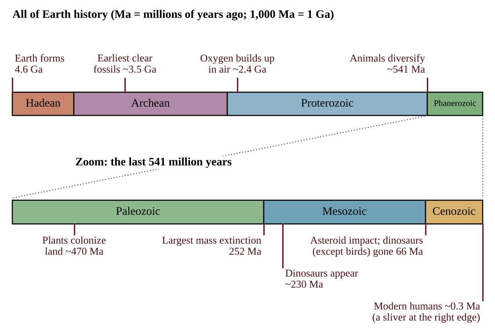
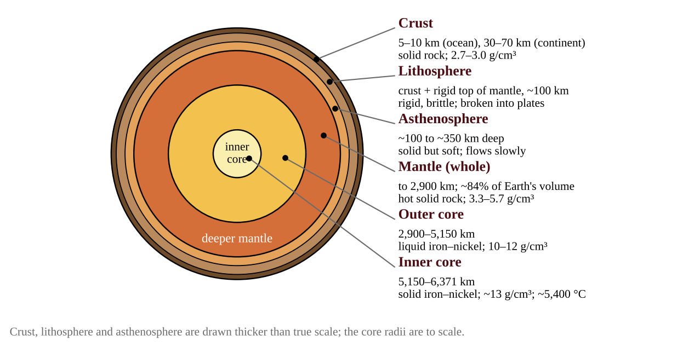
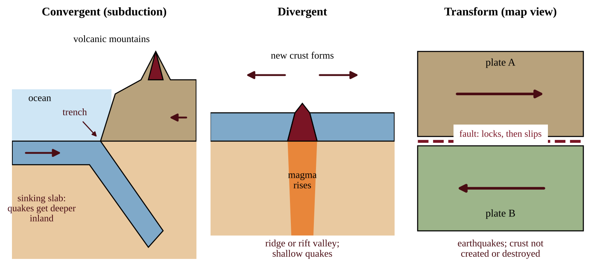
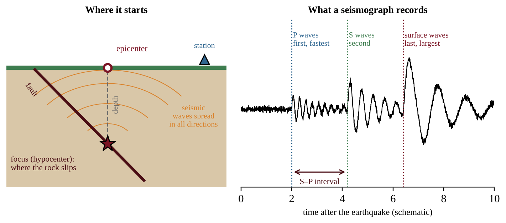
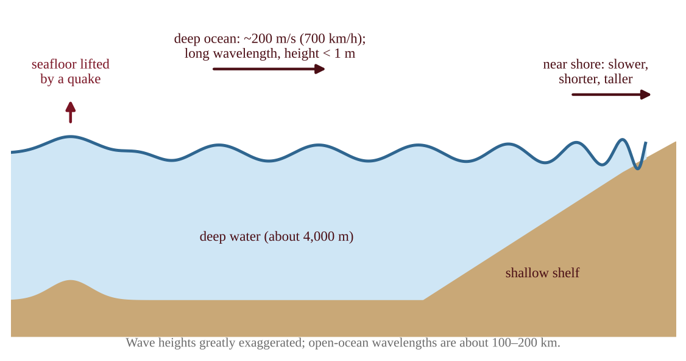
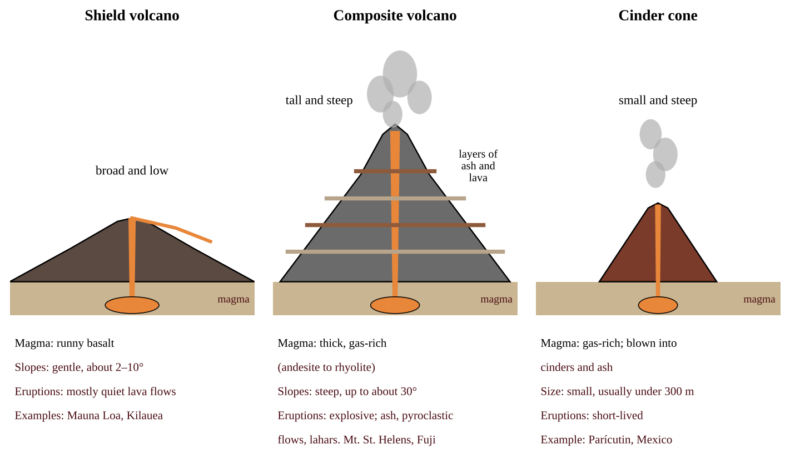
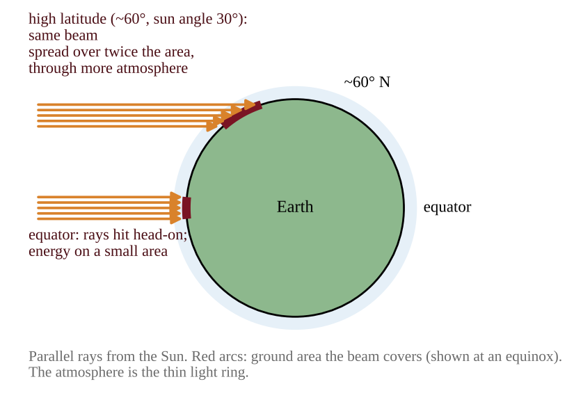
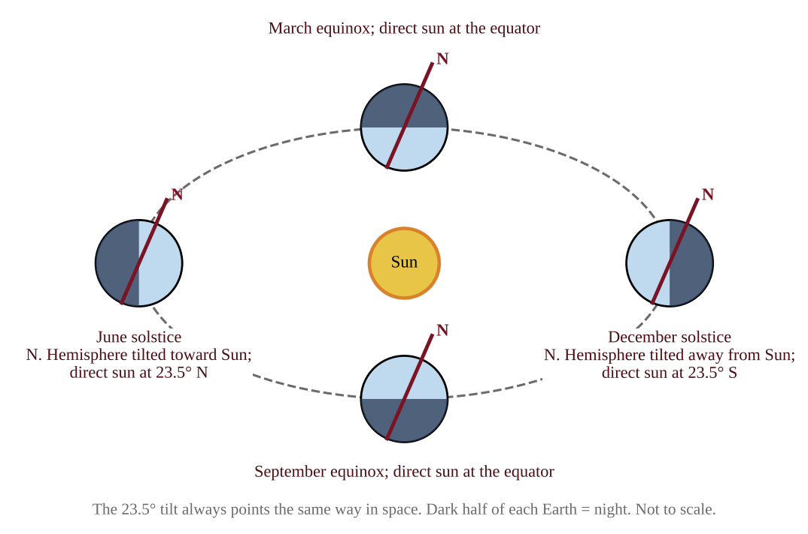
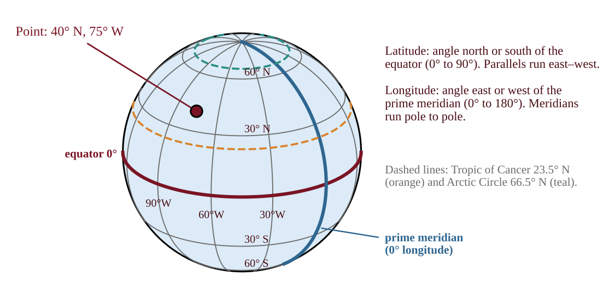
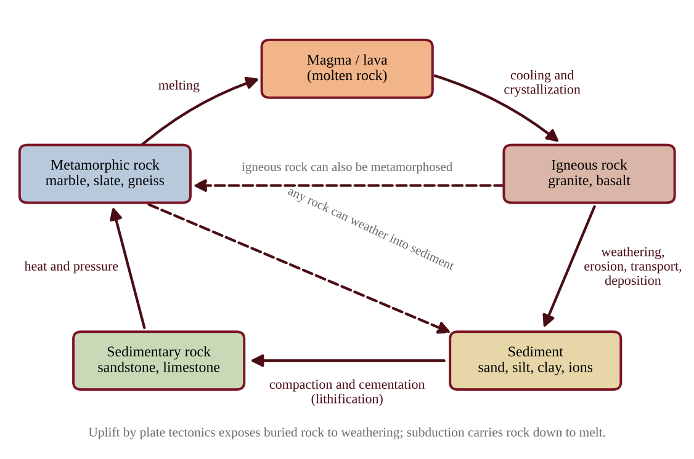

# Chapter 1 — The Earth

:::box objectives
- Place major events on the geologic time scale and use half-lives to date rocks and fossils.
- Describe Earth's layers and explain how plate motion produces boundaries, earthquakes, tsunamis and volcanoes.
- Explain how latitude, the sun's angle and Earth's tilt control sunlight and the seasons, and read latitude and longitude.
- Describe how soil forms, its horizons, texture and properties, and how erosion is reduced.
- Trace rock through the rock cycle and name the three rock families.
:::

## 1.1 Geologic Time Scale
%% CED: none (academy extension)

:::box simple
Earth is about 4.6 billion years old. Geologists split that huge span into named blocks, the way a historian splits history into ages. The blocks start and end at big changes in the planet or in life. Squeeze Earth's history into one day and modern humans appear in the last few seconds.
:::

### Deep time and how it is divided

The **geologic time scale** is the calendar of Earth history. Its units, from longest to shortest, are **eons, eras, periods** and **epochs**. There are four eons: the Hadean, Archean and Proterozoic (together called the Precambrian, nearly 90% of all time) and the Phanerozoic ("visible life"). Boundaries are placed where the rock and fossil record changes sharply, and several mark **mass extinctions**, when a large share of species disappears. Five major ones are recorded, at about 445, 370, 252, 201 and 66 million years ago (Ma).

{w=0.8}

| Era (began) | Periods | Defining features |
|---|---|---|
| Paleozoic (541 Ma) | Cambrian, Ordovician, Silurian, Devonian, Carboniferous, Permian | Animals diversify in the sea; fish, land plants, forests, amphibians, reptiles. Ends with the Permian extinction (about 90% of marine species lost). |
| Mesozoic (252 Ma) | Triassic, Jurassic, Cretaceous | Dinosaurs, first mammals and birds, flowering plants. Pangaea breaks up. Ends with an asteroid impact. |
| Cenozoic (66 Ma) | Paleogene, Neogene, Quaternary | Mammals diversify. Ice ages in the Quaternary. The Holocene epoch began about 11,700 years ago. |

Other landmarks: life began in the oceans by about 3.5 billion years ago (Ga); photosynthetic bacteria raised oxygen in the air about 2.4 Ga; coal-forming swamp forests thrived in the Carboniferous period.

### Dating rocks and fossils

**Relative dating** puts events in order. In undisturbed layers (**strata**), older rock lies below younger rock (the law of superposition), and a fault or intrusion is younger than the rock it cuts. **Index fossils**, species that lived briefly and widely, match layers in different places.

**Absolute (radiometric) dating** gives ages in years. Unstable **parent isotopes** decay into stable **daughter isotopes** at a fixed rate, measured by the **half-life**, the time for half of a sample to decay. Measure how much parent remains and you can calculate how long decay has run. The clock starts when a mineral crystallizes, so igneous rock is dated directly; sedimentary layers are dated by the igneous layers above and below them.

| Isotope | Half-life | Best use |
|---|---|---|
| Carbon-14 | 5,730 years | Wood, bone, charcoal up to about 50,000 years old |
| Potassium-40 → argon-40 | 1.25 billion years | Volcanic rock, millions to billions of years |
| Uranium-238 → lead-206 | 4.47 billion years | The oldest rocks and minerals |

:::box formula
**Fraction remaining = (½)ⁿ**, where n = number of half-lives = elapsed time ÷ half-life
**Age = n × half-life**
Counting: 100% → 50% → 25% → 12.5% → 6.25% after 1, 2, 3, 4 half-lives. For fractions that are not simple, use n = ln(1 ÷ fraction) ÷ ln 2 (calculator).
:::

:::box apply
Coal, oil and natural gas formed from organisms buried over tens to hundreds of millions of years. Humans burn them in a few centuries. Comparing these two time scales explains why fossil fuels are non-renewable and why a rapid change in atmospheric CO₂ is a sharp break from the slow geologic record.
:::

:::box define
**Eon, era, period, epoch** — the four levels of the time scale, longest to shortest.
**Mass extinction** — a short interval in which a large fraction of Earth's species disappears.
**Half-life** — the time for half of the atoms of a radioactive isotope to decay.
**Radiometric dating** — finding an age from the ratio of parent to daughter isotopes.
:::

:::box mistake
- Thinking a sample is "all decayed" after two half-lives. Then 25% remains.
- Using carbon-14 on very old rock. After about 50,000 years too little is left to measure.
- Saying radiometric dating dates sediment grains. It dates when a mineral crystallized.
:::

:::box strategy
Show the half-life count in a table (100%, 50%, 25% …) before calculating. State units, and keep millions (Ma) and billions (Ga) of years separate.
:::

:::box example
id: SG-C1-E001
A charcoal sample from an ancient hearth contains 12.5% of the carbon-14 found in living wood. The half-life of carbon-14 is 5,730 years. (a) Calculate how many half-lives have passed. (b) Calculate the age of the charcoal. (c) A volcanic rock contains 25% of its original potassium-40 (half-life 1.25 billion years); assume no loss of the daughter product matters. Calculate the rock's age in billion years. (d) Explain why carbon-14 cannot be used to date a 100-million-year-old fossil.
:::

:::box example
id: SG-C1-E002
Compress the 4.6 billion years of Earth history into one 24-hour day, with Earth forming at 00:00. (a) Calculate the clock time (hours and minutes) at which the Phanerozoic eon began, 541 million years ago. (b) Calculate how many seconds before midnight modern humans appeared, 0.3 million years ago. (c) State what this comparison suggests about human history relative to geologic time.
:::

:::box summary
- Earth is about 4.6 Ga old; time is divided into eons, eras, periods and epochs.
- Boundaries often mark mass extinctions; humans appear in the last sliver of time.
- Radiometric dating uses half-lives: fraction remaining = (½)ⁿ.
:::

## 1.2 Earth's Structure
%% CED: none (academy extension)

:::box simple
Earth is like a peach with a thin skin, a thick soft flesh and a dense stone. The thin rocky skin is the crust, the flesh is the mantle, and the stone is a core of iron and nickel. Going down, everything gets hotter, denser and more squeezed.
:::

### Layers by composition

Early in its history Earth was hot enough to be partly molten, so dense iron and nickel sank to the center and light rock rose, a sorting called **differentiation**. The result is three compositional layers.

- **Crust**: the thin outer shell of solid rock. **Oceanic crust** is thin (5–10 km), made of dense basalt (about 3.0 g/cm³) and young (under about 200 million years). **Continental crust** is thick (30–70 km), mostly lighter granite-type rock (about 2.7 g/cm³) and much older, in places over 4 billion years.
- **Mantle**: about 84% of Earth's volume, hot solid rock rich in iron and magnesium that extends to 2,900 km. It is solid but flows very slowly over millions of years, like thick putty. Density rises with depth from about 3.3 to 5.7 g/cm³.
- **Core**: iron and nickel, the densest layer (10–13 g/cm³). The **outer core** is liquid; the **inner core** is solid because the pressure is so great, although it is hotter than 5,000 °C. Motion in the liquid outer core creates Earth's magnetic field.

### Layers by strength

Geologists also divide the outer Earth by how it behaves. The **lithosphere** (crust plus the rigid top of the mantle, about 100 km thick on average) is cool, stiff and brittle, and it is broken into **tectonic plates**. Below it, the **asthenosphere** is hot enough to be soft and flow slowly, so plates can slide over it. Heavy continents ride higher than ocean basins, like floats of different weights, a balance called **isostasy**.

{w=0.85}

### How we know

No one has drilled beyond about 12 km. The layers are mapped by **seismic waves** from earthquakes. Waves speed up or bend where the material changes. S waves cannot travel through liquid, and they vanish behind the outer core, which shows that it is liquid. Meteorites, rocks brought up by volcanoes, and Earth's magnetic field give more evidence.

:::box define
**Crust** — thin, solid outer layer (oceanic or continental).
**Mantle** — thick layer of hot, slowly flowing solid rock.
**Core** — iron–nickel center: liquid outer core, solid inner core.
**Lithosphere** — rigid outer shell (crust + top of mantle) broken into plates.
**Asthenosphere** — soft, flowing part of the upper mantle beneath the plates.
:::

:::box mistake
- Saying the mantle is liquid. It is solid rock that flows very slowly; only the outer core is liquid.
- Mixing up crust and lithosphere. The lithosphere includes the crust plus the rigid uppermost mantle.
:::

:::box strategy
Memorize the order and the one-word state of each layer: crust (solid), mantle (solid, flowing), outer core (liquid), inner core (solid). Density increases toward the center.
:::

:::box example
id: SG-C1-E003
Earth's radius is 6,371 km. The outer core extends from a depth of 2,900 km to a depth of 5,150 km. (a) Calculate the thickness of the outer core. (b) Calculate the radius of the inner core. (c) A P wave crosses the mantle from the surface to the core–mantle boundary, a path of 2,900 km, at an average speed of 10 km/s. Calculate the travel time in seconds and in minutes. (d) Identify which core layer is liquid and state the evidence from S waves.
:::

:::box summary
- Dense iron sank and light rock rose: crust, mantle, core.
- The rigid lithosphere (in plates) floats on the soft asthenosphere.
- Seismic waves reveal the layers; S waves stop at the liquid outer core.
:::

## 1.3 Plate Tectonics
%% CED: 4.1 | ERT-4.A.1, ERT-4.A.2, ERT-4.A.3, ERT-4.A.4, ERT-4.A.5 | LO: ERT-4.A

:::box simple
Earth's rigid outer shell is cracked into giant slabs called plates. They ride very slowly (about as fast as fingernails grow) on hot, soft rock beneath. Where slabs push together, pull apart or slide past each other, the crust crumples, splits or snaps. Mountains, volcanoes and earthquakes are mostly found along those cracks.
:::

### The engine: moving plates

The lithosphere is broken into about a dozen large plates and many small ones. Heat flowing out of the deep Earth drives slow convection in the mantle, and the pull of cold, dense plate edges sinking back into the mantle moves plates a few centimeters per year. **Plate motion is powered by Earth's internal heat, not by the Sun.** Plate boundaries are where almost all geologic activity concentrates, so a map of boundaries is also a map of risk.

Evidence for moving plates: coastlines that fit together, matching rocks and fossils on separate continents, the same ages and magnetic stripes mirrored on both sides of a mid-ocean ridge (the seafloor gets older with distance from the ridge), and GPS measurements of plates moving today.

### Three boundary types

At a **convergent boundary** two plates move toward each other. What happens depends on the crust involved.

- *Oceanic meets continental.* The denser oceanic plate sinks beneath the continental plate in a **subduction zone**, forming a deep ocean **trench**. Water released from the sinking slab helps rock above it melt, and the magma rises to build volcanoes and mountains on the continent (the Andes, the Cascades). Powerful earthquakes occur along the slab.
- *Oceanic meets oceanic.* One sinks, forming a trench and a curved chain of volcanic islands, an **island arc** (Japan, the Aleutians).
- *Continental meets continental.* Neither sinks easily, so the crust buckles upward into very high mountains (the Himalayas). Earthquakes are common; volcanoes are rare.

At a **divergent boundary** plates move apart. Magma rises into the gap and hardens, creating new crust. Under the ocean this is a mid-ocean ridge with **seafloor spreading**; on land it creates a **rift valley** (the East African Rift). Volcanoes and shallow earthquakes accompany it.

At a **transform boundary** plates slide horizontally past each other. Crust is neither created nor destroyed, but friction makes the plates stick, and the result is earthquakes (the San Andreas Fault).

### Hot spots and reading global maps

A **hot spot** is a place where a plume of hot rock rises from deep in the mantle, far from any plate edge. The plate drifts over the plume, so volcanoes form in a line: the active volcano sits over the plume and older, extinct ones lie farther along the direction of plate motion (the Hawaiian Islands).

When a question gives a map of plate boundaries, apply a routine. Volcanoes and earthquakes tracing a long narrow line mark a boundary. A line of volcanoes just inland from a trench points to oceanic–continental subduction; a curved island chain beside a trench points to an island arc. Earthquakes without volcanoes along a straight line point to a transform fault or a continental collision. A volcano far from any boundary suggests a hot spot. The "Ring of Fire" around the Pacific holds most of the world's earthquakes and active volcanoes because so many subduction zones lie there.

A sinking slab dips into the mantle at an angle. Near a trench earthquakes are shallow, and farther **inland** they occur at **greater and greater depth**, tracing the slab downward. A graph of earthquake depth against distance from the trench that slopes steadily down to the right is the signature of subduction. A transform fault produces only shallow earthquakes. Rifts and hot spots heat groundwater, giving hot springs and geothermal energy. Section 1.4 explains how stress on a locked fault releases an earthquake.

:::box formula
**Plate speed = distance between two volcanoes ÷ difference in their ages**
Age of a farther volcano = its distance from the active volcano ÷ plate speed. The active volcano has age 0.
Shortcut: 1 km per million years = 0.1 cm per year. Check: 100 km in 2 million years is 50 km per million years, which is 5 cm per year.
:::

:::box example
id: SG-U4-E011
Three extinct volcanic islands lie along a chain that ends at an active hot-spot volcano. Island P is 140 km from the active volcano and 2.0 million years old; Island Q is 350 km away and 5.0 million years old; Island R is 630 km away and 9.0 million years old. (a) Calculate the plate's speed from the data for Island R, in km per million years and in cm per year. (b) Check it with Island P. (c) Predict the age of an island 1,050 km from the active volcano. (d) State which direction the plate is moving relative to the hot spot and explain why the volcanoes are not found at a plate boundary.
:::

:::box apply
Cities on subduction coasts, such as Seattle or Santiago, face earthquakes, tsunamis and volcanic ash from one process. Planners respond with building codes, tsunami sirens, evacuation routes and zoning that keeps hospitals and schools off soft, water-saturated ground. Reading the plate map tells you which hazards to plan for.
:::

:::box mistake
- Saying plates "float on liquid magma." The asthenosphere is solid but flows slowly; most of the mantle is not liquid.
- Saying transform boundaries make volcanoes or new crust. They make earthquakes only.
- Saying all convergent boundaries make volcanoes. Continent–continent collisions build mountains with few or no volcanoes.
:::

:::box strategy
For a boundary question, name three things: the **motion** (toward, apart, sideways), the **landform** (trench, ridge, mountains) and the **hazard** (earthquake, volcano). Use the CED words: island arcs, seafloor spreading, rift valleys, hot spots, faults.
:::

:::box example
id: SG-U4-E001
A geologist studies three sites. Site 1 is a line of active volcanoes 150 km inland, parallel to a deep ocean trench offshore. Site 2 is a long underwater mountain chain where new basalt is found and the seafloor gets older with distance on both sides. Site 3 is a straight valley where a road has been offset 4 m sideways by an earthquake, with no volcanoes nearby. (a) Identify the type of plate boundary at each site. (b) For Site 2, describe what happens to the plates and name the process that adds new crust. (c) State which site is most likely to produce a tsunami, and justify your choice in one sentence.
:::

:::box summary
- Plates move on the asthenosphere, driven by Earth's internal heat; boundaries concentrate quakes and volcanoes.
- Convergent: subduction, trenches, volcanic mountains, island arcs, or collision mountains. Divergent: ridges, seafloor spreading, rift valleys. Transform: earthquakes.
- Hot spots lie inside plates and leave chains of volcanoes.
:::

## 1.4 Earthquakes
%% CED: 4.1 | ERT-4.A.3, ERT-4.A.5 | LO: ERT-4.A

:::box simple
Imagine bending a ruler until it snaps. It stores energy as it bends, then releases it all at once. Rock does the same. Plates keep moving, the rock along a fault stays stuck, strain builds, and finally the rock slips and sends out shaking.
:::

### How an earthquake happens

:::box process
Plate motion → plates lock along a fault and stress (strain energy) builds → stress exceeds the friction holding the fault → sudden slip → stored energy released as seismic waves → shaking at the surface.
:::

An earthquake occurs when stress overcomes a locked fault, releasing stored energy. The point underground where slip begins is the **focus** (hypocenter). The point on the surface directly above it is the **epicenter**. Smaller **aftershocks** follow as the surrounding rock adjusts. Most earthquakes happen at plate boundaries because that is where plates grind against one another: along transform faults, at subduction zones (where quakes occur from the surface down to about 700 km) and at ridges and rifts (shallow). A few occur inside plates on old faults. Shallow quakes (under 70 km) cause the most damage.

### Seismic waves

{w=0.9}

| Wave | Motion | Speed (crust) | Passes through |
|---|---|---|---|
| **P** (primary) | Push–pull (compression) | about 6 km/s, fastest | Solids and liquids |
| **S** (secondary) | Side-to-side shear | about 3.5 km/s | Solids only |
| **Surface** | Rolling and shaking along the ground | slowest | Ground surface; strongest damage |

A **seismograph** records the waves. P waves arrive first, S waves next, and surface waves last. The longer the gap between P and S arrivals, the farther the station is from the earthquake. Distances from three or more stations place the epicenter where three circles intersect (triangulation).

### Measuring earthquakes: magnitude and intensity

**Magnitude** measures the energy released at the source, with one number per earthquake. Today the **moment magnitude** scale is used (the older Richter scale is similar). The scale is logarithmic: each whole-number step is a tenfold larger wave amplitude and about 32 times more energy. **Intensity** describes the shaking and damage felt at one place, using the **Modified Mercalli** scale (I to XII). One earthquake has one magnitude but many intensities, which fall with distance and rise on soft ground.

:::box formula
**Amplitude ratio = 10^(ΔM)** and **energy ratio ≈ 32^(ΔM)**, where ΔM is the difference in magnitude.
**Distance to epicenter = (S–P time) × (vP × vS) ÷ (vP − vS)**, using wave speeds in km/s and time in s. For vP = 6.0 and vS = 3.5 km/s the factor is 8.4 km per second of S–P time.
:::

### Hazards and reducing risk

Hazards: ground shaking; surface rupture; **liquefaction** (water-saturated sand and fill act like a liquid and buildings sink or tilt); landslides; fires from broken gas and power lines; tsunamis (section 1.5); and collapse of dams and bridges. Damage depends on magnitude, depth, distance, ground type and construction quality. Soft sediment amplifies shaking; solid bedrock shakes less. Unreinforced masonry buildings fail most often.

:::box apply
Earthquake risk is cut by building codes with flexible, reinforced frames, retrofitting old buildings, keeping critical facilities off soft or filled ground, and drills ("drop, cover, hold on"). Early-warning systems detect fast P waves and send alerts seconds before the slower, damaging S and surface waves arrive. Earthquakes cannot yet be predicted, only forecast as probabilities.
:::

:::box mistake
- Using "Richter" and "intensity" as if they were the same. Magnitude is the energy; intensity is the local effect.
- Thinking a magnitude 7 is "a bit more" than a 6. It is 10 times the amplitude and about 32 times the energy.
- Placing the epicenter underground. The focus is underground; the epicenter is on the surface.
:::

:::box strategy
Link the cause chain (locked fault → stress → slip → waves) and always say which boundary type a given earthquake belongs to. For logarithmic scales, write the factor as a power: 8.1 − 6.1 = 2, so amplitude × 10².
:::

:::box example
id: SG-C1-E004
A seismograph station records the first P wave at 08:14:10 and the first S wave at 08:14:35. Assume P waves travel at 6.0 km/s and S waves at 3.5 km/s. (a) Calculate the S–P interval in seconds. (b) Calculate the distance from the station to the earthquake. (c) Calculate how many seconds after the earthquake began the P wave arrived. (d) Explain why data from at least three stations are needed to locate the epicenter.
:::

:::box example
id: SG-C1-E005
Earthquake A has a moment magnitude of 6.1 and earthquake B has a magnitude of 8.1. (a) Calculate how many times larger the ground-motion amplitude of B is than that of A. (b) Using a factor of 32 per magnitude unit, calculate how many times more energy B releases. (c) State which measure, magnitude or Modified Mercalli intensity, can differ between two towns affected by the same earthquake, and explain why.
:::

:::box summary
- Stress builds on a locked fault; when it slips, stored energy is released as P, S and surface waves.
- Magnitude (energy, logarithmic) differs from intensity (local effects).
- Most quakes occur at plate boundaries; hazards include shaking, liquefaction, landslides and tsunamis.
:::

## 1.5 Tsunamis
%% CED: 4.1 | ERT-4.A.5 | LO: ERT-4.A

:::box simple
A tsunami is not a wind wave. It is a push through the whole depth of the ocean. A sudden jolt of the seafloor shoves an enormous volume of water, and the push travels across the sea as a very long, fast, low wave. It looks harmless at sea and becomes huge only when it runs into shallow water.
:::

### How tsunamis form

A **tsunami** is a series of very long ocean waves caused by a sudden displacement of a large volume of water. The most common cause is a large undersea earthquake at a subduction zone, where the seafloor suddenly rises or drops by several meters. Others are underwater landslides, volcanic eruptions or collapses, and asteroid impacts. Earthquakes that move rock sideways (transform faults) seldom make large tsunamis.

{w=0.85}

### Speed, wavelength and run-up

A tsunami's wavelength (distance between crests) is about 100–200 km, far greater than the ocean depth, so it behaves as a **shallow-water wave** whose speed depends only on depth.

:::box formula
**v = √(g × d)**, with g = 9.8 m/s² and d = water depth in m; v is in m/s (multiply by 3.6 for km/h).
**Travel time = distance ÷ speed.** Wavelength = speed × wave period.
In 4,000 m of water v ≈ 198 m/s (about 710 km/h), as fast as a jet airliner.
:::

In the open ocean the wave is under 1 m high, so ships do not notice it. As the water shallows near the coast the wave slows, its wavelength shortens, the energy is squeezed into less water, and the height grows (**shoaling**). The wave can run far inland (**run-up**) and may arrive as a rapidly rising tide or a wall of water. Often it is a series of waves, minutes to an hour apart, and the first may not be the largest. Sometimes the sea first drains away from the shore.

### Impacts, warning and protection

Tsunamis kill by drowning and debris, destroy buildings, ports and power plants (as at Fukushima, Japan, 2011), and wipe out coastal wetlands, reefs and farmland. Salt water and debris contaminate soil and freshwater aquifers, so land can stay unusable for years. The 2004 Indian Ocean tsunami, from a magnitude 9.1 quake, killed over 200,000 people.

Warning systems combine seismometers (to locate a large quake and judge whether it can raise a tsunami), deep-ocean pressure sensors on buoys (the DART network) that detect passing waves, and tide gauges. Travel times are hours across an ocean, so distant coasts get time to evacuate; near a quake there may be only minutes, so the natural warnings (strong shaking, a sudden sea retreat, a loud roar) mean *move now to high ground or far inland*.

:::box apply
Hawaii and Japan have sirens, mapped evacuation routes and drills. Mangrove and coastal forests and reefs reduce wave energy somewhat; zoning keeps critical buildings above the run-up line. After a tsunami, relief agencies test drinking water for salt and contaminants.
:::

:::box mistake
- Calling a tsunami a "tidal wave." It has nothing to do with the tides.
- Thinking a tsunami is tall far out at sea. It is low and long there and grows only in shallow water.
- Thinking the first wave is the only one. Several waves arrive and later ones can be bigger.
:::

:::box strategy
For "explain" questions, give the sequence: seafloor displacement → water displaced → long fast wave → slows and grows in shallow water → inundation. Decide which input (depth, distance) the formula needs and keep units consistent (m and s).
:::

:::box example
id: SG-C1-E006
A tsunami crosses an ocean 4,000 m deep. Use v = √(g × d) with g = 9.8 m/s². (a) Calculate the wave speed in m/s and in km/h. (b) Calculate the time, in hours, to reach a coast 2,500 km away, assuming constant depth. (c) Calculate the speed where the depth is 10 m. (d) Explain why the wave becomes taller as it approaches shore even though it slows down.
:::

:::box summary
- Large undersea quakes at subduction zones (and landslides or eruptions) displace water and cause tsunamis.
- Speed = √(g·d): fast in deep water, slower and taller in shallow water.
- Sensors, sirens and evacuation planning save lives; salt and debris damage land and water.
:::

## 1.6 Volcanoes
%% CED: 4.1 | ERT-4.A.1, ERT-4.A.2, ERT-4.A.4 | LO: ERT-4.A

:::box simple
A volcano is a vent where molten rock, gas and ash escape from inside Earth. Think of a shaken soda bottle. Thin, runny magma lets gas bubble out gently, like a slowly opened bottle. Thick, sticky magma traps the gas until it blasts out, like the soda spraying all over the room.
:::

### Where and why volcanoes form

Rock inside Earth is melted into **magma**; magma that reaches the surface is **lava**. Volcanoes form in three settings.

- **Subduction zones** (convergent boundaries): water from the sinking slab lowers the melting point of the mantle above it. The magma builds continental volcanic arcs and island arcs. This is where most explosive volcanoes are.
- **Divergent boundaries**: pressure drops as plates pull apart and mantle rock melts, producing basalt at ridges and rifts (Iceland).
- **Hot spots**: plumes of hot mantle rock melt under the middle of a plate (Hawaii, Yellowstone).

### Magma and eruption style

What controls an eruption is the **silica (SiO₂) content** of the magma, which sets its **viscosity** (resistance to flow) and how much dissolved gas it holds.

| Magma | Silica | Temperature | Viscosity and gas | Typical eruption |
|---|---|---|---|---|
| Basaltic (mafic) | about 50% | hottest, 1,000–1,200 °C | Low viscosity; gas escapes | Quiet lava flows |
| Andesitic | 57–63% | intermediate | Medium–high | Often explosive |
| Rhyolitic (felsic) | over 68% | coolest, 650–800 °C | Very viscous; traps gas | Very explosive |

A **caldera** is a large basin left when a volcano empties its magma chamber and collapses (Crater Lake, Yellowstone). The explosiveness of an eruption is rated on the **Volcanic Explosivity Index** (VEI, 0–8), which rises about tenfold per step with the volume of material erupted.

### Hazards

- **Lava flows** destroy property but are usually slow enough to outrun.
- **Pyroclastic flows**: glowing clouds of hot gas, ash and rock, up to 700 °C and moving at over 100 km/h. They are the deadliest hazard.
- **Ash fall** collapses roofs, grounds aircraft, harms lungs and buries crops.
- **Lahars**: volcanic mudflows from melted ice or heavy rain on loose ash, which can travel tens of kilometers down valleys.
- **Gases**: sulfur dioxide (SO₂) forms acid rain, and carbon dioxide (CO₂) can pool in low ground and suffocate.
- Eruptions can trigger landslides, tsunamis and floods.

### Volcanoes and climate

A large explosive eruption blasts SO₂ into the stratosphere. There it forms tiny sulfate particles (**aerosols**) that reflect sunlight, cooling the planet for one to three years. Pinatubo (1991) cooled global temperatures by about 0.5 °C; Tambora (1815) was followed by "the year without a summer." Volcanoes also emit CO₂, but the total is far less than the CO₂ from human activities, so they do not explain modern warming.

Volcanoes also help people: weathered ash makes very fertile soil, hot rock supplies geothermal energy, and eruptions build new land and concentrate mineral ores. Scientists monitor volcanoes with seismometers (swarms of small quakes), ground tilt and GPS, gas measurements and thermal images, and agencies close or evacuate danger zones.

:::box define
**Magma / lava** — molten rock below / above ground.
**Viscosity** — a liquid's resistance to flowing; high-silica magma is highly viscous.
**Pyroclastic flow** — fast, hot cloud of gas, ash and rock fragments.
**Lahar** — a volcanic mudflow.
**Aerosol** — tiny particles suspended in the air; sulfate aerosols cool the climate.
:::

:::box mistake
- Saying all eruptions are explosive. Basaltic eruptions are usually gentle.
- Thinking lava is the deadliest hazard. Pyroclastic flows, ash and lahars kill more people.
- Saying volcanoes warm the climate. A big eruption cools Earth for a few years through aerosols.
:::

:::box strategy
Connect composition → viscosity → gas trapping → eruption style. Match each volcano type with its boundary or hot spot and its hazards, and name a monitoring method plus a response.
:::

:::box example
id: SG-C1-E007
A town lies 18 km from a volcano's vent. A second town lies 45 km from the vent down a river valley. A pyroclastic flow moves at an average of 120 km/h and a lahar at an average of 36 km/h. (a) Calculate the time, in minutes, for the pyroclastic flow to reach the first town. (b) Calculate the time, in minutes, for the lahar to reach the second town. (c) State which hazard allows more time to evacuate and give one monitoring method that could provide warning. (d) Explain why rhyolitic magma tends to erupt more explosively than basaltic magma.
:::

:::box summary
- Volcanoes occur at subduction zones, rifts and hot spots.
- High-silica, viscous, gas-rich magma erupts explosively; low-silica basalt flows quietly.
- Hazards: pyroclastic flows, ash, lahars, gases. Sulfate aerosols cool climate for a few years.
:::

## 1.7 Solar Intensity, Seasons, and Latitude–Longitude
%% CED: 4.7 | ENG-2.A.1, ENG-2.A.2, ENG-2.A.3, ENG-2.A.4, ENG-2.A.5 | LO: ENG-2.A

:::box simple
Imagine a flashlight shining straight down on a table, then tilted so the beam hits at a slant. The straight beam makes a small, bright spot; the slanted beam spreads the same light over a bigger, dimmer area. Earth's curved surface does the same with sunlight, which is why the equator is hot and the poles are cold.
:::

### Insolation, angle and latitude

**Insolation** (incoming solar radiation) is Earth's main energy source, and it depends on **season and latitude**. The **angle of the sun's rays** determines intensity. Because Earth is a sphere, the sun's rays strike the surface at a right angle (90°) at only one latitude at a time, the place directly under the sun. There the same energy is spread over the smallest area and passes through the least atmosphere, so intensity is greatest. At higher latitudes the rays arrive at a slant, spread over a larger area and travel a longer path through the atmosphere, where more is absorbed, scattered or reflected. So the highest solar radiation per unit area is received at the equator and it decreases toward the poles.

{w=0.75}

### The tilt makes the seasons

Earth's axis is tilted about **23.5°** from the plane of its orbit and points in the same direction in space all year. As Earth travels around the sun, the Northern Hemisphere leans toward the sun for half the year and away for the other half.

- **June solstice (about June 21):** the Northern Hemisphere is tilted toward the sun. The sun is directly overhead at the Tropic of Cancer (23.5° N). Northern days are longest and sun angles highest: northern summer, southern winter.
- **December solstice (about December 21):** the opposite. The sun is overhead at 23.5° S (Tropic of Capricorn); the Northern Hemisphere has its shortest days and lowest sun.
- **Equinoxes (about March 20 and September 22):** the sun is overhead at the equator; day and night are nearly equal everywhere.

{w=0.85}

The tilt also controls **day length**. At the equator day length stays near 12 hours all year. In the summer hemisphere days grow longer at higher latitudes, and above the Arctic Circle the sun may stay up for 24 hours. A location therefore receives the most radiation on its longest summer day and the least on its shortest winter day: high sun angle and long daylight work together.

:::box formula
**Noon sun angle above the horizon = 90° − |latitude − latitude of the direct sun|**
Latitude of the direct sun is +23.5° (N) on the June solstice, 0° at the equinoxes and −23.5° on the December solstice (north positive, south negative). A larger angle means more intense radiation.
:::

Intensity on flat ground is proportional to the **sine of the noon sun angle**. To compare two dates, find each angle, take its sine (calculator in degree mode) and divide. For 60° and 30°: 0.866 ÷ 0.500 ≈ 1.7, so the 60° sun is about 1.7 times as intense.

On a day-length graph, a city whose day length barely changes is near the equator; a larger swing means a higher latitude; longest days in June mean the Northern Hemisphere, in December the Southern. At the December solstice places south of the Antarctic Circle (66.5° S) have 24 hours of daylight and places north of the Arctic Circle (66.5° N) have none; in June it reverses. With no tilt there would be no seasons.

:::box formula
**Energy absorbed = incoming sunlight × (1 − albedo)**
**Albedo** is the fraction of sunlight a surface reflects (0 to 1). Extra energy absorbed when a bright surface is replaced by a dark one = incoming × (albedo of old surface − albedo of new surface). Units: W/m². Fresh snow has high albedo; open water has low albedo.
:::

### Latitude and longitude

Every place on Earth can be given two angles. **Latitude** is the angle north or south of the equator (0° at the equator, 90° at the poles). Lines of equal latitude are **parallels**; they run east–west. **Longitude** is the angle east or west of the **prime meridian** (0°, through Greenwich, England), from 0° to 180°. Lines of equal longitude are **meridians**; they run from pole to pole.

{w=0.85}

Key latitudes follow from the tilt: the **Tropic of Cancer** (23.5° N) and **Tropic of Capricorn** (23.5° S) mark the farthest points where the sun can be directly overhead; the **Arctic and Antarctic Circles** (66.5° N and S) mark where 24-hour day or night can occur. These give the **tropical** (0–23.5°), **temperate** (23.5–66.5°) and **polar** (66.5–90°) zones.

:::box formula
**1° of latitude ≈ 111 km** everywhere.
**1° of longitude ≈ 111 km × cos(latitude)**: 111 km at the equator, shrinking to 0 at the poles.
**Earth turns 360° in 24 h = 15° per hour.** Places 15° apart in longitude differ by 1 hour of solar time; the place farther east is ahead.
:::

:::box apply
Navigators, maps, GPS and weather reports all use coordinates. A farmer at 20° latitude can grow crops all year because every month has high sun angles, while one at 55° N has a short, intense growing season.
:::

:::box mistake
- Saying the seasons happen because Earth is closer to the sun in summer. Earth is closest in early January, during northern winter. Tilt, not distance, causes the seasons.
- Saying the tilt changes during the year. The tilt stays the same; Earth's position in its orbit changes.
- Writing latitude and longitude in the wrong order or without N/S/E/W. Always give latitude first and include the direction.
:::

:::box strategy
Give **two** linked reasons for seasonal change: (1) sun angle (intensity per unit area) and (2) day length (hours of exposure). Trace both back to the tilt.
:::

:::box example
id: SG-U4-E016
A city is at 52° N. (a) Calculate the noon sun angle on the June and December solstices. (b) Calculate how many times more intense the noon sunlight is in June than in December, using the sine of each angle. (c) A snow-covered field with albedo 0.80 receives 180 W/m² and then melts to bare soil with albedo 0.15. Calculate the increase in energy absorbed per square meter. (d) Explain why a city at 5° N has much smaller seasonal temperature changes than this city.
:::

:::box example
id: SG-U4-E008
A city lies at 40° N. (a) Calculate the noon sun angle at the city on the June solstice and on the December solstice using the formula in this guide. (b) Identify which date gives more intense radiation per unit area at the city, and explain why with reference to area and atmospheric path length. (c) State a second reason, other than sun angle, that the city receives more total energy on the June solstice than on the December solstice. (d) At which latitude is the sun directly overhead on the March equinox?
:::

:::box example
id: SG-C1-E008
Two research stations are both at 52° N. Station 1 is at 100° W and Station 2 is at 70° W. Use 1° of latitude = 111 km and 15° of longitude = 1 hour of solar time. (a) Calculate the difference in solar time between the stations and state which is ahead. (b) Calculate the distance between the stations along the 52° N parallel, using cos 52° = 0.616. (c) Calculate the distance from Station 1 north to the Arctic Circle (66.5° N) along its meridian. (d) Explain why 1° of longitude is a shorter distance at 52° N than at the equator.
:::

:::box summary
- Insolation depends on latitude and season; intensity depends on the angle of the sun's rays and is greatest at the equator.
- Earth's 23.5° tilt, not distance from the sun, causes the seasons and varying daylight hours.
- Latitude (north–south) and longitude (east–west) locate any place; 1° latitude ≈ 111 km.
:::

## 1.8 Soil
%% CED: 4.2, 4.3 | ERT-4.B.1, ERT-4.B.2, ERT-4.B.3, ERT-4.C.1, ERT-4.C.2, ERT-4.C.3, ERT-4.C.4 | LO: ERT-4.B, ERT-4.C

:::box simple
Soil is crushed rock mixed with dead plant and animal matter, air, water and living things. It takes hundreds to thousands of years to make a centimeter, but one heavy storm can wash it away. Soil also acts like a coffee filter for water passing through. Coarse grains (sand) let water drain like gravel in a bucket; very fine grains (clay) hold water like a sponge that is hard to wring out; a balanced mix, loam, gives the best of both.
:::

### How soil forms

Soil begins as **parent material**: bedrock or loose sediment. Weathering breaks it down.

- **Physical weathering** breaks rock without changing its chemistry: freeze–thaw cycles, roots wedging cracks open, temperature swings, abrasion.
- **Chemical weathering** changes minerals: weak acids in rainwater and from roots, oxidation (rusting) and hydrolysis.
- **Biological activity** (lichens, roots, burrowing animals, microbes) contributes to both and adds organic matter.

Weathered material may stay put (residual soil) or be **transported** by water, wind, ice or gravity and **deposited** elsewhere (river floodplains, windblown loess, glacial till). Soil character depends on parent material, climate, organisms, slope and time. **Climate** sets the pace: warmth and moderate to heavy rain speed weathering and decomposition; cold or very dry conditions slow them. On brand-new ground, such as cooled lava or bare rock, **primary succession** starts the process: lichens and mosses release acids that break the rock down, and their remains add organic matter. **Humus**, the dark, stable end product of decomposition, gives fertile soil its color, crumbly structure and ability to hold nutrients.

### Soil horizons

Soils develop layers called **horizons** that differ in composition and organic content. A vertical cut through all of them is a **soil profile**.

{w=0.75}

Water moving down carries dissolved minerals and fine clay out of the upper layers (**leaching**) and drops them in the **B horizon**. The **A horizon** is the most biologically active and is what we mean by topsoil. The O-horizon litter shields soil from raindrop impact, holds moisture and recycles nutrients, so losing it (to clearing, fire or invasive earthworms) dries, erodes and depletes the soil. The A horizon has **biotic** parts (roots, earthworms, fungi, bacteria) and **abiotic** parts (sand, silt, clay, minerals, water, air). Not every soil has every horizon; young and dry-climate soils may lack a distinct E horizon.

:::box define
**Parent material** — the rock or sediment from which a soil develops.
**Weathering** — physical and chemical breakdown of rock into smaller pieces and dissolved minerals.
**Humus** — dark, partly stable organic matter that improves fertility and water retention.
**Horizon** — a layer of soil that differs from those above and below it in composition and organic content.
**Leaching** — downward removal of dissolved or fine material by percolating water.
:::

### Erosion and soil protection

**Erosion** moves soil particles from one place to another. Wind lifts loose, dry, bare soil (the dust storms of the 1930s Great Plains). Water erodes in stages: splash from raindrops, **sheet** erosion in thin layers, **rills** (small channels) and **gullies** (deep channels). Erosion is worst on bare, steep, loose soil, and the topsoil is lost first, taking nutrients and organic matter with it.

Eroded soil is not just a farm problem. Sediment, with attached fertilizer, pesticides and bacteria, ends up in streams, clouding water, smothering fish eggs and fueling algal blooms. Intact soil, in contrast, filters and cleans water: particles trap sediment, humus and clay hold many pollutants and nutrient ions, and soil microbes break down some contaminants. **Protecting soils therefore protects water quality.** Soluble nutrients such as nitrate are not held tightly, so fertilizer beyond what crops take up leaches to groundwater. Soils on limestone neutralize acid rain; soils on granite have little buffering.

Conservation methods keep living cover (cover crops, perennial vegetation), use no-till or reduced tillage, plow along contours, terrace steep slopes, strip-crop, plant windbreaks and leave vegetated buffer strips along streams. Each works by slowing wind or water, binding soil with roots, or keeping the surface covered.

:::box formula
**Net soil change = formation rate − erosion rate** (same units, such as t/ha/yr)
**Total net change = net rate × area (ha) × time (yr)**
**Depth of soil lost = mass lost ÷ (bulk density × area)**
Bulk density is soil mass per volume (t/m³); 1 ha = 10⁴ m²; multiply meters by 1,000 for mm. Loss is sustainable only if depth lost per year does not exceed depth formed per year. On an erosion graph, compare curves at the same x-value: the higher line has lost more soil.
:::

:::box example
id: SG-U4-E012
A 25-ha field loses soil at 12 t/ha/yr while new soil forms at 1.0 t/ha/yr. The soil's bulk density is 1.25 t/m³. (a) Calculate the net loss per hectare per year. (b) Calculate the total net loss from the whole field over 30 years. (c) Calculate the depth of soil lost per year, in mm, from the erosion rate. (d) New soil forms at about 0.08 mm per year. Justify whether the erosion is sustainable, and propose one practice to bring it closer to the formation rate.
:::

:::box apply
A farm field slopes toward a creek. Plowing up and down the slope creates channels that speed runoff, and the creek turns brown after storms. Switching to contour rows and planting a grass buffer strip slows water, traps sediment, and the creek runs clearer. The farmer loses less topsoil and the stream gains cleaner water.
:::

:::box example
id: SG-U4-E002
A soil pit shows these layers from the top down. P (0–3 cm): loose, dark, partly decayed leaves. Q (3–15 cm): dark brown, crumbly, many roots, rich in humus. R (15–28 cm): pale gray, sandy, few nutrients. S (28–60 cm): reddish brown, sticky, clay-rich. T (60–110 cm): angular broken rock pieces with a little clay. U (below 110 cm): solid, unbroken rock. (a) Match each layer to its horizon letter (O, A, E, B, C or R). (b) Explain why layer R is pale and nutrient-poor while layer S is clay-rich. (c) Identify the layer that a farmer loses first when heavy rain erodes a bare field, and describe one practice that would reduce this loss.
:::

### Sand, silt and clay

Mineral particles are sorted by diameter. **Sand** is the largest (0.05–2.0 mm) and feels gritty. **Silt** (0.002–0.05 mm) feels smooth, like flour. **Clay** (smaller than 0.002 mm) is sticky when wet and can be rolled into a ribbon. **Texture** is the proportion of the three. Soil also holds organic matter, air, water and a living community of bacteria, fungi, earthworms and insects.

### Porosity, permeability and water-holding capacity

**Porosity** is the percentage of a soil's volume that is empty space. **Permeability** is how quickly water moves through. They differ: clay can have high total porosity, but its pores are tiny, so water moves very slowly. **Water-holding capacity** is the total amount of water a soil can hold against gravity, and it varies with soil type. Water retention contributes to land productivity and fertility, because soils that hold water and nutrients support more plant growth.

| Property | Sandy soil | Silty soil | Clay soil |
|---|---|---|---|
| Pore size | Large | Medium | Very small |
| Permeability | High | Medium | Low |
| Water-holding capacity | Low | Medium–high | High |
| Nutrient retention | Poor (leaches) | Moderate | Good |
| Problems | Droughty, nutrient loss | Easily eroded | Waterlogging, hard to till |

The particle size and composition of each horizon affect porosity, permeability and fertility. A sandy A horizon over a clay-rich B horizon drains quickly at the top but may perch water above the clay, and an organic-rich A horizon holds more water and nutrients than a pale, humus-poor one. **Fertility** depends on nutrients (nitrogen, phosphorus, potassium), pH, organic matter and the soil community.

### The soil texture triangle

A **soil texture triangle** plots the percentages of clay, silt and sand, which add to 100%, and shows which named soil the mixture is. Each side carries one component's scale. To plot a soil: (1) find the clay percentage on the left scale and follow its horizontal line; (2) find the sand percentage on the bottom scale and follow its line up and to the left; (3) the lines cross at the soil's point, and the colored region it falls in is the class. The silt line through the same point is a check. Two components are enough because the third is 100% minus the other two. **Loam**, a blend of clay, silt and sand, supports a wide variety of crops because it drains yet still holds water and nutrients; it is a specific range, not equal thirds.

{w=0.85}

| Group | Classes | Water intake and drainage | Water and nutrient holding |
|---|---|---|---|
| Sandy | sand, loamy sand, sandy loam | Fast | Low to moderate |
| Loamy | loam, silt loam, silt | Moderate | Moderate to high |
| Clay-loamy | clay loam, sandy clay loam, silty clay loam | Moderately slow | High |
| Clayey | sandy clay, silty clay, clay | Very slow | Highest (held tightly) |

Sandy loam suits crops that need good drainage (citrus); adding sand or compost helps a waterlogged soil; a **landfill liner** needs clay-rich soil, whose tiny pores block leachate. For worked examples in this guide we also use a simplified key.

| Texture class (simplified key) | Rule (percent by mass) |
|---|---|
| Sand | sand ≥ 85 |
| Clay | clay ≥ 40 |
| Silt | silt ≥ 80 |
| Loam | sand 23–52, silt 28–50, clay 7–27 |

Any mixture that fits none of these rows is an "intermediate texture" in this guide.

### Testing soil

Different tests answer different management questions.

- **Physical:** texture by the **jar (sedimentation) test**: shake soil in water and let it settle; sand drops in about a minute, silt over hours, clay stays suspended for a day or more. Each reading is a **cumulative** depth, so a layer's thickness is the difference between successive readings: **percent of a component = layer thickness ÷ total sediment depth × 100.** Sieving separates particles by size. A **percolation test** times how fast measured water drains through a sample. Water-holding capacity is the volume held after draining.
- **Chemical:** pH with a meter or strips; nutrient kits or lab analysis for N, P and K; salinity (electrical conductivity).
- **Biological:** organic matter, earthworm counts, and soil respiration (CO₂ release), indicators of microbial activity.

Results guide decisions: sandy soil may need more frequent, lighter irrigation; a low-phosphorus result calls for targeted fertilizer rather than blanket spreading; a low pH may call for lime; a waterlogged clay may need drainage or raised beds.

**Infiltration rate** is how fast water enters the surface: depth of water ÷ time (mm/h). If rain falls faster than the soil takes it in, the excess runs off.

:::box formula
**Percent by mass of a component** = (mass of component ÷ total mass of sample) × 100 (the three texture percentages sum to 100%)
**Water retained (mL)** = water poured in − water drained out
**Percent retained** = (water retained ÷ water poured in) × 100
**Infiltration rate** = depth of water ÷ time; **runoff rate = rainfall rate − infiltration rate** (zero if rain is slower than infiltration)
:::

:::box example
id: SG-U4-E014
A ring is filled with 30 mm of water on Field A and on Field B. The water soaks in completely in 45 minutes on A and in 6 hours on B. (a) Calculate the infiltration rate of each field in mm/h. (b) A storm drops 12 mm of rain per hour for 3 hours. Calculate the runoff depth from each field during the storm, assuming the rates stay constant. (c) Identify which field is more likely to be compacted clay and state one effect on a nearby stream.
:::

### Designing a soil investigation

State a testable question, then identify the **independent variable** (what you change, for example soil type), the **dependent variable** (what you measure, for example drained volume after 10 minutes), the **controlled variables** (same soil volume, water volume, temperature, container and time) and the **replicates** (repeat each soil at least three times and average). Write the hypothesis in if–then form ("If compost is added, then water retained will increase") and describe what the data would show if it were right.

:::box apply
A community garden has sandy soil that dries out within a day of watering. Adding compost raises organic matter, which increases water-holding capacity and nutrient retention. A percolation test before and after confirms the change.
:::

:::box mistake
- Confusing weathering with erosion. Weathering breaks rock down in place; erosion moves material away.
- Calling the whole soil "topsoil." Topsoil is the A horizon (with the O above it when present).
- Thinking soil renews quickly. On human time scales it is effectively non-renewable.
- Mixing up porosity and permeability. Clay has many tiny pores (can be highly porous) yet low permeability.
- Reading the triangle with only one percentage, and assuming loam means equal parts.
:::

:::box strategy
For a soil-protection method, give **how it works** (slows water, binds soil, covers surface) and **what it protects** (topsoil, nutrients, water quality). In an investigation question, name the independent, dependent and controlled variables separately and say why replicates matter. In a data question, quote numbers to justify which soil holds the most water or drains fastest.
:::

:::box example
id: SG-U4-E003
A technician oven-dries and sieves a 50.0 g soil sample and obtains 21.0 g of sand, 18.0 g of silt and 11.0 g of clay. (a) Calculate the percent by mass of sand, silt and clay. (b) Using the simplified key in this guide, name the texture class. (c) State which of the three components is most responsible for holding water against gravity, and explain why in terms of pore size.
:::

:::box example
id: SG-U4-E004
A student tests three soils (X, Y, Z). For each, she places 400 g of dry soil in an identical funnel lined with filter paper, pours in 200 mL of water at once, and records the volume that has drained into a cylinder after 10 minutes. Results: soil X, 170 mL; soil Y, 110 mL; soil Z, 40 mL. (a) Calculate the percent of the poured water retained by each soil. (b) Identify the independent variable, the dependent variable and two controlled variables. (c) One soil is a sand, one a loam and one a clay. Assign each, and justify using the drained volumes. (d) Propose one improvement that would make her conclusion more reliable.
:::

:::box summary
- Soil forms as parent material is weathered, transported and deposited; humus adds fertility; horizons (O, A, E, B, C, R) differ in composition and organic content.
- Wind and water erode soil; conservation keeps cover and slows flow. Healthy soil filters water, so protecting soil protects water quality.
- Texture is the sand–silt–clay proportion (read from the triangle); coarse soil is permeable and holds little water, fine soil holds water but drains slowly; loam is the balanced blend.
- Physical, chemical and biological tests guide irrigation and fertilizer decisions.
:::

## 1.9 The Rock Cycle
%% CED: none (academy extension)

:::box simple
Rocks are slowly recycled. A mountain wears down into sand, sand is buried and cemented into stone, stone is baked or squeezed into a new kind of rock, and deep enough it melts and may erupt again. No rock is permanent, and the heat of Earth's interior and the energy of the Sun keep the cycle turning.
:::

### Three rock families

Rocks are made of **minerals**, natural solids with a definite chemistry and crystal structure. Rocks are grouped by how they form.

| Family | How it forms | Clues | Examples |
|---|---|---|---|
| **Igneous** | Magma or lava cools and crystallizes. *Intrusive* (plutonic): slow cooling underground, large crystals. *Extrusive* (volcanic): fast cooling at the surface, tiny crystals or glass. | Interlocking crystals, no layers; sometimes bubbles | Granite (intrusive); basalt, obsidian, pumice (extrusive) |
| **Sedimentary** | Sediment is compacted and cemented (**lithification**); some form from minerals precipitated out of water or from shell and plant remains. | Layers (strata), rounded grains, fossils | Sandstone, shale, conglomerate; limestone, rock salt, coal |
| **Metamorphic** | Existing rock changes in the solid state under high heat and pressure (not melting). Minerals recrystallize or align into bands (*foliation*). | Banded or sheared look, hard, sometimes shiny | Slate, schist, gneiss (foliated); marble, quartzite (non-foliated) |

### Processes that link them

- **Weathering and erosion** break rock into **sediment** (including the parent material of soil, section 1.8), and **deposition** lays it down in layers.
- **Compaction and cementation** squeeze out water and glue grains: sediment becomes sedimentary rock.
- **Metamorphism**: heat and pressure change any rock into metamorphic rock.
- **Melting**: any rock that gets hot enough becomes magma.
- **Cooling and crystallization**: magma becomes igneous rock.

The cycle has many routes. Igneous rock can be metamorphosed without ever weathering, and a sedimentary rock can be weathered into sediment again. Plate tectonics powers the cycle: subduction drags rock down to melt, continental collision folds and metamorphoses rock, volcanoes make new igneous rock, and uplift raises rock into the reach of weathering. These steps take thousands to hundreds of millions of years.

:::box apply
Rock types tell us what is useful. Sandstone and granite are building stone; limestone is crushed for cement and agricultural lime; coal (sedimentary) is a fuel; and many metal ores form where hot fluids move through igneous rock. Marble and slate are metamorphic building stones, and rocks that weather and break down supply the minerals in soils.
:::

:::box define
**Mineral** — a natural, solid, inorganic substance with a definite chemical composition and crystal structure.
**Igneous / sedimentary / metamorphic** — rock formed by cooling of melt / by lithification of sediment / by heat and pressure changing existing rock.
**Lithification** — compaction and cementation of sediment into rock.
**Foliation** — banded or layered texture in some metamorphic rocks.
:::

:::box mistake
- Believing the cycle runs in one fixed order. Any rock can become any other type, and rocks can skip steps.
- Saying metamorphic rock melted. It changed in the solid state; if it melts it becomes magma.
- Using "rock" and "mineral" as the same word. A rock is a mixture of one or more minerals.
:::

:::box strategy
To identify a rock type, read the clue (crystals, layers/fossils, bands) and then name the process (cooling, lithification, heat and pressure). For a cycle diagram, name the process on each arrow.
:::

:::box example
id: SG-C1-E009
Sediment accumulates on a shallow sea floor at an average of 0.40 mm per year. When it becomes sedimentary rock, compaction reduces its thickness by 40%. (a) Calculate the thickness of sediment, in meters, deposited in 5.0 million years. (b) Calculate the thickness of rock formed after compaction. (c) Name the process that turns loose sediment into rock. (d) The rock is limestone, which is later buried deep and heated and squeezed without melting. Name the rock family and one example of the rock that forms.
:::

:::box summary
- Igneous rock cools from melt; sedimentary rock forms from compacted, cemented sediment; metamorphic rock is changed by heat and pressure.
- Weathering, erosion, deposition, lithification, metamorphism, melting and crystallization link them in any order.
- Plate tectonics drives the cycle over millions of years.
:::

## 1.10 Practice Questions and Answers
%% CED: none (academy extension)

Test what you have learned in this chapter with the exam-style questions below.

[[chapter-practice]]
