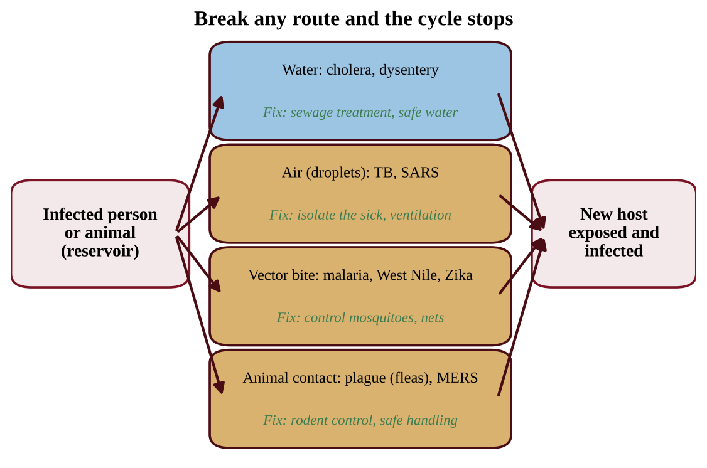
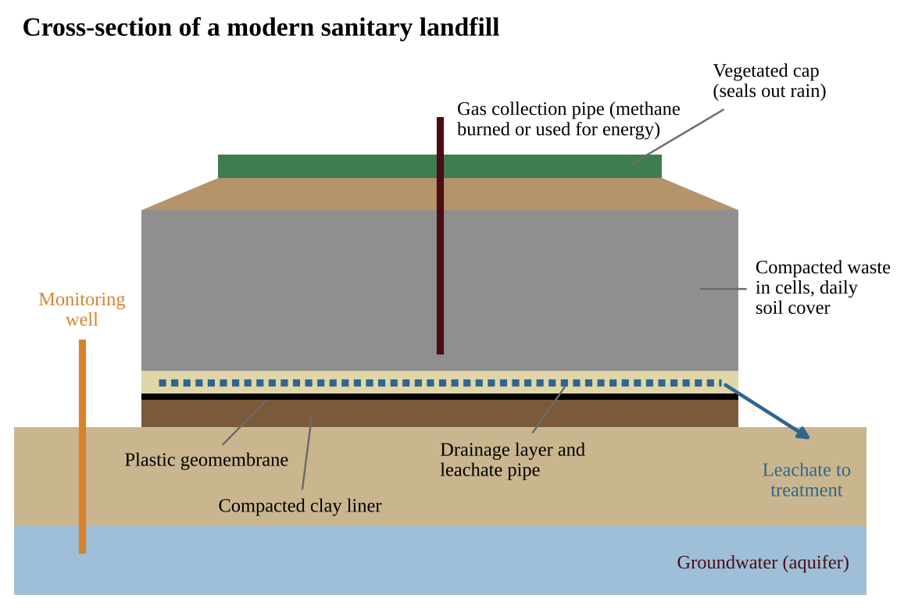
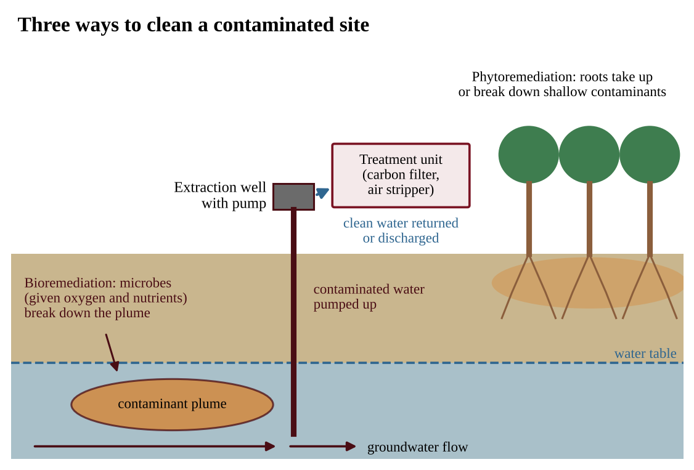
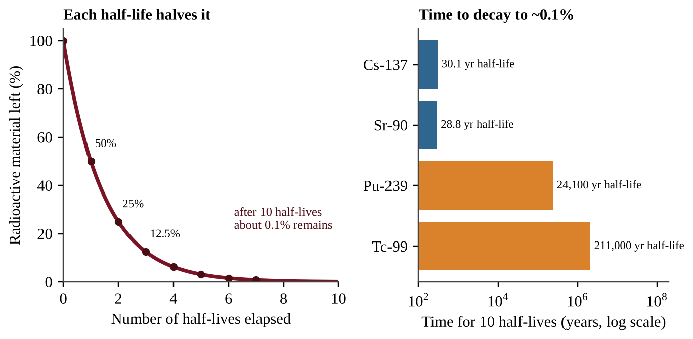
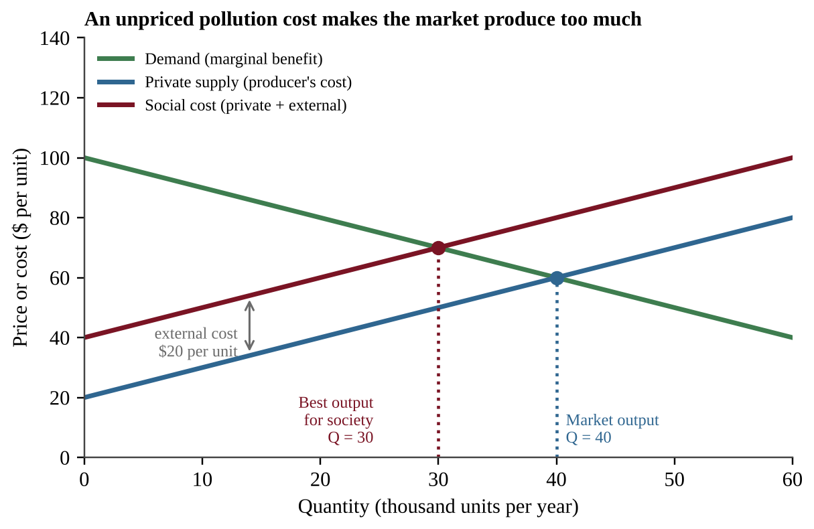
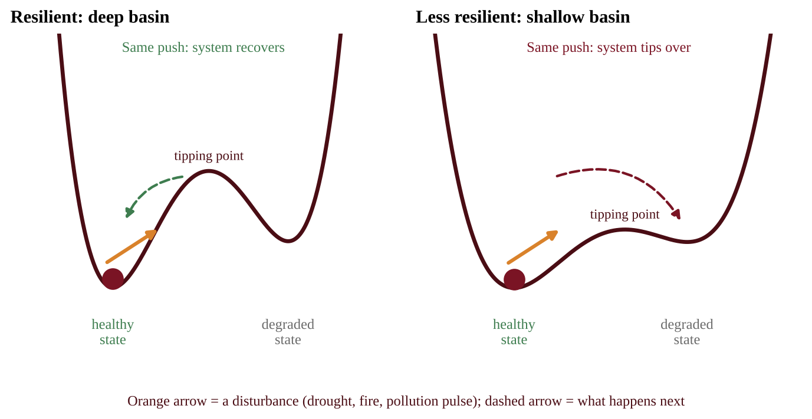

# Chapter 10 — Impacts on the Environment and Human Health

:::box objectives
- Link pollution and pathogens to human health problems and explain how scientists test those links.
- Use LD50 and dose-response curves to compare toxicity and to calculate doses.
- Explain why endocrine disruptors and persistent organic pollutants (POPs) harm ecosystems, and calculate bioaccumulation and biomagnification.
- Describe how hazardous waste, contaminated sites, and nuclear waste are treated, stored, and cleaned up.
- Use basic environmental economics (externalities, cost-benefit analysis, discounting) to judge pollution policies.
- Explain sustainability and resilience, and read indicators of whether we are moving toward or away from them.
:::

## 10.1 Hazards to Human Health
%% CED: 8.14, 8.15 | EIN-3.C.1, EIN-3.C.2, EIN-3.C.3, EIN-3.C.4, EIN-3.D.1, EIN-3.D.2, EIN-3.D.3, EIN-3.D.4, EIN-3.D.5, EIN-3.D.6, EIN-3.D.7, EIN-3.D.8, EIN-3.D.9, EIN-3.D.10, EIN-3.D.11, EIN-3.D.12 | LO: EIN-3.C, EIN-3.D

:::box simple
Many things can make people sick: air, water, food, jobs, genes, habits. Scientists untangle them by comparing exposed groups with similar unexposed groups. Germs are stopped by breaking their route from one host to the next.
:::

A **hazard** is anything that can cause harm: **chemical** (toxins, pollutants), **physical** (radiation, noise), **biological** (pathogens), or **cultural** (smoking, diet, occupation). **Risk** is the chance that harm actually happens, so it depends on the hazard *and* on exposure. A very toxic chemical sealed in a drum has low risk; a mildly toxic one in daily drinking water may have high risk. **Acute** exposure is short and intense; **chronic** exposure is long and low-level and may cause disease only after a delay called the **latency period**.

### Pollution and health

It can be hard to establish cause and effect between a pollutant and a health problem because people are exposed to many chemicals at once.

| Health issue | Linked pollutant or cause | Key facts |
|---|---|---|
| **Dysentery** | Untreated sewage in streams and rivers | Intestinal infection with severe diarrhea; spreads when drinking water is contaminated with feces |
| **Mesothelioma** | Asbestos | A cancer of the lining of the lungs and chest, caused mainly by inhaled asbestos fibers (old insulation and building materials); appears decades after exposure |
| **Respiratory problems** | Elevated tropospheric (ground-level) ozone | Ozone irritates the airways and reduces lung function, worsening asthma and other lung disease |

### Research methods

A **controlled experiment** (lab animals or cell cultures) changes one variable, the dose, while everything else is held constant. For people, researchers use **epidemiological studies** that compare disease rates among groups with different exposures and adjust statistically for age, smoking, and other factors. These show *correlation*. Evidence for *causation* builds up from a dose-response pattern (more exposure, more disease), a plausible biological mechanism, and consistent results in several studies. Large samples and control groups are essential.

:::box define
**Risk** — the probability that a hazard causes harm; depends on toxicity and exposure.
**Epidemiology** — the study of how often diseases occur in different groups and what is associated with them.
**Latency period** — the delay between exposure and the appearance of disease.
:::

### Pathogens and infectious diseases

A **pathogen** is an organism or virus that causes disease. A **vector** is an animal, such as a mosquito, that carries a pathogen from one host to another. Pathogens **adapt** to take advantage of new opportunities to infect and spread through human populations (crowding, travel, land-use change, contact with animals). Specific pathogens occur in many environments **regardless of the appearance of sanitary conditions**: clear-looking water can carry bacteria, so water must be tested or treated, not judged by eye.

{w=0.72}

**Climate.** As equatorial-type climate zones spread north and south into what are now subtropical and temperate zones, pathogens, infectious diseases, and their vectors are spreading into areas where the disease was not previously known. Warmer conditions let mosquitoes survive in new regions for more months of the year.

**Poverty.** Poverty-stricken, low-income areas often lack sanitary waste disposal and have contaminated drinking water, creating havens and opportunities for infectious diseases to spread. Crowding, poor nutrition, and flooding (which mixes sewage with drinking water) add to the problem. Clean water and sewage treatment are among the most powerful public-health measures.

| Disease | Type of pathogen | Spread / source |
|---|---|---|
| **Plague** | Bacterium | Carried by infected animals such as rodents and their fleas; transferred to humans by the bite of an infected organism or contact with contaminated fluids or tissues |
| **Tuberculosis (TB)** | Bacterium | Typically attacks the lungs; spread by breathing in bacteria from the bodily fluids of an infected person |
| **Malaria** | Parasite | Bites from infected mosquitoes; most often found in sub-Saharan Africa |
| **West Nile virus** | Virus | Bites from infected mosquitoes |
| **SARS** | Virus; a form of pneumonia | Transferred by inhaling or touching infected fluids |
| **MERS** | Virus; respiratory illness | Transferred from animals to humans |
| **Zika** | Virus | Bites from infected mosquitoes; can also be transmitted through sexual contact |
| **Cholera** | Bacterium | Contracted from infected water |

:::box process
Infected host sheds the pathogen (feces, fluids, blood) → pathogen enters the environment (water, air, or a vector) → new person exposed (drinking, breathing, bite, contact) → infection → more shedding. Break any arrow and the cycle stops: treat sewage, purify water, control vectors, isolate the sick.
:::

:::box mistake
- Assuming clean-looking water is free of pathogens.
- Saying a correlation between a pollutant and a disease *proves* the pollutant caused it.
:::

:::box example
id: SG-U8-E010
Three villages along one river were surveyed for cholera during one rainy season:

| Village | Drinking water | Sewage handling | Cases per 10,000 people |
|---|---|---|---|
| A | Chlorinated, from a protected well | Latrines connected to a treatment plant | 2 |
| B | Untreated river water | Latrines connected to a treatment plant | 14 |
| C | Untreated river water | Open disposal upstream of the intake | 61 |

(a) Calculate how many times higher the case rate is in village C than in village A. (b) Make a claim about the factor most strongly associated with the difference between A and B, and support it with data. (c) Explain the transmission route that links open sewage disposal to cases in village C. (d) State one reason this survey alone cannot prove that sewage handling caused the difference in cases, and propose one low-cost intervention for village C.
:::

:::box summary
- Hazards are chemical, physical, biological, or cultural; risk depends on hazard and exposure.
- Untreated sewage causes dysentery, asbestos causes mesothelioma, and ground-level ozone harms the lungs. Cause and effect is hard to prove, so studies use controls, large samples, and dose-dependent patterns.
- Pathogens adapt, occur even in clean-looking places, spread into new regions as climate zones shift, and thrive where poverty means poor sanitation. Know each disease's route.
:::

## 10.2 Dose-Response Relationships
%% CED: 8.12, 8.13 | EIN-3.A.1, EIN-3.B.1 | LO: EIN-3.A, EIN-3.B

:::box simple
"The dose makes the poison." To compare poisons, scientists ask how much it takes to kill half of a test group: the LD50. Tiny LD50 means very toxic. A dose-response curve shows the whole picture: dose on the x-axis, how many are affected on the y-axis.
:::

### LD50

**Lethal dose 50% (LD50)** is the dose of a chemical that is lethal to 50% of the population of a particular species. It is found in controlled tests on groups of test animals given different doses and is usually reported in milligrams of chemical per kilogram of body mass (mg/kg) so that animals of different sizes can be compared.

:::box formula
Total dose (mg) = dose (mg/kg) × body mass (kg)
Times more toxic = larger LD50 ÷ smaller LD50
The **lower** the LD50, the **more toxic** the chemical.
Units: mg of chemical per kg of body mass (mg/kg). Convert grams to kilograms first.
:::

*Illustration.* An LD50 of 40 mg/kg in rats: a 0.25 kg rat given 10 mg has received 10 ÷ 0.25 = 40 mg/kg, so about half of such rats would die.

**How many times more toxic?** Divide, do not subtract: LD50 of 12 mg/kg (A) versus 480 mg/kg (B) gives 480 ÷ 12 = 40, so A is 40 times more toxic.

The LD50 measures death only (not illness or cancer), applies to one species and one exposure route, and says nothing about long-term low-level exposure. It is not a safe dose: some animals die below it. A rat LD50 cannot simply be applied to humans, because body size, metabolism, and exposure route differ, so animal tests give only estimates (testing people is unethical).

### The dose-response curve

A **dose-response curve** describes the effect on an organism, or the mortality rate in a population, based on the dose of a particular toxin or drug. Dose goes on the horizontal axis (often logarithmic, because doses span a wide range) and response (percent affected or dying) on the vertical axis.

{w=0.72}

**Reading the curve**

1. **Flat start (threshold).** At very low doses there may be no measurable effect. The **threshold dose** is the highest dose with no effect above the control group's background response (a few control animals may die anyway). Some substances, such as some carcinogens, may have no safe threshold in practice.
2. **Steep middle, then plateau.** Over a narrow range the response climbs rapidly, then levels off near 100%.
3. **LD50.** Draw a horizontal line from 50% on the y-axis to the curve, then drop down to the x-axis.
4. **Comparing chemicals.** A curve shifted left reaches 50% at a smaller dose, so that chemical is more toxic. A steeper curve leaves a narrow gap between "no effect" and "high effect."

{w=0.72}

- **Shapes.** A *threshold* curve is flat until a dose is reached. A *linear, no-threshold* curve rises from the first dose (the working assumption for many carcinogens). Most mortality curves are S-shaped. A curve can also fall: if a drug *reduces* an effect as concentration rises, the relationship is inverse, and "the dose makes the poison" does not describe it. Read the axis labels first.
- **Log axis.** Each equal gap means multiplication by 10. To interpolate an LD50 between two plotted doses, interpolate the exponent: if 35% die at 0.1 and 68% at 1, then 50% is (50 − 35) ÷ (68 − 35) = 0.45 of the way from exponent −1 to 0, so the exponent is −0.55 and the dose is 10⁻⁰·⁵⁵ ≈ 0.28.
- **Linear interpolation.** LD50 ≈ low dose + [(50 − low response) ÷ (high response − low response)] × (high dose − low dose).
- **Expected deaths.** Percent × number exposed (30% of 40,000 is 12,000).

**Setting up a toxicity test.** Expose several identical groups of one species to different doses, plus a **control group** that receives none. Keep temperature, age, food, and exposure time the same. Dose is the independent variable; percent responding is the dependent variable.

:::box define
**LD50** — the dose of a chemical lethal to 50% of a test population of one species.
**Dose-response curve** — a graph of the effect on an organism, or mortality in a population, versus the dose of a toxin or drug.
**Threshold dose** — the highest dose at which no effect is observed.
:::

:::box mistake
- Reading the dose on the y-axis. Dose is on the x-axis; response is on the y-axis.
- Looking for 50 on the x-axis to find the LD50. The 50 is on the y-axis.
- Saying the curve farther right is more toxic. It is less toxic.
:::

:::box strategy
To compare toxicity, quote the LD50 values (smaller means more toxic). On graphs, draw reading lines on the figure and give the value with units.
:::

:::box example
id: SG-U8-E009
Two insecticides were tested on separate groups of identical laboratory mice, with the following percent mortality after 24 hours:

| Insecticide X dose (mg/kg) | 5 | 10 | 20 | 40 | 80 |
|---|---|---|---|---|---|
| Mice dead (%) | 8 | 22 | 46 | 72 | 94 |

| Insecticide Y dose (mg/kg) | 100 | 200 | 400 | 800 |
|---|---|---|---|---|
| Mice dead (%) | 30 | 52 | 80 | 96 |

(a) For each insecticide, estimate the LD50 by linear interpolation between the two tested doses whose mortalities bracket 50%. Give the answer to the nearest 1 mg/kg. (b) State which insecticide is more toxic and justify your answer using the LD50 values. (c) Using your rounded LD50 for insecticide X, calculate the total dose, in mg, for a mouse of body mass 0.025 kg. (d) Give one limitation of using LD50 to decide whether either insecticide is safe in a river.
:::

:::box example
id: SG-U8-E014
Brine shrimp (100 per dish) were exposed to a salt of a heavy metal. A control dish received no metal. After 48 hours:

| Concentration (mg/L) | Shrimp dead (of 100) |
|---|---|
| 0 (control) | 3 |
| 0.01 | 8 |
| 0.1 | 24 |
| 1 | 61 |
| 10 | 93 |
| 100 | 100 |

(a) Explain why a log scale is appropriate for the concentration axis and describe how you would set up the axes. (b) Estimate the concentration that kills 50% by interpolating the exponent between the two doses that bracket 50%. (c) Explain why the control dish matters.
:::

:::box summary
- LD50 is the dose lethal to 50% of a test population; lower LD50 means more toxic, and total dose = mg/kg × body mass.
- A dose-response curve is typically S-shaped with a threshold and a plateau; a curve farther left is more toxic.
- Risk depends on both toxicity (the curve) and exposure.
:::

## 10.3 Hazardous Chemicals in the Environment
%% CED: 8.3, 8.7 | STB-3.C.1, STB-3.D.1, STB-3.H.1, STB-3.H.2, STB-3.H.3 | LO: STB-3.C, STB-3.D, STB-3.H

:::box simple
Hormones are the body's chemical text messages. An **endocrine disruptor** sends fake messages or blocks real ones, so cells do the wrong thing even at very low concentrations. **POPs** are like plastic: man-made molecules microbes cannot break down. They last for years, dissolve in fat so animals store them, and ride wind and ocean currents far from where they were used.
:::

### Endocrine disruptors

The **endocrine system** is the set of glands that release hormones controlling growth, development, metabolism, and reproduction. **Endocrine disruptors** are chemicals that can interfere with the endocrine system of animals. Some mimic natural hormones (for example, imitating estrogen), some block hormone receptors, and some change how much hormone the body makes. Examples include certain pesticides, PCBs, some plastics chemicals, and medication residues in sewage effluent.

Because hormones control development and reproduction, disruption shows up there first. Endocrine disruptors can lead to **birth defects, developmental disorders, and gender imbalances** in fish and other species. In a documented pattern, male fish downstream of wastewater outfalls develop female traits, which skews sex ratios, lowers breeding success, and can shrink the population. Amphibians absorb chemicals through thin skin and develop in water, so they are especially vulnerable. If the share of affected males is highest at the outfall and falls downstream, the effluent is the likely source, but chemical analysis is needed to name the chemical.

### Persistent organic pollutants (POPs)

**POPs** do not easily break down in the environment because they are synthetic, carbon-based molecules (such as DDT and PCBs). Decomposers have no enzymes evolved for these structures, so POPs remain in soil, sediment, and water for years or decades. "Organic" here means carbon-based, not "grown without pesticides."

POPs can be toxic to organisms because they are **soluble in fat** (lipid-soluble) rather than water. Water-soluble chemicals are excreted in urine; fat-soluble ones are retained and accumulate in fatty tissues such as body fat, liver, and eggs (Section 10.6).

POPs can **travel over long distances** via wind and water before being redeposited. They evaporate in warm regions, ride air currents, and condense in cold regions, so they contaminate places where they were never used, such as Arctic wildlife and the people who eat it.

:::box define
**Endocrine disruptor** — a chemical that interferes with the endocrine system of animals by imitating, blocking, or altering hormone signals.
**POP** — a synthetic, carbon-based pollutant that resists breakdown, dissolves in fat, and can be transported long distances. Examples: DDT, PCBs.
:::

:::box summary
- Endocrine disruptors interfere with animals' hormones, causing birth defects, developmental disorders, and gender imbalances in fish and other species.
- POPs are persistent (synthetic, carbon-based), fat-soluble (stored in fatty tissue), and mobile (long-distance transport by wind and water).
:::

## 10.4 Treatment, Disposal, and Cleanup of Contaminated Sites
%% CED: none (academy extension)

:::box simple
Hazardous waste needs special handling from the day it is made until it is made harmless or sealed away. When land or groundwater is already contaminated, we can pump the water out and clean it, let microbes or plants do the work, or dig up the soil. The cheapest cleanup is not making the waste.
:::

### Hazardous waste and the laws that govern it

**Hazardous waste** is toxic, corrosive, flammable, or reactive (solvents, pesticides, acids, heavy-metal sludge, used oil, lead batteries). Two U.S. laws are central:

| Law | What it does |
|---|---|
| **RCRA** (Resource Conservation and Recovery Act, 1976) | Regulates hazardous waste from **cradle to grave**: generator, transporter, treatment, storage, and disposal facility must be tracked and permitted. Also sets rules for ordinary landfills. Prevents *new* problems. |
| **CERCLA** (Comprehensive Environmental Response, Compensation, and Liability Act, 1980, "**Superfund**") | Cleans up *old* contaminated sites. Creates a trust fund and makes the responsible parties pay (**strict, joint, and retroactive liability**: owners, operators, generators, and transporters can all be charged, whatever the date of the dumping). Sites are ranked on the National Priorities List. |

### Treating and disposing of hazardous waste

The preferred order is: **reduce** (use less toxic materials), **reuse or recycle** (recover solvents or metals), **treat** (neutralize acids, use microbes, incinerate at high temperature), and only then **dispose**. Disposal options include **secure hazardous-waste landfills** with double liners and leachate collection, **deep-well injection** into rock far below drinking-water aquifers, and lined **surface impoundments**. Toxic metals such as lead and mercury are elements: they never decay or biodegrade, so they must be isolated indefinitely.

### Landfill liners and leachate

Rain that percolates through buried waste picks up dissolved chemicals and becomes **leachate**, a toxic liquid that can contaminate groundwater. A modern landfill sits on a **liner** of compacted clay topped by a plastic **geomembrane**, with a drainage layer and pipes that collect leachate for treatment. Wells monitor the groundwater. Waste is covered with soil daily, a final cap seals the top, and pipes collect methane (a greenhouse gas) that can be burned for energy.

{w=0.72}

### Cleaning up contaminated sites

A cleanup starts with **site assessment**: sampling soil, water, and air to find the contaminant, how far the **plume** (the moving cloud of contaminated groundwater) has spread, and who might be exposed. Then a method is chosen.

- **Pump-and-treat.** Wells pull contaminated groundwater to the surface, where carbon filters or air strippers remove the chemical before the water is returned or discharged. It also keeps the plume from spreading. It is reliable but slow, because contaminant stuck to soil keeps releasing; it may run for decades.
- **Bioremediation.** Microbes break down contaminants (oil, solvents, fuels) into less harmful products; adding oxygen and nutrients speeds them up. It works only for biodegradable chemicals.
- **Phytoremediation.** Plants take up, store, or break down contaminants through their roots (some take up heavy metals, which are then harvested). It is low-cost and gentle on the land but slow and limited by root depth.
- **Excavation and capping.** Soil is dug out and hauled to a secure landfill, or covered with a cap. It is fast but expensive and moves the problem.

{w=0.72}

**Brownfields** are abandoned or underused industrial and commercial properties where reuse is complicated by real or suspected contamination (old factories, gas stations, dry cleaners). Redeveloping them reduces sprawl, restores tax revenue, and uses land that already has roads and utilities.

:::box formula
Mass removed = volume treated × concentration
Mass (mg) = volume (L) × concentration (mg/L); then ÷ 1,000,000 for kg (1 m³ = 1,000 L)
Percent of contaminant removed = mass removed ÷ total mass × 100
:::

:::box apply
**Love Canal.** In the 1970s, homes at Love Canal, New York, were found on buried chemical waste. The outcry helped lead to CERCLA (Superfund) in 1980.
:::

:::box define
**Leachate** — liquid that has percolated through waste and carries dissolved contaminants.
**Plume** — a spreading body of contaminated groundwater.
**Brownfield** — an abandoned or underused site whose reuse is complicated by contamination.
:::

:::box mistake
- Mixing up the two laws: RCRA manages waste being made now (cradle to grave); CERCLA cleans up old sites and makes polluters pay.
- Thinking a liner makes a landfill leak-proof. Liners slow leachate; they need collection and monitoring.
- Assuming one cleanup method fits everything. Bioremediation fails on non-biodegradable chemicals; phytoremediation fails on deep contamination.
:::

:::box strategy
For "propose a solution," match the method to the problem (groundwater plume: pump-and-treat; oil or fuel: bioremediation; shallow, light contamination: phytoremediation) and add prevention or monitoring.
:::

:::box example
id: SG-C10-E001
A pump-and-treat system removes contaminated groundwater at 25 L per minute. The water contains 40 mg/L of benzene, and the treatment unit removes all of it. Estimate that the plume holds 3,000 kg of benzene in total. (a) Calculate the mass of benzene removed in one year (365 days), in kilograms. (b) Calculate the percent of the 3,000 kg removed in one year, to the nearest 0.1%. (c) Explain why the real cleanup will take longer than the simple division suggests.
:::

:::box summary
- RCRA tracks hazardous waste from cradle to grave; CERCLA (Superfund) cleans up old sites and makes responsible parties pay.
- Liners, leachate collection, gas collection, caps, and monitoring wells make landfills safer.
- Cleanup methods: pump-and-treat, bioremediation, phytoremediation, excavation and capping; brownfields are contaminated sites reused after cleanup.
:::

## 10.5 Perpetual Storage
%% CED: none (academy extension)

:::box simple
Some wastes stay dangerous longer than any human institution has lasted. We cannot make high-level nuclear waste harmless, so we isolate it deep underground and keep watch for thousands of years.
:::

### High-level nuclear waste

Nuclear power plants produce **spent nuclear fuel** (used fuel rods), a **high-level radioactive waste**. It is intensely radioactive and hot at first, so it is stored in water-filled pools for some years and then often in dry steel-and-concrete casks. Its radiation damages tissue and DNA, causing cancer and genetic damage. Lower-level waste (gloves, tools, medical waste) is buried in shallow, controlled sites.

### Half-life

A radioactive isotope decays at a fixed rate. Its **half-life** is the time for half of the atoms to decay. After one half-life 50% remains, after two 25%, after three 12.5%. After about ten half-lives only about 0.1% remains. Isotopes with long half-lives therefore set the storage time.

{w=0.72}

:::box formula
Amount remaining = initial amount × (½)ⁿ, where n = elapsed time ÷ half-life
Time to decay to a given fraction: t = half-life × log(initial ÷ remaining) ÷ log 2
Units: any unit of amount (kg, Ci, or %); time and half-life in the same unit (years).
:::

Strontium-90 and cesium-137 (half-lives about 29 and 30 years) fade within a few centuries. Plutonium-239 (about 24,100 years) and technetium-99 (about 211,000 years) stay hazardous for tens to hundreds of thousands of years, far longer than recorded human history.

### Repositories and long-term stewardship

The accepted plan is a **deep geologic repository**: tunnels in stable rock hundreds of meters underground, in a dry place with little groundwater movement. Waste is sealed in corrosion-resistant canisters with several barriers.

- **WIPP (Waste Isolation Pilot Plant), New Mexico.** An operating U.S. repository, in a deep salt bed, for long-lived radioactive waste from nuclear weapons programs. Salt is attractive because it is dry and slowly creeps shut around the waste.
- **Yucca Mountain, Nevada.** A proposed repository for commercial spent fuel in volcanic rock. Studied for decades but never opened, it was held up by scientific questions (water movement, earthquakes, volcanism) and political opposition. Spent fuel still sits at power plants.
- **Finland's Onkalo.** A repository in crystalline bedrock being built for spent fuel, with local consent.

**Long-term stewardship** means records, markers, monitoring, and funding must last for centuries. How do we warn future people who may not read our languages, who pays for guarding the site, and is it fair to leave them a waste we benefited from? Siting also raises **environmental justice** concerns when the burden falls on a community with little political power.

:::box define
**Half-life** — the time for half of the atoms of a radioactive isotope to decay.
**Spent nuclear fuel** — used fuel rods removed from a reactor; high-level radioactive waste.
**Geologic repository** — a deep underground facility built for permanent isolation of waste.
**Long-term stewardship** — monitoring and maintenance of a waste site for as long as it stays hazardous.
:::

:::box mistake
- Believing the waste is safe after one half-life. Half remains, and the half-life is only the first step.
- Assuming a long half-life means high intensity. Long half-life isotopes are less intense but last far longer.
:::

:::box example
id: SG-C10-E002
A batch of waste contains cesium-137, half-life 30 years, with an initial activity of 640 units. (a) Calculate the activity remaining after 90 years. (b) Calculate how many years it takes for the activity to fall to 1% of the initial value, to the nearest year. (c) Explain why plutonium-239, with a half-life of 24,100 years, needs a repository designed for a much longer time than cesium-137.
:::

:::box summary
- High-level nuclear waste stays dangerous for thousands of years; half-life tells how fast it fades (about ten half-lives to reach roughly 0.1%).
- Deep geologic repositories (WIPP operating, Yucca Mountain proposed, Onkalo under construction) aim for permanent isolation.
- Stewardship means centuries of record keeping, monitoring, and funding, and raises ethical and justice questions.
:::

## 10.6 Bioaccumulation—Biomagnification
%% CED: 8.8 | STB-3.I.1, STB-3.I.2, STB-3.J.1, STB-3.J.2, STB-3.J.3 | LO: STB-3.I, STB-3.J

:::box simple
**Bioaccumulation** happens inside one animal: it takes in a pollutant faster than it gets rid of it, so the amount in its body keeps rising over its lifetime. **Biomagnification** happens up a food chain: a predator eats many contaminated prey, so the concentration climbs at each step. An osprey ends up with far more toxin per gram than the water it fishes in.
:::

**Bioaccumulation** is the selective absorption and concentration of elements or compounds by cells in a living organism, most commonly fat-soluble compounds. **Biomagnification** is the increase in concentration of substances per unit of body tissue that occurs in successively higher trophic levels of a food chain or food web.

Why does it magnify? Only about 10% of energy passes up each trophic level, so a predator eats many prey over its lifetime. If the toxin is stored and not excreted, the predator collects the whole load. A common rule of thumb is about **10× per trophic level**, though real factors vary.

{w=0.72}

:::box formula
Biomagnification factor (BMF) = concentration in the consumer ÷ concentration in its food (the trophic level below)
Concentration at level *n* ≈ starting concentration × (BMF)ⁿ; over several steps multiply the factors
Units: ppm, ppb, or mg/kg of tissue (the same units for both levels).
:::

For example, if plankton hold 0.04 ppm and each step multiplies by 10, small fish hold 0.4 ppm, larger fish 4 ppm, and a fish-eating bird 40 ppm after three steps (0.04 × 10³ = 40).

### Effects

Effects in an ecosystem include **eggshell thinning** and **developmental deformities** in top carnivores at the higher trophic levels. DDT famously thinned the eggshells of birds of prey such as eagles, ospreys, and peregrine falcons, so eggs broke in the nest and populations crashed. Humans also experience harmful effects from biomagnification, including problems of the **reproductive, nervous, and circulatory** systems.

Three substances to know: **DDT** (insecticide), **PCBs** (industrial chemicals), and **mercury** (converted to methylmercury by aquatic bacteria; it harms the nervous system). All three bioaccumulate and have major environmental impacts.

Mercury follows a clear path: coal burning releases it to the air, wind carries it, rain or dry fallout deposits it on lakes and oceans, bacteria convert it to methylmercury, and it biomagnifies in fish. People are advised to limit large predatory fish, since lower trophic levels carry less toxin. Cutting coal emissions lowers mercury input, but lake fish recover slowly because mercury persists in sediment. A persistent chemical banned in one country can still turn up in its people through imported food.

:::box define
**Bioaccumulation** — the buildup of a substance, especially a fat-soluble one, in the tissues of a single organism over time.
**Biomagnification** — the increase in a substance's concentration per unit of tissue at successively higher trophic levels.
:::

:::box mistake
- Using the terms interchangeably. Accumulation is within one organism over time; magnification is across trophic levels.
- Assuming the producers have the highest concentrations. They have the lowest tissue concentration among organisms in the chain; the top consumer has the highest.
- Saying the pollutant "disappears" at each step. The food chain concentrates it.
:::

:::box strategy
Biomagnifiers are persistent, fat-soluble, and not easily excreted. Explain the mechanism (eaten in large numbers, stored in fat) and pair it with an effect.
:::

:::box example
id: SG-U8-E005
Tissue samples from a pond food chain contained the following concentrations of a persistent pesticide:

| Organism | Trophic level | Concentration (ppm) |
|---|---|---|
| Algae | Producer | 0.8 |
| Minnows | Primary consumer | 6.4 |
| Trout | Secondary consumer | 52 |
| Heron | Tertiary consumer | 416 |

(a) Calculate the biomagnification factor for each step (consumer ÷ food), rounded to one decimal. (b) Calculate the overall factor from algae to heron. (c) Explain why the heron's concentration is much higher than the algae's even though the pond water is only slightly contaminated. (d) Identify one effect this pesticide might have on the heron population.
:::

:::box summary
- Bioaccumulation: buildup in one organism; biomagnification: increase up trophic levels.
- Fat-soluble, persistent, non-excretable substances such as DDT, PCBs, and methylmercury do both.
- Effects: eggshell thinning and deformities in top predators; reproductive, nervous, and circulatory harm in humans.
:::

## 10.7 Environmental Economics
%% CED: none (academy extension)

:::box simple
A product's price normally covers only what it costs the company to make. If a factory also damages air, water, and health, the neighbors pay for that. Environmental economics puts a price on that damage and compares costs and benefits that arrive at different times.
:::

### Externalities

An **externality** is a cost or benefit of an activity that falls on people who did not choose it. A **negative externality** is a cost to others (pollution, noise); a **positive externality** is a benefit to others (a wetland that cleans water downstream). Because producers ignore external costs, the **private cost** is lower than the **social cost** (private + external), and the market produces *more* of the polluting good than is best for society. This is a **market failure**, related to the **tragedy of the commons**: a shared resource such as air or a fishery is overused because no one pays for harming it.

{w=0.72}

### Internalizing external costs

**Internalizing** a cost means making the polluter pay it. Main tools:

| Tool | How it works | Example |
|---|---|---|
| **Pollution tax or fee** | A tax per unit of pollution or product raises private cost to match social cost | Carbon tax; landfill fee |
| **Cap-and-trade (tradable permits)** | A cap limits total pollution; permits are issued and firms that cut emissions cheaply can sell spare permits | The U.S. sulfur dioxide trading program for power plants |
| **Subsidies** | Payments that reward clean choices | Tax credits for solar panels |
| **Regulation and liability** | A legal standard, ban, or duty to pay for damage | Emission limits; Superfund |

A tax fixes the *price* of pollution; a cap fixes the *amount*.

### Cost-benefit analysis

**Cost-benefit analysis (CBA)** adds up all costs and benefits of a project in dollars and compares them; it is worthwhile if benefits exceed costs.

:::box formula
Net benefit = total benefits − total costs
Marginal cost = change in total cost ÷ change in amount (e.g., per extra percentage point removed)
Benefit-cost ratio = total benefits ÷ total costs (greater than 1 means benefits exceed costs)
Pigouvian tax per unit = external cost per unit
:::

Marginal cost usually rises steeply: removing the first 50% of a pollutant is cheap, the last few percent cost far more. CBA has limits: some benefits are hard to price (a species, a view), the future is uncertain, and it does not say who gains and who loses, which raises environmental justice questions.

### Valuing ecosystem services

**Ecosystem services** are the benefits nature provides to people: *provisioning* (food, timber, water), *regulating* (flood control, water purification, pollination), *supporting* (soil formation, nutrient cycling), and *cultural* (recreation). Economists value them by **replacement cost** (what a water treatment plant would cost instead of a forested watershed), by the market value of what they produce, by the cost of damage avoided, or by surveys of **willingness to pay**. This lets CBA count the benefits of keeping a wetland or forest, not just the profit from developing it. New York City, for example, protected its upstate watersheds instead of building a very costly filtration plant.

### Discounting

A dollar today is worth more than a dollar in the future, because it can be invested and people prefer benefits sooner. **Discounting** converts a future amount into its **present value** using a discount rate. A higher rate makes distant benefits (a recovered forest, avoided climate damage) look smaller and favors quick payoffs. Choosing the rate is partly an ethical question about fairness to future generations.

:::box formula
Present value: PV = FV ÷ (1 + r)ᵗ
FV = future amount ($), r = annual discount rate as a decimal, t = years until it arrives.
Method: write r as a decimal, raise (1 + r) to the power t, divide.
Example: $1,000 in 10 years at 5% → 1,000 ÷ 1.629 ≈ $614 today.
:::

:::box apply
**SO₂ trading.** The U.S. acid rain program capped sulfur dioxide from power plants and let plants trade permits. Emissions fell at a lower cost than many predicted.
:::

:::box define
**Externality** — a cost or benefit of an activity that falls on others who did not choose it.
**Internalizing a cost** — making the producer pay for the external cost so the price reflects it.
**Cost-benefit analysis** — comparing the monetary value of a project's benefits and costs.
**Ecosystem services** — benefits that ecosystems provide to people.
**Discounting** — converting future amounts into present value.
:::

:::box mistake
- Saying a higher discount rate makes future benefits look larger. It makes them look *smaller*.
:::

:::box strategy
In economics answers, name the tool (tax, cap-and-trade, subsidy), say whose cost it internalizes, and give one drawback. In CBA, show the ratio, then justify your claim with it.
:::

:::box example
id: SG-C10-E003
A factory sells a product, with demand given by price P = 100 − Q and marginal private cost P = 20 + Q (P in dollars per unit, Q in thousands of units). Each unit also causes $20 of pollution damage to neighbors that the factory does not pay. (a) Find the market quantity Q and price P where demand equals private cost. (b) Find the quantity that is best for society, where demand equals private cost plus the external cost. (c) State the per-unit tax that makes the factory choose the quantity in (b). (d) Calculate the annual tax revenue, in thousands of dollars, at the quantity in (b).
:::

:::box example
id: SG-C10-E004
A wetland restoration costs $400,000 now and is expected to deliver ecosystem-service benefits worth $1,000,000 twenty years from now (flood protection and water purification). (a) Calculate the present value of the benefit at a 4% discount rate, to the nearest $1,000. (b) Calculate the benefit-cost ratio at 4%, to two decimals. (c) Repeat the benefit-cost ratio at a 7% discount rate and state whether the project still passes the test of benefits exceeding costs. (d) Explain how a higher discount rate affects projects whose benefits come far in the future.
:::

:::box summary
- An externality is a cost or benefit borne by others; when costs are external, the market over-produces the polluting good.
- Internalize with taxes, cap-and-trade, subsidies, regulation, or liability. Cost-benefit analysis compares monetized benefits and costs, including ecosystem services.
- Discounting: PV = FV ÷ (1 + r)ᵗ; higher rates shrink the value of future benefits.
:::

## 10.8 Sustainability—Resiliency
%% CED: 5.12 | STB-1.A.1, STB-1.A.2 | LO: STB-1.A

:::box simple
Sustainability means living on Earth's income, not on its savings. We can use the interest, the forests that regrow and the fish that breed, but we cannot keep spending the principal. **Resilience** is the ability to take a hit, such as a drought, a fire, or a pollution spill, and bounce back.
:::

**Sustainability** refers to humans living on Earth and using resources without depleting them for future generations. It has **environmental, economic, and social** sides: a practice that wrecks the soil, bankrupts the farmer, or ignores the community will not last.

### Environmental indicators

An **environmental indicator** is a measurement that tells us whether we are moving toward or away from sustainability. Indicators named in the course:

- **Biological diversity:** falling diversity signals ecosystem stress.
- **Food production:** falling per-person output signals degraded land and water.
- **Average global surface temperature and CO₂ concentration:** rising values indicate climate change.
- **Human population:** growth increases resource demand.
- **Resource depletion:** declining stocks of fish, water, forests, soil, or minerals.

### Sustainable yield

**Sustainable yield** is the amount of a renewable resource that can be taken without reducing the available supply. If a forest grows 20 m³ of wood per hectare per year, cutting more than 20 m³ per hectare per year will shrink the forest. Non-renewable resources such as ore have no sustainable yield; sustainable use means reducing demand, recycling, and substituting.

{w=0.72}

:::box formula
Sustainable yield (per year) = natural growth (or regeneration) per year
Overharvest (%) = (harvest − sustainable yield) ÷ sustainable yield × 100
Total growth = area × growth rate per unit area
:::

### Resilience of ecosystems and communities

**Resilience** is the capacity of a system to absorb a disturbance and return to its earlier state without shifting into a different, often degraded state. Ecosystems are more resilient with high biodiversity (many species can fill the same role), connected habitats, healthy soils, and little other stress. Pushed past a **tipping point**, a system can flip into a state that is hard to reverse, such as a clear lake that becomes a murky algae-dominated lake, or a forest that turns to grassland after repeated fires.

{w=0.72}

**Communities** are resilient when they can absorb shocks such as floods, hurricanes, or droughts and recover quickly. Helpful features are diverse local economies, reserves of food and water, backup power, flood-wise land use (wetlands and floodplains left open), strong social networks, and good planning. Protecting mangroves, wetlands, and forests builds resilience and supports sustainability.

:::box define
**Sustainability** — using resources to meet present needs without depleting them for future generations.
**Sustainable yield** — the amount of a renewable resource that can be harvested without reducing the supply.
**Environmental indicator** — a measure of environmental condition such as biodiversity or atmospheric CO₂.
**Resilience** — the ability of an ecosystem or community to absorb a disturbance and recover.
**Tipping point** — a threshold beyond which a system shifts to a different state that is hard to reverse.
:::

:::box mistake
- Believing renewable means unlimited. A fish stock or forest collapses if harvest exceeds regeneration.
- Thinking sustainability is only environmental. It is also economic and social.
:::

:::box example
id: SG-C10-E005
A managed forest of 1,200 hectares grows 8 m³ of wood per hectare per year. Loggers harvest 11,000 m³ per year. (a) Calculate the sustainable yield of the forest, in m³ per year. (b) Calculate by what percent the harvest exceeds the sustainable yield, to one decimal. (c) Identify one environmental indicator that would show the forest is being used unsustainably and state the direction it would change. (d) Propose one change that would make the harvest sustainable.
:::

:::box summary
- Sustainability means meeting present needs without depleting resources for the future; indicators are biodiversity, food production, temperature and CO₂, population, and resource depletion.
- Sustainable yield is the harvest a renewable resource can supply without shrinking; exceeding it leads to depletion.
- Resilience is the ability to absorb disturbance and recover; diversity and healthy habitats raise it, and passing a tipping point can lock in a degraded state.
:::

## 10.9 Practice Questions and Answers

Now that you have the ideas, test yourself with the classroom examples and exam-style questions listed below.

[[chapter-practice]]
