# Chapter 11 — Stratospheric Ozone and Global Warming

:::box objectives
- Explain why stratospheric ozone matters and how CFCs, chlorine and the polar vortex deplete it.
- Describe how the Montreal Protocol and its substitutes worked, and what they left unsolved.
- Explain the greenhouse effect, the principal greenhouse gases, and how GWP compares them.
- Interpret ice-core and Keeling-curve data and explain positive and negative feedbacks.
- Describe the effects of warming on sea level, oceans, weather, health and ecosystems, and evaluate mitigation and adaptation.
- Use HIPPCO to explain biodiversity loss, and evaluate ways to control invasive species and protect endangered ones.
:::

Two global problems share this chapter: a thinning ozone layer (largely solved) and a warming climate (still growing). Both show one big idea: **local and regional human activities can have impacts at the global level.** The last part shows the second big idea: **the health of a species is tied to its ecosystem, so small environmental changes can have large effects.**

## 11.1 Stratospheric Ozone

%% CED: 9.1 | STB-4.A.1, STB-4.A.3 | LO: STB-4.A

:::box simple
Ozone in the stratosphere is a thin sunscreen wrapped around the planet. It absorbs most of the Sun's harmful ultraviolet (UV) light. If the sunscreen thins, more UV reaches the ground.
:::

### Where ozone is, and why it matters

Ozone (O₃) is a molecule of three oxygen atoms. The same molecule plays opposite roles in two places. **Tropospheric (ground-level) ozone** is an air pollutant that irritates lungs and damages plants; it forms when sunlight drives reactions of NOₓ and VOCs (Chapter 9). **Stratospheric ozone** is the "good" ozone. It sits mostly between about 15 and 35 km above the surface, with the highest concentration near 20–30 km.

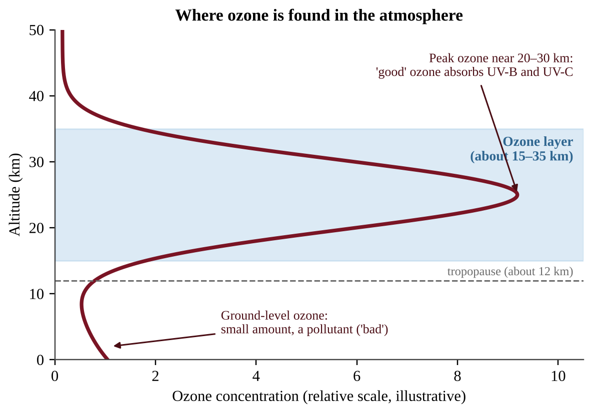{w=0.8}

The layer is made and destroyed continuously by sunlight:

- O₂ + UV → O + O (high-energy UV splits oxygen molecules)
- O + O₂ → O₃ (an oxygen atom joins another O₂)
- O₃ + UV → O₂ + O (ozone absorbs UV and is split again; the energy becomes heat)

Natural creation and destruction roughly balance, so the layer keeps a steady thickness. Because ozone turns UV into heat, the stratosphere gets warmer with height, the reverse of the troposphere.

**Why it matters.** UV-B and UV-C damage DNA and proteins in living cells. Early life stayed in the oceans, where water shielded it from UV. As photosynthesis added oxygen to the air, an ozone layer formed, and that helped make life on land possible.

### Effects of more UV at the surface

When stratospheric ozone decreases, **more UV reaches Earth's surface**. In humans this raises the risk of **skin cancer** and **cataracts** (clouding of the eye's lens) and can weaken the immune system. Higher UV also harms phytoplankton (the base of marine food webs), fish and amphibian larvae and crops, and it breaks down plastics and paints. In tank experiments phytoplankton under a UV-blocking filter photosynthesize more than those under natural or boosted UV. Regions near the ozone hole, such as southern Australia, show the clearest rise in UV-related skin cancer.

### Measuring ozone

Ozone is measured as a **column**: all the O₃ in a vertical strip of air, in **Dobson units (DU)**. A typical global value is about 300 DU. Values below about 220 DU are called an **ozone hole**.

:::box define
**Ozone layer** — the part of the stratosphere with high O₃ concentration that absorbs most UV-B and UV-C.
**Ultraviolet (UV) radiation** — short-wavelength light from the Sun that can damage living tissue.
**Dobson unit (DU)** — a measure of the total ozone in a column of air.
:::

:::box mistake
- Mixing up the two ozones. Ground-level ozone is a pollutant; stratospheric ozone protects. Always name the location.
- Saying UV causes skin cancer "by heat." UV damages DNA directly.
- Saying ozone depletion causes global warming. It is a different problem (CFCs are also greenhouse gases, see 11.3).
:::

:::box example
id: SG-U9-E001
A city's meteorological office reports that over ten years, the average stratospheric ozone concentration above the region fell, while a separate monitor shows ground-level ozone in the same city rose. (a) Identify which of the two changes increases the UV that reaches residents and explain why. (b) State one human health effect of the increased UV exposure and one effect of the increased ground-level ozone.
:::

:::box example
id: SG-C11-E001
A polar monitoring station records a lowest yearly ozone column of 280 DU in 1975 and 105 DU in 2000. (a) Calculate the percent decrease. (b) State whether the 2000 value is below the 220 DU hole threshold and by how many DU. (c) Name one human health effect expected from the extra UV that reaches the surface.
:::

:::box summary
- Stratospheric ozone absorbs harmful UV and made life on land possible.
- Ground-level ozone is a pollutant; stratospheric ozone is protective.
- Less ozone means more UV, which means more skin cancer and cataracts and damage to plankton and crops.
:::

## 11.2 Ozone Depletion

%% CED: 9.1, 9.2 | STB-4.A.2, STB-4.B.1 | LO: STB-4.A, STB-4.B

:::box simple
Humans released long-lived chemicals (CFCs) that drift up, get split by sunlight and free chlorine atoms. One chlorine atom destroys ozone again and again. We fixed the problem by banning the chemicals, but the substitutes are not all harmless.
:::

### What depletes ozone

**Human causes.** The main culprits are **chlorofluorocarbons (CFCs)**, synthetic compounds of carbon, chlorine and fluorine. They were used as refrigerants, aerosol propellants, foam-blowing agents and solvents. CFCs are unreactive in the lower atmosphere, which is why they seemed safe. It is also why they last decades to a century and drift up into the stratosphere. Halons (fire suppressants with bromine) and methyl bromide also deplete ozone.

:::box process
CFC at the surface (stable) → winds carry it up into the stratosphere → UV-C breaks a C–Cl bond and frees a chlorine atom (Cl) → Cl + O₃ → ClO + O₂ (ozone destroyed) → ClO + O → Cl + O₂ (Cl regenerated) → the same Cl attacks another ozone molecule → one Cl atom can destroy thousands of ozone molecules.
:::

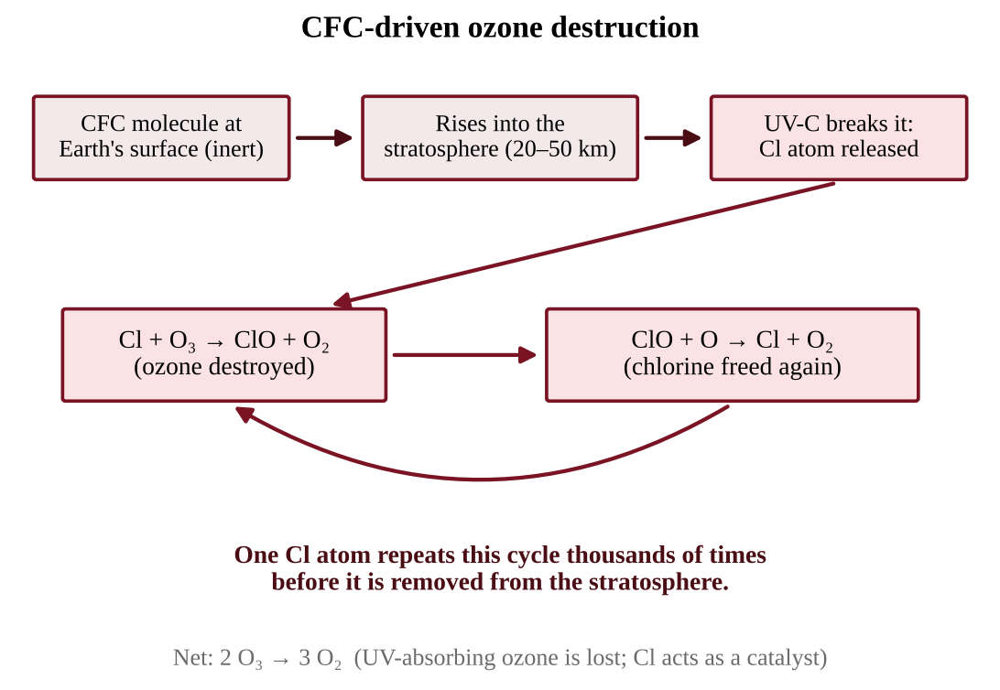{w=0.8}

A **catalyst** speeds up a reaction without being used up. Chlorine leaves the cycle unchanged, so a trace gas measured in parts per trillion can thin a layer that spans the globe.

**Natural factors.** During the long Antarctic winter, air circulates in an isolated **polar vortex** and becomes extremely cold, so thin ice crystals form in polar stratospheric clouds. Reactions on the surface of these crystals change stable chlorine compounds into reactive forms. Little ozone is lost in the dark, because freeing chlorine atoms needs sunlight. When sunlight returns at the start of the Antarctic spring, UV splits the reactive chlorine, and ozone is destroyed quickly until the air warms and the ice crystals melt. That is why the Antarctic **ozone hole** appears each September–October. Cold-vortex conditions set the timing; the chlorine that makes the hole so severe comes from human-made chemicals.

### The Montreal Protocol

In the 1970s and 1980s scientists linked CFCs to ozone loss and documented the Antarctic ozone hole. In 1987 nations signed the **Montreal Protocol**, an agreement to phase out CFCs, halons and other ozone-depleting substances. It was strengthened several times and nearly every country joined. It is widely seen as the most successful international environmental treaty because the science was clear, affordable substitutes existed, and developing countries got a slower schedule with financial help.

Because CFCs persist for decades, recovery is slow. Stratospheric chlorine peaked around 2000 and has fallen since. Ozone responds with a lag, so the ozone minimum bottoms out *after* chlorine peaks. "Recovered" means back to the earlier (about 1980) level, so a minimum that rose from 100 to 125 DU has improved but not recovered. The layer is expected to recover around the middle of this century.

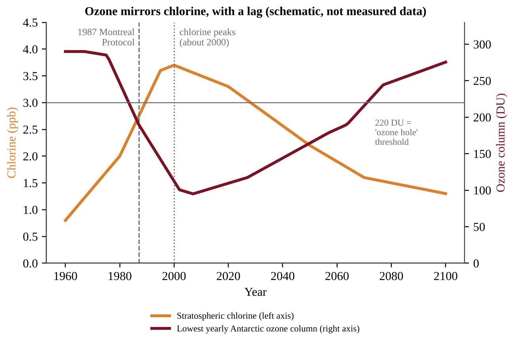{w=0.85}

### Substitutes for CFCs

| Substitute | Contains chlorine? | Ozone effect | Other concern |
|---|---|---|---|
| HCFCs (hydrochlorofluorocarbons) | Yes, but less | Much less depleting; interim step | Greenhouse gases; also being phased out |
| HFCs (hydrofluorocarbons) | No | Do not deplete ozone | Many are strong greenhouse gases |
| Hydrocarbons, ammonia, CO₂ | No | None | Some flammable or toxic; need careful design |

**HFCs** contain no chlorine, so they do not harm the ozone layer. But some HFCs trap heat hundreds to thousands of times more strongly than CO₂ per unit mass, so their growing use in air conditioning worsens climate change. A 2016 amendment to the Montreal Protocol now phases HFCs down too. **A solution to one environmental problem can create an unintended consequence elsewhere**, so judge a substitute on more than one impact.

Two separate scales rate a chemical. **Ozone depletion potential (ODP)** compares its ozone-destroying power with a CFC reference of 1. **GWP** compares its heat trapping with CO₂ (see 11.3). An HFC can have ODP 0 and GWP in the thousands, so never use one scale to answer a question about the other.

:::box define
**Montreal Protocol** — the 1987 treaty that phased out ozone-depleting substances.
**Catalyst** — a substance that speeds a reaction without being consumed.
**Polar vortex** — the isolated, very cold winter air over a pole.
**HFC (hydrofluorocarbon)** — a CFC substitute with no chlorine; ozone-safe but often a potent greenhouse gas.
**Phase-out** — a scheduled reduction of production and use until a substance is eliminated.
:::

:::box mistake
- Writing that the Montreal Protocol "fixed" the ozone layer. It stopped new damage; recovery takes decades.
- Calling HFCs "harmless." They are ozone-safe, not climate-safe.
- Expecting the ozone hole to disappear the year chlorine peaks. Recovery lags the chlorine decline.
:::

:::box strategy
To describe how CFCs deplete ozone, name the sequence: CFCs reach the stratosphere, UV frees chlorine, chlorine breaks down ozone, chlorine is regenerated (catalyst). Finish with the impact: more UV, skin cancer and cataracts.
:::

:::box example
id: SG-U9-E002
Three coolants are being considered for a new refrigeration plant. Coolant X contains chlorine and has low heat-trapping ability. Coolant Y contains no chlorine and has a very high heat-trapping ability per molecule. Coolant Z contains no chlorine and has low heat-trapping ability but is flammable. (a) Which coolant would harm the stratospheric ozone layer most? Explain using the chlorine cycle. (b) Which coolant would contribute most to the greenhouse effect per kilogram released? (c) Make a claim for which coolant should be chosen and justify it, naming one precaution you would take.
:::

:::box example
id: SG-U9-E013
A monitoring station reports stratospheric chlorine (ppb) and the lowest yearly ozone column over a polar site (DU): 1985: 2.2 ppb, 190 DU; 1995: 3.6 ppb, 120 DU; 2005: 3.5 ppb, 110 DU; 2015: 3.0 ppb, 120 DU. A refrigerant has an ODP of 0.04 and a GWP of 900. (a) Calculate the percent decrease in chlorine from 1995 to 2015. (b) Explain why ozone in 2015 was still below its 1985 value although chlorine had been falling for 20 years. (c) Calculate the CO₂e of releasing 50 kg of the refrigerant and state whether it harms ozone more or less than a CFC (ODP 1).
:::

:::box summary
- CFCs reach the stratosphere, UV frees chlorine, and chlorine catalytically destroys ozone. Cold polar vortex conditions set the timing of the Antarctic ozone hole.
- The Montreal Protocol (1987) phased out ozone-depleting substances; recovery is slow because CFCs persist.
- Substitutes: HCFCs (interim), HFCs (no chlorine, often high GWP), and non-halogen options.
:::

## 11.3 Global Warming

%% CED: 9.3, 9.4, 9.5 | STB-4.C.1, STB-4.C.2, STB-4.C.3, STB-4.D.1, STB-4.E.1, STB-4.F.1, STB-4.F.7, STB-4.F.8, STB-4.F.9 | LO: STB-4.C, STB-4.D, STB-4.E, STB-4.F

:::box simple
Sunlight warms the ground. The ground sends the energy back out as invisible infrared heat. Greenhouse gases absorb some of that heat and re-emit it in all directions, including back down, like a blanket. Without the blanket Earth would be frozen; a thicker blanket makes it hotter.
:::

### The greenhouse effect

Earth receives most of its energy as **shortwave radiation** (visible light and some UV). About 30% is reflected straight back by clouds, aerosols, ice and bright surfaces (**albedo** is the fraction reflected). The rest warms the atmosphere and surface. A warm surface emits **longwave (infrared) radiation**. To keep a steady temperature, Earth must send out as much energy as it absorbs.

Greenhouse gases let sunlight in but absorb outgoing infrared. They re-emit it in every direction, and part goes back down, warming the surface and lower atmosphere. Nitrogen and oxygen (about 99% of air) do not absorb infrared significantly, so they are not greenhouse gases.

The **natural greenhouse effect is essential**: it gives an average surface temperature near 15°C instead of about −18°C. The environmental problem is the **enhanced greenhouse effect**: human activities add greenhouse gases, strengthen the blanket and raise the temperature at which energy in equals energy out.

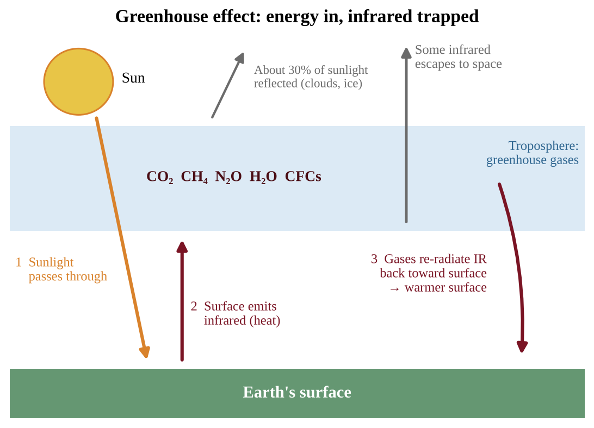{w=0.8}

:::box process
More greenhouse gas → more outgoing infrared absorbed and re-emitted downward → less heat escapes to space → Earth absorbs more than it emits → atmosphere, land and oceans warm → warming continues until outgoing radiation again matches incoming energy, at a higher temperature.
:::

**Following the energy in numbers.** Energy budgets use 100 units of arriving sunlight. Two checks always work: (1) at the **surface**, sunlight absorbed + infrared returned by the atmosphere = infrared emitted by the surface; (2) at the **top of the atmosphere**, reflected sunlight + infrared escaping = sunlight arriving. In Figure 11.5, 45 + 75 = 120 at the surface, and 30 + 15 + 55 = 100 balances the sunlight. The surface gets more energy from the atmosphere (75) than from the Sun (45): the greenhouse effect in one number. More greenhouse gas raises the 75 and lowers the 15 that escapes directly, so the budget is briefly unbalanced. A warmer surface then emits more infrared, a **negative feedback** that restores balance. **Aerosols** such as volcanic sulfate droplets scatter sunlight and cool the surface for a few years, the opposite push to CO₂.

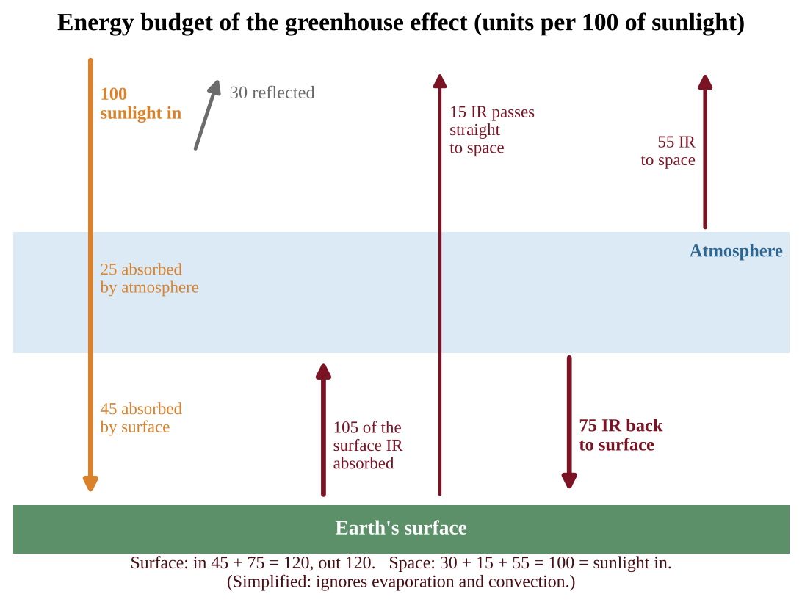{w=0.75}

### Greenhouse gases: sources and potency

The principal greenhouse gases are carbon dioxide (CO₂), methane (CH₄), water vapor (H₂O), nitrous oxide (N₂O) and chlorofluorocarbons (CFCs).

**Water vapor** is the most abundant greenhouse gas, yet it is not a major cause of human-driven climate change. Its **residence time** is short (days), so it rains out. Its amount is set by temperature, not by emissions: warming raises it (a feedback, below).

**Global warming potential (GWP)** compares the heat a gas traps with CO₂ over a set period (usually 100 years), per unit mass. CO₂ is the reference: **GWP = 1**. **CFCs have the highest GWP, followed by nitrous oxide, then methane.**

| Gas | Main sources | Approx. GWP (100 yr) | Notes |
|---|---|---|---|
| CO₂ | Fossil fuels, deforestation, cement | 1 | Largest total effect: huge emissions, long-lived |
| CH₄ | Livestock, rice paddies, landfills, gas leaks, wetlands, thawing permafrost | about 25–30 | Lives about a decade; strong per molecule |
| N₂O | Synthetic fertilizer, manure, fuel combustion | about 265–300 | Also depletes stratospheric ozone |
| CFCs | Old refrigerants, foams, aerosols | thousands (up to 10,000+) | Very potent, small amounts, declining |

CO₂, CH₄, N₂O and water vapor have natural and human sources. **CFCs and HFCs have none**, so any in the air is human-made. Ground-level ozone is also a greenhouse gas. Methane forms where organic matter decays **without oxygen**: wetlands, rice paddies, landfills, manure lagoons and the guts of cattle and termites. Burning fossil fuel adds carbon that was locked underground for millions of years. Burning recently grown plant material returns carbon that plants took from the air recently, so it is often treated as part of the existing cycle, though it still releases CO₂.

**Potency versus total.** GWP shows strength per kilogram. A gas's total contribution depends on potency, how much is emitted and how long it stays. CO₂ has the lowest GWP yet is the largest driver, because humans emit billions of tonnes a year and part of it stays for centuries.

:::box formula
**CO₂-equivalent (CO₂e) = mass of gas × GWP**
Mass in tonnes (or kg); GWP is a unitless multiplier; CO₂e has the same mass unit. Use CO₂e to add different gases: total = (mass₁ × GWP₁) + (mass₂ × GWP₂) + …
*Demonstration:* a landfill emits 200 t CH₄ (GWP 25) and a plant emits 1,000 t CO₂. CO₂e = 200 × 25 + 1,000 × 1 = 6,000 t; methane is 5,000 ÷ 6,000 ≈ 83% of the effect.
:::

### Increases in greenhouse gases: reading the record

**Ice cores.** In Antarctica and Greenland, snow compresses into ice that traps bubbles of ancient air. Deeper ice is older, so cores give a record of about 800,000 years. Oxygen-isotope ratios in the ice estimate past temperatures. Over that time CO₂ cycled between about 180 ppm in cold glacial periods and about 280 ppm in warm interglacials, and **temperature and CO₂ rose and fell together**. Slow changes in Earth's orbit and tilt started these swings and feedbacks amplified them.

**The Keeling curve.** Direct measurements at Mauna Loa, Hawaii, since 1958 show CO₂ rising from about 315 ppm to over 420 ppm. A small yearly zigzag appears: in the Northern Hemisphere growing season plants take up CO₂ and the level dips; in winter it climbs. Under the zigzag every year is higher than the last. Today's CO₂ is about 50% above the pre-industrial level of about 280 ppm and higher than anything in the ice-core record. Methane and N₂O have also risen well above pre-industrial levels.

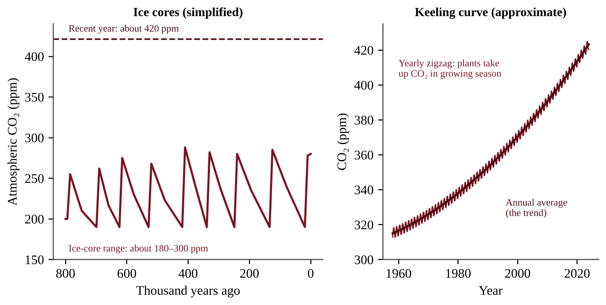{w=0.9}

**Reading an ice-core graph.** Match the peaks of CO₂ and temperature, quote values (180–300 ppm) and compare with today's line. Use careful verbs ("closely linked," not "CO₂ alone caused every change").

### Climate change through time and feedback loops

Earth's climate has swung between ice ages and warm periods, recorded in ice cores, ocean sediments and tree rings, with natural drivers such as orbit, solar output, volcanoes and greenhouse gases. What is new is the **speed** and the **cause**: average global temperature has risen about 1.1–1.2°C since the late 1800s, far faster than natural transitions, and it matches the rise in human-emitted greenhouse gases. **Weather** is the state of the atmosphere at a place and time; **climate** is the long-term average (30 years or more). One cold winter does not disprove warming.

A **positive feedback loop** amplifies a change. A **negative feedback loop** counteracts it. Positive and negative describe direction, not good or bad.

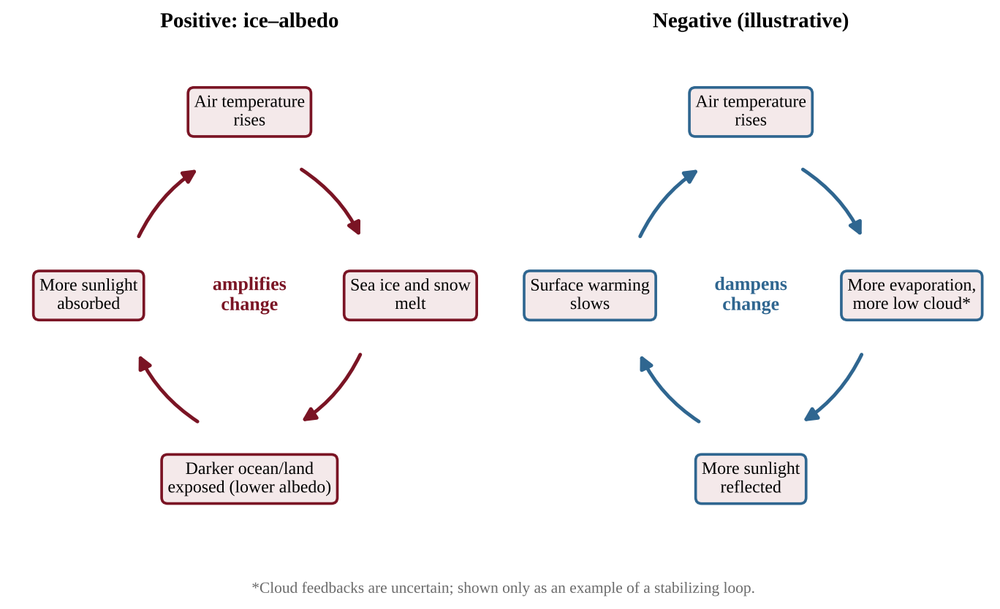{w=0.85}

- **Ice–albedo.** Bright snow and ice reflect sunlight. Warming melts them, exposing darker water and land that absorb more sunlight, causing more warming and melting. Dark shrubs and trees standing above the snow act the same way. Polar regions respond **faster** than most places because of this loop; the Arctic warms two to four times faster than the global average.
- **Permafrost thaw.** Frozen tundra soil stores vast amounts of dead plant matter. When it thaws, microbes release CO₂ and **methane**, adding greenhouse gas and more warming. The **active layer** is the surface soil that thaws each summer; as it deepens, more carbon becomes available. Thawing also destabilizes ground under buildings, roads and pipelines (adaptations: pile foundations, insulated pads, relocation).
- **Water vapor.** Warmer air holds more vapor, a greenhouse gas.
- **Declining ocean uptake.** Warmer water dissolves less CO₂, leaving more in the air.

Negative feedbacks also exist: a warmer surface radiates more infrared to space.

:::box process
Warming → sea ice and snow melt → albedo falls → more sunlight absorbed by dark ocean and land → more warming → more melt.
Warming → permafrost thaws → decomposition releases CO₂ and CH₄ → stronger greenhouse effect → more warming → more thaw.
:::

:::box define
**Greenhouse effect** — warming of the lower atmosphere and surface because gases absorb and re-emit outgoing infrared.
**Global warming potential (GWP)** — a gas's heat trapping relative to the same mass of CO₂.
**Residence time** — the average time a molecule stays in the atmosphere.
**Albedo** — the fraction of incoming sunlight a surface reflects.
**Permafrost** — ground frozen for two or more years, holding large stores of carbon.
**Positive / negative feedback loop** — a process whose effects amplify / reduce the original change.
:::

:::box mistake
- "The greenhouse effect is bad." The natural effect is necessary; the **enhanced** effect is the problem.
- "Greenhouse gases trap sunlight." They absorb outgoing **infrared**.
- Naming water vapor as the main cause of climate change because it is abundant. Short residence time and temperature control are the key points.
- Reading the seasonal zigzag in a CO₂ graph as a trend. The annual average is the trend.
- Treating the energy budget as "energy trapped forever." At equilibrium energy out equals energy in, at a higher temperature.
- Calling every feedback "good" or "bad." Positive means amplifying.
:::

:::box strategy
If a question gives amounts of several gases and asks which has the biggest climate impact, compute CO₂e (mass × GWP) for each; do not pick the highest GWP automatically. In a feedback FRQ, write the chain one link at a time, give the mechanism (albedo, methane release), then label it "positive, because the change is amplified."
:::

:::box example
id: SG-U9-E003
A dairy and crop farm reports its annual emissions: 600 tonnes of CO₂, 40 tonnes of CH₄ and 3 tonnes of N₂O. Use GWP values of 1 for CO₂, 28 for CH₄ and 265 for N₂O. (a) Calculate the farm's total emissions in tonnes of CO₂e. (b) Calculate the percentage of the total that comes from methane. (c) Identify one source of each of the three gases on a farm.
:::

:::box example
id: SG-U9-E014
In a simplified budget, 100 units of sunlight arrive. Clouds and ice reflect 28; the atmosphere absorbs 22 and the surface absorbs 50. The surface emits 130 units of infrared, of which 10 pass directly to space. (a) Calculate how many units of infrared the atmosphere returns to the surface. (b) Calculate how many units the atmosphere emits to space. (c) Extra greenhouse gas now absorbs 4 of the 10 units that used to pass directly to space. Predict the immediate effect on the total energy leaving Earth compared with the 100 units arriving, the long-term effect on surface temperature, and the feedback that finally restores balance.
:::

:::box example
id: SG-U9-E004
Atmospheric CO₂ was about 280 ppm before the Industrial Revolution and 420 ppm in a recent year. (a) Calculate the percent increase. (b) An ice-core record shows that CO₂ over the last 800,000 years never exceeded 300 ppm. Explain in one or two sentences what this comparison suggests about the present concentration. (c) A graph of CO₂ measured monthly at one observatory shows a yearly zigzag. Explain what causes the zigzag and why it does not contradict the long-term increase.
:::

:::box example
id: SG-U9-E006
In a high-latitude lake region, a scientist records that each year the ice-free period lengthens, exposing dark water. (a) Describe how this is a positive feedback loop, including the role of albedo. (b) Explain why a loop in which warmer air increases evaporation, forming bright low clouds that reflect more sunlight, would be a negative feedback loop. (c) Identify one effect on an ice-dependent species.
:::

:::box example
id: SG-C11-E002
Annual-average CO₂ at an observatory was 370 ppm in 2000 and 410 ppm in 2020. (a) Calculate the average rate of increase in ppm per year. (b) Assuming the same rate continues, calculate the year in which CO₂ reaches 450 ppm. (c) State one reason the real future rate could differ from this straight-line projection.
:::

:::box summary
- Greenhouse gases absorb outgoing infrared; the natural effect keeps Earth habitable, the enhanced effect warms it.
- Principal gases: CO₂, CH₄, H₂O, N₂O, CFCs. Water vapor is not a major driver (short residence time). GWP (CO₂ = 1): CFCs > N₂O > CH₄ > CO₂.
- Ice cores (800,000 years, 180–280 ppm, tracking temperature) and the Keeling curve (continuous rise since 1958) show today's CO₂ is unprecedented.
- Positive feedbacks (ice–albedo, permafrost methane) amplify warming, especially at the poles.
:::

## 11.4 Impacts and Consequences of Global Warming

%% CED: 9.4, 9.5, 9.6, 9.7 | STB-4.E.1, STB-4.F.2, STB-4.F.3, STB-4.F.4, STB-4.F.5, STB-4.F.6, STB-4.F.10, STB-4.G.1, STB-4.G.2, STB-4.G.3, STB-4.H.1, STB-4.H.2, STB-4.H.3, STB-4.H.4 | LO: STB-4.E, STB-4.F, STB-4.G, STB-4.H

:::box simple
A warmer world melts ice, swells the oceans, shifts weather and stresses species. The oceans soak up most of the extra heat and about a quarter to a third of our CO₂, so they warm and turn less basic. Each effect also feeds back on people.
:::

### Sea level and coasts

Sea level rises for two reasons: (1) **thermal expansion**, because water expands as it warms, and (2) **melting land ice** (mountain glaciers and the Greenland and Antarctic ice sheets), which adds new water. Melting floating sea ice does not raise sea level noticeably, like an ice cube in a full glass, though it feeds the albedo loop.

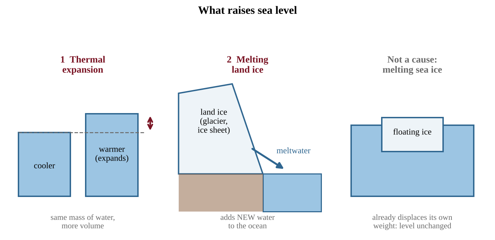{w=0.85}

Flooding, storm surge and saltwater intrusion into groundwater make low-lying land uninhabitable, so **coastal populations are displaced**. Island nations and river deltas are exposed first. Salt water moves farther up estuaries and kills species with narrow salt tolerance. Marshes and mangroves cannot migrate inland when seawalls or development block them.

### Health, population and movement

As winters shorten, **disease vectors spread from the tropics toward the poles** and uphill. Mosquitoes and ticks that carry malaria, dengue and Lyme disease are limited by cold, so new areas face people with no immunity and prepared health systems. Heat waves raise heat illness and deaths, and hotter air worsens smog and ground-level ozone. Drought, failed crops, flooded coasts and heat lower a region's carrying capacity, so **population dynamics and movements change**: people migrate (climate refugees), altering birth, death and migration patterns where they leave and where they arrive.

### Weather, circulation and soil

- **Extreme weather.** Warmer air holds more water vapor, so heavy rain and flooding become more intense. Heat waves, droughts and wildfire seasons lengthen. Warmer ocean surfaces give tropical cyclones more energy, so the strongest storms get stronger and carry more rain; sea-level rise adds to storm surge.
- **Atmospheric circulation.** Winds carry heat around the planet. Warm air rises at the equator and flows poleward in **Hadley cells**; the **jet stream** is a fast air current near the tropopause that steers storms. Warming changes the temperature contrast driving them, so cells can widen and the jet stream can become wavier, shifting rainfall belts and storm tracks.
- **Ocean currents.** Currents, the ocean conveyor belt, carry heat across the globe. Cold, salty water sinks in the North Atlantic and drives the circulation. Melting ice adds fresh, less dense water that sinks less readily, so the conveyor may slow, which could change climates, especially in coastal regions such as northwestern Europe.
- **Soils.** Higher temperatures speed evaporation and decomposition. Drought leaves soil dry and bare; intense storms increase erosion. Soil viability for crops can fall and erosion can rise.

### Effects on ecosystems

- **Ranges shift** toward the poles and uphill. Mountaintop species run out of higher ground, and cold-water fish lose streams that warm. Timing mismatches arise when insects emerge earlier than the birds that feed on them.
- **Ice-dependent species** such as polar bears and seals lose hunting and breeding platforms, and under-ice algae at the base of the food web are lost.
- **Marine ecosystems and sea level.** Rising seas create new shallow habitat over flooded continental shelves, a gain for some species. But communities that need light, such as seagrass and corals, may end up deeper than the **photic zone** (the sunlit layer where photosynthesis is possible) and decline. Coastal wetlands are squeezed against development.

### Ocean warming and coral bleaching

Ocean warming is caused by **greenhouse gases**. Water has a very high heat capacity, so the oceans absorb more than 90% of the extra heat. Surface water warms first and mixes slowly downward, so oceans keep warming long after emissions fall.

- **Habitat loss.** Species with narrow temperature tolerance lose range. Cold-water fish, kelp forests and sea-ice communities shrink and many species move poleward, changing fisheries.
- **Metabolic changes.** Most marine animals are ectotherms. Warming speeds their metabolism and oxygen needs, while **warmer water holds less dissolved oxygen**. This stresses fish and invertebrates and can create low-oxygen zones.
- **Reproductive changes.** Spawning and larval survival are timed to temperature. In sea turtles, warm nests produce more females. Larvae can miss their plankton food.

**Coral bleaching.** Reef-building corals are animals that host microscopic algae (zooxanthellae). The algae photosynthesize and supply most of the coral's food and color; the coral gives shelter and nutrients (a mutualism). When water stays a degree or two above the normal summer maximum for weeks, the algae produce harmful compounds and the coral expels them, leaving transparent tissue over a white skeleton. Bleached corals are starving, not dead. **Some corals recover** if temperatures drop soon enough and algae return; if the stress lasts, **corals die**, and the reef loses the habitat of about a quarter of marine species plus fisheries and coastal protection.

### Ocean acidification

Ocean acidification is the **decrease in ocean pH, primarily from increased atmospheric CO₂**. The oceans absorb roughly a quarter to a third of the CO₂ humans emit. In seawater:

CO₂ + H₂O ⇌ H₂CO₃ (carbonic acid)
H₂CO₃ ⇌ H⁺ + HCO₃⁻ (bicarbonate)
H⁺ + CO₃²⁻ ⇌ HCO₃⁻ (carbonate is used up)

More CO₂ gives more H⁺ **and less carbonate**. Shell and skeleton builders make calcium carbonate: Ca²⁺ + CO₃²⁻ → CaCO₃. With less carbonate, building costs more energy, and in sufficiently acidic water calcium carbonate can **dissolve**.

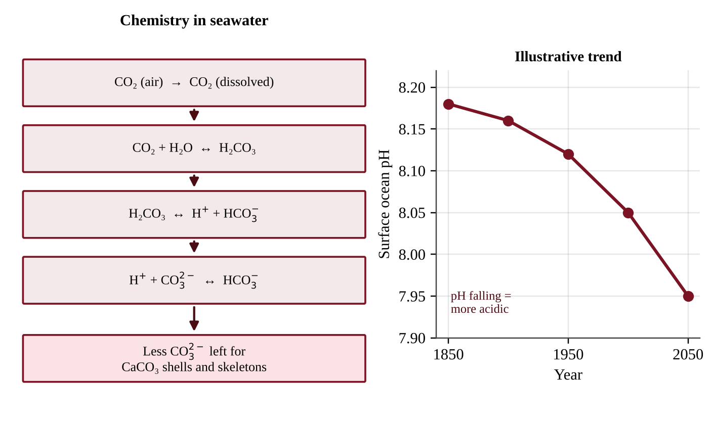{w=0.85}

**Understanding pH.** The pH scale is **logarithmic**: a change of 1 unit is a 10-fold change in H⁺. Average surface pH has fallen from about 8.2 to about 8.1. That 0.1 drop means H⁺ rose by 10^0.1 ≈ 1.26, about **26%**. The ocean is still slightly basic (pH above 7); "acidification" means becoming *less basic*.

| pH drop | Factor 10^drop | Increase in H⁺ |
|---|---|---|
| 0.05 | 1.12 | 12% |
| 0.10 | 1.26 | 26% |
| 0.20 | 1.58 | 58% |
| 0.30 | 2.00 | 100% |
| 1.00 | 10 | 900% |

A CO₂ graph and a pH graph for the same years mirror each other (inverse relationship). **Local pH can swing more than the global average.** In coastal **upwelling**, winds draw up cold deep water that holds extra CO₂ from decaying organic matter and has a lower pH. Upwelled water can kill oyster larvae building their first shells.

**Causes and effects.** Activities that raise atmospheric CO₂, and so acidify the ocean, are **burning fossil fuels, vehicle emissions and deforestation**, the same cause as global warming. Corals, oysters, clams, sea urchins and planktonic snails (pteropods) have calcium carbonate shells or skeletons, so growth slows, larvae weaken and structures dissolve. Pteropods feed fish such as salmon, and reefs lose the structure that shelters fish and shields shorelines. Heat plus acidification harms coral more than either alone.

:::box formula
**Change in H⁺ concentration = 10^(pH₁ − pH₂)** (new [H⁺] ÷ old [H⁺])
pH₁ is the higher (earlier) value; pH₂ the lower (later) value. Each 1.0 decrease means 10 times more H⁺; each 0.3 means about 2 times more. Percent increase = (factor − 1) × 100.
**Sea-level rise = rate × time**, with units converted (4 mm/yr × 50 yr = 200 mm = 0.2 m).
**Volume = area × thickness; mass = volume × density.** Convert units first (3 mm = 0.003 m).
:::

:::box define
**Thermal expansion** — the increase in volume of water as it warms.
**Ectotherm** — an organism whose body temperature follows its surroundings.
**Coral bleaching** — loss of symbiotic algae from coral under stress, leaving it white.
**Ocean acidification** — the fall in ocean pH caused mainly by absorbed atmospheric CO₂.
**Calcification** — building shells or skeletons from calcium carbonate.
:::

:::box mistake
- Saying melting sea ice raises sea level the way melting land ice does, or forgetting thermal expansion.
- Saying bleached coral is always dead, or that acidification causes bleaching. Bleaching is mainly heat stress; acidification harms coral by removing carbonate.
- Saying the ocean is "now acidic," or that a drop from 8.2 to 8.1 is "small" (26% more H⁺).
- Forgetting that warm water holds less dissolved oxygen.
:::

:::box strategy
To "explain how burning fossil fuels harms coral reefs," write the chain: CO₂ rises → more dissolves in the ocean → H₂CO₃ forms → H⁺ rises, pH falls → carbonate decreases → calcium carbonate skeletons are harder to build. Add warming and bleaching as a second effect.
:::

:::box example
id: SG-U9-E005
The table shows global mean sea level rise measured by satellites for a small island nation's region.

| Year | Sea level above 2000 baseline (mm) |
|---|---|
| 2000 | 0 |
| 2010 | 32 |
| 2020 | 66 |

(a) Calculate the average rate of rise per year for 2000–2010 and for 2010–2020. (b) State whether the rate is speeding up or slowing and by how many mm/yr. (c) Identify the two main physical processes that raise sea level in a warming world.
:::

:::box example
id: SG-U9-E007
A coral reef's summer maximum sea temperature is normally 29.0°C. During one summer the water stays at 30.8°C for six weeks, and many corals turn white. Three months later, survey teams find that corals in a shaded, deeper part of the reef have regained their color while corals on the shallow, sunny flat are covered in algae growth and have no living tissue. (a) Calculate by how many degrees the water exceeded the normal maximum. (b) Explain what the corals lost to turn white and why this harms them. (c) State which part of the reef shows recovery and which shows mortality, and cite the evidence from the survey.
:::

:::box example
id: SG-U9-E008
Average surface-ocean pH in a monitored bay was 8.20 in 1990 and 8.10 in 2020. (a) By what factor did the hydrogen ion concentration change between those years? Express it as a percent increase. (b) Write the chemical equation showing how dissolved CO₂ combines with water to form carbonic acid. (c) Explain why this change makes it harder for oysters in the bay to build shells.
:::

:::box example
id: SG-C11-E003
A 1,000 m deep column of ocean water warms by 0.5°C. Seawater expands by about 2 × 10⁻⁴ of its height for each 1°C of warming. Assume the whole column warms evenly. (a) Calculate the rise in the height of the column, in meters and centimeters. (b) Identify whether this is a thermal expansion or a melting-ice effect, and name one other process that raises sea level.
:::

:::box summary
- Sea level rises from thermal expansion plus melting land ice; coasts flood and populations move; disease vectors, heat, storms and drought spread.
- Circulation (Hadley cells, jet stream, conveyor belt) and soils change; species shift ranges and ice-dependent species lose habitat.
- Oceans absorb most excess heat: habitat loss, less oxygen, reproductive changes and coral bleaching.
- CO₂ + H₂O ⇌ H₂CO₃ lowers pH and removes carbonate; 0.1 pH unit ≈ 26% more H⁺.
:::

## 11.5 Reducing Climate Change

%% CED: 9.4, 9.5 | STB-4.E.1, STB-4.F.2 | LO: STB-4.E, STB-4.F

:::box simple
There are two ways to respond to a warming world. **Mitigation** attacks the cause by cutting emissions or removing carbon. **Adaptation** reduces the damage from changes already under way. We need both.
:::

### Mitigation and adaptation

**Mitigation** reduces the cause: renewable energy, efficiency, public transit, fewer methane leaks, protecting forests, and carbon removal. **Adaptation** reduces harm: sea walls, raised buildings, beach nourishment, drought-tolerant crops, early-warning systems, wildlife corridors, cooling centers, and managed retreat (zoning limits on shoreline building, buyouts, ending subsidized flood insurance). Mitigation limits how bad things get; adaptation helps societies cope with what is already locked in.

### Where emissions come from and how to cut them

Most CO₂ comes from burning coal, oil and natural gas for electricity, heating, transport and industry. Methane comes from livestock, landfills, rice and gas leaks; N₂O from fertilizer. Major levers:

- **Switch fuels.** Replace coal with natural gas (about half the CO₂ per unit of electricity, but methane leaks offset some of the gain), and then with wind, solar, hydro, geothermal and nuclear, which emit little CO₂ in operation.
- **Use less energy.** Efficient buildings, appliances and vehicles; rail and public transit burn less fuel per passenger. Efficiency is often the cheapest lever: the fuel saved can repay the cost, giving a negative cost per tonne avoided.
- **Capture methane.** Landfill and manure digesters turn CH₄ (GWP about 28) into CO₂ (GWP 1) when burned. CH₄ + 2O₂ → CO₂ + 2H₂O, so 16 g of CH₄ gives 44 g of CO₂, and **1 t CH₄ gives 44 ÷ 16 = 2.75 t CO₂**.
- **Cut fertilizer and manure N₂O** with precise application.

**Net effect of an action** is what it avoids minus what it adds. Flaring 100 t of CH₄ avoids 100 × 28 = 2,800 t CO₂e but creates 100 × 2.75 = 275 t CO₂, so net = 2,525 t CO₂e avoided.

### Carbon sinks

A **carbon sink** takes in more carbon than it releases. About 45% of human CO₂ emissions stays in the air; the rest (about 55%) is absorbed by the ocean and by land.

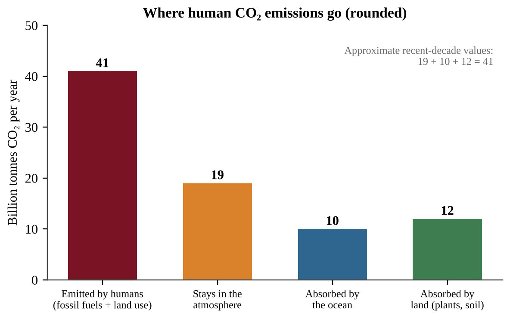{w=0.75}

- **Forests and soils.** Growing trees store carbon in wood and roots. Protecting forests and replanting (afforestation, reforestation) keep carbon out of the air; deforestation and burning release it. Farming that disturbs soil less and keeps it covered builds soil carbon.
- **Oceans.** They absorb CO₂, but this causes acidification (11.4), and warmer water holds less.
- **Coastal "blue carbon".** Mangroves, salt marshes and seagrass bury carbon in waterlogged mud for centuries.
- **Carbon capture and storage (CCS).** CO₂ is captured at a power plant or factory and injected into deep rock. It adds cost and energy use, and stored CO₂ must not leak.

To convert **carbon mass to CO₂ mass**, multiply by 44 ÷ 12 ≈ 3.67.

### Energy policy

| Policy | How it works | Trade-off |
|---|---|---|
| Carbon tax | Puts a price on each tonne of CO₂e | Raises energy costs; can be softened by returning revenue |
| Cap-and-trade | Caps total emissions; firms buy and sell permits | Needs strict, falling caps and monitoring |
| Subsidies and tax credits for renewables | Lower the cost of clean energy | Cost taxpayers; can be hard to end |
| Efficiency standards, renewable portfolio standards | Require efficient products or a share of clean power | Slow to turn over equipment |
| Ending fossil-fuel subsidies | Removes cost advantage of fossil fuels | Politically difficult; affects low-income households |

### International agreements and personal action

Climate change crosses borders, so countries negotiate. The **Kyoto Protocol (1997)** set binding emission targets for developed countries. The **Paris Agreement (2015)** aims to hold warming well below 2°C and pursue 1.5°C above pre-industrial levels. Each country sets its own **nationally determined contribution (NDC)** and reports progress, with targets meant to be strengthened every five years. Because pledges are voluntary, success depends on trust, finance for developing countries and transparent reporting.

**Personal action** adds up when many people act: driving less or choosing electric or transit, flying less, insulating homes, using renewable electricity, eating less beef and wasting less food.

:::box formula
**Percent change** = (new − old) ÷ old × 100 (the old value is the denominator).
**Cost per tonne avoided** = total cost ÷ (annual reduction × years).
**Target and yearly cut:** target = baseline × (1 − x ÷ 100); yearly cut = (current − target) ÷ years left.
**Payback time** = cost ÷ annual savings. **Total cost** over n years = one-time cost + annual cost × n.
**Percentage points vs percent:** a fall from 90% to 60% is 30 percentage points but 30 ÷ 90 = 33% percent change.
Projections assume a constant trend; feedbacks can speed or slow it.
:::

:::box define
**Mitigation** — action to reduce the causes of climate change.
**Adaptation** — action to adjust to the effects of climate change.
**Carbon sink** — a reservoir that absorbs more carbon than it releases.
**Carbon tax** — a fee per tonne of CO₂e emitted.
**Nationally determined contribution (NDC)** — a country's own emission pledge under the Paris Agreement.
:::

:::box mistake
- Treating mitigation and adaptation as the same thing, or as alternatives. A sea wall is adaptation; solar power is mitigation.
- Counting only the CO₂ saved and forgetting the CO₂ created when methane is burned (unless told to ignore it).
- Dividing a percent change by the new value instead of the old value.
:::

:::box strategy
When asked to justify a solution, compare cost per tonne avoided, then give one advantage and one disadvantage and say whether it is mitigation or adaptation. Show every step of a unit conversion.
:::

:::box example
id: SG-U9-E012
A city is choosing between two ten-year plans to reduce greenhouse gases. Plan A (replace coal heating with a district heat network) costs $18 million and cuts emissions by 1,500 t CO₂e per year. Plan B (capture methane at the landfill) costs $6 million and captures 400 t of CH₄ per year; use a GWP of 25 for CH₄ to convert captured methane to CO₂e. Assume each plan works for the whole ten years and ignore interest. (a) Calculate the total CO₂e avoided by each plan over ten years. (b) Calculate the cost per tonne of CO₂e avoided for each plan. (c) Make a claim for which plan the city should fund first and give one advantage and one disadvantage of the plan you chose. (d) Classify each plan as mitigation or adaptation.
:::

:::box example
id: SG-U9-E015
A farm captures 300 t of CH₄ a year from manure and burns it. Use GWP = 28 for CH₄. (a) Calculate the CO₂ produced by burning it, using 44 ÷ 16, and the net change in CO₂e per year. (b) The farm's emissions were 20,000 t CO₂e before the project. Calculate the percent reduction. (c) The farm pledges to end 40% below its original emissions in 8 years. Calculate the target and the average yearly cut still needed, starting from its emissions after the project. (d) The system cost $420,000 and earns $35,000 a year from selling the gas. Calculate the payback time.
:::

:::box example
id: SG-C11-E004
A household drives 12,000 km a year in a gasoline car that emits 0.20 kg of CO₂ per km. It switches to an electric car that uses 0.15 kWh per km, charged from a grid that emits 0.40 kg of CO₂ per kWh. (a) Calculate the household's yearly CO₂ emissions from driving before and after the switch, in kg. (b) Calculate the percent reduction. (c) State whether this is mitigation or adaptation and name one way the electricity source could make the reduction larger.
:::

:::box example
id: SG-C11-E005
A company plants 50 ha of forest that stores 4.0 t of carbon per hectare per year. The company emits 5,000 t of CO₂ per year. (a) Calculate the carbon stored per year, in tonnes of carbon. (b) Convert it to tonnes of CO₂ using 44 ÷ 12. (c) Calculate the percent of the company's yearly emissions this offsets. (d) Identify one reason the forest may offset less than calculated over several decades.
:::

:::box summary
- Mitigation cuts emissions or removes carbon; adaptation reduces damage. Both are needed.
- Levers: cleaner fuels, efficiency, methane capture, sinks (forests, soils, blue carbon, CCS), and policy (carbon tax, cap-and-trade, standards, subsidies).
- Paris-style agreements rely on voluntary national pledges that are reviewed and tightened.
- Compare options by CO₂e, cost per tonne avoided, net effect and payback.
:::

## 11.6 Loss of Biodiversity

%% CED: 9.8, 9.9, 9.10 | EIN-4.A.1, EIN-4.A.2, EIN-4.A.3, EIN-4.B.1, EIN-4.B.2, EIN-4.B.3, EIN-4.B.4, EIN-4.B.5, EIN-4.C.1, EIN-4.C.2, EIN-4.C.3, EIN-4.C.4, EIN-4.C.5, EIN-4.C.6 | LO: EIN-4.A, EIN-4.B, EIN-4.C

:::box simple
Biodiversity is falling because of six human pressures, remembered as **HIPPCO**. Most species are not killed directly. Their home is removed, cut into pieces, polluted or changed faster than they can adjust. Invasive species and a low, falling population make it worse.
:::

### HIPPCO

**Biodiversity** includes genetic diversity within species, species diversity within ecosystems and ecosystem diversity across a region. It gives stability and resilience, and provides food, medicines, materials, pollination, water purification and recreation.

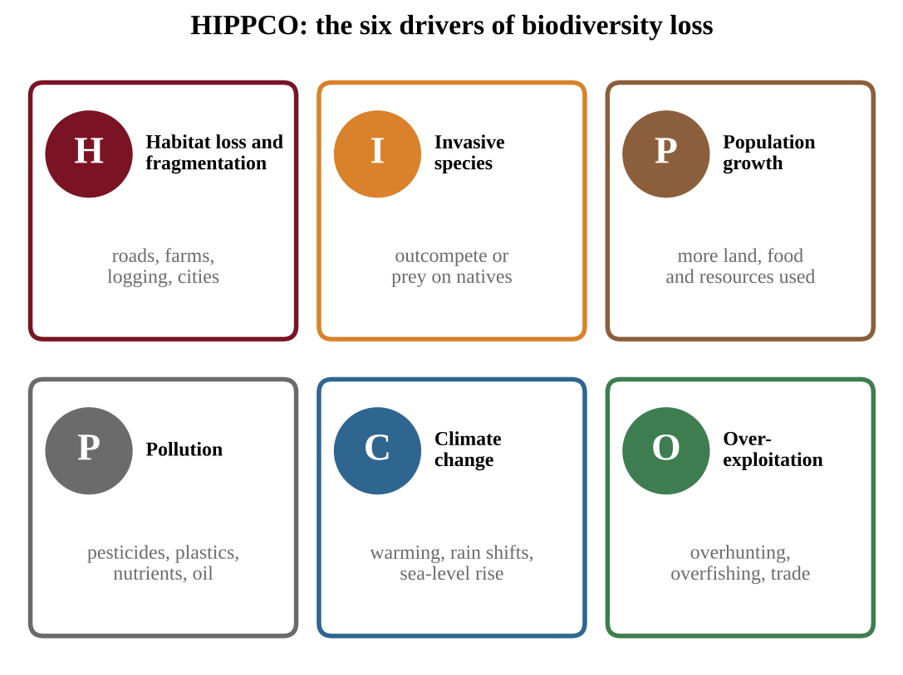{w=0.8}

| Letter | Factor | How it reduces biodiversity |
|---|---|---|
| **H** | Habitat destruction | Conversion to farms, cities, mines; loss of forests, wetlands, reefs; fragmentation |
| **I** | Invasive species | Outcompete or prey on natives |
| **P** | Population growth (human) | More people use more land, water and resources, magnifying every other pressure |
| **P** | Pollution | Pesticides, plastics, nutrients, oil and heavy metals poison or alter habitats |
| **C** | Climate change | Warming, shifting rainfall, sea-level rise, acidification |
| **O** | Over-exploitation | Overhunting, overfishing, bycatch, overharvesting, illegal wildlife trade |

### Invasive species

A **native** species evolved in an ecosystem. A **non-native** (introduced) species arrives from elsewhere; most do no harm. An **invasive species** can live, and sometimes thrive, outside its normal habitat and spreads so that it **threatens native species**. Invasive species can sometimes be beneficial (food, erosion control), but they are classed as invasive when they threaten natives.

**Pathways.** Ballast water of cargo ships, shipping crates and packing wood, the pet and aquarium trade, deliberate introduction for farming or ornament, and accidental transport on boats, vehicles and clothes. Trailers and bait water move aquatic invaders between lakes; roads and trails carry seeds into disturbed ground, so invasive plants are densest near them.

**Why they succeed.** Invasive species are often **generalist, r-selected species** that may **outcompete natives for resources**:

- **Generalists** tolerate wide conditions and eat many foods.
- **r-selected traits:** rapid growth, early maturity, many offspring, effective dispersal.
- **Few natural enemies** in the new range (enemy release).
- Aggressive behavior or chemicals that suppress other plants (allelopathy).

**Reading invasion data.** **Linear** growth adds the same amount each year. **Exponential** growth adds more each year and doubles every fixed time: size = N₀ × 2ⁿ after n doublings (25 ha doubling every 5 years covers 25 × 2³ = 200 ha after 15 years). **Logistic** growth levels off near carrying capacity. While an invader is on the upward bend, control is cheap and each year of delay costs more.

**Examples.** Zebra mussels (Great Lakes; they filter plankton, clearing the water and starving native filter feeders), kudzu (smothers plants), Burmese pythons (Everglades), lionfish (Caribbean) and cane toads (Australia; brought in to eat crop beetles, they poisoned native predators, a biological control that backfired). Consequences: loss of native biodiversity, altered food webs and nutrient cycles, economic costs, loss of ecosystem services.

| Control strategy | Example | Advantage | Disadvantage |
|---|---|---|---|
| Prevention | Cargo inspection, boat cleaning, ballast rules | Cheapest, most effective | Needs monitoring and cooperation |
| Physical removal | Hand-pulling, trapping, hunting | Targeted, no chemicals | Labor-intensive |
| Chemical control | Herbicides, pesticides | Fast, large areas | Harms non-target species; resistance |
| Biological control | Release a predator or pathogen from the home range | Self-sustaining | May attack natives or itself become invasive |
| Habitat management | Prescribed burns, restoring native plants | Strengthens natives | Ongoing effort |
| Legislation and education | Laws on transport and release; awareness campaigns | Broad impact | Enforcement |

### Endangered species

Conservation groups rank species by closeness to extinction. The IUCN Red List runs from Least Concern through Near Threatened, **Vulnerable, Endangered, Critically Endangered**, to Extinct in the Wild and Extinct. In the United States the **Endangered Species Act (1973)** protects species listed as endangered (in danger of extinction across all or a large part of their range) or threatened (likely to become endangered). **CITES** regulates international trade in wild plants and animals.

**How species become endangered.** A species is at risk when it is:

- **extensively hunted or collected** (poaching for ivory, horn, fur, pets);
- limited to a **narrow diet** (pandas and bamboo, koalas and eucalyptus);
- **outcompeted by invasive species**;
- tied to **specific, limited habitat** (an island or single mountaintop).

Other risk factors: K-selected traits (large body, slow maturity, few young, so slow recovery), small population size, and being a top predator. **Small populations** are fragile: chance events remove a large share, a bottleneck leaves little genetic diversity so inbreeding follows, and mates are hard to find. A disease seldom kills every host, because some individuals resist it and fewer hosts slow its spread, but a small, genetically similar population may have no resistant members.

**Not all species are in danger of extinction when exposed to the same changes.** Species that can **adapt** (variation in behavior or genes) or **move** (disperse) to a new environment are less likely to go extinct. An island specialist can do neither.

**Selective pressures** are any factors that change the behaviors and fitness of organisms: predation, disease, climate change, food shortage, a new competitor, hunting. Individuals with helpful traits leave more offspring, so the population evolves, but evolution needs time and genetic variation. Species also **compete for resources** (territory, food, mates, habitat). If human change intensifies competition, the weaker competitor may become endangered or extinct.

**Protecting species.** (1) **Criminalizing poaching** and trade, with enforcement; (2) **protecting habitats** through parks, reserves and conservation easements, because habitat loss is the leading cause; (3) **legislation** such as the ESA and CITES. Match the strategy to the threat: given data on threats, find the largest category and pick the action that targets it. Each has trade-offs: reserves can limit local land use, captive breeding is costly and may produce animals that cannot live in the wild, and laws work only if enforced. For a population whose births add 5% a year and deaths (including poaching) remove 9%, net change is −4% a year; the Rule of 70 gives 70 ÷ 4 ≈ 18 years to halve.

### Habitat fragmentation and edge effects

**Habitat fragmentation** breaks a large habitat into smaller, isolated areas. Causes: **roads and pipelines**, **clearing for agriculture or development**, and **logging**. Even with habitat left, fragmentation harms:

- Each patch holds fewer individuals, so populations are small and more vulnerable to chance and inbreeding.
- Animals cannot move between patches for mates, food or territory, so gene flow is cut.
- **Edge effects.** Patch edges have more light, wind and temperature extremes, more predators and parasites (cowbirds lay eggs in forest birds' nests) and more invasive species. A smaller patch has proportionally more edge. A 10 × 10 km square has a 40 km perimeter; four 5 × 5 km squares with the same total area have 80 km.
- Roads kill animals that try to cross.

The scale at which fragmentation harms **varies from species to species**. A road barely affects a bird but blocks a salamander or large carnivore. Species needing large territories or interior habitat are hit hardest.

**Counting interior habitat.** If the edge zone is w wide on every side, the interior of an a × b rectangle is **(a − 2w) × (b − 2w)**; if a side is 2w or less, the interior is zero. A road creates new edges, so apply the rule to each piece and add. Percent interior = interior ÷ total area × 100.

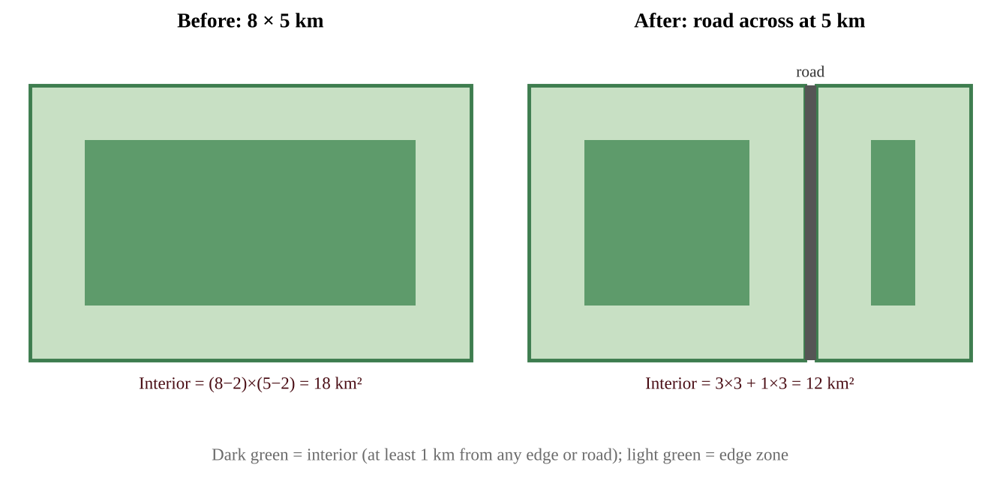{w=0.85}

### Climate change, domestication and conservation

**Climate change** causes habitat loss through changes in temperature, precipitation and sea level: mountain species run out of higher ground, reefs bleach, coastal wetlands drown, and arid regions expand.

**Domestication.** Some organisms are partly or fully domesticated and **managed for economic returns**, such as honeybee colonies and livestock. Farmers select a few high-yield breeds and replicate them, so local varieties disappear and the remaining population is vulnerable to one disease or climate stress. Wild relatives can be displaced or hybridize with domestic forms, and land converted for livestock and monocultures adds to habitat loss.

**Strategies to mitigate biodiversity loss:** **protected areas** (parks, reserves, marine protected areas); **habitat corridors** (wildlife overpasses and underpasses, riparian strips) that let animals move and genes flow; **sustainable land use** (agroforestry, selective logging, rotational grazing, sustainable fisheries, compact cities); **restoring lost habitat** (replanting, rewetting wetlands, removing dams, restoring reefs); and addressing the other HIPPCO factors. Evaluate them: protected areas conserve the most but can restrict local livelihoods and be too small; corridors cost money and can help invasives or disease spread; restoration is slow and rarely recreates the original; sustainable-use rules need enforcement.

:::box apply
A small island lizard lives on one 12 km² island, eats a single berry and lays two eggs a year. Introduced rats eat the eggs and a hurricane destroyed part of the berry forest: small range, specialist diet, low reproduction, a new predator and habitat loss are stacked together. The recovery plan removes the rats, fences and replants the forest and starts a captive-breeding colony as insurance.
:::

### Designing and judging an investigation

Free-response questions often ask you to design or criticize an investigation.

- **Hypothesis.** A testable "If … then …" that names the direction: *if distance from a trail increases, invasive shrub density will decrease and native wildflower richness will increase.*
- **Variables.** The **independent variable** is what you change or compare; the **dependent variable** is what you measure; **controlled variables** are kept the same (temperature, salinity, light, plot size, season).
- **Control group.** A comparison with no treatment or the normal condition, such as tanks at present-day pH or plots without removal.
- **Replication.** Several tanks, plots or sites per treatment, averaged, so chance does not decide the result.
- **Random and matched sampling.** Assign treatments randomly and match plots on soil, slope, cover and elevation, so a hidden variable does not explain the difference.
- **Observation versus experiment.** Surveys show association; showing cause needs a manipulation such as fencing or removing the species, with a control.
- **Results and limits.** State the pattern that supports the hypothesis and one limit: small sample, one site, short time or an unmeasured variable.

**Reading an article.** The *claim* is its main conclusion, the *evidence* is the data and examples it cites, and an *assumption* is a step it leaves unstated. Ask whether the evidence really supports the claim.

**Reading graphs.** Identify axes and units, quote two values, describe the shape, and say what a trend shows and cannot show (correlation versus cause).

:::box define
**Biodiversity** — the variety of life: genetic, species and ecosystem diversity.
**HIPPCO** — habitat destruction, invasive species, population growth, pollution, climate change, over-exploitation.
**Invasive species** — a species living outside its normal habitat that spreads and threatens natives.
**Generalist / specialist** — a species with a wide / narrow niche.
**Endangered species** — a species at risk of extinction across all or a large part of its range.
**Selective pressure** — an environmental factor that affects survival and reproduction.
**Habitat fragmentation / edge effect / corridor** — a habitat divided into isolated patches / changed conditions at a patch boundary / a strip of habitat joining patches.
:::

:::box mistake
- Equating "non-native" with "invasive," or saying invaders are always predators. Many are plants, insects or pathogens.
- Recommending biological control without noting its risk.
- Claiming all species go extinct under the same change. Vulnerability varies with traits.
- Saying habitat loss is the same as extinction (it is a leading cause), or that "endangered" means none remain.
:::

:::box strategy
To explain why species A is more at risk than species B, compare trait by trait (range size, diet breadth, reproduction rate, population size, hunting pressure, dispersal) using "because" statements. To choose a conservation action, find the largest threat in the data and target it.
:::

:::box example
id: SG-U9-E009
A shrub introduced as a garden ornamental has spread into a wetland. A 2-hectare study plot was surveyed twice.

| Year | Native sedge cover (% of plot) | Introduced shrub cover (% of plot) |
|---|---|---|
| 2018 | 80 | 5 |
| 2024 | 44 | 38 |

(a) Calculate the percent change in native sedge cover from 2018 to 2024. (b) Identify two traits of the shrub that could explain its spread. (c) Propose one control method and state one disadvantage of it.
:::

:::box example
id: SG-U9-E010
Two mammals live in the same mountain forest that is being logged and warmed by a changing climate. Species P is a generalist omnivore that breeds at one year of age, produces five young per year and can move to nearby valleys. Species Q eats only the bark of one tree species, breeds at five years of age with one young every two years, and lives only above 2,000 m. (a) Identify which species is more at risk of extinction and give three traits that support your claim. (b) Define selective pressure and give one example from this scenario. (c) Propose one strategy to protect Species Q and describe one limitation of it.
:::

:::box example
id: SG-U9-E011
A square reserve measures 10 km on each side. Assume that within 1 km of any edge the habitat is "edge habitat," and the remaining area is "interior habitat." A new road and pipeline cross the reserve and divide it into four equal squares, each 5 km on a side, with the same edge-zone width of 1 km on every side of every square. (a) Calculate the interior area of the original reserve and of the four squares combined. (b) Calculate the percentage of the total area that is interior habitat in each case. (c) Explain how this change would affect a forest-interior bird and name one measure that could help it.
:::

:::box example
id: SG-U9-E016
A lake association wants to know whether a floating invasive plant lowers dissolved oxygen (DO) and the number of native fish species. They can remove the plant from some bays. (a) Write an "if … then …" hypothesis. (b) Identify the independent and dependent variables. (c) Describe a design that includes a control group, replication and a method of choosing bays. (d) Identify two variables to keep similar across bays. (e) Describe the pattern of results that would support the hypothesis and name one limitation of the study.
:::

:::box example
id: SG-C11-E006
A tiger population of 3,200 declines by 4% each year. (a) Calculate the population after 10 years, to the nearest 100 animals. (b) Use the Rule of 70 to estimate the years needed for the population to halve. (c) Identify one trait of tigers that makes recovery slow and one conservation action that targets poaching.
:::

:::box summary
- HIPPCO: habitat destruction, invasive species, population growth, pollution, climate change, over-exploitation.
- Invaders are often generalist, r-selected species with few enemies; prevention is the cheapest control, and every method has trade-offs.
- Risk rises with hunting, narrow diet or habitat, small population and K-selected traits; adaptable, mobile species fare better.
- Fragmentation isolates small populations and creates edge effects; domestication narrows genetic diversity.
- Solutions: protected areas, corridors, sustainable land use, restoration and law, each with trade-offs.
:::

## 11.7 Practice Questions and Answers

%% CED: none (academy extension)

Work through the chapter's classroom examples, then test yourself with the question sets listed below.

[[chapter-practice]]
