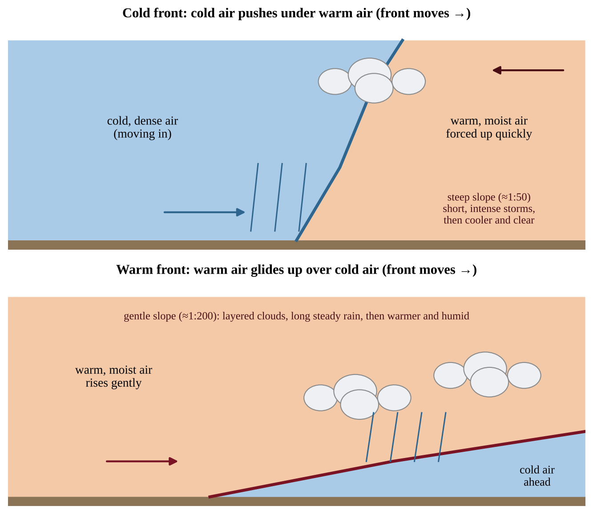
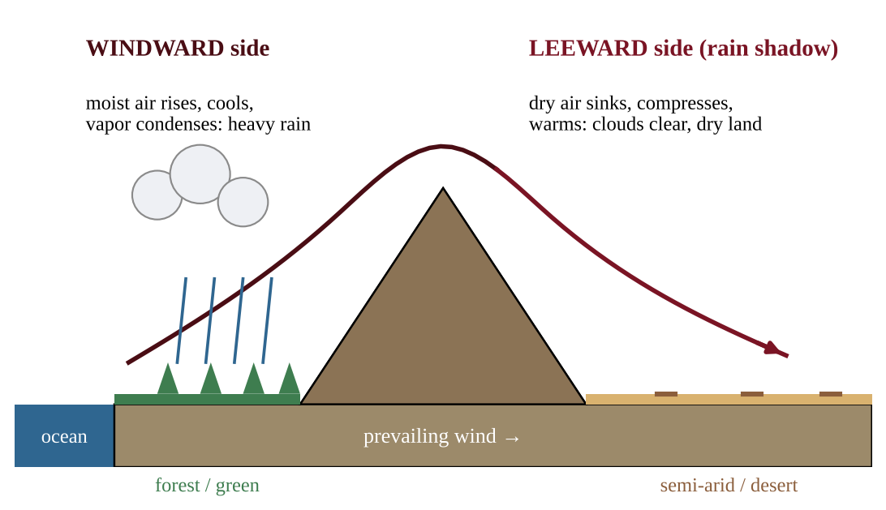
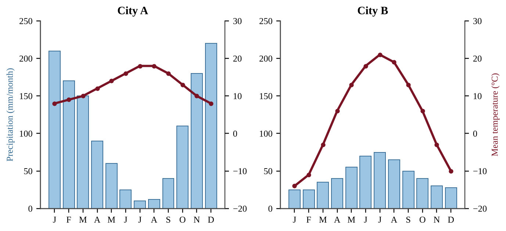
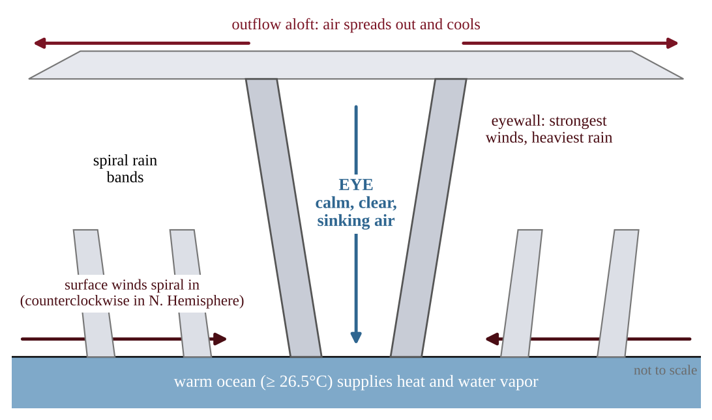

# Chapter 2 — The Atmosphere

:::box objectives
- Name the major and variable gases of the atmosphere, give their abundances, and explain why trace gases and aerosols matter.
- Describe the five atmospheric layers by their temperature gradients and read a temperature–altitude profile.
- Distinguish weather from climate, and explain how fronts, mountains, oceans and elevation shape both.
- Explain how uneven solar heating, density differences and the Coriolis effect produce the global circulation cells and wind belts.
- Describe how hurricanes and tornadoes form, how they are rated, and why storm surge is so dangerous.
- Describe El Niño and La Niña, their causes and their effects in different regions.
:::

## 2.1 Composition
%% CED: 4.4 | ERT-4.D.1 | LO: ERT-4.D

:::box simple
The atmosphere is a thin blanket of gas held to Earth by gravity. Almost all of it is nitrogen and oxygen; the small amounts of other gases and tiny floating particles control warming, ozone protection and air quality.
:::

### The major gases

The atmosphere is made up of major gases, each with its own relative abundance. Dry air is about **78% nitrogen**, **21% oxygen** and **0.9% argon**. Everything else is a **trace gas**: present at under 0.1% and usually measured in **parts per million (ppm)**.

| Gas | Share of dry air | Role |
|---|---|---|
| Nitrogen, N₂ | 78.08% | Unreactive; enters the nitrogen cycle after fixation |
| Oxygen, O₂ | 20.95% | Respiration, combustion; made by photosynthesis |
| Argon, Ar | 0.93% | Inert; no biological or climate role |
| Carbon dioxide, CO₂ | ≈0.042% (≈420 ppm) | Greenhouse gas; used in photosynthesis |
| Neon, helium, methane, N₂O, ozone | ppm or less | Methane and N₂O warm the planet; ozone absorbs UV |

### Variable gases

- **Water vapor** ranges from almost 0% (cold deserts, polar air) to about 4% (warm tropical air). It is the most abundant greenhouse gas and is the source of clouds and precipitation. Warm air can hold much more water vapor than cold air.
- **Ozone (O₃)** is concentrated in the stratosphere, where it absorbs ultraviolet radiation. Near the ground it is a pollutant.
- **Carbon dioxide** has climbed from about 280 ppm before industrialization to about 420 ppm today, mainly from burning fossil fuels.

### Aerosols

An **aerosol** is a tiny solid or liquid particle suspended in air. Natural sources: dust, sea salt, volcanic ash, pollen, wildfire smoke. Human sources: soot from engines and fires, sulfates from burning coal.

- Light-colored aerosols (sulfates, volcanic particles) **reflect sunlight** and cool the surface; dark soot **absorbs sunlight** and warms the air.
- Aerosols are **condensation nuclei**: water vapor condenses onto them to form cloud droplets.
- Fine particles (PM2.5) lodge deep in the lungs and harm health.

:::box define
**Trace gas** — a gas present in very small amounts, yet often with a large effect.
**ppm** — parts per million; 1% = 10,000 ppm.
**Aerosol** — a solid or liquid particle suspended in air.
:::

:::box formula
**Volume of a gas** = total air volume × (percent ÷ 100). **ppm** = percent × 10,000. **Percent change** = (new − old) ÷ old × 100.
:::

:::box mistake
- Saying air is mostly oxygen. It is nearly four-fifths nitrogen.
- Treating water vapor as a fixed gas. It varies from place to place and hour to hour.
:::

:::box example
id: SG-C2-E001
A sealed classroom measures 240 m³. Its air is 78.08% N₂ and 0.0420% CO₂ by volume. Before industrialization, CO₂ made up 280 ppm of air. (a) Express the present CO₂ level in ppm. (b) Calculate the volume of CO₂ in the room in m³, to the nearest 0.001 m³. (c) Calculate the volume of N₂ in the room in m³, to the nearest 0.1 m³. (d) Calculate the percent increase in the CO₂ level since industrialization. (e) Identify which of the gases N₂, CO₂ and water vapor changes most from place to place.
:::

:::box summary
- Dry air is ≈78% N₂, ≈21% O₂, ≈0.9% Ar, with trace gases (CO₂ ≈420 ppm).
- Water vapor and ozone vary; trace gases and aerosols have large effects on climate and health.
:::

## 2.2 Structure
%% CED: 4.4 | ERT-4.D.2 | LO: ERT-4.D

:::box simple
Scientists divide the atmosphere into five layers. The layers are not different mixtures of gas. They are separated by whether the air gets colder or warmer as you climb.
:::

### Layers defined by temperature

The layers of the atmosphere are based on **temperature gradients**. Where the temperature trend changes direction, one layer ends and the next begins.

{w=0.75}

- **Troposphere** (surface to about 12 km; thinner at the poles, thicker at the equator): temperature **falls** with height, by about 6.5°C per km on average. It holds about 75% of the atmosphere's mass and nearly all water vapor, so it is where weather happens.
- **Stratosphere** (about 12–50 km): temperature **rises** with height because the ozone layer (roughly 15–35 km) absorbs ultraviolet radiation. This warm-over-cold arrangement is stable, so there is little vertical mixing and little weather.
- **Mesosphere** (about 50–85 km): temperature **falls** again, reaching the coldest values in the atmosphere (about −90°C). Most meteors burn up here.
- **Thermosphere** (about 85–600 km): temperature **rises** sharply as sparse molecules absorb high-energy X-rays and short-wave UV. Auroras occur here, and the International Space Station orbits in this layer.
- **Exosphere:** the outermost region, where molecules are so few that they drift off into space.

The boundary between layers is named with the suffix *-pause*: the tropopause, stratopause and mesopause.

:::box formula
**Average lapse rate** = (T at the lower altitude − T at the higher altitude) ÷ (altitude difference in km)
Units: °C per km. In the troposphere the typical value is about 6.5°C/km.
:::

### Reading the profile

On a temperature–altitude graph, the turning points of the line are the tropopause, stratopause and mesopause. A line sloping left going up means air cools with altitude. The stratosphere warms because ozone absorbs UV; the troposphere cools because it is heated from the ground below.

**Pressure.** Air pressure and density fall steadily with altitude in every layer.

**Why particles linger in the stratosphere.** Warm air lies above cooler air, so the layer is stable, with little mixing and no rain to wash particles out. Volcanic aerosols there can stay a year or more and, by reflecting sunlight (raising albedo), cool the surface; tropospheric particles last days to weeks. A **thermal inversion** is different: a local warm layer in the lower troposphere that traps cooler air and pollutants beneath it.

:::box mistake
- Thinking the layers are separated by gas composition. They are separated by temperature trends.
- Thinking the ozone layer is in the troposphere. It is in the stratosphere; ozone near the ground is a pollutant.
- Thinking it is always colder higher up. The stratosphere and thermosphere get warmer with altitude.
:::

:::box strategy
On a temperature–altitude graph, mark the turning points first, then name each section by its trend (cool, warm, cool, warm). Link each warm layer to its absorber: ozone (stratosphere), high-energy radiation (thermosphere).
:::

:::box example
id: SG-U4-E005
A weather balloon records these temperatures: 0 km, 18°C; 4 km, −8°C; 8 km, −34°C; 12 km, −60°C; 16 km, −60°C; 25 km, −47°C; 50 km, −3°C. (a) Calculate the average rate of temperature change (°C per km) from 0 to 12 km. (b) Identify the layer from 0 to 12 km and the layer from 16 to 50 km. (c) Explain, using a specific gas, why the temperature trend reverses at about 12–16 km. (d) State the altitude at which the tropopause is located in these data.
:::

:::box summary
- Troposphere (cools, weather), stratosphere (warms, ozone), mesosphere (cools), thermosphere (warms), exosphere.
:::

## 2.3 Weather and Climate
%% CED: 4.8 | ENG-2.B.1, ENG-2.B.2 | LO: ENG-2.B

:::box simple
Weather is what the air is doing today. Climate is what the weather is usually like in a place over many years. The sun sets the basic climate for each latitude, but mountains, oceans and elevation change it.
:::

### Weather versus climate

**Weather** is the state of the atmosphere at a place over a short time (minutes to days): temperature, humidity, wind, clouds and precipitation. **Climate** is the long-term pattern of weather in a region, usually averaged over at least 30 years. A cold week in a desert is weather; its low rainfall year after year is climate.

### Temperature and precipitation

Temperature depends mainly on **latitude** (sun angle), then on elevation, nearness to oceans and ocean currents. Precipitation forms when air rises, expands and cools until its water vapor condenses into droplets large enough to fall. Air is lifted by ground heating (convection), by a mountain (orographic lift) or at a front.

### Air masses and fronts

An **air mass** is a huge body of air with fairly uniform temperature and humidity. A **front** is the boundary between two air masses. Warm air is less dense, so it is always lifted over colder, denser air at a front, producing clouds and precipitation.

{w=0.7}

At a **cold front** cold air wedges under warm air and lifts it steeply: a narrow band of heavy showers and thunderstorms, then cooler, clearer air. At a **warm front** warm air slides gently up over cold air: a wide area of layered clouds and steady rain, then warmer, humid air. Fronts move west to east in the westerlies, which is why mid-latitude weather changes every few days.

### Geologic and geographic factors

Weather and climate are affected not only by the sun's energy but by geologic and geographic factors, such as mountains and ocean temperature.

- **Elevation:** air temperature drops about 6.5°C per km of elevation, so mountain tops are cold even in the tropics.
- **Proximity to oceans:** water heats and cools more slowly than land (high specific heat), so coastal climates are milder, with smaller temperature ranges, than inland ones at the same latitude.
- **Ocean currents:** surface currents move heat across the globe. Warm currents (the Gulf Stream) warm coasts such as western Europe; cold currents (the California Current) cool coasts and favor fog. Air over cold water holds little moisture, one reason for some coastal deserts.
- **Mountains:** force air upward and shape where precipitation falls.

### Rain shadows

A **rain shadow** is a region of land that has become drier because a higher elevation area blocks precipitation from reaching the land.

{w=0.75}

:::box process
Moist air blows toward the mountains (windward side) → forced to rise → expands and cools (about 10°C per km when dry, about 5–6°C per km once saturated) → water vapor condenses into clouds → heavy rain or snow on the windward slope → air crosses the crest, now dry → descends on the leeward side → compresses and warms → clouds evaporate, little rain → dry leeward desert (rain shadow).
:::

**Examples.** Pacific air rises over the Cascades and Sierra Nevada: western slopes are lush rain forest, while eastern Washington and the Great Basin of Nevada are semi-arid or desert. The Atacama Desert lies in the shadow of the Andes. Farmers on the dry side cope with drought-tolerant crops, drip irrigation or stored runoff.

On a map, find the prevailing wind (Section 2.4), then the mountains: wet side upwind, dry side downwind.

**West coast versus east coast.** In the middle latitudes the westerlies carry ocean air onto west coasts (Pacific Northwest, western Europe), giving mild winters, cool summers and a small temperature range. East coasts receive air that has crossed the continent, so winters are colder and summers warmer. Global climate is set by solar input, atmospheric gases, the layout of land and ocean, and Earth's rotation and orbit; a thermal inversion is local weather, not a driver of climate.

### Reading a climatogram

A **climatogram** (climate graph) shows monthly precipitation as bars (mm) and monthly mean temperature as a line (°C) for one place.

{w=0.8}

- **Annual precipitation** = the sum of the 12 bars.
- **Annual temperature range** = warmest month − coldest month. A large range suggests an inland site; a small range a coastal one.
- Look for a **dry season**. City A has a wet winter and dry summer (a west coast in the westerlies); City B's large range points inland.
- For "A is X% less than B," use (B − A) ÷ B × 100, with B (the one after "than") as the base.

:::box mistake
- Calling one hot summer "climate." One season is weather; climate is a 30+ year average.
- Putting the desert on the windward side. The rain shadow is *behind* the mountain (leeward).
- Saying the mountain "makes the air dry by itself." The air loses its moisture as rain on the way up; descending air then warms and cannot easily form clouds.
:::

:::box strategy
Use "up, cool, rain; down, warm, dry," and state the **wind direction** and which side is windward. For a climatogram, show the numbers you used (sum of bars, warmest − coldest month).
:::

:::box example
id: SG-U4-E009
A mountain range runs north–south in a region where the prevailing winds blow from the west. City M lies on the western foot of the range at 100 m elevation and receives 1,850 mm of precipitation per year. City N lies 60 km away on the eastern foot of the range, also at about 100 m elevation, and receives 420 mm per year. (a) Calculate how many times greater City M's precipitation is than City N's, to the nearest tenth. (b) Identify which city is in the rain shadow. (c) Explain the sequence of events in the air that causes the difference. (d) Predict how the vegetation at City N would differ from City M, and state one reason a coastal city at the same latitude would have a smaller annual temperature range than an inland one.
:::

:::box example
id: SG-C2-E002
Climate data for two cities at the same latitude and elevation. City P monthly precipitation (mm), January to December: 150, 120, 100, 70, 45, 20, 8, 10, 30, 80, 130, 160. City P monthly mean temperature ranges from 9°C (January) to 19°C (August). City Q monthly precipitation (mm), January to December: 30, 30, 40, 45, 60, 75, 80, 70, 55, 45, 35, 30. City Q monthly mean temperature ranges from −12°C (January) to 22°C (July). (a) Calculate the annual precipitation of each city. (b) Calculate the annual temperature range of each city. (c) Calculate how much less annual precipitation City Q receives than City P, as a percent of City P's, to the nearest percent. (d) Identify which city is more likely coastal and give one reason from the data. (e) Describe City P's dry season.
:::

:::box summary
- Weather is short-term; climate is the 30+ year pattern.
- Warm air lifted over cold air at fronts makes clouds and rain; cold fronts bring short, intense storms, warm fronts long, steady rain.
- Mountains, elevation, ocean temperature and currents modify the climate set by the sun; a rain shadow forms on the leeward side of high ground.
:::

## 2.4 Atmospheric Circulation—Pressure
%% CED: 4.5 | ERT-4.E.1 | LO: ERT-4.E

:::box simple
The equator gets the most direct sunlight, so air there heats up and rises, spreads toward the poles, cools and sinks. Because Earth spins, the flows are bent sideways, making the steady winds sailors have used for centuries.
:::

### Pressure and wind

**Air pressure** is the weight of the air above a point (about 1,013 hPa at sea level). Warm air is less dense, rises and leaves **low pressure** at the surface; cold air sinks and makes **high pressure**. **Wind is air moving from high toward low pressure.** Lows bring clouds and rain (rising air cools); highs bring clear skies (sinking air warms and dries). In the Northern Hemisphere winds spiral **counterclockwise into a low** and **clockwise out of a high** (reversed in the Southern).

### The cause: uneven heating

Global wind patterns primarily result from the most intense solar radiation arriving at the equator, resulting in density differences and the Coriolis effect. Air warmed at the equator expands, becomes less dense and **rises**, creating a belt of low pressure. Rising air cools and its water vapor condenses, so the equator is wet. This belt of converging air is the **intertropical convergence zone (ITCZ)**, which tracks the overhead sun north and south through the year. The now-dry air moves poleward aloft and by about 30° latitude has cooled enough to **sink**, forming high pressure. Sinking air warms and dries, so many great deserts lie near 30° N and S (Sahara, Arabian, Kalahari, Australian interior).

### Three cells in each hemisphere

{w=0.75}

- The **Hadley cell** (0°–30°): air rises at the equator, flows poleward aloft, sinks near 30° and returns along the surface.
- The **Polar cell** (60°–90°): cold air sinks over the poles, flows equatorward at the surface, rises near 60° and returns aloft.
- The **Ferrel cell** (30°–60°) is driven by the other two: surface air flows poleward, rises near 60° and returns aloft toward 30°.

Rising air means low pressure, clouds and rain (near 0° and 60°). Sinking air means high pressure and dry conditions (near 30° and 90°).

### The Coriolis effect

Earth rotates eastward, and points near the equator move faster (about 1,670 km/h) than points near the poles (almost zero). Moving air keeps the eastward speed of where it started, so it appears to curve relative to the ground: **to the right in the Northern Hemisphere and to the left in the Southern Hemisphere**. This apparent deflection is the **Coriolis effect**. It turns the surface flows as follows.

| Latitude | Wind belt | Blows from | Hemisphere detail |
|---|---|---|---|
| 0°–30° | Trade winds | East (NE in north, SE in south) | Air moving toward equator curves westward |
| 30°–60° | Prevailing westerlies | West (SW in north, NW in south) | Air moving poleward curves eastward |
| 60°–90° | Polar easterlies | East (NE in north, SE in south) | Air moving equatorward curves westward |

Winds are named for the direction they come **from**. Storms in middle latitudes generally move west to east, carried by the westerlies.

**If Earth did not rotate**, air would rise at the equator, sink at the pole and return in one cell per hemisphere, with surface winds blowing straight from the poles to the equator. Rotation breaks the flow into three cells and bends the winds.

:::box mistake
- Saying winds blow from the *direction they go to*. A westerly comes from the west.
- Saying the Coriolis effect *causes* wind. Pressure differences cause wind; Coriolis only turns it.
- Putting deserts at the equator. They are mainly near 30° where air sinks.
:::

:::box strategy
Start at the equator and work poleward: rising (low, wet), sinking at 30° (high, dry), then add the deflection (right in the north, left in the south).
:::

:::box example
id: SG-U4-E006
A sailing ship leaves the coast of West Africa at about 15° N, bound for the Caribbean. (a) State the name and the direction of origin (compass direction the wind comes from) of the prevailing wind that helps it. (b) Explain, using the Coriolis effect, why that wind does not blow directly from the north. (c) Later, a storm system forms near 45° N over the North Atlantic. State the direction in which it is most likely to be carried and the global wind belt responsible. (d) Explain why a large desert is expected near 30° N on the African continent.
:::

:::box summary
- Strongest solar heating at the equator drives rising air and a global circulation; wind blows from high to low pressure.
- Hadley (0–30°), Ferrel (30–60°) and Polar (60–90°) cells; rising air = low pressure and rain, sinking air = high pressure and dry.
- Coriolis deflects air right in the north, left in the south, producing trades, westerlies and polar easterlies.
:::

## 2.5 Hurricanes, Tornadoes, and Cyclones
%% CED: none (academy extension)

:::box simple
A hurricane is a huge spinning storm, hundreds of kilometers wide, that feeds on warm ocean water. A tornado is a narrow, violent column of rotating air, usually under a kilometer wide, that comes out of a thunderstorm over land.
:::

### How a tropical cyclone forms

A **tropical cyclone** is a large, rotating storm that forms over warm tropical oceans. It needs:

1. **Warm surface water**, at least about 26.5°C to roughly 50 m deep.
2. **A starting disturbance**, such as thunderstorms moving west off Africa.
3. **Low wind shear**, so the storm's cloud tower is not torn apart.
4. **The Coriolis effect**, so storms do not form within about 5° of the equator.

:::box process
Warm ocean evaporates water → moist air rises and condenses → latent heat is released, warming the air and making it rise faster → surface pressure falls → winds rush in toward the low → Coriolis deflection makes them spiral (counterclockwise in the Northern Hemisphere, clockwise in the Southern) → more evaporation → storm strengthens until it moves over land or cold water.
:::

By sustained wind speed it is a **tropical depression** (under 63 km/h), a **tropical storm** (63–118 km/h) or, from 119 km/h, a hurricane, typhoon or cyclone. It weakens over land (no warm water, more friction) or cooler water. Lower central pressure means stronger winds, so pressure rises as a storm weakens. Damaging winds and surge arrive hours before the eye: arrival time = distance ÷ speed, minus that lead time.

### Structure

{w=0.75}

- The **eye** (20–60 km across) is calm and often clear, with sinking air and the lowest pressure.
- The **eyewall** is a ring of towering thunderstorms around the eye; it has the strongest winds and heaviest rain.
- **Spiral rain bands** extend outward for hundreds of kilometers; air spirals in near the surface and flows out at the top.

### Regional names

The same kind of storm has different names depending on where it forms.

| Name | Where it forms |
|---|---|
| **Hurricane** | North Atlantic and the eastern and central North Pacific |
| **Typhoon** | Northwestern Pacific (near Japan, the Philippines, China) |
| **Cyclone** | South Pacific and Indian Ocean (near Australia, India, Madagascar) |

### Saffir–Simpson hurricane wind scale

The **Saffir–Simpson scale** rates hurricanes from Category 1 to 5 by **sustained wind speed**. It does not measure rain or storm surge.

| Category | Sustained wind (mph) | Sustained wind (km/h) | Typical damage |
|---|---|---|---|
| 1 | 74–95 | 119–153 | Some roof and tree damage |
| 2 | 96–110 | 154–177 | Major roof damage |
| 3 | 111–129 | 178–208 | Devastating; roofs and walls lost |
| 4 | 130–156 | 209–251 | Catastrophic damage |
| 5 | 157 or more | 252 or more | Most buildings destroyed |

### Storm surge and other hazards

**Storm surge** is the rise in sea level above the normal tide, pushed onto land mainly by the storm's winds (low pressure adds a little). It is the greatest killer in hurricanes. It is worst on coasts with a shallow, gently sloping seafloor and, in the Northern Hemisphere, on the right-front side of the storm, where wind and forward motion add together. Other hazards are wind, heavy rain with inland flooding, and tornadoes. Higher sea level lets the same surge reach farther inland. (In 2005, Hurricane Katrina's surge overtopped the levees at New Orleans.)

### Tornadoes

A **tornado** is a violently rotating column of air touching the ground, spawned by a thunderstorm, usually a **supercell** (a thunderstorm with a rotating updraft). Rotation develops when warm, moist surface air meets cold, dry air aloft and winds change speed and direction with height (wind shear). A rotating cloud not touching the ground is a **funnel cloud**. The central United States ("Tornado Alley") has the most, mainly in spring.

The **Enhanced Fujita (EF) scale** rates a tornado from EF0 to EF5 by the **damage** it does, which is used to estimate wind speed.

| Rating | Estimated wind (mph) | Typical damage |
|---|---|---|
| EF0 | 65–85 | Light: branches broken |
| EF1 | 86–110 | Moderate: roofs stripped |
| EF2 | 111–135 | Considerable: roofs torn off houses |
| EF3 | 136–165 | Severe: walls torn off houses |
| EF4 | 166–200 | Devastating: houses leveled |
| EF5 | over 200 | Incredible: strong houses swept away |

:::box mistake
- Thinking the calm eye means the storm is over. The second half of the storm, with winds from the opposite direction, follows.
- Rating a tornado by wind speed alone. The EF scale uses damage.
:::

:::box example
id: SG-C2-E003
A hurricane in the Atlantic has sustained winds of 185 km/h. Its eye is 420 km from the coast and is moving toward it at a steady 14 km/h. Use 1 mph = 1.609 km/h. (a) Convert the wind speed to mph, to the nearest whole number. (b) Use the Saffir–Simpson table to identify the hurricane's category. (c) Calculate how many hours until the eye reaches the coast. (d) Explain why the storm will weaken soon after it moves inland.
:::

:::box summary
- Tropical cyclones form over warm (≥ 26.5°C) water with low wind shear and spin because of the Coriolis effect; hurricane, typhoon and cyclone are the same storm in different oceans.
- Hurricanes are rated by wind (Saffir–Simpson, 1–5); storm surge is the greatest hazard.
- Tornadoes are narrow and short-lived, form in supercells, and are rated by damage (EF0–EF5).
:::

## 2.6 El Niño—Southern Oscillation (ENSO)
%% CED: 4.9 | ENG-2.C.1, ENG-2.C.2 | LO: ENG-2.C

:::box simple
Every few years the Pacific's surface temperature pattern flips for a while. In an El Niño a big pool of warm water slides east and the rain follows it; in a La Niña the cold water along the eastern Pacific gets even colder. Because the Pacific is so large, weather changes worldwide.
:::

### Normal (neutral) conditions

Normally the **trade winds** blow east to west across the tropical Pacific, piling a deep warm pool near Indonesia and Australia. Off South America, surface water moves away and cold, nutrient-rich water **upwells**, feeding plankton and fisheries. Warm, moist air rises over the western Pacific (heavy rain) and sinks in the east, which stays drier.

### El Niño

El Niño and La Niña are phenomena associated with changing ocean surface temperatures in the Pacific Ocean, and together with the linked atmospheric pressure shift (the Southern Oscillation) make up **ENSO**. In an **El Niño**, the trade winds weaken or even reverse. The warm pool spreads east, the boundary between warm and cold water (the **thermocline**) flattens, and upwelling off South America weakens or stops. Evaporation and rising air shift toward the central and eastern Pacific.

{w=0.7}

### La Niña

In a **La Niña**, the trade winds strengthen, more warm water is pushed west, upwelling off South America intensifies, and the eastern Pacific becomes cooler than normal.

### Effects

These phenomena can cause global changes to rainfall, wind and ocean circulation patterns, but effects differ by place. The typical tendencies are:

| Region | El Niño | La Niña |
|---|---|---|
| Coastal Peru and Ecuador | Heavy rain, floods; fish catch collapses (upwelling lost) | Drier; strong upwelling, rich fishing |
| Indonesia and Australia | Drought, wildfire risk | Heavier rain, flooding |
| Southern United States | Wetter, cooler winter | Drier, warmer winter, drought risk |
| Northwestern United States | Warmer, often drier winter | Cooler, wetter winter |
| Atlantic hurricanes | Often fewer (more wind shear) | Often more |
| Global average temperature | Tends to rise | Tends to dip |

Other impacts include coral bleaching and crop failures. ENSO events recur every two to seven years. ENSO reaches North America by shifting the **jet stream**, the fast high-altitude river of air that steers storms.

ENSO is influenced by geological and geographic factors: the size and shape of the Pacific basin, the position of continents and islands, the sloping thermocline, and the trade winds and currents shaped by them. Because each region sits differently relative to ocean and mountains, the same event can bring flood to one place and drought to another.

:::box process
**El Niño:** weaker trade winds → warm water flows east → thermocline deepens in the east → less upwelling → warm surface water in the eastern Pacific → rain shifts east → drought in the west Pacific, flooding on the Peru coast, altered weather worldwide.
**La Niña:** stronger trades → more upwelling in the east → cooler eastern Pacific → rain concentrated in the west → opposite regional effects.
:::

Peru's anchovy fishery depends on cold upwelling; in an El Niño the lost nutrients lower phytoplankton, then anchovies, then seabirds.

:::box formula
**Anomaly** = observed value − long-term average. Positive = warmer than normal; a larger anomaly means a stronger event. **Mean** = sum ÷ number of values. Classify with the rule given (for example, ≥ +0.5°C El Niño, ≤ −0.5°C La Niña, otherwise neutral), then connect it to the expected effects.
:::

:::box mistake
- Mixing up the phases: El Niño is **warm**, La Niña **cool**.
- Assuming every region gets the same effect.
- Reading an anomaly as the actual temperature. It is the difference from average.
- On exam answers, give the cause chain (trade winds → warm water → upwelling → rainfall) and a located effect.
:::

:::box example
id: SG-U4-E010
A monitoring program reports the sea-surface temperature anomaly (difference from the long-term average) in the eastern tropical Pacific for four years, along with the anchovy catch off Peru. Year 1: +2.1°C, catch 4 million tonnes. Year 2: −0.3°C, catch 9 million tonnes. Year 3: −1.6°C, catch 11 million tonnes. Year 4: +0.2°C, catch 8 million tonnes. Use this rule: an anomaly of +0.5°C or more is El Niño, −0.5°C or less is La Niña, anything between is neutral. (a) Classify each year. (b) Calculate the percent change in catch from Year 2 to Year 1, to the nearest whole percent. (c) Explain, in terms of trade winds and upwelling, why the catch was lowest in the year you identified as El Niño. (d) Predict the rainfall effect in Indonesia in Year 1 and in Year 3.
:::

:::box summary
- ENSO is a Pacific ocean–atmosphere cycle: El Niño (warm, weak trades, less upwelling) and La Niña (cool, strong trades, more upwelling).
- Effects on rainfall, wind and ocean circulation spread globally but differ by place.
- Geology and geography (basin shape, thermocline, trade winds) influence ENSO.
:::

## 2.7 Practice Questions and Answers

Now put what you have learned to work with the practice set for this chapter.

[[chapter-practice]]
