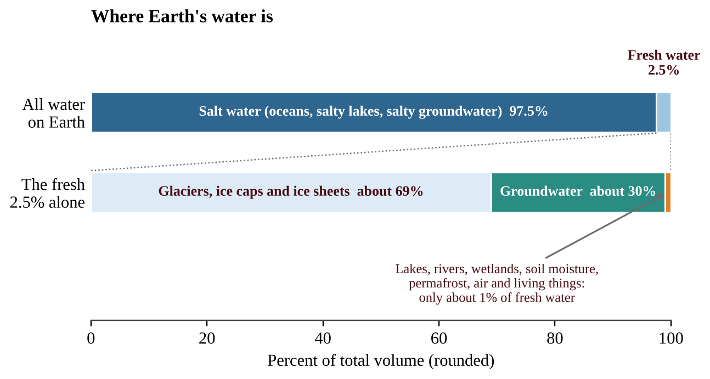
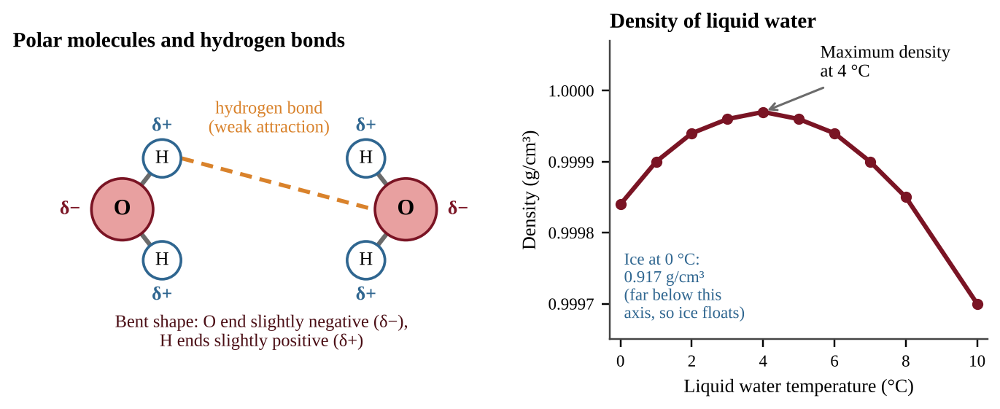
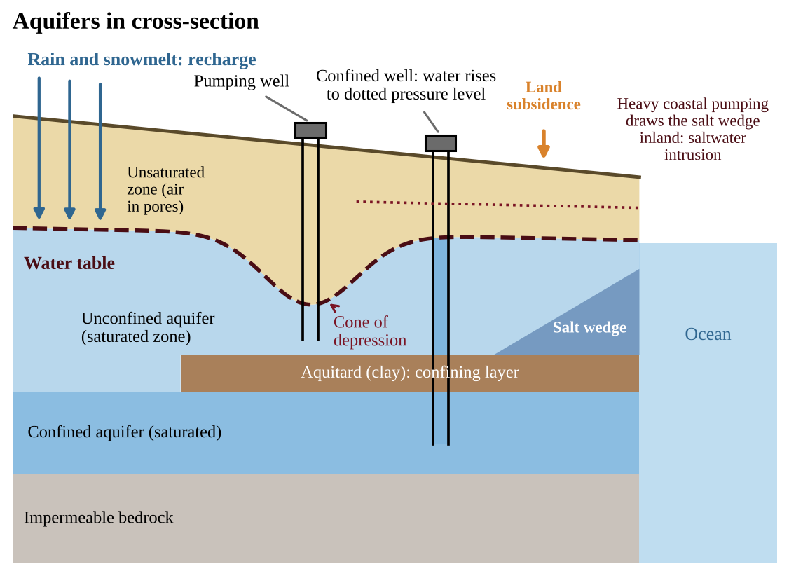
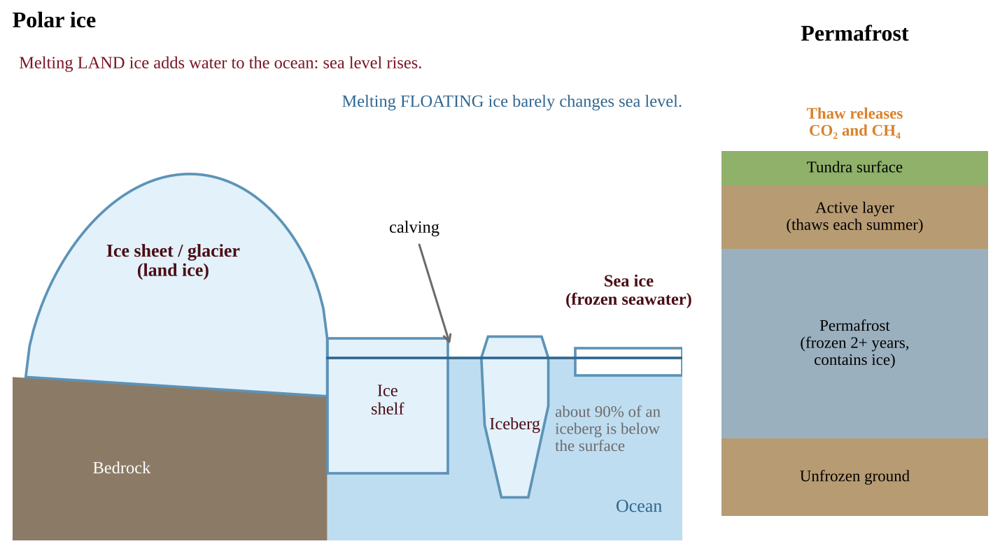
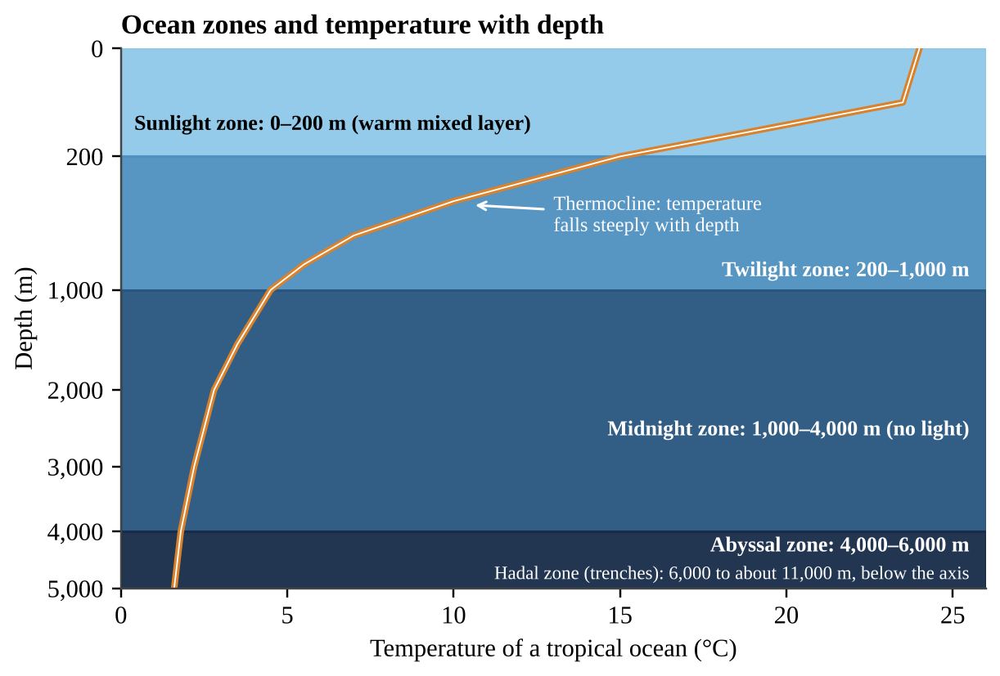
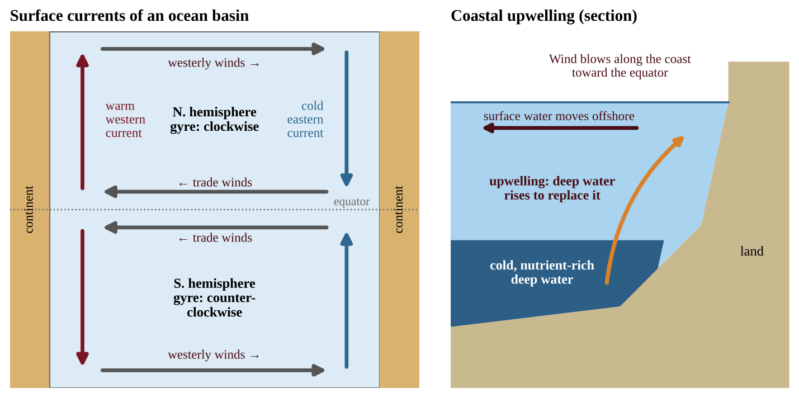

# Chapter 3 — Global Water Resources and Use

:::box objectives
- Describe where Earth's water is stored and explain why so little of it is usable fresh water.
- Explain how the structure of the water molecule gives water its special properties.
- Describe watersheds, aquifers, ice, and the ocean, and explain how water moves through each.
- Compare irrigation methods, and explain how agriculture, industry, and cities use water.
- Analyze global water problems and evaluate solutions such as conservation, dams, and desalination.
:::

## 3.1 Water Distribution and Properties
%% CED: none (academy extension)

:::box simple
Earth is a "water planet," yet almost all of its water is too salty to drink and most of the fresh water is frozen. The water we can actually reach in rivers, lakes, and wells is a tiny sliver. Water also behaves in unusual ways, and those oddities make life possible.
:::

### Where Earth's water is

About 71% of Earth's surface is ocean. The planet holds roughly 1.4 × 10⁹ km³ of water, and about **97.5% of it is salt water**, mostly in the oceans. Only about **2.5% is fresh water**. Of that fresh water:

- about 69% is frozen in glaciers, ice caps, and ice sheets;
- about 30% is groundwater;
- only about 1% is everything else (permafrost, lakes, rivers, wetlands, soil moisture, air, and living things). Lakes and rivers together hold roughly 0.3% of the fresh water.

So the liquid fresh water that people reach easily, in lakes and rivers, is under 0.01% of all the water on Earth. Fresh water is also **unevenly spread**: some regions are water-rich, others (the Middle East, North Africa) have very little.

{w=0.85}

### Special properties of water

Water is made of two hydrogen atoms bonded to one oxygen atom in a bent shape. Oxygen pulls the shared electrons harder, so the oxygen end is slightly negative (δ−) and the hydrogen ends are slightly positive (δ+). A molecule with uneven charge is **polar**. The positive end of one molecule is attracted to the negative end of its neighbor, forming a weak **hydrogen bond**. Billions of these bonds explain nearly everything unusual about water.

| Property | Cause | Why it matters |
|---|---|---|
| Excellent solvent | Polar molecules surround and pull apart ions and other polar substances | Carries nutrients in blood and sap; also carries pollutants and salts |
| Cohesion and adhesion | Hydrogen bonds hold water molecules to each other and to other surfaces | High surface tension; capillary action lifts water in plants and soil |
| High specific heat | Energy goes into breaking hydrogen bonds before molecules speed up | Oceans and lakes warm and cool slowly, moderating coastal climates and body temperature |
| High heat of vaporization | Many hydrogen bonds must break for water to evaporate | Evaporation (sweating, transpiration) cools; moving water vapor carries heat around the planet |
| Ice is less dense than liquid water | In ice, hydrogen bonds lock molecules into an open, six-sided lattice | Ice floats; lakes freeze from the top down, and the ice insulates the life below |

{w=0.92}

:::box formula
**Heat energy Q = m × c × ΔT**
Q = heat in joules (J); m = mass in grams; c = specific heat in J/(g·°C); ΔT = temperature change in °C. For liquid water, c = 4.18 J/(g·°C). Dry sand is about 0.84 J/(g·°C). Rearrange: ΔT = Q ÷ (m × c).
:::

:::box mistake
- Saying water is densest as ice. Ice is *less* dense than liquid water; liquid water is densest at about 4 °C.
- Calling a hydrogen bond a bond *inside* a water molecule. Hydrogen bonds act *between* molecules; the bonds inside are covalent.
:::

:::box example
id: SG-C3-E001
Earth holds about 1.4 × 10⁹ km³ of water, of which 2.5% is fresh. Of the fresh water, about 69% is ice and about 30% is groundwater. Lakes and rivers together hold about 0.3% of the fresh water. (a) Calculate the volume of fresh water in km³. (b) Calculate the volume of groundwater, in km³, in scientific notation. (c) Calculate the volume of water in lakes and rivers, in km³, and express it as a percentage of all the water on Earth.
:::

:::box example
id: SG-C3-E002
A beaker contains 500 g of liquid water and a tray holds 500 g of dry sand, both starting at 20 °C. Each absorbs 20,000 J of heat. The specific heat of water is 4.18 J/(g·°C) and that of sand is 0.84 J/(g·°C). (a) Calculate the temperature change of the water. (b) Calculate the temperature change of the sand. (c) Use your answers to explain why a beach is much hotter than the nearby sea on a sunny afternoon.
:::

:::box summary
- 97.5% of Earth's water is salty; of the 2.5% that is fresh, about 69% is ice and about 30% is groundwater.
- Polarity and hydrogen bonds give water cohesion, high specific heat, high heat of vaporization, and a solid form (ice) that floats.
- These properties moderate climate, carry heat, dissolve substances, and protect aquatic life.
:::

## 3.2 Freshwater
%% CED: 4.6 | ERT-4.F.1 | LO: ERT-4.F

:::box simple
A watershed is the whole area of land that drains to one river, lake, or sea, like a giant bowl or funnel. Every raindrop that lands inside the rim ends up at the same outlet, carrying along whatever it picked up on the way.
:::

### Sources of fresh water

**Surface water** (rivers, lakes, reservoirs, wetlands) is easy to reach and is refilled by precipitation and runoff, but it is exposed to pollution and evaporation. **Groundwater** is stored in soil and rock (Section 3.3). Fresh water is renewable only at the rate of precipitation and recharge; using it faster makes it behave like a nonrenewable resource.

### What a watershed is

A **watershed** (drainage basin) is all the land that drains into a common water body. Its boundary, a ridge or high ground, is the **divide**, which separates it from adjoining watersheds. Small watersheds nest inside larger ones: a creek's watershed lies inside a river's, which lies inside a major basin such as the Mississippi.

### Characteristics that control flow

| Characteristic | Effect on water movement |
|---|---|
| Area | Larger area collects more rain and produces more total runoff and flow |
| Length | A long, narrow watershed delivers flow to the outlet more slowly and evenly than a short, round one |
| Slope | Steeper slopes speed runoff, increase erosion and give a quick, high peak flow |
| Soil | Permeable soils soak up water and recharge groundwater; clay or compacted soils increase runoff |
| Vegetation | Roots and leaf litter slow water, increase infiltration, reduce erosion; bare or paved ground does the opposite |
| Divides | Define which land contributes water and pollutants to the outlet |

Natural cover and permeable soil mean most rain infiltrates and moves slowly as groundwater, giving a steady stream. Impervious surfaces (roofs, roads) force water into **runoff**, which reaches the stream quickly, raising peak flows, causing flash floods and carrying oil, fertilizer, sediment and trash. Because pollutants anywhere in the watershed flow to the outlet, a watershed is the natural unit for managing water quality.

:::box formula
**Runoff volume = precipitation depth × area × runoff coefficient (C)**
Precipitation depth in m, area in m² (1 km² = 10⁶ m²), result in m³. The runoff coefficient C is the fraction of rain that leaves as surface runoff (0 to 1); forest has a low C, pavement a high C. On pavement or a roof, where nearly all rain runs off, volume ≈ depth × area (for example, 0.02 m of rain on a 30 m × 40 m roof gives 24 m³). For mixed land cover, add the parts: depth × (A₁C₁ + A₂C₂ + …).
**Discharge (m³/s) = volume (m³) ÷ time (s)**; one year = 3.15 × 10⁷ s.
**Mass of material carried = concentration × volume**; 1 m³ = 1,000 L, and 1 metric ton = 10⁹ mg. Overflow = inflow − capacity. Percent change = (new − old) ÷ old × 100.
:::

### Reading hydrographs and land-use graphs

A **hydrograph** plots a stream's discharge (m³/s) against time after a storm begins. Compare three features: the **peak** (highest discharge), the **lag time** (how long the peak takes to arrive) and the total area under the curve. A mostly paved watershed gives a taller, earlier, steeper peak than a forested one, because rain runs off instead of soaking in and being released slowly.

{w=0.8}

:::box example
id: SG-U4-E015
Birch Creek drains a 90 km² watershed that receives 1,200 mm of precipitation a year, with an average runoff coefficient of 0.35. Its water carries 80 mg/L of suspended sediment, and 15% of the watershed is cropland. (a) Calculate the annual runoff volume in m³. (b) Calculate the average discharge in m³/s. (c) Calculate the mass of sediment carried each year, in metric tons. (d) Assuming all sediment comes from the cropland and the soil's bulk density is 1.2 t/m³, calculate the average depth of soil lost from the cropland per year, in mm.
:::

:::box apply
A town upstream converts forest to a shopping center and parking lots. The stream downstream floods more often and carries more sediment and road pollutants, because the larger impervious area increased runoff. Retention ponds, permeable pavement and restored wetlands reduce the effect.
:::

:::box mistake
- Treating a watershed boundary as a political border. It follows ridges, not county or state lines.
- Saying a larger watershed always means faster flooding. Steepness, soil and cover matter as much as size.
:::

:::box strategy
For any watershed question, list the six characteristics in the CED and ask of each: does it speed up or slow down water? A change that raises runoff (clearing, paving, compaction) raises flood peaks and pollution loads.
:::

:::box example
id: SG-U4-E007
A watershed covers 120 km² and receives 0.90 m of precipitation in a year. Before development its runoff coefficient is 0.30 everywhere. (a) Calculate the annual runoff volume in m³ before development, in scientific notation. (b) Later, 20 km² of the watershed is covered with pavement and rooftops (C = 0.85) while the other 100 km² keeps C = 0.30. Calculate the new annual runoff volume in m³. (c) Calculate the percent increase in runoff caused by development. (d) Explain, in terms of infiltration, why runoff increased, and name one watershed characteristic from this topic that changed.
:::

:::box summary
- Fresh water is renewable only as fast as the water cycle replaces it; surface water and groundwater are the two main sources.
- A watershed is all land draining to one outlet; divides separate adjoining watersheds.
- Area, length, slope, soil, vegetation and divides shape how fast and how cleanly water moves.
- More impervious area means more runoff, faster peaks and more pollutants.
:::

## 3.3 Aquifers
%% CED: none (academy extension)

:::box simple
An aquifer is not an underground lake. It is more like a soaked sponge made of sand, gravel, or fractured rock, with water filling the tiny spaces between the grains. A well is a straw pushed into the sponge.
:::

### What an aquifer is

Rain and snowmelt soak into the ground. Near the surface, pores hold air and water (the **unsaturated zone**); deeper down, every pore is full (the **saturated zone**). The top of the saturated zone is the **water table**. An **aquifer** is a body of rock or sediment that holds enough water, and lets it flow easily enough, to supply wells and springs. Two properties decide this:

- **Porosity** is the fraction of the rock that is empty space. Clay can have high porosity but its pores are tiny.
- **Permeability** is how easily water moves through the connected pores. Sand, gravel, sandstone, and fractured limestone are permeable; clay and unfractured granite are not.

A layer that water cannot easily pass through, such as clay, is an **aquitard** (or confining layer). Groundwater moves slowly (centimeters to a few meters per day). Some deep groundwater is thousands of years old (**fossil water**), so refilling it takes far longer than a human lifetime.

### Unconfined and confined aquifers

| Feature | Unconfined aquifer | Confined aquifer |
|---|---|---|
| Boundaries | Open to the surface above; sits on an aquitard | Sandwiched between two aquitards |
| Top of the water | The water table, which rises and falls | No water table; water is under pressure |
| Recharge | Rain soaks in directly above it | Only where the aquifer reaches the surface (the **recharge zone**), often far away |
| Well behavior | Water stands at the water table | Water rises above the aquifer, and may flow out as an **artesian** well |
| Vulnerability | Easily polluted from the surface; responds quickly to drought | Better protected, but recharges very slowly |

**Recharge** is the water that moves down into an aquifer. It is greatest where soil is permeable and vegetation is intact, and least where land is paved or covered by clay.

{w=0.88}

### The Ogallala Aquifer

The **Ogallala (High Plains) Aquifer** lies beneath parts of eight central states, from South Dakota to Texas. It irrigates one of the world's most productive farming regions. Its recharge is slow, only a few millimeters to a few centimeters of water a year in the dry south, while farmers pump it much faster. In parts of Texas and Kansas the water table has dropped more than 30 m, and wells have run dry. Pumping a resource faster than it refills is **groundwater mining**.

### Problems caused by pumping

- **Cone of depression.** Pumping draws water toward the well faster than it flows in, so the water table forms a cone-shaped dip around the well. Nearby shallow wells can run dry.
- **Saltwater intrusion.** Fresh water is less dense than salt water, so along a coast a lens of fresh water floats on top of a wedge of salt water. Pumping lowers the fresh water level, and the salt wedge moves inland and upward, so wells begin to produce salty water.
- **Land subsidence.** Water in the pores helps hold up the layers above. When water is pumped from a confined aquifer, the clay layers compress and the land sinks. This is mostly *permanent*, because compacted clay cannot rebound and the aquifer loses storage. Parts of California's Central Valley have sunk by more than 8 m, and Mexico City and Jakarta have sunk several meters.

:::box formula
**Water stored = area × saturated thickness × porosity (drainable fraction)**
Area in m² (1 km² = 10⁶ m²), thickness in m, porosity as a decimal; result in m³.
**Net change = recharge − withdrawal;** years until depleted = water stored ÷ net annual loss (same units).
:::

:::box example
id: SG-C3-E003
An unconfined aquifer covers 5,000 km² and has an average saturated thickness of 30 m. Its porosity (the fraction of the volume that can be drained) is 0.20. Farmers withdraw 1.5 × 10⁹ m³ of water per year and natural recharge adds 3 × 10⁸ m³ per year. (a) Calculate the volume of water stored, in m³. (b) Calculate the net change in storage per year. (c) Calculate the number of years until the aquifer is empty if both rates stay constant.
:::

:::box summary
- An aquifer is porous, permeable material saturated with water; unconfined aquifers have a water table, confined ones are under pressure beneath an aquitard.
- Recharge refills aquifers slowly; the Ogallala is being mined faster than it recharges.
- Overpumping causes a cone of depression, saltwater intrusion, and land subsidence.
:::

## 3.4 Types of Ice
%% CED: none (academy extension)

:::box simple
Ice is not one thing. Ice on land, ice floating on the sea, and frozen ground behave very differently. The key question is whether the ice is sitting on land (melting adds water to the ocean) or already floating (melting changes almost nothing).
:::

### Land ice

- A **glacier** is a large, long-lasting mass of ice that flows slowly under its own weight. **Valley (alpine) glaciers** flow down mountain valleys; **ice caps** are smaller domes covering highlands.
- **Ice sheets** are continental-scale masses of ice, over 50,000 km². Only two exist today: **Antarctica** (about 90% of the world's ice) and **Greenland**.
- **Ice shelves** are thick floating extensions of an ice sheet, still attached to land. Where the shelf breaks off, the pieces are **icebergs**; this breaking is **calving**.

A glacier grows where more snow accumulates than melts. Its **mass balance** is **accumulation − ablation** (ablation is loss by melting, sublimation, and calving). A negative balance means the glacier is retreating. Glaciers store fresh water and release it slowly to rivers in summer. Many people rely on mountain meltwater, so retreating glaciers eventually mean less summer flow.

### Floating ice

- **Sea ice** is frozen *sea water* floating on the ocean, mainly in the Arctic Ocean and around Antarctica. It is only a few meters thick. Arctic summer sea ice has shrunk since satellite records began in 1979. When sea water freezes, most of the salt is pushed into the water below, making it saltier and denser; this dense water helps drive deep ocean currents (Section 3.5).
- **Icebergs** are chunks of freshwater land ice. Because ice is about 92% as dense as liquid water (917 kg/m³ versus about 1,025 kg/m³ for sea water), about 90% of an iceberg lies below the surface.

### Permafrost

**Permafrost** is ground (soil, rock, and ice) that stays frozen for at least two consecutive years. It covers about a quarter of Northern Hemisphere land. Only the top **active layer** thaws each summer. It stores huge amounts of frozen organic carbon; as it thaws, microbes decompose it and release **carbon dioxide and methane**, which adds to warming (a positive feedback). Thaw also collapses buildings and roads.

{w=0.92}

### Why ice matters: sea level and albedo

**Sea level.** Sea level rises for two reasons: melting **land ice** adds new water to the ocean, and warming makes sea water **expand** (thermal expansion). Melting **floating ice** (sea ice, ice shelves, and icebergs) changes sea level very little, because the floating ice already displaces about its own weight of water. If all of Greenland's ice melted, the oceans would rise about 7 m; Antarctica's ice holds about 58 m of sea-level rise, and all other glaciers about 0.4 m. Sea level now rises about 3 to 4 mm per year.

**Albedo.** Albedo is the fraction of sunlight a surface reflects. Fresh snow and ice reflect about 80–90% of sunlight, whereas open ocean reflects only about 6%. When ice melts, dark water or land is exposed, more energy is absorbed, and more ice melts. This **ice-albedo feedback** is a positive feedback that makes the poles warm faster than the rest of the planet (**polar amplification**).

:::box formula
**Sea-level rise = (ice volume × 0.917) ÷ ocean surface area**
Convert ice to water by multiplying by 0.917 (ice density ÷ water density). Use consistent units: km³ ÷ km² gives km; multiply by 1,000 for m.
**Fraction of an iceberg below water = ρ(ice) ÷ ρ(sea water) = 917 ÷ 1,025 ≈ 0.89.**
**Mass balance = accumulation − ablation.**
:::

:::box example
id: SG-C3-E004
The Greenland ice sheet contains about 3.0 × 10⁶ km³ of ice. Ice has a density 0.917 times that of liquid water. The ocean covers 3.6 × 10⁸ km², and you may assume this area stays constant. (a) Calculate the rise in sea level, in meters, if all of this ice melted and ran into the ocean. (b) An iceberg has a density of 917 kg/m³ and floats in sea water of density 1,025 kg/m³. Calculate the percentage of its volume that is below the water surface. (c) Explain why melting of floating sea ice raises sea level much less than melting of an equal volume of land ice.
:::

:::box summary
- Land ice (glaciers, ice caps, ice sheets) raises sea level when it melts; floating ice (sea ice, ice shelves, icebergs) does not.
- Permafrost is frozen ground; thawing releases CO₂ and methane.
- Ice reflects sunlight, so ice loss lowers albedo and speeds warming.
:::

## 3.5 Oceans
%% CED: none (academy extension)

:::box simple
The ocean is a giant, slow-moving heat and water reservoir. Sunlight heats its surface, winds push it around, and differences in temperature and salt make water sink or rise. Together these movements spread heat and nutrients around the planet.
:::

### Ocean zones

The ocean is divided by **depth and light** (vertical zones):

| Zone | Depth | Features |
|---|---|---|
| Sunlight (euphotic) | 0–200 m | Enough light for photosynthesis; phytoplankton and most marine life |
| Twilight (dysphotic) | 200–1,000 m | Dim light; no net photosynthesis |
| Midnight (aphotic) | 1,000–4,000 m | No sunlight; cold, high pressure |
| Abyssal and hadal | 4,000 m to about 11,000 m | Near freezing; life relies on food sinking from above |

Temperature falls with depth. A warm **surface mixed layer** sits on top, then a **thermocline** where temperature drops steeply, then cold deep water (2–4 °C). Horizontally, the **intertidal zone** lies between high and low tide, the **neritic zone** is the shallow, productive water over the continental shelf, and the **oceanic zone** is the open sea beyond.

{w=0.88}

### Salinity

**Salinity** is the mass of dissolved salts per kilogram of water, in parts per thousand (ppt). The ocean average is about **35 ppt (3.5%)**, mostly sodium and chloride ions. Salts come from rock weathering and undersea vents and stay because evaporation removes only water. Salinity varies:

- **Higher** where evaporation exceeds precipitation, such as the dry subtropics around 25° latitude, and in enclosed seas.
- **Lower** near the equator (heavy rain), near river mouths and estuaries, and in polar waters where ice melts or sea ice thaws.

Density rises as water gets **colder** and **saltier**. This is the key to deep circulation.

### Surface currents

**Surface currents** are driven by **prevailing winds** (the trade winds and westerlies), deflected by the **Coriolis effect** (to the right in the Northern Hemisphere, left in the Southern) and turned by continents. The result is a large circular flow in each ocean basin called a **gyre**: clockwise in the Northern Hemisphere, counterclockwise in the Southern. On the **western** side of each basin, **warm** currents carry tropical heat poleward (Gulf Stream, Kuroshio). On the **eastern** side, **cold** currents flow toward the equator (California, Canary, Humboldt). The Gulf Stream keeps northwestern Europe far milder than other places at the same latitude.

### Deep currents (thermohaline circulation)

In the North Atlantic and around Antarctica, surface water becomes cold and salty (partly because forming sea ice leaves salt behind) and **sinks**. It spreads along the ocean floor, slowly crosses the basins, and eventually returns to the surface. This global **thermohaline circulation**, sometimes called the "conveyor belt," takes about a thousand years to make one circuit.

### Upwelling

**Upwelling** is the rise of cold, deep water to the surface. Along many west coasts (California, Peru, Chile, northwest Africa), winds blow toward the equator parallel to the coast. The Coriolis effect turns the surface water offshore, and deep water rises to replace it. Deep water is rich in nutrients from decayed organisms, so upwelling zones feed plankton blooms and some of the world's richest fisheries. During El Niño, upwelling off Peru weakens, and fisheries and seabirds suffer (Chapter 2).

{w=0.95}

:::box example
id: SG-C3-E005
A 2.0 kg sample of sea water has a salinity of 35 ppt (35 g of salt per kg of sea water). The sample is left in the sun and pure water evaporates, but no salt is lost. (a) Calculate the mass of salt in the sample, in g. (b) Calculate the mass of water that must evaporate for the salinity to reach 50 ppt. (c) Explain why the surface water of the dry subtropics is saltier than the surface water at the equator.
:::

:::box summary
- Ocean zones are set by depth and light; temperature falls steeply across the thermocline.
- Average salinity is about 35 ppt; it is higher where evaporation dominates and lower where rain, rivers, or ice melt add fresh water.
- Winds drive surface gyres, density drives deep currents, and wind plus Coriolis drives coastal upwelling.
:::

## 3.6 Agricultural, Industrial, and Municipal Use
%% CED: 5.5 | EIN-2.E.1, EIN-2.E.2, EIN-2.F.1, EIN-2.F.2, EIN-2.F.3, EIN-2.F.4, EIN-2.F.5, EIN-2.F.6, EIN-2.F.7 | LO: EIN-2.E, EIN-2.F

:::box simple
Irrigation is like watering a houseplant. You could flood the pot, dribble water along the edge, spray it overhead, or give it a few drops at the roots. The more precisely you water, the less is wasted, but precision costs more.
:::

### Who uses the water

Human water use falls into three sectors:

| Sector | Approximate share of global use | Typical uses |
|---|---|---|
| Agricultural | about 70% | Irrigating crops, watering livestock, aquaculture |
| Industrial | about 20% | Cooling in power plants, manufacturing, mining, processing |
| Municipal (domestic) | about 10% | Drinking, cooking, washing, toilets, lawns, public services |

Wealthy countries use more for industry; dry developing countries use most for farming. Two terms matter. **Withdrawal** is water taken from a source, and **consumption** is the part that does not return to the source, because it evaporates, is incorporated into products, or is transpired by crops. Power plants withdraw huge amounts for cooling but return most of it (warmer), while irrigation consumes a large share because much of it is evaporated and transpired. Leaking pipes can lose 15–30% of a city's water. Because agriculture is the biggest user, even a modest gain in irrigation efficiency saves large volumes of water. **Irrigation efficiency** is the percentage of the water applied that actually reaches the crop roots.

### Irrigation methods

| Method | How it works | Water lost to evaporation and runoff | Cost and energy |
|---|---|---|---|
| Furrow | Channels are cut between crop rows and filled with water | about 1/3 | Inexpensive |
| Flood | The whole field is covered with water | about 20% | Inexpensive; can cause waterlogging |
| Spray | Groundwater is pumped to spray nozzles over the field | 1/4 or less | More expensive than flood and furrow; requires energy |
| Drip | Perforated hoses release small amounts of water at the roots | about 5% | Most efficient but expensive, so used less often |

{w=0.8}

### Problems caused by irrigation

**Waterlogging** happens when too much water sits in the soil. It raises the groundwater table until the root zone is saturated, so roots cannot absorb the oxygen they need and plants suffocate. Flood irrigation is especially prone to it.

**Salinization** occurs when irrigation water, which contains dissolved salts, evaporates and leaves the salts behind. Over time the soil becomes salty enough to be toxic to many plants, reducing yields or forcing farmers to abandon the field. It is worst in hot, dry climates and in poorly drained soils. A white salt crust on the surface is the classic sign. In a flood-irrigated arid field both problems often appear together.

**Aquifer depletion** occurs when water is pumped out faster than rain recharges the aquifer. The **Ogallala Aquifer** under the central United States supports large areas of irrigated farming, and in many places it has been drawn down severely because recharge is very slow (Section 3.3). When the water table falls, wells must be deepened and pumping costs rise until farming becomes uneconomical. This is also a tragedy of the commons (Chapter 7).

### Aquifer budgets and rates of change

An aquifer works like a bank account. The water table falls whenever withdrawal exceeds recharge, *even if pumping is shrinking*. If pumping falls from 1,800 to 1,300 million m³ per year but recharge is only 200 million m³ per year, the aquifer still loses 1,100 million m³ every year. Sustainable use means withdrawal ≤ recharge.

:::box formula
**Net rate = recharge − withdrawal** (negative = decline)
**Average rate of change = (final value − initial value) ÷ (final year − initial year)**
**Years until depletion = amount remaining ÷ net annual loss**
Units: m/yr or m³/yr; put both rates in the same units first. A negative sign means decline; quote it, or write "declined by".
:::

:::box define
**Irrigation efficiency** — (water that reaches the crop ÷ water applied) × 100%.
**Waterlogging** — saturation of soil by excess water, raising the water table and depriving roots of oxygen.
**Salinization** — build-up of salts in soil as irrigation water evaporates.
**Withdrawal / consumption** — water taken from a source / the part of it that does not return.
:::

:::box formula
**Water to apply = water needed by crop ÷ efficiency (as a decimal)**
**Water lost = water applied × fraction lost**
Efficiency = 1 − fraction lost (drip loses 5%, so efficiency = 0.95). Dividing by 0.67 is not the same as multiplying by 1.33.
**Annual use = people × use per person per day × 365**; 1 m³ = 1,000 L. If a system loses a fraction f in pipes, water produced = water delivered ÷ (1 − f).
:::

:::box mistake
- Treating "efficiency" as the percent *lost*. Efficiency is the percent *delivered*.
- Saying drip irrigation is "free of problems." It is expensive and can clog; and because water is applied only at the roots, salts can still collect at the edges of the wetted zone.
- Confusing withdrawal with consumption. A power plant can withdraw a lot of water yet consume little.
:::

:::box strategy
In "compare irrigation methods" questions give a *cost* point and an *efficiency* point for each method. Many students supply only efficiency. Check whether a graph shows percent *lost* or percent *delivered* before reading it.
:::

:::box example
id: SG-U5-E004
A 40-hectare farm needs 5,700 m³ of water per hectare to reach its crop roots during the growing season. Assume the loss percentages are exactly 1/3 for furrow irrigation and 5% for drip irrigation. (a) Calculate the volume of water, in m³, that must be pumped for the whole farm using furrow irrigation. (b) Calculate the volume that must be pumped using drip irrigation. (c) Calculate how many cubic meters of water the farm would save per year by switching, and give one reason a farmer might still keep the furrow system.
:::

:::box example
id: SG-U5-E013
An aquifer holds 36 m of saturated thickness. Pumping lowers the water table by 1.1 m per year and recharge raises it by 0.2 m per year; both rates stay constant. (a) Calculate the net change per year and the number of years until the aquifer is dry. (b) Pumping is then cut by 40% while recharge is unchanged. Calculate the new net change and state whether use is now sustainable. (c) Name one change in irrigation that could cut pumping and one drawback of it.
:::

:::box example
id: SG-C3-E006
A city of 250,000 people uses an average of 380 L of water per person per day. The city's pipes lose 15% of all the water put into the system through leaks, so customers receive the other 85%. (a) Calculate the volume of water, in m³, that customers use in one year. (b) Calculate the volume of water the city must produce in one year, in m³. (c) Calculate the volume lost to leaks in one year, in m³.
:::

:::box summary
- About 70% of human freshwater consumption goes to agriculture; industry uses about 20% and municipal use about 10%.
- Water lost: drip about 5%, spray 1/4 or less, flood about 20%, furrow about 1/3. Cost and energy generally rise with efficiency.
- Irrigation can cause waterlogging, salinization, and aquifer depletion (the Ogallala).
:::

## 3.7 Global Problems
%% CED: none (academy extension)

:::box simple
Water problems come from three things: not enough water where people live, water that is too dirty to use, and fights over who gets it. Most are made worse by growing populations, climate change, and wasteful use.
:::

### Water scarcity

**Water scarcity** exists when demand for water exceeds the supply that is available and safe. Two kinds exist. **Physical scarcity** means there is not enough water in the region (the Middle East, North Africa, parts of India and Central Asia). **Economic scarcity** means water exists but people lack the money or infrastructure to reach it (much of sub-Saharan Africa). A common indicator is renewable water per person per year: below about 1,700 m³ is called *water stress*, below 1,000 m³ *scarcity*, and below 500 m³ *absolute scarcity*. Climate change, population growth, and rising incomes all increase pressure on supplies.

### Groundwater depletion

In many farming regions, wells now draw water faster than rain recharges it. The Ogallala story is repeated in northwest India, the North China Plain, and California's Central Valley, with falling water tables, dry wells, subsidence, and saltwater intrusion. Remedies: pricing water, limiting pumping, efficient irrigation, and artificial recharge.

### Dams and reservoirs

A **dam** blocks a river to create a **reservoir**. Large dams store water, generate hydroelectricity, control floods, and supply irrigation, but have costs.

| Benefits | Costs |
|---|---|
| Reliable water for cities and farms | Flooding of land, homes, farms, and habitat; people displaced |
| Hydroelectric power without burning fuel | Blocks fish migration and traps sediment, so downstream deltas and floodplains lose nutrients and erode |
| Flood control; recreation | Changes river temperature and flow; evaporation losses; methane from decaying plants in the reservoir |
| | Rivers may no longer reach the sea (the Colorado River), and dam failure is a risk |

Diverting rivers for irrigation can shrink whole lakes: the Aral Sea lost most of its volume after its rivers were diverted to cotton fields.

### Desalination

**Desalination** removes salt from sea water or salty groundwater. In **reverse osmosis**, high pressure forces water through a membrane that blocks salt, and a stream of concentrated brine remains. In **distillation**, water is evaporated and the vapor is condensed, leaving salts behind. It gives coastal regions such as the Arabian Peninsula and Israel a drought-proof supply. Its drawbacks are **high energy use** (about 3–4 kWh per m³ for reverse osmosis, often from fossil fuels), **high cost**, **brine** with about twice the salinity of sea water that harms marine life if dumped carelessly, and intake systems that kill small organisms. Because it is costly, it supplies cities, not large-scale irrigation.

### Transboundary conflicts

Rivers and aquifers cross borders, so an upstream country can reduce flow and quality for downstream countries. Examples: the **Nile** (Egypt, Sudan, Ethiopia), the **Tigris–Euphrates** (Turkey, Syria, Iraq), the **Indus** (India, Pakistan), and the **Colorado** (United States, Mexico). Treaties and agreed allocations lower the risk of conflict.

### Access to clean water

Roughly **2 billion people** lack safely managed drinking water, and about 3.5 billion lack safely managed sanitation. Contaminated water spreads cholera, typhoid, dysentery, and other diarrheal diseases, which kill many young children each year. Solutions include protected wells, filtration and chlorination, sanitation (Chapter 9), and rainwater harvesting.

### Solutions

**Conserve** (fix leaks, price water, use drip irrigation); **reuse** graywater and treated wastewater; **protect** watershed wetlands and forests; **recharge** aquifers and harvest rainwater; **cooperate** through treaties.

:::box formula
**Recovery = product water ÷ feed water × 100%**
**Brine volume = feed − product.**
**Brine salinity = salt in feed ÷ brine volume** (if the product is salt-free, so salinity ≈ feed salinity ÷ (1 − recovery)).
**Energy = volume × energy per m³ (kWh/m³);** cost = energy × price per kWh. **Water per person = supply ÷ population.**
:::

:::box strategy
"Propose a solution" requires a specific action plus its drawback: for example, "install drip irrigation (saves water but costs more to install)". Match the solution to the problem: pricing and efficiency for depletion, desalination only for coastal cities with money, treaties for transboundary rivers.
:::

:::box example
id: SG-C3-E007
A coastal reverse-osmosis plant produces 200,000 m³ of fresh water per day with a recovery of 45% (45% of the feed water becomes fresh water; the rest leaves as brine). The feed is sea water at 35 ppt, and the product is salt-free. The plant uses 3.5 kWh of electricity per m³ of fresh water, at a price of $0.10 per kWh. (a) Calculate the volume of sea water taken in per day, in m³. (b) Calculate the volume of brine discharged per day, in m³. (c) Calculate the salinity of the brine, in ppt. (d) Calculate the cost of the electricity per day, in dollars.
:::

:::box summary
- Scarcity can be physical or economic; groundwater depletion, dams, and rising demand make it worse.
- Dams store water and power, but displace people and disrupt rivers; desalination provides new water at high energy cost and with brine.
- Shared rivers need treaties, and about 2 billion people still lack safe drinking water.
:::

## 3.8 Practice Questions and Answers
%% CED: none (academy extension)

Practice makes these ideas stick, so use the classroom examples and exam-style questions listed below.

[[chapter-practice]]
