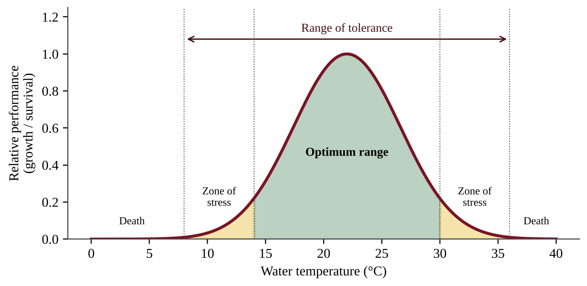
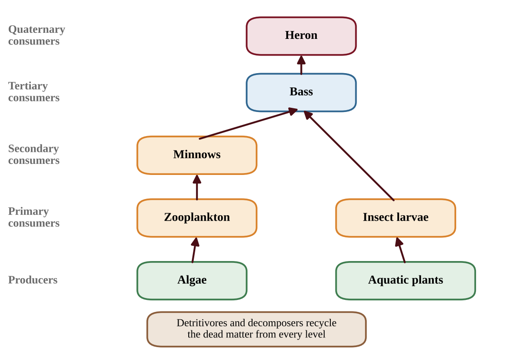
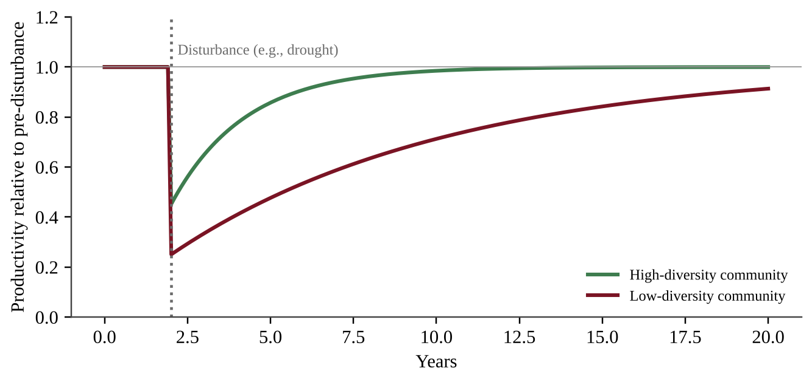
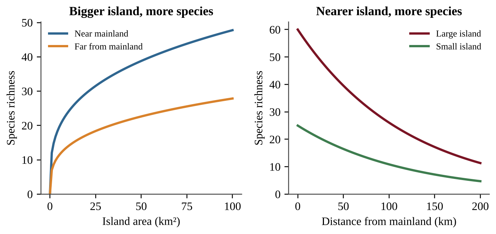
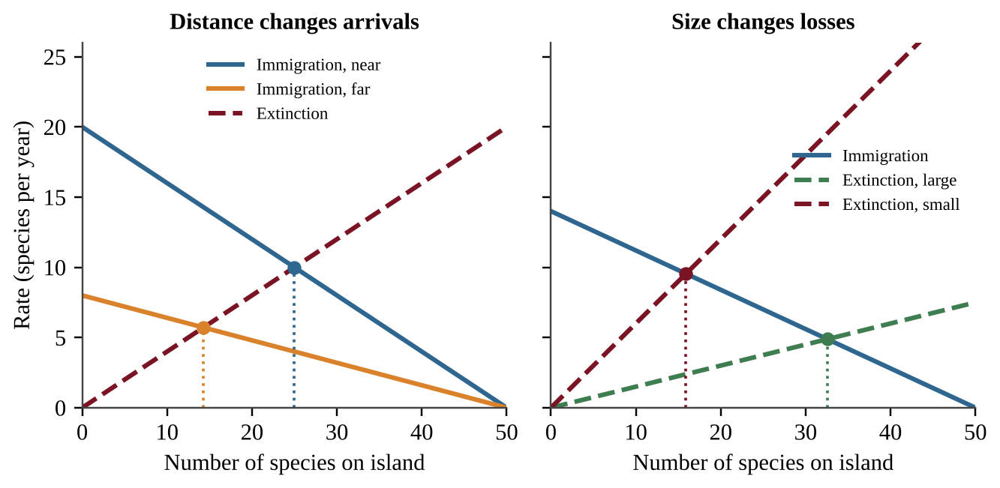
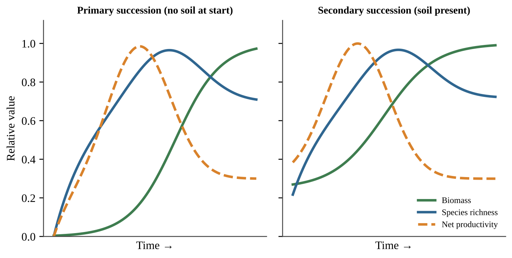

# Chapter 4 — Ecosystems

:::box objectives
- Explain how limited resources shape interactions among species (predation, symbiosis, competition).
- Describe tolerance ranges and use them to predict where species can live.
- Trace energy through ecosystems: GPP, NPP, trophic levels, the 10% rule, food chains and food webs.
- Identify the major terrestrial and aquatic biomes and explain how climate, salinity, depth and nutrients shape them.
- Explain biodiversity, ecosystem services, island biogeography, natural disruptions, adaptation and succession.
:::

## 4.1 Ecology
%% CED: 1.1 | ERT-1.A.1, ERT-1.A.2, ERT-1.A.3 | LO: ERT-1.A

**Ecology** is the study of how organisms interact with each other and with their environment. It works at several scales: an **organism**, a **population** (one species in one area), a **community** (all the populations living together), an **ecosystem** (a community plus its non-living surroundings), a **biome** (a large region with a characteristic climate and community) and the **biosphere** (all life on Earth).

An ecosystem includes the **biotic** (living) parts and the **abiotic** (non-living) parts of an area and the interactions among them. Abiotic factors include sunlight, temperature, water, soil minerals and oxygen. Biotic factors include every organism and the relationships between them. The central idea is simple: *resources are limited, so organisms interact over them.* Food, water, light, nesting space and mates are all resources. When a resource is scarce, the interactions around it become stronger and more important for survival.

### Predator–prey relationships

A **predator** is an organism that kills and eats another organism, the **prey**. The two populations affect each other. When prey is plentiful, predators have more food and may become more numerous. As predators multiply, more prey are eaten and the prey population declines. Predators then face a food shortage, and their numbers fall. This cause-and-effect loop often produces linked rises and falls in both populations.

### Symbiosis

**Symbiosis** is a close, long-term interaction between two species. To identify the type, ask who benefits and who is harmed.

| Type | Species A | Species B | Example |
|---|---|---|---|
| Mutualism | benefits | benefits | Bees collect nectar while pollinating flowers; reef-building coral and the algae living inside them |
| Commensalism | benefits | not affected | Orchids growing on a tree branch for light; barnacles riding on a whale |
| Parasitism | benefits | harmed | Ticks feeding on a deer; tapeworms in an intestine |

### Competition and resource partitioning

**Competition** occurs when organisms need the same limited resource. It can be **intraspecific** (within one species, for example two oak seedlings competing for light) or **interspecific** (between different species). Competition lowers the survival and reproduction of the competitors. Species that use a resource in the same way cannot easily coexist. Coexistence becomes possible through **resource partitioning**: using the resource in a different way, in a different place, or at a different time.

*Examples:* several warbler species feed in the same spruce tree, each in a different part of it; owls and hawks both hunt rodents, at night and by day.

:::box mistake
- Parasitism is not predation: a parasite lives on or in its host and does not usually kill it quickly; a predator kills its prey.
- Commensalism needs the second species to be truly unaffected; if both benefit it is mutualism.
:::

:::box strategy
When a question describes an interaction, write the effect on each species as a plus, minus or zero. (+,+) is mutualism, (+,0) is commensalism, (+,−) is parasitism or predation, and (−,−) is competition. Then use words from the scenario to justify your answer.
:::

:::box example
id: SG-U1-E001
Four species of small seed-eating birds live in the same grassland. Observers record the plant height at which each species feeds: species P feeds at 0–10 cm, species Q at 10–30 cm, species R at 30–60 cm, and species S at 60–100 cm. (a) Name the interaction pattern that allows these four species to share the same seed supply. (b) Explain how this pattern reduces the negative impact on each species' survival. (c) If a drought reduces total seed production by half, state whether you expect competition to increase, decrease or stay the same, and give a reason.
:::

:::box summary
- Ecosystems = biotic + abiotic parts interacting; limited resources drive species interactions.
- Predation, mutualism, commensalism, parasitism and competition are distinguished by who gains and who loses.
- Resource partitioning (different ways, places or times) lets similar species coexist.
:::

## 4.2 Law of Tolerance
%% CED: 2.4 | ERT-2.F.1, ERT-2.F.2 | LO: ERT-2.F

:::box simple
**Every organism has a comfort zone, and beyond its edges it gets hurt or dies.** A polar bear is comfortable in cold; it overheats in a desert. A cactus handles drought; it rots in a swamp. The width of the zone is the organism's tolerance.
:::

The **law of tolerance** says that each species can live only within a range of each environmental factor, and the factor closest to a species' limit decides whether it survives. **Ecological tolerance** is the range of conditions, such as temperature, salinity, flow rate, and sunlight, that an organism can endure before injury or death results. Each factor has its own range. A trout may tolerate a narrow temperature range but a wide range of sunlight; an estuary crab may tolerate wide swings in salinity.

{w=0.85}

*Reading the graph:* the x-axis is the environmental factor, the y-axis is how well the organism does. The peak is the optimum. The two outer limits mark the range of tolerance; outside them survival is not possible. A species with a *wide* curve is a generalist for that factor, and one with a *narrow* curve is a specialist. The **optimum range** is where the organism grows and reproduces best; in the **zone of stress** it survives but performs poorly.

**Individuals and species.** Tolerance applies at two levels. An *individual* has a tolerance that can shift a little with age, health, and acclimation (a runner adapts to altitude over weeks). A *species* has a tolerance range for the whole group, because individuals vary. A species' range is wider than any single individual's because it includes the hardiest and most sensitive members. A limiting factor that goes beyond tolerance determines where a species can live, so tolerance helps explain geographic range, and why a small shift in temperature, salinity, or flow can remove sensitive species from a stream.

### Reading tolerance graphs and tables

- The **range** is where performance is above zero (or the interval in a table); the **optimum** is the peak. Height shows performance at the best; width shows tolerance.
- Test the new condition against *each* species' range. Inside: it persists, perhaps with reduced growth. Outside: it is lost, however wide its range is elsewhere.
- Exposure time matters: a temperature survived for a week may kill within a month.

### Designing a tolerance experiment

A field survey shows only an association: distance from a road also changes shade, depth, and predators (**confounding variables**). Only an experiment that changes one factor shows cause. A good design has:

- a **hypothesis** in the form "If X increases, then Y will decrease, because the organism's tolerance limit is exceeded";
- an **independent variable** (the one factor you change, at several graded levels) and a **dependent variable** (what you measure, such as percent survival);
- a **control** (the natural or zero-stress level) and **replicates** (several containers per level, each with the same number of organisms);
- **constants** (temperature, volume, food, light, age and source of organisms, duration).

Graph response against level; the tolerance limit is where survival drops sharply.

:::box mistake
- Mixing up tolerance with adaptation. Tolerance is the range an organism can already survive; adaptation is a heritable change across generations (Section 4.5).
- Thinking the optimum and the limit are the same thing. Organisms can survive in the zone of stress but do poorly.
- Stating that tolerance is one number. It is a range with an upper and lower limit, for each factor.
:::

:::box example
id: SG-U2-E004
Laboratory trials recorded the survival of two freshwater snail species after 7 days at different water temperatures.

| Temperature (°C) | Species A survival (%) | Species B survival (%) |
|---|---|---|
| 6 | 0 | 0 |
| 10 | 0 | 55 |
| 14 | 80 | 90 |
| 18 | 100 | 95 |
| 22 | 95 | 85 |
| 26 | 70 | 40 |
| 30 | 0 | 0 |
| 34 | 0 | 0 |

(a) Using only the temperatures tested, identify the lowest and highest tested temperatures at which each species survived at all. (b) Which species is better described as having the wider tolerance for temperature? Justify with the data. (c) A power plant will raise stream temperature from 20 °C to 28 °C. Predict which species is affected more and explain.
:::

:::box example
id: SG-U2-E010
Acid rain may be lowering the pH of ponds where a salamander breeds. Design an experiment to find the range of pH its larvae can tolerate. (a) State a testable hypothesis. (b) Identify the independent and dependent variables. (c) Describe the treatments, control, and replication. (d) Name two constants. (e) Explain how you would find the tolerance limit.
:::

:::box summary
- Ecological tolerance is the range of conditions an organism can endure before injury or death.
- Factors include temperature, salinity, flow rate, and sunlight.
- It applies to individuals and to species.
- Narrow tolerance means a specialist for that factor; wide means a generalist.
:::

## 4.3 Energy Flow
%% CED: 1.8, 1.9, 1.10, 1.11 | ENG-1.A.1, ENG-1.A.2, ENG-1.A.3, ENG-1.A.4, ENG-1.A.5, ENG-1.B.1, ENG-1.B.2, ENG-1.B.3, ENG-1.C.1, ENG-1.C.2, ENG-1.D.1, ENG-1.D.2 | LO: ENG-1.A, ENG-1.B, ENG-1.C, ENG-1.D

Energy enters ecosystems as sunlight, is captured by producers, and then passes upward through feeding levels, shrinking at every step. This section follows that energy from the sun to the top predator.

### Primary productivity

**Primary productivity** is the rate at which solar energy is converted into organic compounds through photosynthesis over a unit of time. **Gross primary productivity (GPP)** is the total rate of photosynthesis in an area. Producers use part of that energy for their own cellular respiration (R). **Net primary productivity (NPP)** is the rate of energy storage by photosynthesizers in an area after subtracting the energy lost to respiration. NPP is the energy available to consumers.

:::box formula
NPP = GPP − R
GPP — gross primary productivity; R — energy used in the producers' respiration; NPP — net primary productivity.
Units: energy per unit area per unit time, for example kcal/m²/yr. Carbon units such as g C/m²/yr are also used.
Percent of GPP lost to respiration = R ÷ GPP × 100. If NPP and GPP are given, R = GPP − NPP.
Total NPP = NPP per unit area × area (1 km² = 10⁶ m²).
:::

Productivity is a **rate**, so its units include time. Biomass (total mass of organisms) is an amount at one moment. A forest can have very large biomass but moderate productivity, while an algal bloom can have small biomass but fast turnover.

**What controls productivity.** Light, temperature, water and nutrients set the rate of photosynthesis. Tropical rainforests, estuaries, marshes and coral reefs have high NPP per unit area; deserts, tundra and the open ocean have low NPP per unit area. The open ocean has low NPP per m², but its enormous area gives it the largest total NPP of any ecosystem type.

**Seasonal data.** Find NPP = GPP − R for each month. It is negative when respiration exceeds photosynthesis, as in a temperate forest's winter. Annual NPP = annual GPP − annual R. If insects strip leaves, GPP falls while respiration continues, so NPP falls.

**Light in water.** Photosynthesis stores energy as glucose; oxygen is a by-product. Water absorbs light. Most red light is absorbed in the upper 1 m, and blue light penetrates deeper than 100 m only in the clearest water. Photosynthesis therefore concentrates near the surface, and productivity falls with depth. Floating phytoplankton stay in the sunlit layer, and some algae have accessory pigments that capture the wavelengths that penetrate deeper. Turbid water makes the problem worse.

:::box example
id: SG-U1-E008
Two ecosystems are studied. Ecosystem A: GPP = 6,000 kcal/m²/yr; producer respiration = 4,200 kcal/m²/yr. Ecosystem B: GPP = 2,400 kcal/m²/yr; producer respiration = 600 kcal/m²/yr. (a) Calculate the NPP of each ecosystem. (b) Calculate NPP as a percentage of GPP for each ecosystem. (c) A student claims that Ecosystem A supports more consumers because its GPP is higher. Evaluate this claim using your results.
:::

:::box example
id: SG-C4-E001
A lake covers 25 km² and its producers have a net primary productivity of 800 kcal/m²/yr. Assume 10% of energy is passed on at each transfer. (a) Calculate the total NPP of the lake in kcal/yr. (b) Calculate the energy per year available to the primary consumers. (c) Calculate the energy per year available to the secondary consumers.
:::

### Trophic levels

A **trophic level** is an organism's feeding position in a food chain. **Producers (autotrophs)** make their own organic compounds, most by photosynthesis. **Consumers (heterotrophs)** get energy from other organisms. **Primary consumers** are herbivores that eat producers, **secondary consumers** eat primary consumers, and **tertiary consumers** eat secondary consumers. Omnivores eat both plants and animals, so they can occupy more than one level. **Detritivores** (for example earthworms and dung beetles) eat dead matter, and **decomposers** (bacteria and fungi) break down dead matter chemically, returning nutrients to the soil.

All ecosystems depend on a **continuous inflow of high-quality energy**, usually sunlight, to maintain their structure and function. In terrestrial and near-surface marine communities, energy flows from the sun to producers in the lowest trophic levels and then upward to higher levels. At each step some energy becomes low-quality heat that radiates away and cannot be recycled, so the flow is one-way.

Matter behaves differently. Atoms of carbon, nitrogen, phosphorus, oxygen and hydrogen move between the environment and organisms through **biogeochemical cycles** (Chapter 5). Each cycle demonstrates the **conservation of matter**: atoms are not created or destroyed, only moved and rearranged.

### Energy flow and the 10% rule

Of all the energy a trophic level takes in, only a fraction is stored in its tissues and available to the next level. The **10% rule** approximates that in a transfer of energy from one trophic level to the next, only about 10% of the energy is passed on. The rest is lost mostly as heat from respiration, and also in wastes, uneaten parts (bones, roots, fur) and dead matter that goes to decomposers.

{w=0.7}

**Why the loss happens: thermodynamics.**

- The **first law of thermodynamics** states that energy cannot be created or destroyed, only converted from one form to another. The sunlight captured by producers becomes chemical energy in sugar, then movement and heat.
- The **second law of thermodynamics** states that every energy conversion increases disorder (entropy), and some energy is always converted to low-quality heat. No conversion is 100% efficient. Every organism spends energy to move, grow, stay warm and reproduce, and that energy ends up as heat.

Consequences: food chains are short (usually 3 to 5 levels), top predators are rare, and a large base of producers is needed to support few top consumers.

:::box formula
Energy at level n+1 = energy at level n × 0.10
Energy after k transfers = starting energy × (0.10)ᵏ
Ecological efficiency (%) = (energy at the higher level ÷ energy at the lower level) × 100
Going down (energy needed at the lower level): divide by 0.10 for each step.
Units: the same as the data, such as kcal/m²/yr or joules.
:::

The 10% figure is approximate (real efficiencies range from about 5% to 20%); use 10% unless told otherwise. Count transfers, not levels: an organism at level 4 is three transfers above the producers.

- **Efficiency from data:** for each step, higher level ÷ lower level × 100. Similar values near 10% support the rule; the missing energy is lost mostly as heat (second law), not destroyed.
- **From harvest to area:** harvest mass × energy per kg = energy needed at the top level; divide by 0.10 per transfer down to the producers; divide by NPP (kcal/m²/yr) for area in m²; convert (1 ha = 10⁴ m²). Carry units on every line.
- **Diet and land:** each step up multiplies the energy and land needed by about 10, or by the factor given (if 1 kcal of beef needs 20 kcal of corn, 5,000 kcal of beef needs 100,000 kcal of corn). Eating lower on the food chain wastes less energy, so the same land feeds more people. People fed = energy per year ÷ (kcal per person per day × 365).

:::box apply
Raising beef needs many times more plant energy and land than growing grain for people, because about 90% of the feed energy is lost as heat and waste before the meat is eaten.
:::

:::box strategy
Write the trophic level labels next to the numbers, then draw an arrow for each transfer and multiply by 0.10. Show units, state the answer and check that each lower level has about 10 times the energy of the one above.
:::

:::box example
id: SG-U1-E009
In an ocean food chain, phytoplankton fix 25,000 kcal/m²/yr. The chain is phytoplankton → zooplankton → small fish → tuna. Assume 10% of the energy is passed on at each transfer. (a) Calculate the energy available to the tuna in kcal/m²/yr. (b) Calculate how much phytoplankton energy would be needed to support 400 kcal/m²/yr in the small fish. (c) Explain, using the second law of thermodynamics, why the tuna receive less energy than the small fish.
:::

### Food chains and food webs

A **food chain** shows a single pathway of energy and matter from producers (autotrophs) to primary consumers (herbivores), secondary and tertiary consumers (carnivores and omnivores). The arrows point from the organism being eaten to the organism that eats it, which is the direction of energy flow. Detritivores and decomposers play an essential role: they return nutrients to the soil, where producers use them again.

A **food web** is a model of the interlocking food chains in an ecosystem. It is more realistic than a single chain because most consumers eat several things and are eaten by several predators, so one organism can sit at several trophic levels. A hawk that eats a mouse (a primary consumer) is a secondary consumer, but a hawk that eats a snake that ate a mouse is a tertiary consumer.

{w=0.8}

To read a food web, find the producers (arrows only leave them), count steps from a producer to give each consumer's trophic level (list every level if there are several paths), and, to predict the effect of removing a species, follow every arrow that enters or leaves it.

**Feedback loops and changing the web.** When one species is added to or removed from a food web, the rest of the web can change. Feedback loops often drive these changes.

- A **negative (balancing) feedback loop** counteracts a change and stabilizes the system. When rabbits increase, foxes find more food and multiply, so rabbits are reduced.
- A **positive (reinforcing) feedback loop** amplifies a change. In a lake, a large algal bloom dies, decomposers use up the dissolved oxygen as they consume it, fish die, and their decay uses still more oxygen.

A **trophic cascade** is a chain of effects across levels. When sea otters (which eat sea urchins) are removed, urchins increase, they graze down the kelp, and the kelp forest that sheltered many other species disappears.

**Tracing effects and judging evidence.** To predict a change, start with the first change and flip the direction at each link. Removing bass lets minnows increase; more minnows eat more zooplankton; fewer zooplankton graze less, so algae rise. Predators are far fewer than their prey because only about 10% of energy passes up a level.

Two sites that differ (a no-fishing reserve and a fished reef) show an association, not proof of cause, because depth, temperature or nutrients may also differ. Stronger evidence comes from several matched sites, before-and-after data at one site, or an experiment that removes or adds the predator with untreated controls.

:::box mistake
- GPP is always greater than NPP (unless R = 0); productivity is a rate, biomass an amount.
- Energy flows one way; only matter cycles. An omnivore can belong to more than one trophic level.
- Arrows point from the food to the eater. A web with alternative prey is more resilient.
:::

:::box example
id: SG-U1-E010
A food web in a dry grassland has these feeding relationships (prey → predator): grass → grasshoppers; grass → rabbits; grasshoppers → lizards; lizards → hawks; rabbits → foxes; rabbits → hawks. (a) Write the longest food chain in this web and identify the trophic level of the hawk in that chain. (b) A disease eliminates nearly all lizards. Predict the direction of change in the grasshopper population, assuming lizards are the only predator of grasshoppers, and explain. (c) As rabbits increase, foxes increase, and then rabbits decline. Identify the type of feedback and justify your answer.
:::

:::box summary
- Primary productivity is the rate at which producers convert sunlight into organic compounds; NPP = GPP − R, in energy per area per time (for example kcal/m²/yr). Water absorbs light, so aquatic photosynthesis is concentrated near the surface.
- Producers capture energy; consumers pass it up; detritivores and decomposers recycle dead matter. Ecosystems need a continuous input of high-quality energy but recycle matter (conservation of matter).
- About 10% of energy passes to the next trophic level and about 90% is lost, mainly as heat (first and second laws of thermodynamics), so food chains are short and top predators few.
- Food chains show one pathway; food webs combine many; adding or removing a species affects the web through positive and negative feedback loops.
:::

## 4.4 Biomes
%% CED: 1.2, 1.3 | ERT-1.B.1, ERT-1.B.2, ERT-1.B.3, ERT-1.B.4, ERT-1.C.1, ERT-1.C.2, ERT-1.C.3 | LO: ERT-1.B, ERT-1.C

A **biome** is a large region with a characteristic community of plants and animals that result from, and are adapted to, its climate. Temperature and precipitation are the two main drivers. Because both change with latitude (distance from the equator) and altitude (height above sea level), biomes form recognizable bands and patterns around the globe.

### Terrestrial biomes

**Reading a biome climate graph.** Find the site's temperature (x-axis) and precipitation (y-axis) and read which zone contains the point; where zones overlap, other clues (seasonality, soil, vegetation) decide. Cold biomes lie on the left and wet biomes at the top. At a given temperature, more precipitation shifts desert to grassland to forest.

| Biome | Climate | Typical features |
|---|---|---|
| Tundra | Very cold, low precipitation, short growing season | Permafrost; low shrubs, mosses, lichens; slow decomposition |
| Taiga (boreal forest) | Long, cold winters; short, mild summers | Evergreen conifers; acidic, nutrient-poor soil; large expanses |
| Temperate rainforest | Cool, very wet, mild temperatures | Tall conifers, ferns and mosses; moist, rich in biomass |
| Temperate seasonal forest | Four distinct seasons; moderate precipitation | Deciduous trees that drop leaves in winter; fertile soil |
| Tropical rainforest | Hot all year, very wet | Greatest biodiversity; nutrients locked in biomass; thin, poor soil |
| Shrubland | Hot dry summers, mild wet winters | Drought-tolerant, fire-adapted shrubs |
| Temperate grassland | Hot summers, cold winters, moderate-to-low rain | Grasses; deep fertile soil; fire and grazing maintain it |
| Savanna | Warm year-round, distinct wet and dry seasons | Grasses with scattered trees; large grazing herds |
| Desert | Very low precipitation (typically under about 30 cm/yr) | Drought-adapted plants; animals that avoid daytime heat |

Tropical rainforest soil is poor even though the forest is lush: warmth and moisture make decomposition fast and plants absorb nutrients at once, so little is stored in the soil. In cold biomes, decomposition is slow and organic matter accumulates.

**Reading a climatograph.** Monthly graphs show precipitation as bars and temperature as a line. Ask: how warm is the line, and does it change? Is rain spread evenly, or is there a dry season? Does rain fall in the warm or the cool months? In Figure 4.5, a flat warm line with tall bars every month is tropical rainforest (A); warmth with a long dry season is savanna (B); a mild wet winter and nearly rainless summer is shrubland (C); a freezing winter with rain peaking in summer is temperate grassland (D). Very short bars in every month mean desert.

{w=0.8}

**Comparing biomes.** Species diversity and net primary productivity (NPP) per m² peak where warmth and water are abundant all year. Diversity ranks tropical rainforest, temperate seasonal forest, temperate grassland, tundra (high to low); NPP is highest in tropical rainforest and lowest in desert and tundra. On a world map, rainforest lies near the equator, temperate seasonal forest at mid-latitudes, then taiga and tundra toward the pole.

**Why resources and biomes are not spread evenly.** Non-mineral natural resources such as fresh water and timber are unevenly distributed because of **climate, geography, latitude and altitude, nutrient availability and soil**. Timber is concentrated in forest biomes; water is abundant in rainforests and scarce in deserts. Biome distribution is **dynamic**: it changed in the past, for example as ice sheets advanced and retreated, and may shift again with climate change. Warming can push forest boundaries toward the poles and up mountainsides.

:::box mistake
- Deserts are defined by low precipitation, not heat; some are cold.
:::

:::box example
id: SG-U1-E002
Use Figure 4.4. Three field stations report the following climate data. Station A: mean annual temperature 25 °C, precipitation 300 cm/yr. Station B: mean annual temperature −9 °C, precipitation 22 cm/yr. Station C: mean annual temperature 18 °C, precipitation 12 cm/yr. (a) Identify the most likely biome at each station. (b) Explain why decomposition and nutrient turnover would differ between the biomes at Stations A and B.
:::

:::box example
id: SG-U1-E011
Station M: temperature 24–28 °C every month; precipitation 150–230 mm per month from November to April and under 15 mm per month from May to October. Station N: temperature −6 °C in January and 20 °C in July; precipitation 15–25 mm per month in winter and 60–90 mm per month from May to August. (a) Identify the biome at each station and cite two pieces of evidence for each. (b) Explain how the dry season at Station M shapes its plant community. (c) Predict how Station N's biome would change if the region warmed and became drier, and justify it.
:::

### Aquatic biomes

**Freshwater biomes** include streams, rivers, ponds and lakes. They contain little dissolved salt (typically under about 0.5 parts per thousand) and are a vital source of drinking water, irrigation and food. **Marine biomes** are salty (the open ocean averages about 35 parts per thousand).

- **Oceans** cover most of Earth's surface. Surface algae (phytoplankton) supply a large portion of Earth's oxygen and take in carbon dioxide from the atmosphere.
- **Coral reefs** occur in warm, clear, shallow water. They host great biodiversity and rely on a mutualism between coral animals and algae. They are sensitive to warming and pollution.
- **Marshland** (including salt marshes and mangroves) is shallow and nutrient-rich, with plants rooted in saturated soil; it filters runoff and protects coasts.
- **Estuaries** form where a river meets the sea, creating water of intermediate salinity that varies with tides and river flow. They are nutrient-rich, turbid and serve as nurseries for many fish and shellfish.

**Why aquatic resources vary.** The distribution of non-mineral marine resources such as different fish varies with **salinity, depth, turbidity, nutrient availability and temperature**. Fish that need cold, nutrient-rich water gather in areas where deep water rises to the surface, bringing nutrients with it. Turbid (cloudy) water blocks light and limits photosynthesis to a thin surface layer. Where nutrients are scarce, as in much of the open ocean, phytoplankton stay sparse even in clear, warm, sunlit water. Photosynthesis is limited to the sunlit top tens of meters (Section 4.3), so the dark deep ocean has no photosynthesizers.

:::box mistake
- Algae and phytoplankton, not large plants, produce most marine oxygen.
- Do not call an estuary "freshwater." Its salinity is intermediate and changes with the tides.
:::

:::box example
id: SG-U1-E003
A student records data for two aquatic sites. Site X: salinity 34 parts per thousand, temperature 27 °C, depth 8 m, very clear water, with corals and many fish species. Site Y: salinity 12 parts per thousand where a river meets a bay, depth 2 m, cloudy water full of sediment and rich in nutrients, with young fish and oysters. (a) Identify the aquatic biome at each site. (b) Explain how low turbidity at Site X helps its primary producers, and state one reason Site Y supports so many young fish.
:::

:::box summary
- Terrestrial biomes follow temperature and precipitation, which vary with latitude and altitude. Know the nine biomes, their climate and signature adaptations; biome boundaries are dynamic and may shift with climate change.
- Freshwater biomes: streams, rivers, ponds, lakes. Marine biomes: oceans, coral reefs, marshland, estuaries.
- Climate, soil and geography control non-mineral land resources; salinity, depth, turbidity, nutrients and temperature control marine resources.
- Marine algae produce a large share of Earth's oxygen and absorb atmospheric CO₂.
:::

## 4.5 Biodiversity
%% CED: 2.1, 2.2, 2.3, 2.5, 2.6, 2.7 | ERT-2.A.1, ERT-2.A.2, ERT-2.A.3, ERT-2.A.4, ERT-2.A.5, ERT-2.B.1, ERT-2.C.1, ERT-2.D.1, ERT-2.D.2, ERT-2.E.1, ERT-2.G.1, ERT-2.G.2, ERT-2.G.3, ERT-2.G.4, ERT-2.G.5, ERT-2.G.6, ERT-2.H.1, ERT-2.H.2, ERT-2.I.1, ERT-2.I.2, ERT-2.I.3, ERT-2.J.1, ERT-2.J.2 | LO: ERT-2.A, ERT-2.B, ERT-2.C, ERT-2.D, ERT-2.E, ERT-2.G, ERT-2.H, ERT-2.I, ERT-2.J

### Levels of biodiversity

:::box simple
**Biodiversity is variety, counted at three scales.** Think of a school. The students differ from one another (genetic variety within one species). The school has many kinds of clubs (variety of species). The campus has a gym, library, garden, and cafeteria (variety of habitats). A healthy ecosystem has lots of variety at every scale: when something goes wrong, someone can always step in.
:::

**Genetic diversity** is the variety of genes (alleles) among the individuals of one species. **Species diversity** is the variety of different species in an ecosystem. **Habitat diversity** (also called ecosystem diversity) is the variety of physical environments, such as forest, meadow, stream, and wetland, in an area. Each habitat supports its own set of species, so more habitats usually means more species.

:::box define
**Species richness** — the number of different species found in an ecosystem. It counts kinds, not individuals.
**Population bottleneck** — a sharp drop in population size that leaves the survivors with only a small sample of the original genes.
**Specialist** — a species with narrow requirements for food, habitat, or conditions.
**Generalist** — a species that can use many foods and habitats and tolerate a wide range of conditions.
:::

**Why genetic diversity matters.** A genetically diverse population contains individuals with many different traits. When a stressor arrives, such as a new disease, a hot summer, or a pesticide, a few individuals are likely to carry traits that let them survive and reproduce. Those survivors rebuild the population. A population with little genetic variety may have no such individuals, so the same stressor can wipe out nearly everyone. A field planted with one identical crop variety can be lost to a single fungus, while a mixed wild meadow rarely is. Crops and livestock bred from a few uniform lines carry fewer alleles than wild populations, and breeding among close relatives in small populations makes harmful alleles show up more often.

A **bottleneck** causes loss of genetic diversity. When a population collapses, whether from hunting, fire, or disease, only the survivors pass genes forward. Rare alleles are often lost by chance, and even if numbers recover, the population stays genetically uniform. Remember: *recovering numbers does not restore lost genes.*

**Species richness and recovery.** If a meadow plot contains 14 plant species, its richness is 14, whether it holds 20 plants or 2,000. Ecosystems with more species are more likely to recover from disruptions. More species means more different ways of doing the same job (several kinds of plants fix carbon, several kinds of insects pollinate). If a drought or pest eliminates one species, another with a different tolerance fills in. A low-diversity system depends on a few species, so losing one leaves a gap nothing can fill.

{w=0.85}

*Reading the graph:* the drop at the dotted line shows the size of the damage; the climb back to 1.0 shows resilience. The green line drops less and returns sooner.

**Habitat loss.** When habitat is destroyed or fragmented, species do not vanish all at once. **Specialists** go first because they cannot use any other habitat or food. Generalists follow later if the loss continues. Species with **large territorial requirements** (wolves, big cats, eagles) decline in number early, because a shrunken or chopped-up patch cannot hold enough territories. Habitat loss is the leading cause of biodiversity loss worldwide (Chapter 11). Roads, fields, and clear-cuts split one large habitat into small patches. A small patch is mostly edge, where sun, wind, and outside predators change conditions, so forest-interior specialists lose space first. Corridors (strips of habitat joining patches) let animals move between them. To decide who vanishes first, compare patch size with territory size, then ask how narrow the species' needs are.

:::box mistake
- Confusing richness with total number of individuals. A plot with 500 ants of one species has richness 1.
- Saying a recovered population has "regained genetic diversity." A bottleneck loss of alleles is not undone by regrowth in numbers.
- Believing generalists are the first to disappear from habitat loss. Specialists go first.
- Treating "biodiversity" as only species. Genetic and habitat diversity are part of it too.
:::

:::box strategy
When a question asks you to *explain* why diversity helps, give a chain: more genetic or species variety → some individuals or species tolerate the stressor → they survive and reproduce or take over the lost function → the ecosystem keeps functioning or recovers sooner. A bare statement such as "diversity is good" earns no credit.
:::

:::box example
id: SG-U2-E001
For each situation, name the level of biodiversity (genetic, species, or habitat) that is being described, and say in one sentence whether it is high or low in that situation. (a) A cheetah population descended from a few dozen survivors shows almost no variation in the genes that control immune response. (b) A 40-hectare reserve contains pine forest, a lake, a peat bog, and open grassland. (c) A 100 m² plot of coral reef holds 63 fish species.
:::

:::box example
id: SG-C4-E002
A forest plot was surveyed before and after selective logging. Before: oak 12 trees, maple 7, birch 3, hickory 5, beech 2. After: oak 9 trees, maple 4, birch 0, hickory 3, beech 0. (a) State the species richness of the plot before and after logging. (b) Calculate the percent change in species richness. (c) Calculate the percent change in the total number of trees, to the nearest percent. (d) Explain why richness and the number of individuals are different measures of biodiversity.
:::

### Ecosystem services

:::box define
**Ecosystem services** — the benefits that people obtain from functioning ecosystems.
**Provisioning services** — the material goods ecosystems supply: food, fresh water, timber, fiber, fuel, medicines.
**Regulating services** — the ways ecosystems control conditions: climate regulation (carbon storage), flood control, water purification, pollination, disease and pest control, erosion control.
**Cultural services** — the non-material benefits: recreation, tourism, spiritual value, education, and beauty.
**Supporting services** — the basic processes on which all the others depend: nutrient cycling, soil formation, photosynthesis (primary production), and habitat for species.
:::

**Ecosystem services are the free benefits nature provides.** Memory trick: provisioning = *products*; regulating = *rules* of the environment; cultural = *culture and enjoyment*; supporting = *the foundation*. One ecosystem usually gives all four. A mangrove forest supplies fish and wood (provisioning), buffers storm surge and traps sediment (regulating), draws ecotourists (cultural), and acts as a nursery for young fish while recycling nutrients (supporting). To classify a benefit, ask what it does: supplies a good, moderates a process or hazard, gives enjoyment, or keeps the ecosystem running.

| Service category | Wetland example | Forest example |
|---|---|---|
| Provisioning | Fish, rice, drinking water | Timber, mushrooms, medicinal plants |
| Regulating | Absorbs floodwater, filters pollutants | Stores carbon, reduces erosion on slopes |
| Cultural | Bird watching, education | Hiking, spiritual significance |
| Supporting | Nutrient cycling, nursery habitat | Soil formation, wildlife habitat |

**Human disruption of ecosystem services.** Anthropogenic (human-caused) activities can damage or remove these services, and the results are both **ecological** and **economic**. Cutting a mountain forest for timber gains short-term income (provisioning) but can destroy flood and erosion control (regulating): the next rains send mud into the river, the reservoir silts up, and the downstream town pays for dredging and flood repair. Pollinator decline from pesticide overuse lowers crop yields and forces farmers to pay for hand pollination or rented hives. Draining wetlands removes natural water purification, so a city must build an expensive treatment plant.

:::box process
Human activity (clearing, draining, polluting) → ecosystem function damaged → service lost → ecological consequence (flooding, soil loss, fewer species) → economic consequence (repair costs, lower yields, lost tourism)
:::

**Putting a dollar value on services.** Two common methods compare costs and benefits. **Market value** is quantity × price (a harvest). **Replacement cost** is what a machine or plant would cost to do the same job (a treatment plant replacing a wetland's filtering).

:::box formula
Value of a service ($/yr) = area (ha) × rate (units/ha/yr) × price ($/unit)
Cost over t years = one-time cost + (annual cost × t)
Net benefit = total benefits − total costs
Convert every service to $ per year before adding; compare options over the same number of years.
Example: 40 ha × 150 kg/ha/yr × $5/kg = $30,000/yr.
:::

When an ecosystem is converted, compare the developer's profit with the *total* value of all services lost; the loss usually falls on the public. Solutions: build on already-degraded land, restore habitat elsewhere, require new building to stay back from the shore, or make the developer pay for lost services. Each has a cost, which is its tradeoff.

:::box example
id: SG-U2-E009
A 120-ha tidal marsh filters nutrients from a bay. A treatment plant doing the same job would cost $9 million to build and $0.5 million per year to run. Protecting the marsh costs $120 per hectare per year. The marsh also supports 90 kg/ha/yr of shellfish worth $8/kg. (a) Calculate the yearly value of the shellfish harvest. (b) Calculate the 15-year cost of the plant and of protecting the marsh, and the difference. (c) Classify the filtering and the shellfish as ecosystem services. (d) State one tradeoff of relying on the marsh.
:::

:::box example
id: SG-U2-E002
A river valley has a floodplain forest. Classify each of the following benefits as provisioning, regulating, cultural, or supporting: (i) the forest soaks up spring floodwater; (ii) families harvest wild nuts; (iii) leaf litter decomposes and returns nitrogen to the soil; (iv) a canoe-rental company runs tours. Then, if the forest were cleared for farmland, describe one ecological and one economic consequence for the town downstream.
:::

### Island biogeography

Big, near islands hold the most species; small, remote ones the fewest. **Island biogeography** is the study of the ecological relationships and distribution of organisms on islands, and of the community structure of those organisms. The ideas apply to any isolated habitat: a mountaintop, a lake, a forest fragment surrounded by farmland, or a nature reserve in a city.

Islands were **colonized** in the past by species that arrived from elsewhere: birds flying, seeds blown by wind or carried in feathers, insects rafting on floating logs, and sometimes human introductions. The number of species on an island reflects a balance between new species arriving (**colonization**) and species being lost (**extinction**).

:::box process
**Distance:** island near mainland → more colonists arrive → more species. Island far away → fewer colonists → fewer species.
**Size:** large island → more habitats and resources → larger populations → lower extinction rate → more species. Small island → small populations → more likely to disappear → fewer species.
:::

{w=0.9}

*Reading the graphs:* on the left, both lines rise with area, and the near-mainland line sits higher at every size. On the right, richness drops as distance grows, and the large-island line sits above the small-island line. Describe both variables: "richness increases with island area and decreases with distance."

**Equilibrium: arrivals balance losses.** As an island fills, fewer new species remain to arrive, so the **immigration rate falls**. More species means smaller populations and more competition, so the **extinction rate rises**. Where the curves cross is the **equilibrium**: arrivals equal losses and richness stays steady. Read the number of species straight down from the crossing.

{w=0.85}

*Reading the graphs:* a far island has a lower immigration curve and a small island a steeper extinction curve; both push the crossing left. Equilibrium is a *number*, not a fixed list: species keep arriving and disappearing (turnover), so two surveys can show the same richness but different species. **Species–area graphs** rise quickly on small areas and slowly on large ones. On a logarithmic area axis each equal step multiplies area by 10, so 300 ha sits about halfway between the 100 and 1,000 ha marks. To predict an island's richness, bracket its area between islands at a similar distance.

**Island biogeography and evolution.** Island resources such as food and territory are limited. Over time many island species evolve to be **specialists** that use one narrow food or habitat, which reduces competition among the few species present. Isolation also lets populations diverge from mainland relatives, so islands are well known for unusual species found nowhere else. This specialization carries a risk. Invasive species that arrive on islands are typically **generalists**: they eat many foods, tolerate many conditions, and reproduce quickly. A generalist can outcompete a specialist for food or space, or prey on animals that evolved without defenses against such predators. The long-term survival of island specialists can therefore be jeopardized when invasive species are introduced.

:::box mistake
- Saying a bigger island has more species "because it is closer." Size and distance are two separate variables; keep them separate.
- Claiming islands have more species than the mainland. Islands generally have *fewer* species than a comparable mainland area.
- Assuming invasive species are specialists. They are typically generalists.
:::

:::box example
id: SG-U2-E003
Four islands were surveyed for land-bird species.

| Island | Area (km²) | Distance from mainland (km) | Bird species |
|---|---|---|---|
| P | 4 | 10 | 18 |
| Q | 4 | 120 | 9 |
| R | 90 | 10 | 41 |
| S | 90 | 120 | 24 |

(a) Describe the effect of distance on bird richness, using a pair of islands that differ only in distance, and give the percent decrease for that pair. (b) Describe the effect of area on richness for islands at the 120 km distance. (c) Predict which island is most likely to lose a specialist species through chance extinction, and justify your choice.
:::

### Natural disruptions to ecosystems

Nature disturbs ecosystems all the time, sometimes harder than humans do. Natural disruptions include fires, floods, hurricanes, volcanic eruptions, earthquakes, drought, disease outbreaks, and slow shifts in climate. **Short-term** disruptions (a storm, a fire) act over hours to years. **Long-term** disruptions (an ice age, a change in sea level) act over thousands to millions of years. The consequences of a natural disruption, for a given occurrence, may be as great as or greater than those of many human-made disruptions. A major eruption can bury a whole landscape in ash, and a hurricane can flatten a forest. Natural does not mean harmless.

Earth system processes operate over a range of time scales, and they differ in how predictable they are:

:::box define
**Periodic** — happens at regular, predictable intervals (seasons, annual monsoon flooding, daily tides).
**Episodic** — happens in occasional bursts, with some pattern in how often but not on a fixed schedule (hurricane seasons with active and quiet years; large wildfires every few decades).
**Random** — has no predictable pattern in timing (a meteorite impact, a single earthquake or volcanic eruption).
:::

**Climate and sea level.** Earth's climate has changed over geological time for many reasons, including changes in Earth's orbit and tilt, variations in solar output, volcanic activity, shifting continents, and changes in greenhouse gas levels. During cold (glacial) periods large amounts of water are locked in continental ice, so **sea level falls**; during warm periods ice melts and **sea level rises**. Falling sea level can expose land bridges and shallow shelves; rising sea level floods coastal lowlands. Continental-shelf islands often share mammals with the mainland because lower glacial sea level once joined them by land.

**Habitat change and migration.** Major environmental change or upheaval commonly results in **large swaths of habitat change**: grassland may turn to desert, forest may retreat or advance, shorelines move inland. Wildlife responds. **Migration** may be short-term (a seasonal trip to avoid winter, or fleeing a fire and returning) or long-term (a species' range shifting poleward over centuries as climate warms). Animals migrate for many reasons, including food, breeding, temperature, and natural disruptions. A wet winter in a fire-prone region grows extra grass and shrubs; once dry, that fuel makes the next fire larger. As climate warms, species track their temperature range poleward or upslope, but a narrow-tolerance species stranded on a mountaintop or island may have nowhere to go.

:::box mistake
- Believing that natural disruptions are always smaller than human ones. A single natural event can exceed many human-caused disruptions.
- Mixing up "episodic" and "periodic." Periodic = regular clock-like timing; episodic = occasional bursts; random = unpredictable.
- Saying sea level falls when ice melts. Melting land ice *raises* sea level.
:::

:::box example
id: SG-U2-E005
A valley forest has a net primary productivity of 1,200 g/m²/yr before a hurricane. The measured values afterward are: Year 1 = 300, Year 3 = 540, Year 5 = 780, Year 8 = 1,020. (a) Calculate the percent decrease in productivity in Year 1 compared with the pre-hurricane value. (b) Calculate the average increase in productivity per year between Year 1 and Year 5. (c) Classify hurricanes as periodic, episodic, or random for a coastal region with several active years and several quiet years, and justify. (d) Describe one way wildlife might respond in the short term.
:::

### Adaptations

**Adaptation is a population change across generations, not something an individual does.** Individuals in a population vary, and many differences are **heritable** (passed from parents to offspring through genes). Some variants help an organism survive and reproduce in its particular environment. Those individuals leave more offspring, so the helpful trait becomes more common in the next generation. Over many generations these incremental changes at the genetic level make the population **adapted** to its environment.

Example: a beetle population contains green and brown beetles. Birds in a brown, dry landscape eat green beetles more often. Brown beetles survive longer, breed more, and the next generation has a higher percentage of brown beetles. No individual beetle changed color. The *population's* gene frequencies shifted. **Genetic diversity supplies the variation** that natural selection needs; a population with no variation cannot adapt.

:::box define
**Natural selection** — the process in which individuals with heritable traits that improve survival and reproduction leave more offspring, so those traits become more common.
**Adaptation** — a heritable trait that increases an organism's fitness in its environment; also the process of a population becoming better suited over generations.
**Heritable trait** — a trait controlled by genes that can be passed to offspring.
:::

**When the environment changes.** Environmental change may be sudden (a volcanic eruption, an oil spill) or gradual (slow warming, a rising sea). Either may threaten a species' survival. Individuals have three possible outcomes: **alter behavior** (hunt at night when days get too hot), **move** (migrate to a better area), or **perish**. Behavioral change and movement happen within an individual's lifetime and are not genetic adaptation. Whether the *species* survives depends on whether enough individuals can do one of these or whether the population has heritable variation that selection can act on quickly enough. Fast change, few individuals, long generation times, and low genetic diversity all work against survival.

**Kinds of adaptation and selection in action.** Adaptations may be **structural** (large heat-shedding ears), **physiological** (concentrated urine that saves water), or **behavioral** (nocturnal activity). A behavior counts as an adaptation when it is inherited; a one-time response to a situation is not. **Mutations** are random changes in DNA that supply new alleles. The environment does not cause helpful mutations on demand; it only decides which existing variants survive.

**Resistance is natural selection.** Each spraying of one pesticide or herbicide kills susceptible individuals and leaves resistant ones to breed, so the resistant fraction rises every generation, fastest in species with many offspring and short generations. To slow it, reduce selection pressure: leave untreated refuges so susceptible individuals keep mating with survivors, rotate products with different modes of action, and spray only when needed. Higher doses or more frequent spraying strengthen selection.

:::box mistake
- Saying "the organism adapted because it needed to." Selection acts on existing variation; needs do not create traits.
- Claiming individuals evolve during their lives. Populations change across generations.
- Confusing learned behavior or acclimation (not inherited) with adaptation (heritable change).
:::

:::box example
id: SG-U2-E011
A weed species was sprayed with the same herbicide for six seasons. The share of resistant plants rose: 3% (season 1), 9%, 26%, 58%, 81%, 93% (season 6). (a) Describe the trend. (b) Explain it as natural selection, naming the variation, the selective agent, and the outcome. (c) Propose one change that would slow resistance and justify it.
:::

:::box example
id: SG-U2-E006
A population of 2,000 field mice is reduced to 40 individuals by a disease outbreak, then recovers to 2,000 over six years. Before the outbreak, 5 different alleles of an immune-response gene were present; after recovery only 2 of them are found. (a) Name the process that explains the loss of alleles and state what happened to genetic diversity even though the population size returned to normal. (b) A new, more virulent disease then appears. Explain why this population is at greater risk than the original population. (c) Distinguish between a mouse changing its behavior to avoid the disease and the population adapting to it.
:::

### Ecological succession

:::box define
**Primary succession** — community development in an area with no soil, such as bare rock after a lava flow, a retreating glacier, or a new sand dune. It starts from nothing and takes hundreds to thousands of years.
**Secondary succession** — community development in an area where soil remains after a disturbance, such as an abandoned field, a burned forest, or a cleared lot. It is faster because the soil already holds nutrients, organic matter, and seeds.
**Pioneer species** — the first species to colonize unoccupied or newly disturbed habitat, usually hardy, fast-growing, and good at dispersing.
**Keystone species** — a species whose activities play a particularly significant role in determining community structure, much more than its abundance would suggest.
**Indicator species** — a plant or animal whose presence, abundance, scarcity, or chemical composition shows that some distinctive aspect of the character or quality of an ecosystem is present.
:::

Succession is an ecosystem rebuilding itself in stages: hardy species move in, change the place, and let new species follow until the community is stable. **Primary succession** typically proceeds: bare rock → lichens and mosses (pioneers) that slowly break down rock and add organic matter → thin soil → grasses and herbs → shrubs → trees → mature community. **Secondary succession** skips the soil-building stage: the field or burned forest starts with weeds and grasses, then shrubs, fast-growing trees, and finally a mature forest. A storm or fire that leaves the soil restarts *secondary* succession.

**Pioneers and the origin of new species.** Pioneer members of an early successional species commonly move into unoccupied habitat. Over time they adapt to its particular conditions, which may result in the origin of new species: a founding population in a new, isolated place faces new selective pressures and can diverge from its parent population. Pioneers also change the environment: lichens create soil, and early plants add organic matter and shade, making the habitat suitable for later species.

**What changes during succession.** Succession in a disturbed ecosystem affects **total biomass** (the mass of living organisms), **species richness**, and **net productivity** (the rate at which producers store energy as new biomass, after their own respiration) over time.

{w=0.9}

- **Biomass** increases steadily and levels off in a mature community, where large long-lived plants store much material.
- **Net productivity** is highest during the fast-growing middle stages and declines as the community matures, because a large mature community uses much of what it produces for its own respiration and maintenance.
- **Species richness** generally increases through the early and middle stages as habitats become more varied, and may level off or decline slightly late in succession when a few dominant, shade-casting species crowd others out.

*Reading the graph:* identify the type of succession from where the lines begin (near zero means no soil, so primary; already substantial means soil present, so secondary). Then describe each line using words such as "increases," "peaks," and "levels off."

As the canopy closes, light at the ground falls, so sun-loving pioneers decline and shade-tolerant species take over, leading to a stable mature (climax) community.

:::box formula
Productivity per biomass (yr⁻¹) = NPP ÷ total biomass
Young stands give high ratios; old stands give low ratios, because a mature stand holds much woody tissue that adds no growth but needs energy for respiration.
Example: NPP 0.9 kg/m²/yr with biomass 6.0 kg/m² → 0.9 ÷ 6.0 = 0.15 yr⁻¹.
:::

**Keystone and indicator species.** A **keystone species** has an influence far larger than its numbers. Sea otters eat sea urchins; without otters, urchins overgraze kelp, and the kelp forest community collapses. Beavers build dams that create wetlands for dozens of other species. An **indicator species** signals something about ecosystem condition. Certain stonefly larvae need clean, oxygen-rich water, so their presence indicates good water quality and their disappearance suggests pollution. Lichens that are sensitive to air pollution work the same way. A keystone species *shapes* the community; an indicator species *reports* on it.

:::box mistake
- Saying primary succession occurs after a forest fire. Burned forest keeps its soil, so that is secondary.
- Assuming a keystone species must be abundant or large. Its importance comes from its effect, not its numbers.
- Treating indicator and keystone species as the same. One reports conditions; the other controls community structure.
- Stating that net productivity keeps rising until the end of succession. It peaks in the middle and falls in mature stages, while biomass keeps climbing and then levels off.
:::

:::box example
id: SG-U2-E007
Researchers measured two plots after a disturbance. Plot X began as bare, scoured rock after a glacier retreated. Plot Y was a farm field abandoned after plowing.

| Year | Plot X species | Plot Y species | Plot Y biomass (kg/m²) |
|---|---|---|---|
| 1 | 0 | 12 | 0.3 |
| 10 | 3 | 26 | 2.1 |
| 30 | 9 | 31 | 6.5 |
| 80 | 15 | 24 | 14.0 |

(a) Identify the type of succession in each plot and justify using the data. (b) Calculate the percent increase in Plot Y biomass between Year 10 and Year 30. (c) Describe the trend in Plot Y species richness over the 80 years and give one reason the trend changes after Year 30. (d) A lichen species grows only on Plot X's rock in Year 1–10; explain how lichens make later colonists possible.
:::

:::box example
id: SG-U2-E008
A coastal island 80 km from the mainland has an area of 6 km². Its only ground-nesting bird, species G, eats only the seeds of one native grass and has a population of about 300. A generalist invasive rat arrives. In 15 years the rat population reaches 40,000 and species G declines to about 20 birds. (a) Describe two reasons a species like G is vulnerable on this island, using island biogeography and specialist-versus-generalist concepts. (b) Calculate the percent decrease in species G. (c) Propose one action to protect the remaining G population and justify it. (d) Explain why even a successful rat removal would leave species G with reduced ability to respond to future stressors, if its numbers stay near 20 for several generations.
:::

### Math & Skills Toolkit

- **Species richness:** count the number of different species and ignore how many individuals each has (oak 12, maple 3, birch 1 → richness 3).
- **Percent change** = (new value − old value) ÷ old value × 100. Divide by the *original* value; a negative result is a decrease (richness falls from 40 to 30 → (30 − 40) ÷ 40 × 100 = −25%). **Percent of whole** = part ÷ whole × 100.
- **Average rate of change** = (end value − start value) ÷ time elapsed, with units (biomass 2 to 8 kg/m² in 12 years → 0.5 kg/m² per year).
- **Conversions:** multiply by a fraction equal to 1 so units cancel (25 km² = 25 × 10⁶ m²). **10% rule:** × 0.10 per upward transfer. **NPP = GPP − R.**
- **Graphs:** for tolerance curves, range = upper limit − lower limit. For recovery and succession graphs, note the starting value, the peak, where each line levels off, quote two data points and give a cause.

:::box summary
- Biodiversity (genetic, species, habitat) builds resilience; bottlenecks reduce genetic diversity and habitat loss removes specialists first. Ecosystem services (provisioning, regulating, cultural, supporting) can be disrupted with ecological and economic costs.
- Island richness rises with area and falls with distance; invasive generalists threaten island specialists.
- Natural disruptions are periodic, episodic or random; populations adapt by natural selection, while individuals alter behavior, move or perish.
- Succession: primary from bare substrate, secondary from soil; biomass rises and levels off, net productivity peaks mid-succession. Keystone species shape communities; indicator species report conditions.
:::

## 4.6 Practice Questions and Answers
%% CED: none (academy extension)

Test what you have learned in this chapter with the classroom examples and exam-style questions below.

[[chapter-practice]]
