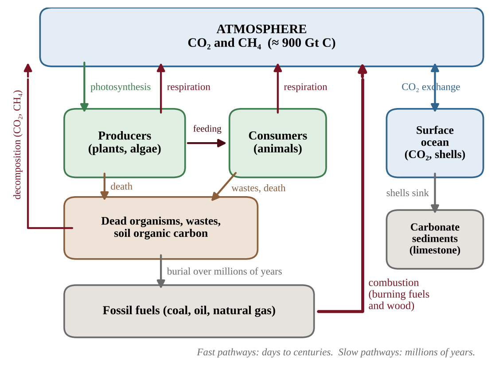
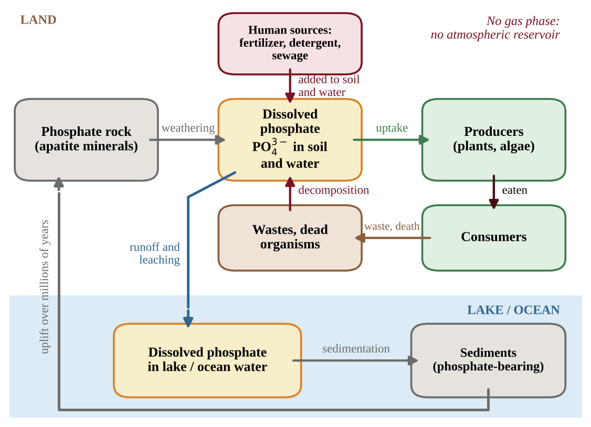
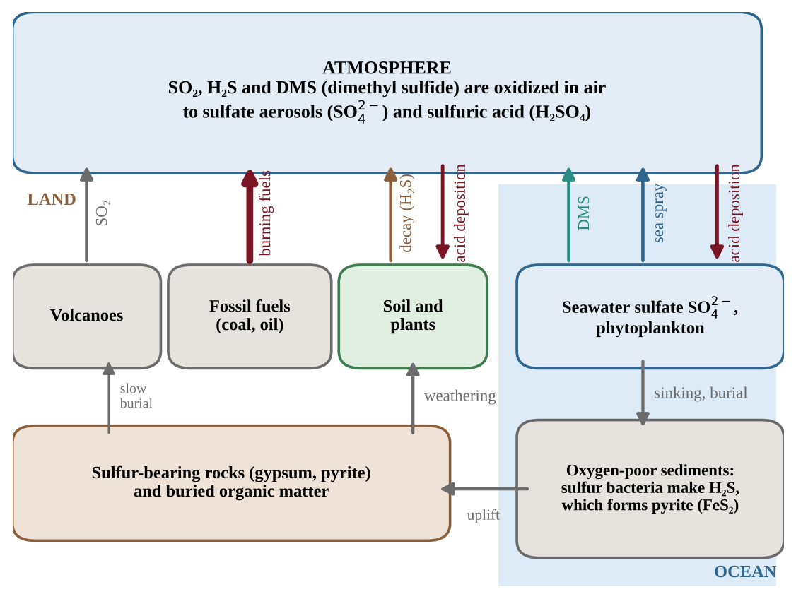
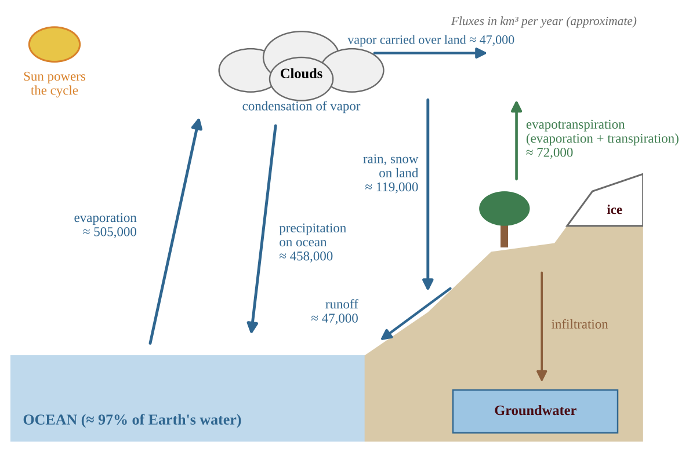
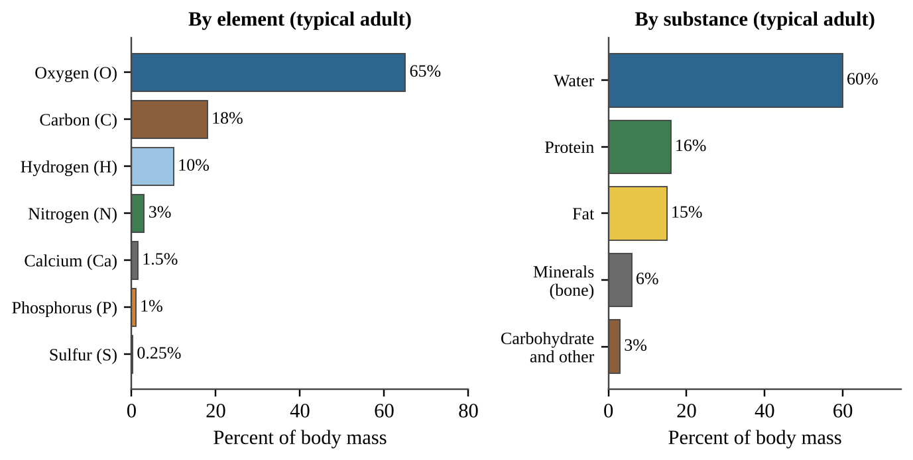

# Chapter 5 — Natural Biogeochemical Cycles

:::box objectives
- Trace carbon, nitrogen, phosphorus, sulfur and water through their reservoirs, naming every process and every arrow of the cycle.
- Distinguish short-term from long-term reservoirs and explain what residence time tells us.
- Explain how humans speed up each cycle (fossil fuels, fertilizer, sewage, SO₂, land use) and predict the result.
- Calculate carbon budgets, residence times, water budgets and mass conversions.
- Explain why water, carbon, nitrogen, phosphorus and sulfur are essential to the human body.
:::

Matter is not made or destroyed in an ecosystem; it is used again and again. A **biogeochemical cycle** is the path an element takes between living things (*bio*), the air, water and rocks (*geo*) and chemical forms (*chemical*). Each cycle has **reservoirs** (pools that hold the element) and **fluxes** (the movements between them). A reservoir that releases more than it takes in is a **source**; one that takes in more than it releases is a **sink**. A reservoir can be a source in one process and a sink in another: a growing forest is a carbon sink, a burning forest is a carbon source.

## 5.1 Carbon Cycle
%% CED: 1.4 | ERT-1.D.1, ERT-1.D.2, ERT-1.D.3, ERT-1.D.4 | LO: ERT-1.D

:::box simple
Carbon is the backbone of all living things. Plants pull CO₂ from the air and build sugar. Eating, breathing and rotting put CO₂ back. Burning fossil fuels adds carbon that was locked underground for millions of years.
:::

The **carbon cycle** is the movement of atoms and molecules containing carbon between sources and sinks.

### How carbon moves

- **Photosynthesis** moves carbon from atmospheric CO₂ (or CO₂ dissolved in water) into organic compounds in producers.
- **Cellular respiration** returns carbon to the air as CO₂ when producers, consumers and decomposers break down organic compounds for energy.
- **Feeding** passes carbon through food chains.
- **Decomposition** releases CO₂ (and, where oxygen is scarce, as in wetlands and landfills, methane, CH₄) from dead matter and waste.
- **Gas exchange with the ocean:** CO₂ dissolves in and escapes from surface water; some marine organisms build calcium carbonate shells that sink and become sediment.
- **Burial and fossilization:** plant and animal remains buried and compressed over millions of years form coal, oil and natural gas; carbonate sediments form limestone.
- **Combustion** of fossil fuels and wood moves carbon quickly into the atmosphere as CO₂.

### Short-term and long-term reservoirs

Some reservoirs hold carbon for a short time and others for very long periods. The sizes below are rounded, approximate values.

| Reservoir | Carbon stored (Gt C) | How long carbon stays |
|---|---|---|
| Atmosphere (CO₂, CH₄) | ≈ 900 | years |
| Living vegetation | ≈ 450–650 | years to centuries |
| Soil organic matter | ≈ 1,500–2,400 | decades to centuries |
| Surface ocean | ≈ 1,000 | years to decades |
| Deep ocean | ≈ 38,000 | centuries to a thousand years |
| Fossil fuels | several thousand | millions of years |
| Sedimentary rock (limestone) | tens of millions | tens to hundreds of millions of years |

Burning fossil fuels returns carbon stored for millions of years to the atmosphere within decades, about 10 Gt C per year, which is why atmospheric CO₂ is accumulating (Chapter 11).

### Carbon budgets and seasonal data

To find the net change in a reservoir from a flux diagram, add every arrow into it and subtract every arrow out, keeping the units (for example Gt C/yr). A positive result means the reservoir is growing.

An ecosystem's carbon balance is carbon taken up by photosynthesis minus carbon released by *all* respiration (plants, animals, soil microbes). Positive is a net **sink**; negative is a net **source**. Add all seasons before judging: a tundra can release carbon in winter yet absorb more over the year.

Atmospheric CO₂ at a Northern Hemisphere station zigzags each year: land plants photosynthesize from late spring to early autumn, so CO₂ falls; in cold months respiration and decay win, so it rises. The rising baseline is fossil fuel burning adding carbon faster than sinks remove it.

{w=0.8}

Stored soil carbon becomes a source when disturbed. In cold or waterlogged soils (peat, mangrove, permafrost) decomposition is slow for lack of warmth or oxygen; draining, plowing, burning and warming speed it up and release CO₂.

:::box define
**Flux** — the amount moving between reservoirs per unit time (for example Gt C/yr).
**Fossil fuel** — coal, oil or natural gas formed from buried organisms over millions of years.
:::

:::box formula
Net change in reservoir = Σ inputs − Σ outputs
Ecosystem carbon balance = GPP − total respiration (positive = net sink)
Mass of CO₂ = mass of C × 44 ÷ 12 ≈ mass of C × 3.67 (molar masses: CO₂ 44, C 12)
Photosynthesis: 6 CO₂ + 6 H₂O + light energy → C₆H₁₂O₆ + 6 O₂
Cellular respiration: C₆H₁₂O₆ + 6 O₂ → 6 CO₂ + 6 H₂O + usable energy
Combustion of a hydrocarbon: fuel + O₂ → CO₂ + H₂O + heat
:::

:::box mistake
- Plants also respire, releasing CO₂; they are not only sinks.
- Fossil fuel carbon was out of the fast cycle for millions of years; burning it adds *new* carbon to the fast cycle.
:::

:::box strategy
Label each arrow with its process and say whether it moves carbon into or out of the atmosphere. For a budget, show "inputs − outputs" with units.
:::

:::box example
id: SG-U1-E004
A carbon atom is part of a coal seam. A power plant burns the coal, and the carbon enters the air. Later that atom is taken up by a wheat plant, the wheat is eaten by a cow, and the cow exhales it. (a) List, in order, the four named processes that move the atom from the coal seam to the exhaled breath, and give the form of the carbon after each step. (b) State whether the coal seam acted as a source or a sink in this sequence, and explain why this carbon was not part of the fast cycle before the plant was built.
:::

:::box example
id: SG-U1-E012
A 50-ha peatland stores 600 Mg of carbon per hectare in its top 1 m of soil. After it is drained and plowed, 12% of that carbon is oxidized to CO₂ over ten years. (a) Calculate the mass of CO₂ released, in Mg. (b) Explain why draining speeds up the release. (c) State whether the peatland is now a source or a sink.
:::

:::box example
id: SG-C5-E001
A simplified yearly budget for atmospheric carbon (Gt C per year) lists these inputs: fossil fuel burning 9.5, land-use change 1.1, respiration and decay on land 120, release from the ocean 90. The outputs are: photosynthesis on land 123 and absorption by the ocean 93. (a) Calculate the net change in atmospheric carbon in Gt C per year. (b) If 2.1 Gt C added to the atmosphere raises CO₂ by 1 ppm, calculate the yearly rise in CO₂ in ppm. (c) Convert the 9.5 Gt C from fossil fuels into Gt of CO₂.
:::

:::box summary
- Carbon moves between sources and sinks; photosynthesis and respiration link living things to the atmosphere.
- Short-term reservoirs: atmosphere, organisms, soil, surface ocean. Long-term: fossil fuels, rocks, deep-ocean sediments.
- Burning fossil fuels moves carbon stored for millions of years into the atmosphere within decades.
:::

## 5.2 Nitrogen Cycle
%% CED: 1.5 | ERT-1.E.1, ERT-1.E.2, ERT-1.E.3, ERT-1.E.4 | LO: ERT-1.E

:::box simple
Nitrogen is in every protein. Air is almost 80% nitrogen, but plants cannot use the gas. Special soil bacteria must first change it into forms roots can absorb.
:::

Nitrogen is a key part of proteins, DNA and chlorophyll. Air is about 78% nitrogen gas (N₂), yet most organisms cannot use it, because the two atoms in N₂ are held by a very strong triple bond. The **nitrogen cycle** is the movement of nitrogen-containing atoms and molecules between sources and sinks. It involves several steps, and microorganisms in the soil do most of the work.

### The five steps

1. **Nitrogen fixation** converts atmospheric N₂ into ammonia (NH₃) by certain soil bacteria, including bacteria in root nodules of legumes such as beans and clover. In soil, ammonia quickly becomes **ammonium (NH₄⁺)**, which is available for biological uptake. Lightning also fixes a smaller amount.
2. **Nitrification** is the conversion of ammonium to nitrite (NO₂⁻) and then nitrate (NO₃⁻) by soil bacteria that need oxygen. Nitrate is the main form that plant roots absorb. It dissolves easily, so it is also easily lost by leaching.
3. **Assimilation** is the uptake of ammonium and nitrate by plants and algae and their conversion into proteins and nucleic acids. Animals assimilate nitrogen by eating plants or other animals.
4. **Ammonification** (decay) is the conversion of nitrogen in wastes and dead organisms back to ammonium by decomposers.
5. **Denitrification** is the conversion of nitrate to nitrogen gas by bacteria in oxygen-poor (anaerobic) conditions such as waterlogged soils, returning nitrogen to the atmosphere.

### Reservoirs and limits

The **atmosphere is the largest reservoir** of nitrogen, but it is not directly available. Most of the other reservoirs (soil nitrate and ammonium, living organisms, wastes) hold nitrogen for relatively short periods. The availability of nitrogen compounds in the soil is limited by the rate of nitrogen fixation. Because of this, nitrogen often **limits primary production** by plants and other producers: when more nitrogen is added, plants grow faster.

### Human effects

Humans have greatly increased fixation. The Haber–Bosch process makes ammonia from N₂ for fertilizer, legume crops fix nitrogen on farms, and high-temperature burning makes nitrogen oxides. Excess nitrate runs off into waterways and causes eutrophication (Chapter 9). Nitrate leaches easily because it is negatively charged and does not cling to soil particles, which are also mostly negative.

:::box mistake
- Plants cannot take up N₂ from the air; only certain bacteria (and lightning) fix it.
- Nitrification needs oxygen; denitrification occurs when oxygen is scarce.
- Do not confuse nitrification (makes nitrate) with denitrification (removes nitrate).
:::

:::box strategy
Name the step, the organism and the nitrogen form before and after. Flooded or compacted soil means oxygen-poor, so think denitrification.
:::

:::box example
id: SG-U1-E005
A farmer notices that, after a week of flooding, an oxygen-poor, waterlogged field has much less nitrate and the corn is yellowing and stunted. (a) Name the process that increased in the waterlogged soil and state the product that leaves the soil. (b) Explain why the loss of nitrate reduces plant growth. (c) Name the process by which dead corn leaves, left on the field, would become a new supply of ammonium.
:::

:::box example
id: SG-C5-E002
Urea, CO(NH₂)₂, is a common nitrogen fertilizer. Atomic masses: C = 12, O = 16, N = 14, H = 1. (a) Calculate the percent of nitrogen by mass in urea. (b) A farmer wants to apply 150 kg of nitrogen per hectare to 40 ha. Calculate the mass of urea needed, in kg. (c) Suppose 20% of the applied nitrogen is lost as nitrate by leaching. Calculate the mass of nitrogen lost, in kg, and explain why nitrate leaches more easily than ammonium.
:::

:::box summary
- Nitrogen cycle steps: fixation, nitrification, assimilation, ammonification, denitrification; soil microorganisms do most of the work.
- The atmosphere is the largest reservoir, but N₂ is unusable until fixed. Most other reservoirs turn over quickly.
- Nitrogen frequently limits plant growth; humans add large amounts through fertilizer and combustion.
:::

## 5.3 Phosphorus Cycle
%% CED: 1.6 | ERT-1.F.1, ERT-1.F.2, ERT-1.F.3 | LO: ERT-1.F

:::box simple
Phosphorus is in DNA, in the cell's energy molecule and in bones. It never becomes a gas, so it moves slowly through rock, soil and water. Because it is scarce, a little extra can turn a lake green with algae.
:::

Phosphorus is part of DNA, ATP (the cell's energy molecule) and cell membranes. The **phosphorus cycle** is the movement of phosphorus-containing atoms and molecules between sources and sinks. It differs from the carbon and nitrogen cycles in one important way: **it has no significant atmospheric component.**

### The steps

1. **Weathering** slowly breaks down phosphorus-bearing rock and releases phosphate (PO₄³⁻) into soil and water.
2. **Uptake** by plants and algae takes dissolved phosphate through roots or cell surfaces.
3. **Transfer** moves phosphorus through the food chain as consumers eat producers. (Phosphate-rich seabird droppings, guano, are mined as fertilizer.)
4. **Return** occurs through wastes and decomposition, which release phosphate back to the soil or water for reuse.
5. **Sedimentation** carries phosphate to ocean and lake bottoms, where it forms sediments. Over millions of years, uplift can bring sedimentary rock back to land, restarting the cycle.

The **major reservoirs** are rock and ocean sediments that contain phosphorus-bearing minerals. Because rocks weather slowly, phosphorus is relatively scarce in ecosystems. It is therefore often a **limiting nutrient** for producers, particularly in freshwater and some terrestrial ecosystems. This is why a small addition of phosphorus (from fertilizer, sewage or some detergents) can cause an algal bloom in a lake.

### Designing and judging a nutrient experiment

A limiting nutrient is found by adding it and watching the response.

- **Hypothesis:** an "if … then …" prediction naming both variables: if phosphorus limits growth, bottles with added phosphorus will hold more algae than bottles without it.
- **Independent variable:** nutrient added. **Dependent variable:** chlorophyll *a* or algal biomass.
- **Control:** identical water with nothing added.
- **Treatments:** N alone, P alone, both, and the control.
- **Constants:** light, temperature, volume, water source, duration.
- **Replication:** several bottles per treatment, averaged.

If nitrogen alone changes little, phosphorus alone raises growth a lot, and both together raise it most, phosphorus is the main limiting nutrient and nitrogen limits next. Growth in the control does not show that nothing limits it. Change one factor at a time: fertilizing plots in a different field, adding several things at once, or comparing only "before and after" with no untreated plots cannot isolate the cause.

:::box formula
Nutrient ratio = mass of N ÷ mass of P in the water.
Algae use N and P at about 7 g N per 1 g P (about 16 N : 1 P by atoms). A water N:P ratio above about 7 suggests phosphorus is limiting; below 7 suggests nitrogen is limiting.
Percent increase = (new − control) ÷ control × 100
:::

:::box mistake
- Do not include an atmospheric reservoir or a gas phase in the phosphorus cycle.
- Phosphorus is limiting in many freshwater lakes; nitrogen is more often limiting in many marine and terrestrial systems. Both can be limiting, so use the data in the question.
:::

:::box strategy
Name the control, the independent and dependent variables and one constant. The limiting nutrient is the one whose addition gives the biggest change from the control.
:::

:::box example
id: SG-U1-E006
Researchers add nutrients to four identical experimental ponds for six weeks and measure algae concentration as chlorophyll in micrograms per liter (µg/L). Control (nothing added): 10 µg/L. Nitrogen only: 11 µg/L. Phosphorus only: 38 µg/L. Nitrogen and phosphorus together: 40 µg/L. (a) Identify the limiting nutrient in these ponds and justify your answer using the data. (b) Calculate the percent increase in algae concentration in the phosphorus-only pond compared with the control. (c) Explain why phosphorus is naturally scarce in freshwater ecosystems.
:::

:::box example
id: SG-C5-E003
Algae use nitrogen and phosphorus at a mass ratio of about 7 g N to 1 g P. Lake A has 1.4 mg/L of nitrogen and 0.10 mg/L of phosphorus. Lake B has 0.35 mg/L of nitrogen and 0.08 mg/L of phosphorus. (a) Calculate the N:P mass ratio of each lake. (b) State which lake is limited by phosphorus and which by nitrogen, and justify. (c) A treatment plant adds 0.12 mg/L of phosphorus to Lake A without changing its nitrogen. Calculate the new N:P ratio and state which nutrient now limits growth.
:::

:::box summary
- Phosphorus moves through rock, soil, water, organisms and sediments, with no significant atmospheric reservoir.
- Slow weathering makes it scarce, so it often limits producers, especially in fresh water.
- Added phosphorus can trigger rapid algal growth.
:::

## 5.4 Sulfur Cycle
%% CED: none (academy extension)

:::box simple
Sulfur gives rotten eggs and burning matches their smell. Living things need a little for proteins. It moves between rocks, ocean, air and organisms. Burning coal and oil adds sulfur gas to the air, where it makes acid rain.
:::

The **sulfur cycle** is the movement of sulfur-containing atoms and molecules between rocks, water, air and living things. Like phosphorus, sulfur is stored mostly in rocks. Like carbon and nitrogen, it has a gas phase, so it can travel through the air.

### Reservoirs

- **Rocks and sediments** are the largest reservoir: gypsum (calcium sulfate, CaSO₄·2H₂O), pyrite (iron sulfide, FeS₂) and sulfur bound in shale. These release sulfate (SO₄²⁻) slowly by weathering.
- **The ocean** holds huge amounts of dissolved sulfate and is the largest *surface* reservoir.
- **Fossil fuels** (coal, oil, natural gas) contain sulfur from the organisms they formed from. Coal commonly holds 0.5–5% sulfur by mass.
- **Living things and soil** hold sulfur in proteins.
- **The atmosphere** holds little (SO₂, H₂S, DMS, sulfate aerosols) but moves sulfur fast and far.

### Steps and fluxes

1. **Weathering and uptake.** Weathering releases sulfate to soil and water. Plants and algae absorb it and build amino acids (assimilation); animals get sulfur by eating.
2. **Decomposition.** Decomposers break down dead organisms and release sulfur as hydrogen sulfide (H₂S), the "rotten egg" gas, or back to sulfate if oxygen is present.
3. **Volcanoes** release SO₂ and H₂S. A large eruption can lift SO₂ into the stratosphere, where sulfate aerosols reflect sunlight and cool the planet for a year or two.
4. **Ocean emissions.** Phytoplankton release dimethyl sulfide (DMS), which is oxidized in air to sulfate aerosols that seed clouds. Sea spray adds sulfate too.
5. **Fossil fuel burning and smelting.** Burning coal or oil, and smelting metal ores such as copper sulfide, oxidizes sulfur to SO₂: S + O₂ → SO₂. Human emissions now rival or exceed all natural gas sources combined.
6. **Atmospheric chemistry.** In the air SO₂ is oxidized and reacts with water to form sulfuric acid (H₂SO₄) and sulfate aerosols: 2 SO₂ + O₂ → 2 SO₃, then SO₃ + H₂O → H₂SO₄.
7. **Deposition.** Sulfuric acid and sulfate return to Earth as acid rain and snow (wet deposition) or as dry particles and gas (dry deposition).
8. **Burial.** In oxygen-poor mud and swamps, sulfate is used by **sulfate-reducing bacteria**, which make H₂S. The H₂S combines with iron to form pyrite, and the sulfur is buried in sediment. Over millions of years uplift returns it to land.

### Sulfur bacteria

**Sulfate-reducing bacteria** live without oxygen and use sulfate in place of oxygen, producing H₂S. **Sulfur-oxidizing bacteria** convert H₂S and sulfur back into sulfate. Some live at deep-sea vents, where the energy of H₂S builds food (chemosynthesis) and supports whole vent communities. Purple and green sulfur bacteria use H₂S in a form of photosynthesis.

### Acid deposition and aerosols

Sulfuric acid lowers the pH of rain and lakes. It frees aluminum and washes calcium and magnesium from soil, which stresses trees and kills fish and their eggs, and it corrodes marble and limestone. Sulfate aerosols also scatter sunlight and brighten clouds, so they cool the climate. Cutting SO₂ (scrubbers, low-sulfur fuel, cap-and-trade rules) reduces acid rain but also removes this slight cooling.

:::box apply
**Mount Pinatubo, 1991.** The eruption injected about 20 million tonnes of SO₂ into the stratosphere. The sulfate aerosols spread worldwide and cooled Earth's surface by about 0.5 °C for roughly two years. This natural event shows how fast the sulfur cycle can move sulfur through the air.
:::

:::box formula
S + O₂ → SO₂ (molar masses: S 32, SO₂ 64)
Mass of SO₂ = mass of S × 64 ÷ 32 = mass of S × 2
Mass of S in fuel = mass of fuel × fraction sulfur
:::

:::box mistake
- Most sulfur is in rocks, sediments and the ocean, not the air.
- SO₂ is a gas; sulfate (SO₄²⁻) is what it becomes after oxidation.
- Burning fuel does not create sulfur; it moves it from a long-term reservoir into the air.
:::

:::box strategy
To link a cause to acid rain, write the chain: burning sulfur-bearing fuel → SO₂ → sulfuric acid → lower pH of rain.
:::

:::box example
id: SG-C5-E004
A power plant burns 2.0 × 10⁶ metric tons of coal per year. The coal is 1.8% sulfur by mass, and all of the sulfur is converted to SO₂ (atomic masses: S = 32, O = 16). (a) Calculate the mass of sulfur burned per year, in metric tons. (b) Calculate the mass of SO₂ produced per year. (c) A scrubber removes 90% of the SO₂. Calculate the mass of SO₂ still released per year. (d) Explain how the SO₂ that escapes can lower the pH of rain far from the plant.
:::

:::box summary
- Sulfur is stored mostly in rocks, sediments and ocean sulfate; the atmosphere holds little but moves sulfur quickly.
- Natural sources: weathering, volcanoes, decomposition and marine DMS. Human source: burning sulfur-bearing fuels and smelting, which makes SO₂.
- SO₂ becomes sulfuric acid and sulfate aerosols (acid deposition and cooling); sulfur bacteria drive reduction and oxidation steps.
:::

## 5.5 Water Cycle
%% CED: 1.7 | ERT-1.G.1, ERT-1.G.2 | LO: ERT-1.G

:::box simple
Water evaporates, forms clouds, falls as rain or snow and flows back to the sea. The sun supplies the energy; gravity brings the water down.
:::

The **hydrologic cycle**, powered by the sun, is the movement of water in its solid, liquid and gaseous phases between sources and sinks. Solar energy evaporates water, and gravity returns it to Earth.

### Processes

- **Evaporation** changes liquid water to vapor from oceans, lakes and soil.
- **Transpiration** is the release of water vapor from plant leaves. Evaporation plus transpiration together are called **evapotranspiration**.
- **Condensation** changes vapor to liquid droplets, forming clouds.
- **Precipitation** returns water as rain, snow, sleet or hail.
- **Infiltration and percolation** move water into and through soil to **groundwater**. Water stored in porous rock is an **aquifer**.
- **Runoff** is water flowing over land surfaces into streams, lakes and the ocean. The land that drains to one stream or river is its **watershed**.
- **Sublimation, freezing and melting** move water between ice and the other phases.

### Reservoirs

The **oceans are the primary reservoir** of water at Earth's surface, holding roughly 97% of it. Ice caps and groundwater act as much smaller reservoirs; together they hold nearly all fresh water.

| Reservoir | Share of all water | Typical residence time |
|---|---|---|
| Oceans | ≈ 97% | thousands of years |
| Ice caps and glaciers | ≈ 1.7% | thousands to tens of thousands of years |
| Groundwater | ≈ 1.7% | weeks to over 10,000 years |
| Lakes, soil, rivers, atmosphere, organisms | ≈ 0.1% in total | days (air, rivers) to years (lakes) |

Water spends only about nine days in the atmosphere but thousands of years in a deep aquifer or an ice cap, so turnover differs greatly among reservoirs.

### Residence time, water budgets and land use

**Residence time** is the average time a water molecule stays in a reservoir. A watershed's **water budget** balances what arrives against where it goes.

:::box formula
Residence time = volume stored ÷ rate of inflow (or outflow)
Precipitation (P) = evapotranspiration (ET) + runoff + change in storage
Volume = depth × area (convert units first: 1 km² = 10⁶ m²; 1,000 mm = 1 m)
:::

Pavement, roofs and compacted soil block **infiltration**, so more precipitation leaves quickly as **runoff** and less recharges groundwater. Clearing vegetation lowers transpiration, so more of the same precipitation is left to run off. Forest and wetland soils slow runoff and feed groundwater.

### Math and skills toolkit

- **Percent change** = (new − original) ÷ original × 100 (divide by the *original*). **Percent of whole** = part ÷ whole × 100.
- **Conversions:** multiply by a fraction equal to 1 so units cancel (80 cm × 1 m ÷ 100 cm = 0.80 m; 25 km² = 25 × 10⁶ m²).
- **Volume = area × depth** (m² × m = m³). Show formula, substitution with units, answer with units.

:::box mistake
- Transpiration is water loss from plants; evaporation is from surfaces.
- Most fresh water is in ice and groundwater, not in lakes and rivers.
- Residence time uses the stored volume divided by the *rate* of flow, not the rate times the volume.
:::

:::box strategy
Write P = ET + runoff first, then convert every quantity to the same units.
:::

:::box example
id: SG-U1-E007
A watershed has an area of 25 km² and receives 80 cm of precipitation in a year. Of the precipitation, 60% returns to the atmosphere by evapotranspiration, and the remaining water leaves the watershed as stream flow (ignore groundwater storage and change). (a) Calculate the volume of stream flow in cubic meters per year. Use 1 km² = 10⁶ m². (b) Name the process by which the largest portion of the water leaves the watershed, and give one biological contributor to it.
:::

:::box example
id: SG-U1-E013
A groundwater aquifer stores 3.0 × 10³ km³ of water. Recharge and natural discharge are each 12 km³ per year. (a) Calculate the average residence time of water in the aquifer. (b) A city covers part of the recharge area with pavement, so recharge falls to 9 km³ per year while natural discharge stays at 12 km³ per year. Calculate the annual change in stored water and state whether the aquifer is growing or shrinking. (c) Explain how pavement changes infiltration.
:::

:::box example
id: SG-C5-E005
Global fluxes in thousand km³ per year: evaporation from the ocean 505, precipitation on the ocean 458, precipitation on land 119, evapotranspiration from land 72. The atmosphere holds about 12,900 km³ of water vapor. (a) Calculate the net amount of vapor carried from the ocean to the land. (b) Calculate the global runoff from land, assuming no change in storage. (c) Calculate the percent of all evaporation and evapotranspiration that comes from the ocean. (d) Calculate the average residence time of water in the atmosphere, in days, using total evaporation plus evapotranspiration as the flux.
:::

:::box summary
- The sun-powered water cycle moves water as solid, liquid and gas among oceans, ice, groundwater, surface water, soil, organisms and the air.
- Oceans are the largest surface reservoir; ice caps and groundwater are much smaller.
- Key processes: evaporation, transpiration, condensation, precipitation, infiltration, runoff. Residence time = volume ÷ flow rate.
:::

## 5.6 Role of H₂O, C, N, P, and S in the Human Body
%% CED: none (academy extension)

:::box simple
Your body is part of every cycle in this chapter. The water you drink, the carbon in your food, the nitrogen in your proteins, the phosphorus in your bones and the sulfur in your hair all came from soil, water and air, and will return there.
:::

### Water (H₂O): about 60% of body mass

Water makes up roughly 50–65% of an adult's mass and is the **solvent** for cell chemistry. It carries nutrients, oxygen, hormones and wastes in blood, takes part in reactions such as digestion, and cools the body through sweat because its high heat of vaporization absorbs much heat. An adult must replace about 2–3 liters a day lost in urine, sweat, breath and feces, so **clean drinking water** links the body directly to the water cycle (Section 5.5).

### Carbon (C): the backbone of life

Carbon atoms form chains and rings and bond with H, O, N, P and S. All **organic molecules** are built on carbon: carbohydrates, lipids, proteins and nucleic acids. Carbon is about 18% of body mass, second only to oxygen (water is mostly oxygen by mass). Plants take carbon from CO₂; we eat it and release CO₂ in respiration, closing the carbon cycle (Section 5.1).

### Nitrogen (N): proteins and DNA

Nitrogen is in the **amino group** of every amino acid, so it is in all proteins (enzymes, muscle, hemoglobin, antibodies). It is also in the **bases** of DNA and RNA and in ATP. We cannot use the N₂ we breathe; our nitrogen comes from dietary protein, which began as nitrate or ammonium taken up by plant roots and fixed by soil bacteria (Section 5.2). About 16% of protein by mass is nitrogen. Too little protein stunts growth; too much nitrate in well water can interfere with oxygen transport in infants ("blue-baby syndrome").

### Sulfur (S): protein shape

Sulfur is in two amino acids, **cysteine** and **methionine**. Pairs of cysteine form **disulfide bridges** that hold proteins in shape, giving strength to hair, nails and skin (keratin). Sulfur is also in some vitamins and in coenzyme A, which helps release energy from food. We get it from protein foods that trace back to soil sulfate absorbed by plants (Section 5.4). Body sulfur is about 0.25% of mass.

### Phosphorus (P): genes, energy and bones

Phosphate groups form the **sugar–phosphate backbone of DNA and RNA**, carry the energy in **ATP**, and make up the **phospholipids** of every cell membrane. About 85% of the body's phosphorus (about 1% of body mass) is in **bones and teeth** as calcium phosphate (hydroxyapatite). It comes from food grown on soil phosphate (Section 5.3).

### Why the cycles matter for health and food

- **Food supply.** Crops need N, P and S from soil. Haber–Bosch nitrogen and mined phosphate help feed about half of the world's people, but over-application pollutes water (Chapter 9).
- **Nutrient loss.** Erosion, leaching and harvest remove N, P and S from fields; manure, compost, crop rotation or fertilizer must replace them. Phosphate rock is limited, so recovering phosphorus from sewage and manure also reduces algal blooms.
- **Health.** Too little protein or water causes illness; polluted water and acid rain harm health directly and through food.
- **Connection.** A person is a temporary reservoir of these elements; every meal and breath moves atoms between the body and the cycles.

:::box define
**Amino acid** — building block of proteins; contains N, and cysteine and methionine also contain S.
**ATP** — adenosine triphosphate, the cell's energy-carrying molecule, containing P.
**Disulfide bridge** — a bond between two sulfur atoms that holds a protein in its folded shape.
**Organic molecule** — a carbon-based molecule made by living things (carbohydrate, lipid, protein, nucleic acid).
**Hydroxyapatite** — the calcium phosphate mineral of bones and teeth.
:::

:::box mistake
- The human body is mostly *oxygen* by mass, because water is 89% oxygen by mass, not mostly carbon.
- Breathing in nitrogen does not supply the body's nitrogen; it comes from dietary protein.
- Phosphorus is not only in bones; it is also in DNA, ATP and membranes.
:::

:::box strategy
When asked "why is element X essential?", name the molecule that contains it (for example amino acids for N and S, ATP and DNA for P), say what that molecule does, and link X to its cycle and source in food.
:::

:::box example
id: SG-C5-E006
An adult has a body mass of 70 kg. Water is 60% of body mass. Protein is 16% of body mass, and protein is 16% nitrogen by mass. Phosphorus is 1.0% of body mass, and 85% of that phosphorus is in bones and teeth. (a) Calculate the mass of water in the body, in kg. (b) Calculate the mass of nitrogen contained in the body's protein, in kg. (c) Calculate the mass of phosphorus in bones and teeth, in kg. (d) Name one molecule other than bone mineral that contains phosphorus and state its function.
:::

:::box summary
- Water (about 60% of body mass) is the solvent for cell chemistry, transport and cooling.
- Carbon is the backbone of all organic molecules; nitrogen is in amino acids and nucleic acid bases; sulfur is in cysteine and methionine (protein shape).
- Phosphorus is in DNA, RNA, ATP, membranes and bones. Body elements come from the cycles through food and water.
:::

## 5.7 Practice Questions and Answers
%% CED: none (academy extension)

Now put the cycles to work: the classroom examples below, together with the extra question sets, will turn these ideas into exam skills.

[[chapter-practice]]
