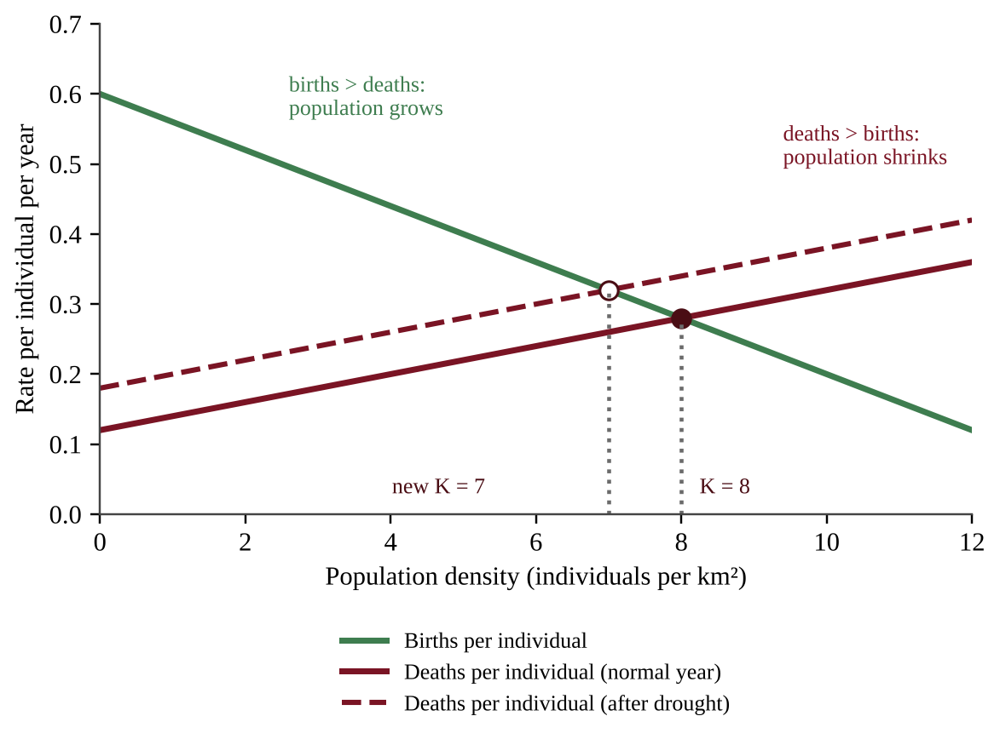
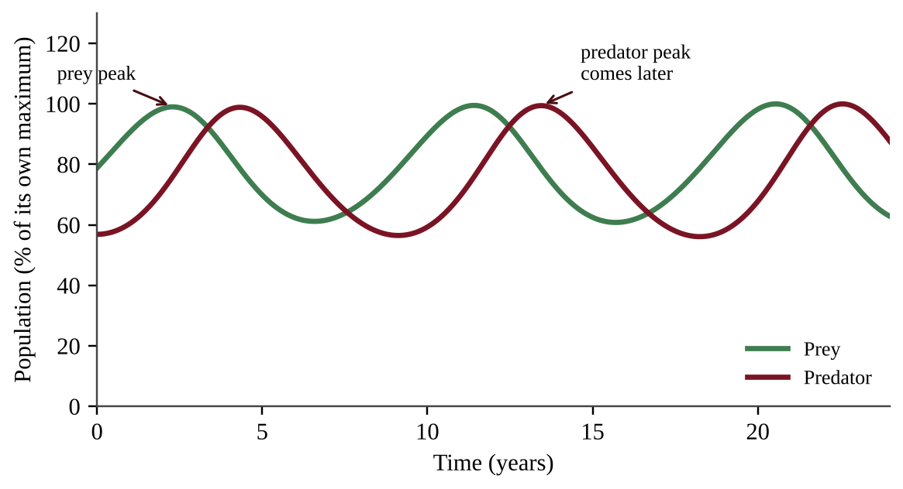
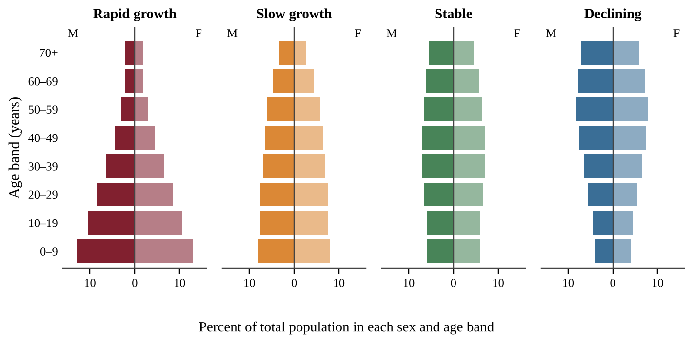
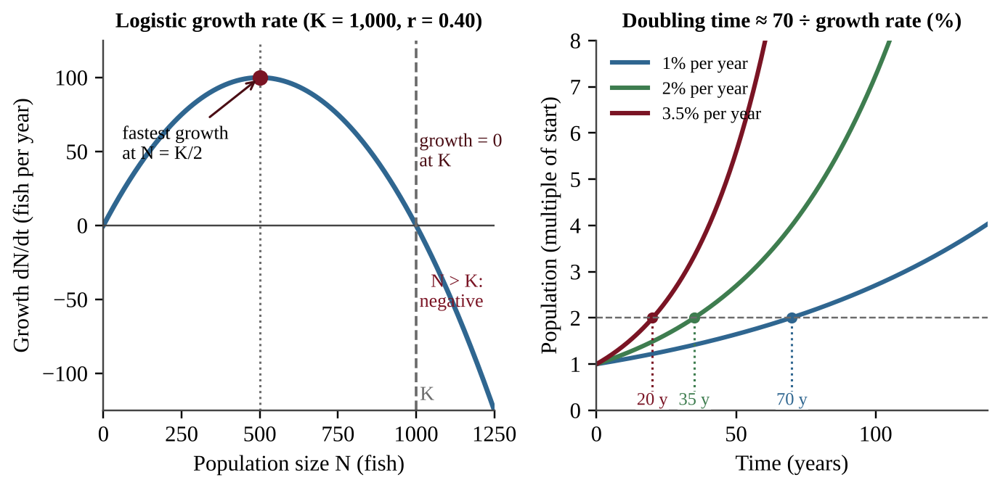

# Chapter 6 — Populations

:::box objectives
- Compare generalist and specialist species, and r-selected and K-selected species, and predict who is favored when habitats stay constant or change.
- Explain carrying capacity, overshoot and dieback, and read survivorship curves.
- Apply the growth mathematics: percent change, logistic growth, RNI, doubling time, TFR and resource budgets.
- Describe human population dynamics: limiting factors, fertility, infant mortality, the demographic transition and age structure.
- Explain how population growth and consumption create environmental impacts, and read ecological footprint data.
:::

A population is a group of individuals of one species living in the same place at the same time. This chapter asks two big questions. Why do populations of different species grow, shrink and survive in such different ways? And how do the same ideas explain the growth of the human population and the pressure it puts on Earth? It is the most math-heavy chapter in the course, so work every calculation with a pencil as you read.

## 6.1 Population Ecology

%% CED: 3.1, 3.2, 3.4 | ERT-3.A.1, ERT-3.B.1, ERT-3.B.2, ERT-3.B.3, ERT-3.B.4, ERT-3.B.5, ERT-3.D.1, ERT-3.E.1 | LO: ERT-3.A, ERT-3.B, ERT-3.D, ERT-3.E

:::box simple
Every species makes a living in its own way. Some are flexible, some are fussy. Some have many cheap babies, some have a few precious ones. Whatever the strategy, every population eventually meets a ceiling set by its environment, called the carrying capacity.
:::

### Generalist and specialist species

A **niche** is a species' job and address: what it eats, where it lives, and the conditions it tolerates. A **generalist species** has a wide niche. It eats many foods, lives in many habitats and tolerates wide ranges of temperature and moisture. Raccoons, cockroaches, coyotes, house mice and white-tailed deer are generalists. A **specialist species** has a narrow diet, a narrow habitat or narrow tolerance limits. A koala eats almost only eucalyptus leaves, and a giant panda depends overwhelmingly on certain bamboos. Think of a Swiss army knife (generalist: does everything adequately) and a surgeon's scalpel (specialist: one job done superbly, useless for anything else).

In a **constant habitat**, such as a stable rain forest, a specialist fine-tunes its body and behavior to exact conditions and out-competes the generalist for its one resource. In a **changing habitat** the story flips. A fire, drought, new road or climate shift removes the specialist's one food or habitat, so its population crashes. The generalist simply switches food or moves, so it persists or spreads.

:::box process
Stable habitat → specialist uses its one resource very efficiently → specialist is favored  
Habitat changes or is lost → specialist's only resource disappears → specialist declines or goes extinct  
Habitat changes → generalist switches food or habitat → generalist persists or spreads
:::

:::box apply
A coastal wetland is drained for farmland and crop fields replace the reed beds. A rare marsh bird that nests only in tall reeds disappears within two seasons. Crows and starlings, generalists that eat grain, insects and scraps and nest almost anywhere, increase in the same area. The same change produced opposite results because of niche width.
:::

:::box define
**Niche** — the role of a species in its ecosystem, including its food, habitat and tolerance range.
**Generalist species** — broad niche; advantaged in changing habitats.
**Specialist species** — narrow niche; advantaged in constant habitats and vulnerable to change.
:::

:::box mistake
- A generalist is not "better." It wins only when conditions change; in a stable habitat the specialist wins.
- Living in a small area does not make a species a specialist. Niche width (diet and tolerance) is what counts.
:::

:::box example
id: SG-U3-E001
Two beetle species live in a mixed forest. Beetle A lays its eggs only on the bark of one tree species and its larvae eat only that bark. Beetle B eats wood of more than twenty tree species and can survive in forests, parks and wood piles. A fungal disease kills nearly all trees of the species Beetle A depends on. (a) Classify each beetle as a generalist or a specialist. (b) Predict what happens to each population over the next five years and explain why. (c) State which beetle would likely be favored if the forest stayed completely unchanged for a century, and give one reason.
:::

To test whether a disturbance favors generalists, compare **paired plots**: several similar disturbed plots (for example, partly logged) and several undisturbed ones, with equal trapping effort in every plot and counts of at least one generalist and one specialist species. Replicates separate the disturbance from ordinary differences between sites. One plot, one species, or a published number from another forest cannot answer the question. Design rules are in Section 6.6.

### K-selected and r-selected species

Every species has a limited energy budget. It can spend it on **many cheap offspring** (the r strategy) or **a few expensive ones** (the K strategy). The letters come from population math: **r** is the growth rate of a population and **K** is carrying capacity. **r-selected species** put energy into rapid reproduction, so they grow fast when conditions are good. **K-selected species** stay near the carrying capacity of their environment and put their energy into surviving and competing.

| Trait | r-selected | K-selected |
|---|---|---|
| Body size | Small | Large |
| Offspring per birth event | Many | Few |
| Energy invested per offspring | Minimal | Large; long parental care |
| Age at maturity | Early | Late (long youth) |
| Life span | Short | Long |
| Reproduction | Often once, or in a burst | Several times in a lifetime |
| Habitat and competition | Disturbed or unpredictable; competition usually low | Stable; competition usually high |
| Examples | Bacteria, weeds, mosquitoes, mice | Elephants, whales, humans, oaks |

**Biotic potential** is the maximum reproductive rate of a population under ideal conditions: unlimited food, no predators, no disease. A bacterium has an enormous biotic potential; an elephant has a tiny one. To rank species, weigh three traits together: more offspring per reproductive event, an **earlier** age at first reproduction, and a **shorter** time between generations. Body size and long life add nothing to reproductive speed. Biotic potential is almost never reached in nature, because environmental resistance (limited resources, predators, disease) holds populations back.

Most real species fall between the extremes, and many change strategy with conditions. A sea turtle lives a long time (K-like) but lays more than a hundred eggs (r-like). Describe a species by its **tendencies**, not as a perfect r or K.

**Invasive species.** Most invasive species are r-selected: they reproduce quickly, spread widely and tolerate disturbance. They hurt K-selected natives most, because slow breeders cannot replace their losses quickly. An island's slow-breeding native bird suffers far more from introduced rats than a fast-breeding native does. r-selected natives rebound quickly and are minimally affected. The same logic predicts recovery: after hunting removes 30% of a population, an r-selected species rebounds within a few seasons, but a K-selected species needs many years.

:::box define
**r-selected species** — small, many offspring, little investment per offspring, early maturity, short life, often reproduce once; usually low competition.
**K-selected species** — large, few offspring, high investment, late maturity, long life, reproduce repeatedly; usually high competition.
**Biotic potential** — the maximum reproductive rate of a population in ideal conditions.
:::

:::box mistake
- r and K are tendencies on a spectrum. Do not claim "all large animals are K and all small ones are r" without checking the traits.
- K the strategy is not K the carrying capacity. They are connected (K-selected species live near K) but they are different things.
:::

:::box strategy
Answer "compare" prompts with a trait pair: "r-selected species produce many offspring while K-selected species produce few." A list of traits with no comparison earns less credit than one clear contrast per trait.
:::

:::box example
id: SG-U3-E002
A biologist records the following about three species. Species P: adult mass 2 g, 400 eggs per season, matures at 3 months, lives about 1 year. Species Q: adult mass 4,500 kg, one calf every 3 years, matures at 12 years, lives 60 years. Species R: adult mass 25 kg, 2 pups per year, matures at 2 years, lives 12 years. (a) Classify P and Q as r-selected or K-selected, citing two traits each. (b) State which of P and Q would be more severely harmed by an aggressive invasive predator and explain why. (c) Explain why R is difficult to classify as purely r or purely K.
:::

### Carrying capacity

A lake can feed only so many ducks. **Carrying capacity (K)** is the largest population an environment can support **indefinitely** with its food, water, space and other resources. When a few individuals enter a resource-rich area, the population first grows slowly, then rapidly, then levels off near K. The graph is an **S-shaped (logistic) curve**. With no limits, growth would follow a **J-shaped (exponential) curve**, climbing faster and faster. Real populations may follow a J-curve briefly, but limiting factors bend it into an S or into a boom-and-bust pattern.

Carrying capacity is **not fixed**. A wet year increases plant growth and raises K for deer; a drought or a pollutant lowers it; a new competitor can reduce it for the original species.

**Overshoot and dieback.** **Overshoot** happens when a population exceeds K. The population often keeps growing for a time after resources start to run short because of a **time lag**: births already underway, long-lived adults and slow feedback. During overshoot, consumption exceeds renewal, so the habitat is damaged: vegetation is overgrazed, soil erodes, water and prey are depleted. The result is **dieback** (a population crash), a sharp, often severe decline caused by famine, disease or conflict. Because the habitat was damaged, the new carrying capacity may be lower than the old one.

:::box process
Population is below K → resources plentiful → population grows (S-curve rising)  
Population exceeds K (overshoot) → resource use > resource renewal → resource depletion and habitat damage  
Resource shortage → famine, disease, conflict → dieback → population falls to or below K (K may be lower)
:::

:::box apply
A small number of goats is released on a rocky island with sparse grass. The herd grows quickly for years, eats nearly all the ground cover, and then starves in a dry summer. The bare hillside erodes in winter storms, so a smaller herd can be supported afterward. Overshoot, dieback and a lowered K occurred in one story.
:::

:::box define
**Carrying capacity (K)** — the maximum population size an environment can sustain over the long term.
**Overshoot** — a population exceeding K.
**Dieback** — a severe decline after overshoot because of resource shortage.
:::

:::box mistake
- K is not "the number of births." It is a ceiling set by resources, and it can change.
- Overshoot does not cause instant dieback; the lag lets a population overshoot before the crash.
:::

:::box example
id: SG-U3-E004
Deer were introduced to a 25 km² island. Population counts: year 0: 30; year 2: 80; year 4: 190; year 6: 330; year 8: 430; year 10: 480; year 12: 495; year 14: 500; year 16: 500. (a) Estimate the carrying capacity and calculate the population density at that size in deer per km². (b) Identify which two-year interval had the greatest increase in number of deer, and show the calculation. (c) Explain, in terms of resources, why growth slowed after year 8.
:::

:::box example
id: SG-U3-E005
On a small island, the forage supports a carrying capacity of 300 goats. Goats are released and the herd grows to 560 before a severe drought. Afterward the herd falls to 140. (a) Calculate by what percent the herd exceeded carrying capacity at its peak. (b) Name the term for the decline from 560 to 140. (c) Explain two environmental impacts of the overshoot and one reason the new carrying capacity might be below 300.
:::

### What holds a population at K

At low density each individual finds plenty to eat, so the **per-capita birth rate** (births per individual per year) is high and the **per-capita death rate** is low. As density rises, competition, disease and stress push births down and deaths up. The population grows while births per individual exceed deaths per individual, stops growing where they are equal, and shrinks beyond that. That density is K.

{w=0.8}

**Finding K from a table.** Look for the density where birth and death values are equal. If no row matches, find the two rows where births switch from above deaths to below; with straight-line trends, K lies between them, in proportion to the gaps (a gap of +0.10 at density 6 and −0.10 at density 8 crosses at 7). A stress that raises deaths or lowers births at every density moves the crossing left, so K falls; more food or shelter moves it right, so K rises.

### Predators and prey

Predation is a density-dependent limit and a **negative feedback loop**. When prey are plentiful, predators eat well and increase; more predators remove more prey; prey decline; predators then go hungry and decline; prey recover. This produces linked cycles in which the predator peak comes **after** the prey peak, because predators need time to breed.

{w=0.8}

In a census table, find the prey peak first, then the predator peak; the predator column trails. A prey decline that follows a predator rise is predation, not necessarily overshoot of the prey's own K.

### Reading growth graphs and tables

- On a labeled graph: the steep early climb is the exponential phase; the dashed line is K; a peak above it is overshoot; the low point after the peak is the dieback; a later plateau is the new K.
- In a census table, the **greatest increase** is the largest difference between consecutive counts. If the gaps differ, divide by the years to compare yearly change. Percentage growth is highest very early, when N is small, even though the largest numerical gain comes near K/2.
- Estimate K as the plateau.

:::box example
id: SG-U3-E013
A vole population was sampled at five densities (voles per hectare): 2, 4, 6, 8, 10. Births per vole per year: 0.70, 0.58, 0.46, 0.34, 0.22. Deaths per vole per year: 0.30, 0.38, 0.46, 0.54, 0.62. (a) Identify the carrying capacity and explain your reasoning. (b) Calculate the net change per vole per year at 4 voles per hectare and state whether the population is growing or shrinking there. (c) A disease raises deaths by 0.05 per vole per year at every density. Estimate the new carrying capacity by straight-line interpolation and state the direction of the change.
:::

:::box example
id: SG-U3-E014
Census counts on a prairie. Year: 0, 2, 4, 6, 8, 10. Rabbits: 900, 1,500, 1,100, 600, 800, 1,400. Foxes: 40, 60, 90, 70, 40, 55. (a) Identify the years of the rabbit peak and the fox peak and state the lag. (b) Explain the lag in terms of fox reproduction and food supply. (c) Calculate the percent decrease in rabbits from year 2 to year 6. (d) Name the type of feedback loop and state whether predation is density-dependent or density-independent.
:::

:::box summary
- Specialists win in constant habitats; generalists win in changing ones.
- r-selected: small, many offspring, early maturity, short life. K-selected: large, few offspring, late maturity, long life. Most invasive species are r-selected; K-selected natives suffer most.
- K is the long-term maximum and can change. Overshoot → resource depletion → dieback from famine, disease or conflict.
:::

## 6.2 Survivorship

%% CED: 3.3 | ERT-3.C.1, ERT-3.C.2 | LO: ERT-3.C

:::box simple
Follow 1,000 newborns of one species. Graph how many are still alive at each age. If most live long and die old, you get Type I. If death strikes evenly at every age, Type II. If most die very young, Type III.
:::

A **survivorship curve** displays the relative survival of a **cohort** (a group of individuals born at the same time) from birth to the greatest age reached by any member. The x-axis is age, often as a percent of maximum life span so that species can be compared. The y-axis is the number (or percent) of the cohort still alive, commonly on a log scale so that a drop from 1,000 to 10 survivors is as visible as a drop from 100 to 1.

| Type | Shape | Pattern of death | Typical species and strategy |
|---|---|---|---|
| I | Flat early, then drops steeply late | Low death at young and middle ages; most die in old age | Humans, elephants, large mammals (K-selected); heavy parental care |
| II | Straight diagonal line | Roughly constant chance of dying at every age | Many songbirds, some lizards and rodents (intermediate) |
| III | Steep early drop, then flat | Very high death of the young; survivors often live long | Oysters, most fish, insects, sea turtles, weeds (r-selected); many offspring, little care |

### Reading the curve

Steepness tells you where deaths happen: a steep section means many individuals die in that age range, a flat one means few. Type III species offset massive early losses by producing huge numbers of offspring, so a few survive. Type I species produce few offspring but protect each one. The cause-and-effect link: high parental investment → high juvenile survival → Type I; low investment → high juvenile mortality → Type III. K-selected species typically follow Type I or II; r-selected species follow Type III.

:::box formula
**Percent surviving to age x** = (number alive at age x ÷ number in starting cohort) × 100  
**Number dying in an interval** = survivors at start of interval − survivors at end of interval  
Counts are individuals; the first result is a percent.
:::

**Working from a survivorship table.** Convert each count to a **percent of the starting cohort**; the percent that died before an age is 100 minus that. Then compare the **percent lost** in each interval, not the raw number. If ages are unevenly spaced (0, 1, 2, 4, 8 years), divide each loss by the length of its interval before comparing yearly rates. Decision rule: most of the cohort gone in the first interval, then slow loss means Type III; almost no loss until late, then rapid loss means Type I; about the same percent lost in every equal interval means Type II.

:::box mistake
- The curve shows **survival**, not population size. A Type III curve does not mean the population is shrinking.
- Do not say Type III species "live short lives." Many survivors live long; the point is high mortality when young.
- On a log scale, a straight line means a constant **percent** loss per time step, not a constant number lost.
:::

:::box strategy
Locate where the curve is steepest, name the life stage (young, middle, old), then name the type, and support it with a number read from the graph: "Only 8% survive to 10% of maximum age, so most deaths occur in the young."
:::

:::box example
id: SG-U3-E003
A researcher follows a cohort of 800 tree-frog eggs. Survivors at the end of each age: age 0: 800; age 1 year: 160; age 2 years: 80; age 4 years: 40; age 8 years: 20. (a) Calculate the percent of the cohort that survives to age 1 year. (b) Calculate how many individuals die between age 1 and age 2. (c) Identify the survivorship type and state whether the species is more likely r-selected or K-selected, giving a reason based on the data.
:::

:::box example
id: SG-C6-E001
A researcher follows a cohort of 1,000 individuals of a large mammal. Survivors at each age: age 0: 1,000; 10 years: 950; 20 years: 900; 30 years: 840; 40 years: 700; 50 years: 400; 60 years: 100. (a) Calculate the percent of the cohort that survives to age 40. (b) Calculate how many individuals die between ages 40 and 60. (c) Calculate the percent of the starting cohort that dies between ages 0 and 20, and between ages 40 and 60, and state which interval has the greater loss. (d) Identify the survivorship type and state whether the species is more likely r-selected or K-selected, giving a reason.
:::

:::box summary
- A survivorship curve tracks a cohort from birth to maximum age; steepness shows when most deaths occur.
- Type I (K-selected, much parental care), Type II (steady mortality), Type III (r-selected, high juvenile mortality).
:::

## 6.3 Human Population Dynamics

%% CED: 3.7, 3.8 | EIN-1.B.1, EIN-1.B.2, EIN-1.B.3, EIN-1.C.1, EIN-1.C.2, EIN-1.C.3, EIN-1.C.4 | LO: EIN-1.B, EIN-1.C

:::box simple
A population is like a bathtub. Births and immigrants are water coming in; deaths and emigrants are water going down the drain. If more comes in than leaves, the level rises. The only questions are how fast and for how long.
:::

### The four inputs

Human population growth or decline is controlled by four rates: **birth, death, immigration and emigration**. Birth and death rates are strongly affected by access to **education, family planning, healthcare and nutrition**.

:::box formula
**Rate of natural increase (RNI, %)** = (crude birth rate − crude death rate) ÷ 10  
CBR and CDR are births and deaths per 1,000 people per year; dividing by 10 converts per 1,000 to percent.  
**Population growth rate (%)** = [(births + immigrants) − (deaths + emigrants)] ÷ starting population × 100  
or = (CBR − CDR + immigration rate − emigration rate) ÷ 10, with every rate per 1,000 per year.  
**Doubling time (years)** ≈ 70 ÷ annual growth rate (%)  (the Rule of 70)
:::

The Rule of 70 is an estimate: 2% growth doubles a population in about 35 years, 1% in about 70 years, 3.5% in about 20 years. After one doubling the population is 2× the original; after two, 4×; after three, 8×. For a declining population, 70 ÷ percent decline gives the time to halve.

:::box define
**Crude birth rate (CBR)** — births per 1,000 people per year.
**Crude death rate (CDR)** — deaths per 1,000 people per year.
**Rate of natural increase (RNI)** — CBR minus CDR, usually expressed as a percent.
**Doubling time** — years for a population to double at a constant growth rate.
:::

:::box mistake
- Forgetting to convert per 1,000 to percent: a difference of 20 per 1,000 is 2.0%, not 20%.
- Using the decimal in 70 ÷ r. Use the percent number (2, not 0.02).
- Mixing RNI with total growth: RNI ignores migration.
:::

:::box strategy
In a calculation FRQ, label each step with its unit (people per year, %, years). Write units in the setup so they cancel to the unit asked for.
:::

:::box example
id: SG-U3-E009
A coastal town has 25,000 residents at the start of a year. During the year there are 400 births, 250 deaths, 350 people moving in and 150 people moving out. (a) Calculate the town's population growth rate as a percent for the year. (b) Use the Rule of 70 to estimate the doubling time. (c) Identify whether the town's growth in this year came mostly from natural increase or from net migration, and show the two numbers you compared.
:::

:::box example
id: SG-U3-E010
Country M has a crude birth rate of 28 per 1,000, a crude death rate of 8 per 1,000 and an emigration rate of 1.5 per 1,000 per year. Immigration is negligible. (a) Calculate the rate of natural increase as a percent. (b) Calculate the overall population growth rate as a percent. (c) Calculate the doubling time using the overall growth rate and state how many times larger the population would be after three doubling times. (d) Classify an earthquake and an increase in disease transmission as density-independent or density-dependent factors.
:::

### Total fertility rate and infant mortality

**Total fertility rate (TFR)** is the average number of children a woman would have in her lifetime if she lived through all her childbearing years at today's age-specific birth rates. **Replacement-level fertility** is about 2.1 children per woman in countries with low infant mortality. The extra 0.1 covers children who die young and the slightly higher number of boys born. Where infant mortality is high, replacement is higher, because more births are needed to ensure two children survive to adulthood. At replacement level a population is considered relatively stable (ignoring migration, and with a lag because of momentum, Section 6.5). Above it the population grows; below it the population eventually shrinks.

:::box formula
**TFR** = (sum of age-specific fertility rates for all age groups) × (width of age group in years) ÷ 1,000  
Age-specific fertility rate = births per 1,000 women in that age group per year; for 5-year groups, width = 5. TFR is in children per woman.  
**Infant mortality rate (IMR)** = (deaths of infants under 1 year ÷ live births) × 1,000, in deaths per 1,000 live births.
:::

**Factors that lower TFR:**

- **Age at first child.** Later first births leave fewer childbearing years and tend to mean fewer children overall.
- **Educational opportunities for females.** Educated women gain job options and delay marriage and childbirth.
- **Access to family planning.** Contraception and information let families choose the number and timing of children.
- **Government acts and policies.** Examples are incentives or penalties, family-planning programs, and laws on marriage age or women's rights.

**Infant mortality** falls when mothers have access to good **healthcare** (prenatal care, safe delivery, vaccines) and good **nutrition**, and when families have clean water and sanitation. When infant mortality falls, families no longer need many births to ensure survivors, and fertility tends to fall after a lag.

TFR can fall far below 2.1 where housing and child-rearing are costly, women have wide education and career options, and late marriage is the norm. These countries face a shrinking workforce and a rising share of older people. Governments may adopt **pro-natalist** policies that encourage births (child allowances, paid parental leave, tax breaks) or **anti-natalist** policies that discourage them (family-planning programs, schooling for girls, penalties for larger families).

:::box mistake
- TFR is not babies per 1,000 people; that is the crude birth rate.
- TFR of 2.1 does not instantly stop growth, because of momentum.
- A graph showing TFR falling as girls' schooling rises is a **negative association**. It does not prove schooling alone caused the fall, because income, contraceptive access, urbanization and infant survival change at the same time. Write "associated with" or "tends to," not "always" or "directly causes."
:::

:::box example
id: SG-U3-E008
In Country Z, age-specific fertility rates (births per 1,000 women per year) are: ages 15–19: 10; 20–24: 70; 25–29: 105; 30–34: 85; 35–39: 40; 40–44: 8; 45–49: 0. (a) Calculate the total fertility rate, using 5-year age groups. (b) Compare it with the replacement level of 2.1 and state whether, ignoring migration, the long-term population is likely to grow, stay stable or decline. (c) Describe two factors that could change Country Z's TFR and the direction each would push it.
:::

:::box example
id: SG-C6-E002
In one year Country H records 250,000 live births and 11,500 infant deaths. After a program of prenatal clinics and vaccination, a later year records 240,000 live births and 7,500 infant deaths. (a) Calculate the infant mortality rate for each year. (b) Calculate the percent change in the infant mortality rate. (c) Explain why a lower infant mortality rate tends to lower a country's total fertility rate after a lag.
:::

### Limits to human population

**Earth's carrying capacity.** Earth's resources (food, fresh water, energy, space, a stable climate) are finite, so the human population ultimately has a limit, though technology, diet and consumption level change where that limit lies.

**Malthusian theory.** Thomas Malthus argued that population grows **geometrically** (2, 4, 8, 16) while food production grows only **arithmetically** (2, 4, 6, 8). Eventually population outruns food and is held back by famine, disease and war. Technology has delayed these limits for humans, but the basic idea, that growth in numbers cannot continue forever on finite resources, remains central to the debate.

**Global trend.** World population is still rising, but its growth rate has fallen since the 1960s as fertility has dropped (girls' education, family planning, urbanization, lower infant mortality). Most projections show the total leveling off later this century. As fertility falls and life spans lengthen, older people become a larger share of the population.

### Density-dependent and density-independent factors

| Kind | Effect depends on population density? | Examples |
|---|---|---|
| Density-dependent | Yes; stronger when crowded | Competition for food, clean water and air, disease transmission, territory size, predation |
| Density-independent | No; hits regardless of size | Major storms, fires, heat waves, droughts, floods |

A crowded city is more likely to see a fast-moving epidemic (density-dependent), but a hurricane harms a village and a city equally per person (density-independent). Density-dependent factors tend to regulate populations near K, while density-independent events can cause sudden crashes at any size. A factor is density-dependent if its **rate** changes with density, so compare rates, not totals: percent infected, deaths per individual, eggs per female. A flood that kills about the same percent at every density is density-independent.

Environmental impact depends on how many people there are **and** how much each uses: total use = population × use per person.

:::box define
**Density-dependent factor** — a limit whose strength changes with population density.
**Density-independent factor** — a limit that acts regardless of density.
:::

:::box example
id: SG-U3-E018
Hares in four meadows. Density (hares per hectare): 5, 10, 20, 40. Percent infected with a parasite: 4, 9, 18, 37. Percent killed by a spring flood: 12, 11, 13, 12. (a) Identify which factor is density-dependent and which is density-independent, citing the rates. (b) Explain why the total number of infected hares would be a poor test. (c) Country S has 10 million people each using 8 tons of a resource per year; Country T has 40 million people each using 1 ton. Calculate each country's total use and state which has the larger impact.
:::

:::box summary
- Growth depends on births, deaths, immigration and emigration, influenced by education, family planning, healthcare and nutrition.
- RNI = (CBR − CDR) ÷ 10; doubling time ≈ 70 ÷ growth rate (%); replacement TFR ≈ 2.1.
- Lower TFR: later first births, female education, family planning, policy. Lower infant mortality: healthcare and nutrition.
- Malthus: population grows geometrically, food arithmetically. Density-dependent limits (disease, food, water, territory) differ from density-independent ones (storms, fires, heat waves, droughts).
:::

## 6.4 Demographic Transition

%% CED: 3.9 | EIN-1.D.1, EIN-1.D.2 | LO: EIN-1.D

:::box simple
As a country develops, death rates fall first (better food, medicine and sanitation). Birth rates fall later (families adjust). In the gap between, the population surges. The **demographic transition model (DTM)** tells that story in four stages.
:::

The **demographic transition** is the shift from high birth and death rates to low birth and death rates as a country moves from a **pre-industrial** to an **industrialized** economy.

| Stage | Birth rate | Death rate | Growth | What is happening |
|---|---|---|---|---|
| 1 Pre-industrial | High | High | Very slow | Famine, disease and poor sanitation; many children die; children help with farm work |
| 2 Transitional | High | Falling fast | Rapid | Better food, clean water, medicine; infant mortality drops but families still large |
| 3 Industrializing | Falling | Low | Slowing | Urbanization, women's education and work, family planning, children cost more |
| 4 Industrial | Low | Low | Very slow, near zero or negative | Stable or aging population; TFR near or below replacement |

**Why death rates fall before birth rates.** Public health and food improvements spread quickly because they are cheap and obvious, but family size depends on social and economic change (education, jobs, urban living, cost of children, expectations) that takes decades. The lag creates Stage 2 growth.

**Developing versus developed countries.** Developing countries (Stages 2 and early 3) typically have **higher infant mortality**, more **children in the workforce**, lower female education, lower income and a young age structure. Developed countries (Stage 4) have low infant mortality, children in school rather than at work, high education levels and an older age structure. Long life expectancy and low infant mortality signal better health care, nutrition and sanitation.

:::box process
Stage 1: high births and deaths → Stage 2: death rate falls (medicine, sanitation, food), births stay high → population surge  
Stage 3: birth rate falls (education, family planning, urbanization, women's work) → growth slows  
Stage 4: low births and deaths → stable, aging population
:::

:::box apply
A country in Stage 2 sees its death rate fall from 30 to 12 per 1,000 after a vaccination campaign and clean-water projects, while its birth rate stays at 38. The RNI jumps from nearly zero to 2.6%. Its schools and cities strain to keep up. Twenty years later, as girls' schooling and family planning spread, the birth rate falls to 22 and the country enters Stage 3.
:::

:::box define
**Demographic transition** — the move from high to low birth and death rates as a country industrializes.
**Demographic transition model (DTM)** — the four-stage model describing this shift.
:::

### Placing a country in a stage

Stage names vary between sources (Stage 3 may be called "industrial," Stage 4 "post-industrial"). Rely on the rates. Both high = Stage 1; birth far above death with death falling = Stage 2; birth falling but still clearly above death, so growth is positive, = Stage 3 (birth 16 and death 5 per 1,000 gives 1.1% growth, Stage 3, even though both numbers look low); both low and nearly equal (growth near zero or negative) = Stage 4. Then check the age structure for agreement. On a graph, read both curves at the year asked, subtract, divide by 10, then apply the Rule of 70.

**Plotting data.** Put the independent variable (time) on the x-axis and the measured variable on the y-axis. Label both axes with units, choose an even scale that uses most of the grid, plot every point, and join the points or draw a smooth curve as directed. Plot two data sets on one grid with a key.

:::box mistake
- Stage 4 is not zero growth in every country; some have slight growth or decline. Say "very slow, near zero."
- The population is **largest in Stage 4** but **grows fastest in Stage 2**.
- Death rate falls first, not birth rate.
:::

:::box strategy
Compare the two rates to place a country, check the age structure, then state the cause of the gap (falling death rate from medicine and sanitation, or falling birth rate from education and family planning).
:::

:::box example
id: SG-U3-E011
A country reports these rates per 1,000 people per year.

| Year | Birth rate | Death rate |
|---|---|---|
| 1900 | 44 | 41 |
| 1930 | 43 | 30 |
| 1960 | 38 | 14 |
| 1990 | 24 | 9 |
| 2020 | 12 | 10 |

(a) Calculate the rate of natural increase (as a percent) for each year. (b) Assign each year to a stage of the demographic transition model. (c) Identify the year of fastest natural growth and explain the cause of the gap between birth and death rates then. (d) Describe the likely age structure shape in 2020.
:::

:::box example
id: SG-U3-E012
Country X has 36 million people, a growth rate of 2.8% per year, a total fertility rate of 4.8, an infant mortality rate of 62 per 1,000 live births, and only 28% of girls completing secondary school. (a) Estimate the doubling time and the population after 50 years if the growth rate stayed constant. (b) Identify the stage of the demographic transition model that best fits Country X and justify it with two data values. (c) Propose two policies and explain, for each, how it would lower TFR over time. (d) Explain why the population would probably keep growing for decades even if TFR fell to 2.1 tomorrow.
:::

:::box example
id: SG-U3-E019
A country's rates per 1,000: 1950, birth 36, death 20; 1970, birth 33, death 10; 1990, birth 21, death 8; 2010, birth 12, death 9. (a) Plot both rates against year on one graph with labeled axes and scales. (b) Calculate the RNI for 1970 and the doubling time, then give the year the population would double if that rate continued. (c) Assign 1970, 1990 and 2010 to a stage and justify each from the rates.
:::

:::box summary
- Stage 1 both rates high; Stage 2 death rate falls and population surges; Stage 3 birth rate falls; Stage 4 both low.
- Developing countries have higher infant mortality and more children in the workforce.
:::

## 6.5 Age-Structure Diagrams

%% CED: 3.6 | EIN-1.A.1, EIN-1.A.2 | LO: EIN-1.A

:::box simple
An **age structure diagram** (population pyramid) stacks bars for each age group, males on one side and females on the other. A wide base means lots of children: the population will grow. A narrow base means few children: the population will shrink.
:::

Each horizontal bar shows the number or percent of people in an age band. The population is often split into three groups: **pre-reproductive** (under 15), **reproductive** (about 15–44) and **post-reproductive** (45 and older). The shape predicts where the population is heading, because today's children become tomorrow's parents.

| Shape | What it means | Proportion of young |
|---|---|---|
| Wide base, narrowing quickly (triangle) | Rapid growth: many children will become parents | Highest |
| Wider at base, gentle taper | Slow growth | Moderate |
| Nearly vertical sides | Stable, near zero growth | Lower |
| Narrow base, bulge in middle or top | Declining population | Lowest |

A rapidly growing population has a **higher proportion of young people** than a stable or declining one. This produces **population momentum**: even if each family chose to have fewer children, the population keeps growing for decades because so many young people are about to reach reproductive age. A bulge in the middle ages (a "baby boom") moves upward over time; a sudden narrow band shows a past drop in births, a famine, a war or an epidemic. A narrow base and large top predicts a rising share of elderly people and fewer workers.

To find the largest age range, add the bars in each range; several narrow bars can outweigh one wide bar. The **support ratio** is people aged 15–64 ÷ people aged 65 and older. A falling ratio means fewer workers for each older person, which strains pensions and health care. A **stable age distribution** means the proportion in each age group stays constant; the whole population may still grow or shrink if every group changes by the same percent.

:::box define
**Age structure diagram** — a graph of the number or percent of a population in each age group, split by sex.
**Pre-reproductive / reproductive / post-reproductive** — age groups before, during and after the child-bearing years.
**Population momentum** — continued growth caused by a large young group entering reproductive age even after fertility falls.
:::

:::box mistake
- A pyramid shows the **current** structure; you infer the trend from it.
- Read the **base** (young ages) for growth, not the width of the top bars.
- A high proportion of young does not by itself tell you the death rate.
:::

:::box strategy
Describe the shape first ("wide base, sharply tapering"), then state the inference ("rapid growth because many young will reproduce"), then give a consequence (schools, jobs, health care; for a young, growing population, rising demand for resources and waste).
:::

:::box example
id: SG-U3-E007
The table gives the percent of each country's population in three age groups.

| Country | Under 15 | 15–44 | 45 and over |
|---|---|---|---|
| A | 41 | 40 | 19 |
| B | 25 | 41 | 34 |
| C | 13 | 36 | 51 |

(a) Identify which country is growing fastest and which is most likely declining, and justify each using the data. (b) Explain what population momentum means and name the country where it is strongest. (c) Describe one challenge that Country C's age structure is likely to create.
:::

:::box example
id: SG-U3-E017
Percent of population by age. Country P: under 15, 36; 15–64, 59; 65 and older, 5. Country Q: under 15, 14; 15–64, 66; 65 and older, 20. (a) Calculate the support ratio for each country. (b) State which country faces greater pension and health-care strain and explain why. (c) Describe the shape of each country's diagram and state which has the greater population momentum.
:::

:::box summary
- The base of a diagram predicts growth: wide = rapid growth, narrow = decline.
- Rapidly growing populations have a higher proportion of young people, and momentum keeps them growing after fertility drops.
:::

## 6.6 Population Size

%% CED: 3.5 | ERT-3.F.1, ERT-3.F.2, ERT-3.F.3, ERT-3.F.4 | LO: ERT-3.F

:::box simple
Food, water and space are a bank account. When the account is full, a population spends freely and grows faster and faster. When the account shrinks, there is not enough to go around, and the population stops growing or shrinks.
:::

### The logic of limits

Population growth is limited by environmental factors, above all resources and space, which are **finite at every scale**: a year's rain, a lake's fish, an island's soil. When resources are abundant, growth usually **accelerates**. When the resource base shrinks, some individuals get enough and others do not. The result is higher mortality, lower fecundity (fewer offspring), or both, so growth falls to or below carrying capacity.

### Percent change and exponential growth

:::box formula
**Percent change** = [(final value − initial value) ÷ initial value] × 100  
**Average annual growth rate (%)** = percent change ÷ number of years  
Values are numbers of individuals; time in years; the answer is in % per year. Setup only: 400 → 450 in 5 years gives (50 ÷ 400) × 100 = 12.5% total, 2.5% per year.  
For a decline of p%, final = initial × (1 − p ÷ 100).
:::

**Exponential growth** means a **constant percentage** increase each period, so the population takes the same time to double again and again (the J-curve). **Linear growth** adds a constant *number* each period. Growth at biotic potential is exponential. To project forward, count doublings: doublings = years ÷ doubling time, and N = N₀ × 2^doublings. A population of 3 million growing 1.4% per year doubles in 70 ÷ 1.4 = 50 years and reaches 12 million after 100 years (two doublings). For a constant annual rate, N after t years = N₀ × (1 + rate)ᵗ, with the rate as a decimal.

### Logistic growth

In a limited environment the speed of growth depends on how much room is left. The **logistic model** says the growth rate is the unlimited rate multiplied by the fraction of capacity still open.

:::box formula
**Population change per time (dN/dt)** = r × N × [(K − N) ÷ K]  
N = current population (individuals); K = carrying capacity (individuals); r = per-capita rate of increase under ideal conditions (per year); dN/dt = individuals added per year.  
When N is small, (K − N) ÷ K ≈ 1, so growth is nearly exponential. When N = K/2, growth is fastest. When N = K, growth is 0. When N > K, growth is negative.
:::

On an S-curve the steepest part (the fastest addition of individuals) occurs about halfway to K, not at K. Above K the curve falls, a sign of overshoot. If a graph shows the population falling after peaking far above a dashed K line, say "overshoot followed by dieback."

:::box mistake
- The fastest growth in numbers is near K/2, not at K.
- Percent change uses the **initial** value in the denominator, not the final value.
- A population that is still growing may be growing at a slower rate. Rate and size are different things.
:::

:::box strategy
Write the formula, substitute with units, calculate, and put a unit on the answer. Partial credit depends on visible work.
:::

:::box example
id: SG-U3-E006
A lake's carrying capacity for a fish species is K = 2,000 fish, and the species' per-capita rate of increase is r = 0.40 per year. Use dN/dt = r × N × (K − N) ÷ K. (a) Calculate the yearly population change when N = 500, when N = 1,000, and when N = 1,900. (b) State at which of these sizes growth is fastest and explain why growth is slowest of the three at 1,900. (c) Calculate dN/dt when N = 2,600 and interpret the sign of your answer.
:::

:::box example
id: SG-C6-E003
A city of 480,000 people grows at a constant 2.5% per year. (a) Use the Rule of 70 to estimate the doubling time. (b) Estimate the population after 56 years by counting doublings. (c) Use N = N₀ × (1 + rate)ᵗ to calculate the population after 10 years, to the nearest thousand.
:::

### Carrying capacity from supply and need

When one resource is the limit, carrying capacity is a division, and human demand is a multiplication.

:::box formula
**K** = total resource supplied per year ÷ amount one individual needs per year  
**Percent over capacity** = (N − K) ÷ K × 100  
**Demand** = population × need per person  
**Shortfall** = demand − supply (a positive answer is a deficit)  
Convert units first: per day → per year (× 365), kg → metric tons (÷ 1,000). Supply and demand must share one unit.
:::

K changes in proportion to supply: 25% less forage means 25% fewer animals can be fed.

### Designing an investigation

- **Hypothesis**: an if–then statement with a direction, such as "If nitrate is added to tanks, then the algae population will reach a larger plateau."
- **Independent variable**: the one factor you change. **Dependent variable**: what you measure (a count, a birth rate). **Controlled variables**: everything else held equal (light, temperature, container size, starting number).
- **Control group**: an untreated group for comparison.
- **Replicates**: several units per treatment, so chance differences average out (reliability). Assigning treatments at random and changing only one factor improves validity. Count at regular intervals and long enough to see the plateau.
- **Supporting results**: treated groups plateau higher than the control. Small-scale results may not scale to a whole lake.

### Math and skills toolkit

- **Unit conversions.** Per 1,000 → percent: divide by 10. Percent → per 1,000: multiply by 10. Write units next to every number.
- **Density** = individuals ÷ area, with one area unit throughout.
- **Scale-ups.** Multiply along a chain so the units cancel (hectares × termites per hectare × kg per termite per year). To rescale a result, multiply by the ratio of the changed factor: a rate one-third as large gives one-third of the total.
- **Exam routine.** Formula → substitution with units → answer with units → one-sentence interpretation ("the population doubles about every 35 years"). Round at the end; keep two or three significant figures.

:::box example
id: SG-U3-E015
A pasture yields 240,000 kg of usable forage per year, and one sheep needs 600 kg per year. A farmer keeps 520 sheep. (a) Calculate K. (b) Calculate by what percent the flock exceeds K. (c) A drought cuts forage by 25%. Calculate the new K and the number of sheep that must be removed. (d) A town of 80,000 people eats 0.45 kg of rice per person per day and its farms supply 12,000 metric tons per year. Calculate the annual demand in metric tons and the shortfall.
:::

:::box example
id: SG-U3-E016
A student suspects that phosphorus limits a green alga in a pond. She has 12 identical clear tanks, pond water, a phosphorus solution and a light bank. (a) Write an if–then hypothesis. (b) Identify the independent and dependent variables and two controlled variables. (c) Describe the treatment and control groups, how many tanks each gets, and why. (d) State the results that would support the hypothesis and one reason the result might not apply to the whole pond.
:::

:::box summary
- Abundant resources → accelerating growth; shrinking resource base → higher mortality and lower fecundity → growth falls toward or below K.
- Percent change = (final − initial) ÷ initial × 100. Logistic growth: dN/dt = rN(K − N)/K; fastest at K/2, zero at K, negative above K.
- K = supply ÷ need per individual.
:::

## 6.7 Impacts of Population Growth

%% CED: 5.11, 3.8 | EIN-2.N.1, EIN-1.C.2 | LO: EIN-2.N, EIN-1.C

:::box simple
Every person needs food, water, energy and space, and every person makes waste. More people usually means more demand and more waste, unless each person uses less or uses it more cleverly. Your **ecological footprint** is a receipt for your lifestyle, written in hectares of land and water.
:::

### From more people to more pressure

Population growth raises the total demand on Earth's resources, and each extra person in a high-consumption society adds more demand than one in a low-consumption society. The impacts follow the resource chains met throughout this book.

| Demand | Typical environmental impact |
|---|---|
| Food | Cropland expands into forests and grasslands (habitat loss); fertilizer and pesticide runoff; heavy irrigation; overfishing |
| Fresh water | Aquifer depletion, lower river flows, saltwater intrusion, water shortages |
| Energy | Fossil-fuel combustion adds CO₂ and air pollutants; mining and drilling damage land |
| Land for housing, roads and industry | Urban sprawl, impervious surfaces, loss of farmland and wildlife habitat |
| Materials and goods | Mining, deforestation, solid waste and landfills |
| Waste | Water and air pollution, greenhouse gas emissions, climate change |

When demand exceeds what ecosystems can supply or absorb, the human population is in **overshoot** in the same sense as the goats in Section 6.1: resources are used faster than they regenerate, and the damage may lower future carrying capacity. Technology, such as the Green Revolution, has raised Earth's carrying capacity for humans, but at costs such as water use and pollution. Malthus's warning (Section 6.3) is therefore a question about how much each person uses as well as how many people there are.

:::box formula
**Impact (I) = Population (P) × Affluence (A) × Technology (T)**  
P = number of people; A = resource use per person (for example energy in GJ per person per year); T = impact per unit of resource (for example tons of CO₂ per GJ).  
Impact falls when any factor falls: fewer people, less use per person, or cleaner technology.
:::

:::box apply
City M has 2 million people using 300 liters of water per person per day; City N has 8 million people using 60 liters. N has four times the people, yet M has the larger total demand, because affluence (use per person) counts as much as population. If N's incomes double and its per-person use doubles, its demand doubles even with no population growth.
:::

### Ecological footprints

An **ecological footprint** compares the resource demands and waste production of an individual or a society with the Earth's capacity. It adds up the area needed for:

- food: cropland, pasture and fishing grounds;
- wood and fiber: forest products;
- built-up land: housing, roads and industry;
- energy: the forest area needed to absorb the CO₂ released from fossil-fuel use.

Footprints are usually expressed in **global hectares (gha)** per person; a global hectare is a hectare of average biological productivity. **Biocapacity** is the productive area available to supply resources and absorb waste. When the footprint exceeds biocapacity there is an **ecological deficit**: the region is using resources faster than they regenerate or importing them from elsewhere. When biocapacity is larger there is an **ecological reserve**. Footprints are larger where consumption of energy, meat and goods is high. Distinguish **per-person** from **total** values.

{w=0.8}

:::box formula
**Total footprint = per-person footprint × population**  
**Deficit (or reserve) = biocapacity − footprint** (negative = deficit); for a population, multiply the per-person deficit by the number of people  
**Percent cut needed to reach biocapacity = (footprint − biocapacity) ÷ footprint × 100%**  
**Earths required = global footprint per person ÷ biocapacity available per person on Earth**  
Units: global hectares (gha) or gha per person.
:::

### Reducing the impact

Slower population growth (Section 6.3), lower per-person use (efficiency, less meat, less waste) and cleaner technology (renewable energy, recycling) all shrink the footprint. A country in deficit can import resources, but that moves the pressure elsewhere.

:::box define
**Ecological footprint** — estimate of the land and water area required to supply a person's or society's resources and absorb its wastes.
**Biocapacity** — capacity of ecosystems to regenerate resources and absorb waste.
**Ecological deficit** — footprint greater than biocapacity.
:::

:::box mistake
- Ecological footprint is not carbon footprint. The carbon footprint is only the greenhouse gases produced; the ecological footprint includes all land uses.
- More people does not always mean a bigger impact than fewer people; compare total use (P × A).
:::

:::box strategy
For footprint data questions, identify the unit, compare footprint with biocapacity, then say what drives the difference (consumption, population or limited land). For "propose a solution," name the factor (P, A or T) your action changes.
:::

:::box example
id: SG-U5-E010
Country X has 20 million people, a footprint of 6.0 gha per person and a biocapacity of 4.5 gha per person. (a) Calculate Country X's total footprint and total biocapacity in millions of global hectares. (b) Calculate the size of its ecological deficit as a number and as a percent of its biocapacity. (c) Identify two ways the country could reduce its deficit and one way it can meet its demand without lowering its footprint, and state a consequence of the latter.
:::

:::box example
id: SG-C6-E004
Country K has 50 million people and a footprint of 3.6 gha per person. Biocapacity available per person on Earth is 1.6 gha. (a) Calculate Country K's total footprint in millions of global hectares. (b) Calculate how many Earths would be required if everyone lived like the people of Country K. (c) Calculate the percent by which Country K's per-person footprint would have to be cut to equal Earth's biocapacity per person.
:::

:::box example
id: SG-C6-E005
Country P has 60 million people, each using 90 GJ of energy per year, and its energy releases 0.07 tons of CO₂ per GJ. Later, its population rises 10% to 66 million, efficiency cuts energy use to 72 GJ per person, and cleaner sources cut emissions to 0.05 tons of CO₂ per GJ. (a) Calculate total CO₂ emissions at the start, in millions of tons. (b) Calculate total emissions later. (c) Calculate the percent change in emissions and name which of P, A and T each change represents.
:::

:::box summary
- More people and more consumption increase demand for food, water, energy and land and increase pollution and habitat loss. Impact = P × A × T.
- Footprint compares demand with biocapacity; footprint > biocapacity = deficit.
:::

## 6.8 Practice Questions and Answers

Now put the chapter to work with the classroom examples and exam questions below.

[[chapter-practice]]
