# Chapter 7 — Land and Water Use

:::box objectives
- Explain how a growing population changes the demand for food, wood, minerals, fish and land, and why meat, farming, forestry, mining and cities each leave an environmental footprint.
- Compare agricultural systems and practices, and propose and justify sustainable alternatives (soil conservation, IPM, rotational grazing, aquaculture, sustainable forestry).
- Describe how wildfire works, why fire suppression can backfire, and how forests, rangelands and public lands are managed.
- Explain the impacts of urban land development, roads, mining and fishing, and the methods that reduce them.
- Use data skills: percent change, yield, ore grade, runoff, carbon-to-CO₂ conversion, CPUE, sustainable yield and carrying capacity.
- Explain the tragedy of the commons and how economics, trade and subsidies shape how people use land and water.
:::

## 7.1 Feeding a Growing Population
%% CED: 5.3, 5.7 | EIN-2.C.1, EIN-2.I.1, EIN-2.I.6 | LO: EIN-2.C, EIN-2.I

:::box simple
Every meal, board, battery and parking lot comes from land or water. As people and their appetite for meat grow, so do the demands on farms, forests, mines, oceans and cities. This chapter follows that demand.
:::

About 11% of Earth's ice-free land is cropland, and about twice that area is grazing land. Little good land is left to plow, so farmers have mostly met rising demand by raising **yield**, the harvest per hectare, with the Green Revolution (Section 7.3). That brought food, but also pollution, soil loss and fossil-fuel use.

### Why diet matters: energy lost at each step

Energy is lost at every step in a food chain; on average only about **10%** passes from one trophic level to the next (Chapter 4). A person who eats grain gets energy one step from the producer. A person who eats beef from grain-fed cattle gets energy two steps away, so about ten times more grain (and land and water) is needed for the same food energy.

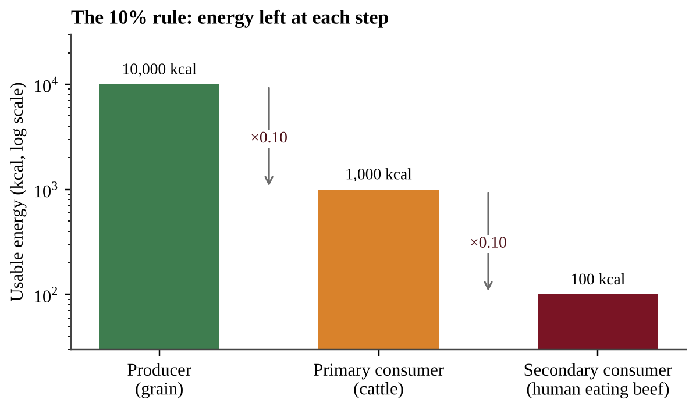{w=0.8}

Meat production therefore needs more land, water and energy per gram of protein than plant foods, and it adds nutrient pollution and greenhouse gases such as methane (CH₄). The impact depends on the animal and the system (Section 7.2).

### Eating less meat

Less consumption of meat, especially from **ruminants** such as cattle and sheep, can lower emissions of CO₂, CH₄ and N₂O, conserve fresh water and reduce reliance on antibiotics and growth hormones. Better feed quality and precision farming (sensors, GPS and data used to apply feed, water and chemicals only where needed) also reduce impacts. How large the benefit is depends on the production methods used and on what happens to land no longer used for livestock: restored forest stores carbon, but land converted to another intensive use may not.

:::box define
**Yield** — the amount of crop harvested per unit of land, for example tonnes per hectare.
**Ruminant** — a grazing mammal, such as a cow or sheep, whose gut microbes produce methane.
:::

:::box formula
**Energy at a later level = energy at the start × 0.10^(number of steps)**
Working backward, divide by 0.10 for each step. Keep units (kcal) at every step; a person's daily need ÷ energy per hectare gives person-days.
:::

:::box example
id: SG-U5-E006
A grain farmer produces 900,000 kcal of grain energy per hectare per year. Assume that only 10% of the energy in feed is stored in the bodies of cattle fed that grain, and that a person gets all of the energy stored in the cattle's bodies. (a) Calculate the kilocalories of beef that one hectare could provide if all the grain were fed to cattle. (b) A person needs 2,000 kcal per day. Calculate how many person-days of food one hectare could supply as grain eaten directly and as beef. (c) Explain two other environmental drawbacks of cattle production beyond land use.
:::

:::box example
id: SG-C7-E001
A country of 40 million people needs an average of 2,200 kcal of food energy per person per day. Its farmland supplies 5.0 × 10⁶ kcal per hectare per year. (a) Calculate the food energy needed per person in one year (365 days). (b) Calculate the total food energy the country needs in one year. (c) Calculate the number of hectares of farmland needed to supply it.
:::

:::box summary
- Rising population and diet change push up demand for land, water and energy; most new food comes from higher yield, not more land.
- Each trophic step keeps about 10% of the energy, so meat needs far more resources than plants; less meat, especially from ruminants, lowers emissions and water use.
:::

## 7.2 Types of Agriculture
%% CED: 5.4, 5.7 | EIN-2.D.1, EIN-2.H.1, EIN-2.I.1, EIN-2.I.2, EIN-2.I.3 | LO: EIN-2.D, EIN-2.H, EIN-2.I

:::box simple
Farming is a trade: we take food and the land pays. Some farms feed one family from a small plot; others are food factories. Each system works, and each has a hidden cost.
:::

| System | Typical features | Main environmental concern |
|---|---|---|
| Subsistence farming | Small plots, family labor, food mainly eaten at home | Soil exhaustion if land is not rested |
| Shifting cultivation (slash-and-burn) | Forest cut and burned, farmed a few years, then left to regrow | Deforestation and fire if fields are too many or fallow too short |
| Industrial (commercial) agriculture | Large monocultures, machines, fertilizer, pesticides, irrigation | Erosion, nutrient runoff, pesticide resistance, fossil-fuel use |
| Pastoral and ranching | Livestock graze open land | Overgrazing (Section 7.10) |

### Practices that cause damage

**Tilling** (plowing) turns over soil to bury weeds and prepare a seedbed. It leaves bare soil exposed, breaks up soil structure, speeds the decomposition of organic matter (releasing CO₂) and lets wind and rain carry away fine particles. Topsoil takes hundreds of years to form, and eroded sediment clouds streams and buries aquatic habitat. Heavy machines also compact soil.

In **slash-and-burn** farming, trees are cut and burned. Ash adds a pulse of nutrients, so the first crops grow well. In tropical forests, however, most nutrients are in living biomass rather than thin soils, so fertility falls in a few years and farmers move on. With few farmers and decades of regrowth the forest can recover; with too many it is lost. Burning releases CO₂ and particulates and destroys habitat.

**Fertilizers** replace the nutrients crops remove, mainly nitrogen and phosphorus. Plants take up only part of what is applied. The rest runs off or leaches into water. Nutrient pollution fertilizes algae; when they die, bacteria use up dissolved oxygen and create low-oxygen "dead zones" (eutrophication, Chapter 9). Nitrate in drinking water is a health risk for infants, and nitrogen fertilizer also releases nitrous oxide (N₂O), a greenhouse gas.

### Meat production systems

A **concentrated animal feeding operation (CAFO)** raises many animals in confined spaces on grain and soy. **Free-range** or **pasture-based** systems let animals eat grass or forage for most of their lives; **rotational grazing** moves them between paddocks so plants can regrow.

| Feature | Feedlots / CAFOs | Pasture-based (rotational or free-range) |
|---|---|---|
| Housing and feed | Confined; grain and soy | Outdoors; grass and forage |
| Land needed | Less | More |
| Cost to consumers | Lower (more economically efficient) | Higher |
| Waste | Large, concentrated manure; can contaminate waterways if not managed | Manure fertilizes soil; runoff and erosion if animal density is high |
| Antibiotics | Routine use can add to global antibiotic resistance | Not always antibiotic-free |

CAFO manure also causes odors and releases methane and ammonia.

### Feed conversion

The **feed conversion ratio (FCR)** is the mass of feed an animal eats per mass of weight it gains. An FCR of 7 means 7 kg of feed per 1 kg of body mass; a lower ratio means less feed, and less land, per kilogram of meat. Chains of conversions are multiplied in order with units kept: if a feed is 25% fishmeal and each kilogram of fishmeal needs 4 kg of wild fish, then 1 kg of farmed fish that ate 1.5 kg of feed used 1.5 × 0.25 × 4 = 1.5 kg of wild fish. Footprint tables per 100 g of protein scale with the protein served: value × (protein served ÷ 100 g).

:::box define
**Tilling** — mechanical turning of soil before planting.
**Slash-and-burn** — clearing land by cutting vegetation and burning it.
**CAFO** — a facility that confines large numbers of animals and feeds them grain and soy.
**Feed conversion ratio (FCR)** — kilograms of feed eaten per kilogram of body mass gained.
:::

:::box formula
**Feed needed = FCR × body mass gained**
**Usable forage = forage per hectare × hectares × fraction allowed to be eaten**
**Animals supported = usable forage ÷ forage eaten per animal per year**
Units: kg of feed or forage; keep "per year" and "per hectare" consistent.
:::

:::box mistake
- Believing free-range always means antibiotic-free or low impact.
:::

:::box example
id: SG-U5-E014
A ranch has 600 hectares that produce 1,800 kg of dry forage per hectare per year; managers allow cattle to eat 40% of it. Each cow eats 3,000 kg per year. (a) Calculate the largest number of cows the ranch can support sustainably. (b) The owner keeps 400 cows. Calculate by what percent the herd exceeds the sustainable number. (c) A feedlot with an FCR of 7 adds 25,000 kg of beef. Calculate the feed it needs, and state one environmental problem of the feedlot system.
:::

:::box example
id: SG-C7-E002
A CAFO holds 4,000 cattle. Each animal produces 30 kg of manure per day, and the manure is 0.5% nitrogen by mass. (a) Calculate the mass of manure produced per day. (b) Calculate the mass of nitrogen in that manure per day and per year (365 days). (c) If 4% of the yearly nitrogen reaches a nearby stream, calculate the mass of nitrogen entering the stream per year.
:::

:::box summary
- Damaging practices: tilling (erosion, CO₂ release), slash-and-burn (quick fertility, then decline, habitat and CO₂ loss) and fertilizer (nutrient runoff, dead zones, N₂O).
- CAFOs are cheap and efficient but concentrate manure and antibiotics; pasture systems need more land and cost more but return manure to soil.
:::

## 7.3 Agricultural Productivity
%% CED: 5.3, 5.4 | EIN-2.C.1, EIN-2.C.2, EIN-2.D.1 | LO: EIN-2.C, EIN-2.D

:::box simple
Before the Green Revolution a field was like a family garden. Afterward it was more like a factory: improved seeds, fertilizer, pesticides, irrigation and machines made the same land yield far more food.
:::

Beginning in the mid-1900s, plant breeders developed high-yield varieties of staple crops such as wheat and rice that responded strongly to fertilizer and water. Combined with other technologies, they greatly increased food production and helped feed a rapidly growing population. Together these changes are the **Green Revolution**, a shift to new agricultural strategies with both positive and negative results.

| Strategy | What it does | Benefit | Cost or risk |
|---|---|---|---|
| Mechanization | Tractors, harvesters, planters | Higher efficiency and profit; less labor | Fossil-fuel use, equipment cost, fewer farm jobs |
| High-yield and genetically modified crops (GMOs) | Selected or engineered traits | Higher yield, pest or drought tolerance | Seed cost; loss of genetic diversity |
| Synthetic fertilizer | Adds nitrogen, phosphorus | Higher yield per hectare | Nutrient runoff, eutrophication |
| Irrigation (Chapter 3) | Adds water | Farming in dry regions; extra harvests | Depleted aquifers, salinization |
| Pesticides | Kill pests | Less crop damage | Resistance, toxicity to wildlife |

**Mechanization** raises profit and efficiency because one operator with a machine can do what once took many workers. But machines burn fossil fuels, so farms depend on oil prices, and fertilizers and pesticides are also made with fossil energy. The tillage and fertilizer damage in Section 7.2 is the price of higher yield.

**Reading for perspective (skill 3.B):** if an author praises the Green Revolution only in tonnes of grain, ask what the author values, what evidence is left out (such as water pollution) and who benefits from that view.

:::box define
**Green Revolution** — the shift, beginning in the mid-1900s, to high-yield crops plus fertilizer, irrigation, pesticides and machinery to increase food production.
**Genetically modified organism (GMO)** — an organism whose DNA was altered by genetic engineering to give it a desired trait.
**Mechanization** — the use of machinery in place of human or animal labor.
:::

:::box formula
**Yield = harvest ÷ area** (so harvest = yield × area); **percent change = (new − old) ÷ old × 100%**
Convert units first (1 ha = 10,000 m²). Divide by the *old* value: a yield rising from 2.0 to 3.0 t/ha is a 50% increase.
:::

:::box example
id: SG-U5-E003
A district grows wheat on 12,000 hectares. Before adopting Green Revolution methods the district averaged 1.8 t/ha; after adopting them it averaged 3.6 t/ha, while nitrogen fertilizer use rose from 10 kg/ha to 90 kg/ha and diesel use for machinery rose from 20 L/ha to 55 L/ha. (a) Calculate the percent increase in yield and the total additional grain, in tonnes, from the whole district. (b) Calculate the additional kilograms of nitrogen fertilizer applied to the district each year. (c) Describe one environmental consequence of the increased fertilizer use and one of the increased diesel use.
:::

:::box summary
- Green Revolution = high-yield crops, fertilizer, irrigation, pesticides, GMOs and mechanization.
- It raised food production but increased reliance on fossil fuels and created pollution and genetic-diversity problems.
:::

## 7.4 Sustainable Agriculture
%% CED: 5.15 | EIN-2.I.3, STB-1.E.1, STB-1.E.2, STB-1.E.3 | LO: STB-1.E

:::box simple
Good soil is a bank that took centuries to fill. Sustainable farming protects the vault (stops erosion) and makes regular deposits (restores fertility).
:::

### Soil conservation: preventing erosion

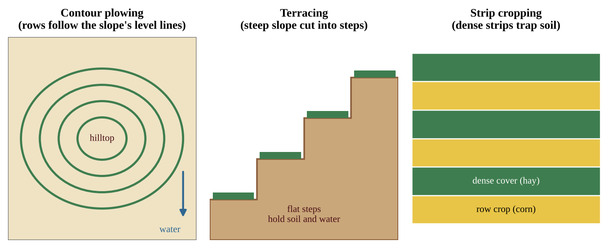

| Practice | What the farmer does | How it works | Trade-off |
|---|---|---|---|
| **Contour plowing** | Plow across the slope rather than up and down | Furrows slow runoff and trap soil | Best on gentle slopes; needs careful layout |
| **Terracing** | Build step-like flat platforms on steep slopes | Breaks long slopes into short flat sections that hold water | Expensive, labor-intensive |
| **Strip cropping** | Alternate rows of row crops and dense cover crops along contours | Dense strips catch soil washed from row crops | More complex planting and harvesting |
| **Windbreaks** | Rows of trees or shrubs along field edges | Slow wind and reduce wind erosion | Take land and years to grow |
| **Perennial crops** | Plant crops that live many years | Roots hold soil year-round; fewer plowings | May take years to produce income |
| **No-till agriculture** | Plant seeds directly into last year's residue without plowing | Residue protects soil; stores carbon; saves fuel | May need more herbicide; special seeding equipment |

### Soil fertility strategies

- **Crop rotation:** alternate crops, for example a nitrogen-hungry grain with a legume. Legumes host bacteria that convert atmospheric nitrogen to forms plants can use, so soil nitrogen is replenished, and pests are disrupted.
- **Green manure:** growing cover crops and plowing them in (or leaving them as mulch) adds organic matter and nutrients.
- **Limestone:** raises the pH of acidic soils, improving nutrient availability for crops.

### Rotational grazing

**Rotational grazing** is the regular rotation of livestock between pastures to avoid overgrazing in any one area. Plants have time to regrow, soil stays covered and manure is spread across the land (Sections 7.2 and 7.10).

:::box mistake
- Mixing up contour plowing (along the slope) and terracing (building steps).
:::

:::box example
id: SG-C7-E003
A 40-hectare field loses 15 tonnes of soil per hectare per year under conventional tillage. Switching to no-till reduces soil loss by 80%. Topsoil forms at about 1 tonne per hectare per year. (a) Calculate the total soil lost per year under conventional tillage. (b) Calculate the soil lost per year under no-till and the tonnes saved on the whole field. (c) Calculate how many times greater the conventional loss rate per hectare is than the topsoil formation rate.
:::

:::box summary
- Soil conservation: contour plowing, windbreaks, perennial crops, terracing, no-till, strip cropping.
- Soil fertility: crop rotation, green manure, limestone; rotational grazing protects pasture.
:::

## 7.5 Controlling Pests
%% CED: 5.6, 5.14 | EIN-2.G.1, EIN-2.G.2, STB-1.C.1, STB-1.D.1, STB-1.D.2 | LO: EIN-2.G, STB-1.C, STB-1.D

:::box simple
Spraying a pesticide is like using one antibiotic over and over. It kills most of the target, but the few survivors pass on their toughness, and soon the treatment stops working. A smarter approach is a toolbox, not a hammer.
:::

A **pest** is any organism that harms crops, livestock or people. Farmers use **pesticides**: insecticides (insects), herbicides (weeds), fungicides (fungi) and rodenticides (rodents). Pest control decreases crop damage and raises yield. The drawbacks are toxicity to non-target species such as pollinators and fish, contamination of water and residues on food.

### Resistance by artificial selection

Within a pest population, individuals vary genetically. A few may survive a chemical because of a gene that makes them resistant. With repeated spraying, susceptible individuals die and resistant survivors reproduce, so the share of resistant pests rises each generation. Because humans apply the selective pressure, this is **artificial selection**. Pests with short generation times and many offspring evolve resistance fastest, and farmers respond with stronger or more frequent doses, a cycle called the "pesticide treadmill."

For example, suppose 1 insect in 500 (0.2%) is resistant and a spray kills 95% of susceptible insects and none of the resistant ones. Of 500,000 insects, 1,000 are resistant; after the spray 1,000 resistant and about 24,950 susceptible survive, so resistant insects rise to 1,000 ÷ 25,950 ≈ 3.9% of the survivors. Rotating pesticides, leaving untreated refuges and spraying only above a pest threshold weaken this selection.

### Genetically engineered crops

Crops can be **genetically engineered** to increase resistance to pests and diseases, which can cut pesticide use and raise yield. Examples are a built-in insect toxin (Bt crops) and herbicide tolerance (repeated use of one herbicide selects for resistant weeds). The risk is a **loss of genetic diversity**: if farmers plant one variety, a single new disease or pest that overcomes its resistance can destroy the entire crop.

### Integrated pest management (IPM)

**Integrated pest management (IPM)** combines biological, physical and limited chemical methods to control pests effectively while minimizing disruption to the environment.

| Tool | Example | Why it works |
|---|---|---|
| Biocontrol | Release or protect natural predators, parasites or pathogens of the pest | Pest numbers fall without chemicals |
| Crop rotation | Change the crop each season | Pests of one crop starve when the next crop is not their host |
| Intercropping | Plant two or more crops together | Confuses pests and supports natural enemies |
| Monitoring and thresholds | Scout fields; spray only when pest numbers pass an economic threshold | Avoids unnecessary spraying |
| Limited chemicals | Targeted, low-toxicity pesticides applied precisely | Reduces non-target harm and slows resistance |

IPM reduces the risk pesticides pose to wildlife, water supplies and human health, and it slows resistance because selection pressure is weaker. A biocontrol organism brought in from elsewhere is itself a risk: if not specific to the pest it may attack native species or become invasive, so it must be tested first. IPM can be complex and expensive: farmers need training, monitoring and sometimes more labor, and results are slower than a quick spray.

:::box define
**Artificial selection** — selection by humans, intentional or not, of which individuals survive and reproduce.
**Resistance** — heritable ability to survive a chemical that once killed an organism's ancestors.
**Genetic diversity** — variation in genes within a species or crop.
**Biocontrol** — use of a pest's natural enemies to control it.
**Intercropping** — growing two or more crops in the same field.
:::

:::box mistake
- Writing that pests "adapt" or "learn" to resist. Resistance is *selection* acting on existing genetic variation, not an individual changing.
- Believing IPM bans all pesticides. It allows *limited* chemical use.
- Saying IPM is cheaper. It can be complex and expensive.
:::

:::box strategy
For "propose a solution" questions about pests, name two IPM tools matched to the scenario, a benefit and a drawback (cost, training, slower results).
:::

:::box example
id: SG-U5-E005
A cabbage grower sprays an insecticide each generation. In generation 1, 2% of the moths carry a resistance allele. Assume the resistant share of the population doubles in every generation, and that the population is rebuilt to its original size each time. (a) Calculate the percentage of resistant moths in generations 2, 3 and 4. (b) Explain why this is an example of artificial selection. (c) Propose one change in pest control that would slow this process, and describe one disadvantage of your proposal.
:::

:::box example
id: SG-U5-E011
A farm with 50 hectares compares four soil and pest-management plans on separate trial plots. Data per hectare per year: Plan 1 (conventional tillage, weekly insecticide) loses 18 t of soil and uses 12 sprayings; Plan 2 (no-till, weekly insecticide) loses 4 t of soil and uses 12 sprayings; Plan 3 (no-till plus IPM) loses 4 t of soil and uses 3 sprayings; Plan 4 (terraced plus IPM) loses 3 t of soil and uses 3 sprayings. (a) Calculate the percent reduction in soil loss from Plan 1 to Plan 2, and the total tonnes of soil saved per year on the whole farm by Plan 4 compared with Plan 1. (b) Identify which plan best reduces both soil loss and pesticide use, with data, and describe the pest-control tools it likely uses. (c) Justify why a farmer might still choose Plan 2 despite its environmental disadvantage.
:::

:::box summary
- Pesticides cut crop damage and raise yield but harm non-target organisms and select for resistance; genetically engineered crops can resist pests but may reduce genetic diversity.
- IPM = biocontrol, crop rotation, intercropping, physical methods, monitoring and limited chemicals: lower risk to wildlife, water and health, but complex and often expensive.
:::

## 7.6 Forestry
%% CED: 5.17 | STB-1.G.1, STB-1.G.2, STB-1.G.3 | LO: STB-1.G

:::box simple
A sustainable forest is managed like a garden: harvest some, plant more, keep the soil and the stream safe, and clear the dry brush before it catches fire.
:::

Forests provide **timber** and fuelwood, but they also deliver services that markets rarely price: they store carbon, filter air and water, hold soil, moderate floods and shelter most of the world's land species. **Forestry** is the management of forests for these goods and services. Plantations of one species grow wood fast but support less biodiversity and resist pests and fire less well than diverse forests.

### Reducing deforestation

- **Reforestation:** replanting trees after harvest or on degraded land, restoring habitat, soil protection and carbon storage.
- **Sustainably harvested wood:** choosing and buying wood from ecologically sustainable forestry, often identified by third-party certification. Methods include **selective cutting** (removing only certain mature trees), **strip cutting** (cutting narrow bands and leaving the rest to reseed), and harvesting no more than regrowth. (Figure 7.5 in Section 7.9 compares these with clearcutting.)
- **Reusing wood:** reclaimed lumber, recycled paper and reuse of furniture reduce demand for new harvest.

Selective cutting costs more per tonne and needs more skill than clearcutting, but it keeps a canopy, so there is less erosion, less stream warming and more habitat.

### Protecting forests from pests and fire

- **Pathogens and insects:** use IPM (Section 7.5) and **remove affected trees** to stop the spread. Removing infested trees too late is less effective; healthy, diverse forests resist outbreaks better than single-species plantations.
- **Prescribed burns:** forests are deliberately set on fire under controlled conditions (specific weather, trained crews) to reduce the occurrence of damaging natural fires. They burn off dry underbrush and litter, so a wildfire is less likely to become an intense crown fire (Sections 7.7 and 7.8).

:::box define
**Reforestation** — replanting trees on cut or degraded land.
**Selective cutting** — removing only some mature trees, leaving the canopy mostly intact.
**Certification** — independent verification that wood comes from sustainably managed forest.
:::

:::box formula
**Sustainable harvest ≈ annual growth per hectare × hectares**
Harvest above this rate shrinks the standing forest. Percent over = (harvest − sustainable) ÷ sustainable × 100%.
:::

:::box example
id: SG-C7-E004
A forest company manages 500 hectares of forest in which trees add 6 cubic meters of wood per hectare per year. (a) Calculate the largest sustainable harvest per year in cubic meters. (b) The company actually removes 4,200 cubic meters per year. Calculate by what percent the harvest exceeds the sustainable harvest. (c) Describe one forestry method that would let the company keep earning income while protecting the forest, and one drawback of it.
:::

:::box summary
- Reduce deforestation with reforestation, sustainably harvested (certified) wood and reuse of wood.
- Protect forests from pests with IPM and removal of affected trees, and from catastrophic fire with prescribed burns.
:::

## 7.7 Forest Fires (Wildfires)
%% CED: none (academy extension)

:::box simple
A wildfire needs something to burn, heat to start it and air to feed it. Take away one and it stops. Fire is also a natural, if rough, housecleaning: it clears dead material, recycles nutrients and gives new plants room.
:::

### The fire triangle and fire behavior

Burning needs **fuel**, **heat** and **oxygen**. In a forest, fuel is litter, branches, logs, grass, shrubs and trees; heat comes from lightning, human sparks, power lines or another fire; oxygen is always in the air. Fire fighters remove one side: clearing fuel with firebreaks, cooling with water or retardant, or smothering flames.

Fire behavior depends on the **fuel** (amount, moisture, continuity), the **weather** (temperature, humidity, wind, drought) and the **topography** (fire runs faster uphill because flames preheat the slope above). Dry fuel, low humidity and strong wind are the dangerous combination.

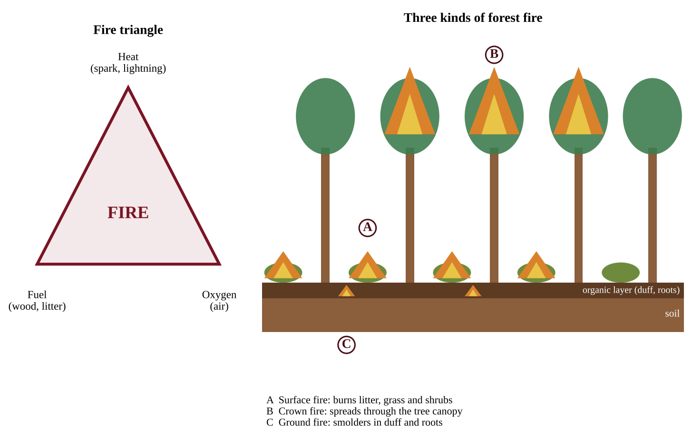

### Surface, crown and ground fires

| Type | What burns | Typical effect |
|---|---|---|
| Surface fire | Litter, grass, small shrubs and fallen branches on the forest floor | Often low intensity; most mature trees survive |
| Crown fire | Leaves and branches in the tree canopy | Very hot and fast; spreads on wind and often kills the whole stand |
| Ground fire | Organic layer (duff, peat) and roots below the surface | Slow, smoldering, can last for days; kills roots and is hard to see or extinguish |

**Ladder fuels** (small trees and shrubs under taller trees) let a surface fire climb into the canopy and become a crown fire.

### The natural role of fire

Many ecosystems evolved with fire and depend on it. Fire clears dead material, returns nutrients as ash, opens the canopy so sunlight reaches seedlings, controls pests and disease, and creates a mosaic of young and old patches that supports many species. **Fire adaptations** include thick bark (ponderosa pine), heat-opened cones (lodgepole and jack pine) and resprouting from roots (oaks, aspen, prairie grasses).

A **fire regime** describes the usual pattern of fire in a region: how often it burns (frequency), how hot (intensity), how much it kills (severity), the season and the size.

| Ecosystem | Typical fire regime |
|---|---|
| Grassland and savanna | Frequent (every 1–5 years); surface fires; grasses regrow quickly |
| Open ponderosa pine forest | Frequent (about every 5–30 years); low-severity surface fires |
| Chaparral and lodgepole pine | Infrequent (decades to a century or more); high-intensity, high-severity |
| Boreal forest | Infrequent (every 50–200 years); stand-replacing crown fires |

### Harm from wildfire

Fire becomes a problem when it is more intense than the ecosystem is adapted to or when it reaches people. Wildfire kills people and animals, destroys homes, and releases CO₂ and smoke (fine particulates, PM2.5) that harm health far downwind. Burned slopes lose their plant cover, and some soils turn water-repellent after severe fire, so storms cause floods, erosion and mudslides and carry ash into reservoirs. Climate change lengthens fire seasons and dries fuels, and burning forests release stored carbon, a feedback that adds to warming (Chapter 11).

:::box define
**Fuel load** — the mass of burnable material per unit area.
**Fire regime** — the typical frequency, intensity, severity, season and size of fires in an ecosystem.
**Fire adaptation** — a trait (thick bark, heat-opened cones, resprouting) that lets a species survive or use fire.
:::

:::box mistake
- Believing all fire is destructive. Many ecosystems need fire; the problem is fires that are unnaturally intense.
- Mixing up intensity (how hot) with severity (how much damage).
:::

:::box example
id: SG-C7-E005
A fire spreads outward in every direction at 1.5 kilometers per hour for 6 hours. Assume the burned area is a circle. (a) Calculate the radius of the burned area in kilometers. (b) Calculate the burned area in square kilometers and in hectares (1 km² = 100 ha). (c) Identify which part of the fire triangle a firebreak removes.
:::

:::box summary
- Fire needs fuel, heat and oxygen; its behavior depends on fuel, weather and topography.
- Surface, crown and ground fires differ in what burns; ecosystems have adapted to characteristic fire regimes.
- Fire clears, recycles and renews, but unusually intense fires kill, pollute and trigger erosion.
:::

## 7.8 Wildfire Suppression
%% CED: 5.17 | STB-1.G.3 | LO: STB-1.G

:::box simple
Putting out every small fire is like never cleaning your garage: it feels safe for years, then one spark finds a mountain of clutter. Modern managers try to manage fire, not just stop it.
:::

### A history of suppression

The "Big Burn" of 1910 in the northwestern United States (about 3 million acres) convinced the young US Forest Service that fire was an enemy. For most of the 20th century the policy was to put out every fire quickly (the "10 a.m. policy" aimed to control each fire by the next morning), backed by the Smokey Bear campaign. It worked in the short term, but it also removed the frequent low-intensity fires that had kept many forests open.

### The unintended result: fuel build-up

Without fire, litter and fallen branches accumulate, small trees grow up between the big trees as ladder fuels, and forests become dense. Crowded trees are stressed and open to insects and disease, which adds dead fuel. When a fire finally escapes, it is far more intense, burns in the canopy and kills mature trees that a surface fire would have spared.

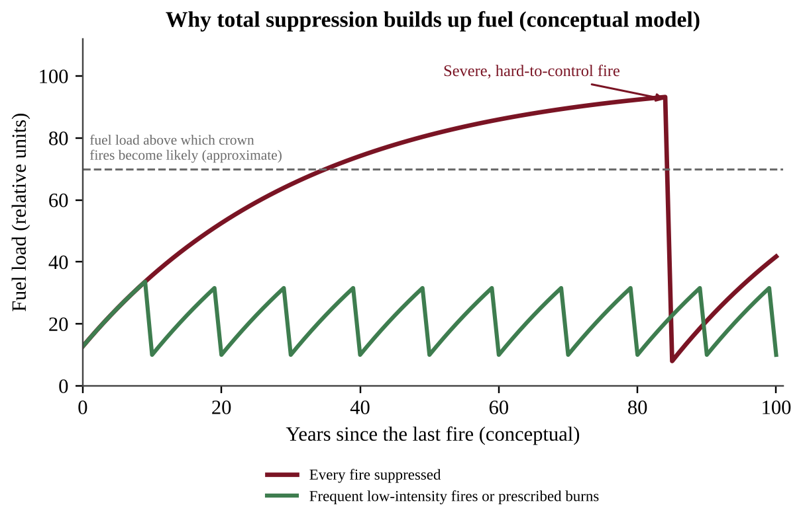

### Modern approaches

| Method | What it does | Benefit | Limitation |
|---|---|---|---|
| Prescribed burns | Planned, controlled fires under set weather | Remove surface fuel; restore natural regimes; cheap per hectare | Smoke, risk of escape; narrow safe weather windows; needs trained crews |
| Mechanical thinning | Cut small trees and remove ladder fuels | Reduces crown-fire risk; yields wood | Costly; leaves slash; no ecological "reset" |
| Managed natural fires | Allow lightning fires to burn under monitoring when risk is low | Cheap; natural process | Public fear; can escape in dry, windy weather |
| Firebreaks and fire fighting | Clear lines; aircraft and crews | Protect homes and lives | Does not remove fuel; very expensive |

### The wildland–urban interface (WUI)

The **wildland–urban interface** is the zone where houses meet or mix with flammable vegetation. As more people build there, more homes are at risk and fighting fires to protect property is costly and dangerous. Homeowners can create **defensible space** (cleared vegetation near the house), use ember-resistant vents and fire-resistant roofs, and communities can plan evacuation routes and limit building in high-risk areas.

:::box define
**Prescribed burn** — a fire set deliberately under controlled conditions to reduce fuel.
**Thinning** — mechanical removal of small trees and brush to lower fuel density.
**Wildland–urban interface (WUI)** — the area where development meets or mixes with wildland vegetation.
**Defensible space** — a cleared zone around a building that slows fire.
:::

:::box example
id: SG-C7-E006
A forest agency plans a prescribed burn on 2,000 hectares at a cost of $55 per hectare. A wildfire on the same land would cost $1,100 per hectare to fight and repair. Without the burn the chance of a wildfire on this land in the next 10 years is 35%; with the burn it is 10%. (a) Calculate the cost of the prescribed burn. (b) Calculate the cost of a wildfire on the 2,000 hectares. (c) Calculate the expected reduction in wildfire cost over 10 years (chance reduction × cost of a wildfire) and the net benefit after subtracting the cost of the burn.
:::

:::box summary
- Total suppression let fuel build up, making later fires larger and more intense.
- Prescribed burns, thinning and managed fire reduce fuel; the WUI and defensible space link wildfire to housing decisions.
:::

## 7.9 Deforestation—Tree Harvesting
%% CED: 5.2 | EIN-2.B.1, EIN-2.B.2 | LO: EIN-2.B

:::box simple
A forest is like a giant sponge wearing an umbrella. The canopy softens rain, roots hold soil in place, and shade keeps streams cool. Clearcutting removes the umbrella and the roots all at once.
:::

**Deforestation** is the permanent conversion of forest to another land use. Its main causes are clearing for crops, pasture and buildings, timber, fuelwood and charcoal, and urban growth. **Clearcutting** is the harvest of all or nearly all trees in an area in one operation. It is the cheapest and fastest method: heavy machines reach every tree, logging roads are simple, and the sunlit ground can be replanted with one fast-growing species. That economic advantage is real, so acknowledge it in a balanced answer. But the ecological costs are large.

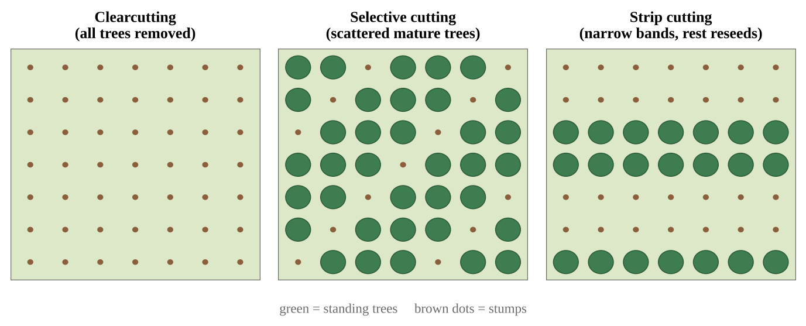

:::box process
Trees removed → roots die and no longer hold soil, and rain strikes bare ground → **soil erosion** increases → sediment washes into streams and clouds the water → the loss of shade raises **soil and stream temperatures** → warmer water holds less dissolved oxygen, stressing cold-water fish → with no canopy interception and less water uptake by roots, runoff rises → **flooding** downstream increases.
:::

### Climate and pollution effects

Forests are carbon sinks. Trees absorb CO₂ during photosynthesis and store the carbon in wood, roots and soil, and their leaves capture air pollutants such as particulates and ozone. When trees are cut and burned, or the wood and debris decay, the stored carbon is released as CO₂, which adds to the greenhouse effect and contributes to climate change. Less forest also means less future CO₂ uptake, so the loss is felt twice. Clearcutting also destroys habitat, reducing biodiversity, and exposed soil loses nutrients and organic matter, slowing regrowth.

### From stored carbon to CO₂

Forest data are usually given as the mass of *carbon* in the wood, but the gas released is CO₂, which also contains oxygen. One carbon atom (12 g/mol) becomes one CO₂ molecule (44 g/mol), so each tonne of carbon released as CO₂ is 44 ÷ 12 ≈ 3.67 tonnes of CO₂.

:::box formula
**Carbon released = stored carbon per hectare × hectares × fraction released**
**Mass of CO₂ = mass of carbon × 44 ÷ 12**
Units: tonnes of C, then tonnes of CO₂. Apply the fraction released first and the 44/12 conversion last; the 44/12 step is only needed when the question asks for CO₂ rather than carbon.
:::

:::box define
**Deforestation** — the permanent conversion of forest to another land use.
**Carbon sink** — a reservoir that absorbs more carbon than it releases.
:::

:::box mistake
- Forgetting the 44/12 conversion, or applying it before the fraction released.
:::

:::box example
id: SG-U5-E002

A 100-hectare watershed is clearcut. In the following year, monitors record that the stream's maximum summer temperature rises from 14 °C to 21 °C, that suspended sediment in the stream increases, and that peak flow during a storm is much higher than before the cut. (a) Explain how removing the trees causes each of these three changes. (b) Describe one effect of this clearcut on the carbon cycle. (c) State one economic advantage of clearcutting that explains why it is still used.
:::

:::box example
id: SG-U5-E012
A 30-hectare stand holds 140 tonnes of carbon per hectare. It is clearcut, and 65% of the stored carbon is released as CO₂ within a few years (C = 12 g/mol, CO₂ = 44 g/mol). (a) Calculate the tonnes of carbon released. (b) Convert your answer to tonnes of CO₂. (c) Describe one way wood could still be obtained while keeping more of this carbon stored.
:::

:::box summary
- Clearcutting is cheap and efficient but increases erosion, stream and soil temperature, and flooding.
- Forests absorb pollutants and store CO₂; cutting and burning releases CO₂ and adds to climate change.
:::

## 7.10 Rangelands
%% CED: 5.7 | EIN-2.I.4, EIN-2.I.5 | LO: EIN-2.I

:::box simple
A rangeland is a natural pasture. Its grass is like a savings account: animals may live off the "interest" (new growth) but not the "principal" (the roots and cover that make growth possible).
:::

**Rangelands** are lands dominated by grasses, forbs and shrubs that are grazed by livestock or wild animals: prairies, savannas, desert grasslands and shrublands. They cover roughly a third of the land area of the United States and a large share of Earth's land, much of it too dry or too steep to farm. They provide meat, milk and wool, wildlife habitat, watershed protection and carbon storage in soil and roots.

### Grazing and carrying capacity

Grazing is not harmful by itself: many grasses evolved with grazers and regrow from the base. Damage begins when animals eat plants faster than they regrow. The **carrying capacity** of a range is the number of animals it can support year after year without degrading the vegetation. It depends on the forage produced per hectare (which varies with rainfall and soil) and the fraction that may be taken, often "take half, leave half." Use the forage formulas in Section 7.2.

### Overgrazing

**Overgrazing** occurs when the livestock population exceeds the land's capacity to regenerate vegetation. Animals graze the best plants again and again, so palatable perennial grasses decline while unpalatable weeds and woody shrubs spread. Plant cover shrinks, soil is exposed and compacted, less water infiltrates, erosion increases and fertility drops. Biodiversity falls and the land stores less carbon.

:::box process
Too many animals → plants grazed faster than they regrow → less cover and fewer roots → soil exposed, compacted and eroding → less water infiltrates and fertility falls → even less forage → still more pressure on the remaining plants.
:::

### Desertification

In arid and semi-arid regions overgrazing can lead to **desertification**, the conversion of productive land into desert-like land that can no longer support vegetation. Drought, deforestation and over-cultivation also contribute, as in the African Sahel. It is hard to reverse because lost topsoil takes centuries to rebuild.

### Rangeland management

- **Stocking rates:** match animal numbers to forage, and cut them in drought years.
- **Rotational grazing:** move animals between paddocks so each gets a rest period to regrow (Section 7.4).
- **Restoration:** reseed native grasses, control invasive weeds, use prescribed fire against woody shrubs and apply soil conservation. Restoration, soil conservation and improved grazing can slow or reverse desertification.
- **Permits:** on public rangeland, agencies limit animal numbers (Section 7.13).

:::box define
**Carrying capacity (grazing)** — the number of animals a range can support sustainably.
**Overgrazing** — livestock numbers exceed the vegetation's ability to regenerate.
**Desertification** — degradation of arid or semi-arid land into desert-like condition.
:::

:::box mistake
- Saying grazing is always harmful. Well-managed grazing can keep grassland healthy; overgrazing is the problem.
- Thinking desertification means "deserts expanding." It means land *degrading*, often far from existing deserts.
:::

:::box example
id: SG-C7-E007
A rangeland of 2,400 hectares produces 900 kg of forage per hectare per year, and managers allow 50% of the forage to be eaten. Each cow eats 4,500 kg of forage per year. (a) Calculate the number of cows the range can support sustainably. (b) The rancher grazes 300 cows. Calculate by what percent the herd exceeds the sustainable number. (c) A drought cuts forage production by 30%. Calculate the new sustainable number of cows.
:::

:::box summary
- Rangelands are grazed grasslands and shrublands; carrying capacity depends on forage produced and the share that can be taken.
- Overgrazing reduces cover, compacts and erodes soil, lowers biodiversity and carbon storage, and can cause desertification; stocking limits, rotation and restoration reduce it.
:::

## 7.11 Urban Land Development
%% CED: 5.10, 5.13 | EIN-2.M.1, EIN-2.M.2, EIN-2.M.3, EIN-2.M.4, STB-1.B.1 | LO: EIN-2.M, STB-1.B

:::box simple
A city is a giant machine that takes in water, energy, food and land and gives out waste, heat and runoff.
:::

**Urbanization** is the growth of cities as more people move from rural to urban areas. Cities can be efficient (shared transport and buildings), but they concentrate resource demand and waste.

### Effects on resources and cycles

- **Resource depletion and the water cycle:** Large populations draw heavily on rivers and aquifers. In coastal cities, pumping groundwater lowers the water table and lets salt water move into the freshwater aquifer, called **saltwater intrusion**, which makes wells unusable.
- **Carbon cycle:** Burning fossil fuels for vehicles, power and heating, and the decomposition of waste in landfills, add CO₂ (and methane from landfills) to the atmosphere, increasing the greenhouse effect.
- **Impervious surfaces:** Roads, roofs, sidewalks and parking lots do not allow water to reach the soil. Rain that would soak in becomes fast surface runoff, causing flash floods, carrying oil, metals and trash into streams, and giving less groundwater recharge.
- **Heat:** Dark pavement and buildings absorb sunlight and hold heat (the urban heat island effect, Chapter 9).

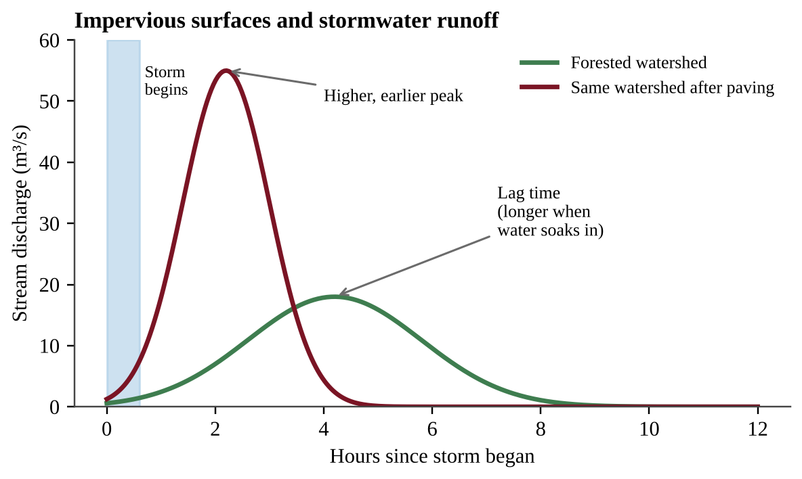{w=0.8}

Read a hydrograph by comparing the **peak height** (flood severity), the **lag time** (rainfall to peak) and the **area** under the curve (total runoff). Pavement raises the peak, shortens lag time and increases total runoff. Where old cities send storm runoff and sewage down one pipe, a heavy storm can overwhelm the treatment plant and release untreated mixture into streams.

:::box formula
**Runoff volume (m³) = area (m²) × rainfall depth (m) × runoff coefficient**
1 ha = 10,000 m²; 1 cm = 0.01 m; 1 mm = 0.001 m. Find each surface separately and add.
:::

### Urban sprawl

**Urban sprawl** is the change in population distribution from high-density areas to low-density suburbs that spread into rural lands. Typical consequences: loss of farmland and habitat, more roads and parking (more impervious surface), longer commutes and more vehicle emissions, higher infrastructure costs per person and greater energy use per household.

### Methods to reduce urban runoff

The goal is to **increase infiltration**, the movement of water into soil, so that less water leaves as runoff:

| Method | How it helps | Limitation |
|---|---|---|
| Permeable pavement | Replaces traditional pavement so water seeps through to the soil | Can clog with sediment; higher cost; not for all heavy-traffic roads |
| Planting trees (and green spaces) | Roots and soil absorb water, leaves intercept rain, shade reduces heat | Takes years to grow; needs space and maintenance |
| Public transportation | Fewer cars means fewer lanes, garages and parking lots, and less pollution | Needs funding and enough population density |
| Building up, not out | Taller buildings on smaller footprints leave more open land | Cost and building regulations; higher local density |

### Designing an investigation (skill 4.B)

Use this checklist when a question asks you to test a land-use idea (permeable pavement, mulch on a slope, fertilizer rate, rotational grazing, ladybugs against aphids).

- **Hypothesis:** testable and directional ("If slopes are covered with mulch, then less sediment will wash into runoff than from bare slopes").
- **Independent variable:** the one thing you change. **Dependent variable:** what you measure, with units (runoff in L, nitrate in mg/L, percent cover, turbidity).
- **Control group:** gets no treatment or the standard one (bare soil, asphalt). Do not confuse it with **controlled variables**, the conditions kept the same in every plot (slope, soil, area, rainfall, measurement time).
- **Replication and randomization:** several plots per treatment, assigned at random; report the mean and the scatter.
- **Supporting result:** the treatment mean differs from the control in the predicted direction by more than the scatter among replicates.

Weak designs change two variables at once, have no control group, or use one plot.

:::box define
**Impervious surface** — human-made surface (road, roof, parking lot) that does not allow water to reach the soil.
**Urban sprawl** — the outward spread of low-density development into rural land.
**Saltwater intrusion** — movement of salt water into a coastal freshwater aquifer, often because of overpumping.
:::

:::box mistake
- Mixing up the control group (no treatment) with controlled variables (conditions kept equal).
:::

:::box example
id: SG-U5-E009
A 40-hectare site is a forest. A 25-mm rainstorm falls on it. Use runoff coefficients of 0.15 for pervious ground and 0.90 for impervious surfaces, and runoff volume = area (m²) × rainfall depth (m) × coefficient. (1 hectare = 10,000 m²). (a) Calculate the runoff volume from the forested site. (b) The site is developed so that 60% of its area is impervious. Calculate the new runoff volume and how many times greater it is than before. (c) Describe one consequence for the stream below the site and one design change that would reduce the runoff.
:::

:::box example
id: SG-U5-E017
A 12-hectare school campus has 3 ha of roofs and 4 ha of asphalt (runoff coefficient 0.90 each) and 5 ha of lawn (0.20). A storm drops 3.0 cm of rain. (a) Calculate the runoff volume in m³. (b) Half of the asphalt is replaced by permeable pavement (coefficient 0.35). Calculate the new runoff volume and the percent reduction. (c) Describe one limitation of permeable pavement.
:::

:::box example
id: SG-U5-E018
A town wants to know whether a layer of wood-chip mulch on bare construction slopes reduces the sediment that reaches a creek. (a) Write a hypothesis. (b) Identify the independent variable, the dependent variable (with a unit), the control group and two controlled variables. (c) Describe how many plots you would use, how you would assign treatments and what result would support your hypothesis.
:::

:::box summary
- Urbanization depletes resources, can cause saltwater intrusion, and adds CO₂ through fossil-fuel use and landfills; impervious surfaces prevent infiltration and cause flooding; sprawl spreads low-density development into rural land.
- Reduce runoff with permeable pavement, trees, public transportation and building up rather than out.
:::

## 7.12 Transportation Infrastructure
%% CED: none (academy extension)

:::box simple
A road is more than pavement. It cuts a landscape into pieces, brings people and weeds into wild places, and sends oil and salt into every stream it crosses.
:::

Roads, railways, airports, pipelines and ports connect people and goods, but they take land and reshape ecosystems. The United States alone has more than 4 million miles of public roads, and the area affected is much larger than the pavement: the **road-effect zone** extends tens to hundreds of meters on each side.

### Habitat fragmentation and edge effects

A road divides a large habitat into smaller patches, called **habitat fragmentation**. Small patches hold fewer individuals, so populations die out more easily, and many animals will not or cannot cross a road; isolated populations lose genetic exchange. Every patch has an **edge**, where light, wind, noise, invasive plants and predators differ from the interior. Small patches may be nearly all edge, so interior species decline.

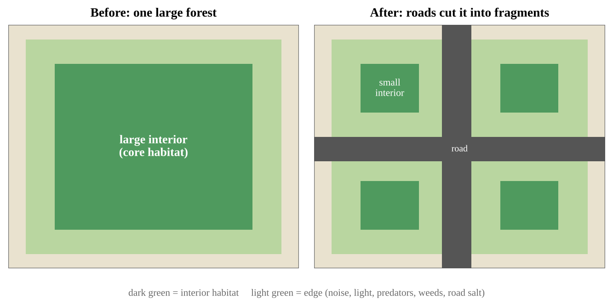

Vehicles kill wildlife directly, and roads open remote areas to hunting, logging, fires and invasive species. Construction exposes soil, so erosion and stream sediment rise.

### Runoff and pollution

Roads are impervious (Section 7.11). Runoff carries oil, heavy metals and tire particles, and winter road salt, into streams and groundwater; salt can harm freshwater organisms. Traffic adds air pollution, noise and CO₂ (Chapters 8 and 9).

### Roads and sprawl

New roads make distant land easy to reach, so houses and shops spread outward, creating more traffic and demand for more roads. This feedback is **induced demand**: added capacity fills up with new trips. Sprawl in turn raises the cost of roads and services per household.

### Reducing the impacts

- **Wildlife crossings:** overpasses, underpasses and culverts, with fencing that guides animals to them.
- **Fewer and narrower roads:** limit road density in sensitive habitat; close old logging roads.
- **Better runoff control:** permeable pavement, vegetated swales and retention basins, and less road salt.
- **Compact development and transit:** mass transit, walking and cycling, and building up not out, so fewer new roads are needed (Chapter 8).

:::box define
**Habitat fragmentation** — division of a large continuous habitat into smaller, isolated patches.
**Edge effect** — change in conditions (light, wind, predators, invasive species) along the border of a habitat patch.
**Induced demand** — new road capacity encourages new trips and development, so traffic rises again.
:::

:::box mistake
- Measuring a road's impact only by the area of pavement. The affected area includes the edge and road-effect zone.
:::

:::box example
id: SG-C7-E008
A square forest block measures 4 km on each side. Treat the outer 0.2 km along every boundary as edge habitat; the rest is interior. (a) Calculate the interior area of the block in square kilometers. (b) A straight road (ignore its width) is built through the middle of the block, parallel to one side, splitting it into two equal rectangles of 2 km × 4 km. Calculate the total interior area of the two fragments. (c) Calculate the percent decrease in interior area and the area of the largest single interior fragment.
:::

:::box summary
- Roads fragment habitat, create edges, kill wildlife, spread invasive species and carry polluted runoff.
- Roads and sprawl feed each other; crossings, fewer roads, runoff control and compact development reduce the impacts.
:::

## 7.13 Public and Federal Lands
%% CED: none (academy extension)

:::box simple
Public land belongs to everyone, so everyone wants something different: loggers want trees, ranchers grass, hikers quiet, wildlife habitat. The law gives each agency a different job.
:::

The federal government owns roughly 640 million acres, about 28% of the United States, mostly in the West and Alaska. Four agencies manage most of it. Acreages below are approximate.

| Agency | About how much | Mission | Typical uses |
|---|---|---|---|
| Bureau of Land Management (BLM) | 245 million acres | **Multiple use** and sustained yield | Grazing, mining, oil and gas, recreation, wildlife |
| US Forest Service (USFS) | 193 million acres (national forests and grasslands) | Multiple use and sustained yield | Timber, grazing, recreation, watershed protection |
| National Park Service (NPS) | 85 million acres | **Preservation** and public enjoyment | Hiking, camping, education; no logging, hunting or mining in most parks |
| Fish and Wildlife Service (FWS) | 89 million acres of refuge land | Conservation of wildlife and habitat | Wildlife viewing, regulated hunting and fishing |

### Multiple use versus preservation

**Multiple use** means managing land for many uses at once (timber, grazing, mining, recreation, water, wildlife) without destroying its ability to produce in the future (**sustained yield**). **Preservation** means keeping land natural, with only low-impact recreation and study. The goals often conflict: logging roads cross wildlife habitat, grazing and mining affect streams, and off-road vehicles disturb quiet recreation. **Conservation**, the wise use of resources so they last, lies between them.

### Wilderness and other designations

- **Wilderness areas** (Wilderness Act, 1964) are designated parts of federal land with the highest protection: no roads, no motorized vehicles and no permanent structures. Wilderness can lie within any of the four agencies' lands.
- **National monuments** can be set aside by the president under the Antiquities Act (1906).
- The National Environmental Policy Act (NEPA, 1970) requires environmental impact reviews before major federal projects.
- Public lands are leased or permitted for grazing, timber, oil and gas, and mining (the General Mining Law of 1872 still governs hard-rock claims). Fees are often below market value, a debated subsidy (Section 7.17).

:::box define
**Multiple use** — managing public land for several uses at the same time.
**Sustained yield** — harvesting no more than the land regrows or renews over time.
**Preservation** — protecting land in its natural condition, with little human use.
**Wilderness area** — federal land protected from roads, vehicles and permanent development.
:::

:::box mistake
- Mixing up the agencies. USFS and BLM are multiple-use agencies; NPS is preservation and recreation; FWS is wildlife conservation.
- Treating preservation and conservation as identical. Preservation excludes most use; conservation allows wise use.
:::

:::box example
id: SG-C7-E009
A western state has 62.0 million acres of land. The federal government manages 31.0 million acres of it: BLM 14.5 million, USFS 9.5 million, NPS 3.0 million and FWS 4.0 million acres. (a) Calculate the percent of the state's land that is federally managed. (b) Calculate the percent of the federal land that is managed by the two multiple-use agencies (BLM and USFS). (c) Identify which agency's mission is mainly preservation and recreation.
:::

:::box summary
- BLM and USFS manage for multiple use and sustained yield; NPS for preservation and recreation; FWS for wildlife.
- Multiple use versus preservation is a recurring land-use conflict; wilderness areas have the strictest protection.
:::

## 7.14 Mining
%% CED: 5.9 | EIN-2.K.1, EIN-2.K.2, EIN-2.L.1, EIN-2.L.2 | LO: EIN-2.K, EIN-2.L

:::box simple
Mining is like eating a cake from the outside in: the rich pieces go first. Later you must dig through more plain cake for the same sweetness. In mining, the rich parts are high-grade ore, and as they run out more rock must be moved for each tonne of metal.
:::

**Mining** extracts minerals, metals and fuels such as coal from the Earth. It supplies low-cost energy and the materials used to make products, from wires to bridges, and it provides jobs. Its drawbacks are habitat destruction, pollution and large volumes of waste.

### Ore grade and diminishing returns

An **ore** is rock containing enough valuable mineral to be mined profitably. The **grade** is the concentration of the valuable material in the ore. As the most accessible, highest-grade ores are mined to depletion, operations are forced to use lower-grade ores. This requires more energy, water and machinery, and it produces more waste and pollution per tonne of product.

:::box process
High-grade ore depleted → miners turn to lower-grade ore → more rock must be excavated per tonne of metal → more energy, water and chemicals are used → more overburden and tailings → more land disturbance and pollution.
:::

### Mining methods

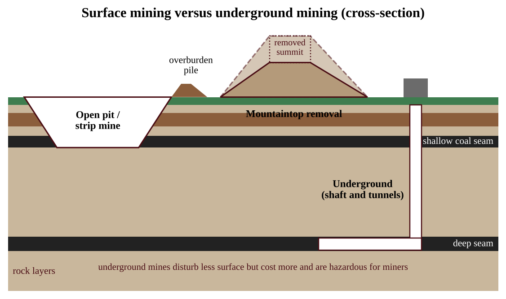

| Method | How it works | Example impact |
|---|---|---|
| Surface mining | Soil and rock above the ore, called **overburden**, are removed | Habitat loss, erosion, dust |
| Strip mining | Vegetation and overburden removed in long strips to expose a shallow seam | Vegetation loss makes the area susceptible to erosion; acidic runoff |
| Open-pit mining | Large pit dug to reach ore close to the surface | Huge pits, tailings piles |
| Mountaintop removal | Mountain summit blasted off to reach coal seams, debris dumped in valleys | Stream burial, large-scale habitat loss |
| Subsurface (underground) mining | Shafts and tunnels reach deeper deposits | Very expensive; hazards to miners; subsidence; methane |

As shallow coal reserves get smaller, it becomes necessary to use subsurface mining, which is very expensive.

### Waste and pollution

Mining wastes include the soil and rock moved to gain access to the ore (overburden or spoil) and the **tailings** and **slag** that remain after minerals are separated or smelted. Water that touches exposed sulfide minerals can become acidic (**acid mine drainage**) and carry heavy metals into streams and groundwater. Pyrite (iron sulfide) exposed to air and water is oxidized to sulfuric acid, so stream pH can fall to about 3–4 and metals dissolve; this continues long after a mine is abandoned. Some mines, such as gold mines, use cyanide solutions to separate the metal, so leaks from tailings ponds can poison water. Coal mining can destroy habitat, contaminate groundwater, and release dust particles and methane, a greenhouse gas.

:::box formula
**Ore needed = mass of metal wanted ÷ ore grade (as a decimal)**
**Waste mass = ore mined − metal recovered**
Units: tonnes (t); grade as a decimal (0.5% = 0.005). A lower grade means more ore and more waste for the same amount of metal; halving the grade doubles the ore.
:::

Grades can also be given as a fraction of the *volume* (very small values such as 2 × 10⁻⁶ are common for gold). Then:

:::box formula
**Volume of metal = volume of rock × grade (as a fraction)**
**Mass of metal = volume of metal × density** (1 m³ = 10⁶ cm³, so convert volume to cm³ if density is in g/cm³)
**Break-even price = total cost of mining and processing ÷ mass of metal recovered**
Method: write each conversion as a fraction equal to 1 (for example 10⁶ cm³/1 m³) so the unwanted units cancel.
:::

:::box define
**Ore** — rock containing a valuable mineral in a concentration high enough to mine.
**Overburden** — soil and rock removed to reach ore.
**Tailings / slag** — waste left after minerals are separated from ore (tailings) or smelted (slag).
**Reclamation** — restoring mined land (regrading, topsoil, replanting) after mining.
:::

:::box mistake
- Saying mining waste is only "overburden." Tailings and slag are separate.
- Thinking mining is purely harmful. Describe both the economic benefit and the ecological cost.
:::

:::box example
id: SG-U5-E008
A mine must produce 1,000 tonnes of copper per year. Assume all of the copper in the ore is recovered and the rest of the ore becomes tailings. (a) Calculate the tonnes of ore that must be processed per year when the ore grade is 0.8% copper and when it is 0.4% copper. (b) Calculate the tonnes of tailings produced per year at each grade. (c) Explain why the lower-grade ore is likely to increase both the cost and the environmental impact of the mine, and propose one way to reduce the demand for newly mined copper.
:::

:::box example
id: SG-U5-E016
A block of rock measures 50 m × 40 m × 10 m. Gold makes up 3 × 10⁻⁷ of its volume, and gold has a density of 19 g/cm³. Mining and processing the block costs $400,000. (a) Calculate the volume of the rock and the volume of the gold in m³. (b) Calculate the mass of gold in kilograms. (c) Calculate the break-even price per gram, and explain why a fall in the ore grade would raise it.
:::

:::box summary
- Surface mining removes overburden (strip mining, open-pit, mountaintop removal); subsurface mining is deeper and costlier.
- Declining ore grade means more waste, energy and pollution per tonne; mining waste includes overburden, tailings and slag, and acid mine drainage.
:::

## 7.15 Global Mineral Reserves
%% CED: none (academy extension)

:::box simple
Think of the ground as a huge pantry. Some shelves you have counted, some you know about, some you only guess exist. "Reserves" are the counted shelves worth opening at today's prices.
:::

### Reserves and resources

A mineral **resource** is the total amount of a mineral that exists in Earth's crust in a form that could eventually be extracted, including deposits not yet found. A **reserve** is the part of a resource that has been identified and can be extracted profitably with current technology and at today's prices. Reserves are therefore *smaller* than resources and can change: a higher price, cheaper technology or a new discovery moves material into the reserves, while a falling price or tougher regulation moves it out. Reserve numbers are not a count of how much is left in the ground.

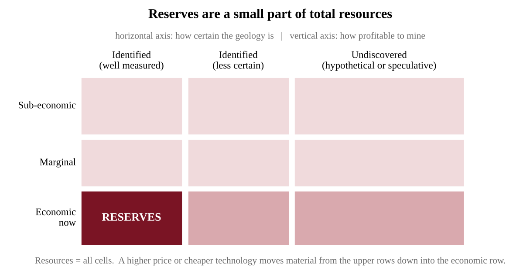

### Ore grade and how long reserves last

Richer ores are mined first, so average grade falls (Section 7.14) and the energy, water and waste per tonne of metal rise. The **static reserve index** estimates how long reserves last at a constant rate of use:

:::box formula
**Years remaining (static) = reserves ÷ annual production**
Units: reserves and production in the same unit (tonnes; tonnes per year). If production grows each year the true lifetime is shorter; recycling, new discoveries and substitution make it longer.
:::

### Uneven distribution and critical minerals

Minerals form where geologic processes concentrated them (Chapter 1), so they are unevenly spread. Examples (approximate): much of the world's cobalt comes from the Democratic Republic of the Congo, lithium from Australia, Chile and China, copper from Chile and Peru, platinum-group metals from South Africa and Russia, and most rare-earth processing takes place in China. A **critical mineral** is essential to technologies such as batteries, wind turbines, electronics and solar panels, and its supply can be disrupted because few countries produce or process it. Countries respond by diversifying sources, stockpiling, recycling and finding substitutes.

### Recycling and reducing demand

Recycling metals avoids new mining and saves energy: recycling aluminum uses about 95% less energy than making it from bauxite ore. Collecting metal from old electronics ("urban mining") can be profitable because scrap can be richer in metal than natural ore. Substitution, longer-lived products and using less material also reduce demand.

:::box define
**Mineral resource** — all of a mineral that exists in or on Earth, including deposits not yet found or not yet profitable to mine.
**Reserve** — the part of a resource that is identified and can be mined profitably now.
**Critical mineral** — a mineral essential to modern technology whose supply is vulnerable to disruption.
**Urban mining** — recovering metals from discarded products and waste.
:::

:::box mistake
- Saying reserves are "all the metal that exists." Resources are larger; reserves depend on price and technology.
:::

:::box example
id: SG-C7-E010
A metal has world reserves of 120 million tonnes and annual production of 3.0 million tonnes. (a) Calculate the number of years the reserves would last at the current production rate. (b) Recycling supplies enough metal to cut the demand for newly mined metal by 25%. Calculate the new annual mine production and the new number of years. (c) Explain why a rise in the metal's price could increase the reserves without any new deposit being found.
:::

:::box summary
- Reserves are the profitable, identified part of the resource; they rise or fall with price and technology.
- Minerals are unevenly distributed, so critical minerals carry supply risks; recycling and substitution reduce demand for new mining.
:::

## 7.16 Fishing
%% CED: 5.8, 5.16 | EIN-2.J.1, STB-1.F.1, STB-1.F.2 | LO: EIN-2.J, STB-1.F

:::box simple
A fish population is like a bank account that earns interest. You can spend the interest forever, but if you spend the principal, the interest shrinks and the account empties.
:::

**Overfishing** is harvesting fish faster than the population can replace itself. It has led to the extreme scarcity of some fish species, which can lessen biodiversity in aquatic systems and harm people who depend on fishing for food and commerce. A fishery is a classic commons, so the tragedy of the commons applies (Section 7.18).

### Causes

- Growing demand for seafood as population and incomes increase.
- Technology (sonar, GPS, factory ships), open access in international waters, weak enforcement and subsidies that keep too many boats at sea.

### Fishing methods and their impacts

| Method | Description | Main problems |
|---|---|---|
| Bottom trawling | Weighted net dragged along the seafloor | Destroys bottom habitat; heavy **bycatch** |
| Purse seining | Net encircles a school and is closed at the bottom | Bycatch (dolphins, sharks) |
| Drift-net or gill-net | Long walls of netting that hang in the water | Entangles non-target animals, including turtles and marine mammals |
| Longlining | Line with thousands of baited hooks | Hooks seabirds, turtles and sharks |

**Bycatch** is the unintended capture of non-target species. Removing top predators or a keystone species can cascade through the food web and reduce biodiversity; for example, fishing out the herbivorous fish on a reef lets algae overgrow and smother the coral.

### Reading fishery data

Total catch alone can mislead. **Catch per unit effort (CPUE)** is the total catch divided by the fishing effort (boats, boat-days or hours fished). In a healthy stock, adding boats raises the catch and CPUE stays about the same. In a shrinking stock, each boat finds fewer fish even with sonar and bigger nets, so CPUE falls while effort rises. Total catch can stay high for years because more boats and better technology hide the decline, and then collapse. Always work out CPUE before concluding that a stock is healthy.

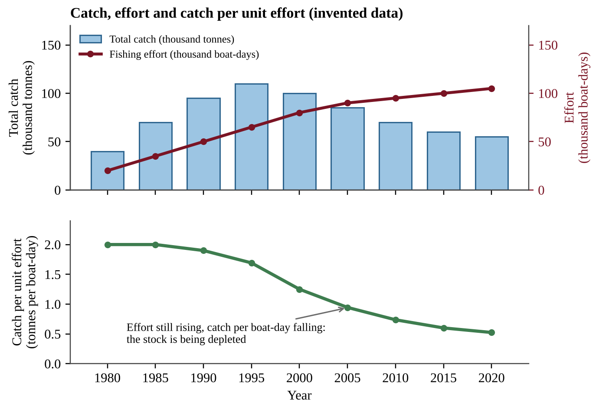{w=0.8}

:::box formula
**CPUE = total catch ÷ fishing effort** (for example, tonnes per boat-day)
**Change in stock = natural growth − harvest** (per year)
:::

### Sustainable yield

The **sustainable yield** of a fishery is the amount that can be harvested without reducing the supply. The fish stock replaces itself fastest at intermediate stock sizes. A harvest below the peak of the growth curve can continue indefinitely; a harvest above it will shrink the stock every year.

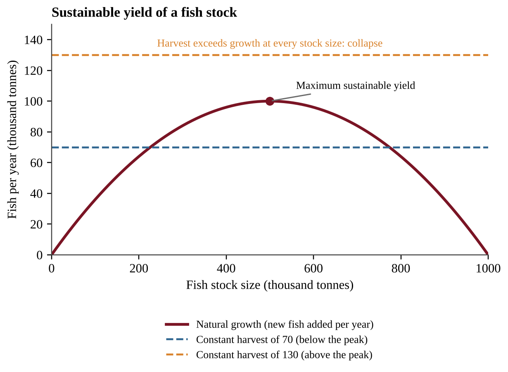{w=0.8}

Compare the growth curve with the harvest line at the stock size you start from. Where the curve is above the line, the stock rises; where it is below, the stock falls. Where they meet is an equilibrium. The right-hand crossing is stable (a small drop in stock makes growth exceed harvest, so the stock recovers); the left-hand crossing is unstable (below it the stock falls to collapse). A harvest line above the peak never meets the curve, so the stock collapses. Harvesting exactly at the peak leaves no safety margin, so quotas are set below it.

### Solutions

- Catch limits and quotas based on stock surveys.
- Closed seasons and marine protected areas where fish can breed.
- Gear restrictions: larger mesh sizes, turtle-excluder devices, bans on destructive methods.
- Certification, international agreements, enforcement, and aquaculture.

### Aquaculture

**Aquaculture** is the farming of fish, shellfish and aquatic plants in ponds, tanks or ocean pens. It has expanded because it is highly efficient, requires only small areas of water and uses little fuel (no long trips to far fishing grounds). It can relieve pressure on wild stocks, provide a reliable supply and create jobs in coastal and rural communities.

Its drawbacks:

- **Wastewater contamination:** uneaten feed, feces and chemicals flow into surrounding water, adding nutrients and causing eutrophication.
- **Escapes:** farmed fish that escape may compete with wild fish for food and habitat, or breed with them and change the wild gene pool.
- **Disease:** crowded fish have high disease and parasite rates, and these can be transmitted to wild fish.
- **Other impacts:** shrimp ponds can replace coastal mangroves, and carnivorous farmed species may be fed wild-caught fish.

:::box define
**Bycatch** — unintended capture of non-target species.
**Sustainable yield** — the harvest that can be taken year after year without reducing the stock.
**Aquaculture** — the farming of fish, shellfish and aquatic plants.
:::

:::box example
id: SG-U5-E007
A fish stock's natural growth, measured as tonnes of new fish added in a year, depends on stock size as follows: stock 200 → growth 64; stock 400 → growth 96; stock 500 → growth 100; stock 600 → growth 96; stock 800 → growth 64 (all in thousands of tonnes). A fleet takes 90 thousand tonnes every year. (a) State the maximum sustainable yield shown by the data and the stock size at which it occurs. (b) If the stock is 800 thousand tonnes, calculate the change in stock after one year of fishing. (c) Predict what will happen to the stock if the stock falls to 200 thousand tonnes while the fleet still takes 90, and explain how this relates to the tragedy of the commons.
:::

:::box example
id: SG-U5-E015
A lake fishery records effort of 30,000 boat-days and a catch of 60,000 tonnes in 2005; 50,000 boat-days and 70,000 tonnes in 2015; and 80,000 boat-days and 56,000 tonnes in 2025. (a) Calculate the catch per unit effort for each year. (b) Describe the trend in total catch and in CPUE, and state what each suggests about the fish stock. (c) Explain why the 2015 total catch could mislead a manager, and propose one management action.
:::

:::box summary
- Overfishing: harvest exceeds replenishment. It reduces biodiversity and harms fishing communities; destructive gear causes bycatch and habitat damage.
- Falling CPUE signals decline; sustainable yield sets safe catch limits.
- Aquaculture is efficient and uses little space and fuel, but its waste pollutes water, escapees compete and breed with wild fish, and dense populations spread disease.
:::

## 7.17 Global Economics
%% CED: none (academy extension)

:::box simple
A banana, a T-shirt or a phone ties you to farms, mines and factories abroad. The price rarely includes the damage done to land and water far away.
:::

### Trade and globalization

**Trade** is the exchange of goods and services between regions or countries. **Globalization** is the growing connection of economies through trade, investment, transport and communication. Trade lets countries specialize in what they produce most cheaply, which can lower prices and raise incomes. But it also moves environmental impact away from consumers: forests are cleared for beef, soy and palm oil sold abroad; water is used to grow exported crops (**virtual water**); and long transport burns fossil fuel. A country's ecological footprint (Chapter 6) can exceed the land inside its borders.

### Prices, subsidies and externalities

Prices guide choices, but market prices often leave out **externalities**, costs of pollution, habitat loss and depleted water that others pay. When the price is too low, people use too much. **Subsidies** (government payments or tax breaks) can make this worse: payments for fuel to fishing fleets encourage overfishing, subsidized irrigation water encourages waste, and cheap fees for grazing and mining on public land lower costs for the users. Subsidies can also help the environment, for example when they support solar power or soil conservation.

Environmental economics tools (Chapter 10) correct prices: a tax or fee equal to the external cost, tradable permits, and removal of harmful subsidies.

### Development and the environment

Poorer countries often export raw materials (timber, crops, minerals, oil) to raise income and may have weak enforcement. When one resource dominates an economy, price swings and environmental damage can leave the country worse off (the "resource curse"). As incomes rise, people can afford cleaner technology and demand stricter rules, but consumption per person usually rises too. Fair-trade rules, certification and international agreements try to make trade support both development and conservation.

:::box define
**Globalization** — the increasing connection of the world's economies through trade, investment and communication.
**Subsidy** — a government payment or tax break that lowers the cost of producing or buying something.
**Externality** — a cost (or benefit) of an activity borne by people who did not choose it.
**Virtual water** — the water used to produce a traded product.
:::

:::box formula
**Full-cost price = market price + external cost per unit**
**Tax to internalize the cost = external cost per unit; revenue = tax × quantity**
**Percent increase = (new − old) ÷ old × 100%**
:::

:::box mistake
- Saying trade or subsidies are always harmful. Both can help or harm; evaluate who gains and which costs are left out.
:::

:::box example
id: SG-C7-E011
A farm product sells for $80 per tonne. Producing it causes $22 per tonne of damage to water and soil that the producer does not pay. A government adds a tax equal to the damage on each tonne. The farms produce 500,000 tonnes per year. (a) Calculate the full-cost price per tonne. (b) Calculate the annual tax revenue. (c) Calculate the percent increase in price caused by the tax, and describe one effect the higher price could have on use of the resource.
:::

:::box summary
- Trade and globalization link consumers to distant land and water use, often hiding environmental costs.
- Externalities and subsidies distort prices; taxes, fees and subsidy reform correct them.
:::

## 7.18 Tragedy of the Commons
%% CED: 5.1 | EIN-2.A.1 | LO: EIN-2.A

:::box simple
Imagine a shared pizza in the middle of a table with no rule about slices. Each hungry person thinks, "If I do not take another slice, someone else will." Everyone takes more than a fair share, and the pizza is gone in minutes. No one wanted that result, yet everyone's sensible-looking choice caused it. That is the tragedy of the commons.
:::

A **commons** is a resource that belongs to everyone and so to no one in particular: a fishing ground, the air, a groundwater aquifer, a public pasture, the open ocean, the atmosphere's capacity to absorb carbon dioxide. Such a resource is usually *rival* (my use leaves less for you) and *hard to exclude people from*. The tragedy of the commons suggests that individuals will use shared resources in their own self-interest rather than in keeping with the common good, thereby depleting the resources. Each user gets the full benefit of taking more but shares the cost of depletion with everyone, so the rational self-interested choice is to take more. Overfishing (Section 7.16), overgrazing (Section 7.10) and public-land use (Section 7.13) are all examples.

:::box process
Open access to a shared resource → each user gains the full benefit of extra use → the cost (depletion) is spread across all users → every user has an incentive to take more → total use exceeds the resource's ability to renew itself → the resource declines or collapses → everyone, including the heaviest users, loses.
:::

### Why it happens and how it is prevented

The problem is not that people are evil; it is that the *rules* reward overuse. Solutions therefore change the rules:

- **Regulation and quotas:** catch limits for each fishing season, pumping limits on a shared aquifer, permits for grazing on public land, emissions caps.
- **Privatization or assigned shares:** if a person owns the pasture or a transferable share of the fishery, he or she pays the long-term cost of overuse. The drawback is that ownership can favor the wealthy and may ignore the ecosystem services that benefit everyone.
- **Community management:** a village that sets its own rules for a shared forest or irrigation canal, enforced by social pressure, often succeeds when the group is small and can monitor itself.

:::box define
**Tragedy of the commons** — the idea that individuals acting in their own self-interest will use a shared resource in ways that do not serve the common good, thereby depleting or degrading it.
**Commons (common-pool resource)** — a shared resource open to many users, such as a fishery, aquifer, pasture or the atmosphere.
**Externality** — a cost of an activity that falls on people who did not choose it.
:::

:::box mistake
- Believing the tragedy happens only to *land*. Air, oceans, groundwater and the climate are commons too.
- Saying people are "greedy" or "ignorant." On the exam, the cause is *self-interest combined with lack of rules or enforcement*.
:::

:::box strategy
When a question gives a shared resource, answer in three moves: (1) identify the commons and who uses it, (2) explain that each user benefits fully from taking more while the cost is shared, and (3) propose a specific rule (quota, permit, fee) and state one limitation of it.
:::

:::box example
id: SG-U5-E001
Eight ranchers each graze cattle on a public meadow that can feed 80 cattle per year without losing grass cover. Each rancher currently grazes 14 cattle. A rancher who adds one more animal gains the full sale value of that animal, while the loss of grass is shared among all eight ranchers. (a) Calculate the total number of cattle on the meadow and by what percent it exceeds the sustainable number. (b) Explain, using the concept of the tragedy of the commons, why each rancher might add another animal even though all of them know the meadow is overgrazed. (c) Propose one rule that would prevent further damage and identify one drawback of that rule.
:::

:::box summary
- The tragedy of the commons: self-interested use of a shared resource depletes it for everyone.
- Cause: full personal benefit, shared cost, no enforceable limits; remedies: quotas, permits, assigned shares, community rules.
:::

### Math and Skills Toolkit

Calculators are allowed. Write the formula, the substitution with units, and the answer with units.

- **Percent change** = (new − old) ÷ old × 100%; divide by the *old* value. **Percent of total** = part ÷ whole × 100%.
- **Yield** = harvest ÷ area (1 ha = 10,000 m²). **Runoff** = area × depth × coefficient (convert mm to m first).
- **Trophic energy:** × 0.10 per step; going backward divide by 0.10. **Chained conversions:** multiply the factors in order and cancel units with fractions equal to 1.
- **Ore** = metal ÷ grade; **waste** = ore − metal. **Carbon to CO₂:** × 44 ÷ 12. **CPUE** = catch ÷ effort. **Stocking** = forage × allowed fraction ÷ forage per animal. **Static reserve life** = reserves ÷ annual production.
- **Graphs:** name variables and units first; the peak of a growth curve is the maximum sustainable yield; on a hydrograph compare peak, lag time and area; quote data values.
- **Task verbs:** *Describe* = characteristics; *Explain* = cause and effect; *Calculate* = formula, substitution, answer with units; *Justify* = reason plus evidence; *Propose* = a specific action.

## 7.19 Practice Questions and Answers

Practice makes the ideas in this chapter stick, so use the classroom examples and question sets below.

[[chapter-practice]]
