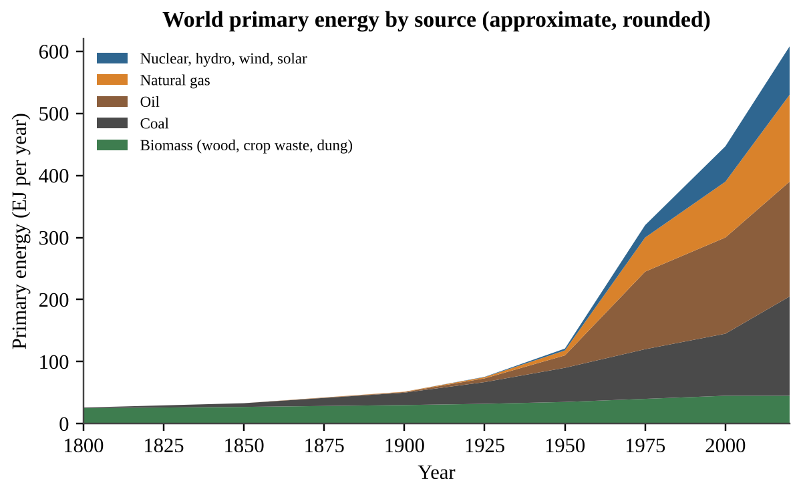
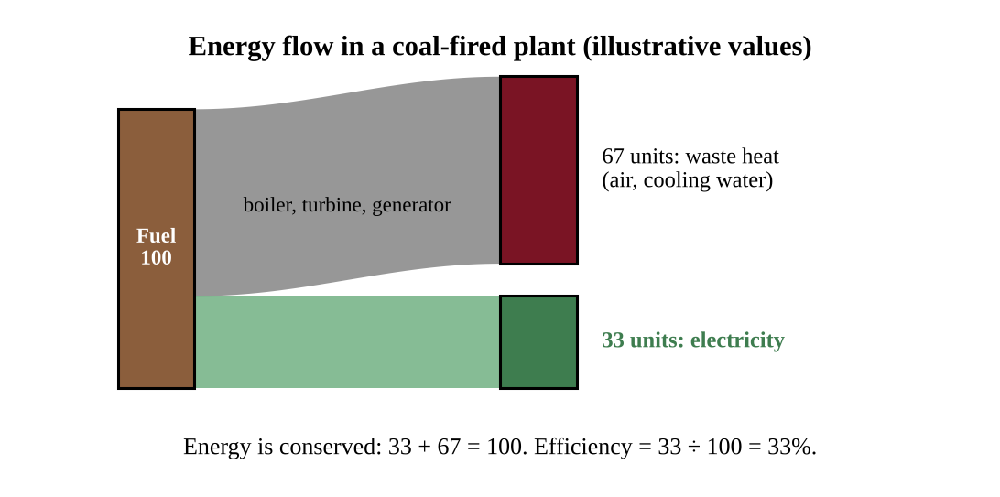
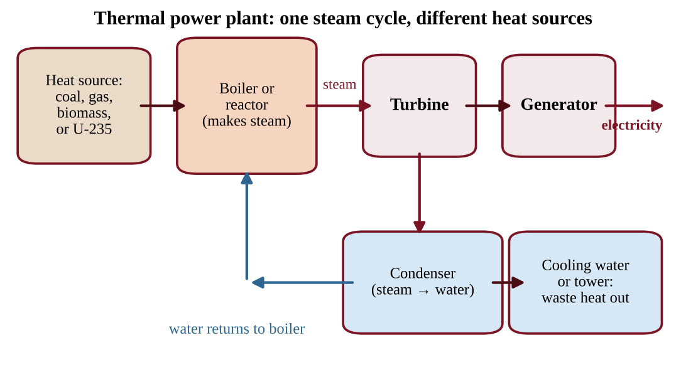
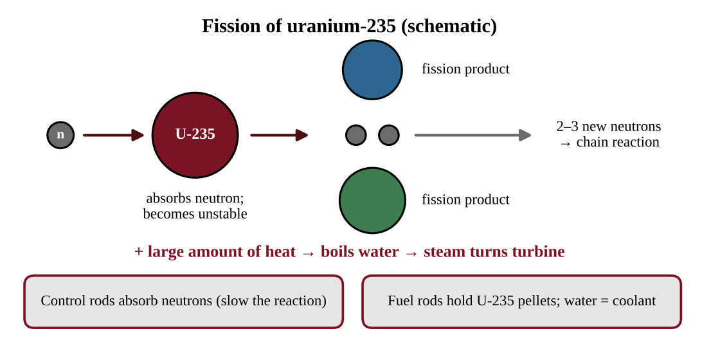
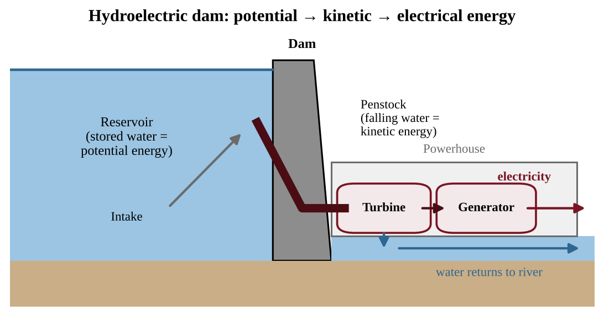
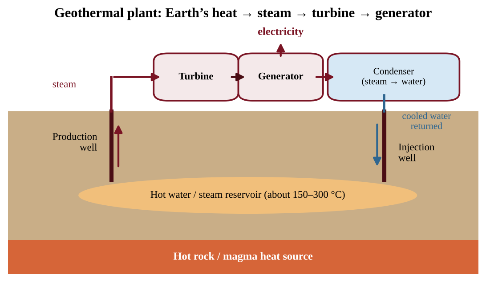
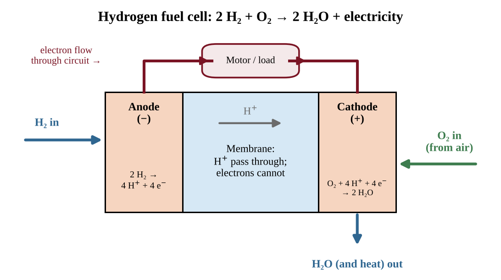
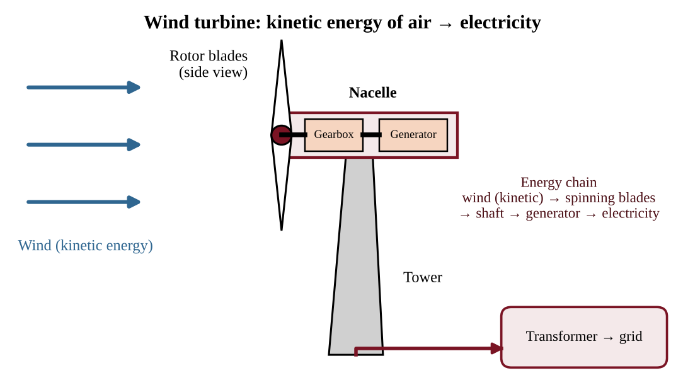
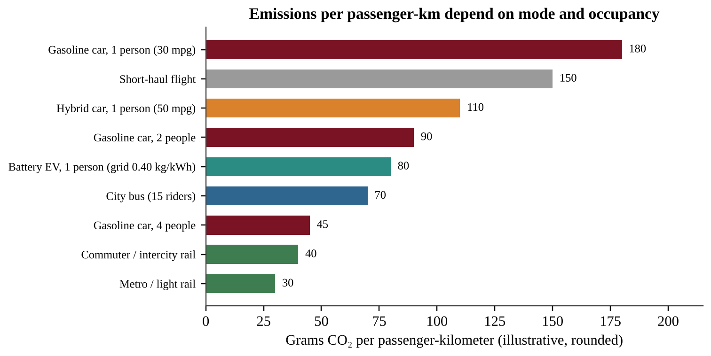

# Chapter 8 — Energy

:::box objectives
- Distinguish renewable from nonrenewable sources, and use energy, power, efficiency and the laws of thermodynamics correctly.
- Describe how energy use grew from wood to coal, oil and gas, and what drives demand today.
- Explain how fossil-fuel, nuclear, biomass, solar, hydro, geothermal, hydrogen and wind systems generate power, and what each costs the environment.
- Calculate energy, power, efficiency, capacity factor, payback, EROEI, R/P ratio, half-life, fuel economy and emissions per passenger-kilometer.
- Compare ways to conserve energy and to move people (cars, hybrids, electric vehicles, buses and rail).
:::

Energy is the "currency" of modern life, and every energy choice leaves an environmental bill. Learn how each source works and what it costs, then learn the arithmetic that lets you compare sources fairly.

## 8.1 Energy Concepts
%% CED: 6.1 | ENG-3.A.1, ENG-3.A.2 | LO: ENG-3.A

:::box simple
Think of a bank account. A **nonrenewable** source is a savings account with a fixed balance: each withdrawal leaves less, and nothing refills it in your lifetime. A **renewable** source is a paycheck: new money arrives continuously, but you can only spend what arrives each period.
:::

### Renewable and nonrenewable sources

**Nonrenewable energy sources** exist in a fixed amount and involve an energy transformation that cannot easily be reversed. Coal, crude oil and natural gas formed from organisms buried for millions of years. Uranium-235, the fuel for nuclear plants, is mined from ore that formed with the Earth. **Renewable energy sources** are replenished naturally at or near the rate we consume them, and they can be reused: sunlight, wind, flowing water, Earth's internal heat and fast-growing biomass. Wood is renewable only if trees regrow as fast as they are cut.

| Source | Category | Why |
|---|---|---|
| Coal, oil, natural gas | Nonrenewable | Formed over millions of years; used far faster than formed |
| Uranium-235 | Nonrenewable | Fixed supply of ore |
| Sunlight, wind, moving water | Renewable | Driven continuously by the Sun and gravity |
| Geothermal heat | Renewable | Heat flows continuously from Earth's interior (if water use is sustainable) |
| Biomass | Renewable if regrown | Plants regrow within years to decades |

:::box define
**Nonrenewable energy source** — exists in a fixed amount and cannot be replaced at the rate it is used.

**Renewable energy source** — replenished naturally at or near the rate of consumption and can be reused.

**Fossil fuel** — fuel formed from the buried remains of ancient organisms: coal, crude oil and natural gas.
:::

### Forms of energy and how they change

Energy is the ability to do work or transfer heat. It comes in several forms, and every energy system is a chain of conversions between them.

| Form | Meaning | Example |
|---|---|---|
| Kinetic | Energy of motion | Moving air (wind), a car |
| Potential | Stored by position | Water behind a dam |
| Chemical | Stored in bonds | Gasoline, coal, food |
| Thermal | Random motion of particles (heat) | Hot water, a boiler |
| Radiant | Electromagnetic waves | Sunlight |
| Electrical | Moving charges | Current in a wire |
| Nuclear | Stored in atomic nuclei | Uranium-235 |

A coal plant converts chemical → thermal → kinetic (steam, turbine) → electrical energy. A car engine converts chemical → thermal → kinetic.

### The laws of thermodynamics

- **First law (conservation of energy):** energy cannot be created or destroyed, only changed from one form to another. In every device, energy in = useful energy out + waste energy out.
- **Second law:** every conversion turns some energy into low-quality, dispersed heat that cannot do the same work again, so no machine is 100% efficient. This is why a thermal power plant loses about two-thirds of its fuel energy as waste heat, and why using the highest-quality energy (electricity) for low-quality jobs (heating water) is wasteful.

### Power, energy, units and efficiency

Do not mix up **power** and **energy**. Power is the *rate* of using or producing energy; energy is power multiplied by time. A 1 kW heater running for 1 hour uses 1 kilowatt-hour (kWh).

:::box formula
**Energy = Power × Time** (kWh = kW × h; J = W × s). If a question gives kW and hours, the answer is kWh. If it gives kWh and hours, divide to get kW.

**Efficiency (%)** = (useful energy output ÷ total energy input) × 100. Efficiency can never exceed 100%.

**Chains multiply:** a plant at 35% sending power through a line at 90% delivers 0.35 × 0.90 = 31.5% of the fuel energy.

**Electricity cost** = energy (kWh) × price ($/kWh)

| Conversion | Value |
|---|---|
| 1 kWh | 3.6 × 10⁶ J = 3.6 MJ ≈ 3,412 BTU |
| 1 BTU | ≈ 1,055 J |
| 1 W | 1 J/s; 1 kW = 1,000 W; 1 MW = 10⁶ W |
| 1 year | 8,760 hours |
| Prefixes | k = 10³, M = 10⁶, G = 10⁹, T = 10¹², P = 10¹⁵, E = 10¹⁸ |
| 1 gallon of gasoline | ≈ 121 MJ ≈ 33.7 kWh |
:::

Write every conversion as a fraction equal to 1 and cancel units.

:::box mistake
- "Renewable means clean." Burning biomass releases particulates and nitrogen oxides, and a large dam floods habitat. Renewable describes supply, not pollution.
- "Nuclear is renewable because it makes no air pollution." Uranium is finite, so nuclear is **nonrenewable**.
- Mixing kW (a rate) with kWh (an amount). A utility bill charges for kWh.
:::

:::box strategy
When a question asks you to "identify" or "distinguish," state the test explicitly: *is it replenished at or near the rate of use?*
:::

:::box example
id: SG-U6-E001
A student sorts five energy sources into two columns: wind, uranium-235, natural gas, sunlight, and coal. (a) List which belong in the nonrenewable column. (b) Using the definition of nonrenewable, explain in one sentence why natural gas is placed there even though it burns more cleanly than coal. (c) One of the nonrenewable sources releases no air pollutants during operation. Identify it.
:::

:::box example
id: SG-C8-E001
A 1,500 W electric space heater runs 6.0 hours per day for 30 days. Electricity costs $0.14 per kWh. (a) Calculate the energy used, in kWh. (b) Express that energy in megajoules and calculate the cost. (c) The electricity comes from a power plant that is 35% efficient. Calculate the fuel energy, in kWh, the plant must burn to supply it.
:::

:::box summary
- Nonrenewable: fixed amount, not replaced on human timescales. Renewable: replenished at or near the rate of use. Neither word means "clean" or "dirty."
- Energy changes form but is conserved (first law); every conversion loses some energy as waste heat (second law).
- Energy = power × time; efficiency = useful output ÷ input; efficiencies in a chain multiply.
:::

## 8.2 Energy Consumption (Past)
%% CED: 6.2 | ENG-3.B.1, ENG-3.B.2, ENG-3.B.3, ENG-3.B.4, ENG-3.B.5 | LO: ENG-3.B

:::box simple
Energy use follows wealth and industry. A country with factories, cars and air conditioning uses far more energy per person than a country where most people cook with wood. Over the last two centuries the world moved from burning wood to burning coal, then oil and gas, and total demand exploded.
:::

### From wood to coal to oil

For most of history people relied on **muscle power, firewood, and water or wind** for mills and sails. Wood is bulky, and growing cities stripped nearby forests.

- **1700s–1800s, the Industrial Revolution.** Coal packs more energy per kilogram than wood, and it fed the **steam engine**, which powered pumps, factories, locomotives and ships. Coal also smelted iron into steel. Wood gave way to coal first in Britain, then worldwide.
- **Late 1800s.** The first commercial oil wells (1859, Pennsylvania), the internal combustion engine and the electric generator created demand for liquid fuels and for electricity, made mostly from coal.
- **1900s.** Oil overtook coal as cars, trucks and aircraft multiplied; natural gas pipelines carried a cleaner fuel to homes and industry. **Nuclear power** began in the 1950s and hydroelectric dams spread.
- **Since 2000.** Wind and solar have grown fastest, yet fossil fuels still supply most energy.

**Reading Figure 8.1.** Biomass was nearly the only large source in 1800. Each new source *added to* the old ones rather than replacing them: coal use is higher today than in 1950.

### Who uses energy, and from what?

Use of energy is **not evenly distributed**. Developed countries have a small share of the world's people but a large share of its energy use, so their use **per capita** is high. Developing countries use less per person, but they hold most of the world's people and their total demand grows fastest. Worldwide, the **most widely used sources are fossil fuels**: oil, coal and natural gas.

### Trends and their causes

- **Industrialization raises demand.** Factories, mining, transport, cement and steel need energy, and rising incomes bring more electricity, vehicles and appliances.
- **Development increases fossil-fuel reliance.** Developing countries often start with traditional biomass (firewood, charcoal, dung) because it is nearby and free. As incomes rise they shift to coal, oil and gas, which are concentrated, transportable and often cheap, so fossil fuel use rises before cleaner sources catch up.
- **Availability, price and government regulation shape choices.** A country with abundant coal tends to burn coal. A rise in oil price pushes users toward alternatives. Subsidies, carbon taxes, emission standards and renewable-energy mandates change which source is cheapest or required.

**Reading Figure 8.2.** The developing country gets a much larger share from coal (38% versus 14%) and from biomass (10% versus 2%), while the developed country relies more on oil and natural gas and has more nuclear. Both are dominated by fossil fuels: oil + coal + gas = 80% and 78%. State the pattern, give one numerical comparison, and link it to a cause such as local resources or stage of development.

:::box formula
**Energy per capita** = total energy used ÷ population

**Percent share** = (energy from one source ÷ total energy) × 100

**Percent change** = (new − old) ÷ old × 100

**Total energy use** = energy per capita × population

**Doubling time (years)** = 70 ÷ annual growth rate (%)   (rule of 70)

**Percent of capacity used** = demand ÷ plant capacity × 100

**Demand after t years** at a steady rate r (decimal) = present demand × (1 + r)ᵗ

Units: J, MJ (10⁶ J), GJ (10⁹ J), EJ (10¹⁸ J) or kWh. Per capita is reported as GJ or kWh per person per year.
:::

:::box apply
**Worked example.** A country of 50 million people uses 4.0 × 10¹⁸ J (4.0 EJ) in a year, and 3.0 EJ comes from fossil fuels.

Per capita: 4.0 × 10¹⁸ J ÷ 5.0 × 10⁷ people = 8.0 × 10¹⁰ J = 80 GJ per person.
Fossil share: 3.0 ÷ 4.0 × 100 = 75%.
If next year's use is 4.4 EJ, percent change = (4.4 − 4.0) ÷ 4.0 × 100 = 10% increase.
:::

:::box example
id: SG-U6-E002
Country A has 300 million people and uses 90 EJ of energy in a year. Country B has 1,500 million people and uses 45 EJ. (a) Calculate each country's energy use per person in GJ. (b) Calculate how many times greater Country A's per-person use is than Country B's. (c) Country B gets 60% of its energy from coal. Calculate the energy from coal in EJ. (d) Describe one reason Country B's total use is likely to rise over the next 20 years.
:::

### Total demand and doubling time

Total demand depends on population and use per person, so a country with low use per person but a huge population can still have very large total use and CO₂ emissions. The rule of 70 works for any steady percentage growth: at 3.5% per year, demand doubles in 70 ÷ 3.5 = 20 years. For a table of towns, find each town's demand (people × kW per person), add them, and compare with plant capacity.

On a graph of **shares**, a source can fall in share while its **amount** still rises, so check the axis. State only causes the data support: a falling coal share beside a rising gas share shows competition, not by itself a cause such as price.

:::box example
id: SG-U6-E013
A city of 400,000 people uses 3.0 kW per person and a town of 90,000 uses 5.0 kW per person; one 2,000 MW plant serves both. (a) Calculate the percent of capacity used. (b) Demand grows 3.5% per year; use the rule of 70 to estimate the doubling time. (c) Explain why the plant will be overloaded before that time has passed.
:::

:::box example
id: SG-C8-E002
World primary energy was about 50 EJ in 1900, of which coal supplied 20 EJ. In 2020 the total was about 600 EJ, of which coal supplied 160 EJ. (a) Calculate coal's percent share of the total in each year. (b) Calculate the percent change in coal energy and in total energy between 1900 and 2020. (c) Explain how coal's share can fall while the amount of coal used rises.
:::

:::box mistake
- Comparing countries by total energy instead of per capita. Always use "per capita" or "percent" when countries differ in size.
- Reading a falling *share* as a falling *amount*.
:::

:::box summary
- Wood gave way to coal in the Industrial Revolution, then oil and gas in the 1900s; each new source added to, rather than erased, the old ones.
- Energy use is uneven: higher per person in developed countries; demand grows fastest where industrialization is happening.
- Fossil fuels are the most widely used sources; availability, price and regulation influence choices.
:::

## 8.3 Energy Use (Present)
%% CED: 6.3, 6.4, 6.5, 6.6 | ENG-3.C.1, ENG-3.C.2, ENG-3.C.3, ENG-3.C.4, ENG-3.C.5, ENG-3.C.6, ENG-3.C.7, ENG-3.D.1, ENG-3.E.1, ENG-3.E.2, ENG-3.E.3, ENG-3.F.1, ENG-3.G.1, ENG-3.G.2, ENG-3.G.3, ENG-3.G.4, ENG-3.H.1, ENG-3.H.2 | LO: ENG-3.C, ENG-3.D, ENG-3.E, ENG-3.F, ENG-3.G, ENG-3.H

:::box simple
Fuels are "energy in a package." The more energy per kilogram (and the less water and ash), the more useful the fuel. Wood is a loose package; gasoline is a compact one. Fossil fuels still supply roughly four-fifths of the world's primary energy.
:::

### Fuels you must know

- **Wood.** Used as firewood and as **charcoal** (wood heated with little oxygen so it is mostly carbon). Common in developing countries because it is accessible and often free. Heavy use causes deforestation and indoor smoke.
- **Peat.** Partially decomposed plant material from waterlogged bogs; the early stage on the way to coal. It burns smokily. Peat bogs store large amounts of carbon, so harvesting them releases CO₂.
- **Coal.** Formed from buried plant matter. **Heat, pressure and depth of burial** determine the type. **Lignite** (soft, brown, lowest energy content), **bituminous** (the most commonly burned, medium to high energy) and **anthracite** (hard, shiny, highest carbon and energy content). Higher rank means more carbon, more energy per kilogram and less moisture.
- **Natural gas.** Mostly **methane (CH₄)**. The **cleanest fossil fuel** per unit of energy: less CO₂ and almost no particulates or SO₂. Leaked methane is itself a strong greenhouse gas.
- **Crude oil and tar sands.** Crude oil is pumped from underground reservoirs. **Tar sands** are a mix of clay, sand, water and a thick hydrocarbon called **bitumen**; oil is recovered by mining or by heating the deposit, which uses much energy and water and disturbs land.
- **Refined fuels.** Crude oil is separated by boiling point into specialized fuels: gasoline for cars, diesel for trucks and trains, kerosene for jet fuel, heating oil and propane.

:::box define
**Cogeneration** — using one fuel source to produce both useful heat and electricity.

**Bitumen** — thick, tar-like hydrocarbon in tar sands.

**Charcoal** — fuel made by heating wood with little oxygen.
:::

### Cogeneration

Making electricity in a thermal plant wastes about two-thirds of the fuel's energy as heat. **Cogeneration** (combined heat and power) captures that heat for buildings or industrial steam. Total efficiency rises, so less fuel is burned and less pollution released for the same useful output.

:::box formula
**Efficiency (%)** = (useful energy output ÷ total energy input) × 100

**Cogeneration efficiency (%)** = (electrical output + useful heat output) ÷ fuel energy input × 100

Input = useful output + waste energy. Use the same unit (J, kWh or BTU) for every term.
:::

:::box example
id: SG-U6-E003
A cogeneration plant burns fuel containing 200 MJ of energy. It produces 60 MJ of electricity and delivers 90 MJ of useful heat to nearby buildings. (a) Calculate the plant's overall efficiency. (b) Calculate the energy that is wasted, in MJ. (c) Explain why a plant that produced only the 60 MJ of electricity would need more fuel to supply the same electricity plus the same heating.
:::

### Where energy resources are found

The global distribution of coal, crude oil, natural gas and ores is **not uniform**. It depends on each region's **geologic history**: what environments existed millions of years ago, how sediments were buried, and how rock layers were folded and sealed.

- **Coal** formed in warm, wet, swampy lowlands where large amounts of plant matter were buried (parts of North America, China, India, Russia, Australia and Europe).
- **Oil and natural gas** formed from marine microorganisms buried in sedimentary basins, then trapped under impermeable rock. The Middle East, parts of Russia, North America and offshore basins are rich in oil and gas; many countries have none.
- **Uranium ores** occur where geological processes concentrated the mineral (Kazakhstan, Canada, Australia).
- **Renewable resources are uneven too.** Geothermal heat is best near plate boundaries and hot spots (Iceland, the Pacific Ring of Fire); sunlight is strongest in low-latitude, cloud-free regions; wind is steadier on coasts, plains and mountain passes.

Countries without resources must import them; resource-rich countries may gain income, but extraction can bring conflict or damage. To compare regions on a graph, divide a region's share of world reserves by its share of world consumption: above 1 marks a likely exporter, below 1 an importer. A useful measure of supply is the **reserves-to-production (R/P) ratio**.

:::box formula
**R/P ratio (years)** = proven reserves ÷ annual production

Reserves and production must use the same unit (for example billion barrels and billion barrels per year). The result assumes production stays constant and no new reserves are found.
:::

:::box apply
A region has 150 billion barrels of proven oil reserves and produces 3.0 billion barrels per year. R/P = 150 ÷ 3.0 = 50 years. If production rises to 5.0 billion barrels per year, the same reserves last 30 years. Faster use shortens the life of a fixed resource. R/P is not a prediction of "the day oil runs out": reserves change with technology and price.
:::

:::box example
id: SG-U6-E004
A country has proven natural gas reserves of 240 billion cubic meters (bcm) and produces 4.0 bcm per year. (a) Calculate the R/P ratio in years. (b) Production rises by 25%. Calculate the new annual production and the new R/P ratio. (c) Explain, using geologic history, why a country with no ancient sedimentary basins is unlikely to have natural gas reserves.
:::

### Fossil fuels: combustion and power generation

A fossil-fuel power plant is a giant kettle. **Combustion** is a chemical reaction between a fuel and oxygen that releases energy. For methane:

CH₄ + 2 O₂ → CO₂ + 2 H₂O + energy

Impurities and air make burning fossil fuels also produce SO₂, NOₓ, particulates and, when oxygen is limited, carbon monoxide (CO).

:::box process
Fuel burned in boiler → heat boils water → high-pressure steam → steam spins turbine → turbine spins generator → electricity → steam cooled in condenser and returned as water (waste heat released to air or cooling water)
:::

Natural gas plants can also use a **combined cycle**: hot exhaust gas first spins a gas turbine, then heats water to run a steam turbine, giving higher efficiency than a coal plant.

### Extraction methods

- **Surface (strip) mining** removes soil and rock above shallow coal. It is cheaper and safer for workers but destroys habitat, erodes soil and can send acidic, metal-rich drainage into streams. *Mountaintop removal* is an extreme form.
- **Subsurface mining** uses shafts and tunnels for deep coal. It is more expensive and dangerous (collapses, gas explosions, lung disease) and can cause land subsidence and acid mine drainage.
- **Drilling** pumps oil and gas from wells on land or offshore; spills, leaks and blowouts are risks.
- **Hydraulic fracturing (fracking)** injects water, sand and chemicals at high pressure to crack tight rock and free oil or gas; the sand **props the cracks open**. It can **contaminate groundwater** if wells or wastewater storage fail, release **volatile organic compounds (VOCs)** and methane to the air, use large volumes of water, and wastewater injected deep underground can trigger small earthquakes.
- **Tar sand extraction** uses mining or heating of the deposit and is energy- and water-intensive.

### Environmental effects of fossil fuels

- **Climate:** combustion releases CO₂; natural gas leaks release methane.
- **Air quality:** SO₂ and NOₓ cause acid deposition and smog; particulates harm lungs; coal burning releases mercury.
- **Water:** thermal pollution from cooling water, oil spills, mine drainage.
- **Land:** mining scars and habitat loss.

Societies keep using fossil fuels because they are energy dense, easy to store and transport, and supported by existing infrastructure; gas drilling also brings jobs, lease income and domestic supply. A utility bill leaves out the **external costs** (illness, lost workdays, ecosystem damage) that society pays. Coal pollution is cut by **scrubbers** (remove SO₂), filters and precipitators (capture particulates), low-sulfur coal and fuel switching. Natural gas is called a **bridge fuel** because it emits less CO₂ and almost no SO₂ per unit of energy than coal, though methane leaks limit the benefit.

:::box define
**VOCs (volatile organic compounds)** — carbon-based chemicals that evaporate easily and can form smog.
:::

:::box example
id: SG-U6-E005
Methane burns according to CH₄ + 2 O₂ → CO₂ + 2 H₂O. Use atomic masses C = 12, H = 1, O = 16. (a) Calculate the mass of CO₂, in kg, released when 16 kg of methane is burned completely. (b) A gas-fired plant produces electricity with an efficiency of 40%. If it uses 500 MWh of fuel energy in an hour, calculate its electrical output in MWh and the energy released as waste heat. (c) Identify the energy transformation sequence from heat to electricity in the plant.
:::

:::box formula
**Fuel (thermal) power in** = electrical power out ÷ efficiency (decimal)

**Waste heat** = power in − power out

**River warming** ΔT = waste heat (kJ/s) ÷ [water flow (kg/s) × 4.18 kJ/(kg·°C)]; 1 MW = 1,000 kJ/s and 1 m³ of water = 1,000 kg

**Fuel mass** = fuel energy needed ÷ energy content of the fuel (MJ/kg)

**CO₂ emitted** = energy (kWh) × emission factor (kg CO₂/kWh)

**Average grid emission factor** = Σ (share of each source × its factor)

**CO₂ avoided by switching** = energy × (old factor − new factor)
:::

:::box apply
**Worked example.** A 300 MW electric plant runs at 40% efficiency on coal containing 25 MJ/kg. Power in = 300 ÷ 0.40 = 750 MW, so waste heat = 750 − 300 = 450 MW. Fuel use = 750 MJ/s ÷ 25 MJ/kg = 30 kg/s = 108 metric tons per hour (30 × 3,600 ÷ 1,000).
A grid that is 60% coal (1.0 kg CO₂/kWh), 30% gas (0.45) and 10% wind (0) averages 0.60 × 1.0 + 0.30 × 0.45 + 0 = 0.735 kg CO₂/kWh. 1 GWh = 10⁶ kWh; 1 metric ton = 1,000 kg.
:::

:::box example
id: SG-U6-E014
A coal plant delivers 200 MW of electric power at 32% efficiency; its coal holds 24 MJ/kg and it emits 1.0 kg CO₂ per kWh. (a) Calculate the waste heat in MW. (b) Calculate the coal burned per hour in metric tons. (c) A gas plant emitting 0.45 kg CO₂/kWh replaces it. Calculate the CO₂ avoided in 8,000 operating hours, in metric tons.
:::

:::box mistake
- Saying water is the *source* of energy in a steam plant. Water is only the working fluid that carries heat.
- "Efficiency means energy is destroyed." Waste heat is still energy, just not useful for the task.
- Calling natural gas "pollution-free." It is the cleanest fossil fuel, not a clean one.
:::

:::box strategy
For "describe the environmental effects of X," name a specific pollutant or impact, say where it goes (air, water, land) and what harm it causes. "It pollutes" earns no credit; "SO₂ forms sulfuric acid that acidifies lakes" does. For R/P questions, state the assumption (constant production).
:::

### Nuclear power

A nuclear plant is also a giant kettle, but the heat comes from splitting atoms instead of burning anything. Power comes from **fission**: a neutron strikes an atom of **uranium-235 (U-235)**, stored in **fuel rods**. The nucleus splits into smaller nuclei and releases heat plus extra neutrons, which strike other U-235 nuclei, creating a **chain reaction**. The heat boils water and the steam turns a turbine and generator, the same steam cycle as in Figure 8.4.

{w=0.8}

Key parts: **fuel rods** (U-235 pellets), **control rods** (absorb neutrons to slow or stop the reaction), **coolant/moderator** (usually water that removes heat), a **containment structure** (thick concrete and steel) and a cooling system. 

**Radioactivity and waste.** **Radioactivity** occurs when the nucleus of a radioactive isotope loses energy by emitting radiation. U-235 and some fission products stay radioactive for a very long time, so **waste disposal** is the core challenge: spent fuel is stored first in cooling pools, then in dry casks, and long-term plans call for deep geologic repositories that stay stable for thousands of years. An ideal site has stable rock with no faults or volcanoes, little groundwater, and distance from people. Radiation damages DNA, so exposure can cause mutations and cancer. **Low-level waste** (tools, clothing) is short-lived; **high-level waste** (spent fuel) needs deep geologic storage.

**Advantages and disadvantages.**
- **Nonrenewable**: uranium is mined and finite. Uranium mining disturbs land and can leave radioactive tailings.
- **No air pollutants or CO₂ from operation**, so it is considered cleaner for air and climate (mining, enrichment and construction still use fossil energy).
- **Thermal pollution**: warm cooling water holds less dissolved oxygen and can exceed organisms' tolerance; intakes can trap fish. Cooling towers reduce the heat released.
- Very high capacity factor (Figure 8.8), but high construction cost.
- Accident risk is low but consequences can be severe.
- Nuclear plants make **electricity only**, so they cannot by themselves replace oil used for transport fuels and petrochemicals.

**Accidents.**
- **Three Mile Island (USA, 1979):** a partial meltdown from equipment failure and operator error; containment held and little radiation escaped, but regulation changed.
- **Chernobyl (Ukraine, then USSR, 1986):** a reactor explosion and fire released large amounts of radioactive material across Europe. A wide exclusion zone remains, with long-term health effects and contaminated land.
- **Fukushima Daiichi (Japan, 2011):** an earthquake and tsunami knocked out cooling power; reactors overheated and released radiation, requiring evacuation and long cleanup. Radioactive iodine concentrates in the thyroid, so thyroid cancer is a typical health effect.

### Half-life math

A radioactive isotope's **half-life** is the time for half of its nuclei to decay. After each half-life the amount remaining is halved, and so is the radioactivity.

:::box formula
**Remaining amount** = initial amount × (½)ⁿ, where n = elapsed time ÷ half-life

Elapsed time and half-life must use the same time unit. Example: 800 units, half-life 5 years. After 15 years n = 3, so 800 → 400 → 200 → 100 units.
:::

{w=0.8}

**Half-life skills.** (1) 50%, 25%, 12.5%, 6.25% are 1, 2, 3, 4 half-lives; 1/16 is (½)⁴. (2) *Find the half-life* as elapsed time ÷ number of halvings, or read the time at which a curve falls to half its start. (3) After about 10 half-lives only about 0.1% is left. The longest-lived isotope controls storage time.

For scale: iodine-131 (about 8 days) is a short-term hazard, cesium-137 (about 30 years) keeps land hazardous for decades, and plutonium and uranium isotopes (thousands to millions of years) are why repositories must work over very long periods.

:::box mistake
- Believing the sample is gone after two half-lives. It is 25% remaining, not zero.
- Thinking "a long half-life means a more intense source." A long half-life decays slowly, so each second is *less* intense but the hazard lasts far longer.
:::

:::box example
id: SG-U6-E006
A waste sample contains an isotope with a half-life of 8 days. The sample's activity is 640 units today. (a) Calculate its activity after 32 days. (b) Calculate how many days are needed for the activity to fall to 10 units. (c) A second isotope in the same waste has a half-life of 24,000 years. Explain why that isotope, not the first, drives the need for very long-term storage.
:::

:::box example
id: SG-U6-E015
A strontium-90 sample (half-life 29 years) has an activity of 480 units. (a) Calculate its activity after 87 years. (b) Calculate the time to fall to 6.25% of the start. (c) A different isotope falls from 0.80 mol to 0.10 mol in 21 days. Calculate its half-life.
:::

:::box summary
- Fuels: wood and charcoal, peat, coal (lignite < bituminous < anthracite), natural gas (mostly methane, cleanest fossil fuel), crude oil, tar sands, refined fuels. Cogeneration uses waste heat.
- Resource distribution follows geologic history; R/P = reserves ÷ annual production.
- Combustion: fuel + O₂ → CO₂ + H₂O + energy. Heat → steam → turbine → generator. Fracking risks groundwater contamination and VOCs.
- Nuclear: U-235 fission, control rods; no air pollutants but thermal pollution and long-lived waste; Three Mile Island, Chernobyl, Fukushima. Half-life halves the amount per period.
:::

## 8.4 Renewable Energy Sources
%% CED: 6.7, 6.8, 6.9, 6.10, 6.11, 6.12 | ENG-3.I.1, ENG-3.I.2, ENG-3.J.1, ENG-3.J.2, ENG-3.J.3, ENG-3.K.1, ENG-3.L.1, ENG-3.L.2, ENG-3.M.1, ENG-3.N.1, ENG-3.O.1, ENG-3.P.1, ENG-3.Q.1, ENG-3.R.1, ENG-3.S.1 | LO: ENG-3.I, ENG-3.J, ENG-3.K, ENG-3.L, ENG-3.M, ENG-3.N, ENG-3.O, ENG-3.P, ENG-3.Q, ENG-3.R, ENG-3.S

Each renewable source has a different "engine" and a different trade-off. Learn the engine first, then the trade-off.

### Biomass

**Biomass** is organic material from plants and animals used as fuel: wood, crop residues, manure and fuel crops. It is stored sunlight; the carbon released was recently taken from the air, so if plants are regrown the carbon cycle is roughly balanced. It is cheap, so it is the main fuel for cooking and heating for billions of people. But combustion produces **CO₂, carbon monoxide, nitrogen oxides, particulates and VOCs**, and indoor smoke causes respiratory disease. **Overharvesting trees for fuel causes deforestation**, which removes habitat, causes soil erosion and removes carbon sinks. Wood pellets give less fossil CO₂ than natural gas but more particulates and nitrogen oxides.

**Ethanol** is alcohol made by fermenting sugars from corn, sugarcane or other crops. It can replace some gasoline (blends such as E10 and E85). Burning ethanol adds no *additional* carbon to the atmosphere (a crop absorbed it recently), but the **energy return on energy investment (EROEI)** of ethanol is **low**, because farming (fertilizer, machinery), transport and distillation use energy, often fossil. Fuel crops can also compete with food crops for land and water and add fertilizer runoff.

:::box formula
**EROEI** = energy delivered by the fuel ÷ energy invested to obtain it

**Net energy** = energy delivered − energy invested = (EROEI − 1) × energy invested

EROEI > 1 means a net energy gain; the higher, the more attractive. Both quantities must use the same unit (for example MJ per liter).

**Land** = fuel volume ÷ yield per hectare. **Water** = land × irrigation per hectare. **Blend emissions** = each component's volume × its life-cycle factor, added.
:::

:::box apply
A distillery uses 8.0 MJ to grow, harvest and process the corn for each liter of ethanol, and the liter contains 21 MJ. EROEI = 21 ÷ 8.0 = 2.6; net energy = 21 − 8.0 = 13 MJ per liter. A good oil field returning 15 MJ per 1 MJ invested has an EROEI of 15.
:::

:::box example
id: SG-U6-E007
Producing one liter of a biofuel requires 12 MJ of energy inputs, and the liter contains 24 MJ of usable energy. A gasoline-like crude oil source returns 18 MJ for each 1.0 MJ invested. (a) Calculate the biofuel's EROEI and its net energy per liter. (b) State which source returns more energy per unit invested. (c) Describe two environmental effects of replacing forest with fuel crops.
:::

:::box example
id: SG-U6-E016
A fleet uses 200,000 L of fuel a year. Petroleum diesel emits 3.2 kg CO₂e per liter over its life cycle and biodiesel 1.1. The fleet changes to 30% biodiesel by volume; the crop yields 1,500 L/ha per year and needs 5,000 m³/ha of irrigation. (a) Calculate the percent reduction in emissions. (b) Calculate the hectares and irrigation water needed. (c) A fuel has an EROEI of 3.0; calculate its net gain per 100 MJ invested.
:::

### Solar energy

Solar energy is free sunshine caught in three ways.

- **Photovoltaic (PV) cells** capture light and transform it **directly into electrical energy**. Output falls on cloudy days and is zero at night. PV can be rooftop (small, distributed) or in large solar farms.
- **Active solar** systems use mechanical and electrical equipment (pumps, fans, collectors) to heat a liquid and to **collect and store** the energy, for example solar water heaters with storage tanks. Concentrating plants use mirrors to focus sunlight on a fluid to make steam, and store heat in an insulated tank.
- **Passive solar** systems absorb heat directly from the sun **without mechanical or electric equipment**: large south-facing windows (Northern Hemisphere), thick dark thermal-mass floors and overhangs that block summer sun.

A home PV system has **panels** (direct current, DC), an **inverter** (DC to AC) and optionally a **battery**; a grid-connected system sells surplus and buys power at night, so it needs no battery. A stand-alone (off-grid) system needs batteries and a backup, which raises cost. PV output also varies by season: a site with a flatter monthly profile needs less storage or backup. Panels face the equator. PV output peaks near midday but home demand often peaks in the evening.

**Environmental effects.** Solar has **low environmental impact and produces clean energy** (no air pollution or CO₂ in operation), but equipment can be **expensive**. Manufacturing panels needs mining and energy. Large solar farms can **harm desert ecosystems** by clearing land, disturbing soil and fragmenting habitat of species such as desert tortoises. Rooftop solar avoids this land use.

:::box formula
**Capacity factor (%)** = actual energy produced ÷ (rated capacity × hours) × 100, so energy = capacity × time × CF

**Payback period (years)** = upfront cost ÷ annual savings

**Lifetime savings** = annual savings × lifetime − upfront cost

**Cost per kWh** = total cost ÷ (annual kWh × years of operation)

**PV energy (kWh/day)** = area (m²) × sunlight (kWh/m²/day) × efficiency (decimal; typically 0.15–0.22)

A plant's **capacity** (kW or MW) is its maximum output; the capacity factor tells you how much it delivers on average. A year has 8,760 hours.
:::

**Reading Figure 8.8.** A plant that runs around the clock (nuclear, geothermal) has a high capacity factor. Solar PV and wind are lower because the sun sets and the wind varies, not because the equipment is poor. Compare the energy actually produced, not capacity alone.

:::box apply
**Worked example.** A rooftop PV array rated 5.0 kW produces 7,300 kWh in a year. Possible output = 5.0 kW × 8,760 h = 43,800 kWh. Capacity factor = 7,300 ÷ 43,800 × 100 = 16.7%. At $0.14 per kWh, savings = 7,300 × 0.14 = $1,022 per year. If the system cost $9,000, payback = 9,000 ÷ 1,022 ≈ 8.8 years.
:::

:::box strategy
For payback questions compute annual savings first, then divide. Note that payback ignores panel degradation and maintenance, and that after payback the energy is essentially free for the rest of the system's life.
:::

:::box example
id: SG-U6-E008
A 6.0 kW solar PV system installed for $12,000 produces 10,000 kWh in one year. Electricity costs $0.15 per kWh. (a) Calculate the system's capacity factor for the year. (b) Calculate the annual savings and the payback period in years. (c) Express the year's production in megajoules (1 kWh = 3.6 MJ). (d) Distinguish passive solar heating from active solar heating in one sentence.
:::

:::box example
id: SG-U6-E017
A school installs 800 m² of PV panels at 19% efficiency on a site averaging 4.8 kWh/m² of sunlight per day. The school uses 400,000 kWh per year at $0.13 per kWh, and the grid emits 0.45 kg CO₂ per kWh. (a) Calculate the array's annual output. (b) Calculate the percent of use supplied, the annual savings and the CO₂ avoided in metric tons. (c) Describe one mismatch between PV output and school demand, and propose a response.
:::

### Hydroelectric power

Moving water pushes a turbine. A dam stores water high up, like a battery that can be released on demand.

- **Dam and reservoir.** A dam across a river collects water in a **reservoir**. Released water flows through the dam, **spins a turbine** and then a generator: potential energy becomes kinetic energy, then electricity. Operators can release more water when demand is high.
- **Run-of-river.** **Turbines placed in small rivers** use the flowing water without a large reservoir. They flood much less land but produce less power and depend on river flow.
- **Tidal energy.** Turbines turned by the in-and-out movement of tides. Predictable, but suitable sites are limited and equipment must survive harsh marine conditions. Wave converters are another ocean source.
- **Pumped storage.** Surplus electricity pumps water uphill; later it runs back down through turbines. It stores energy rather than producing it.

**Advantages** (use these to **justify** hydropower): no air pollution in operation; renewable, driven by the water cycle; low operating cost and long life; flood control, irrigation and recreation; power on demand. **Disadvantages:** construction is **expensive**; reservoirs flood forests, farms and towns, forcing relocation and causing **loss or change of habitat**; dams block fish migration (such as salmon), trap sediment that would nourish downstream floodplains and deltas, and decaying plants in new reservoirs release methane and CO₂. Output falls in droughts. Responses include **fish ladders** and managed flows. **Dam removal** can restore fish migration, sediment flow and floodplains, but gives up electricity, irrigation water and recreation, and may release stored sediment. A reservoir also loses water by evaporation: volume lost = surface area × depth evaporated, after converting km² to m² (× 10⁶).

:::box example
id: SG-U6-E009
A dam has a rated capacity of 1,200 MW and operates at a capacity factor of 45%. (a) Calculate the electrical energy it generates in a year, in MWh. (b) An average home in the region uses 10,000 kWh per year. Calculate how many homes the dam could supply. (c) Describe two ecological effects of building the dam and identify one advantage that could be used to justify it.
:::

:::box example
id: SG-U6-E018
A reservoir of 80 km² loses 1.5 m of water to evaporation yearly. A city of 600,000 people uses 120 L per person per day. (a) Calculate the evaporated volume in m³. (b) Calculate the city's annual use in m³ and the evaporation as a percent of it.
:::

### Geothermal energy

**Geothermal energy** uses the **heat stored in Earth's interior**. Wells are drilled to hot rock and water; heated water returns to the surface as steam, which drives a turbine and generator. The cooled water is usually injected back underground. The best sites are near plate boundaries and volcanic areas (Iceland, Kenya's Rift Valley, the western United States).

Geothermal plants run day and night, giving steady "baseload" power. Designs: **dry steam** (natural steam spins the turbine), **flash** (very hot, high-pressure water turns to steam when pressure drops) and **binary** (hot water heats a second fluid that boils at a lower temperature). **Geothermal heat pumps** use the stable temperature of shallow ground to heat and cool buildings.

**Limits and effects.** The cost of drilling can be **prohibitively expensive**, and good sites are **not easily accessible in many parts of the world**. Plants can release **hydrogen sulfide (H₂S)**, a toxic gas with a rotten-egg smell. Other issues: corrosive minerals, noise, possible small earthquakes, and local depletion if water is removed faster than it recharges.

### Hydrogen fuel cells

A **hydrogen fuel cell** is like a battery that you refill with hydrogen gas. Hydrogen and oxygen go in, electricity and water come out, and no flame is needed:

2 H₂ + O₂ → 2 H₂O + electrical energy (and some heat)

**Water is the only product** at the point of use, so a fuel-cell vehicle has no tailpipe CO₂ or air pollutants. **The catch: hydrogen is an energy carrier, not an energy source.** There is almost no free hydrogen on Earth, so it has to be made, and that takes energy. **Electrolysis** (using electricity to split water into H₂ and O₂) emits no CO₂ if the electricity is renewable. Most hydrogen today is made from natural gas (steam reforming) or coal gasification, which release CO₂ at the plant. Other drawbacks: it is **expensive**, hydrogen is hard to store and transport (a very light gas), and refueling networks are limited.

:::box process
Renewable electricity → splits water (electrolysis) → hydrogen gas stored → fuel cell combines H₂ + O₂ → electricity + water → motor or grid
:::

:::box formula
**Overall efficiency of a chain** = η₁ × η₂ × … For electrolysis (η₁) then fuel cell (η₂), overall = η₁ × η₂ = (useful energy delivered ÷ energy originally put in) × 100.
:::

:::box mistake
"Hydrogen fuel cells are always zero-emission." The cell emits only water, but if the hydrogen comes from natural gas or fossil-fueled electricity, CO₂ is released upstream.
:::

:::box example
id: SG-U6-E010
Producing 1.0 kg of hydrogen by electrolysis uses 55 kWh of electricity. A fuel cell converts that 1.0 kg of hydrogen back into 20 kWh of electricity. (a) Calculate the overall efficiency of the electricity-to-hydrogen-to-electricity chain. (b) The electricity for electrolysis comes from a coal plant that emits 0.9 kg of CO₂ per kWh. Calculate the CO₂ emitted to produce the 1.0 kg of hydrogen. (c) Explain why this fuel cell is not "zero-emission" in this case, even though its only exhaust is water.
:::

### Wind energy

**Wind turbines** use the **kinetic energy of moving air** to spin blades connected to a shaft and a **generator**. Wind is driven by uneven heating of Earth by the Sun. Farms are placed where winds are strong and steady: plains, ridges, coasts and offshore (stronger winds, higher cost).

**Advantages:** renewable and clean (no air pollution or CO₂ in operation), no fuel cost, and land between turbines can still be farmed or grazed. **Disadvantages:** wind is **intermittent**, so backup or storage is needed; birds and bats may be **killed if they fly into spinning blades**; noise and visual impact. Siting away from migration routes and slowing blades at certain times reduce bird and bat deaths.

:::box apply
**Worked example.** A wind farm has 20 turbines rated 3.0 MW each, so capacity is 60 MW. At a capacity factor of 35%, annual energy = 60 MW × 8,760 h × 0.35 = 183,960 MWh. If this displaces a plant emitting 0.8 tonnes CO₂ per MWh, avoided CO₂ = 183,960 × 0.8 ≈ 147,000 tonnes per year.
:::

:::box example
id: SG-U6-E011
A wind farm has 40 turbines, each rated at 2.5 MW, and operates at a capacity factor of 35%. (a) Calculate the farm's annual electricity generation in MWh. (b) The farm replaces electricity from a coal plant that emits 0.9 tonnes of CO₂ per MWh. Calculate the CO₂ emissions avoided per year. (c) Identify one environmental drawback of the wind farm and one action that would reduce it.
:::

The power in wind rises with the **cube** of wind speed. Doubling the speed gives 2³ = 8 times the power, and 5.0 m/s versus 7.5 m/s gives (7.5 ÷ 5.0)³ ≈ 3.4 times. A turbine's **power curve** shows what it actually delivers.

{w=0.8}

**Reading a curve.** Read the output at each speed and divide for a ratio. **Curtailment** means holding blades still at low wind: if bat deaths peak in light winds when little power is made, a higher cut-in speed on migration nights saves bats and costs little electricity.

:::box example
id: SG-U6-E019
One site averages 6.0 m/s and another 9.0 m/s. (a) Calculate how many times more power the wind carries at the second site. (b) Bat deaths per turbine-night are 0.9 at 3–5 m/s, 0.4 at 5–7 m/s and 0.1 above 7 m/s. Propose an operating rule and justify it with the data. (c) Explain why output stops rising above rated speed.
:::

### Comparing the sources

| Source | Main advantage | Main environmental drawback |
|---|---|---|
| Coal | Cheap, abundant | CO₂, SO₂, particulates, mining damage |
| Natural gas | Cleanest fossil fuel | CO₂, methane leaks, fracking effects |
| Oil | Portable liquid fuel | CO₂, spills, air pollutants |
| Nuclear | No air pollutants, high output | Long-lived waste, thermal pollution, accident risk |
| Biomass | Low cost, available | Particulates, deforestation, low EROEI (ethanol) |
| Solar | Clean, low impact | Cost, sunlight-limited, desert land use |
| Hydro | No air pollution, on demand | Habitat change, expense |
| Geothermal | Steady output | Site-limited, cost, H₂S |
| Hydrogen fuel cell | Water-only emission | Expensive, energy needed to make H₂ |
| Wind | Clean, renewable | Intermittent, bird and bat deaths |

:::box summary
- Biomass: cheap heat but pollutants and deforestation; ethanol has low EROEI. Solar: PV, active and passive; clean but costly, desert land use. Hydro: dams, run-of-river, tidal; habitat loss, no air pollution.
- Geothermal: steady but site-limited, with H₂S. Hydrogen fuel cell: water-only emission, but energy is needed to make H₂. Wind: clean but intermittent; bird and bat deaths (propose siting, curtailment or storage).
:::

## 8.5 Energy Conservation
%% CED: 6.13 | ENG-3.T.1, ENG-3.T.2 | LO: ENG-3.T

:::box simple
The cheapest, cleanest unit of energy is the one you never use. Conservation means using less energy for the same job (efficiency) or doing without some of the job (behavior change).
:::

### Around the home (ENG-3.T.1)

- **Adjust the thermostat**: lower it in winter and raise it in summer. Heat flow depends on the temperature difference between inside and outside, so a smaller difference means less heating or cooling.
- **Conserve water**, especially hot water: heating water takes much energy, and treating and pumping water uses electricity too.
- **Use energy-efficient appliances** (ENERGY STAR refrigerators, LED bulbs, heat pumps). An LED gives the same light as an incandescent bulb with about one-sixth of the power.
- **Insulation, sealing and efficient windows.** Insulation is rated by **R-value**: higher R-value means slower heat flow.
- **Conservation landscaping**: shade trees on the sun side reduce summer cooling needs, windbreaks cut winter heat loss, and native, drought-tolerant plants reduce watering.

### On a larger scale (ENG-3.T.2)

- **Improving fuel economy** of vehicles. In the United States, **CAFE** (Corporate Average Fuel Economy) standards set average targets for automakers' fleets.
- **Hybrid vehicles** and **battery electric vehicles (BEVs)** (see Section 8.6).
- **Public transportation**, carpooling and urban planning that shortens trips (see Section 8.7).
- **Green building design**: orientation to the sun, thick insulation, cool or green roofs, daylighting, efficient heating and cooling, and recycled materials. Rating systems such as LEED certify these features.

Policies that push conservation include rebates, tax credits, fuel taxes, efficiency standards such as CAFE, and public charging stations. An efficiency gain saves energy only if use does not rise to cancel it. Some people drive more after buying a more efficient car (the **rebound effect**), so policies pair efficiency with price signals or standards.

:::box formula
**Fuel economy** = distance ÷ fuel used (mpg, or km per liter); **fuel used** = distance ÷ fuel economy

**Annual cost savings** = (energy or fuel saved) × price

**Payback period (years)** = extra upfront cost (after any rebate) ÷ annual savings

**Energy saved (kWh)** = (power_old − power_new in kW) × hours of use

**Insulation:** heat loss rate ∝ (temperature difference) ÷ (R-value). Doubling the R-value halves the heat flow.
:::

:::box apply
**Worked example.** An incandescent bulb uses 60 W and an LED gives the same light with 9 W. Used 4 hours per day for 365 days: energy saved = (0.060 − 0.009) kW × 4 h × 365 = 74.5 kWh per year. At $0.15/kWh this is about $11.17 per year. If the LED costs $3.00, payback = 3.00 ÷ 11.17 ≈ 0.27 year, about 3 months.
:::

:::box mistake
- Comparing cars by miles per gallon *differences*. Going from 15 to 20 mpg saves more fuel than going from 40 to 45 mpg over the same distance. Convert to gallons used before comparing.
- Forgetting that a BEV is only as clean as the grid that charges it.
- Counting only upfront price. The cheapest appliance may cost more over its lifetime.
:::

:::box strategy
For payback and cost questions, set up a three-line plan: (1) energy or fuel saved per year, (2) money saved per year, (3) upfront cost ÷ yearly savings. Label units at every step.
:::

:::box example
id: SG-U6-E012
A household drives 12,000 miles per year. Its current car gets 25 mpg. A hybrid gets 40 mpg and costs $4,200 more. Gasoline costs $3.50 per gallon. (a) Calculate the gallons of gasoline used per year by each car. (b) Calculate the annual fuel cost savings with the hybrid. (c) Calculate the payback period for the extra cost, in years. (d) Describe one factor not included in the calculation that could make the real payback longer or shorter.
:::

### Reading energy data and designing an investigation

**Graphs and tables.** (a) Read the title and units, (b) state the largest and smallest values, (c) compare using numbers, (d) give a cause.

**Designing an energy investigation** (fracking and groundwater, panel direction, bats and wind speed).
- *Hypothesis (if–then):* "If methane is measured farther from the well pad, then concentrations will be lower." The **independent variable** is what you change or compare (distance, panel direction); the **dependent variable** is what you measure (methane in mg/L, kWh).
- *Controls:* keep other factors **constant** (same method, depth, tilt, season). Take a **baseline** before the activity and use an untouched **control site**.
- *Reliability:* take **replicates** at each location and repeat over time.
- *Natural variation:* a change counts only if it exceeds the spread of the baseline readings. A distance graph typically falls, then levels off at the background value.

:::box example
id: SG-U6-E020
A town asks whether a new wind farm raises noise at nearby homes. (a) State an if–then hypothesis and identify the independent and dependent variables. (b) Describe a design with a baseline, a control location and replicates. (c) Explain how you would decide that an increase exceeds normal variation.
:::

:::box strategy
Command words: *Calculate* — show formula, substitution and units. *Describe* — state facts about the source or effect. *Explain* — give a cause-and-effect reason. *Justify* — support a choice with a reason from the data or science. *Propose a solution* — name an action and say how it helps. *Make a claim* — state a position, then support it with two pieces of evidence from the data.
:::

:::box summary
- Home: thermostat, water conservation, efficient appliances, insulation and sealing, conservation landscaping.
- Large scale: better fuel economy (CAFE), hybrids and BEVs, public transit, green building design.
- Conservation is usually the cheapest and cleanest "source" of energy; watch for the rebound effect.
:::

## 8.6 Transportation
%% CED: 6.13 | ENG-3.T.2 | LO: ENG-3.T

:::box simple
A car is a machine that turns the chemical energy in fuel into motion, and most of it is lost as heat. Better transportation means getting the same trip done with less energy, and ideally with fuel that comes from cleaner sources.
:::

Transportation burns most of the world's oil, so it is a major source of CO₂, nitrogen oxides, particulates and carbon monoxide. Each gallon of gasoline burned releases about 8.9 kg of CO₂; a gallon of diesel about 10.2 kg.

### Fuel efficiency

A gasoline engine converts only about 20–30% of the fuel's energy into motion; the rest leaves as heat in the exhaust and radiator. Efficiency improves with lighter vehicles, smaller engines, better aerodynamics, low-rolling-resistance tires and slower, steadier driving. CAFE standards require automakers to meet a fleet-average **fuel economy**. Because fuel used = distance ÷ fuel economy, consumption is clearer in *gallons per 100 miles* (or liters per 100 km) than in mpg.

### Hybrids and electric vehicles

- **Hybrid electric vehicles (HEVs)** combine a gasoline engine, an electric motor and a small battery. **Regenerative braking** turns braking energy into electricity instead of heat, and the engine can shut off at stops. They are typically far more efficient in city driving.
- **Plug-in hybrids (PHEVs)** have a larger battery that can be charged from the grid for short trips on electricity.
- **Battery electric vehicles (BEVs)** use only a battery and motor. An electric drivetrain turns about 85–90% of battery energy into motion and has no tailpipe emissions. Their *total* emissions depend on how the electricity is made: a coal-heavy grid gives much higher emissions per mile than a wind- or hydro-heavy grid. Battery manufacturing needs mined metals (lithium, cobalt, nickel) and energy. Cars are many dispersed sources of pollution; a power plant is one point source, which is easier to regulate and fit with scrubbers.
- **Hydrogen fuel-cell vehicles** (Section 8.4) emit only water at the tailpipe, but hydrogen must be made and distributed.

### Biofuels and other fuels

**Ethanol** (E10 is 10% ethanol in gasoline; E85 is 85%) is made from fermented sugars; **biodiesel** is made from vegetable oils or animal fats. Their EROEI, land and water needs, and life-cycle emissions were covered in Section 8.4. Switching a fleet to a blend lowers fossil CO₂ only in proportion to the share and the biofuel's life-cycle factor.

### Emissions per passenger-kilometer

To compare modes fairly, divide a vehicle's emissions per kilometer by the number of people it carries.

:::box formula
**Emissions per passenger-km** = emissions per vehicle-km ÷ number of passengers

**CO₂ per year** = distance × fuel used per distance × CO₂ per unit of fuel (gasoline ≈ 8.9 kg CO₂ per gallon)

**BEV CO₂** = kWh per mile × miles × grid emission factor (kg CO₂/kWh)
:::

:::box apply
A car that uses 7.8 L of gasoline per 100 km (about 30 mpg) emits roughly 7.8 × 2.3 kg ÷ 100 ≈ 0.18 kg CO₂ per km. With one occupant that is 180 g per passenger-km; with four occupants, 45 g. Occupancy matters as much as the engine.
:::

:::box mistake
- "Electric cars have no emissions." They have no tailpipe emissions; the power plant and battery factory still emit.
- Comparing vehicles per vehicle-km instead of per passenger-km.
:::

:::box example
id: SG-C8-E003
A household drives 15,000 miles per year. Car A gets 20 mpg and Car B gets 30 mpg. Gasoline releases 8.9 kg of CO₂ per gallon. A battery electric vehicle (BEV) uses 0.30 kWh per mile and charges from a grid that emits 0.45 kg CO₂ per kWh. (a) Calculate the gallons of gasoline each car uses per year. (b) Calculate the CO₂ avoided per year by driving Car B instead of Car A. (c) Calculate the BEV's CO₂ emissions per year. (d) Calculate the grid emission factor, in kg CO₂ per kWh, at which the BEV would emit the same CO₂ per mile as Car B.
:::

:::box summary
- Engines are only 20–30% efficient; hybrids recover braking energy; BEVs are efficient but only as clean as the grid.
- Biofuels lower fossil CO₂ only partly, because farming and processing use fossil energy.
- Emissions per passenger-km = emissions per vehicle-km ÷ passengers.
:::

## 8.7 Mass Transit
%% CED: 6.13 | ENG-3.T.2 | LO: ENG-3.T

:::box simple
One bus carrying 40 people takes the place of 30 or more cars. Mass transit saves energy because a heavy vehicle's fuel use is shared among many riders, as long as the seats are filled.
:::

**Mass transit** moves many people together: **buses** (including bus rapid transit, with dedicated lanes), **light rail and subways**, **commuter and intercity rail**, and ferries. Rail runs on steel wheels on steel rails, which have very low rolling resistance, and most trains are electric, so their emissions fall as the grid becomes cleaner.

### Ridership and emissions comparison

Energy and emissions per passenger depend on **ridership** (also called load factor): an empty bus is worse than a car, a full bus is far better. Modes with high capacity and steady demand (subways, commuter trains) have the lowest emissions per passenger-km.

**Reading Figure 8.14.** The same gasoline car emits 180, 90 or 45 g per passenger-km depending on whether it carries one, two or four people. A bus with only 15 riders already beats a car carrying one person by more than half, and rail is lowest. Short-haul flights emit a large amount per passenger-km and also release emissions high in the atmosphere.

### Land use and cities

Transit works best where people live and work near stops. **Dense, mixed-use development** with homes, jobs and shops within walking distance of stations (called transit-oriented development) cuts trip lengths and car ownership. **Urban sprawl**, with low-density housing far from jobs, makes driving almost necessary, paves farmland and habitat and raises energy use per person. Transit also reduces traffic congestion and air pollution, but it needs high upfront cost and enough riders to be worthwhile, and it is less convenient for trips that start and end away from stops. Cycling and walking infrastructure, carpooling and telecommuting reduce energy use further.

:::box define
**Mass transit** — shared passenger transport such as buses and trains.

**Ridership (load factor)** — the average number of passengers carried per vehicle or the share of seats filled.

**Transit-oriented development** — dense, mixed-use neighborhoods built around transit stations.
:::

:::box strategy
In "compare transportation options" questions, give a number per passenger-km, name the factor that makes it low or high (occupancy, fuel, electricity source) and note one trade-off such as cost, convenience or travel time.
:::

:::box example
id: SG-C8-E004
A diesel bus emits 1.2 kg of CO₂ per km and carries an average of 20 riders. A car emits 0.20 kg of CO₂ per km and carries an average of 1.25 people. (a) Calculate the emissions per passenger-km of each, in kg. (b) Calculate how many times greater the car's emissions per passenger-km are than the bus's. (c) A commuter travels 25 km each way on 250 days per year. Calculate the CO₂ saved per year by taking the bus instead of the car. (d) Calculate the minimum whole number of riders at which the bus emits no more per passenger-km than the car.
:::

:::box summary
- Transit saves energy per passenger because fuel use is shared; it works best with high ridership and dense land use.
- Rail and subway have the lowest emissions per passenger-km; sprawl raises energy use.
:::

## 8.8 Practice Questions and Answers
%% CED: none (academy extension)

Practice is where the chapter's ideas become exam skills, so work through the chapter's examples, then the question sets listed below.

[[chapter-practice]]
