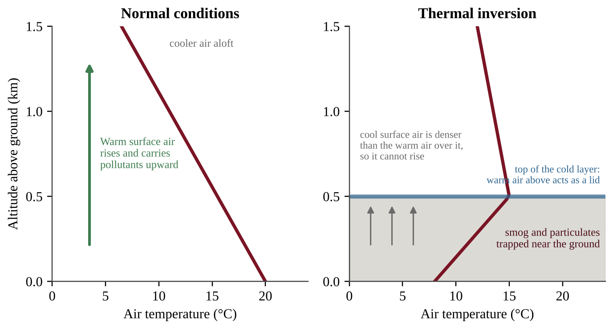
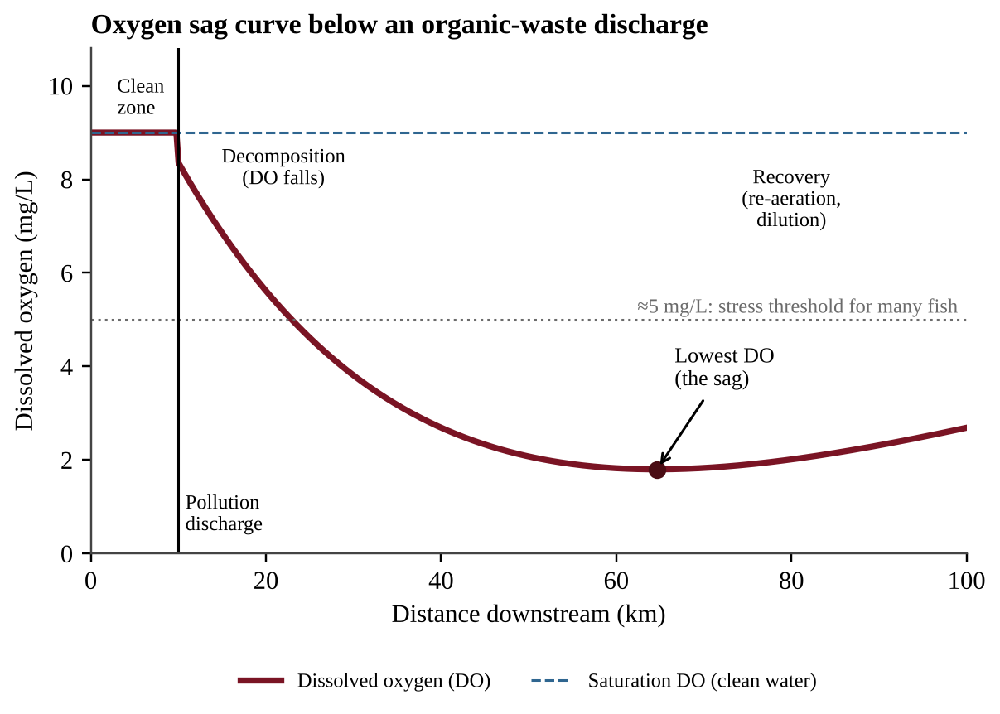
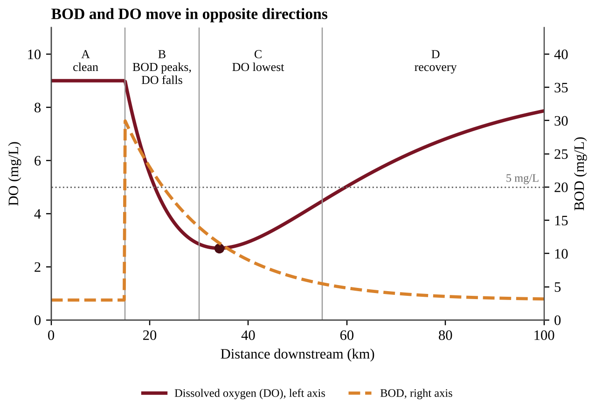
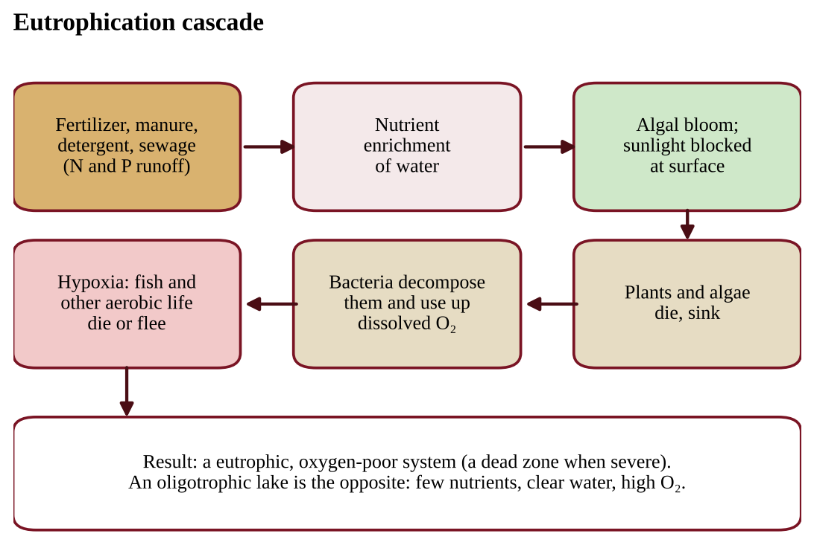
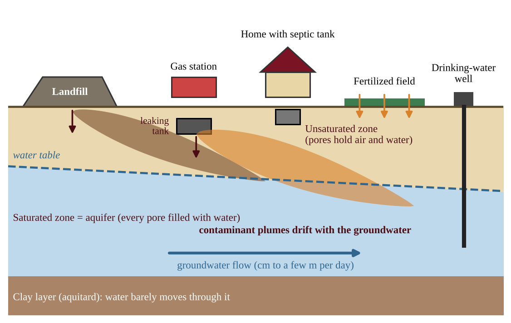
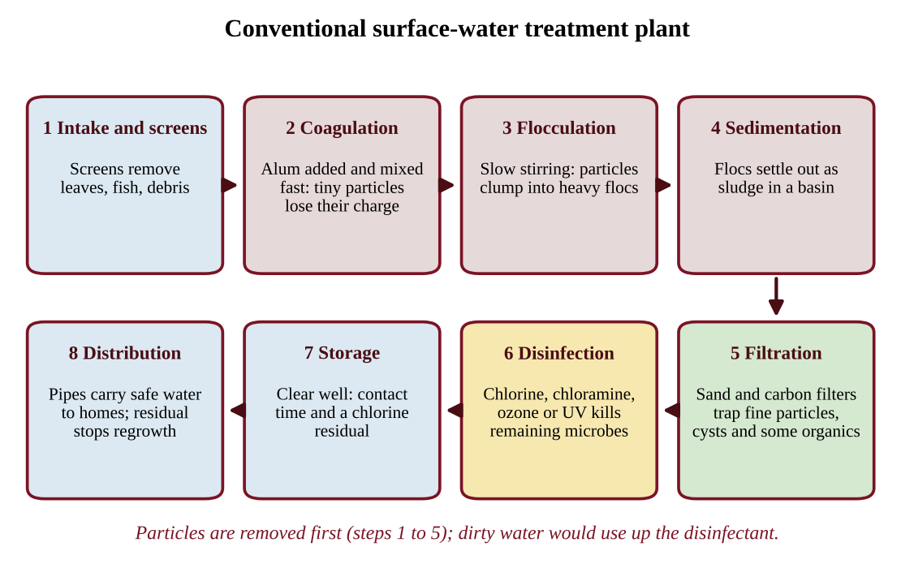
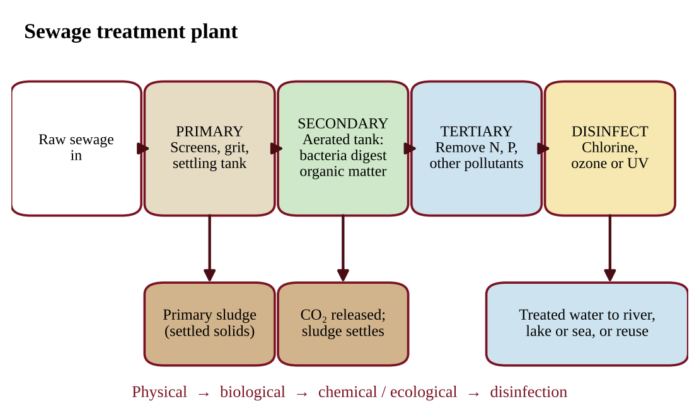
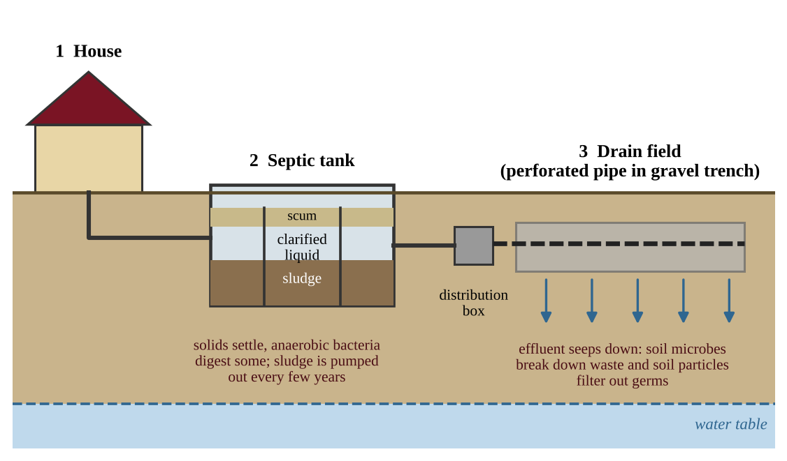
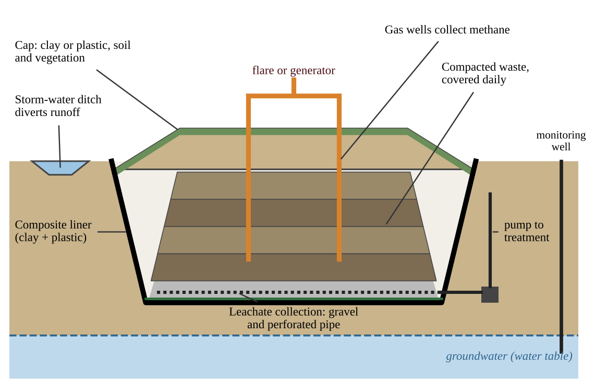

# Chapter 9 — Pollution

:::box objectives
- Classify air pollutants as primary or secondary and link each to its sources, effects and control.
- Explain how photochemical smog, thermal inversions and acid deposition form and why some places suffer more.
- Distinguish point from nonpoint sources, and explain oxygen sag, eutrophication, thermal pollution and the services of wetlands.
- Explain why groundwater pollution is slow to appear and slow to clean, and how water is tested and purified.
- Describe sewage treatment, septic systems and the design of landfills, and compare waste-reduction methods.
- Carry out the calculations of the unit: pH and decibel factors, percent change and removal, loads, emissions, BOD, per-capita waste and landfill life.
:::

## 9.1 Air Pollution
%% CED: 7.1, 7.3, 7.6 | STB-2.A.1, STB-2.A.2, STB-2.A.3, STB-2.A.4, STB-2.A.5, STB-2.C.1, STB-2.C.2, STB-2.G.1, STB-2.G.2, STB-2.G.3, STB-2.G.4, STB-2.G.5 | LO: STB-2.A, STB-2.C, STB-2.G

:::box simple
The air is mostly nitrogen and oxygen. **Air pollution** is anything added in amounts large enough to harm living things or materials. Most of it comes from one habit: burning things. Fuel burns, and the carbon, sulfur and metals in it, plus the nitrogen in the air itself, leave as gases and tiny specks through the chimney or tailpipe.
:::

### Why burning makes pollution

A perfect fuel burned with plenty of oxygen would give only CO₂ and water (CH₄ + 2O₂ → CO₂ + 2H₂O). Real burning is not perfect.

- **Impurities in the fuel.** Coal and oil carry sulfur and metals. Sulfur leaves as **SO₂**; **coal combustion** releases CO₂, SO₂, toxic metals and particulates together. Diesel and other high-sulfur fuels release more SO₂ than low-sulfur fuels.
- **Hot flames.** In engines and furnaces, nitrogen from the air combines with oxygen to form **NOₓ** (NO and NO₂).
- **Incomplete burning.** Too little oxygen or too low a temperature leaves **carbon monoxide (CO)**, a colorless, odorless asphyxiant that blocks oxygen delivery by the blood, plus unburned hydrocarbons (VOCs) and soot (particulate matter).

The table in Section 9.2 lists every major pollutant with its sources, effects and control.

### Primary and secondary pollutants

:::box define
**Primary pollutant** — a pollutant released straight into the air from its source (CO, SO₂, soot, lead).
**Secondary pollutant** — a pollutant that forms in the air when primary pollutants react, often with sunlight or water (ozone, PAN, nitric acid, sulfuric acid, fine sulfate and nitrate particles).
**Precursor** — a chemical that reacts to form a secondary pollutant (NOₓ and VOCs are precursors of ozone).
:::

A quick test: can you point to the pipe it came out of? If so it is probably primary. NO from an engine is primary; the O₃ it helps create is secondary.

### Regulation works: lead and the Clean Air Act

Lead was once added to gasoline to stop engine knock, and cars spread it through every city. Under the **Clean Air Act (CAA)** the EPA ordered lead removed from fuel, and atmospheric lead and children's blood-lead levels fell dramatically. The lesson: **regulating a pollutant at its source works.**

The CAA lets the EPA set health-based limits for six common "criteria" pollutants and regulate power plants, factories and vehicles. Its 1990 amendments capped total SO₂ emissions from power plants to fight acid rain. CO₂ is not a criteria pollutant.

Trend graphs often use an **index**: the starting year is set to 100 and each later value is a percentage of it. An index of 40 means 40% of the starting level, a 60% decrease. Falling lines *support* the effectiveness of a law but do not prove it, because other changes (cleaner engines, fuel switching) happened too. A pollutant the law does not target, such as atmospheric CO₂, can keep rising.

:::box example
id: SG-U7-E010
An index graph (1990 = 100) shows these values for 2020: SO₂ emissions 35, NOₓ emissions 52, lead emissions 6, atmospheric CO₂ concentration 118.
(a) Calculate the percent decrease in SO₂ emissions.
(b) Identify the pollutant that fell the most and the one that rose.
(c) Explain why the graph alone does not prove regulation caused the SO₂ decline.
:::

:::box example
id: SG-U7-E001
Five air pollutants are listed: (1) carbon monoxide from a car exhaust pipe, (2) ground-level ozone measured on a hot afternoon, (3) sulfur dioxide from a coal plant stack, (4) nitric acid dissolved in rainwater, (5) soot from a diesel truck.
(a) Classify each as a primary or a secondary pollutant.
(b) For the two you classified as secondary, name one primary pollutant that is a precursor to each.
(c) Identify which of the five is an asphyxiant and explain, in one sentence, how it harms the body.
:::

### Thermal inversion

:::box simple
Normally the ground warms the air above it, and warm air rises like a chimney, carrying pollution away. In an **inversion** the layers are upside down: cool air sits under a layer of warm air. The warm layer is a lid, and pollution stays trapped where we live.
:::

Normally, temperature falls with height through the troposphere, so warm, light surface air rises, mixes and dilutes pollutants. In a **thermal (temperature) inversion** the normal gradient is altered: the air at the surface is **cooler** than the air higher up. The cool surface air is denser than the warm air over it, so it will not rise. Vertical mixing stops and pollutants, especially **smog and particulates**, are trapped near the ground.

{w=0.85}

How to read Figure 9.1: temperature is on the x-axis, altitude on the y-axis. A line sloping to the upper left (cooler with height) is normal. A stretch bending to the right (warmer with height) is the inversion layer. Pollutants are trapped in the cold air *below* the top of that layer; where the line again falls with height, normal mixing resumes.

:::box process
Clear, calm night → ground loses heat and chills the air near it (or cold air drains into a valley) → cool dense air under warmer air → no vertical mixing → pollutants trapped → smog and particulates build up → health problems
:::

**What favors an inversion:** long, clear, calm nights (clouds act as a blanket and prevent it); cold winter ground or snow; valleys and basins ringed by mountains, where cold air pools and slopes block the wind. Inversions usually break up when the sun heats the ground, but a strong one can last for days. Winter inversions raise **particulates** (heating smoke plus trapped air); **ozone** is mainly a summer problem.

:::box define
**Thermal inversion** — a layer of warm air above cooler air near the ground, reversing the normal drop in temperature with height and trapping pollutants.
**Temperature gradient** — the change in air temperature with altitude.
:::

:::box strategy
Given a graph of temperature versus altitude, find the altitude range where the line moves toward warmer temperatures as altitude increases. That layer is the inversion, and pollutants are trapped below its top.
:::

:::box example
id: SG-U7-E003
A weather balloon measured the air temperature above a valley town on two mornings.

| Altitude above ground (m) | Day X temperature (°C) | Day Y temperature (°C) |
|---|---|---|
| 0 | 14 | 6 |
| 250 | 12 | 9 |
| 500 | 10 | 12 |
| 750 | 8 | 11 |

(a) Identify which day had a thermal inversion and state the altitude range in which it occurred.
(b) Calculate the temperature change from 0 m to 500 m on Day Y.
(c) The town measured fine particulate matter of 15 µg/m³ on one of the days and 55 µg/m³ on the other. Predict which day had which value and explain.
:::

### Reducing air pollution

:::box simple
Three ways to attack air pollution: **use less** of the dirty thing (conservation), **switch** to something cleaner (alternative fuels), or **capture** what is made before it escapes (control devices). Laws make people actually do it.
:::

Methods to reduce air pollutants include **regulatory practices** (the CAA, emission and fuel standards, permits), **conservation** (driving less, transit, efficient buildings), **alternative fuels** (natural gas instead of coal, renewable electricity, electric vehicles, low-sulfur fuels) and **control devices**.

:::box define
**Vapor recovery nozzle** — a device on a gasoline pump that stops fuel vapors (VOCs) escaping while a vehicle is refueled.
**Catalytic converter** — a device in a vehicle's exhaust that uses metal catalysts (platinum, palladium, rhodium) to convert CO, NOₓ and hydrocarbons into less harmful CO₂, N₂, O₂ and H₂O.
**Wet scrubber** — sprays water, or a water and limestone mixture, through exhaust to dissolve gases such as SO₂ and trap particles.
**Dry scrubber** — injects a dry powder (such as lime) that reacts with acidic gases and is then filtered out.
**Electrostatic precipitator** — charges particles so they stick to oppositely charged plates, which are shaken to collect the ash.
:::

:::box process
Catalytic converter: CO + O₂ → CO₂; NO → N₂ + O₂; hydrocarbons + O₂ → CO₂ + H₂O. Wet scrubber: SO₂ in flue gas + water–limestone spray → calcium sulfite/sulfate sludge, cleaner gas out the stack. Precipitator: charged particles → attracted to plates → collected as ash.
:::

**Which device for which job?** A catalytic converter treats the *gases* in vehicle exhaust, not particulates. Scrubbers remove SO₂ (and some other gases and particulates) from power-plant exhaust. An electrostatic precipitator removes *particulates only*. Coal plants often use scrubbers and precipitators together. Vapor recovery nozzles stop VOC evaporation at the pump.

**Trade-offs.** Devices create waste (scrubber sludge, ash), use energy and cost money, and a catalytic converter does nothing about CO₂. Using less fuel is usually cheaper and cleaner than capturing pollutants afterward. Fuel switching has costs too: low-sulfur coal is dearer, natural gas still emits CO₂, wind and solar are intermittent.

### Calculations with emissions

:::box formula
**Sulfur to SO₂:** S + O₂ → SO₂; atomic mass S = 32, SO₂ = 64, so 1 t of S gives 2 t of SO₂.
mass of S = mass of fuel × (% sulfur ÷ 100)
uncontrolled SO₂ = mass of S × (64 ÷ 32)
SO₂ removed = uncontrolled SO₂ × (% removal ÷ 100); SO₂ emitted = uncontrolled − removed
**Cost per metric ton removed** = annual cost ($/yr) ÷ SO₂ removed (t/yr)
**Inventory** = number of sources × activity each (miles/yr) × emission factor (g/mile)
**Per capita** = total emissions ÷ population (1 metric ton = 1000 kg)
:::

For an inventory, write units as fractions so unwanted units cancel (dimensional analysis), using conversion fractions equal to 1, such as 1 t ÷ 10⁶ g. Compare options by cost per ton *removed*: a smaller bill can still cost more per ton if it removes much less.

:::box example
id: SG-U7-E012
A city runs 400 diesel buses. Each travels 30,000 miles per year and emits 0.35 g of particulates per mile. A filter on every bus cuts particulates by 80% and costs $9,000 per bus, spread over 10 years.
(a) Calculate the fleet's yearly particulate emissions in kilograms.
(b) Calculate the kilograms removed per year.
(c) Calculate the yearly cost per kilogram removed.
:::

:::box example
id: SG-U7-E013
A power plant burns 5.0 × 10⁵ metric tons of oil per year. The oil is 0.8% sulfur by mass and all of the sulfur becomes SO₂. A dry scrubber removes 85% of the SO₂ and costs $15 million per year.
(a) Calculate the mass of sulfur burned each year.
(b) Calculate the SO₂ the plant would release with no scrubber.
(c) Calculate the SO₂ emitted with the scrubber.
(d) Calculate the scrubber's cost per metric ton of SO₂ removed.
:::

:::box example
id: SG-U7-E006
A region has two coal-burning power plants and a population of 400,000. Plant A emits 180,000 metric tons of SO₂ per year; Plant B emits 70,000 metric tons per year. Plant A installs wet scrubbers that remove 90% of its SO₂. Plant B makes no change.
(a) Calculate the region's total SO₂ emissions after the installation.
(b) Calculate the percent decrease in the region's total SO₂ emissions.
(c) Calculate the region's SO₂ emissions per person after the installation, in kilograms per person per year.
(d) Identify one by-product of operating a wet scrubber and one pollutant the scrubber does not reduce.
:::

:::box mistake
- Calling ozone "bad" everywhere. In the stratosphere it blocks UV light; at ground level it is a pollutant.
- Thinking "secondary" means less harmful. Ozone and acids are often worse than the pollutants that made them.
- Saying a precipitator removes SO₂ (particulates only), or that a catalytic converter removes CO₂ (it *makes* CO₂ from CO).
- Calling taller smokestacks a fix. They carry pollution farther downwind; the amount emitted is unchanged.
:::

:::box summary
- Burning fuel gives CO₂, CO, SO₂, NOₓ, VOCs, particulates, toxic metals and (historically) lead; primary pollutants are emitted directly, secondary ones form in the air.
- Regulating lead at its source (Clean Air Act) cut atmospheric lead sharply.
- A thermal inversion puts cool air under warm air and traps smog and particulates near the ground.
- Reduce pollution by regulation, conservation and alternative fuels, and with vapor recovery nozzles, catalytic converters, scrubbers and precipitators.
:::

## 9.2 Major Air Pollutants
%% CED: 7.1, 7.2, 7.4, 7.5, 7.6 | STB-2.A.1, STB-2.A.2, STB-2.A.3, STB-2.B.1, STB-2.B.2, STB-2.B.3, STB-2.B.4, STB-2.B.5, STB-2.B.6, STB-2.B.7, STB-2.D.1, STB-2.D.2, STB-2.E.1, STB-2.E.2, STB-2.E.3, STB-2.E.4, STB-2.E.5, STB-2.E.6, STB-2.E.7, STB-2.F.1, STB-2.F.2, STB-2.G.1, STB-2.G.3, STB-2.G.5 | LO: STB-2.A, STB-2.B, STB-2.D, STB-2.E, STB-2.F, STB-2.G

### The pollutants and the six criteria pollutants

In the United States the EPA tracks six **criteria pollutants** under the Clean Air Act: carbon monoxide, lead, nitrogen dioxide, ground-level ozone, particulate matter and sulfur dioxide (marked * below).

| Pollutant | Main sources | Main effects | Main control |
|---|---|---|---|
| Carbon dioxide (CO₂) | Burning any carbon fuel; respiration; decomposition | Traps heat (Chapter 11); not toxic at outdoor levels | Efficiency, renewables |
| Carbon monoxide (CO)* | Incomplete combustion: vehicles, furnaces, stoves, wildfires | Binds to hemoglobin, blocking oxygen; headache, death | Catalytic converters, tuned appliances |
| Sulfur dioxide (SO₂)* | Coal plants, diesel, smelters, volcanoes | Lung irritation; acid rain; sulfate particles | Scrubbers, low-sulfur fuel |
| Nitrogen oxides (NOₓ)* | Vehicle engines, power plants | Lung irritation; ozone and smog; nitric acid | Catalytic converters, fewer vehicle miles |
| Particulate matter (PM)* | Coal and diesel combustion, dust, construction, wildfires | Lung and heart disease; haze | Electrostatic precipitators, filters |
| Hydrocarbons / VOCs | Unburned fuel, fuel vapor, solvents, trees | Smog ingredient; some toxic | Vapor recovery nozzles, low-VOC products |
| Lead (Pb)* | Leaded gasoline (historic), old paint, smelters | Nervous-system damage, especially in children | Fuel regulation, paint removal |
| Toxic metals (e.g., mercury) | Coal combustion, waste incineration | Nerve damage; methylmercury in food webs | Scrubbers, less coal |
| Ground-level ozone (O₃)* | Secondary: NOₓ + VOCs + sunlight | Lung damage, asthma, plant damage | Cut NOₓ and VOCs |

:::box formula
**Concentrations of gases:** 1 ppm = 1 part per million (1 in 10⁶); 1 ppb = 1 part per billion (1 in 10⁹); so 1 ppm = 1000 ppb. Multiply ppm by 1000 to get ppb; divide ppb by 1000 to get ppm. Particulates are reported as µg/m³.
**Percent above a limit** = (measured − limit) ÷ limit × 100
:::

:::box example
id: SG-C9-E001
A city's 8-hour average ozone reading is 0.082 ppm. A health-based limit for ozone is 70 ppb.
(a) Convert the reading to ppb.
(b) Calculate the percent by which the reading exceeds the limit. Round to the nearest whole percent.
(c) Name the two groups of primary pollutants that are the precursors of ozone and state whether ozone is a primary or a secondary pollutant.
:::

### Photochemical smog

:::box simple
Smog is a **recipe**. Ingredients: nitrogen oxides from engines and VOCs from fuel vapor and plants. Cooking conditions: strong sunlight and warm air. Product: ground-level ozone and a brown, stinging haze. No sun, no smog; few engines, little smog.
:::

**Photochemical smog** forms when nitrogen oxides and volatile organic compounds react with heat and sunlight to produce a variety of pollutants. The chemistry you need:

1. Vehicles and power plants emit **NO**, which converts in air to **NO₂**.
2. Sunlight splits NO₂ into NO and a free oxygen atom (O).
3. The oxygen atom joins O₂ to make **ozone (O₃)**.
4. In clean air, ozone would quickly react back with NO. VOCs convert NO back to NO₂ *without* using up ozone, so the cycle repeats and **ozone builds up**.
5. VOCs and NOₓ also form other irritants (PAN, aldehydes, fine particles) that give smog its brownish haze.

:::box define
**Photochemical smog** — secondary pollutants (mainly ozone) formed when sunlight and heat drive reactions between nitrogen oxides and VOCs.
**Volatile organic compound (VOC)** — a carbon-based chemical that evaporates or sublimates at room temperature, such as gasoline vapor and formaldehyde. Trees give off natural VOCs.
**Tropospheric (ground-level) ozone** — O₃ in the air we breathe, a harmful secondary pollutant, unlike the protective stratospheric ozone layer.
:::

**Reading the daily pattern.** In panel B, NOₓ is produced early, in the morning commute. Ozone lags and peaks in the **afternoon**, when sunlight and heat have had hours to drive the reactions, then falls after sunset because the reactions need light. Ozone is also higher in **summer**: stronger sunlight, longer days and warmer air that speeds reactions and makes fuels and plants release more VOCs. Exercise in the morning on bad-ozone days.

**Telling NO, NO₂ and ozone apart.** NO comes straight from engines, peaks first, then falls as it turns into **NO₂**, a reddish-brown gas that peaks a little later. **Ozone** peaks last. Place matters too: fresh NO reacts with ozone and removes it, so beside a busy highway NO is high and O₃ low. Downwind, the NO is used up while sunlight keeps driving the reactions, so ozone is highest in suburbs and rural areas **downwind** of the city. Low ozone at a busy road does not mean clean air.

**Factors:** many vehicles (so mainly urban), strong sunlight and heat, basins ringed by mountains, windless weather and inversions. **Effects and reduction.** Smog causes **respiratory problems** (coughing, asthma, reduced lung function) and **eye irritation**; ozone also injures crop and forest leaves and cracks rubber. Since the precursors are NOₓ and VOCs, smog is reduced by **cutting NOₓ and VOCs**: catalytic converters, vapor recovery nozzles, low-VOC paints, public transit, electric vehicles and limits on driving on high-ozone days.

:::box mistake
- Saying NOₓ and ozone peak at the same time. NOₓ peaks with the morning rush; ozone peaks later.
- Describing smog as "smoke plus fog". It is a chemical product of sunlight and pollutants.
:::

:::box example
id: SG-U7-E002
A monitoring station in a city recorded these hourly averages on a hot, sunny summer day.

| Time | NO₂ (ppb) | Ozone (ppb) |
|---|---|---|
| 6:00 | 18 | 12 |
| 8:00 | 40 | 20 |
| 10:00 | 25 | 45 |
| 12:00 | 15 | 70 |
| 14:00 | 12 | 95 |
| 16:00 | 14 | 88 |
| 18:00 | 30 | 60 |
| 20:00 | 20 | 35 |

(a) Identify the time of the NO₂ peak and the time of the ozone peak.
(b) Calculate how many hours separate the two peaks.
(c) Explain, using the chemistry of smog, why the ozone peak comes later than the NO₂ peak.
(d) Predict how the ozone curve would change on a cool, cloudy day with the same traffic, and justify your prediction.
:::

### Natural sources of CO₂ and particulates

Not all air pollution is man-made; it becomes a problem when people add so much that the balance changes.

**Natural CO₂** comes from **respiration** (every plant, animal, fungus and microbe), **decomposition** of dead organisms, and **volcanic eruptions** (which also vent SO₂ and ash). These flows are balanced by photosynthesis and ocean uptake (the carbon cycle, Chapter 5). Burning fossil fuels adds extra CO₂ on top, so atmospheric CO₂ has risen steadily since the Industrial Revolution (Chapter 11).

**Particulate matter (PM)** is tiny solid and liquid particles suspended in air. **PM10** is 10 µm or smaller; **PM2.5** is 2.5 µm or smaller. The smaller the particle, the deeper it penetrates the lungs; PM2.5 can reach the bloodstream. Natural sources include volcanic ash, wildfire smoke, dust storms and wind-blown soil, sea-spray salt, pollen and mold spores, and sulfate and organic particles formed from natural gases.

### Designing and judging an air-quality investigation

- **Hypothesis:** an if–then statement that names the direction (*If new carpet releases VOCs, then the renovated wing will have more formaldehyde*).
- **Variables:** the *independent variable* is what you compare or change (location, distance, time); the *dependent variable* is what you measure, with a unit (µg/m³). **Controlled variables** stay the same: instrument, height, hours, ventilation.
- **Control or background site:** an upwind, outdoor or unaffected-room sensor measures what is there anyway. Source contribution ≈ downwind reading − background reading.
- **Replication:** many sites, days or samples.
- **Confounding variable:** something else that changes with the independent variable (wind direction when comparing distances from a plant). Measure it or hold it constant.
- **Correlation is not proof of cause.** Say data are *consistent with* a cause, give the mechanism, and name a factor not ruled out. To judge a policy, compare before and after in the same season and note other causes.

:::box example
id: SG-U7-E011
A town suspects that a new gravel quarry raises PM10 in a neighborhood 1 km to its east; the wind usually blows from the west.
(a) State a testable hypothesis with direction.
(b) Identify the independent and dependent variables and two controlled variables.
(c) Describe where and when to place monitors and what an upwind site is for.
(d) Higher PM10 is found at the east site. Explain why this alone does not prove the quarry is the cause.
:::

:::box example
id: SG-U7-E004
A valley town recorded PM2.5 (µg/m³) on six winter days. Days 3, 4 and 6 had a thermal inversion; Days 1, 2 and 5 did not.

| Day | 1 | 2 | 3 | 4 | 5 | 6 |
|---|---|---|---|---|---|---|
| PM2.5 | 14 | 11 | 46 | 58 | 17 | 52 |

(a) Describe the relationship between inversion and PM2.5 shown by the data.
(b) Calculate the mean PM2.5 for the inversion days and for the non-inversion days.
(c) Calculate the percent by which the inversion-day mean exceeds the non-inversion mean. Round to the nearest whole percent.
(d) Propose one action the town could take to lower winter PM2.5 and justify it.
:::

### Indoor air pollutants

Indoor air can be more polluted than outdoor air because there is less dilution.

| Source type | Examples |
|---|---|
| Natural | Radon, mold, dust |
| Human-made (building materials, furnishings) | Insulation; VOCs from furniture, paneling, carpets; formaldehyde from building materials and upholstery; lead from paint; asbestos |
| Combustion | Carbon monoxide, nitrogen oxides, sulfur dioxide, particulates, tobacco smoke |

:::box define
**Asphyxiant** — a gas that starves the body of oxygen. **Carbon monoxide** is an odorless, colorless asphyxiant that binds to hemoglobin far more strongly than oxygen does.
**Indoor particulates** — asbestos, dust and smoke.
**Formaldehyde** — a VOC released from building materials, furniture, upholstery and carpets; an eye and lung irritant and a carcinogen.
**Radon-222** — a naturally occurring radioactive gas produced by the decay of uranium in some rocks and soils.
:::

- **Carbon monoxide** comes from faulty furnaces, gas stoves and heaters, wood stoves and idling cars in garages. High levels cause headaches, dizziness and death. Humans cannot sense it, so a CO detector is the safeguard.
- **Asbestos** fibers from old insulation, tiles and roofing are dangerous when disturbed and inhaled: lung scarring, lung cancer and mesothelioma.
- **VOCs and formaldehyde** off-gas from new carpet, paneling, glues, paints and cleaners and cause irritation and headaches.
- **Lead** from old paint chips and dust harms the nervous system, especially in young children.
- **Mold** (damp places) triggers allergies and asthma. **Combustion products** irritate lungs; cooking over open indoor fires is a leading cause of smoke illness in many developing regions.

**Radon** is the unusual one. Uranium in some rocks and soils decays through radium to **radon-222**, a gas that moves up through soil. It enters homes through cracks in foundations and walls and gaps around pipes, and it is also **dissolved in well water**. It cannot be seen or smelled. Once inhaled, radon and its decay products emit radiation inside the lungs. Radon-induced lung cancer is the **second leading cause of lung cancer in the United States**, after smoking. Homeowners can test with a kit; the EPA recommends action at 4 pCi/L (picocuries per liter) or more.

:::box process
Uranium in rock and soil → radon-222 gas → rises through soil → enters basement through cracks (or in well water) → builds up in a closed house → inhaled → radiation damages lung tissue → higher lung-cancer risk
:::

**Cutting exposure:** remove the source first, then ventilate outdoors, then detect or filter (CO detectors, radon test and sub-slab fan, licensed asbestos removal, humidity control, low-VOC products, intact lead paint, vented stoves). Children are at greater risk: they breathe more air per kilogram, their lungs and nervous systems are still developing, and they put hands in their mouths.

:::box mistake
- Saying radon is a factory chemical. It is natural and radioactive.
- Thinking a tightly sealed new home is automatically safe. Poor ventilation traps indoor pollutants.
- Classing carbon monoxide as a particulate. It is a gas and an asphyxiant.
- Masking a pollutant (air fresheners, incense) instead of removing the source or venting it outdoors.
:::

:::box example
id: SG-U7-E005
A health department tested the basements of five homes for radon. The EPA action level is 4.0 pCi/L.

| Home | 1 | 2 | 3 | 4 | 5 |
|---|---|---|---|---|---|
| Radon (pCi/L) | 2.1 | 5.6 | 3.9 | 8.4 | 3.0 |

(a) Identify which homes exceed the action level and calculate the percentage of tested homes that do.
(b) Calculate the mean radon level for the five homes.
(c) Explain how radon gas enters a house from the ground.
(d) Propose one way to reduce radon in Home 4 and justify why it works.
:::

:::box summary
- Know the six criteria pollutants, the table of sources and effects, and which control matches which pollutant.
- Smog: NOₓ + VOCs + sunlight and heat → ozone; NOₓ peaks in the morning, ozone in the afternoon and in summer; cut NOₓ and VOCs.
- Natural CO₂ sources: respiration, decomposition, volcanoes; natural particulates: ash, smoke, dust, sea spray, pollen, spores. PM2.5 is the most dangerous to health.
- Indoor pollutants are natural, human-made or from combustion; CO is an asphyxiant; radon-222 is the second leading cause of lung cancer in the U.S.
:::

## 9.3 Acid Deposition
%% CED: 7.7 | STB-2.H.1, STB-2.H.2, STB-2.I.1, STB-2.I.2, STB-2.I.3 | LO: STB-2.H, STB-2.I

:::box simple
Burning coal and fuels releases SO₂ and NOₓ. In the air these turn into **sulfuric and nitric acid**, which fall in rain, snow, fog or dry particles, often hundreds of kilometers from the source. The land and water that receive them become more acidic.
:::

**Acid deposition** includes **wet deposition** (acid rain, snow, fog) and **dry deposition** (acidic gases and particles settling out). It starts with two gases from anthropogenic and natural sources:

- **Sulfur oxides.** SO₂ from coal-burning power plants (and volcanoes) reacts with oxygen and water to form sulfuric acid (H₂SO₄).
- **Nitrogen oxides.** NOₓ from motor vehicles and coal-burning power plants (and lightning) forms nitric acid (HNO₃).

{w=0.8}

### The pH scale

:::box formula
pH = −log₁₀[H⁺], where [H⁺] is the hydrogen ion concentration in moles per liter. The scale runs 0 to 14: below 7 acidic, 7 neutral, above 7 basic.
**Each whole pH unit is a factor of 10 in H⁺.** factor = 10^(difference in pH): 1 unit = 10×, 2 units = 100×, 3 units = 1000×. Lower pH means more acidic.
:::

Clean rain is already slightly acidic, about **pH 5.6**, because CO₂ dissolves in it to form weak carbonic acid. Rain is **acid rain** below about 5.6; typical acid rain is pH 4.2–4.4. Differences need not be whole numbers: pH 4.3 versus 5.6 is 1.3 units, so 10^1.3 ≈ 20 times the H⁺ (use the 10ˣ key; never say "1.3 times"). From a concentration, [H⁺] = 1 × 10⁻⁵ mol/L is pH 5.

{w=0.85}

### Effects

1. **Soils.** Acid leaches calcium and magnesium away and frees toxic aluminum, harming roots and weakening forests, especially at high elevations bathed in acid fog.
2. **Lakes and streams.** Falling pH harms fish eggs, amphibians and invertebrates; many fish decline below about pH 5, and released aluminum is toxic to fish.
3. **Structures.** Acid dissolves limestone and marble and corrodes metals in buildings, statues and bridges.
4. **Human health.** The acids form fine particles that reach the lungs.

### Why some places are hit harder

Acid deposition mainly affects communities **downwind** of coal-burning power plants; in North America, winds carry Midwest emissions to the Northeast and eastern Canada. **Bedrock and soil matter.** Limestone (calcium carbonate) and carbonate-rich soils **buffer** acid: they neutralize it and keep lake pH near neutral. Lakes on granite and thin, sandy soils have little neutralizing capacity and acidify quickly.

:::box define
**Acid deposition** — acids and acid-forming pollutants falling from the air as wet or dry deposition.
**Buffering capacity** — the ability of water or soil to neutralize acids and resist a drop in pH; limestone supplies it.
**Downwind** — in the direction the wind blows, away from the source.
:::

:::box process
Burning coal and fuels → SO₂ and NOₓ → oxidized in air and dissolved in water → H₂SO₄ and HNO₃ → carried downwind → wet and dry deposition → soil and lake pH falls → nutrient loss, aluminum release, fish and tree damage, stone corrosion
:::

**Solutions** cut the gases at the source: scrubbers, low-sulfur fuels, natural gas and renewables, catalytic converters, and cap-and-trade (the CAA's SO₂ cap). Adding crushed limestone ("liming") to a lake treats the symptom, not the cause. Recovery lags behind emission cuts because soils have lost much of their calcium and magnesium.

:::box mistake
- Saying pH 4 is "twice as acidic" as pH 5. It is ten times.
- Calling pure rain "pH 7". Clean rain is about 5.6.
- Assuming acid rain only falls near the source, or forgetting dry deposition and natural sources.
- Writing that taller smokestacks solve acid rain. They only carry the acid farther.
:::

:::box example
id: SG-U7-E007
Three rain samples were collected: Sample A has pH 5.6, Sample B has pH 4.6, and Sample C has pH 3.6.
(a) Rank the samples from most acidic to least acidic.
(b) Calculate how many times greater the hydrogen ion concentration of Sample C is than that of Sample A.
(c) Identify the two gaseous pollutants most responsible for rain with a pH below 5.6 and name one human source of each.
(d) Explain why clean, unpolluted rain has a pH below 7.
:::

:::box example
id: SG-U7-E014
Rain over a downwind forest has a pH of 4.2; rain over a remote ocean has a pH of 5.6. A lake sample has an H⁺ concentration of 1 × 10⁻⁶ mol/L.
(a) Calculate how many times greater the H⁺ concentration of the forest rain is than that of the ocean rain.
(b) Calculate the pH of the lake sample and state whether it is acidic.
(c) A lake has pH 6.3. Calculate how many times lower its H⁺ concentration is than the forest rain's.
:::

:::box example
id: SG-U7-E008
Two lakes receive acid rain of the same pH from the same distant power plants. Lake P lies on granite bedrock with thin soil; its pH fell from 6.0 to 5.0 over 30 years. Lake Q lies on limestone bedrock and its pH stayed at 7.1.
(a) Calculate the factor by which the hydrogen ion concentration of Lake P increased.
(b) Explain why Lake Q's pH did not fall.
(c) Predict which lake has the greater risk of fish loss and justify.
(d) Propose one action at the source and one local action that would help Lake P, and state which treats the cause.
:::

:::box summary
- Acid deposition comes from SO₂ (coal plants, volcanoes) and NOₓ (vehicles, coal plants) converting to H₂SO₄ and HNO₃.
- Each pH unit is a tenfold change in H⁺; clean rain is about 5.6.
- Effects: acidified soils and lakes, aluminum release, forest decline, corrosion. Downwind areas are hit most; limestone buffers, granite does not.
:::

## 9.4 Thermal Pollution
%% CED: 8.6 | STB-3.G.1, STB-3.G.2 | LO: STB-3.G

Warm water holds less oxygen, as a warm soda goes flat. **Thermal pollution** occurs when heat released into water produces negative effects on the organisms in that ecosystem. The usual source is **cooling water**: power plants and factories take in river water, use it to carry off waste heat and return it warmer. Heat also enters streams when clear-cutting removes streamside shade and when runoff crosses hot pavement.

**Why warm water is a problem.** Warm water does not contain as much dissolved oxygen as cold water. And the metabolic rates of cold-blooded aquatic animals rise with temperature, so they need more oxygen just when less is available. Cold-water species such as trout have narrow tolerance ranges and die or leave; sudden temperature changes can also shock fish.

| Water temperature (°C) | 5 | 10 | 20 | 30 |
|---|---|---|---|---|
| Maximum DO at saturation (mg/L, fresh water, sea level) | 12.8 | 11.3 | 9.1 | 7.5 |

Remedies: cooling towers, recycling cooling water, reusing waste heat, and shade trees along streams.

:::box define
**Thermal pollution** — heat added to water by human activities that harms organisms.
:::

:::box example
id: SG-U8-E004
A power plant takes in river water at 10°C and discharges it at 30°C. Use the saturation table above. (a) Calculate the percent decrease in the maximum DO the water can hold when it warms from 10°C to 30°C. (b) State two reasons, other than the lower oxygen capacity, that the warmed discharge could harm cold-water fish. (c) Propose one engineering and one landscape solution that would reduce the thermal impact.
:::

:::box summary
- Thermal pollution is heat added to water, mainly power-plant cooling water.
- Warm water holds less oxygen and speeds up metabolism, so stress and fish kills occur.
- Cooling towers, shade and heat reuse reduce the problem.
:::

## 9.5 Noise Pollution
%% CED: 7.8 | STB-2.J.1, STB-2.J.2, STB-2.J.3 | LO: STB-2.J

In cities the main sources are **transportation** (road traffic, trains, aircraft), **construction**, and **domestic and industrial activity** (machinery, power tools, lawn equipment, loud music).

Loudness is measured in **decibels (dB)** on a logarithmic scale, like pH. **Every 10 dB is ten times the sound intensity**: 20 dB is 100 times, 30 dB is 1000 times.

| Sound | Approx. level (dB) |
|---|---|
| Whisper | 30 |
| Normal conversation | 60 |
| Busy city traffic | 80 |
| Chain saw | 110 |
| Jet taking off nearby | 130 |

Hearing damage depends on both level and time: long exposure to about 85 dB or more can cause permanent hearing loss, and very loud sounds damage hearing in minutes.

:::box formula
Intensity ratio = 10^(Δ dB ÷ 10), where Δ dB is the difference between two sound levels.
A 30 dB difference = 10³ = 1000 times; a 25 dB difference = 10^2.5 ≈ 320 times.
:::

**Effects on people:** physiological stress (higher heart rate and blood pressure, disturbed sleep), hearing loss, and trouble concentrating and learning.

**Effects on animals:** stress hormones rise; **masking** of sounds used to communicate or hunt (birds sing louder or higher near roads; ship noise interferes with whale and dolphin calls and sonar); **damaged hearing** from blasts and sonar; and **changed migration routes** as animals avoid noisy zones.

**Reducing noise** at the source works best: quieter engines and mufflers, sound barriers, buffer zones, speed limits, quiet pavement, restricting night flights and ship speeds, and ear protection for workers.

:::box define
**Decibel (dB)** — unit of sound level; every 10 dB is a tenfold change in intensity.
**Masking** — noise covering up sounds animals use to communicate, find prey or detect predators.
:::

:::box example
id: SG-U7-E009
A factory floor measures 95 dB with all machines running. Workers wearing no hearing protection spend 8 hours a day there. A quiet office elsewhere in the building measures 55 dB. Near the factory, a wetland supports a population of frogs that call at night to attract mates.
(a) Calculate how many times greater the sound intensity is on the factory floor than in the quiet office.
(b) Explain why a worker is at risk of hearing loss at 95 dB.
(c) Describe how noise from the factory could reduce frog breeding success.
(d) Propose one source-level and one worker-level control to reduce harm.
:::

:::box summary
- Noise pollution is sound loud enough to cause stress and hearing loss; sources are transportation, construction, and domestic and industrial activity.
- Decibels are logarithmic: +10 dB = 10× the intensity.
- Wildlife are stressed, masked, hearing-damaged and pushed to change migration routes.
:::

## 9.6 Water Pollution
%% CED: 8.1, 8.2, 8.4, 8.5 | STB-3.A.1, STB-3.A.2, STB-3.B.1, STB-3.B.2, STB-3.B.3, STB-3.B.4, STB-3.B.5, STB-3.B.6, STB-3.B.7, STB-3.B.8, STB-3.B.9, STB-3.B.10, STB-3.E.1, STB-3.E.2, STB-3.E.3, STB-3.F.1, STB-3.F.2, STB-3.F.3, STB-3.F.4, STB-3.F.5 | LO: STB-3.A, STB-3.B, STB-3.E, STB-3.F

### Sources: point and nonpoint

:::box simple
Find a puddle of dirty water. If you can follow it back to one pipe, that is a **point source**. If the dirt arrived from the whole neighborhood at once, washed in by rain from lawns, streets and fields, that is a **nonpoint source**. One pipe can be fixed with a filter or a fine. A whole neighborhood is much harder.
:::

A **pollutant** is any substance, or form of energy such as heat or noise, added to the environment faster than natural processes can remove it, harming living things. Pollutants move between air, water and soil: a chemical sprayed on a field can drift in the air, stay as a soil residue and run off into a river.

:::box define
**Point source** — a single, identifiable place where a pollutant enters the environment, such as a smokestack or a waste discharge pipe.
**Nonpoint source** — a diffuse source spread over a wide area with no single outlet, such as pesticide spraying or urban runoff.
:::

A point source has a location, an owner and a measurable flow, so regulators can monitor the pipe, set a permit limit and fine violators. A nonpoint source has thousands of small contributors, such as leaking driveways, fertilized farms and over-treated lawns, and rain carries their contributions to the nearest stream. It is harder to identify, measure and control, and in many watersheds it is now the larger problem. In the United States the **Clean Water Act** works mainly through permits limiting what a point source may discharge; the **Safe Drinking Water Act** sets limits for contaminants in public drinking water.

:::box mistake
- Thinking "nonpoint" means "natural". Lawn fertilizer is entirely human-caused.
- Calling a very large source nonpoint. A giant factory is a point source if the pollutant leaves through an identifiable outlet; identifiability, not size, is the test.
:::

:::box example
id: SG-U8-E001
For each source, state whether it is a point source or a nonpoint source and justify your choice in one sentence: (i) exhaust leaving the stack of a coal-fired power plant; (ii) oil and tire residue washed from a city's streets into storm drains during a rainstorm; (iii) treated wastewater leaving a municipal plant through a single underwater pipe; (iv) fertilizer washing off 200 separate cornfields into a river. Then explain why a regulator could set a measurable discharge limit for only some of these.
:::

### Range of tolerance

Every organism has a **range of tolerance** for each pollutant and physical factor. Within an **optimum range** it keeps its internal conditions steady (homeostasis). Outside that range it suffers physiological stress, limited growth, reduced reproduction and, in extreme cases, death. Species differ: a trout needs cold, well-oxygenated water; a carp tolerates warm, low-oxygen water. That is why the species present indicate water quality: stoneflies and mayflies suggest clean water; only sludge worms suggest heavy organic pollution.

### Impacts on aquatic ecosystems

- **Coral reefs** are damaged by rising ocean temperature (corals expel their symbiotic algae: bleaching), by sediment runoff that smothers them and blocks light, and by destructive fishing such as dynamite or bottom trawling.
- **Oil spills.** Hydrocarbons are toxic and kill organisms directly. Floating oil coats the feathers of birds and fur of marine mammals, destroying insulation and buoyancy. Some components sink and kill bottom-dwelling organisms. Oil on beaches harms fishing and tourism.
- **Heavy metals** (lead, arsenic, cadmium) from industry, especially mining and burning fossil fuels, can reach groundwater and contaminate drinking supplies. Lead, from old paint, pipes and past leaded gasoline, damages the nervous system, and children are most vulnerable.
- **Litter** is unsightly, can cause intestinal blockage and choking in wildlife, and carries toxic substances into the food chain.
- **Sediment** reduces light penetration, harming producers and visual predators (animals that hunt by sight); when it settles it smothers spawning gravel and coral.
- **Mercury.** Elemental mercury from coal burning and mining enters water, where bacteria convert it to highly toxic **methylmercury**, the form that accumulates in organisms (Chapter 10).
- **Oceanic dead zones** are areas of low oxygen caused by increased nutrient pollution (see eutrophication below).

### Dissolved oxygen, BOD and the oxygen sag curve

**Dissolved oxygen (DO)** is oxygen gas dissolved in water, in mg/L. Fish and most aquatic animals need roughly 5 mg/L or more; below about 2 mg/L most cannot survive. Oxygen enters from the atmosphere and from photosynthesis and is removed by respiration and decomposition.

When organic waste such as sewage or manure enters a stream, bacteria decompose it using oxygen. The oxygen microbes need to break down the organic matter in a sample is its **biochemical oxygen demand (BOD)**. High BOD means a heavy load of decomposable material and predicts a drop in DO. Clean streams have low BOD; raw sewage has very high BOD.

An **oxygen sag curve** is a plot of dissolved oxygen versus distance from a source of pollution, usually excess nutrients and biological refuse.

{w=0.8}

:::box process
Organic waste enters stream → bacteria decompose it and consume oxygen (BOD) → DO falls downstream → minimum DO (the sag) where decomposition outpaces re-aeration → waste is used up while oxygen enters from air and photosynthesis → DO recovers toward saturation
:::

**How to read the graph.** The horizontal axis is distance downstream. Before the discharge the water sits near its saturation DO. The steepest fall is just below the outfall; the lowest point is where oxygen is scarcest (fish kills occur here); the rise afterward is recovery. A larger waste load, warmer water or slow flow makes the sag deeper and longer; a treated discharge (lower BOD) makes it shallower. If the minimum falls below a species' tolerance level, that species disappears from the affected stretch.

BOD is often plotted on the same axes. The curves mirror each other: BOD jumps at the outfall and falls as microbes consume the waste; DO is lowest a little farther downstream, where waste is still being broken down faster than oxygen enters.

{w=0.8}

:::box define
**Dissolved oxygen (DO)** — oxygen gas dissolved in water, in mg/L.
**BOD** — biochemical oxygen demand; oxygen consumed by microbes decomposing organic matter in water. More organic waste means higher BOD and lower DO.
**Dead zone** — water so low in oxygen (hypoxic) that most animals cannot live there.
:::

:::box mistake
- Saying the sag is caused by the pollutant being "poisonous". In an organic-waste sag, bacteria feeding on the waste use up the oxygen.
- Thinking DO keeps falling forever. It recovers as waste is used up and the water re-aerates.
- Mixing up BOD and DO: high BOD goes with low DO.
:::

:::box example
id: SG-U8-E002
A stream receives treated effluent from a cannery at kilometer 10. Dissolved oxygen was measured at several sites:

| Distance (km) | DO (mg/L) |
|---|---|
| 0 | 8.8 |
| 10 | 8.8 |
| 15 | 6.5 |
| 20 | 4.2 |
| 30 | 2.9 |
| 40 | 3.6 |
| 60 | 6.1 |
| 80 | 8.0 |

(a) Identify the site with the lowest DO and give its value. (b) List the sampled sites where DO was below the 5 mg/L level needed by most fish. (c) Calculate the percent decrease in DO from the discharge point (km 10) to the lowest value. (d) Explain, using BOD, why DO falls between km 10 and km 30, and explain why it rises between km 40 and km 80.
:::

### Wetlands and mangroves

:::box simple
A wetland is nature's sponge and kidney. It soaks up floodwater, filters pollutants and shelters a huge number of species. Fill in or drain a wetland and all those free services are lost at once.
:::

**Wetlands** are areas where water covers the soil all or part of the time: marshes, swamps, bogs and **mangroves**, salt-tolerant coastal forests of tropical and subtropical shores with tangled roots standing in the water.

**Ecological services:** *water purification and filtration* (plants and microbes trap sediment and remove excess nutrients and some toxins), *flood protection* (storing floodwater and, for mangroves and coastal marshes, absorbing wave energy and storm surge) and *habitat* (nurseries for fish and shellfish; mangrove roots shelter juvenile fish that later live on reefs). They also have economic value: fisheries, tourism and lower storm damage.

**Threats** include commercial development (filling land for buildings, roads and aquaculture ponds), dam construction (changing flow and sediment supply), overfishing, and pollutants from agriculture and industrial waste. When a wetland is lost, communities must build levees and treatment plants at great cost. **Responses:** laws limiting wetland filling, restoring drained wetlands, replanting mangroves, buffer zones and cutting upstream fertilizer runoff.

A pollutant **load** is the mass moving past a point in a given time: concentration × volume of water. Because 1 mg/L = 1 g/m³, mg/L × m³ gives grams.

:::box formula
Load (g/day) = concentration (mg/L) × flow (m³/day); load (kg/day) = load in g ÷ 1000
Mass removed = load × (percent removed ÷ 100)
:::

*Illustration.* A canal carries 10,000 m³/day with 3 mg/L of phosphate: load = 3 × 10,000 = 30,000 g = 30 kg/day. A marsh removing 50% removes 15 kg/day; if it is drained, that extra 15 kg/day reaches the lake.

:::box example
id: SG-U8-E011
A drainage ditch carries 25,000 m³ of water per day containing 8 mg/L of nitrate-nitrogen. A wetland along the ditch removes 45% of the nitrate-nitrogen before the water reaches a lake. (a) Calculate the nitrate-nitrogen load entering the wetland, in kg per day. (b) Calculate the mass the wetland removes each day, in kg, and the mass that reaches the lake. (c) The wetland is drained for a parking lot. Calculate the additional nitrate-nitrogen, in kg per year, that reaches the lake. (d) Name two other services the community loses.
:::

### Eutrophication

:::box simple
Fertilizer is plant food. Dump it into a lake and the algae feast, covering the surface in green. But algae live briefly. When they die, bacteria eat them and use up the oxygen. Fish suffocate. More food led, in a chain, to less oxygen.
:::

**Eutrophication** occurs when a body of water is enriched in nutrients, mainly nitrogen and phosphorus. A **limiting nutrient** is the one in shortest supply, so adding it raises growth the most: phosphorus in most freshwater lakes, nitrogen in many coastal waters.

{w=0.8}

:::box process
Fertilizer, manure, detergent or sewage runs into water → N and P rise → algal bloom → algae shade plants below and die → decomposers digest the dead algae and use oxygen → dissolved oxygen falls (hypoxia) → fish and other organisms die
:::

The bloom may also block sunlight, killing submerged plants, and some algae release toxins. **Anthropogenic causes** are agricultural runoff (fertilizer and animal manure) and wastewater release (sewage, phosphate detergents). Natural eutrophication takes centuries as a lake fills with sediment; human-caused eutrophication can take a few years.

:::box define
**Eutrophic** — nutrient-rich, with frequent algal blooms and low dissolved oxygen.
**Oligotrophic** — very low nutrients, stable algae populations, clear water, high dissolved oxygen.
**Hypoxic** — low in dissolved oxygen.
:::

**Solutions:** apply fertilizer at the right time and amount, plant buffer strips and keep wetlands along streams, ban phosphate detergents, upgrade wastewater plants to remove N and P (tertiary treatment), and manage manure.

### Designing an investigation of a pollution problem

FRQ 1 follows one pattern.

1. **Hypothesis.** An "if … then …" prediction: *If runoff from fertilized lawns adds nutrients to the pond, then nitrate and phosphate will be higher at sites closer to the lawns.*
2. **Variables.** The **independent variable** is what you change or compare (distance from the source, nutrient added); the **dependent variable** is what you measure (nitrate, chlorophyll, DO).
3. **Control and constants.** A **control** receives no treatment (a site above the source, or a container with no added nutrient). **Constants** are held the same or recorded: depth, time of day, temperature, recent rainfall, method.
4. **Procedure.** Say where (above and below the source), when and how often (same time of day, weekly, and after rain) and name the measurement and tool (nitrate kit, DO meter).
5. **Replication.** Take several samples per site and date, then average them.
6. **Analysis.** Graph the averaged dependent variable against the independent variable and state the pattern (nitrate highest at the outfall and falling downstream). A control and a plausible mechanism strengthen a claim of cause.

:::box example
id: SG-U8-E012
A farm pond turns green each July after a nearby field is fertilized. A student suspects that phosphorus in the runoff is the cause. Four sampling sites are available: S1 in the drainage ditch next to the field, S2 at the pond inlet, S3 at the pond center, and S4 in a similar pond with no farm nearby. (a) Write an "if … then …" hypothesis. (b) Identify the independent and dependent variables and the site that serves as the control. (c) Describe a sampling plan that states when and how often samples are taken and how replication is achieved. (d) Name two variables that must be kept constant or recorded at every site. (e) Describe results that would support the hypothesis.
:::

:::box example
id: SG-U8-E003
In an outdoor experiment, four identical tanks received lake water and the same number of fish. Different amounts of phosphate were added once at the start. After 14 days:

| Tank | Phosphate added (mg/L) | Algal density (cells per mL) | DO at the bottom (mg/L) |
|---|---|---|---|
| 1 | 0 | 2,000 | 8.1 |
| 2 | 0.05 | 18,000 | 6.4 |
| 3 | 0.20 | 95,000 | 3.2 |
| 4 | 0.50 | 210,000 | 1.1 |

(a) Identify the control tank. (b) Describe the trend in algal density and in bottom DO as phosphate increases. (c) Explain, step by step, how higher phosphate led to lower bottom DO. (d) Classify tank 1 and tank 4 as oligotrophic-like or eutrophic-like.
:::

:::box mistake
- Saying the *living* algae use up the oxygen. They produce oxygen in daylight; bacteria decomposing the dead algae consume it.
- Calling green, productive-looking eutrophic water "clean".
:::

:::box summary
- A point source has one outlet; a nonpoint source is diffuse and harder to regulate.
- Pollutants push organisms outside their tolerance range; organic waste raises BOD and lowers DO (oxygen sag).
- Reefs, wetlands and mangroves are damaged by warming, sediment, development and runoff; wetlands purify, protect and shelter.
- Eutrophication: nutrients → bloom → decomposition → hypoxia → die-off; oligotrophic water is the opposite.
:::

## 9.7 Groundwater Pollution
%% CED: none (academy extension)

### Where groundwater is and how it moves

Water that seeps down passes through the **unsaturated zone** and reaches the **water table**, the top of the **saturated zone** where every pore is full. A layer of sand, gravel or fractured rock that holds and yields water is an **aquifer**; a layer of clay that blocks water is an **aquitard**. Groundwater is rain and snowmelt that soaked into the ground; it is not an underground river. It creeps through pores, typically a few centimeters to a few meters per day, from high ground toward low ground, and it is pumped out through wells or discharges to streams and springs.

### Sources of groundwater pollution

- **Leaking underground storage tanks** (gasoline stations) release benzene and other fuel chemicals.
- **Landfills and dumps** produce leachate when a liner fails or is absent (Section 9.11).
- **Septic systems** that are failing or too dense add nitrate, pathogens and household chemicals (Section 9.10).
- **Fertilizers and pesticides** carry nitrate and chemicals through soil; nitrate above 10 mg/L (as nitrogen) in drinking water can cause blue-baby syndrome in infants.
- **Industrial spills and mining** add solvents and heavy metals such as lead and arsenic.
- **Road salt** and over-pumping near coasts (salt-water intrusion) make water too salty.
- **Natural contaminants** such as arsenic, fluoride and radon dissolve from some rocks.

### Why groundwater is slow to clean

A river flushes a spill downstream in days. An aquifer does not, for several reasons.

1. **Slow flow.** Water moves only centimeters to meters per day, so a plume may take years to reach a well and decades to clear.
2. **Little dilution or mixing.** Water in the pores does not mix quickly, so the plume stays concentrated.
3. **Little oxygen, no sunlight, cold temperature.** Microbes that break down pollutants work slowly, and sunlight cannot break pollutants down as it does at the surface.
4. **Sticking to soil.** Many chemicals attach to soil particles and release slowly for years.
5. **Hard to reach and see.** Pollution is found only by drilling monitoring wells, and heavy liquids such as chlorinated solvents can sink and pool at the bottom of an aquifer.

:::box process
Spill or leak at the surface → seeps through the unsaturated zone → reaches the water table → forms a plume that moves with the flow → reaches a well or stream years later → source is removed but contamination lingers
:::

### Prevention and cleanup

**Prevention is far cheaper than cleanup.** Use double-walled tanks with leak detection, lined and capped landfills, properly sited and maintained septic systems, careful fertilizer use, protected zones around public wells, and monitoring wells. **Cleanup** options include *pump-and-treat* (pump polluted water up and clean it), air sparging and bioremediation (adding air or nutrients so microbes degrade the pollutant), permeable barriers that treat water as it passes, and *monitored natural attenuation*. All are slow and costly. Underground tanks fall under RCRA, and abandoned contaminated sites under CERCLA (Section 9.11).

:::box define
**Aquifer** — underground layer of rock or sediment that holds and yields usable groundwater.
**Water table** — the top of the saturated zone.
**Plume** — a body of contaminated groundwater that spreads from a source in the direction of flow.
**Leachate** — liquid that has percolated through waste and carries dissolved contaminants.
:::

:::box formula
Travel time = distance ÷ velocity of groundwater (same length unit, e.g., m and m/day)
:::

:::box example
id: SG-C9-E002
A leaking gasoline tank lies 600 m upgradient of a town well. Groundwater in the aquifer moves toward the well at 0.25 m per day.
(a) Calculate the travel time to the well, in days.
(b) Convert your answer to years and round to the nearest 0.1 year.
(c) The tank is dug up and removed today. State whether the gasoline already in the aquifer disappears at once, and give one reason.
:::

:::box summary
- Groundwater flows slowly through pores; sources of pollution include tanks, landfills, septic systems, fertilizers, industry and natural minerals.
- It is slow to clean because of slow flow, little mixing or oxygen, sticking to soil and poor access.
- Prevent first; cleanup (pump-and-treat, bioremediation) is slow and expensive.
:::

## 9.8 Water Quality—Water Testing
%% CED: none (academy extension)

### What we measure

| Test | Unit | What it tells us | Warning sign |
|---|---|---|---|
| Temperature | °C | Oxygen capacity, thermal pollution | Warm water, low saturation DO |
| Dissolved oxygen (DO) | mg/L | Whether animals can breathe | Below 5 mg/L (stress); below 2 (hypoxic) |
| BOD₅ | mg/L | Load of decomposable waste | Over about 5 mg/L in a stream; raw sewage about 200–300 |
| pH | no unit | Acidity (acid rain, mine drainage) | Outside about 6.5–8.5 |
| Turbidity | NTU, or Secchi depth (cm) | Suspended sediment and algae | High NTU, shallow Secchi depth |
| Nitrate and phosphate | mg/L | Nutrient pollution | High values and algal blooms; nitrate over 10 mg/L (as N) unsafe to drink |
| Coliform bacteria / *E. coli* | count per 100 mL | Possible fecal contamination | Any detectable in drinking water |
| Conductivity or TDS | µS/cm or mg/L | Dissolved salts and ions | Sudden rise (road salt, runoff) |
| Macroinvertebrates | taxa count | Long-term health of the stream | Few sensitive taxa |

**Dissolved oxygen** is read with a probe or by chemical titration (the Winkler method). It changes through the day: photosynthesis makes it highest in the afternoon and lowest just before dawn, so samples must be taken at the same time of day. **Percent saturation** compares DO with the maximum the water could hold at that temperature (Section 9.4): a reading of 6.0 mg/L at 20°C, where saturation is 9.1 mg/L, is 66% saturated.

**BOD₅** is found by measuring DO in a sealed bottle, keeping it in the dark at 20°C for five days, then measuring again. The drop in DO is the oxygen used by microbes. When the sample is diluted with oxygen-rich water, multiply by the dilution factor.

:::box formula
BOD₅ (mg/L) = (DO initial − DO final) × (bottle volume ÷ sample volume)
Dilution factor = bottle volume ÷ sample volume (assume the dilution water uses no oxygen)
Percent saturation = DO measured ÷ DO at saturation × 100
:::

**Coliform bacteria** (including *E. coli*) live in intestines. They are harmless indicators: if they are present, feces and so pathogens may be present too, and testing for them is cheaper than testing for each pathogen. **Nitrate** and **phosphate** are measured with color-change kits or lab instruments. **Turbidity** is measured with a turbidity meter or a black-and-white Secchi disk lowered until it disappears; the shallower that depth, the cloudier the water.

### Living indicators

Stream animals that you can see without a microscope (**benthic macroinvertebrates**: insect larvae, snails, worms, crustaceans) integrate conditions over months. Sensitive taxa need clean, oxygen-rich water; tolerant ones survive pollution.

| Group | Examples | Indicates |
|---|---|---|
| Sensitive | Stonefly, mayfly and caddisfly larvae | Clean, well-oxygenated water |
| Moderately tolerant | Crayfish, dragonfly larvae, scuds | Fair water |
| Tolerant | Sludge worms, midge larvae, leeches | Heavy organic pollution |

### Sampling well and reading results

Sample above and below a suspected source plus a reference site, take replicates, and match the pattern of results with the likely source.

| Likely source | Turbidity | Nutrients (N, P) | DO | Other signs |
|---|---|---|---|---|
| Construction site or eroding bank | Much higher | About the same | About the same or slightly lower | Settled silt, fewer sight-feeding fish |
| Fertilizer or manure runoff | Little change | Much higher | Lower | Algal bloom; manure also adds pathogens |
| Raw or poorly treated sewage | Higher | Higher | Much lower | High BOD; coliforms; few sensitive species |
| Heated cooling water | No change | No change | Lower | Temperature clearly higher |

Moving downstream from an organic-waste outfall, the readings trace the oxygen sag (Figures 9.6 and 9.7): BOD jumps at the outfall, DO falls and bottoms out farther downstream, and sensitive macroinvertebrates vanish and then return as the stream recovers.

:::box example
id: SG-C9-E003
A 15 mL sample of treated effluent was placed in a 300 mL bottle and filled with oxygen-rich dilution water that uses no oxygen itself. The dissolved oxygen at the start was 8.6 mg/L. After 5 days in the dark at 20°C it was 4.4 mg/L.
(a) Calculate the dilution factor.
(b) Calculate the drop in dissolved oxygen in the bottle.
(c) Calculate the BOD₅ of the effluent, in mg/L.
(d) A clean stream has a BOD₅ of about 2 mg/L. Calculate how many times greater the effluent's BOD₅ is.
:::

:::box example
id: SG-C9-E004
Students sorted stream animals into pollution-tolerance groups with equal sampling effort at two sites.

| Site | Sensitive | Moderately tolerant | Tolerant |
|---|---|---|---|
| Upstream of an outfall | 48 | 30 | 22 |
| Below the outfall | 3 | 12 | 60 |

(a) Calculate the percent of all animals that are sensitive at each site.
(b) Calculate the percent decrease in the number of sensitive animals from the upstream site to the site below the outfall. Round to the nearest whole percent.
(c) Predict which site has the lower dissolved oxygen and justify your prediction using the data.
(d) Identify one measurement that would support your prediction and the result you would expect.
:::

:::box summary
- Test temperature, DO, BOD₅, pH, turbidity, nutrients, coliforms and macroinvertebrates; together they diagnose the problem.
- BOD₅ = DO drop × dilution factor; high BOD goes with low DO downstream of a discharge.
- Sensitive macroinvertebrates indicate clean water; tolerant ones indicate pollution.
:::

## 9.9 Maintaining Water Quality—Water Purification
%% CED: none (academy extension)

### Drinking-water treatment

Public water systems follow the **Safe Drinking Water Act**, which sets a maximum allowed level for each regulated contaminant. Surface water (rivers and lakes) is usually the dirtiest and goes through the full train in Figure 9.10; groundwater is often clearer and may need only disinfection, or softening and removal of iron, arsenic or radon.

1. **Screening.** Screens catch debris.
2. **Coagulation.** A chemical such as alum (aluminum sulfate) is mixed in fast. Tiny suspended particles carry a surface charge that keeps them apart; the coagulant cancels it.
3. **Flocculation.** Slow stirring lets the destabilized particles collide and clump into **flocs**.
4. **Sedimentation.** In a quiet basin the heavy flocs settle out as sludge.
5. **Filtration.** Water passes through sand and anthracite (and often activated carbon, which adsorbs organic chemicals, tastes and odors). Filters trap fine particles and protozoan cysts such as *Giardia* and *Cryptosporidium*.
6. **Disinfection.** Chlorine, chloramine, ozone or UV light kills bacteria and viruses.
7. **Storage and distribution.** Water sits in a clear well long enough for the disinfectant to work. A small **chlorine residual** is kept so germs cannot regrow in the pipes.

Filtration comes before disinfection because particles shield microbes and use up disinfectant. Some plants also adjust pH, add fluoride, or use **membrane filtration** with pores small enough to block bacteria.

### Chlorination: benefits and costs

Chlorine is cheap and leaves a residual that protects water to the tap. Organic matter and metals use up some (the **chlorine demand**); the rest is the residual. Chlorine can form **disinfection by-products** (trihalomethanes) with organic matter, and *Cryptosporidium* resists it, so filtration or UV is needed; ozone and UV leave no residual.

:::box formula
Chlorine dose (mg/L) = chlorine demand (mg/L) + residual (mg/L)
Mass of chemical per day (kg/day) = dose (mg/L) × flow (m³/day) ÷ 1000, because 1 mg/L = 1 g/m³
:::

### Desalination and other sources

Where fresh water is scarce, **desalination** removes dissolved salt from seawater or brackish water. **Distillation** boils the water and condenses the steam. **Reverse osmosis (RO)** pushes water at high pressure through a membrane that blocks salt, against the direction in which osmosis would move it. RO uses less energy than distillation but still a lot. The fraction of feed water that becomes fresh water is the **recovery**. The rest leaves as **brine** with a higher salt concentration, which can harm marine life near the outfall.

:::box formula
Recovery (%) = fresh water out ÷ feed water in × 100
Brine volume = feed volume − fresh volume
Brine concentration = (feed concentration × feed volume) ÷ brine volume, if the membrane blocks all salt
:::

:::box example
id: SG-C9-E005
A plant treats 20,000 m³ of water per day. The chlorine dose is 2.5 mg/L and the chlorine demand of the water is 1.9 mg/L.
(a) Calculate the chlorine residual, in mg/L.
(b) Calculate the mass of chlorine used per day, in kg.
(c) Explain why the plant keeps a residual in the water instead of dosing only the amount of the demand.
:::

:::box example
id: SG-C9-E006
A reverse-osmosis plant treats 100,000 m³ of seawater per day. The seawater contains 35,000 mg/L of dissolved salts, the recovery is 40%, and the membrane blocks all of the salt.
(a) Calculate the volume of fresh water produced per day.
(b) Calculate the volume of brine discharged per day.
(c) Calculate the salt concentration of the brine, in mg/L, to two significant figures.
(d) Calculate how many times saltier the brine is than the seawater, and state one way the discharge could harm marine life.
:::

:::box summary
- Drinking-water treatment: screening, coagulation, flocculation, sedimentation, filtration, disinfection, storage with a chlorine residual.
- Chlorine is cheap and leaves a residual but can form by-products; UV and ozone leave no residual.
- Desalination (distillation, reverse osmosis) supplies fresh water but needs energy and produces brine.
:::

## 9.10 Septic Systems/Sewage Treatment
%% CED: 8.11 | STB-3.N.1, STB-3.N.2, STB-3.N.3, STB-3.N.4 | LO: STB-3.N

:::box simple
A sewage plant is a series of cleaning steps. First, take out what you can screen or settle. Second, let bacteria eat the dissolved waste. Third, polish the water to remove leftovers. Finally, kill germs before letting the water go.
:::

Sewage (wastewater from toilets, sinks and industry) carries organic matter, nutrients and disease-causing microbes. Without treatment it would cause high BOD, oxygen sags, eutrophication and disease.

{w=0.85}

- **Primary treatment** is the physical removal of large objects, often through screens and grates, followed by the settling of solid waste in the bottom of a tank. It removes solids and some BOD without using biology.
- **Secondary treatment** is a biological process in which bacteria break down organic matter into carbon dioxide and inorganic sludge, which settles in a tank. The tank is **aerated** to speed the aerobic bacteria. This stage removes most of the remaining BOD.
- **Tertiary treatment** uses ecological or chemical processes to remove pollutants left after primary and secondary treatment: constructed wetlands, filters, chemical precipitation of phosphorus or biological removal of nitrogen.
- **Disinfection.** Before discharge the water is exposed to one or more disinfectants (usually chlorine, ozone or UV light) to kill bacteria.

:::box process
Raw sewage → screens and grates remove large objects → settling tank removes solids (primary sludge) → aerated tank where bacteria digest organic matter (secondary) → sludge settles → chemical or ecological polishing removes nutrients (tertiary) → chlorine, ozone or UV kills pathogens → release or reuse
:::

:::box example
id: SG-U8-E008
A treatment plant measured BOD at three points: raw sewage entering, 240 mg/L; after the primary settling tank, 168 mg/L; after the aerated secondary tank, 21 mg/L. (a) Calculate the percent of BOD removed by primary treatment, relative to the raw sewage. (b) Calculate the percent of the remaining BOD removed by the secondary stage, relative to the water entering the secondary tank. (c) Calculate the overall percent removal. (d) Explain why the secondary stage removes BOD by a different mechanism than the primary stage, and why aeration is required.
:::

### Septic systems

About one in five U.S. homes is not connected to a sewer; many use an on-site **septic system**, which is a small version of the same idea.

{w=0.85}

1. Wastewater flows from the house into a buried, watertight **septic tank**. Heavy solids sink as **sludge**; grease and oil float as **scum**; anaerobic bacteria digest some of the solids.
2. The clarified liquid in the middle flows out through a distribution box into a **drain field** (leach field) of perforated pipes in gravel trenches.
3. The liquid seeps down through the soil, where aerobic microbes break down organic matter and soil particles filter out germs. By the time it reaches the water table it is much cleaner.

A septic system works only if it is **maintained**: pump the tank every few years or sludge will flow into the drain field and clog it; do not pour grease, chemicals or non-degradable materials down drains; and keep heavy vehicles off the field. Failures cause sewage to surface or reach groundwater. Septic systems also fail where soils drain too fast (little treatment before the water table) or too slowly, where the water table is high, and where houses are packed too closely. Their nitrate and pathogens are a common source of groundwater and well pollution (Section 9.7).

:::box example
id: SG-C9-E007
A household of 5 people uses 140 L of water per person per day, and all of it flows to a septic system. The soil of the drain field can absorb 25 L per square meter per day. The septic tank holds 3,000 L.
(a) Calculate the daily wastewater flow, in L.
(b) Calculate the drain-field area needed, in m².
(c) Calculate the average time wastewater stays in the tank (tank volume ÷ daily flow), in days, to the nearest 0.1 day.
:::

:::box summary
- Primary: physical (screens, settling). Secondary: aerated bacteria convert organics to CO₂ and sludge. Tertiary: chemical or ecological removal of leftovers such as nutrients. Disinfection (chlorine, ozone, UV) kills pathogens.
- A septic system uses a settling tank and a soil drain field; it needs regular pumping and good soil.
- Percent removal = (in − out) ÷ in × 100.
:::

## 9.11 Municipal Solid Waste
%% CED: 8.9, 8.10 | STB-3.K.1, STB-3.K.2, STB-3.K.3, STB-3.K.4, STB-3.L.1, STB-3.L.2, STB-3.L.3, STB-3.L.4, STB-3.M.1, STB-3.M.2, STB-3.M.3, STB-3.M.4, STB-3.M.5, STB-3.M.6 | LO: STB-3.K, STB-3.L, STB-3.M

:::box simple
Throw something "away" and it does not vanish; it goes somewhere. Most places bury it in a lined landfill, some burn it, and some dump it where they should not. Each choice trades one problem for another: buried trash can leak liquid and gas; burned trash makes smoke and ash. The best trash is trash that never exists.
:::

**Solid waste** is any discarded material that is not a liquid or a gas, generated in domestic, industrial, business and agricultural sectors. **Municipal solid waste (MSW)** is what households, businesses and institutions throw away: paper, food and yard waste, plastics, metals, glass, wood and textiles. A person in the United States throws away about 2 kg a day. **Electronic waste (e-waste)** is discarded devices such as televisions, cell phones and computers; it holds valuable metals but also hazardous lead and mercury.

### Landfills

Solid waste is most often disposed of in landfills. A **sanitary municipal landfill** is engineered to limit harm. It has a **bottom liner** (plastic or clay), a **storm-water collection system**, a **leachate collection system**, a **cap** (cover) and a **methane collection system**. It is sited on low-permeability soil, well above the water table and away from streams, wells and floodplains.

:::box process
Rain falls on the waste → water seeps down and picks up dissolved contaminants (leachate) → liner stops it reaching groundwater → collection pipes pump it to treatment. Meanwhile microbes decompose organic waste → methane and CO₂ form → gas wells collect the methane for flaring or energy
:::

Landfills can still contaminate groundwater and release harmful gases when liners fail or when they predate modern standards. Crushed waste releases more contaminants than large pieces because more surface area is exposed. **Factors in decomposition** are the **composition of the trash** and the **conditions microbes need**: moisture, temperature and oxygen. Tightly compacted, covered waste is deprived of oxygen and moisture, so even paper and food can last for decades and plastics far longer.

### Incineration and illegal dumping

- **Incineration** burns waste at high temperatures. It cuts the volume by about 90%, but releases air pollutants (particulates, NOₓ, SO₂, sometimes toxic metals and dioxins) and leaves ash that must be disposed of, often as hazardous waste. When the heat generates electricity it is called waste-to-energy.
- **Illegal dumping.** Items not accepted in sanitary landfills may be dumped illegally. Used tires left in piles breed mosquitoes that spread disease, and tire piles can burn and release toxic smoke.
- **Ocean dumping.** Some countries dump waste at sea. With other sources of plastic, this has formed large floating islands of trash. Wildlife become entangled in the waste and eat it. Plastic persists for decades to centuries and only breaks into smaller pieces, so cutting plastic at its source (using less, reusing, recycling incentives) works better than cleaning up afterward.

**Hazardous waste** (toxic, flammable or corrosive: batteries, paint, motor oil, pesticides) needs special handling. **RCRA** regulates hazardous waste from creation to disposal ("cradle to grave"); **CERCLA** (Superfund) pays for and organizes cleanup of abandoned hazardous waste sites.

:::box define
**Solid waste** — discarded material that is not a liquid or a gas.
**E-waste** — discarded electronic devices such as televisions, phones and computers.
**Leachate** — liquid that has percolated through waste and carries dissolved contaminants.
:::

### Waste reduction methods

Work up the ladder: **reduce** and **reuse** first, then **recycle** and **compost**, then recover energy, and bury only what is left. **Source reduction** (for example, less packaging) is preferred because the waste never has to be collected or processed.

- **Recycling** processes waste materials into new products. It reduces demand for minerals (aluminum, copper) and usually takes far less energy than mining and refining new aluminum, but collection, sorting and reprocessing are energy-intensive and costly.
- **Composting** is the decomposition of organic matter such as food scraps, paper and yard waste. The product serves as fertilizer or a soil conditioner. Drawbacks are odor and rodents, which good management reduces.
- **E-waste** is reduced by recycling and reuse. Its heavy metals such as lead and mercury can leach from landfills into groundwater if not disposed of properly.
- **Landfill mitigation** ranges from burning waste for energy to restoring habitat on former landfills for use as parks. Burning landfill gas from decomposing organic matter to turn turbines generates electricity and reduces landfill volume.

| Method | Main benefit | Main drawback |
|---|---|---|
| Landfill | Cheap; methane can be captured | Land use; leachate and gas risks |
| Incineration | Volume cut about 90%; energy | Air pollutants; toxic ash |
| Recycling | Saves minerals and landfill space | Energy-intensive, costly |
| Composting | Makes fertilizer; diverts organics | Odor, rodents |

### Calculations

:::box formula
Per capita waste = total mass of waste ÷ number of people (kg per person per day or per year)
Percent diversion = (mass recycled + mass composted) ÷ total mass generated × 100
Volume (m³) = mass (kg) ÷ density (kg/m³)
Landfill life (years) = remaining capacity ÷ amount buried per year (same units)
Electricity from landfill gas (MJ) = gas volume (m³) × energy content (MJ/m³) × efficiency (decimal); kWh = MJ ÷ 3.6
:::

Capacity is a volume but waste is a mass, so use the density of the compacted waste. *Illustration.* 30,000 t/yr at 500 kg/m³ is 3.0 × 10⁷ kg ÷ 500 = 6.0 × 10⁴ m³/yr; with 1.2 × 10⁶ m³ left, life = 20 years. Per capita: 14,600 t × 1000 kg/t ÷ 20,000 people = 730 kg per person per year (2.0 kg per day).

:::box example
id: SG-U8-E006
A city of 125,000 people sends 82,125 metric tons of solid waste to its landfill in one year (365 days). (a) Calculate the waste per person per day, in kilograms. (b) The city sets a goal of reducing the per capita rate by 20%. Calculate the goal in kilograms per person per day and the annual mass of waste, in metric tons, if the population stays the same. (c) Name two methods, one for plastics and metals and one for food scraps, that could help meet the goal.
:::

:::box example
id: SG-U8-E007
A county landfill has 1,200,000 metric tons of remaining capacity. At present 40,000 t of waste is buried each year. The county considers a plan that would recycle 25% and compost 15% of the 40,000 t generated each year, burying only the remainder. (a) Calculate the percent diversion under the plan. (b) Calculate the number of years the landfill will last under the current practice and under the plan. (c) Describe one benefit and one drawback of the plan other than landfill life.
:::

:::box example
id: SG-U8-E013
A town of 80,000 people produces 1.6 kg of solid waste per person per day. It recycles 20% and composts 10%; the rest goes to a landfill and is compacted to 550 kg/m³. The landfill has 2.0 × 10⁶ m³ of space left. (a) Calculate the mass landfilled in one year (365 days), in metric tons. (b) Calculate the volume this occupies, in m³ per year. (c) Calculate how many years the landfill will last. (d) The landfill also captures 4.0 × 10⁵ m³ of methane per year at 36 MJ/m³ and burns it in a generator that is 35% efficient. Calculate the electricity produced, in kWh per year.
:::

:::box mistake
- Treating all diversion as free. Recycling and composting need energy, money and clean sorting.
- Dividing in the wrong order for per capita (waste ÷ people, not people ÷ waste).
- Forgetting to convert tons to kilograms or years to days.
:::

:::box summary
- A sanitary landfill has a liner, storm-water system, leachate system, cap and methane collection; incineration cuts volume but releases air pollutants; illegal and ocean dumping cause serious harm.
- Reduce and reuse first; recycle, compost, recover energy; landfill last.
- Recycling saves minerals but is energy-intensive; composting makes fertilizer but can cause odor and rodents; e-waste contains lead and mercury.
- Per capita = waste ÷ people; diversion % = diverted ÷ generated × 100; landfill life = capacity ÷ annual volume.
:::

## 9.12 Practice Questions and Answers

Welcome to the practice set for Chapter 9: work through the classroom examples and the question sets below to turn what you have read into exam skill.

[[chapter-practice]]
