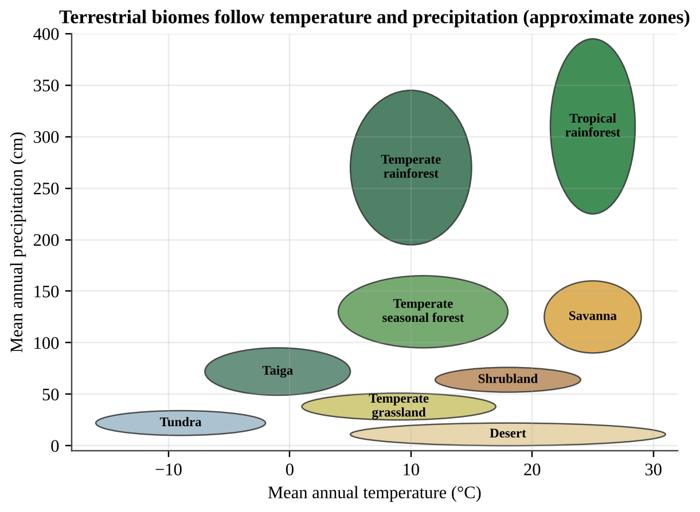
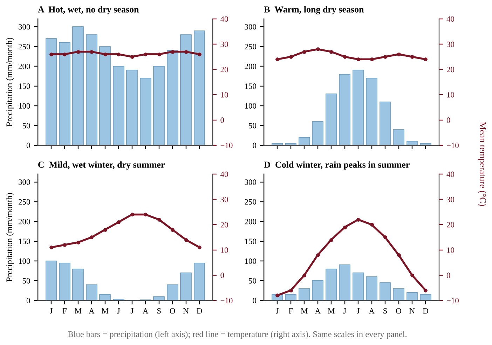
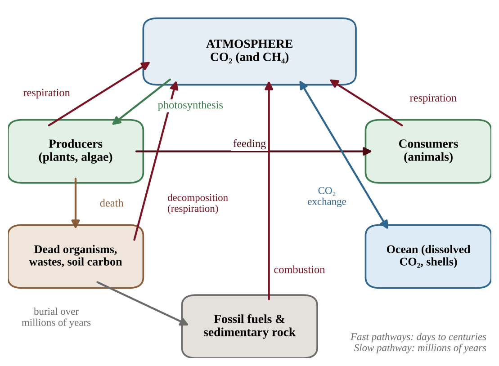
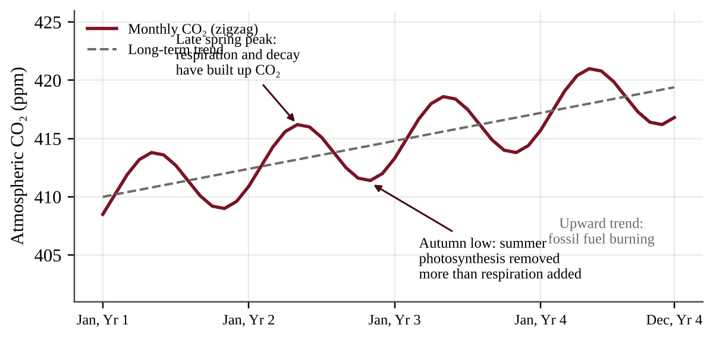
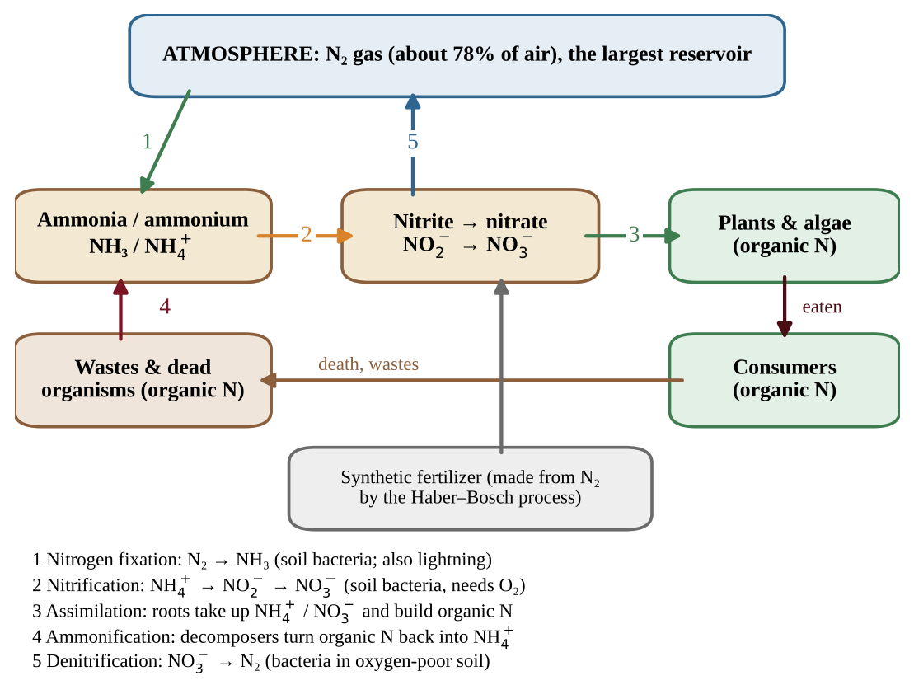
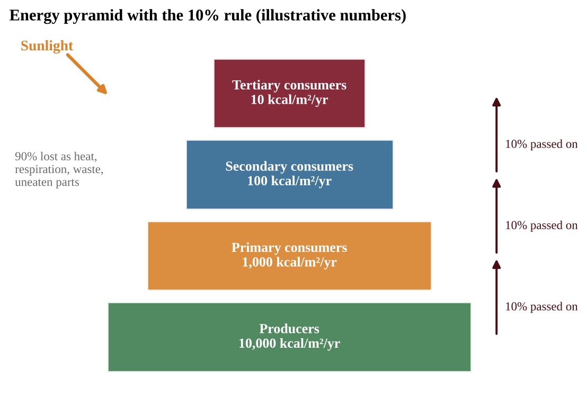

# Unit 1 — The Living World: Ecosystems

An ecosystem is a place where living things and their non-living surroundings work together as one system. Sunlight flows in, atoms of carbon, nitrogen, phosphorus and water circle around, and thousands of species compete, cooperate and eat each other. Nearly every later unit rests on the ideas you meet here.

## Topic 1.1 — Introduction to Ecosystems

:::box objectives
- Explain how the availability of resources influences interactions between species.
- Identify predator–prey relationships, the three types of symbiosis, and competition.
- Explain how resource partitioning reduces the harm of competition.
:::

An **ecosystem** includes the **biotic** (living) parts and the **abiotic** (non-living) parts of an area and the interactions among them. Abiotic factors include sunlight, temperature, water, soil minerals and oxygen. Biotic factors include every organism and the relationships between them. An ecosystem contains communities (all the populations living together), and a population is one species in one area. The central idea of Topic 1.1 is simple: *resources are limited, so organisms interact over them.* Food, water, light, nesting space and mates are all resources. When a resource is scarce, the interactions around it become stronger and more important for survival.

:::box simple
Picture a crowded apartment building with a fixed food supply. Some residents eat others (predation), some help each other (mutualism), some borrow unnoticed (commensalism), some harm their host (parasitism), and some fight over the same shelf (competition).
:::

### Predator–prey relationships

A **predator** is an organism that kills and eats another organism, the **prey**. The two populations affect each other. When prey is plentiful, predators have more food and may become more numerous. As predators multiply, more prey are eaten and the prey population declines. Predators then face a food shortage, and their numbers fall. This cause-and-effect loop often produces linked rises and falls in both populations.

### Symbiosis

**Symbiosis** is a close, long-term interaction between two species. There are three types, and the key to identifying them is asking who benefits and who is harmed.

| Type | Species A | Species B | Example |
|---|---|---|---|
| Mutualism | benefits | benefits | Bees collect nectar while pollinating flowers; reef-building coral and the algae living inside them |
| Commensalism | benefits | not affected | Orchids growing on a tree branch for light; barnacles riding on a whale |
| Parasitism | benefits | harmed | Ticks feeding on a deer; tapeworms in an intestine |

### Competition and resource partitioning

**Competition** occurs when organisms need the same limited resource. It can be **intraspecific** (within one species, for example two oak seedlings competing for light) or **interspecific** (between different species). Competition lowers the survival and reproduction of the competitors. Over time, species that use the same resource in the same way cannot easily coexist. Coexistence becomes possible through **resource partitioning**: using the resource in a different way, in a different place, or at a different time. Several warbler species feeding in the same spruce tree can coexist if each forages in a different part of the tree. Owls and hawks both hunt rodents but at night and during the day, respectively.

:::box mistake
- Parasitism is not predation: a parasite lives on or in its host and does not usually kill it quickly; a predator kills its prey.
- Commensalism needs the second species to be truly unaffected; if both benefit it is mutualism.
:::

:::box strategy
When a question describes an interaction, write the effect on each species as a plus, minus or zero. (+,+) is mutualism, (+,0) is commensalism, (+,−) is parasitism or predation, and (−,−) is competition. Then use words from the scenario to justify your answer.
:::

:::box example
id: SG-U1-E001
Four species of small seed-eating birds live in the same grassland. Observers record the plant height at which each species feeds: species P feeds at 0–10 cm, species Q at 10–30 cm, species R at 30–60 cm, and species S at 60–100 cm. (a) Name the interaction pattern that allows these four species to share the same seed supply. (b) Explain how this pattern reduces the negative impact on each species' survival. (c) If a drought reduces total seed production by half, state whether you expect competition to increase, decrease or stay the same, and give a reason.
:::

:::box summary
- Ecosystems = biotic + abiotic parts interacting; limited resources drive species interactions.
- Predation, mutualism, commensalism, parasitism and competition are distinguished by who gains and who loses.
- Resource partitioning (different ways, places or times) lets similar species coexist.
:::

## Topic 1.2 — Terrestrial Biomes

:::box objectives
- Describe the global distribution and main environmental features of the major terrestrial biomes.
- Explain how climate shapes the plants and animals of a biome.
- Explain why the distribution of non-mineral natural resources and of biomes varies and can change.
:::

A **biome** is a large region with a characteristic community of plants and animals that are adapted to its climate. Temperature and precipitation are the two main drivers. Because both change with latitude (distance from the equator) and altitude (height above sea level), biomes form recognizable bands and patterns around the globe.

### Reading a biome climate graph

Find the site's temperature (x-axis) and precipitation (y-axis) and read which zone contains the point; where zones overlap, other clues (seasonality, soil, vegetation) decide. Cold biomes lie on the left and wet biomes at the top. At a given temperature, more precipitation shifts desert to grassland to forest.

### The nine major terrestrial biomes

| Biome | Climate | Typical features |
|---|---|---|
| Tundra | Very cold, low precipitation, short growing season | Permafrost; low shrubs, mosses, lichens; slow decomposition |
| Taiga (boreal forest) | Long, cold winters; short, mild summers | Evergreen conifers; acidic, nutrient-poor soil; large expanses |
| Temperate rainforest | Cool, very wet, mild temperatures | Tall conifers, ferns and mosses; moist, rich in biomass |
| Temperate seasonal forest | Four distinct seasons; moderate precipitation | Deciduous trees that drop leaves in winter; fertile soil |
| Tropical rainforest | Hot all year, very wet | Greatest biodiversity; nutrients locked in biomass; thin, poor soil |
| Shrubland | Hot dry summers, mild wet winters | Drought-tolerant, fire-adapted shrubs |
| Temperate grassland | Hot summers, cold winters, moderate-to-low rain | Grasses; deep fertile soil; fire and grazing maintain it |
| Savanna | Warm year-round, distinct wet and dry seasons | Grasses with scattered trees; large grazing herds |
| Desert | Very low precipitation (typically under about 30 cm/yr) | Drought-adapted plants; animals that avoid daytime heat |

Tropical rainforest soil is poor even though the forest is lush: warmth and moisture make decomposition fast and plants absorb nutrients at once, so little is stored in the soil. In cold biomes, decomposition is slow and organic matter accumulates.

### Reading a climatograph (monthly data)

Monthly graphs show precipitation as bars and temperature as a line. Ask: how warm is the line, and does it change? Is rain spread evenly, or is there a dry season? Does rain fall in the warm or the cool months? In Figure 1.1b, a flat warm line with tall bars every month is tropical rainforest (A); warmth with a long dry season is savanna (B); a mild wet winter and nearly rainless summer is shrubland (C); a freezing winter with rain peaking in summer is temperate grassland (D). Very short bars in every month mean desert.

{w=0.8}

### Comparing biomes

Species diversity and net primary productivity (NPP) per m² peak where warmth and water are abundant all year. Diversity ranks tropical rainforest, temperate seasonal forest, temperate grassland, tundra (high to low); NPP is highest in tropical rainforest and lowest in desert and tundra; amphibian and tree diversity are richest between about 30° N and 30° S. On a world map, rainforest lies near the equator, temperate seasonal forest at mid-latitudes, then taiga and tundra toward the pole.

### Why resources and biomes are not spread evenly

Non-mineral natural resources such as fresh water and timber are unevenly distributed because of **climate, geography, latitude and altitude, nutrient availability and soil**. Timber is concentrated in forest biomes; water is abundant in rainforests and scarce in deserts; a mountain range can create a dry "rain shadow" on its far side.

Biome distribution is **dynamic**: it changed in the past, for example as ice sheets advanced and retreated, and may shift again with climate change. Warming can push forest boundaries toward the poles and up mountainsides.

:::box mistake
- Deserts are defined by low precipitation, not heat; some are cold.
:::

:::box example
id: SG-U1-E002
Use Figure 1.1. Three field stations report the following climate data. Station A: mean annual temperature 25 °C, precipitation 300 cm/yr. Station B: mean annual temperature −9 °C, precipitation 22 cm/yr. Station C: mean annual temperature 18 °C, precipitation 12 cm/yr. (a) Identify the most likely biome at each station. (b) Explain why decomposition and nutrient turnover would differ between the biomes at Stations A and B.
:::

:::box example
id: SG-U1-E011
Station M: temperature 24–28 °C every month; precipitation 150–230 mm per month from November to April and under 15 mm per month from May to October. Station N: temperature −6 °C in January and 20 °C in July; precipitation 15–25 mm per month in winter and 60–90 mm per month from May to August. (a) Identify the biome at each station and cite two pieces of evidence for each. (b) Explain how the dry season at Station M shapes its plant community. (c) Predict how Station N's biome would change if the region warmed and became drier, and justify it.
:::

:::box summary
- Biomes are shaped by climate (temperature and precipitation), which varies with latitude and altitude.
- Know the nine terrestrial biomes, their climate and signature adaptations.
- Resource distribution and biome boundaries are dynamic and may shift with climate change.
:::

## Topic 1.3 — Aquatic Biomes

:::box objectives
- Describe the distribution and main environmental features of freshwater and marine biomes.
- Explain how salinity, depth, turbidity, nutrients and temperature shape aquatic life and resources.
:::

### Freshwater biomes

**Freshwater biomes** include streams, rivers, ponds and lakes. They contain little dissolved salt (typically under about 0.5 parts per thousand). They are a vital source of drinking water, irrigation and food.

### Marine biomes

**Marine biomes** are salty (the open ocean averages about 35 parts per thousand).

- **Oceans** cover most of Earth's surface. Surface algae (phytoplankton) supply a large portion of Earth's oxygen and take in carbon dioxide from the atmosphere.
- **Coral reefs** occur in warm, clear, shallow water. They host great biodiversity and rely on a mutualism between coral animals and algae. They are sensitive to warming and pollution.
- **Marshland** (including salt marshes and mangroves) is shallow and nutrient-rich, with plants rooted in saturated soil; it filters runoff and protects coasts.
- **Estuaries** form where a river meets the sea, creating water of intermediate salinity that varies with tides and river flow. They are nutrient-rich, turbid and serve as nurseries for many fish and shellfish.

### Why aquatic resources vary

The distribution of non-mineral marine resources such as different fish varies with **salinity, depth, turbidity, nutrient availability and temperature**. Fish that need cold, nutrient-rich water gather in areas where deep water rises to the surface, bringing nutrients with it. Turbid (cloudy) water blocks light and limits photosynthesis to a thin surface layer. Where nutrients are scarce, as in much of the open ocean, phytoplankton stay sparse even in clear, warm, sunlit water. Depth controls how much light reaches photosynthesizers (see Topic 1.8): photosynthesis is limited to the sunlit top tens of meters, so the dark deep ocean has no photosynthesizers.

:::box mistake
- Algae and phytoplankton, not large plants, produce most marine oxygen.
- Do not call an estuary "freshwater." Its salinity is intermediate and changes with the tides.
:::

:::box example
id: SG-U1-E003
A student records data for two aquatic sites. Site X: salinity 34 parts per thousand, temperature 27 °C, depth 8 m, very clear water, with corals and many fish species. Site Y: salinity 12 parts per thousand where a river meets a bay, depth 2 m, cloudy water full of sediment and rich in nutrients, with young fish and oysters. (a) Identify the aquatic biome at each site. (b) Explain how low turbidity at Site X helps its primary producers, and state one reason Site Y supports so many young fish.
:::

:::box summary
- Freshwater biomes: streams, rivers, ponds, lakes. Marine biomes: oceans, coral reefs, marshland, estuaries.
- Salinity, depth, turbidity, nutrients and temperature control where aquatic life and fisheries occur.
- Marine algae produce a large share of Earth's oxygen and absorb atmospheric CO₂.
:::

## Topic 1.4 — The Carbon Cycle

:::box objectives
- Explain the steps of the carbon cycle and the interactions among its reservoirs.
- Distinguish short-term from long-term carbon reservoirs.
- Explain how burning fossil fuels changes the cycle.
:::

All life is built on carbon. The **carbon cycle** is the movement of atoms and molecules containing carbon between **sources** (reservoirs that release it) and **sinks** (reservoirs that take it in). A reservoir can be a source in one process and a sink in another. A growing forest is a sink; a burning forest is a source.

### How carbon moves

- **Photosynthesis** moves carbon from atmospheric CO₂ (or CO₂ dissolved in water) into organic compounds in producers.
- **Cellular respiration** moves carbon back into the air as CO₂ when producers, consumers and decomposers break down organic compounds for energy.
- **Feeding** passes carbon through food chains.
- **Decomposition** releases CO₂ (and, in low-oxygen places such as wetlands and landfills, methane, CH₄) from dead matter and waste.
- **Gas exchange** with the ocean: CO₂ dissolves in surface water and is released from it. Some marine organisms build shells of calcium carbonate, which sink and become sediment.
- **Burial and fossilization**: plant and animal remains buried and compressed over millions of years form coal, oil and natural gas, and carbonate sediments form limestone.
- **Combustion** of fossil fuels and wood moves carbon rapidly into the atmosphere as CO₂.

### Short-term and long-term reservoirs

Some reservoirs hold carbon for a short time (atmosphere, living organisms, surface ocean, soil organic matter), while others hold it for very long periods (deep ocean sediments, sedimentary rocks and fossil fuels). Fossil fuels took millions of years to form; burning them returns that carbon to the atmosphere within decades, which is why extra atmospheric CO₂ is accumulating (Unit 9).

### Carbon budgets and seasonal data

To find the net change in atmospheric carbon from a flux diagram, add every arrow into the atmosphere and subtract every arrow out, keeping the units (for example Gt C/yr). A positive result means the reservoir is growing.

An ecosystem's carbon balance is carbon taken up by photosynthesis minus carbon released by *all* respiration (plants, animals, soil microbes). Positive is a net **sink**; negative is a net **source**. Add all seasons before judging: a tundra can release carbon in winter yet absorb more over the year.

Atmospheric CO₂ at a Northern Hemisphere station zigzags yearly: land plants photosynthesize from late spring to early autumn, so CO₂ falls; in cold months respiration and decay win, so it rises. The rising baseline is fossil fuel burning adding carbon faster than sinks remove it.

{w=0.8}

Stored soil carbon becomes a source when disturbed. In cold or waterlogged soils (peat, mangrove, permafrost, prairie) decomposition is slow for lack of warmth or oxygen. Draining, plowing, burning and warming speed it up and release CO₂. Long-term sinks: limestone, sea-floor sediment, buried organic matter.

:::box formula
Net change in reservoir = Σ inputs − Σ outputs
Ecosystem carbon balance = GPP − total respiration (positive = net sink)
Mass of CO₂ = mass of C × 44 ÷ 12 ≈ mass of C × 3.67 (molar masses CO₂ 44, C 12)
:::

:::box process
Atmosphere CO₂ → (photosynthesis) → carbon in producers → (feeding) → consumers → (respiration, decomposition) → atmosphere CO₂
Dead organisms → (burial, millions of years) → fossil fuels → (combustion) → atmosphere CO₂
:::

:::box formula
Photosynthesis: 6 CO₂ + 6 H₂O + light energy → C₆H₁₂O₆ + 6 O₂
Cellular respiration: C₆H₁₂O₆ + 6 O₂ → 6 CO₂ + 6 H₂O + usable energy
Combustion of a hydrocarbon (fossil fuel): fuel + O₂ → CO₂ + H₂O + heat
:::

:::box mistake
- Plants also respire, releasing CO₂; they are not only sinks.
- Fossil fuel carbon was out of the fast cycle for millions of years; burning it adds *new* carbon to it.
:::

:::box strategy
In a carbon-cycle diagram question, label each arrow with its process name and say whether it moves carbon into or out of the atmosphere. Then state whether the reservoir you are asked about is acting as a source or a sink.
:::

:::box example
id: SG-U1-E004
A carbon atom is part of a coal seam. A power plant burns the coal, and the carbon enters the air. Later that atom is taken up by a wheat plant, the wheat is eaten by a cow, and the cow exhales it. (a) List, in order, the four named processes that move the atom from the coal seam to the exhaled breath, and give the form of the carbon after each step. (b) State whether the coal seam acted as a source or a sink in this sequence, and explain why this carbon was not part of the fast cycle before the plant was built.
:::

:::box example
id: SG-U1-E012
A 50-ha peatland stores 600 Mg of carbon per hectare in its top 1 m of soil. After it is drained and plowed, 12% of that carbon is oxidized to CO₂ over ten years. (a) Calculate the mass of CO₂ released, in Mg. (b) Explain why draining speeds up the release. (c) State whether the peatland is now a source or a sink.
:::

:::box summary
- Carbon moves between sources and sinks; photosynthesis and respiration link living things to the atmosphere.
- Short-term reservoirs: atmosphere, organisms, soil, surface ocean. Long-term: fossil fuels, rocks, sediments.
- Burning fossil fuels moves carbon stored for millions of years into the atmosphere within decades.
:::

## Topic 1.5 — The Nitrogen Cycle

:::box objectives
- Explain the steps of the nitrogen cycle (fixation, assimilation, ammonification, nitrification, denitrification).
- Explain the role of soil microorganisms and why nitrogen often limits primary production.
- Identify the largest nitrogen reservoir and the speed at which most others turn over.
:::

Nitrogen is a key part of proteins, DNA and chlorophyll. Air is about 78% nitrogen gas (N₂), yet most organisms cannot use it, because the two atoms in N₂ are held by a very strong triple bond. The **nitrogen cycle** is the movement of nitrogen-containing atoms and molecules between sources and sinks, and microorganisms in the soil do most of the work.

### The five steps

1. **Nitrogen fixation** converts atmospheric N₂ into ammonia (NH₃) by certain soil bacteria, including bacteria in root nodules of legumes such as beans and clover. In soil, ammonia quickly becomes **ammonium (NH₄⁺)**, which plants can take up. Lightning also fixes a smaller amount.
2. **Nitrification** is the conversion of ammonium to nitrite (NO₂⁻) and then nitrate (NO₃⁻) by soil bacteria that need oxygen. Nitrate is the main form that plant roots absorb, and it dissolves easily, so it is also easily lost by leaching.
3. **Assimilation** is the uptake of ammonium and nitrate by plants and algae and their conversion into proteins and nucleic acids. Animals assimilate nitrogen by eating plants or other animals.
4. **Ammonification** (decay) is the conversion of nitrogen in wastes and dead organisms back to ammonium by decomposers.
5. **Denitrification** is the conversion of nitrate to nitrogen gas by bacteria in oxygen-poor (anaerobic) conditions such as waterlogged soils, returning nitrogen to the atmosphere.

### Reservoirs and limits

The **atmosphere is the largest reservoir** of nitrogen, but it is not directly available. Most of the other reservoirs (soil nitrate and ammonium, living organisms, wastes) hold nitrogen for relatively short periods. Because the rate of fixation controls how much usable nitrogen enters ecosystems, nitrogen often **limits primary production** in many ecosystems: when more nitrogen is added, plants grow faster.

Humans have greatly increased fixation: the Haber–Bosch process makes ammonia from N₂ for fertilizer, and high-temperature burning makes nitrogen oxides. Excess nitrogen runs off into waterways and causes eutrophication (Unit 8).

:::box process
Atmospheric N₂ → (fixation) → NH₃/NH₄⁺ → (nitrification) → NO₂⁻ → NO₃⁻ → (assimilation) → plant protein → (eaten, death, waste) → organic N in soil → (ammonification) → NH₄⁺
NO₃⁻ → (denitrification, low oxygen) → N₂ gas to the atmosphere
:::

:::box mistake
- Plants cannot take up N₂ from the air; only certain bacteria (and lightning) fix it.
- Nitrification needs oxygen; denitrification occurs when oxygen is scarce.
:::

:::box example
id: SG-U1-E005
A farmer notices that, after a week of flooding, an oxygen-poor, waterlogged field has much less nitrate and the corn is yellowing and stunted. (a) Name the process that increased in the waterlogged soil and state the product that leaves the soil. (b) Explain why the loss of nitrate reduces plant growth. (c) Name the process by which dead corn leaves, left on the field, would become a new supply of ammonium.
:::

:::box summary
- Nitrogen cycle steps: fixation, nitrification, assimilation, ammonification, denitrification.
- The atmosphere is the largest reservoir, but N₂ is unusable until fixed. Most other reservoirs turn over quickly.
- Nitrogen frequently limits plant growth; humans add large amounts through fertilizer and combustion.
:::

## Topic 1.6 — The Phosphorus Cycle

:::box objectives
- Explain the steps of the phosphorus cycle and its major reservoirs.
- Explain why phosphorus is often a limiting nutrient.
:::

Phosphorus is part of DNA, ATP (the cell's energy molecule) and cell membranes. The **phosphorus cycle** is the movement of phosphorus-containing atoms and molecules between sources and sinks. It differs from the carbon and nitrogen cycles in one important way: **it has no significant atmospheric component.**

### The steps

1. **Weathering** slowly breaks down phosphorus-bearing rock and releases phosphate (PO₄³⁻) into soil and water.
2. **Uptake** by plants and algae takes up dissolved phosphate through roots or cell surfaces.
3. **Transfer** moves phosphorus through the food chain as consumers eat producers (phosphate-rich seabird droppings, guano, are mined as fertilizer).
4. **Return** occurs through wastes and decomposition, which release phosphate back to the soil or water for reuse.
5. **Sedimentation** carries phosphate to the ocean and lake bottoms, where it forms sediments. Over millions of years, uplift can bring sedimentary rock back to land, restarting the cycle.

The **major reservoirs** are rock and ocean sediments that contain phosphorus-bearing minerals. Because the rate at which rocks weather is very slow, phosphorus is relatively scarce in ecosystems. It is therefore often a **limiting nutrient** for producers, particularly in freshwater ecosystems and some terrestrial ecosystems. This is why a small addition of phosphorus (from fertilizer, sewage or some detergents) can cause an algal bloom in a lake.

### Designing and judging a nutrient experiment

A limiting nutrient is found by adding it and watching the response.

- **Hypothesis:** an "if … then …" prediction naming both variables and the direction: if phosphorus limits growth, bottles with added phosphorus will hold more algae than bottles without it, because phosphorus is scarce.
- **Independent variable:** what you change (nutrient added). **Dependent variable:** what you measure (chlorophyll *a*, or algal biomass).
- **Control:** identical water with nothing added, the baseline for comparison.
- **Treatments:** nitrogen alone, phosphorus alone, both, and the control; two nutrients can limit together.
- **Constants:** light, temperature, volume, water source and duration, so only the nutrient differs.
- **Replication:** several bottles per treatment, averaged, so one odd bottle does not mislead.

If nitrogen alone changes little, phosphorus alone raises growth a lot, and both together raise it most, phosphorus is the main limiting nutrient and nitrogen limits next. Growth in the control does not show that nothing limits it. Change one factor at a time: fertilizing plots in a different field, adding several things at once, or comparing only "before and after" with no untreated plots cannot isolate the cause.

:::box process
Rock → (weathering) → phosphate in soil and water → (uptake) → plants → (eating) → consumers → (waste, decomposition) → phosphate in soil and water → (sedimentation) → sediments → (uplift, millions of years) → rock
:::

:::box mistake
- Do not include an atmospheric reservoir or a gas phase in the phosphorus cycle.
- Phosphorus is limiting in many freshwater lakes; nitrogen is more often limiting in many marine and terrestrial systems. Both can be limiting, so use the data in the question.
:::

:::box example
id: SG-U1-E006
Researchers add nutrients to four identical experimental ponds for six weeks and measure algae concentration as chlorophyll in micrograms per liter (µg/L). Control (nothing added): 10 µg/L. Nitrogen only: 11 µg/L. Phosphorus only: 38 µg/L. Nitrogen and phosphorus together: 40 µg/L. (a) Identify the limiting nutrient in these ponds and justify your answer using the data. (b) Calculate the percent increase in algae concentration in the phosphorus-only pond compared with the control. (c) Explain why phosphorus is naturally scarce in freshwater ecosystems.
:::

:::box summary
- Phosphorus moves through rock, soil, water, organisms and sediments, with no significant atmospheric reservoir.
- Slow weathering makes it scarce, so it often limits producers, especially in fresh water.
- Added phosphorus can trigger rapid algal growth.
:::

## Topic 1.7 — The Hydrologic (Water) Cycle

:::box objectives
- Explain the steps of the water cycle and the interactions among its reservoirs.
- Identify the primary reservoir of water at Earth's surface.
:::

The **hydrologic cycle**, powered by the sun, is the movement of water in its solid, liquid and gaseous phases between sources and sinks. Solar energy evaporates water, and gravity returns it to Earth.

### Processes

- **Evaporation** changes liquid water to vapor from oceans, lakes and soil.
- **Transpiration** is the release of water vapor from plant leaves. Evaporation plus transpiration together are called **evapotranspiration**.
- **Condensation** changes vapor to liquid droplets, forming clouds.
- **Precipitation** returns water as rain, snow, sleet or hail.
- **Infiltration and percolation** move water into and through soil to **groundwater**. Water stored in porous rock is an **aquifer**.
- **Runoff** is water flowing over land surfaces into streams, lakes and the ocean. The land that drains to one stream or river is its **watershed**.
- **Sublimation, freezing and melting** move water between ice and the other phases.

### Reservoirs

The **oceans are the primary reservoir** of water at Earth's surface, holding roughly 97% of it. Ice caps and glaciers hold most of the fresh water, and groundwater holds much of the remainder, together as much smaller reservoirs. Water spends only days in the atmosphere, but it can stay in a deep aquifer or an ice cap for thousands of years, so the speed of turnover differs greatly among reservoirs.

### Residence time, water budgets and land use

**Residence time** is the average time a water molecule stays in a reservoir. A watershed's **water budget** balances what arrives against where it goes.

:::box formula
Residence time = volume stored ÷ rate of inflow (or outflow)
Precipitation (P) = evapotranspiration (ET) + runoff + change in storage
Volume = depth × area (convert units first: 1 km² = 10⁶ m²; 1,000 mm = 1 m)
:::

Pavement, roofs and compacted soil block **infiltration**, so more precipitation leaves quickly as **runoff** and less recharges groundwater. Clearing vegetation lowers transpiration, so more of the same precipitation is left to run off. Forest and wetland soils slow runoff and feed groundwater.

:::box process
Ocean/lake/soil → (evaporation) and plants → (transpiration) → water vapor → (condensation) → clouds → (precipitation) → land → (runoff, infiltration) → streams, groundwater → ocean
:::

:::box mistake
- Transpiration is water loss from plants; evaporation is from surfaces.
- Most fresh water is in ice and groundwater, not in lakes and rivers.
:::

:::box example
id: SG-U1-E007
A watershed has an area of 25 km² and receives 80 cm of precipitation in a year. Of the precipitation, 60% returns to the atmosphere by evapotranspiration, and the remaining water leaves the watershed as stream flow (ignore groundwater storage and change). (a) Calculate the volume of stream flow in cubic meters per year. Use 1 km² = 10⁶ m². (b) Name the process by which the largest portion of the water leaves the watershed, and give one biological contributor to it.
:::

:::box example
id: SG-U1-E013
A groundwater aquifer stores 3.0 × 10³ km³ of water. Recharge and natural discharge are each 12 km³ per year. (a) Calculate the average residence time of water in the aquifer. (b) A city covers part of the recharge area with pavement, so recharge falls to 9 km³ per year while natural discharge stays at 12 km³ per year. Calculate the annual change in stored water and state whether the aquifer is growing or shrinking. (c) Explain how pavement changes infiltration.
:::

:::box summary
- The sun-powered water cycle moves water as solid, liquid and gas among oceans, ice, groundwater, surface water, soil, organisms and the air.
- Oceans are the largest surface reservoir; ice caps and groundwater are much smaller.
- Key processes: evaporation, transpiration, condensation, precipitation, infiltration, runoff.
:::

## Topic 1.8 — Primary Productivity

:::box objectives
- Explain how solar energy is captured and stored by producers.
- Distinguish gross from net primary productivity and use the correct units.
- Explain how light availability affects photosynthesis in aquatic ecosystems.
:::

Energy from the sun enters ecosystems through photosynthesis. **Primary productivity** is the rate at which solar energy is converted into organic compounds through photosynthesis over a unit of time.

### GPP and NPP

**Gross primary productivity (GPP)** is the total rate of photosynthesis in an area. Producers use part of that energy for their own cellular respiration (R). **Net primary productivity (NPP)** is the rate of energy storage by photosynthesizers in an area after subtracting the energy lost to respiration. NPP is the energy available to consumers.

:::box formula
NPP = GPP − R
GPP — gross primary productivity; R — energy used in the producers' respiration; NPP — net primary productivity.
Units: energy per unit area per unit time, for example kcal/m²/yr (the CED example). Carbon units such as g C/m²/yr are also used.
:::

Productivity is a **rate**, so its units include time. Biomass (total mass of organisms) is an amount at one moment. A forest can have very large biomass but moderate productivity, while an algal bloom can have small biomass but fast turnover.

### What controls productivity

Light, temperature, water and nutrients set the rate of photosynthesis. Tropical rainforests, estuaries, marshes and coral reefs have high NPP per unit area; deserts, tundra and the open ocean have low NPP per unit area (the ocean still contributes much in total because of its size).

### Totals, seasons and comparisons

- **Total NPP = NPP per unit area × area** (convert 1 km² = 10⁶ m²). The open ocean has low NPP per m², but its enormous area gives it the largest total NPP of any ecosystem type.
- **Seasonal data:** find NPP = GPP − R for each month. It is negative when respiration exceeds photosynthesis, as in a temperate forest's winter, when leaves are absent but living tissue still respires. Annual NPP = annual GPP − annual R. Percent of GPP lost to respiration = total R ÷ total GPP × 100.
- Photosynthesis stores energy as glucose; oxygen is a by-product. If insects strip leaves, GPP falls while respiration continues, so NPP falls.

### Light in aquatic ecosystems

Water absorbs light. Most red light is absorbed in the upper 1 m, and blue light penetrates deeper than 100 m only in the clearest water. Photosynthesis therefore concentrates near the surface, and productivity falls with depth. Floating phytoplankton stay in the sunlit layer, and some algae have accessory pigments that capture the wavelengths that penetrate deeper. Turbid water makes the problem worse.

:::box mistake
- GPP is always greater than NPP (unless R = 0).
- Productivity is a rate (per time); biomass is an amount at one moment.
:::

:::box strategy
In a graph or data table of productivity, check the units (kcal/m²/yr). Calculating NPP needs both GPP and R. If the question gives NPP and GPP, then R = GPP − NPP.
:::

:::box example
id: SG-U1-E008
Two ecosystems are studied. Ecosystem A: GPP = 6,000 kcal/m²/yr; producer respiration = 4,200 kcal/m²/yr. Ecosystem B: GPP = 2,400 kcal/m²/yr; producer respiration = 600 kcal/m²/yr. (a) Calculate the NPP of each ecosystem. (b) Calculate NPP as a percentage of GPP for each ecosystem. (c) A student claims that Ecosystem A supports more consumers because its GPP is higher. Evaluate this claim using your results.
:::

:::box summary
- Primary productivity is the rate at which producers convert sunlight into organic compounds.
- NPP = GPP − R, measured in energy per area per time (for example kcal/m²/yr).
- Water absorbs light, so aquatic photosynthesis is concentrated near the surface.
:::

## Topic 1.9 — Trophic Levels

:::box objectives
- Explain how energy flows and matter cycles through trophic levels.
- Explain why ecosystems need a continuous input of energy but recycle matter.
:::

A **trophic level** is an organism's feeding position in a food chain. **Producers (autotrophs)** make their own organic compounds, most by photosynthesis. **Consumers (heterotrophs)** get energy from other organisms. **Primary consumers** are herbivores that eat producers, **secondary consumers** eat primary consumers, and **tertiary consumers** eat secondary consumers. Omnivores eat both plants and animals, so they can occupy more than one level. **Detritivores** (for example earthworms and dung beetles) eat dead matter, and **decomposers** (bacteria and fungi) break down dead matter chemically, returning nutrients to the soil.

### Energy flows, matter cycles

All ecosystems depend on a **continuous inflow of high-quality energy**, usually sunlight, to maintain their structure and function. Energy flows from the sun to producers and then upward through the trophic levels. At each step some energy becomes low-quality heat that radiates away and cannot be recycled, so the flow is one-way.

Matter behaves differently. Atoms of carbon, nitrogen, phosphorus, oxygen and hydrogen move between the environment and organisms through **biogeochemical cycles** (Topics 1.4–1.7). Each cycle demonstrates the **conservation of matter**: atoms are not created or destroyed, only moved and rearranged.

:::box process
Energy: Sun → producers → primary consumers → secondary consumers → tertiary consumers, with heat lost at every step (one-way).
Matter: environment → producers → consumers → decomposers → environment (a cycle).
:::

:::box define
**Autotroph (producer)** — organism that makes its own food, usually by photosynthesis.
**Heterotroph (consumer)** — organism that obtains energy by eating other organisms.
**Detritivore** — consumer that feeds on dead organic matter (detritus).
**Decomposer** — organism, mainly a fungus or bacterium, that breaks down dead matter and wastes into simple nutrients.
**Biogeochemical cycle** — pathway by which a chemical element or compound moves through living and non-living parts of Earth.
:::

:::box mistake
- Energy flows one way; only matter cycles.
- An omnivore can belong to more than one trophic level; decomposers act on dead matter from every level.
:::

:::box summary
- Producers capture energy; consumers pass it up; detritivores and decomposers recycle dead matter.
- Ecosystems need a continuous input of high-quality energy but recycle matter through biogeochemical cycles.
- Biogeochemical cycles illustrate conservation of matter.
:::

## Topic 1.10 — Energy Flow and the 10% Rule

:::box objectives
- Determine how energy decreases as it flows through trophic levels.
- Apply the 10% rule in calculations with correct units.
- Explain energy loss using the laws of thermodynamics.
:::

Of all the energy a trophic level takes in, only a fraction is stored in its tissues and available to the next level. The **10% rule** approximates that in a transfer of energy from one trophic level to the next, only about 10% of the energy is passed on. The rest is lost mostly as heat from respiration, and also in wastes, uneaten parts (bones, roots, fur) and dead matter that goes to decomposers.

{w=0.75}

### Why the loss happens: thermodynamics

- The **first law of thermodynamics** states that energy cannot be created or destroyed, only converted from one form to another. The sunlight captured by producers becomes chemical energy in sugar, then movement and heat.
- The **second law of thermodynamics** states that every energy conversion increases disorder (entropy), and some energy is always converted to low-quality heat. No conversion is 100% efficient. Every organism spends energy to move, grow, stay warm and reproduce, and that energy ends up as heat.

Consequences: food chains are short (usually 3 to 5 levels), top predators are rare, and a large base of producers is needed to support few top consumers.

### Doing the math

:::box formula
Energy at level n+1 = energy at level n × 0.10
Energy after k transfers = starting energy × (0.10)ᵏ
Ecological efficiency (%) = (energy at the higher level ÷ energy at the lower level) × 100
Units: the same as the data, such as kcal/m²/yr or joules.
To go downward (find the energy needed at the lower level), divide by 0.10 for each step.
:::

The 10% figure is approximate (real efficiencies range from about 5% to 20%); use 10% unless told otherwise. Count transfers, not levels: an organism at level 4 is three transfers above the producers.

### Harder 10% problems

- **Efficiency from data:** for each step, higher level ÷ lower level × 100. Similar values near 10% support the rule; the missing energy is lost mostly as heat (second law), not destroyed.
- **From harvest to area:** harvest mass × energy per kg = energy needed at the top level; divide by 0.10 per transfer down to the producers; divide by NPP (kcal/m²/yr) for area in m²; convert (1 ha = 10⁴ m²). Carry units on every line.
- **Diet and land:** each step up multiplies the energy and land needed by about 10, or by the factor given (if 1 kcal of beef needs 20 kcal of corn, 5,000 kcal of beef needs 100,000 kcal of corn). Eating lower on the food chain wastes less energy, so the same land feeds more people. People fed = energy per year ÷ (kcal per person per day × 365).

:::box apply
Raising beef needs many times more plant energy and land than growing grain for people, because about 90% of the feed energy is lost as heat and waste before the meat is eaten.
:::

:::box strategy
Write the trophic level labels next to the numbers, then draw an arrow for each transfer and multiply by 0.10. Show units, state the answer and check that each lower level has about 10 times the energy of the one above.
:::

:::box example
id: SG-U1-E009
In an ocean food chain, phytoplankton fix 25,000 kcal/m²/yr. The chain is phytoplankton → zooplankton → small fish → tuna. Assume 10% of the energy is passed on at each transfer. (a) Calculate the energy available to the tuna in kcal/m²/yr. (b) Calculate how much phytoplankton energy would be needed to support 400 kcal/m²/yr in the small fish. (c) Explain, using the second law of thermodynamics, why the tuna receive less energy than the small fish.
:::

:::box summary
- About 10% of energy is passed to the next trophic level; about 90% is lost, mainly as heat.
- Energy loss follows from the first and second laws of thermodynamics.
- Short food chains and few top predators are consequences of energy loss.
:::

## Topic 1.11 — Food Chains and Food Webs

:::box objectives
- Describe food chains and food webs and classify their members by trophic level.
- Explain the role of detritivores and decomposers.
- Predict the effects of adding or removing a species, including feedback loops.
:::

A **food chain** shows a single pathway of energy and matter from producers (autotrophs) to primary consumers (herbivores), secondary and tertiary consumers (carnivores and omnivores). The arrows point from the organism being eaten to the organism that eats it, which is the direction of energy flow. Detritivores and decomposers play an essential role: they return nutrients to the soil, where producers use them again.

A **food web** is a model of the interlocking food chains in an ecosystem. It is more realistic than a single chain because most consumers eat several things and are eaten by several predators, so one organism can sit at several trophic levels. A hawk that eats a mouse (a primary consumer) is a secondary consumer, but a hawk that eats a snake that ate a mouse is a tertiary consumer.

To read a food web, find the producers (arrows only leave them), count steps from a producer to give each consumer's trophic level (list every level if there are several paths), and, to predict the effect of removing a species, follow every arrow that enters or leaves it.

### Feedback loops and changing the web

When one species is added to or removed from a food web, the rest of the web can change. Feedback loops often drive these changes.

- A **negative (balancing) feedback loop** counteracts a change and stabilizes the system. When rabbits increase, foxes find more food and multiply, so rabbits are reduced.
- A **positive (reinforcing) feedback loop** amplifies a change. In a lake, a large algal bloom dies, decomposers use up the dissolved oxygen as they consume it, fish die, and their decay uses still more oxygen.

A **trophic cascade** is a chain of effects across levels. When sea otters (which eat sea urchins) are removed, urchins increase, they graze down the kelp, and the kelp forest that sheltered many other species disappears.

### Tracing effects and judging evidence

To predict a change, start with the first change and flip the direction at each link. In a lake, removing bass lets minnows increase; more minnows eat more zooplankton; fewer zooplankton graze less, so algae and chlorophyll *a* rise. In data tables, the first species to change was disturbed; later ones show the ripple. Predators such as wolves are far fewer than their prey because only about 10% of energy passes up a level; when wolves return, deer browse less and vegetation recovers.

Two sites that differ (a no-fishing reserve and a fished reef) show an association, not proof of cause, because depth, temperature or nutrients may also differ. Stronger evidence comes from several matched sites, before-and-after data at one site, or an experiment that removes or adds the predator with untreated controls.

:::box mistake
- Arrows point from the food to the eater (direction of energy flow).
- A web with alternative prey is more resilient; removing one species does not always collapse the next level.
:::

:::box example
id: SG-U1-E010
A food web in a dry grassland has these feeding relationships (prey → predator): grass → grasshoppers; grass → rabbits; grasshoppers → lizards; lizards → hawks; rabbits → foxes; rabbits → hawks. (a) Write the longest food chain in this web and identify the trophic level of the hawk in that chain. (b) A disease eliminates nearly all lizards. Predict the direction of change in the grasshopper population, assuming lizards are the only predator of grasshoppers, and explain. (c) As rabbits increase, foxes increase, and then rabbits decline. Identify the type of feedback and justify your answer.
:::

:::box summary
- Food chains show one energy pathway; food webs combine many chains; arrows point from food to eater.
- Detritivores and decomposers return nutrients to the soil.
- Adding or removing a species affects the rest of the web through positive and negative feedback loops.
:::

### Math & Skills Toolkit

- **Percent change** = (new − original) ÷ original × 100. Divide by the *original* value. **Percent of whole** = part ÷ whole × 100.
- **Conversions and scientific notation:** multiply by a fraction equal to 1 so units cancel (80 cm × 1 m ÷ 100 cm = 0.80 m; 25 km² = 25 × 10⁶ m²).
- **Volume = area × depth** (use m² and m, answer in m³).
- **10% rule:** × 0.10 per upward transfer; ÷ 0.10 per step down. **NPP = GPP − R.**
- **Showing work:** formula, substitution with units, answer with units; check it is sensible.
- **Graphs:** read axes and units, state the trend in words, quote two data points, and explain the cause.

## Unit 1 Review — Quick Concept Summary

:::box summary
- **Species interactions:** scarce resources drive predation, symbiosis and competition; resource partitioning allows coexistence.
- **Biomes:** terrestrial biomes follow temperature and precipitation; aquatic biomes follow salinity, depth, turbidity, nutrients and temperature.
- **Cycles:** carbon links photosynthesis and respiration (fossil fuels are a slow reservoir); nitrogen needs fixation (the atmosphere is the largest reservoir); phosphorus has no atmospheric phase and is often limiting; the sun-powered water cycle is stored mostly in the oceans.
- **Energy:** NPP = GPP − R; energy flows one way and about 10% passes up each trophic level (thermodynamics), while matter cycles.
- **Food webs** link chains; decomposers recycle nutrients; adding or removing a species triggers feedback loops.
:::
