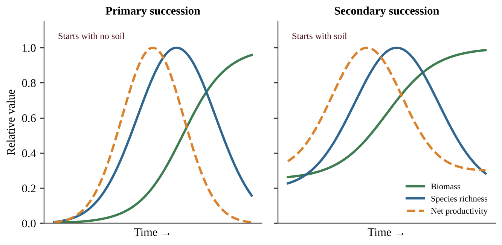

# Unit 2 — The Living World: Biodiversity

Why does a rainforest bounce back from a storm while a cornfield needs fertilizer, seed, and a farmer every single year? Why do tiny islands hold strange animals found nowhere else? Why can a trout survive in one stream and die in another a few kilometers away? Unit 2 answers these questions. It shows how ecosystems are built from many kinds of variety, how that variety helps people, how it changes when conditions change, and how it rebuilds after damage. This unit is worth about 6–8% of the exam, and its ideas return in Units 3, 5, 6 and 9.

## Topic 2.1 — Introduction to Biodiversity

:::box objectives
- Explain the three levels of biodiversity: genetic, species, and habitat diversity.
- Explain why genetic diversity helps a population respond to stress and how a bottleneck reduces it.
- Explain why species-rich ecosystems recover from disruption more readily.
- Describe how habitat loss affects specialists, generalists, and wide-ranging species.
- Define species richness.
:::

:::box simple
**Biodiversity is variety, counted at three scales.** Think of a school. The students differ from one another (genetic variety within one species). The school has many kinds of clubs (variety of species). The campus has a gym, library, garden, and cafeteria (variety of habitats). A healthy ecosystem is like a school with lots of variety at every scale: when something goes wrong, someone can always step in.
:::

### The three levels

**Genetic diversity** is the variety of genes (alleles) among the individuals of one species. Two dandelions in the same lawn are not identical; they carry different versions of many genes. **Species diversity** is the variety of different species in an ecosystem. **Habitat diversity** (also called ecosystem diversity) is the variety of physical environments, such as forest, meadow, stream, and wetland, that exist in an area. Each habitat supports its own set of species, so more habitats usually means more species.

:::box define
**Biodiversity** — the variety of life in an ecosystem, including genetic, species, and habitat diversity.
**Genetic diversity** — variation in the genes of individuals within a population or species.
**Species richness** — the number of different species found in an ecosystem. It counts kinds, not individuals.
**Habitat diversity** — the variety of distinct habitats within an area.
**Population bottleneck** — a sharp drop in population size that leaves the survivors with only a small sample of the original genes.
**Specialist** — a species with narrow requirements for food, habitat, or conditions.
**Generalist** — a species that can use many foods and habitats and tolerate a wide range of conditions.
:::

### Why genetic diversity matters

A genetically diverse population contains individuals with many different traits. When an environmental stressor arrives, such as a new disease, a hot summer, or a pesticide, a few individuals are likely to carry traits that let them survive and reproduce. Those survivors rebuild the population. A population with little genetic variety may have no such individuals, so the same stressor can wipe out nearly everyone. This is why a field planted with one identical crop variety can be lost to a single fungus, while a mixed wild meadow rarely is.

A **bottleneck** causes loss of genetic diversity. When a population collapses, whether from hunting, fire, or disease, only the survivors pass genes forward. Rare alleles are often lost by chance, and even if numbers recover, the population stays genetically uniform. The population is bigger again but not more diverse, and it remains vulnerable. Remember this: *recovering numbers does not restore lost genes.*

:::box process
Stressor kills most of population → few survivors (bottleneck) → many alleles lost → population regrows from the survivors → low genetic diversity → reduced ability to handle the next stressor
:::

### Species richness and recovery

**Species richness** is simply the number of species. If a meadow plot contains 14 plant species, its richness is 14, whether it holds 20 plants or 2,000. Ecosystems with more species are more likely to recover from disruptions. The reasons are cause-and-effect: more species means more different ways of doing the same job (several kinds of plants fix carbon, several kinds of insects pollinate). If a drought or pest eliminates one species, another with a different tolerance fills in. A low-diversity system depends on a few species, so losing one leaves a gap nothing can fill.

{w=0.85}

*Reading the graph:* both lines start at 1.0 (normal productivity). The drop at the dotted line shows the size of the damage; the climb back to 1.0 shows resilience. The green line drops less and returns sooner. A steeper, faster return means a more resilient system.

### Habitat loss

When habitat is destroyed or fragmented, species do not vanish all at once. **Specialists** go first because they cannot use any other habitat or food. Generalists follow later if the loss continues. Species with **large territorial requirements** (wolves, big cats, eagles) decline in number early, because a shrunken or chopped-up patch cannot hold enough territories. Habitat loss is the leading cause of biodiversity loss worldwide, which is why you will see it again in Unit 9.

:::box mistake
- Confusing richness with total number of individuals. A plot with 500 ants of one species has richness 1.
- Saying a recovered population has "regained genetic diversity." A bottleneck loss of alleles is not undone by regrowth in numbers.
- Believing generalists are the first to disappear from habitat loss. Specialists go first.
- Treating "biodiversity" as only species. Genetic and habitat diversity are part of it too.
:::

:::box strategy
When a question asks you to *explain* why diversity helps, always give a chain: more genetic or species variety → some individuals or species tolerate the stressor → they survive and reproduce or take over the lost function → the ecosystem keeps functioning or recovers sooner. A bare statement such as "diversity is good" earns no credit.
:::

:::box example
id: SG-U2-E001
For each situation, name the level of biodiversity (genetic, species, or habitat) that is being described, and say in one sentence whether it is high or low in that situation. (a) A cheetah population descended from a few dozen survivors shows almost no variation in the genes that control immune response. (b) A 40-hectare reserve contains pine forest, a lake, a peat bog, and open grassland. (c) A 100 m² plot of coral reef holds 63 fish species.
:::

:::box summary
- Biodiversity has three levels: genetic, species, and habitat diversity.
- Genetic diversity helps a population respond to stressors; bottlenecks reduce it.
- Species richness is the number of species; richer ecosystems recover from disruption more readily.
- Habitat loss removes specialists first, then generalists, and cuts species with large territories.
:::

## Topic 2.2 — Ecosystem Services

:::box objectives
- Describe the four categories of ecosystem services.
- Describe the economic and ecological results of human disruption of ecosystem services.
:::

:::box simple
**Ecosystem services are the free benefits nature provides.** You do not pay a bill for a wetland that filters your drinking water or for the bees that pollinate your fruit, but if they stopped, you would pay a great deal to replace them.
:::

### The four categories

:::box define
**Ecosystem services** — the benefits that people obtain from functioning ecosystems.
**Provisioning services** — the material goods ecosystems supply: food, fresh water, timber, fiber, fuel, medicines.
**Regulating services** — the ways ecosystems control conditions: climate regulation (carbon storage), flood control, water purification, pollination, disease and pest control, erosion control.
**Cultural services** — the non-material benefits: recreation, tourism, spiritual value, education, and beauty.
**Supporting services** — the basic processes on which all the others depend: nutrient cycling, soil formation, photosynthesis (primary production), and habitat for species.
:::

A quick memory trick: provisioning = *products*; regulating = *rules* of the environment; cultural = *culture and enjoyment*; supporting = *the foundation*. One ecosystem usually gives all four. A mangrove forest supplies fish and wood (provisioning), buffers storm surge and traps sediment (regulating), draws ecotourists (cultural), and acts as a nursery for young fish while recycling nutrients (supporting).

| Service category | Wetland example | Forest example |
|---|---|---|
| Provisioning | Fish, rice, drinking water | Timber, mushrooms, medicinal plants |
| Regulating | Absorbs floodwater, filters pollutants | Stores carbon, reduces erosion on slopes |
| Cultural | Bird watching, education | Hiking, spiritual significance |
| Supporting | Nutrient cycling, nursery habitat | Soil formation, wildlife habitat |

### Human disruption of ecosystem services

Anthropogenic (human-caused) activities can damage or remove these services, and the results are both **ecological** and **economic**. Cutting a mountain forest for timber gains short-term income (a provisioning service), but it can also destroy flood control and erosion control (regulating services). The next rains send mud into the river, the reservoir silts up, and the downstream town spends money on dredging and flood repair. Pollinator decline from pesticide overuse reduces crop yields and forces farmers to pay for hand pollination or rented hives. Draining wetlands removes natural water purification, so a city must build an expensive treatment plant.

:::box process
Human activity (clearing, draining, polluting) → ecosystem function damaged → service lost → ecological consequence (flooding, soil loss, fewer species) → economic consequence (repair costs, lower yields, lost tourism)
:::

:::box example
id: SG-U2-E002
A river valley has a floodplain forest. Classify each of the following benefits as provisioning, regulating, cultural, or supporting: (i) the forest soaks up spring floodwater; (ii) families harvest wild nuts; (iii) leaf litter decomposes and returns nitrogen to the soil; (iv) a canoe-rental company runs tours. Then, if the forest were cleared for farmland, describe one ecological and one economic consequence for the town downstream.
:::

:::box summary
- Four categories: provisioning, regulating, cultural, supporting.
- One ecosystem usually supplies all four.
- Human disruption of services produces ecological and economic consequences, such as flooding, soil loss, lower yields, and costly replacements.
:::

## Topic 2.3 — Island Biogeography

:::box objectives
- Describe island biogeography.
- Describe how island conditions shape evolution, including specialists, generalists, and invasive species.
:::

:::box simple
**An island is a small, isolated world, and its number of species depends on its size and distance.** Big islands have room for more species and for larger populations that are less likely to die out. Islands near a mainland receive new arrivals more often. So the biggest, nearest island has the most species; the smallest, farthest island has the fewest.
:::

### What is island biogeography?

**Island biogeography** is the study of the ecological relationships and distribution of organisms on islands, and of the community structure of those organisms. The ideas apply to any isolated habitat: a mountaintop, a lake, a forest fragment surrounded by farmland, or a nature reserve in a city.

Every island's species were not always there. Islands have been **colonized** in the past by species that arrived from elsewhere: birds flying, seeds blown by wind or carried in feathers, insects rafting on floating logs, and sometimes human introductions. The number of species on an island reflects a balance between new species arriving (**colonization**) and species being lost (**extinction**).

:::box process
**Distance:** island near mainland → more colonists arrive → more species. Island far away → fewer colonists → fewer species.
**Size:** large island → more habitats and resources → larger populations → lower extinction rate → more species. Small island → small populations → more likely to disappear → fewer species.
:::

{w=0.9}

*Reading the graphs:* on the left, both lines rise with area, and the near-mainland line sits higher at every size. On the right, richness drops as distance grows, and the large-island line sits above the small-island line. Describe both variables when you answer a data question: "richness increases with island area and decreases with distance."

### Island biogeography and evolution

Island resources such as food and territory are limited. Over time many island species evolve to be **specialists** that use one narrow food or habitat, which reduces competition among the few species present. Isolation also lets populations diverge from mainland relatives, so islands are well known for unusual species found nowhere else.

This specialization carries a risk. Invasive species that arrive on islands are typically **generalists**: they eat many foods, tolerate many conditions, and reproduce quickly. A generalist can outcompete a specialist for food or space, or prey on animals that evolved without defenses against such predators. The long-term survival of island specialists can therefore be jeopardized when invasive species are introduced.

:::box mistake
- Saying a bigger island has more species "because it is closer." Size and distance are two separate variables; keep them separate.
- Claiming islands have more species than the mainland. Islands generally have *fewer* species than a comparable mainland area.
- Assuming invasive species are specialists. They are typically generalists.
:::

:::box example
id: SG-U2-E003
Four islands were surveyed for land-bird species.

| Island | Area (km²) | Distance from mainland (km) | Bird species |
|---|---|---|---|
| P | 4 | 10 | 18 |
| Q | 4 | 120 | 9 |
| R | 90 | 10 | 41 |
| S | 90 | 120 | 24 |

(a) Describe the effect of distance on bird richness, using a pair of islands that differ only in distance, and give the percent decrease for that pair. (b) Describe the effect of area on richness for islands at the 120 km distance. (c) Predict which island is most likely to lose a specialist species through chance extinction, and justify your choice.
:::

:::box summary
- Island biogeography studies the distribution and community structure of organisms on islands.
- Richness increases with island area and decreases with distance from the colonist source.
- Islands were colonized by species arriving from elsewhere.
- Limited resources favor specialists; invasive generalists can outcompete them.
:::

## Topic 2.4 — Ecological Tolerance

:::box objectives
- Describe ecological tolerance.
- Recognize that tolerance applies to both individuals and species.
:::

:::box simple
**Every organism has a comfort zone, and beyond its edges it gets hurt or dies.** A polar bear is comfortable in cold; it overheats in a desert. A cactus handles drought; it rots in a swamp. The width of the zone is the organism's tolerance.
:::

**Ecological tolerance** is the range of conditions, such as temperature, salinity, flow rate, and sunlight, that an organism can endure before injury or death results. Each factor has its own range. A trout may tolerate a narrow temperature range but a wide range of sunlight; an estuary crab may tolerate wide swings in salinity.

{w=0.85}

*Reading the graph:* the x-axis is the environmental factor, the y-axis is how well the organism does. The peak is the optimum. The two outer limits mark the range of tolerance; outside them survival is not possible. A species with a *wide* curve is a generalist for that factor, and one with a *narrow* curve is a specialist.

**Individuals and species.** Tolerance applies at two levels. An *individual* has a tolerance that can shift a little with age, health, and acclimation (a runner adapts to altitude over weeks). A *species* has a tolerance range for the whole group, because individuals vary. A species' range is wider than any single individual's because it includes the hardiest and most sensitive members. Limiting factors that exceed tolerance determine where a species can live, so tolerance helps explain geographic range, and why a small shift in temperature, salinity, or flow can remove sensitive species from a stream.

:::box define
**Ecological tolerance** — the range of environmental conditions an organism can endure before injury or death.
**Optimum range** — the conditions in which an organism grows and reproduces best.
**Zone of stress** — conditions where the organism survives but performs poorly.
:::

:::box mistake
- Mixing up tolerance with adaptation. Tolerance is the range an organism can already survive; adaptation is a heritable change across generations (Topic 2.6).
- Thinking the optimum and the limit are the same thing. Organisms can survive in the zone of stress but do poorly.
- Stating that tolerance is one number. It is a range with an upper and lower limit, for each factor.
:::

:::box example
id: SG-U2-E004
Laboratory trials recorded the survival of two freshwater snail species after 7 days at different water temperatures.

| Temperature (°C) | Species A survival (%) | Species B survival (%) |
|---|---|---|
| 6 | 0 | 0 |
| 10 | 0 | 55 |
| 14 | 80 | 90 |
| 18 | 100 | 95 |
| 22 | 95 | 85 |
| 26 | 70 | 40 |
| 30 | 0 | 0 |
| 34 | 0 | 0 |

(a) Using only the temperatures tested, identify the lowest and highest tested temperatures at which each species survived at all. (b) Which species is better described as having the wider tolerance for temperature? Justify with the data. (c) A power plant will raise stream temperature from 20 °C to 28 °C. Predict which species is affected more and explain.
:::

:::box summary
- Ecological tolerance is the range of conditions an organism can endure before injury or death.
- Factors include temperature, salinity, flow rate, and sunlight.
- It applies to individuals and to species.
- Narrow tolerance means a specialist for that factor; wide means a generalist.
:::

## Topic 2.5 — Natural Disruptions to Ecosystems

:::box objectives
- Explain how short-term and long-term natural disruptions affect ecosystems.
- Describe periodic, episodic, and random Earth system processes.
- Describe long-term changes in climate and sea level and the habitat changes and migration they cause.
:::

:::box simple
**Nature itself disturbs ecosystems all the time, and sometimes harder than humans do.** One volcanic eruption or one huge wildfire can reshape thousands of square kilometers in a day. What matters is size, how often, and how long the effects last.
:::

### Short-term and long-term disruptions

Natural disruptions include fires, floods, hurricanes, volcanic eruptions, earthquakes, drought, disease outbreaks, and slow shifts in climate. **Short-term** disruptions (a storm, a fire) act over hours to years. **Long-term** disruptions (an ice age, a change in sea level) act over thousands to millions of years. The consequences of a natural disruption, for a given occurrence, may be as great as or greater than those of many human-made disruptions. A major eruption can bury a whole landscape in ash, and a hurricane can flatten a forest, killing organisms, changing habitat, and resetting the ecosystem. Natural does not mean harmless.

### Scales of time: periodic, episodic, random

Earth system processes operate over a range of time scales, and they differ in how predictable they are:

:::box define
**Periodic** — happens at regular, predictable intervals (seasons, annual monsoon flooding, daily tides).
**Episodic** — happens in occasional bursts, with some pattern in how often but not on a fixed schedule (hurricane seasons with active and quiet years; large wildfires every few decades).
**Random** — has no predictable pattern in timing (a meteorite impact, a single earthquake or volcanic eruption).
:::

### Climate and sea level over geological time

Earth's climate has changed over geological time for many reasons, including changes in Earth's orbit and tilt, variations in solar output, volcanic activity, shifting continents, and changes in greenhouse gas levels in the atmosphere. During cold periods (glacial periods) large amounts of water are locked in continental ice, so **sea level falls**. During warm periods ice melts and **sea level rises**. Sea level has therefore varied significantly as a result of changes in the amount of glacial ice on Earth. Falling sea level can expose land bridges and shallow shelves; rising sea level floods coastal lowlands.

:::box process
Climate cools → more water frozen as glacial ice → sea level falls → coastal shelves exposed, habitats shift toward the equator or downslope
Climate warms → ice melts → sea level rises → low coastal habitats flooded, habitats shift poleward or upslope
:::

### Habitat change and migration

Major environmental change or upheaval commonly results in **large swaths of habitat changes**: grassland may turn to desert, forest may retreat or advance, shorelines move inland. Wildlife responds. **Migration** may be short-term (a seasonal trip to avoid winter, or fleeing a fire and returning) or long-term (a species' range shifting poleward over centuries as climate warms). Animals migrate for many reasons, including food, breeding, temperature, and natural disruptions.

:::box mistake
- Believing that natural disruptions are always smaller than human ones. A single natural event can exceed many human-caused disruptions.
- Mixing up "episodic" and "periodic." Periodic = regular clock-like timing; episodic = occasional bursts; random = unpredictable.
- Saying sea level falls when ice melts. Melting land ice *raises* sea level.
:::

:::box example
id: SG-U2-E005
A valley forest has a net primary productivity of 1,200 g/m²/yr before a hurricane. The measured values afterward are: Year 1 = 300, Year 3 = 540, Year 5 = 780, Year 8 = 1,020. (a) Calculate the percent decrease in productivity in Year 1 compared with the pre-hurricane value. (b) Calculate the average increase in productivity per year between Year 1 and Year 5. (c) Classify hurricanes as periodic, episodic, or random for a coastal region with several active years and several quiet years, and justify. (d) Describe one way wildlife might respond in the short term.
:::

:::box summary
- Natural disruptions can have impacts as large as or larger than many human-caused ones.
- Earth processes may be periodic, episodic, or random in timing.
- Climate and sea level have changed over geological time; more glacial ice means lower sea level.
- Major upheaval creates large-scale habitat change, and wildlife responds with short- or long-term migration.
:::

## Topic 2.6 — Adaptations

:::box objectives
- Explain how natural selection acts on heritable traits to cause adaptation.
- Explain how organisms respond when the environment changes suddenly or gradually: alter behavior, move, or perish.
:::

:::box simple
**Adaptation is a population change across generations, not something an individual does.** A giraffe did not stretch its neck to get taller offspring. Instead, longer-necked giraffes in the past got more food, had more young, and passed on the genes for long necks.
:::

### Natural selection

Individuals in a population vary, and many differences are **heritable** (passed from parents to offspring through genes). Some variants help an organism survive and reproduce in its particular environment. Those individuals leave more offspring, so the helpful trait becomes more common in the next generation. Over many generations these incremental changes at the genetic level make the population **adapted** to its environment.

:::box process
Variation in a heritable trait → environment favors some variants (better survival and reproduction) → favored individuals leave more offspring → trait becomes more common over generations → population is better adapted
:::

Example: a beetle population contains green and brown beetles. Birds in a brown, dry landscape eat green beetles more often. Brown beetles survive longer, breed more, and the next generation has a higher percentage of brown beetles. No individual beetle changed color. The *population's* gene frequencies shifted. This links to Topic 2.1: **genetic diversity supplies the variation** that natural selection needs. A population with no variation cannot adapt.

:::box define
**Natural selection** — the process in which individuals with heritable traits that improve survival and reproduction leave more offspring, so those traits become more common.
**Adaptation** — a heritable trait that increases an organism's fitness in its environment; also the process of a population becoming better suited over generations.
**Heritable trait** — a trait controlled by genes that can be passed to offspring.
:::

### When the environment changes

Environmental change may be sudden (a volcanic eruption, an oil spill) or gradual (slow warming, a rising sea). Either may threaten a species' survival. Individuals have three possible outcomes: **alter behavior** (hunt at night when days get too hot), **move** (migrate to a better area), or **perish**. Behavioral change and movement happen within an individual's lifetime and are not genetic adaptation. Whether the *species* survives depends on whether enough individuals can do one of these or whether the population has heritable variation that selection can act on quickly enough. Fast change, few individuals, long generation times, and low genetic diversity all work against survival.

:::box mistake
- Saying "the organism adapted because it needed to." Selection acts on existing variation; needs do not create traits.
- Claiming individuals evolve during their lives. Populations change across generations.
- Confusing learned behavior or acclimation (not inherited) with adaptation (heritable change).
:::

:::box example
id: SG-U2-E006
A population of 2,000 field mice is reduced to 40 individuals by a disease outbreak, then recovers to 2,000 over six years. Before the outbreak, 5 different alleles of an immune-response gene were present; after recovery only 2 of them are found. (a) Name the process that explains the loss of alleles and state what happened to genetic diversity even though the population size returned to normal. (b) A new, more virulent disease then appears. Explain why this population is at greater risk than the original population. (c) Distinguish between a mouse changing its behavior to avoid the disease and the population adapting to it.
:::

:::box summary
- Natural selection acts on heritable traits and produces adaptation over generations through incremental genetic changes.
- Genetic variation is the raw material of selection.
- When the environment changes, individuals alter behavior, move, or perish.
- Sudden or gradual change can threaten a species, especially when diversity is low.
:::

## Topic 2.7 — Ecological Succession

:::box objectives
- Describe primary and secondary succession.
- Describe keystone species and indicator species.
- Describe how pioneer species affect ecosystems, including the possible origin of new species.
- Describe how succession changes biomass, species richness, and net productivity over time.
:::

:::box simple
**Succession is an ecosystem rebuilding itself in stages.** First hardy species move in, then they change the place (more soil, more shade) in ways that let new species move in, and the community keeps changing until it becomes stable.
:::

### Primary and secondary succession

:::box define
**Primary succession** — community development in an area with no soil, such as bare rock after a lava flow, a retreating glacier, or a new sand dune. It starts from nothing and takes hundreds to thousands of years.
**Secondary succession** — community development in an area where soil remains after a disturbance, such as an abandoned field, a burned forest, or a cleared lot. It is faster because the soil already holds nutrients, organic matter, and seeds.
**Pioneer species** — the first species to colonize unoccupied or newly disturbed habitat, usually hardy, fast-growing, and good at dispersing.
**Keystone species** — a species whose activities play a particularly significant role in determining community structure, much more than its abundance would suggest.
**Indicator species** — a plant or animal whose presence, abundance, scarcity, or chemical composition shows that some distinctive aspect of the character or quality of an ecosystem is present.
:::

**Primary succession** typically proceeds: bare rock → lichens and mosses (pioneers) that slowly break down rock and add organic matter → thin soil → grasses and herbs → shrubs → trees → mature community. **Secondary succession** skips the soil-building stage: the field or burned forest starts with weeds and grasses, then shrubs, fast-growing trees, and finally a mature forest.

### Pioneers and the origin of new species

Pioneer members of an early successional species commonly move into unoccupied habitat. Over time they adapt to its particular conditions, which may result in the origin of new species. This links to Topic 2.3 and 2.6: a founding population in a new, isolated place faces new selective pressures and can diverge from its parent population. Pioneers also change the environment: lichens create soil, and early plants add organic matter and shade, a process that makes the habitat suitable for later species.

### What changes during succession

Succession in a disturbed ecosystem will affect **total biomass** (the mass of living organisms), **species richness**, and **net productivity** (the rate at which producers store energy as new biomass, after their own respiration) over time.

{w=0.9}

- **Biomass** increases steadily and levels off in a mature community, where large long-lived plants store much material.
- **Net productivity** is highest during the fast-growing middle stages and declines as the community matures, because a large mature community uses much of what it produces for its own respiration and maintenance.
- **Species richness** generally increases through the early and middle stages as habitats become more varied, and may level off or decline slightly late in succession when a few dominant, shade-casting species crowd others out.

*Reading the graph:* identify the type of succession from where the lines begin (near zero means no soil, so primary; already substantial means soil present, so secondary). Then describe each line using words such as "increases," "peaks," and "levels off" with approximate years or stages.

### Keystone and indicator species

A **keystone species** has an influence far larger than its numbers. Sea otters eat sea urchins; without otters, urchins overgraze kelp, and the kelp forest community collapses. Beavers build dams that create wetlands for dozens of other species. Removing a keystone species can change the whole community. An **indicator species** signals something about ecosystem condition. Certain stonefly larvae need clean, oxygen-rich water, so their presence indicates good water quality and their disappearance suggests pollution. Lichens that are sensitive to air pollution work the same way. The difference: a keystone species *shapes* the community; an indicator species *reports* on it.

:::box mistake
- Saying primary succession occurs after a forest fire. Burned forest keeps its soil, so that is secondary.
- Assuming a keystone species must be abundant or large. Its importance comes from its effect, not its numbers.
- Treating indicator and keystone species as the same. One reports conditions; the other controls community structure.
- Stating that net productivity keeps rising until the end of succession. It peaks in the middle and falls in mature stages, while biomass keeps climbing and then levels off.
:::

:::box example
id: SG-U2-E007
Researchers measured two plots after a disturbance. Plot X began as bare, scoured rock after a glacier retreated. Plot Y was a farm field abandoned after plowing.

| Year | Plot X species | Plot Y species | Plot Y biomass (kg/m²) |
|---|---|---|---|
| 1 | 0 | 12 | 0.3 |
| 10 | 3 | 26 | 2.1 |
| 30 | 9 | 31 | 6.5 |
| 80 | 15 | 24 | 14.0 |

(a) Identify the type of succession in each plot and justify using the data. (b) Calculate the percent increase in Plot Y biomass between Year 10 and Year 30. (c) Describe the trend in Plot Y species richness over the 80 years and give one reason the trend changes after Year 30. (d) A lichen species grows only on Plot X's rock in Year 1–10; explain how lichens make later colonists possible.
:::

:::box example
id: SG-U2-E008
A coastal island 80 km from the mainland has an area of 6 km². Its only ground-nesting bird, species G, eats only the seeds of one native grass and has a population of about 300. A generalist invasive rat arrives. In 15 years the rat population reaches 40,000 and species G declines to about 20 birds. (a) Describe two reasons a species like G is vulnerable on this island, using island biogeography and specialist-versus-generalist concepts. (b) Calculate the percent decrease in species G. (c) Propose one action to protect the remaining G population and justify it. (d) Explain why even a successful rat removal would leave species G with reduced ability to respond to future stressors, if its numbers stay near 20 for several generations.
:::

:::box summary
- Primary succession starts without soil; secondary starts with soil and is faster.
- Pioneer species colonize first, change the habitat, and may give rise to new species by adaptation.
- Keystone species shape community structure; indicator species signal ecosystem conditions.
- During succession biomass rises and levels off, net productivity peaks mid-succession then declines, and species richness generally rises and may level or decline late.
:::

### Math & Skills Toolkit

**1. Species richness.** Count the number of different species. Ignore how many individuals each has. Example: a table lists oak (12 trees), maple (3), birch (1). Richness = 3.

**2. Percent change.**

:::box formula
Percent change = (new value − old value) ÷ old value × 100
- A positive result is an increase; a negative result is a decrease.
- Always divide by the *original* (old) value.
- Report with a % sign. Example: richness falls from 40 to 30 species → (30 − 40) ÷ 40 × 100 = −25%, a 25% decrease.
:::

**3. Average rate of change.** (value at end − value at start) ÷ time elapsed. Include units, such as g/m²/yr per year. Example: biomass rises from 2 to 8 kg/m² in 12 years → (8 − 2) ÷ 12 = 0.5 kg/m² per year.

**4. Comparing islands, plots or populations.** Change one variable at a time. Same area but different distance means any richness difference points to distance.

**5. Reading graphs.** For tolerance curves, range = upper limit − lower limit. For recovery and succession graphs, note the starting value, the peak, where each line levels off, and give a cause.

:::box summary
- Biodiversity has genetic, species, and habitat levels; diversity builds resilience and ecosystems provide four types of services that humans can disrupt.
- Island richness depends on area and distance; island specialists are vulnerable to invasive generalists.
- Tolerance ranges, natural disruptions, and natural selection explain where species live and how they respond to change.
- Succession rebuilds communities: primary from bare substrate, secondary from remaining soil, with predictable changes in biomass, richness, and net productivity.
- Be fluent in percent change, richness counts, and describing graphs with numbers and causes.
:::
