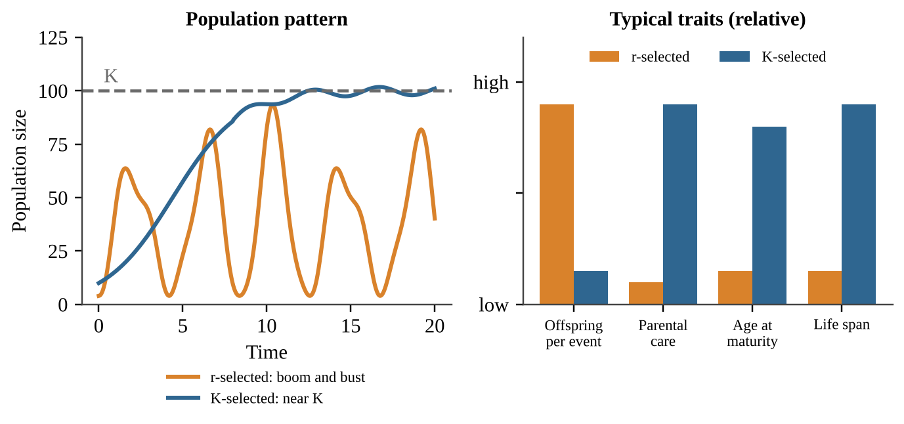
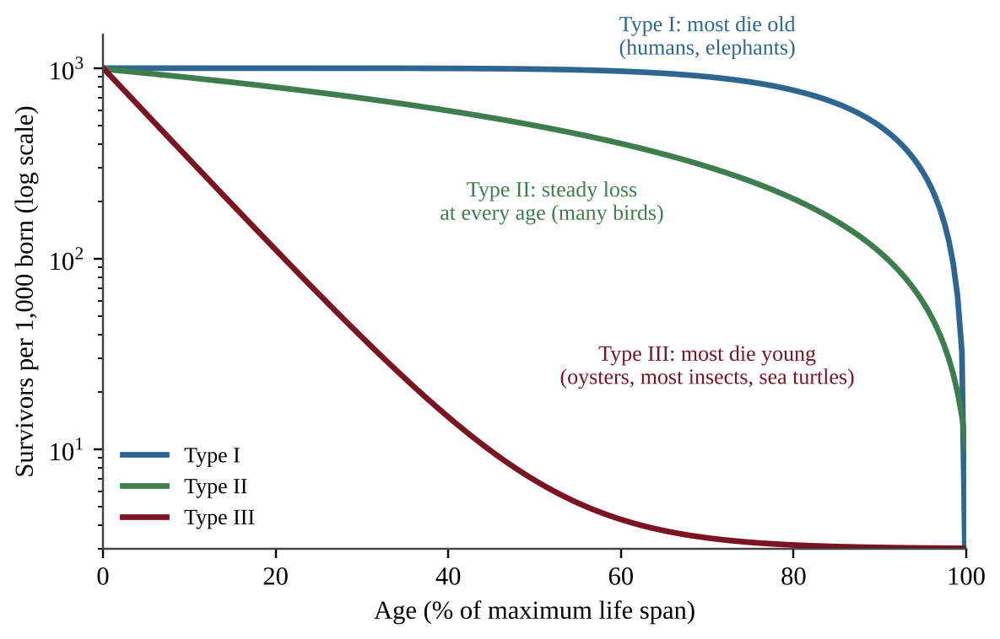
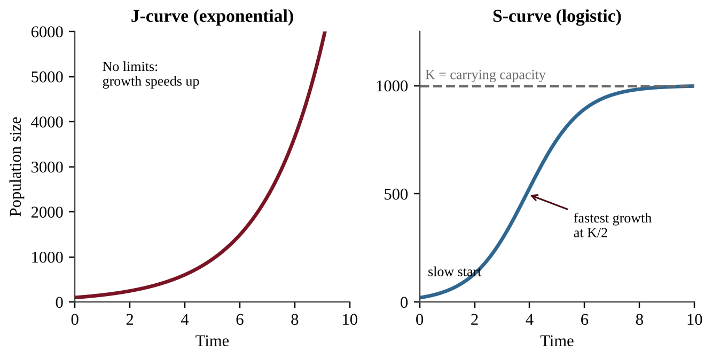
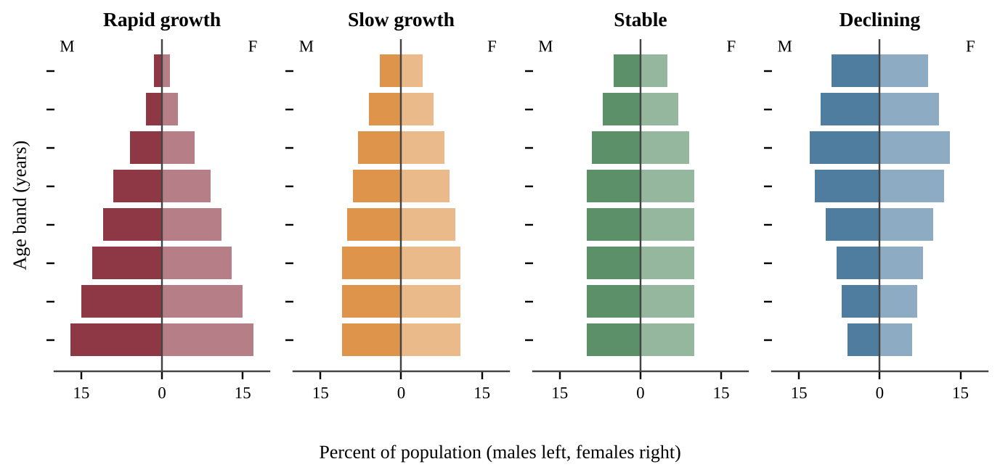
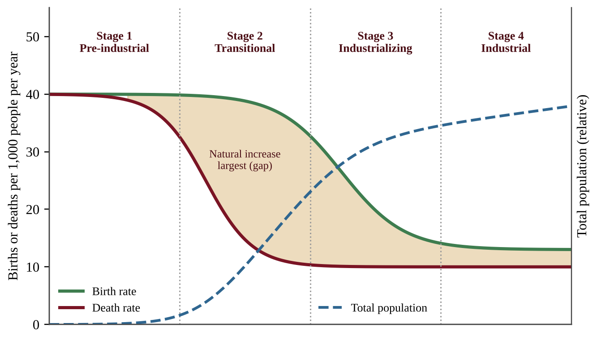

# Unit 3 — Populations

A population is a group of individuals of one species living in the same place at the same time. Unit 3 asks two big questions. First, why do populations of different species grow, shrink and survive in such different ways? Second, how do the same ideas explain the growth of the human population and the choices that shape it? This unit carries 10–15% of the AP exam and is the most math-heavy unit in the course, so work the calculations with a pencil as you read.

## Topic 3.1 — Generalist and Specialist Species

:::box objectives
- Identify differences between generalist and specialist species.
- Predict which type is advantaged when a habitat stays constant and when it changes.
:::

:::box simple
A **niche** is a species' job and address: what it eats, where it lives, and the conditions it tolerates. A generalist is a "jack of all trades" with a wide niche. A specialist is a "master of one" with a narrow niche. Specialists win when life stays the same. Generalists win when life keeps changing.
:::

### Two ways to make a living

A **generalist species** can eat many foods, live in many habitats, and tolerate a wide range of temperature, moisture and other conditions. Raccoons, cockroaches, coyotes, house mice and white-tailed deer are classic examples. A **specialist species** has a narrow diet, a narrow habitat, or narrow tolerance limits. A koala eats almost only eucalyptus leaves. A giant panda depends overwhelmingly on certain bamboo species. A tropical coral reef fish may live only in one kind of coral.

Think of a tool kit. A generalist carries a Swiss army knife: it does everything adequately. A specialist carries a surgeon's scalpel: it does one job superbly but is useless for anything else.

### Why habitat stability decides who wins

In a **constant habitat** (a stable rain forest or a deep, unchanging cave) a specialist can fine-tune its body and behavior to exact conditions. It out-competes the generalist for its one resource because it uses that resource more efficiently, and there are few surprises that could remove it.

In a **changing habitat** the story flips. If a fire, a drought, a new road or climate change removes the specialist's one food or one habitat, the specialist has nowhere to turn and its population crashes. The generalist simply switches to another food or moves to another place, so its population holds steady or grows.

:::box process
Stable habitat → specialist uses its one resource very efficiently → specialist is favored  
Habitat changes or is lost → specialist's only resource disappears → specialist declines or goes extinct  
Habitat changes → generalist switches food or habitat → generalist persists or spreads
:::

:::box define
**Niche** — the role of a species in its ecosystem, including its food, habitat and tolerance range.
**Generalist species** — a species with a broad niche (many foods, habitats, tolerances); advantaged in changing habitats.
**Specialist species** — a species with a narrow niche; advantaged in constant habitats and vulnerable to change.
:::

:::box apply
A coastal wetland is drained for farmland and crop fields replace the reed beds. A rare marsh bird that nests only in tall reeds disappears within two seasons. Crows and starlings, generalists that eat grain, insects and scraps and nest almost anywhere, increase in the same area. The same environmental change produced opposite results because of niche width.
:::

:::box mistake
- Do not say a generalist is "better." It is better only when conditions change. In a stable habitat the specialist wins.
- Specialist does not mean rare by definition. It means narrow niche, though narrow niches do make a species more vulnerable to extinction.
- Living in a small area does not make a species a specialist; niche width (diet and tolerance) is what counts.
:::

:::box example
id: SG-U3-E001
Two beetle species live in a mixed forest. Beetle A lays its eggs only on the bark of one tree species and its larvae eat only that bark. Beetle B eats wood of more than twenty tree species and can survive in forests, parks and wood piles. A fungal disease kills nearly all trees of the species Beetle A depends on. (a) Classify each beetle as a generalist or a specialist. (b) Predict what happens to each population over the next five years and explain why. (c) State which beetle would likely be favored if the forest stayed completely unchanged for a century, and give one reason.
:::

:::box summary
- Generalists have broad niches; specialists have narrow niches.
- Specialists are advantaged in constant habitats; generalists are advantaged in changing habitats.
- Habitat change hits specialists hardest because they cannot switch resources.
:::

## Topic 3.2 — K-Selected and r-Selected Species

:::box objectives
- Identify differences between K-selected and r-selected species.
- Define biotic potential and explain that many species are not purely r or K.
- Explain why invasive species affect K-selected species more strongly.
:::

:::box simple
Every species has a limited energy budget. It can spend it on **many cheap babies** (the r strategy) or on **a few expensive babies** (the K strategy). Mice and dandelions buy lottery tickets in bulk. Elephants and oak trees invest heavily in each ticket.
:::

### The two strategies

The letters come from population math. **r** stands for the growth rate of a population and **K** stands for carrying capacity. **r-selected species** put their energy into rapid reproduction, so they can grow fast when conditions are good. **K-selected species** stay near the carrying capacity of their environment and put their energy into surviving and competing.

| Trait | r-selected | K-selected |
|---|---|---|
| Body size | Small | Large |
| Offspring per birth event | Many | Few |
| Energy invested per offspring | Minimal | Large; long parental care |
| Age at maturity | Early | Late (long youth) |
| Life span | Short | Long |
| Reproduction | Often once, or in a burst | Several times in a lifetime |
| Habitat and competition | Disturbed or unpredictable; competition usually low | Stable; competition usually high |
| Examples | Bacteria, weeds, mosquitoes, mice | Elephants, whales, humans, oaks |

### Biotic potential and the real world

**Biotic potential** is the maximum reproductive rate of a population under ideal conditions: unlimited food, no predators, no disease. A bacterium has an enormous biotic potential; an elephant has a tiny one. Biotic potential is almost never reached in nature because environmental resistance (limited resources, predators, disease) holds populations back.

Most real species fall between the two extremes, and many change strategy with conditions. A sea turtle lives a long time (K-like) but lays more than a hundred eggs (r-like). A tree may produce seeds in huge numbers but then live for centuries. Always describe a species by its **tendencies**, not as a perfect r or K.

### Invasive species

Most **invasive species** are r-selected: they reproduce quickly, spread widely, and tolerate disturbance. They tend to hit K-selected natives hardest, because K-selected species reproduce slowly and cannot replace losses quickly. An island's slow-breeding native bird, for example, is hurt far more by introduced rats than the rats' own fast-breeding relatives would be. r-selected natives are minimally affected because they rebound quickly.

:::box define
**r-selected species** — small, many offspring, little investment per offspring, early maturity, short life, often reproduce once; usually low competition.
**K-selected species** — large, few offspring, high investment, late maturity, long life, reproduce repeatedly; usually high competition.
**Biotic potential** — the maximum reproductive rate of a population in ideal conditions.
:::

:::box mistake
- r and K are tendencies on a spectrum. Do not claim "all large animals are K and all small animals are r" without checking the traits.
- "r-selected" does not mean "inferior." Their strategy succeeds in unstable, disturbed habitats.
- Do not confuse K the strategy with K the carrying capacity. They are connected (K-selected species live near K) but they are not the same thing.
:::

:::box strategy
On the exam, answer "compare" prompts with a trait pair, such as "r-selected species produce many offspring while K-selected species produce few." A list of traits with no comparison earns less credit than one clear contrast per trait.
:::

:::box example
id: SG-U3-E002
A biologist records the following about three species. Species P: adult mass 2 g, 400 eggs per season, matures at 3 months, lives about 1 year. Species Q: adult mass 4,500 kg, one calf every 3 years, matures at 12 years, lives 60 years. Species R: adult mass 25 kg, 2 pups per year, matures at 2 years, lives 12 years. (a) Classify P and Q as r-selected or K-selected, citing two traits each. (b) State which of P and Q would be more severely harmed by an aggressive invasive predator and explain why. (c) Explain why R is difficult to classify as purely r or purely K.
:::

:::box summary
- r-selected: small, many offspring, early maturity, short life; K-selected: large, few offspring, late maturity, long life.
- Biotic potential is the maximum reproduction rate under ideal conditions.
- Many species mix strategies; most invasive species are r-selected and K-selected natives suffer most.
:::

## Topic 3.3 — Survivorship Curves

:::box objectives
- Explain what a survivorship curve shows.
- Distinguish Type I, Type II and Type III curves.
- Connect survivorship type to r- and K-selection.
:::

:::box simple
Follow 1,000 newborns of one species. Draw a graph of how many are still alive at each age. If most live long and die old, you get Type I. If death strikes evenly at every age, Type II. If most die very young, Type III.
:::

A **survivorship curve** displays the relative survival of a **cohort** (a group of individuals born at the same time) from birth to the greatest age reached by any member. The x-axis is age, often as a percent of maximum life span so species can be compared. The y-axis is the number (or percent) of the cohort still alive, commonly on a log scale so that a drop from 1,000 to 10 survivors is as visible as a drop from 100 to 1.

| Type | Shape | Pattern of death | Typical species and strategy |
|---|---|---|---|
| I | Flat early, then drops steeply late | Low death at young and middle ages; most die in old age | Humans, elephants, large mammals (K-selected); heavy parental care |
| II | Straight diagonal line | Roughly constant chance of dying at every age | Many songbirds, some lizards and rodents (intermediate) |
| III | Steep early drop, then flat | Very high death of the young; survivors often live long | Oysters, most fish, insects, sea turtles, weeds (r-selected); many offspring, little care |

### Reading the curve

Steepness tells you where deaths happen. A steep section means many individuals are dying in that age range. A flat section means few are dying. Type III species compensate for massive early losses by producing huge numbers of offspring, so a few survive. Type I species produce few offspring but protect each one, so most reach adulthood. The link is cause and effect: high parental investment → high juvenile survival → Type I; low investment → high juvenile mortality → Type III.

:::box formula
**Percent surviving to age x** = (number alive at age x ÷ number in starting cohort) × 100  
Variables: number alive and cohort size are counts of individuals; the result is a percent.  
**Number dying in an interval** = survivors at start of interval − survivors at end of interval.
:::

:::box mistake
- The curve shows **survival**, not population size. A Type III curve does not mean the population is shrinking.
- Do not say Type III species "live short lives." Many survivors live long. The point is high mortality when young.
- On a log scale, a straight line means a constant **percent** loss per time step, not a constant number lost.
:::

:::box strategy
First locate where the curve is steepest, then name the life stage (young, middle, old), and finally name the type. Support it with a number read from the graph. For example: "Only 8% survive to 10% of maximum age, so most deaths occur in the young."
:::

:::box example
id: SG-U3-E003
A researcher follows a cohort of 800 tree-frog eggs. Survivors at the end of each age: age 0: 800; age 1 year: 160; age 2 years: 80; age 4 years: 40; age 8 years: 20. (a) Calculate the percent of the cohort that survives to age 1 year. (b) Calculate how many individuals die between age 1 and age 2. (c) Identify the survivorship type and state whether the species is more likely r-selected or K-selected, giving a reason based on the data.
:::

:::box summary
- A survivorship curve tracks a cohort from birth to maximum age.
- Type I (K-selected, much parental care), Type II (steady mortality), Type III (r-selected, high juvenile mortality).
- Steepness shows when most deaths occur.
:::

## Topic 3.4 — Carrying Capacity

:::box objectives
- Describe carrying capacity (K).
- Describe overshoot and its environmental impacts, including resource depletion and dieback.
:::

:::box simple
A lake can feed only so many ducks. **Carrying capacity (K)** is the largest population an environment can support **indefinitely** with its food, water, space and other resources. Push past it and the habitat gets damaged, and the population then crashes.
:::

### K and the S-curve

When a few individuals enter a new, resource-rich area, the population first grows slowly, then rapidly, then levels off near K. The graph is an **S-shaped (logistic) curve**. With no limits, growth would follow a **J-shaped (exponential) curve**, climbing faster and faster. Real populations may follow a J-curve briefly, but limiting factors always bend it into an S or into a boom-and-bust pattern.

Carrying capacity is not a fixed number. It **changes** when conditions change: a wet year increases plant growth and raises K for deer, a drought or a pollutant lowers it, and a new competitor can reduce it for the original species.

### Overshoot and dieback

**Overshoot** happens when a population exceeds K. Often the population keeps growing for a time after resources start to run short because of a **time lag**: births that were already underway, long-lived adults, and slow feedback. During overshoot the population consumes resources faster than they regenerate, so the habitat is damaged: vegetation is overgrazed, soil erodes, water and prey are depleted. The result is **dieback** (also called a population crash), a sharp, often severe decline caused by famine, disease or conflict. Because habitat was damaged, the new carrying capacity may be lower than the old one, and the population may oscillate around K or take a long time to recover.

:::box process
Population is below K → resources plentiful → population grows (S-curve rising)  
Population exceeds K (overshoot) → resource use > resource renewal → resource depletion and habitat damage  
Resource shortage → famine, disease, conflict → dieback → population falls to or below K (K may be lower)
:::

:::box define
**Carrying capacity (K)** — the maximum population size an environment can sustain over the long term with available resources.
**Overshoot** — a population exceeding K.
**Dieback** — a severe decline of a population after overshoot due to resource shortage.
:::

:::box apply
A small number of goats is released on a rocky island with sparse grass. The herd grows quickly for years, eats nearly all the ground cover, and then starves in a dry summer. The remaining hillside is bare and erodes in winter storms, so a smaller herd could be supported afterward. Overshoot, dieback and a lowered K occurred in one story.
:::

:::box mistake
- K is not "the number of births." It is a ceiling set by resources.
- K is not permanent. A question that says "K changed" is not a contradiction.
- Overshoot does not instantly cause dieback; the lag allows a population to overshoot before the crash.
:::

:::box example
id: SG-U3-E004
Deer were introduced to a 25 km² island. Population counts: year 0: 30; year 2: 80; year 4: 190; year 6: 330; year 8: 430; year 10: 480; year 12: 495; year 14: 500; year 16: 500. (a) Estimate the carrying capacity and calculate the population density at that size in deer per km². (b) Identify which two-year interval had the greatest increase in number of deer, and show the calculation. (c) Explain, in terms of resources, why growth slowed after year 8.
:::

:::box example
id: SG-U3-E005
On a small island, the forage supports a carrying capacity of 300 goats. Goats are released and the herd grows to 560 before a severe drought. Afterward the herd falls to 140. (a) Calculate by what percent the herd exceeded carrying capacity at its peak. (b) Name the term for the decline from 560 to 140. (c) Explain two environmental impacts of the overshoot and one reason the new carrying capacity might be below 300.
:::

:::box summary
- K is the maximum population an environment can support long term; it can change.
- J-curve is unlimited growth; S-curve levels at K.
- Overshoot → resource depletion → dieback from famine, disease or conflict.
:::

## Topic 3.5 — Population Growth and Resource Availability

:::box objectives
- Explain how resource availability affects population growth.
- Apply mathematical relationships (percent change, growth rate, logistic growth) with work shown.
:::

:::box simple
Food, water and space are a bank account. When the account is full, a population spends freely and grows faster and faster. When the account shrinks, there is not enough to go around, and the population stops growing or shrinks.
:::

### The logic of limits

Population growth is limited by environmental factors, above all the available resources and space. These resources are **finite at every scale of time**: a year's rain, a lake's fish, an island's soil. When resources needed for growth are abundant, growth usually **accelerates**. When the resource base shrinks, resources are shared unequally: some individuals get enough and others do not. The result is higher mortality, lower fecundity (fewer offspring), or both, so growth falls to or below carrying capacity.

### Math: growth and percent change

:::box formula
**Percent change** = [(final value − initial value) ÷ initial value] × 100  
**Average annual growth rate (%)** = percent change ÷ number of years  
Variables: values are numbers of individuals; time in years; the answer is in % per year.  
Example setup (not a problem): 400 → 450 in 5 years gives (50 ÷ 400) × 100 = 12.5% total, 2.5% per year.
:::

### Math: logistic growth

In a limited environment the speed of growth depends on how much room is left. The idea of the **logistic model** is that the growth rate is the unlimited rate multiplied by the fraction of capacity still open:

:::box formula
**Population change per time (dN/dt)** = r × N × [(K − N) ÷ K]  
N = current population (individuals); K = carrying capacity (individuals); r = per-capita rate of increase under ideal conditions (per year); dN/dt = individuals added per year.  
When N is small, (K − N) ÷ K ≈ 1, so growth is nearly exponential. When N = K/2, growth is fastest. When N = K, growth is 0. When N > K, growth is negative.
:::

**Reading a growth graph.** On an S-curve the steepest part (the fastest addition of individuals) occurs about halfway to K, not at K. Above K the curve falls, which is a sign of overshoot. If a graph shows the population falling after peaking far above a dashed K line, say "overshoot followed by dieback."

:::box apply
A fish farm starts a pond with 100 fish. In the first months fish double rapidly because food is abundant. By month 8 the pond holds 4,000 fish, the water is crowded and oxygen is low, and growth almost stops. The pond's carrying capacity (food, oxygen, space) caps the population near 4,500. The farm raises K by adding aeration and food, which allows more fish to be supported.
:::

:::box mistake
- Do not say the fastest growth is "at K." The fastest growth in numbers is near K/2.
- Percent change uses the **initial** value in the denominator, not the final value.
- A population that is still growing may be growing at a slower rate. Rate and size are different things.
:::

:::box strategy
Write the formula, substitute with units, calculate, and put a unit on the answer. Partial credit depends on visible work, and calculators are allowed, so there is no reason to skip steps.
:::

:::box example
id: SG-U3-E006
A lake's carrying capacity for a fish species is K = 2,000 fish, and the species' per-capita rate of increase is r = 0.40 per year. Use dN/dt = r × N × (K − N) ÷ K. (a) Calculate the yearly population change when N = 500, when N = 1,000, and when N = 1,900. (b) State at which of these sizes growth is fastest and explain why growth is slowest of the three at 1,900. (c) Calculate dN/dt when N = 2,600 and interpret the sign of your answer.
:::

:::box summary
- Abundant resources → accelerating growth; shrinking resource base → higher mortality and lower fecundity → growth falls toward or below K.
- Percent change = (final − initial) ÷ initial × 100.
- Logistic growth: dN/dt = rN(K − N)/K; fastest at K/2, zero at K, negative above K.
:::

## Topic 3.6 — Age Structure Diagrams

:::box objectives
- Explain how to read an age structure diagram.
- Use the shape to infer growth rate and the proportion of young people.
:::

:::box simple
An **age structure diagram** (population pyramid) stacks bars for each age group, males on one side, females on the other. A wide base means lots of children: the population will grow. A narrow base means few children: the population will shrink.
:::

Each horizontal bar shows the number or percent of people in an age band. The population is often split into three groups: **pre-reproductive** (under 15), **reproductive** (about 15–44), and **post-reproductive** (45 and older). The shape predicts where the population is heading, because today's children become tomorrow's parents.

| Shape | What it means | Proportion of young |
|---|---|---|
| Wide base, narrowing quickly (triangle) | Rapid growth: many children will become parents | Highest |
| Wider at base, gentle taper | Slow growth | Moderate |
| Nearly vertical sides | Stable, near zero growth | Lower |
| Narrow base, bulge in middle or top | Declining population | Lowest |

A rapidly growing population has a **higher proportion of young people** than a stable or declining one. This produces **population momentum**: even if each family chose to have fewer children, the population keeps growing for decades because so many young people are about to enter their reproductive years.

Reading tips: a bulge in the middle ages (a "baby boom") will move upward over time; a sudden narrow band shows a past drop in births, a famine, a war or an epidemic. A pyramid with a narrow base and a large top predicts a rising proportion of elderly people and fewer workers.

:::box define
**Age structure diagram** — a graph of the number or percent of a population in each age group, split by sex.
**Pre-reproductive / reproductive / post-reproductive** — age groups before, during and after the child-bearing years.
**Population momentum** — continued growth caused by a large young group entering reproductive age even after fertility falls.
:::

:::box apply
Country A has 42% of its people under 15. Its government will need to build many new schools and later create jobs for a large wave of workers. Country B has 25% over 65. It faces strain on pensions and health care and a shortage of young workers. The two pyramids point to very different policy challenges.
:::

:::box mistake
- A pyramid does not show growth over time on its own; it shows the **current** structure from which you infer the trend.
- Do not read the width of the **top** bars for growth. The base (young ages) predicts growth.
- Do not confuse "high proportion of young" with "high death rate." A shape alone does not give either rate.
:::

:::box strategy
Describe the shape first ("wide base, sharply tapering"), then state the inference ("rapid growth because many young will reproduce"), then give a consequence (schools, jobs, health care).
:::

:::box example
id: SG-U3-E007
The table gives the percent of each country's population in three age groups.

| Country | Under 15 | 15–44 | 45 and over |
|---|---|---|---|
| A | 41 | 40 | 19 |
| B | 25 | 41 | 34 |
| C | 13 | 36 | 51 |

(a) Identify which country is growing fastest and which is most likely declining, and justify each using the data. (b) Explain what population momentum means and name the country where it is strongest. (c) Describe one challenge that Country C's age structure is likely to create.
:::

:::box summary
- The base of a diagram predicts growth: wide = rapid growth, narrow = decline.
- Rapidly growing populations have a higher proportion of young people.
- Population momentum keeps populations growing after fertility drops.
:::

## Topic 3.7 — Total Fertility Rate

:::box objectives
- Explain the factors that affect total fertility rate (TFR).
- Explain replacement-level fertility and the factors that affect infant mortality.
:::

:::box simple
**Total fertility rate** is the average number of children a woman would have in her lifetime if she lived through all her childbearing years at today's age-specific birth rates. A TFR of about 2.1 is "replacement," because it just replaces the parents (and allows for some children who die before adulthood).
:::

### What the numbers mean

**Replacement-level fertility** is about 2.1 children per woman in countries with low infant mortality. The extra 0.1 covers children who die young and the slightly higher number of boys than girls born. In places with high infant mortality, replacement is higher, because more children are needed to ensure two survive to adulthood. If TFR is at replacement level, the population is considered relatively stable (ignoring migration, and with a lag because of momentum). Above it the population grows; below it the population eventually shrinks.

:::box formula
**Total fertility rate (TFR)** = (sum of age-specific fertility rates for all age groups) × (width of age group in years) ÷ 1,000  
Age-specific fertility rate = births per 1,000 women in that age group per year; for 5-year groups, width = 5. TFR is in children per woman.  
**Infant mortality rate (IMR)** = (deaths of infants under 1 year ÷ live births) × 1,000, in deaths per 1,000 live births.
:::

### Factors that lower TFR

- **Age at first child.** When women have their first child later, they have fewer years to bear children and tend to have fewer overall.
- **Educational opportunities for females.** Educated women gain job options and delay marriage and childbirth.
- **Access to family planning.** Contraception and information let families choose the number and timing of children.
- **Government acts and policies.** Examples include incentives or penalties, family-planning programs, and laws on marriage age or women's rights.

### Infant mortality

Infant mortality falls when mothers have access to good **healthcare** (prenatal care, safe delivery, vaccines) and good **nutrition**, and when families have clean water and sanitation. When infant mortality falls, families no longer need many births to ensure survivors, and fertility tends to fall after a lag. In a rapidly growing country with high IMR, improving maternal health care can reduce both.

:::box mistake
- TFR is not the number of babies per 1,000 people. That is the crude birth rate.
- TFR of 2.1 does not instantly stop growth, because of momentum.
- Replacement level is not exactly 2 and is higher where infant mortality is high.
:::

:::box apply
Country D raises the share of girls completing secondary school from 20% to 70%, opens rural clinics with family-planning services, and sees the average age at first birth rise from 18 to 23. Over two decades its TFR falls from 5.2 to 2.6, and infant mortality falls too. Several factors from the CED list acted together.
:::

:::box example
id: SG-U3-E008
In Country Z, age-specific fertility rates (births per 1,000 women per year) are: ages 15–19: 10; 20–24: 70; 25–29: 105; 30–34: 85; 35–39: 40; 40–44: 8; 45–49: 0. (a) Calculate the total fertility rate, using 5-year age groups. (b) Compare it with the replacement level of 2.1 and state whether, ignoring migration, the long-term population is likely to grow, stay stable or decline. (c) Describe two factors that could change Country Z's TFR and the direction each would push it.
:::

:::box summary
- TFR is children per woman; about 2.1 is replacement.
- Lower TFR is linked with later first births, female education, family planning and policy.
- Infant mortality falls with healthcare and nutrition, and lower infant mortality contributes to lower fertility.
:::

## Topic 3.8 — Human Population Dynamics

:::box objectives
- Explain how human populations grow and decline through births, deaths, immigration and emigration.
- Describe density-dependent and density-independent limiting factors and Malthusian limits.
- Calculate rate of natural increase, growth rate and doubling time.
:::

:::box simple
A population is like a bathtub. Births and immigrants are water coming in; deaths and emigrants are water going down the drain. If more comes in than leaves, the level rises. The only questions are how fast and for how long.
:::

### The four inputs

Human population growth or decline is controlled by four rates: **birth, death, immigration and emigration**. Birth and death rates are strongly affected by access to **education, family planning, healthcare and nutrition**.

:::box formula
**Rate of natural increase (RNI, %)** = (crude birth rate − crude death rate) ÷ 10  
CBR and CDR are births and deaths per 1,000 people per year; dividing by 10 converts per 1,000 to percent.  
**Population growth rate (%)** = [(births + immigrants) − (deaths + emigrants)] ÷ starting population × 100  
or  = (CBR − CDR + immigration rate − emigration rate) ÷ 10, with every rate per 1,000 per year.  
**Doubling time (years)** ≈ 70 ÷ annual growth rate (%)  (the Rule of 70)
:::

The Rule of 70 is an estimate. A growth rate of 2% gives about 35 years to double; 1% gives about 70 years; 3.5% gives about 20 years. After one doubling the population is 2× the original; after two doublings, 4×; after three, 8×. Note that RNI ignores migration, so a country can have a high RNI but a lower total growth rate if many people leave.

**Worked pattern (not a solved problem).** For a population of 90,000 gaining 1,800 people in one year, the growth rate is 1,800 ÷ 90,000 × 100 = 2.0%, so doubling time ≈ 70 ÷ 2.0 = 35 years. Use this three-step pattern: rate → percent → doubling.

### Limits to human population

**Carrying capacity of Earth.** Earth's resources (food, fresh water, energy, space, a stable climate) are finite, so human population ultimately has a limit, though technology, diet and consumption level change where that limit lies.

**Malthusian theory.** Thomas Malthus argued that population grows **geometrically** (like 2, 4, 8, 16) while food production grows only **arithmetically** (like 2, 4, 6, 8). Eventually population outruns food and is held back by famine, disease and war (and, he argued, by restraint). Modern technology has delayed these limits for humans, but the basic idea, that growth in numbers cannot continue forever on finite resources, remains central to the debate.

### Density-dependent and density-independent factors

| Kind | Effect depends on population density? | Examples |
|---|---|---|
| Density-dependent | Yes; stronger when crowded | Competition for food, clean water and air, disease transmission, territory size, predation |
| Density-independent | No; hits regardless of size | Major storms, fires, heat waves, droughts, floods |

A crowded city is more likely to see a fast-moving epidemic (density-dependent), but a hurricane harms a village and a city equally per person (density-independent). Density-dependent factors tend to regulate populations near K, while density-independent events can cause sudden crashes at any size.

:::box define
**Crude birth rate (CBR)** — births per 1,000 people per year.
**Crude death rate (CDR)** — deaths per 1,000 people per year.
**Rate of natural increase (RNI)** — CBR minus CDR, usually expressed as a percent.
**Doubling time** — years for a population to double at a constant growth rate.
**Density-dependent factor** — a limit whose strength changes with population density.
**Density-independent factor** — a limit that acts regardless of density.
:::

:::box mistake
- Forgetting to convert per 1,000 to percent: a difference of 20 per 1,000 is 2.0%, not 20%.
- Putting growth rate as a decimal in 70 ÷ r. Use the percent number (2, not 0.02).
- Mixing RNI with total growth: RNI ignores migration.
:::

:::box strategy
In a calculation FRQ, label each step with its unit (people per year, %, years). Use dimensional analysis: write units in the setup so they cancel to the unit asked for.
:::

:::box example
id: SG-U3-E009
A coastal town has 25,000 residents at the start of a year. During the year there are 400 births, 250 deaths, 300 people moving in and 150 people moving out. (a) Calculate the town's population growth rate as a percent for the year. (b) Use the Rule of 70 to estimate the doubling time. (c) Identify whether the town's growth in this year came mostly from natural increase or from net migration, and show the two numbers you compared.
:::

:::box example
id: SG-U3-E010
Country M has a crude birth rate of 28 per 1,000, a crude death rate of 8 per 1,000 and an emigration rate of 1.5 per 1,000 per year. Immigration is negligible. (a) Calculate the rate of natural increase as a percent. (b) Calculate the overall population growth rate as a percent. (c) Calculate the doubling time using the overall growth rate and state how many times larger the population would be after three doubling times. (d) Classify an earthquake and an increase in disease transmission as density-independent or density-dependent factors.
:::

:::box summary
- Growth depends on births, deaths, immigration and emigration, influenced by education, family planning, healthcare and nutrition.
- RNI = (CBR − CDR) ÷ 10; doubling time ≈ 70 ÷ growth rate (%).
- Malthus: population grows geometrically, food arithmetically; Earth's carrying capacity limits humans.
- Density-dependent factors (disease, food, water, territory) vs. density-independent (storms, fires, heat waves, droughts).
:::

## Topic 3.9 — Demographic Transition

:::box objectives
- Define the demographic transition and describe the four stages of the model.
- Describe characteristics of developing versus developed countries.
:::

:::box simple
As a country develops, death rates fall first (better food, medicine and sanitation). Birth rates fall later (families adjust). In the gap between, the population surges. The **demographic transition model (DTM)** tells that story in four stages.
:::

The **demographic transition** is the shift from high birth and death rates to low birth and death rates as a country moves from a **pre-industrial** to an **industrialized** economy. The DTM shows it in four stages.

| Stage | Birth rate | Death rate | Growth | What is happening |
|---|---|---|---|---|
| 1 Pre-industrial | High | High | Very slow | Famine, disease and poor sanitation; many children die; children help with farm work |
| 2 Transitional | High | Falling fast | Rapid | Better food supply, clean water, medicine; infant mortality drops but families still large |
| 3 Industrializing | Falling | Low | Slowing | Urbanization, women's education and work, family planning, children cost more |
| 4 Industrial | Low | Low | Very slow, near zero or negative | Stable or aging population; TFR near or below replacement |

**Why death rates fall before birth rates.** Public health and food improvements spread quickly because they are cheap and obvious, but family size depends on social and economic change (education, jobs, urban living, cost of children, expectations), and those change over decades. The lag creates Stage 2 growth.

### Developing versus developed countries

Developing countries (Stages 2 and early 3) typically have **higher infant mortality**, more **children in the workforce**, lower female education, lower income, and a young age structure. Developed countries (Stage 4) have low infant mortality, children in school rather than in the workforce, high education levels and an older age structure. A single country can be placed in the model by comparing its birth and death rates and age structure.

:::box process
Stage 1: high births and deaths → Stage 2: death rate falls (medicine, sanitation, food), births stay high → population surge  
Stage 3: birth rate falls (education, family planning, urbanization, women's work) → growth slows  
Stage 4: low births and deaths → stable, aging population
:::

:::box define
**Demographic transition** — the move from high to low birth and death rates as a country industrializes.
**Demographic transition model (DTM)** — the four-stage model describing this shift.
:::

:::box apply
A country in Stage 2 sees its death rate fall from 30 to 12 per 1,000 after a vaccination campaign and clean-water projects, while its birth rate stays at 38. The RNI jumps from nearly zero to 2.6%. Its schools and cities strain to keep up. Twenty years later, as girls' schooling and family planning spread, the birth rate falls to 22 and the country enters Stage 3.
:::

:::box mistake
- Stage 4 is not zero growth in every country; some have slight growth or decline. Describe it as "very slow, near zero."
- The population is **largest in Stage 4**, but it is **growing fastest in Stage 2**.
- Death rate falls first, not birth rate.
:::

:::box strategy
To place a country in a stage, compare the two rates: both high = 1; birth far above death with death falling = 2; birth falling toward death = 3; both low and close = 4. Then check the age structure for agreement.
:::

:::box example
id: SG-U3-E011
A country reports these rates per 1,000 people per year.

| Year | Birth rate | Death rate |
|---|---|---|
| 1900 | 44 | 41 |
| 1930 | 43 | 30 |
| 1960 | 38 | 14 |
| 1990 | 24 | 9 |
| 2020 | 12 | 10 |

(a) Calculate the rate of natural increase (as a percent) for each year. (b) Assign each year to a stage of the demographic transition model. (c) Identify the year of fastest natural growth and explain the cause of the gap between birth and death rates then. (d) Describe the likely age structure shape in 2020.
:::

:::box example
id: SG-U3-E012
Country X has 36 million people, a growth rate of 2.8% per year, a total fertility rate of 4.8, an infant mortality rate of 62 per 1,000 live births, and only 28% of girls completing secondary school. (a) Estimate the doubling time and the population after 50 years if the growth rate stayed constant. (b) Identify the stage of the demographic transition model that best fits Country X and justify it with two data values. (c) Propose two policies and explain, for each, how it would lower TFR over time. (d) Explain why the population would probably keep growing for decades even if TFR fell to 2.1 tomorrow.
:::

### Math & Skills Toolkit

**1. Unit conversions.** Per 1,000 → percent: divide by 10. Percent → per 1,000: multiply by 10. Always write units next to numbers.

**2. Percent change** = (final − initial) ÷ initial × 100. A negative answer means decline.

**3. Growth rate from components.** Add inputs (births, immigrants), subtract outputs (deaths, emigrants), divide by the starting population, multiply by 100.

**4. Rule of 70.** Doubling time = 70 ÷ growth rate (%). Use the percent number. For halving of a declining population, divide by the percent decline.

**5. Repeated doubling.** After n doubling times the population is N₀ × 2ⁿ. For a constant annual percent rate, N after t years ≈ N₀ × (1 + rate)ᵗ with rate as a decimal.

**6. Density** = number of individuals ÷ area (individuals per km²). Use the same area unit throughout.

**7. Reading graphs.**
- J-curve: unlimited growth, doubling again and again. S-curve: levels at K. Dashed horizontal line usually marks K.
- Fastest increase on an S-curve is near K/2; any drop after a peak above K means dieback.
- Survivorship: locate steepest drop, name the type, then link to r or K.
- Age structure: read the base first; compare the proportion of young.
- Demographic transition: both rates high, then death rate falls, then birth rate falls; the gap equals growth.

**8. Exam routine for calculations.** Formula → substitution with units → answer with units → one-sentence interpretation (for example "the population doubles about every 35 years"). Round at the end, and keep two or three significant figures.

**9. Command words.** *Calculate* needs numbers and units. *Describe* states what the data show. *Explain* gives a cause-and-effect reason. *Justify* supports a claim with evidence from the data. *Propose a solution* names a specific action and its effect.

:::box summary
**Unit 3 at a glance**
- Generalists thrive when habitats change; specialists thrive when habitats are constant.
- r-selected species: small, many offspring, little care, early maturity, short life, Type III survivorship, boom and bust. K-selected: large, few offspring, much care, late maturity, long life, Type I or II, near K. Most invasive species are r-selected; K-selected natives suffer more.
- Carrying capacity (K) is the long-term maximum; overshoot leads to resource depletion and dieback.
- Resources limit growth; abundant resources accelerate it, shrinking resources raise mortality and lower fecundity. Logistic growth: dN/dt = rN(K − N)/K.
- Age structure: wide base = rapid growth; narrow base = decline; momentum persists after fertility falls.
- TFR of about 2.1 is replacement; later first births, female education, family planning and policy lower TFR; healthcare and nutrition lower infant mortality.
- RNI = (CBR − CDR) ÷ 10; doubling time = 70 ÷ growth rate (%); Malthus: geometric population vs. arithmetic food; density-dependent vs. density-independent factors.
- DTM: Stage 1 both high; Stage 2 death rate falls and population surges; Stage 3 birth rate falls; Stage 4 both low.
:::
