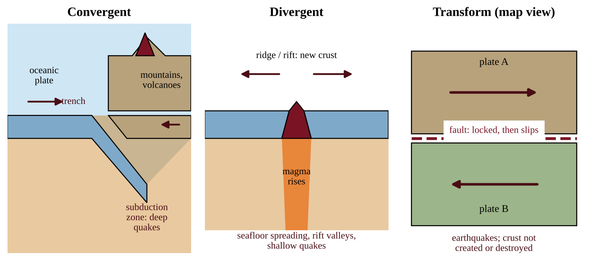
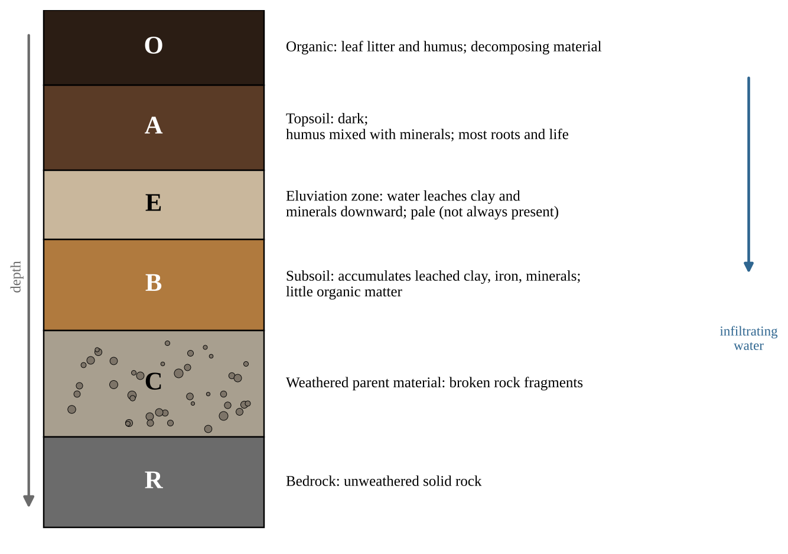
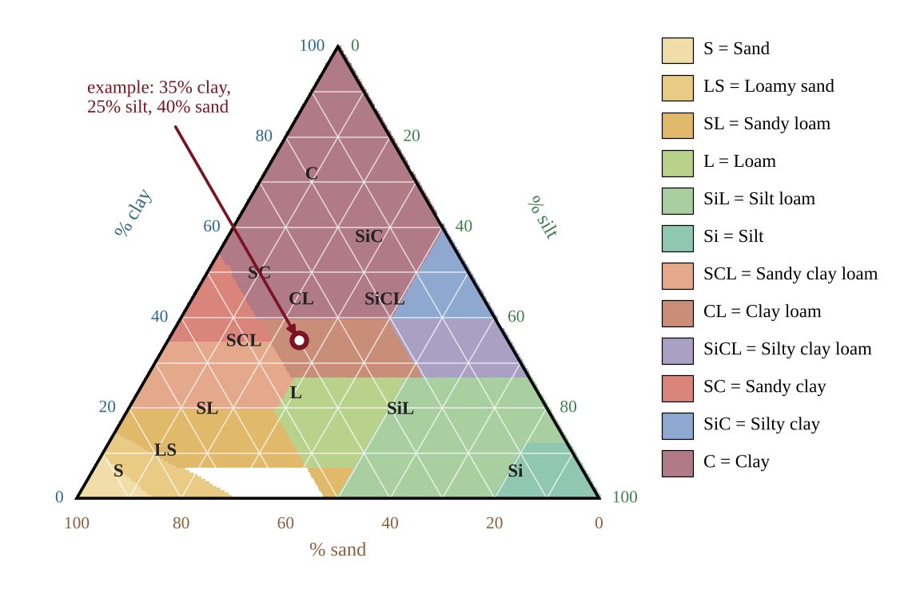
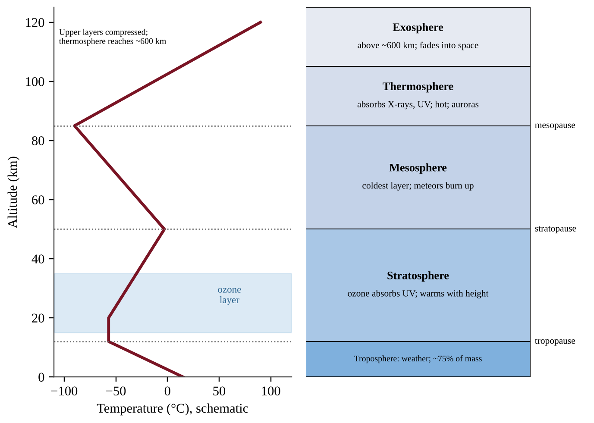
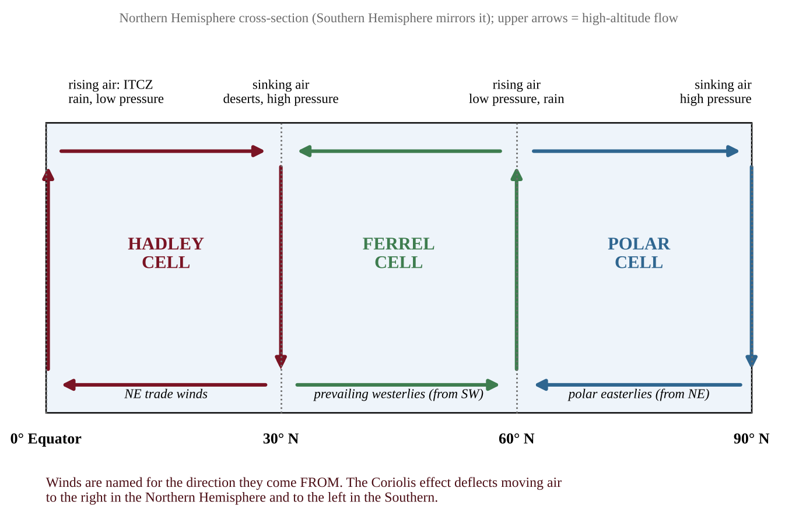
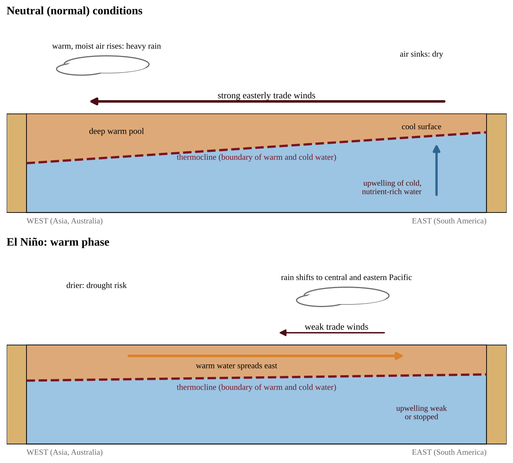

# Unit 4 — Earth Systems and Resources

This unit explains the physical stage on which every other unit is played: the moving crust beneath us, the thin skin of soil we grow food in, the layered air above us, the winds and ocean patterns that spread the sun's energy around the planet, and the geography that bends all of this into local weather and climate. Unit 4 carries 10–15% of the exam. Many of its questions are **visual**: a map, a diagram, a soil triangle, a temperature profile or a wind-pattern figure. Learn to *read pictures* and to explain the cause-and-effect chain behind each one.

## Topic 4.1 — Plate Tectonics

:::box objectives
- Describe the geological changes and events at convergent, divergent and transform plate boundaries.
- Use maps of plate boundaries to locate volcanoes, island arcs, earthquakes, hot spots and faults.
- Explain how an earthquake occurs when stress overcomes a locked fault.
:::

:::box simple
Earth's rigid outer shell is cracked into giant slabs called plates. They ride very slowly (about as fast as your fingernails grow) on hot, soft rock beneath them. Where slabs push together, pull apart or slide past each other, the crust crumples, splits or snaps. Mountains, volcanoes and earthquakes are mostly found along those cracks.
:::

### The engine: moving plates

Earth's outer layer, the **lithosphere** (crust plus the rigid top of the mantle), is broken into about a dozen large plates and many small ones. They float on the hotter, plastic **asthenosphere**. Heat flowing out of the deep Earth sets up slow convection in the mantle, and together with the pull of cold, dense plate edges sinking back into the mantle, this moves plates a few centimeters per year. Plate boundaries are where almost all geologic activity concentrates, so a map of boundaries is also a map of risk.

### Three boundary types

At a **convergent boundary** two plates move toward each other. What happens depends on the crust involved.

- *Oceanic plate meets continental plate.* The denser oceanic plate sinks beneath the continental plate in a **subduction zone**, forming a deep ocean **trench**. Water released from the sinking slab helps rock above it melt, and the magma rises to build a chain of volcanoes and mountains on the continent (the Andes, the Cascades). Powerful earthquakes occur along the slab.
- *Oceanic plate meets oceanic plate.* One sinks, forming a trench and a curved chain of volcanic islands called an **island arc** (Japan, the Aleutians).
- *Continental plate meets continental plate.* Neither sinks easily, so the crust buckles upward into very high mountains (the Himalayas). Earthquakes are common but volcanoes are rare.

At a **divergent boundary** plates move apart. Magma rises into the gap and hardens, creating new crust. Under the ocean this is a mid-ocean ridge with **seafloor spreading**; on land it creates a **rift valley** (the East African Rift). Volcanoes and shallow earthquakes accompany it.

At a **transform boundary** plates slide horizontally past each other. Crust is neither created nor destroyed, but friction makes the plates stick, and the result is earthquakes (the San Andreas Fault in California).

:::box process
Plate motion → plates lock along a fault and stress (strain energy) builds → stress exceeds the friction holding the fault → sudden slip → stored energy released as seismic waves → shaking at the surface (the **epicenter** lies directly above the underground **focus** where slip began).
:::

### Earthquakes and their effects

An earthquake occurs when stress overcomes a locked fault, releasing stored energy. Magnitude scales are logarithmic: each whole-number step up is a tenfold larger wave amplitude and about 32 times more energy released. Earthquakes under the sea can displace water and cause tsunamis. Damage depends on magnitude, depth, distance, ground type and construction quality.

### Hot spots and reading global maps

A **hot spot** is a place where a plume of hot rock rises from deep in the mantle, far from any plate edge. The plate drifts over the plume, so volcanoes form in a line: the active volcano sits over the plume and older, extinct ones lie farther along the direction of plate motion (the Hawaiian Islands).

When a question gives a map of plate boundaries, apply a short routine. Volcanoes and earthquakes that trace a long narrow line mark a boundary. A line of volcanoes just inland from a trench points to oceanic–continental subduction; a curved island chain beside a trench points to an island arc. Earthquakes without volcanoes along a straight line point to a transform fault or a continental collision. A volcano far from any boundary suggests a hot spot. The "Ring of Fire" around the Pacific holds most of the world's earthquakes and active volcanoes because so many subduction zones lie there.

### What drives the plates, and what depth, speed and tsunamis tell us

Plate motion is powered by **heat from Earth's interior** (mantle convection and the pull of sinking, cold slabs), not by the Sun. Sunlight drives weather and ocean currents, not tectonics.

A sinking slab dips into the mantle at an angle, so near a trench the earthquakes are shallow, and farther **inland** they occur at **greater and greater depth**, tracing the slab downward. A graph of earthquake depth against distance from the trench that slopes steadily down to the right is therefore the signature of subduction. A transform fault produces only shallow earthquakes. Rifts and hot spots heat groundwater, giving hot springs and geothermal energy.

An undersea earthquake that suddenly lifts or drops the seafloor displaces the water above it and sends out a **tsunami**. Where the waves reach shallow coasts they flood land, wash away habitat, and contaminate soil and freshwater with salt and debris.

:::box formula
**Plate speed = distance between two volcanoes ÷ difference in their ages**
Age of a farther volcano = its distance from the active volcano ÷ plate speed. The active volcano has age 0.
Unit shortcut: 1 km per million years = 0.1 cm per year. Check: 100 km in 2 million years is 50 km per million years, which is 5 cm per year.
:::

:::box example
id: SG-U4-E011
Three extinct volcanic islands lie along a chain that ends at an active hot-spot volcano. Island P is 140 km from the active volcano and 2.0 million years old; Island Q is 350 km away and 5.0 million years old; Island R is 630 km away and 9.0 million years old. (a) Calculate the plate's speed from the data for Island R, in km per million years and in cm per year. (b) Check it with Island P. (c) Predict the age of an island 1,050 km from the active volcano. (d) State which direction the plate is moving relative to the hot spot and explain why the volcanoes are not found at a plate boundary.
:::

:::box apply
Cities on subduction coasts, such as Seattle or Santiago, face earthquakes, tsunamis and volcanic ash from one process. Planners respond with building codes, tsunami warning sirens, evacuation routes and zoning that keeps hospitals and schools off soft, water-saturated ground. Reading the plate map tells you which hazards to plan for.
:::

:::box mistake
- Saying plates "float on liquid magma." The asthenosphere is solid but flows slowly; most of the mantle is not liquid.
- Saying transform boundaries make volcanoes or new crust. They make earthquakes only.
- Saying all convergent boundaries make volcanoes. Continent–continent collisions build mountains with few or no volcanoes.
:::

:::box strategy
For a boundary question, name three things: the **motion** (toward, apart, sideways), the **landform** (trench, ridge, mountains) and the **hazard** (earthquake, volcano). Use the CED words: island arcs, seafloor spreading, rift valleys, hot spots, faults.
:::

:::box example
id: SG-U4-E001
A geologist studies three sites. Site 1 is a line of active volcanoes 150 km inland, parallel to a deep ocean trench offshore. Site 2 is a long underwater mountain chain where new basalt is found and the seafloor gets older with distance on both sides. Site 3 is a straight valley where a road has been offset 4 m sideways by an earthquake, with no volcanoes nearby. (a) Identify the type of plate boundary at each site. (b) For Site 2, describe what happens to the plates and name the process that adds new crust. (c) State which site is most likely to produce a tsunami, and justify your choice in one sentence.
:::

:::box summary
- Plates move on the asthenosphere; boundaries concentrate quakes and volcanoes.
- Convergent: subduction, trenches, volcanic mountains, island arcs, or collision mountains. Divergent: ridges, seafloor spreading, rift valleys. Transform: earthquakes.
- Hot spots lie inside plates and leave chains of volcanoes.
- An earthquake is stored stress released when a locked fault slips.
:::

## Topic 4.2 — Soil Formation and Erosion

:::box objectives
- Describe how soil forms from parent material by weathering, transport and deposition.
- Describe soil horizons and what distinguishes them.
- Explain how wind and water erode soil and why protecting soil protects water quality.
:::

:::box simple
Soil is crushed rock mixed with dead plant and animal matter, air, water and living things. It takes hundreds to thousands of years to make a centimeter of it, but one heavy storm can wash it away. Soil also acts like a coffee filter for the water passing through it.
:::

### How soil forms

Soil begins as **parent material**: bedrock or loose sediment. Weathering breaks it down.

- **Physical weathering** breaks rock without changing its chemistry: freeze–thaw cycles, roots wedging cracks open, temperature swings, abrasion.
- **Chemical weathering** changes minerals: weak acids in rainwater and from roots, oxidation (rusting) and hydrolysis dissolve and alter them.
- **Biological activity** (lichens, roots, burrowing animals, microbes) contributes to both and adds organic matter.

Weathered material may stay where it formed (residual soil) or be **transported** by water, wind, ice or gravity and **deposited** elsewhere (river floodplains, windblown loess, glacial till). Soil character depends on parent material, climate (warm, wet climates weather quickly), organisms, slope (topography) and time. Humus, the dark, stable end product of decomposition, gives fertile soil its color, crumbly structure and ability to hold nutrients.

### Soil horizons

Soils develop layers called **horizons** that differ in composition and organic content. A vertical cut through all of them is a **soil profile**.

{w=0.8}

Water moving down carries dissolved minerals and fine clay out of the upper layers (**leaching** or eluviation) and drops them in the **B horizon** (accumulation). The **A horizon** is the most biologically active and is what we mean by topsoil. Not every soil has every horizon; young soils and dry-climate soils may lack a distinct E horizon.

:::box define
**Parent material** — the rock or sediment from which a soil develops.
**Weathering** — the physical and chemical breakdown of rock into smaller pieces and dissolved minerals.
**Humus** — dark, partly stable organic matter that improves fertility and water retention.
**Horizon** — a layer of soil that differs from those above and below it in composition and organic content.
**Leaching** — the downward removal of dissolved or fine material by percolating water.
:::

### Erosion and soil protection

**Erosion** moves soil particles from one place to another. Wind lifts loose, dry, bare soil (think of the dust storms of the 1930s Great Plains). Water erodes in stages: splash from raindrop impact, **sheet** erosion in thin layers, **rills** (small channels) and **gullies** (deep channels). Erosion is worst on bare, steep, loose soil, and the topsoil is lost first, taking nutrients and organic matter with it.

Eroded soil is not just a farm problem. Sediment, along with attached fertilizer, pesticides and bacteria, ends up in streams, clouding water, smothering fish eggs and fueling algal blooms. Intact soil, in contrast, filters and cleans water: particles trap sediment, humus and clay hold on to many pollutants and nutrient ions, and soil microbes break down some contaminants. **Protecting soils therefore protects water quality.**

Conservation methods include keeping living cover (cover crops, perennial vegetation), no-till or reduced tillage, contour plowing, terracing steep slopes, strip cropping, windbreaks (rows of trees), and vegetated buffer strips along streams. Each works by slowing wind or water, binding soil with roots, or keeping the surface covered.

### What speeds or slows soil formation, and how to measure loss

**Climate** sets the pace. Warmth speeds weathering and decomposition; cold slows them (freeze–thaw still cracks rock). Moderate to heavy rain speeds weathering and plant growth; a very dry climate slows both; torrential rain on a bare slope removes soil faster than it forms. On brand-new ground, such as cooled lava or bare rock, **primary succession** starts the process: lichens and mosses release acids that break the rock down, and their remains add organic matter, producing a thin first soil for later plants.

The A horizon has **biotic** parts (roots, earthworms, fungi, bacteria) and **abiotic** parts (sand, silt, clay, minerals, water, air). Cropping without returning residue or manure lets organic matter fall. Soluble nutrients such as nitrate are not held tightly by soil particles, so fertilizer beyond what crops take up leaches to groundwater or washes into streams. Soils formed on limestone or other carbonate rock neutralize acid rain; soils on granite have little buffering.

:::box formula
**Net soil change = formation rate − erosion rate** (same units, such as t/ha/yr)
**Total net change = net rate × area (ha) × time (yr)**
**Depth of soil lost = mass lost ÷ (bulk density × area)**
Bulk density is soil mass per volume (t/m³); 1 ha = 10⁴ m²; multiply meters by 1,000 for mm. Loss is sustainable only if the depth lost per year does not exceed the depth formed per year.
:::

On an erosion graph, compare curves at the same x-value: the higher line has lost more soil.

:::box example
id: SG-U4-E012
A 25-ha field loses soil at 12 t/ha/yr while new soil forms at 1.0 t/ha/yr. The soil's bulk density is 1.25 t/m³. (a) Calculate the net loss per hectare per year. (b) Calculate the total net loss from the whole field over 30 years. (c) Calculate the depth of soil lost per year, in mm, from the erosion rate. (d) New soil forms at about 0.08 mm per year. Justify whether the erosion is sustainable, and propose one practice to bring it closer to the formation rate.
:::

:::box apply
A farm field slopes toward a creek. Plowing up and down the slope creates channels that speed runoff, and the creek turns brown after storms. Switching to contour rows and planting a grass buffer strip slows water, traps sediment, and the creek runs clearer. The farmer loses less topsoil and the stream gains cleaner water.
:::

:::box mistake
- Confusing weathering with erosion. Weathering breaks rock down in place; erosion moves material away.
- Calling the whole soil "topsoil." Topsoil is the A horizon (with the O above it when present).
- Thinking soil is a quickly renewable resource. On human time scales it is effectively non-renewable.
:::

:::box strategy
When asked to explain a soil-protection method, give **how it works** (slows water, binds soil, covers surface) and **what it protects** (topsoil, nutrients, nearby water quality). If asked to identify a research method, name what was measured, such as sediment collected in a catch basin from plots with different cover.
:::

:::box example
id: SG-U4-E002
A soil pit shows these layers from the top down. P (0–3 cm): loose, dark, partly decayed leaves. Q (3–15 cm): dark brown, crumbly, many roots, rich in humus. R (15–28 cm): pale gray, sandy, few nutrients. S (28–60 cm): reddish brown, sticky, clay-rich. T (60–110 cm): angular broken rock pieces with a little clay. U (below 110 cm): solid, unbroken rock. (a) Match each layer to its horizon letter (O, A, E, B, C or R). (b) Explain why layer R is pale and nutrient-poor while layer S is clay-rich. (c) Identify the layer that a farmer loses first when heavy rain erodes a bare field, and describe one practice that would reduce this loss.
:::

:::box summary
- Soil forms as parent material is weathered, transported and deposited; humus adds fertility.
- Horizons (O, A, E, B, C, R) differ in composition and organic content; leaching moves material downward.
- Wind and water erode soil; conservation practices keep cover and slow flow.
- Healthy soil filters water, so protecting soil protects water quality.
:::

## Topic 4.3 — Soil Composition and Properties

:::box objectives
- Compare properties of different soil types: texture, porosity, permeability, water-holding capacity and fertility.
- Explain how particle size and horizon composition affect porosity, permeability and fertility.
- Describe methods for testing the physical, chemical and biological properties of soil.
- Use a soil texture triangle to identify and compare soil types.
:::

:::box simple
Soil is a mixture of three sizes of mineral grain, plus air, water and organic matter. Coarse grains (sand) let water drain right through, like gravel in a bucket. Very fine grains (clay) hold water tightly, like a sponge that is hard to wring out. A balanced mix, loam, gives the best of both.
:::

### Sand, silt and clay

Mineral particles are sorted by diameter. **Sand** is the largest (0.05–2.0 mm) and feels gritty. **Silt** (0.002–0.05 mm) feels smooth, like flour. **Clay** (smaller than 0.002 mm) is sticky when wet and can be rolled into a ribbon. **Texture** is the proportion of the three. Soil also contains organic matter, air and water, and the living community of bacteria, fungi, earthworms and insects.

### Porosity, permeability and water-holding capacity

**Porosity** is the percentage of a soil's volume that is empty space (pores). **Permeability** is how quickly water moves through the soil. They are different: clay can have high total porosity, but its pores are tiny, so water moves through very slowly (low permeability). **Water-holding capacity** is the total amount of water a soil can hold against gravity, and it is what keeps plants supplied between rains.

| Property | Sandy soil | Silty soil | Clay soil |
|---|---|---|---|
| Pore size | Large | Medium | Very small |
| Permeability | High | Medium | Low |
| Water-holding capacity | Low | Medium–high | High |
| Nutrient retention | Poor (leaches) | Moderate | Good |
| Problems | Droughty, nutrient loss | Easily eroded | Waterlogging, hard to till |

Water retention contributes to land productivity: soils that hold water and nutrients support more plant growth. A horizon's particle size and composition affect all of these properties. A sandy A horizon over a clay-rich B horizon drains quickly at the top but may perch water above the clay, while an organic-rich A horizon holds more water and nutrients than a pale, humus-poor one. **Fertility** depends on nutrients (nitrogen, phosphorus, potassium), pH, organic matter and the soil community.

### The soil texture triangle

A **soil texture triangle** plots the percentages of clay, silt and sand, which always add to 100%, and shows which named soil type the mixture is. Each of the three sides carries one component's scale. To use it: find the percentage of clay and trace its line across the triangle; do the same for silt and sand; the three lines meet at one point, which lies inside one labeled region. In practice two components are enough because the third is 100% minus the other two. **Loam**, a blend of clay, silt and sand, supports a wide variety of crops because it drains yet still holds water and nutrients.

On the exam the triangle is given. For the worked examples in this guide we use the simplified key below, which follows the main regions of the standard triangle.

| Texture class (simplified key) | Rule (percent by mass) |
|---|---|
| Sand | sand ≥ 85 |
| Clay | clay ≥ 40 |
| Silt | silt ≥ 80 |
| Loam | sand 23–52, silt 28–50, clay 7–27 |

Any mixture that fits none of these rows is an "intermediate texture" in this guide.

### Using the full triangle

Each side of the triangle is the scale for one component. To plot a soil: (1) find the clay percentage on the left scale and follow its horizontal line; (2) find the sand percentage on the bottom scale and follow its line up and to the left; (3) the lines cross at the soil's point, and the colored region it falls in is the class. The silt line through the same point is a check. Two components are enough. In the figure the point 35% clay and 40% sand lies in clay loam.

| Group | Classes | Water intake and drainage | Water and nutrient holding |
|---|---|---|---|
| Sandy | sand, loamy sand, sandy loam | Fast | Low to moderate |
| Loamy | loam, silt loam, silt | Moderate | Moderate to high |
| Clay-loamy | clay loam, sandy clay loam, silty clay loam | Moderately slow | High |
| Clayey | sandy clay, silty clay, clay | Very slow | Highest (held tightly) |

Use the table to choose a soil. Sandy loam suits crops that need good drainage (citrus); adding sand or compost helps a waterlogged soil; a **landfill liner** needs clay-rich soil, whose tiny pores block leachate.

### Reading a jar test and an infiltration test

In a jar test the layers settle in order of size, so each reading you take is a **cumulative** depth of sediment: about one minute for sand, a few hours for silt, a day or more for clay. A layer's thickness is the difference between successive readings. **Percent of a component = layer thickness ÷ total sediment depth × 100.**

**Infiltration rate** is how fast water enters the soil surface: depth of water ÷ time it takes to soak in (mm/h). If rain falls faster than the soil can take it in, the excess runs off: **runoff rate = rainfall rate − infiltration rate**. If rainfall is slower than infiltration, there is no runoff. Sandy and loose soils have high rates; clay, crusted or compacted soils have low rates.

:::box example
id: SG-U4-E014
A ring is filled with 30 mm of water on Field A and on Field B. The water soaks in completely in 45 minutes on A and in 6 hours on B. (a) Calculate the infiltration rate of each field in mm/h. (b) A storm drops 12 mm of rain per hour for 3 hours. Calculate the runoff depth from each field during the storm, assuming the rates stay constant. (c) Identify which field is more likely to be compacted clay and state one effect on a nearby stream.
:::

### Testing soil

Different tests answer different management questions.

- **Physical:** texture by the **jar (sedimentation) test**: shake soil in water and let it settle; sand drops in about a minute, silt over hours, clay stays suspended for a day or more, giving layers whose thickness estimates percentages. Sieving separates particles by size. A **percolation test** times how fast measured water drains through a soil sample. Water-holding capacity is the volume held after draining.
- **Chemical:** pH with a meter or test strips; nutrient test kits or lab analysis for N, P and K; salinity (electrical conductivity).
- **Biological:** organic matter content, earthworm counts, and soil respiration (CO₂ release), all indicators of microbial activity.

Results guide decisions: sandy soil may need more frequent, lighter irrigation; a low-phosphorus result calls for targeted fertilizer rather than blanket spreading; a low pH may call for lime; a waterlogged clay may need drainage or raised beds.

:::box formula
**Percent by mass of a component** = (mass of component ÷ total mass of sample) × 100
Use grams for mass. The three texture percentages must sum to 100%.
**Water retained (mL)** = water poured in − water drained out
**Percent retained** = (water retained ÷ water poured in) × 100
:::

### Designing a soil investigation

For an experiment, state a testable question, then identify the **independent variable** (what you change, for example soil type), the **dependent variable** (what you measure, for example drained volume after 10 minutes), the **controlled variables** (same soil volume, same water volume and temperature, same container and time) and the **replicates** (repeat each soil at least three times and average). Describe what the data would show if your hypothesis were right.

:::box apply
A community garden has sandy soil that dries out within a day of watering. Adding compost raises organic matter, which increases water-holding capacity and nutrient retention. A percolation test before and after confirms the change.
:::

:::box mistake
- Mixing up porosity and permeability. Clay has many tiny pores (can be highly porous) yet low permeability.
- Reading the triangle with only one percentage. You need two (the third follows) and all three lines should cross at the same point.
- Calling loam "all loam equals equal parts." Loam has a specific range, not 33/33/33.
:::

:::box strategy
In an investigation question, always name the independent, dependent and controlled variables separately, and say why replicates matter. In a data question, quote numbers from the table to justify the soil that holds the most water or drains the fastest.
:::

:::box example
id: SG-U4-E003
A technician oven-dries and sieves a 50.0 g soil sample and obtains 21.0 g of sand, 18.0 g of silt and 11.0 g of clay. (a) Calculate the percent by mass of sand, silt and clay. (b) Using the simplified key in this guide, name the texture class. (c) State which of the three components is most responsible for holding water against gravity, and explain why in terms of pore size.
:::

:::box example
id: SG-U4-E004
A student tests three soils (X, Y, Z). For each, she places 400 g of dry soil in an identical funnel lined with filter paper, pours in 200 mL of water at once, and records the volume that has drained into a cylinder after 10 minutes. Results: soil X, 170 mL; soil Y, 110 mL; soil Z, 40 mL. (a) Calculate the percent of the poured water retained by each soil. (b) Identify the independent variable, the dependent variable and two controlled variables. (c) One soil is a sand, one a loam and one a clay. Assign each, and justify using the drained volumes. (d) Propose one improvement that would make her conclusion more reliable.
:::

:::box summary
- Texture is the sand–silt–clay proportion; loam is a balanced blend supporting many crops.
- Coarse soil: high permeability, low water-holding. Fine soil: high water-holding, low permeability.
- Particle size and horizon composition shape porosity, permeability and fertility.
- Physical, chemical and biological tests guide irrigation and fertilizer decisions.
- A soil texture triangle uses clay, silt and sand percentages (summing to 100%) to name a soil.
:::

## Topic 4.4 — Earth's Atmosphere

:::box objectives
- Identify the major gases of the atmosphere and their relative abundance.
- Describe the layers of the atmosphere and how temperature changes within them.
:::

:::box simple
The atmosphere is a thin blanket of gas held by gravity. It is thickest near the ground and thins out gradually into space. Scientists divide it into five layers by whether the air gets colder or warmer as you climb.
:::

### Composition

Dry air is about **78% nitrogen (N₂)** and **21% oxygen (O₂)**, with about **0.9% argon**. Everything else, including carbon dioxide (about 0.04%, or roughly 420 ppm), neon, helium, methane and ozone, are **trace gases**. Water vapor varies from near 0 to about 4% depending on place and weather. Trace gases matter far more than their size suggests: CO₂, methane and water vapor warm the planet, and ozone absorbs ultraviolet radiation.

### Layers defined by temperature

The layers are separated not by composition but by **temperature gradients**: where the temperature trend changes direction, a layer ends.

- **Troposphere** (surface to about 12 km; thinner at the poles, thicker at the equator): temperature **falls** with height, by about 6.5°C per km on average. It holds about 75% of the atmosphere's mass and nearly all water vapor, so it is where weather happens.
- **Stratosphere** (about 12–50 km): temperature **rises** with height because the ozone layer (roughly 15–35 km) absorbs ultraviolet radiation. This warm-over-cold arrangement is stable, so there is little vertical mixing and little weather.
- **Mesosphere** (about 50–85 km): temperature **falls** again, reaching the coldest values in the atmosphere (about −90°C). Most meteors burn up here.
- **Thermosphere** (about 85–600 km): temperature **rises** sharply as sparse molecules absorb high-energy X-rays and short-wave UV. Auroras occur here, and the International Space Station orbits in this layer.
- **Exosphere:** the outermost region, where molecules are so few that they drift off into space.

The boundary between layers is named with the suffix *-pause*: the tropopause, stratopause and mesopause.

:::box define
**Troposphere** — lowest layer; contains most air and all everyday weather; cools with height.
**Stratosphere** — layer containing the ozone layer; warms with height.
**Mesosphere** — coldest layer; cools with height.
**Thermosphere** — hot, thin layer that absorbs X-rays and UV; warms with height.
**Exosphere** — outermost layer, merging into space.
:::

:::box formula
**Average lapse rate** = (T at the lower altitude − T at the higher altitude) ÷ (altitude difference in km)
Units: °C per km. In the troposphere the typical value is about 6.5°C/km.
:::

### Reading the profile

On the temperature–altitude graph, altitude is on the vertical axis. Find where the line changes direction; those turning points are the tropopause, stratopause and mesopause. A line sloping to the left going up means the air cools with altitude. The reason the stratosphere warms is the ozone absorbing UV; the reason the troposphere cools is that it is heated from the ground below, so the air farthest from the ground is the coolest.

**Pressure and density.** Air pressure and density fall steadily with altitude in every layer. About 75% of the molecules lie in the troposphere; the exosphere has the lowest pressure.

**Why particles linger in the stratosphere.** Warm air lies above cooler air there, so the layer is stable, with little vertical mixing, almost no water vapor and no rain to wash particles out. Volcanic aerosols there can stay a year or more; tropospheric particles are removed in days to weeks. A **thermal inversion** is different: a local warm layer in the lower troposphere that traps cooler air and pollutants beneath it (Topic 7.3).

:::box mistake
- Thinking the layers are separated by gas composition. They are separated by temperature trends.
- Thinking the ozone layer is in the troposphere. The protective ozone layer is in the stratosphere; ozone near the ground is a pollutant (Unit 7).
- Thinking it is always colder higher up. The stratosphere and thermosphere get warmer with altitude.
:::

:::box strategy
When you see a temperature–altitude graph, mark the three turning points first, then name each section by its trend (cool, warm, cool, warm). Link each warm layer to its absorber: ozone in the stratosphere, high-energy radiation in the thermosphere.
:::

:::box example
id: SG-U4-E005
A weather balloon records these temperatures: 0 km, 18°C; 4 km, −8°C; 8 km, −34°C; 12 km, −60°C; 16 km, −60°C; 25 km, −47°C; 50 km, −3°C. (a) Calculate the average rate of temperature change (°C per km) from 0 to 12 km. (b) Identify the layer from 0 to 12 km and the layer from 16 to 50 km. (c) Explain, using a specific gas, why the temperature trend reverses at about 12–16 km. (d) State the altitude at which the tropopause is located in these data.
:::

:::box summary
- Air is ≈78% N₂, ≈21% O₂, ≈0.9% Ar, with small, important amounts of CO₂, water vapor and others.
- Layers, from the ground up: troposphere (cools), stratosphere (warms, ozone), mesosphere (cools), thermosphere (warms), exosphere.
- Layers are based on temperature gradients; weather occurs in the troposphere.
:::

## Topic 4.5 — Global Wind Patterns

:::box objectives
- Explain how intense solar radiation at the equator, density differences and the Coriolis effect produce global wind patterns.
- Interpret diagrams of the Hadley, Ferrel and Polar cells.
:::

:::box simple
The equator gets the most direct sunlight, so air there heats up and rises. Cooler air flows in at the bottom to replace it, and the rising air spreads toward the poles, cools and sinks again. Because Earth spins, these air flows are bent sideways, making the steady winds sailors have used for centuries.
:::

### The cause: uneven heating

Global wind patterns primarily result from the most intense solar radiation arriving at the equator, resulting in density differences and the Coriolis effect. Air warmed at the equator expands, becomes less dense and **rises**, creating a belt of low pressure. Rising air cools, and its water vapor condenses into clouds, so the equator is wet. This belt of converging air near the equator is the **intertropical convergence zone (ITCZ)**, which tracks the overhead sun north and south through the year. The dry air that has lost its moisture moves poleward aloft and, by about 30° latitude, has cooled enough to **sink**, forming belts of high pressure. Sinking air warms and dries as it descends, which is why many of the world's great deserts lie near 30° N and 30° S (Sahara, Arabian, Kalahari, Australian interior).

### Three cells in each hemisphere

- The **Hadley cell** (0°–30°): air rises at the equator, flows poleward aloft, sinks near 30° and returns toward the equator at the surface.
- The **Polar cell** (60°–90°): cold, dense air sinks over the poles and flows toward lower latitudes at the surface, rises near 60° and returns aloft.
- The **Ferrel cell** (30°–60°) lies between the two and is driven by them: surface air flows poleward, rises near 60° (where it meets cold polar air), and returns aloft toward 30°.

Rising air means low pressure, clouds and rain (near 0° and 60°). Sinking air means high pressure and dry conditions (near 30° and 90°).

### The Coriolis effect

If Earth did not rotate, surface winds would blow straight from high to low pressure, north–south. But Earth rotates eastward, and points near the equator move faster (about 1,670 km/h) than points near the poles (almost zero). Moving air keeps the eastward speed of where it started, so it appears to curve relative to the ground: **to the right in the Northern Hemisphere and to the left in the Southern Hemisphere**. This apparent deflection is the **Coriolis effect**. It turns the surface flows as follows.

| Latitude | Wind belt | Blows from | Hemisphere detail |
|---|---|---|---|
| 0°–30° | Trade winds | East (NE in north, SE in south) | Air moving toward equator curves westward |
| 30°–60° | Prevailing westerlies | West (SW in north, NW in south) | Air moving poleward curves eastward |
| 60°–90° | Polar easterlies | East (NE in north, SE in south) | Air moving equatorward curves westward |

Winds are named for the direction they come **from**. Storms in middle latitudes generally move west to east, carried by the westerlies.

**If Earth did not rotate**, there would be no Coriolis deflection. Air heated at the equator would rise, flow poleward aloft, sink at the pole and return along the surface in one large cell per hemisphere, so surface winds would blow straight from the poles toward the equator, with no trades, westerlies or polar easterlies. Rotation is what breaks the flow into three cells and bends the winds.

:::box process
Intense sunlight at the equator → surface air warms, expands, becomes less dense → air rises (low pressure, rain at ITCZ) → air flows poleward aloft and cools → air sinks near 30° (high pressure, dry) → surface air flows back toward the equator → Earth's rotation deflects it (Coriolis) → easterly trades.
:::

:::box mistake
- Saying winds blow from the *direction they go to*. A westerly comes from the west.
- Saying the Coriolis effect *causes* wind. Pressure differences cause wind; Coriolis only turns it.
- Putting deserts at the equator. They are mainly near 30° where air sinks.
:::

:::box strategy
Start any wind question at the equator and work poleward: rising (low, wet), sinking at 30° (high, dry), then add the deflection (right in the north, left in the south). Check that the surface wind name matches the cell.
:::

:::box example
id: SG-U4-E006
A sailing ship leaves the coast of West Africa at about 15° N, bound for the Caribbean. (a) State the name and the direction of origin (compass direction the wind comes from) of the prevailing wind that helps it. (b) Explain, using the Coriolis effect, why that wind does not blow directly from the north. (c) Later, a storm system forms near 45° N over the North Atlantic. State the direction in which it is most likely to be carried and the global wind belt responsible. (d) Explain why a large desert is expected near 30° N on the African continent.
:::

:::box summary
- Strongest solar heating at the equator drives rising air and a global circulation.
- Hadley (0–30°), Ferrel (30–60°) and Polar (60–90°) cells; rising air = low pressure and rain, sinking air = high pressure and dry.
- Coriolis deflects air right in the north, left in the south, producing trades, westerlies and polar easterlies.
:::

## Topic 4.6 — Watersheds

:::box objectives
- Describe a watershed by its area, length, slope, soil, vegetation types and divides.
- Explain how these characteristics influence the flow of water and pollutants.
:::

:::box simple
A watershed is the whole area of land that drains to one river, lake or sea, like a giant bowl or funnel. Every raindrop that lands inside the rim ends up at the same outlet, carrying along whatever it picked up on the way.
:::

### What a watershed is

A **watershed** (drainage basin) is all the land that drains into a common water body. Its boundary, a ridge or high ground, is the **divide**, which separates it from adjoining watersheds. A drop falling on one side of a divide goes one way; one inch away, the other way. Small watersheds nest inside larger ones: a creek's watershed lies inside a river's, which lies inside a major basin such as the Mississippi.

### Characteristics that control flow

| Characteristic | Effect on water movement |
|---|---|
| Area | Larger area collects more rain and produces more total runoff and flow |
| Length | A long, narrow watershed delivers flow to the outlet more slowly and evenly than a short, round one |
| Slope | Steeper slopes speed runoff, increase erosion and give a quick, high peak flow |
| Soil | Permeable soils soak up water and recharge groundwater; clay or compacted soils increase runoff |
| Vegetation | Roots and leaf litter slow water, increase infiltration, reduce erosion; bare or paved ground does the opposite |
| Divides | Define which land contributes water and pollutants to the outlet |

Natural cover and permeable soil mean most rain infiltrates and moves slowly as groundwater, giving a steady stream. Impervious surfaces (roofs, roads) force water into **runoff**, which reaches the stream quickly, raising peak flows, causing flash floods and carrying oil, fertilizer, sediment and trash. Because pollutants anywhere in the watershed flow to the outlet, a watershed is the natural unit for managing water quality.

:::box formula
**Runoff volume = precipitation depth × area × runoff coefficient (C)**
Precipitation depth in m, area in m² (1 km² = 10⁶ m²), result in m³. The runoff coefficient C is the fraction of rain that leaves as surface runoff (0 to 1); forest has a low C, pavement a high C. On pavement or a roof, where nearly all rain runs off, volume ≈ depth × area (for example, 0.02 m of rain on a 30 m × 40 m roof gives 24 m³).
**Discharge (m³/s) = volume (m³) ÷ time (s)**; one year = 3.15 × 10⁷ s.
**Mass of material carried = concentration × volume**; 1 m³ = 1,000 L, and 1 metric ton = 10⁹ mg. Overflow = inflow − capacity.
:::

### Reading hydrographs and land-use graphs

A **hydrograph** plots a stream's discharge (m³/s) against time after a storm begins. Compare three features: the **peak** (highest discharge), the **lag time** (how long the peak takes to arrive) and the total area under the curve. A mostly paved watershed gives a taller, earlier, steeper peak than a forested one, because rain runs off instead of soaking in and being released slowly. On a land-use bar graph, more urban cover means flashier flow and road pollutants; more cropland means more nutrient and sediment runoff and algae; more forest or wetland means steadier, cleaner flow.

:::box example
id: SG-U4-E015
Birch Creek drains a 90 km² watershed that receives 1,200 mm of precipitation a year, with an average runoff coefficient of 0.35. Its water carries 80 mg/L of suspended sediment, and 15% of the watershed is cropland. (a) Calculate the annual runoff volume in m³. (b) Calculate the average discharge in m³/s. (c) Calculate the mass of sediment carried each year, in metric tons. (d) Assuming all sediment comes from the cropland and the soil's bulk density is 1.2 t/m³, calculate the average depth of soil lost from the cropland per year, in mm.
:::

:::box apply
A town upstream converts forest to a shopping center and parking lots. The stream downstream floods more often and carries more sediment and road pollutants, because the larger impervious area increased runoff. Retention ponds, permeable pavement and restored wetlands reduce the effect.
:::

:::box mistake
- Treating a watershed boundary as a political border. It follows ridges, not county or state lines.
- Saying a larger watershed always means faster flooding. Steepness, soil and cover matter as much as size.
:::

:::box strategy
For any watershed question, list the six characteristics in the CED and ask of each: does it speed up or slow down water? A change that raises runoff (clearing, paving, compaction) raises flood peaks and pollution loads.
:::

:::box example
id: SG-U4-E007
A watershed covers 120 km² and receives 0.90 m of precipitation in a year. Before development its runoff coefficient is 0.30 everywhere. (a) Calculate the annual runoff volume in m³ before development, in scientific notation. (b) Later, 20 km² of the watershed is covered with pavement and rooftops (C = 0.85) while the other 100 km² keeps C = 0.30. Calculate the new annual runoff volume in m³. (c) Calculate the percent increase in runoff caused by development. (d) Explain, in terms of infiltration, why runoff increased, and name one watershed characteristic from this topic that changed.
:::

:::box summary
- A watershed is all land draining to one outlet; divides separate adjoining watersheds.
- Area, length, slope, soil, vegetation and divides shape how fast and how cleanly water moves.
- More impervious area means more runoff, faster peaks and more pollutants.
:::

## Topic 4.7 — Solar Radiation and Earth's Seasons

:::box objectives
- Explain how incoming solar radiation (insolation) depends on latitude and season.
- Explain how the angle of the sun's rays determines intensity.
- Explain how Earth's axial tilt causes seasons and changes in daylight hours.
:::

:::box simple
Imagine a flashlight shining straight down on a table, then tilted so the beam hits at a slant. The straight beam makes a small, bright spot; the slanted beam spreads the same light over a bigger, dimmer area. Earth's curved surface does the same with sunlight, which is why the equator is hot and the poles are cold.
:::

### Insolation, angle and latitude

**Insolation** (incoming solar radiation) is Earth's main energy source, and it depends on **season and latitude**. The **angle of the sun's rays** determines intensity. Because Earth is a sphere, the sun's rays strike the surface at a right angle (90°) at only one latitude at a time, the place directly under the sun (where the sun is directly overhead). There the same amount of energy is spread over the smallest area and passes through the least atmosphere, so intensity is greatest. At higher latitudes the rays arrive at a slant, spread over a larger area and traverse a longer path through the atmosphere, where more is absorbed, scattered or reflected. As a result, the highest solar radiation per unit area is received at the equator and decreases toward the poles.

### The tilt makes the seasons

Earth's axis of rotation is tilted about **23.5°** from the plane of its orbit, and it points at the same direction in space all year. Therefore as Earth travels around the sun, the Northern Hemisphere leans toward the sun for half the year and away for the other half.

- **June solstice (about June 21):** the Northern Hemisphere is tilted toward the sun. The sun is directly overhead at the Tropic of Cancer (23.5° N). Northern days are longest and sun angles highest: northern summer, southern winter.
- **December solstice (about December 21):** the opposite. The sun is overhead at 23.5° S (Tropic of Capricorn); the Northern Hemisphere has its shortest days and lowest sun: northern winter.
- **Equinoxes (about March 20 and September 22):** the sun is overhead at the equator; day and night are nearly equal everywhere.

The tilt also controls **day length**. At the equator, day length stays near 12 hours all year. In the summer hemisphere days grow longer at higher latitudes, and above the Arctic Circle the sun may stay up for 24 hours. So a location receives the most radiation on its longest summer day and the least on its shortest winter day: high sun angle and long daylight work together.

:::box formula
**Noon sun angle above the horizon = 90° − |latitude − latitude of the direct sun|**
Latitude of the direct sun is +23.5° (N) on the June solstice, 0° at the equinoxes and −23.5° on the December solstice (use north as positive and south as negative). A larger angle means more intense radiation.
:::

### Comparing intensity, reading day length, and albedo

Intensity on flat ground is proportional to the **sine of the noon sun angle**. To compare two dates, find each angle with the formula, take its sine (calculator in degree mode) and divide. For angles of 60° and 30°: 0.866 ÷ 0.500 ≈ 1.7, so the 60° sun is about 1.7 times as intense.

On a day-length graph, a city whose day length barely changes is near the equator (about 12 hours all year); a larger swing means a higher latitude; longest days in June mean the Northern Hemisphere, and in December the Southern. At the December solstice places south of the Antarctic Circle (66.5° S) have 24 hours of daylight while places north of the Arctic Circle (66.5° N) have none; in June it reverses. With no tilt, every latitude would keep the same sun angle and day length all year, so there would be no seasons (nearly true at the equator).

:::box formula
**Energy absorbed = incoming sunlight × (1 − albedo)**
**Albedo** is the fraction of sunlight a surface reflects (0 to 1). Extra energy absorbed when a bright surface is replaced by a dark one = incoming × (albedo of old surface − albedo of new surface). Units: W/m². Fresh ice and snow have high albedo; open water has low albedo (Unit 9 uses this in the ice–albedo feedback).
:::

:::box example
id: SG-U4-E016
A city is at 52° N. (a) Calculate the noon sun angle on the June and December solstices. (b) Calculate how many times more intense the noon sunlight is in June than in December, using the sine of each angle. (c) A snow-covered field with albedo 0.80 receives 180 W/m² and then melts to bare soil with albedo 0.15. Calculate the increase in energy absorbed per square meter. (d) Explain why a city at 5° N has much smaller seasonal temperature changes than this city.
:::

:::box mistake
- Saying the seasons happen because Earth is closer to the sun in summer. Earth is actually closest to the sun in early January, during northern winter. Tilt, not distance, causes the seasons.
- Saying the tilt changes during the year. The tilt stays the same; Earth's position in its orbit changes.
:::

:::box strategy
Give **two** linked reasons for seasonal change: (1) sun angle (intensity per unit area) and (2) day length (hours of exposure). Always trace both back to the tilt.
:::

:::box example
id: SG-U4-E008
A city lies at 40° N. (a) Calculate the noon sun angle at the city on the June solstice and on the December solstice using the formula in this guide. (b) Identify which date gives more intense radiation per unit area at the city, and explain why with reference to area and atmospheric path length. (c) State a second reason, other than sun angle, that the city receives more total energy on the June solstice than on the December solstice. (d) At which latitude is the sun directly overhead on the March equinox?
:::

:::box summary
- Insolation depends on latitude and season; intensity depends on the angle of the sun's rays.
- Highest per-area radiation at the equator, decreasing to the poles.
- Earth's 23.5° tilt, not distance from the sun, causes the seasons and varying daylight hours.
:::

## Topic 4.8 — Earth's Geography and Climate

:::box objectives
- Describe how mountains, ocean temperature and other geographic factors affect weather and climate.
- Explain how a rain shadow forms.
:::

:::box simple
Sunlight sets the basic climate for each latitude, but land and water modify it. Mountains wring the rain out of passing air, and oceans act like giant heaters and coolers for the coast.
:::

### Geologic and geographic factors

Weather and climate are affected not only by the sun's energy but by geologic and geographic factors, such as mountains and ocean temperature.

- **Elevation:** air temperature drops about 6.5°C per km of elevation, so mountain tops are cold even in the tropics.
- **Proximity to oceans:** water heats and cools more slowly than land (it has a high specific heat), so coastal climates are milder with smaller temperature ranges than inland (continental) climates at the same latitude.
- **Ocean currents:** warm currents (the Gulf Stream) carry heat poleward and warm coasts such as western Europe; cold currents (the California Current) cool coasts and favor fog. Coastal air above cold surface water also holds less moisture, one reason for some coastal deserts.
- **Mountains:** force air upward and shape where precipitation falls.

### Rain shadows

A **rain shadow** is a region of land that has become drier because a higher elevation area blocks precipitation from reaching the land.

:::box process
Moist air blows toward the mountains (windward side) → forced to rise → expands and cools (about 6.5°C per km when saturated, roughly 10°C per km when dry) → water vapor condenses into clouds → heavy rain or snow on the windward slope → air crosses the crest, now dry → descends on the leeward side → compresses and warms → clouds evaporate, little rain → dry leeward desert (rain shadow).
:::

In the westerlies of the western United States, the Pacific air rises over the Cascades and Sierra Nevada. Western slopes are lush rain forest or green foothills, while the land to the east (eastern Washington, the Great Basin of Nevada) is semi-arid or desert. The Atacama Desert lies in the shadow of the Andes and also beside a cold ocean current.

When reading a climate graph or map, check the wind direction first (global wind belt, from Topic 4.5), identify the mountain range, and then place the wet side upwind and the dry side downwind.

**West coast versus east coast.** In the middle latitudes the prevailing westerlies carry ocean air onto west coasts (Pacific Northwest, western Europe), giving mild winters, cool summers and a small temperature range. East coasts receive air that has crossed the continent, so their winters are colder and summers warmer. Global climate is set by solar input, atmospheric gases, the layout of land and ocean, and Earth's rotation and orbit; a thermal inversion is local weather, not a driver of climate.

**Reading a climatogram.** Bars show monthly precipitation (mm) and the line shows monthly mean temperature (°C). Annual precipitation is the sum of the 12 bars; the annual temperature range is the warmest month minus the coldest. Look for a dry season, and compare: a large range suggests an inland site, a small range a coastal one. For "A is X% less than B," use (B − A) ÷ B × 100, with B (the one after "than") as the base.

:::box mistake
- Putting the desert on the windward side. The rain shadow is *behind* the mountain (leeward).
- Saying the mountain "makes the air dry by itself." The air loses its moisture as rain on the way up; descending air then warms and cannot easily form clouds.
:::

:::box strategy
Use the sequence "up, cool, rain; down, warm, dry." Always tell the grader the **wind direction** and which side is windward.
:::

:::box example
id: SG-U4-E009
A mountain range runs north–south in a region where the prevailing winds blow from the west. City M lies on the western foot of the range at 100 m elevation and receives 1,850 mm of precipitation per year. City N lies 60 km away on the eastern foot of the range, also at about 100 m elevation, and receives 420 mm per year. (a) Calculate how many times greater City M's precipitation is than City N's, to the nearest tenth. (b) Identify which city is in the rain shadow. (c) Explain the sequence of events in the air that causes the difference. (d) Predict how the vegetation at City N would differ from City M, and state one reason a coastal city at the same latitude would have a smaller annual temperature range than an inland one.
:::

:::box summary
- Mountains, elevation, ocean temperature and currents modify the climate set by the sun.
- A rain shadow forms on the leeward side of high ground because rising air drops its moisture on the windward side.
:::

## Topic 4.9 — El Niño and La Niña

:::box objectives
- Describe the environmental changes and effects that result from El Niño and La Niña events (El Niño–Southern Oscillation, ENSO).
- Explain how geologic and geographic factors influence ENSO and why its effects differ by location.
:::

:::box simple
Every few years the Pacific Ocean's surface temperature pattern flips for a while. In an El Niño, a big pool of warm water slides east and the rain follows it; in a La Niña, the cold water along the eastern Pacific gets even colder. Because the Pacific is so large, these changes alter weather around the world.
:::

### Normal (neutral) conditions

In a typical year the **trade winds** blow from east to west across the tropical Pacific. They push warm surface water westward, piling a deep warm pool near Indonesia and Australia. Along the coast of South America, surface water moves away and cold, nutrient-rich water **upwells** from below, feeding plankton and rich fisheries. Warm, moist air rises over the western Pacific, bringing heavy rain; the air returns aloft and sinks in the east, which stays drier.

### El Niño

El Niño and La Niña are phenomena associated with changing ocean surface temperatures in the Pacific Ocean, and together with the linked atmospheric pressure shift (the Southern Oscillation) make up **ENSO**. In an **El Niño**, the trade winds weaken or even reverse. The warm pool spreads east, the boundary between warm and cold water (the **thermocline**) flattens, and upwelling off South America weakens or stops. Evaporation and rising air shift toward the central and eastern Pacific.

### La Niña

In a **La Niña**, the trade winds strengthen. More warm water is pushed west, upwelling off South America intensifies, and the eastern Pacific becomes cooler than normal, an exaggeration of normal conditions.

### Effects

These phenomena can cause global changes to rainfall, wind and ocean circulation patterns, but effects differ by place. The typical tendencies are:

| Region | El Niño | La Niña |
|---|---|---|
| Coastal Peru and Ecuador | Heavy rain, floods; fish catch collapses (upwelling lost) | Drier; strong upwelling, rich fishing |
| Indonesia and Australia | Drought, wildfire risk | Heavier rain, flooding |
| Southern United States | Wetter, cooler winter | Drier, warmer winter, drought risk |
| Northwestern United States | Warmer, often drier winter | Cooler, wetter winter |
| Atlantic hurricanes | Often fewer (more wind shear) | Often more |
| Global average temperature | Tends to rise | Tends to dip |

Other impacts include coral bleaching, crop failures and flood-related disease. ENSO events recur every two to seven years, and forecasts help governments and farmers prepare. ENSO reaches North America by shifting the **jet stream**, the fast high-altitude river of air that steers storms.

Upwelling feeds the whole food web, so lost nutrients in an El Niño lower phytoplankton, then anchovies, then fish-eating seabirds, whose chicks starve.

ENSO is influenced by geological and geographic factors: the size and shape of the Pacific basin, the position of continents and islands, the sloping thermocline, and the trade winds and ocean currents shaped by them. Because each region sits differently relative to the ocean and the mountains, the same event can bring flood to one place and drought to another.

:::box process
**El Niño:** weaker trade winds → warm water flows east → thermocline deepens in the east → less upwelling → warm surface water in the eastern Pacific → rain shifts east → drought in the west Pacific, flooding on the Peru coast, altered weather worldwide.
**La Niña:** stronger trades → more upwelling in the east → cooler eastern Pacific → rain concentrated in the west → opposite regional effects.
:::

:::box apply
Fishers off Peru depend on cold upwelling water for anchovies. In an El Niño year the anchovy catch drops sharply and seabirds starve. Fisheries agencies use ENSO forecasts to cut quotas early and help communities plan.
:::

:::box mistake
- Treating El Niño as a local event. It starts in the tropical Pacific but changes weather worldwide.
- Mixing up the two: El Niño is the **warm** phase; La Niña the **cool** phase.
- Assuming every region gets the same effect. Effects vary by location.
:::

:::box strategy
Link ENSO phases to a **cause chain** (trade winds → warm water position → upwelling → rainfall) and give one effect with its location, such as "drought in Indonesia."
:::

:::box example
id: SG-U4-E010
A monitoring program reports the sea-surface temperature anomaly (difference from the long-term average) in the eastern tropical Pacific for four years, along with the anchovy catch off Peru. Year 1: +2.1°C, catch 4 million tonnes. Year 2: −0.3°C, catch 9 million tonnes. Year 3: −1.6°C, catch 11 million tonnes. Year 4: +0.2°C, catch 8 million tonnes. Use this rule: an anomaly of +0.5°C or more is El Niño, −0.5°C or less is La Niña, anything between is neutral. (a) Classify each year. (b) Calculate the percent change in catch from Year 2 to Year 1, to the nearest whole percent. (c) Explain, in terms of trade winds and upwelling, why the catch was lowest in the year you identified as El Niño. (d) Predict the rainfall effect in Indonesia in Year 1 and in Year 3.
:::

:::box summary
- ENSO is a Pacific ocean–atmosphere cycle: El Niño (warm, weak trades, less upwelling) and La Niña (cool, strong trades, more upwelling).
- Effects on rainfall, wind and ocean circulation spread globally but differ by place.
- Geology and geography (basin shape, thermocline, trade winds) influence ENSO.
:::

### Math & Skills Toolkit

**1. Soil composition percentages.** Divide each component's mass by the total mass and multiply by 100. The three must sum to 100% (small rounding differences are fine). Then compare to the triangle or key. If only two percentages are given, find the third by subtraction.

**2. Water retention from a drainage test.** Retained = poured − drained. Percent retained = retained ÷ poured × 100. A larger percent retained means higher water-holding capacity; a faster drainage time means higher permeability.

**3. Lapse-rate and temperature-profile reading.** Rate = temperature change ÷ altitude change. Identify layers by where the trend reverses. Remember the cool–warm–cool–warm pattern.

**4. Watershed and runoff reasoning.** Convert units first (km² to m² by × 10⁶; mm to m by ÷ 1,000). Runoff = depth × area × C. For mixed land cover, calculate each part separately and add: total runoff = depth × (A₁C₁ + A₂C₂ + …). Percent change = (new − old) ÷ old × 100.

**5. Reading climate graphs and maps.** On a climate graph, a large temperature range suggests an inland site, a small range a coastal or tropical one, and a pronounced dry season suggests sinking air or a rain shadow. On maps, find the prevailing wind belt, then the mountains, then place the wet and dry sides.

**6. Reading anomaly data.** An anomaly is the deviation from average, not the actual temperature: positive means warmer than normal. Classify with the rule given, and then connect to expected effects.

**7. Sun angle.** Noon angle = 90° − |latitude − direct-sun latitude|; the result must lie between 0° and 90°. To compare intensity, use the ratio of the sines of the two angles.

**8. Chains of conversions.** Write each step with units so they cancel (km² → m², mm → m, L → m³, mg → t, years → seconds). Quantity = rate × time; part of a total = total × percent ÷ 100.

**9. Rates and speeds.** Plate or hot-spot speed = distance ÷ time (1 km per million years = 0.1 cm/yr); runoff rate = rain rate − infiltration rate; discharge = volume ÷ time.

:::box summary
Unit 4 in brief: plate boundaries make earthquakes, volcanoes and mountains. Soil forms by weathering, has horizons, gets its properties from sand, silt and clay, and filters water. The atmosphere has five temperature-defined layers. Equatorial heating, density differences and the Coriolis effect create the three circulation cells and the trades, westerlies and polar easterlies. Watersheds funnel runoff. Axial tilt sets sun angle, day length and seasons. Mountains create rain shadows, oceans moderate climate, and ENSO shifts rainfall and currents worldwide.
:::
