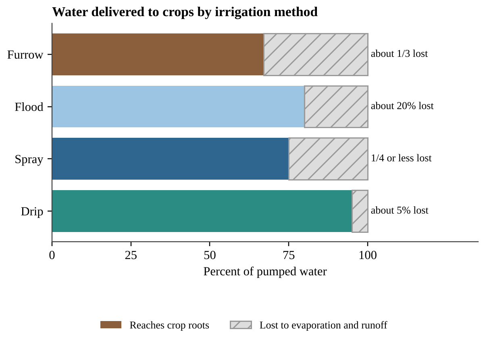
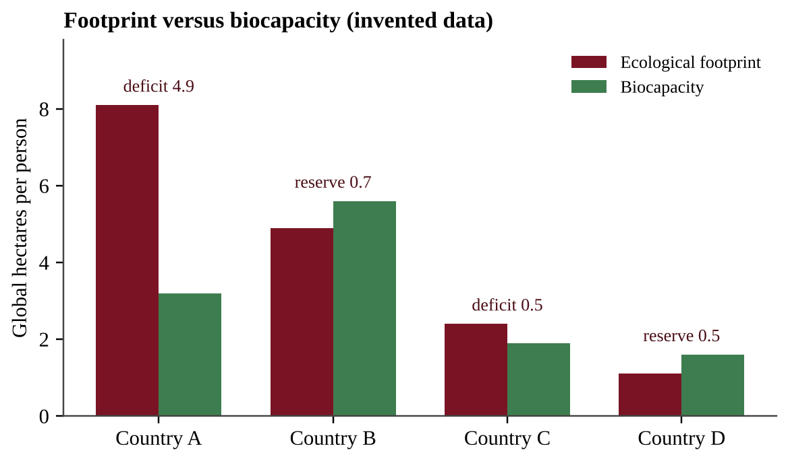

# Unit 5 — Land and Water Use

Every meal you eat, every board in a house, every phone battery and every paved parking lot began as a decision about land or water. This unit asks a single question in many forms: when people use natural resources, how do they change natural systems, and how can we use land and water so that they last? You will meet the problems first (Topics 5.1–5.11) and then the solutions built around **sustainability** (Topics 5.12–5.17). The unit is worth 10–15% of the AP exam, and it is rich in applied scenarios, calculations and "propose and justify a solution" tasks.

## Topic 5.1 — The Tragedy of the Commons

:::box objectives
- Explain the concept of the tragedy of the commons (EIN-2.A).
- Apply the concept to a new shared resource and propose a way to prevent depletion.
:::

:::box simple
Imagine a shared pizza in the middle of a table with no rule about slices. Each hungry person thinks, "If I do not take another slice, someone else will." Everyone takes more than a fair share, and the pizza is gone in minutes. No one wanted that result, yet everyone's sensible-looking choice caused it. That is the tragedy of the commons.
:::

A **commons** is a resource that belongs to everyone and so to no one in particular: a fishing ground, the air, a groundwater aquifer, a public pasture, the open ocean, the atmosphere's capacity to absorb carbon dioxide. Such a resource is usually *rival* (my use leaves less for you) and *hard to exclude people from*. Because each user gets the full benefit of taking more but shares the cost of depletion with everyone, the rational self-interested choice is to take more.

:::box define
**Tragedy of the commons** — the idea that individuals acting in their own self-interest will use a shared resource in ways that do not serve the common good, thereby depleting or degrading it.
**Commons (common-pool resource)** — a shared resource open to many users, such as a fishery, aquifer, pasture or the atmosphere.
**Externality** — a cost of an activity that falls on people who did not choose it (for example, the pollution from a factory that harms downstream fishers).
:::

:::box process
Open access to a shared resource → each user gains the full benefit of extra use → the cost (depletion) is spread across all users → every user has an incentive to take more → total use exceeds the resource's ability to renew itself → the resource declines or collapses → everyone, including the heaviest users, loses.
:::

### Why it happens and how it is prevented

The problem is not that people are evil; it is that the *rules* reward overuse. Solutions therefore change the rules:

- **Regulation and quotas:** catch limits for each fishing season, pumping limits on a shared aquifer, permits for grazing on public land, emissions caps.
- **Privatization or assigned shares:** if a person owns the pasture or a transferable share of the fishery, he or she pays the long-term cost of overuse. The drawback is that ownership can favor the wealthy and may ignore the ecosystem services that benefit everyone.
- **Community management:** a village that sets its own rules for a shared forest or irrigation canal, enforced by social pressure, often succeeds when the group is small and can monitor itself.

:::box mistake
- Believing the tragedy happens only to *land*. Air, oceans, groundwater and the climate are commons too.
- Saying people are "greedy" or "ignorant." On the exam, the cause is *self-interest combined with lack of rules or enforcement*.
:::

:::box strategy
When a question gives a shared resource, answer in three moves: (1) identify the commons and who uses it, (2) explain that each user benefits fully from taking more while the cost is shared, and (3) propose a specific rule (quota, permit, fee) and state one limitation of it.
:::

:::box example
id: SG-U5-E001
Eight ranchers each graze cattle on a public meadow that can feed 80 cattle per year without losing grass cover. Each rancher currently grazes 14 cattle. A rancher who adds one more animal gains the full sale value of that animal, while the loss of grass is shared among all eight ranchers. (a) Calculate the total number of cattle on the meadow and by what percent it exceeds the sustainable number. (b) Explain, using the concept of the tragedy of the commons, why each rancher might add another animal even though all of them know the meadow is overgrazed. (c) Propose one rule that would prevent further damage and identify one drawback of that rule.
:::

:::box summary
- The tragedy of the commons: self-interested use of a shared resource depletes it for everyone.
- Cause: full personal benefit, shared cost, no enforceable limits.
:::

## Topic 5.2 — Clearcutting

:::box objectives
- Describe the effects of clearcutting on forests (EIN-2.B).
- Connect forest removal to erosion, stream temperature, flooding and climate change.
:::

:::box simple
A forest is like a giant sponge wearing an umbrella. The canopy softens rain, roots hold soil in place, and shade keeps streams cool. Clearcutting removes the umbrella and the roots all at once.
:::

**Clearcutting** is the harvest of all or nearly all trees in an area in one operation. It is popular with timber companies because it is the cheapest and fastest method: heavy machines can reach every tree, the logging roads are simple, and the sunlit ground can be replanted with one fast-growing species. That economic advantage is real, which is why you must acknowledge it in a balanced answer. But the ecological costs are large.

:::box process
Trees removed → roots die and no longer hold soil, and rain strikes bare ground → **soil erosion** increases → sediment washes into streams and clouds the water → the loss of shade raises **soil and stream temperatures** → warmer water holds less dissolved oxygen, stressing cold-water fish → with no canopy interception and less water uptake by roots, runoff rises → **flooding** downstream increases.
:::

### Climate and pollution effects

Forests are carbon sinks. Trees absorb carbon dioxide during photosynthesis and store the carbon in wood, roots and soil, and their leaves capture some air pollutants such as particulates and ozone. When trees are cut and burned, or when the wood and debris decay, the stored carbon is released as CO₂, which adds to the greenhouse effect and contributes to climate change. Less forest also means less future CO₂ uptake, so the loss is felt twice. Clearcutting also destroys habitat, reducing biodiversity, and the exposed soil loses nutrients and organic matter, slowing regrowth. A second economic advantage is that clearing frees land for crops, pasture or buildings, which is a main reason forests are cleared; the other main reasons are timber, fuelwood and charcoal, and urban growth.

### From stored carbon to CO₂

Forest data are usually given as the mass of *carbon* in the wood, but the gas released is CO₂, which also contains oxygen. One carbon atom (12 g/mol) becomes one CO₂ molecule (44 g/mol), so each tonne of carbon released as CO₂ is 44 ÷ 12 ≈ 3.67 tonnes of CO₂.

:::box formula
**Carbon released = stored carbon per hectare × hectares × fraction released**
**Mass of CO₂ = mass of carbon × 44 ÷ 12**
Units: tonnes of C, then tonnes of CO₂. Apply the fraction released first and the 44/12 conversion last; the 44/12 step is only needed when the question asks for CO₂ rather than carbon.
:::

:::box example
id: SG-U5-E002

A 100-hectare watershed is clearcut. In the following year, monitors record that the stream's maximum summer temperature rises from 14 °C to 21 °C, that suspended sediment in the stream increases, and that peak flow during a storm is much higher than before the cut. (a) Explain how removing the trees causes each of these three changes. (b) Describe one effect of this clearcut on the carbon cycle. (c) State one economic advantage of clearcutting that explains why it is still used.
:::

:::box example
id: SG-U5-E012
A 30-hectare stand holds 140 tonnes of carbon per hectare. It is clearcut, and 65% of the stored carbon is released as CO₂ within a few years (C = 12 g/mol, CO₂ = 44 g/mol). (a) Calculate the tonnes of carbon released. (b) Convert your answer to tonnes of CO₂. (c) Describe one way wood could still be obtained while keeping more of this carbon stored.
:::

:::box summary
- Clearcutting is cheap and efficient but increases erosion, stream and soil temperature, and flooding.
- Forests absorb pollutants and store CO₂; cutting and burning releases CO₂ and adds to climate change.
:::

## Topic 5.3 — The Green Revolution

:::box objectives
- Describe changes in agricultural practices that began with the Green Revolution (EIN-2.C).
- Evaluate positive and negative results, including mechanization and fossil-fuel reliance.
:::

:::box simple
Before the Green Revolution, a farmer's field was like a small family garden that produced what the soil and rain allowed. The Green Revolution turned fields into factories: improved seeds, fertilizer, pesticides, irrigation and machines were added so the same land produced far more food.
:::

Beginning in the mid-20th century, plant breeders developed high-yield varieties of staple crops such as wheat and rice that responded strongly to fertilizer and water. Combined with other technologies, they greatly increased food production in many countries and helped feed a rapidly growing human population. Together, these practices are called the **Green Revolution**.

| Strategy | What it does | Benefit | Cost or risk |
|---|---|---|---|
| Mechanization | Tractors, harvesters, planters | Higher efficiency and profit; less labor | Fossil-fuel use, equipment cost, fewer farm jobs |
| High-yield and genetically modified crops (GMOs) | Selected or engineered traits | Higher yield, pest or drought tolerance | Seed cost; loss of genetic diversity |
| Synthetic fertilizer | Adds nitrogen, phosphorus | Higher yield per hectare | Nutrient runoff, eutrophication |
| Irrigation | Adds water | Farming in dry regions; extra harvests | Depleted aquifers, salinization |
| Pesticides | Kill pests | Less crop damage | Resistance, toxicity to wildlife |

**Mechanization** raises profit and efficiency because one operator with a machine can plant, spray or harvest what once took many workers. But machines burn fossil fuels, so farms become dependent on oil prices, and heavy equipment compacts soil. Fertilizers and pesticides are often made with fossil energy too.

:::box define
**Green Revolution** — the shift, beginning in the mid-1900s, to high-yield crops plus fertilizer, irrigation, pesticides and machinery to increase food production.
**Genetically modified organism (GMO)** — an organism whose DNA has been altered by genetic engineering to give it a desired trait.
**Mechanization** — the use of machinery in place of human or animal labor.
**Yield** — the amount of crop harvested per unit of land, for example tonnes per hectare.
:::

**Reading for perspective (skill 3.B):** if an author praises the Green Revolution only in tonnes of grain, ask what the author values, what evidence is left out (such as water pollution) and who benefits from that view.

:::box example
id: SG-U5-E003
A district grows wheat on 12,000 hectares. Before adopting Green Revolution methods the district averaged 1.8 t/ha; after adopting them it averaged 3.6 t/ha, while nitrogen fertilizer use rose from 10 kg/ha to 90 kg/ha and diesel use for machinery rose from 20 L/ha to 55 L/ha. (a) Calculate the percent increase in yield and the total additional grain, in tonnes, from the whole district. (b) Calculate the additional kilograms of nitrogen fertilizer applied to the district each year. (c) Describe one environmental consequence of the increased fertilizer use and one of the increased diesel use.
:::

:::box summary
- Green Revolution = high-yield crops, fertilizer, irrigation, pesticides, GMOs and mechanization.
- It raised food production but increased reliance on fossil fuels and created pollution and genetic-diversity problems.
:::

## Topic 5.4 — Impact of Agricultural Practices

:::box objectives
- Describe agricultural practices that cause environmental damage: tilling, slash-and-burn and fertilizer use (EIN-2.D).
:::

:::box simple
Farming is a trade: we take food, and the land pays. Tilling exposes the soil, burning wipes out forest, and fertilizer escapes to the water. Each practice works in the short term and has a hidden cost.
:::

### Tilling

**Tilling** (plowing) turns over the soil to bury weeds, loosen the ground and prepare a seedbed. It also leaves bare soil exposed for months, breaks up soil structure, speeds the decomposition of soil organic matter (releasing CO₂), and leaves fine particles easy for wind and rain to carry away. Erosion removes the fertile topsoil, which takes hundreds of years to form, and the sediment fills streams and reservoirs, clouding water and burying aquatic habitat. Heavy machinery also compacts soil and burns fuel.

### Slash-and-burn agriculture

In **slash-and-burn** farming, trees are cut and burned to clear land. Ash adds a pulse of nutrients, so the first crops grow well. In tropical forests, however, most nutrients are held in living biomass rather than in thin soils, so fertility declines within a few years and farmers move on. When population density is low and fields are left to regrow for decades, the system can recover; when too many farmers use it, forest is lost for good. Burning releases CO₂ and particulates, destroys habitat and biodiversity, and exposed soil erodes.

### Fertilizers

Crops remove nutrients from the soil, so farmers replace them with fertilizer, mainly nitrogen and phosphorus compounds. Plants take up only part of what is applied. The rest runs off or leaches into surface water and groundwater. **Nutrient pollution** (Unit 8 covers eutrophication in detail) fertilizes algae in lakes and coastal waters; when the algae die, bacteria decompose them and use up dissolved oxygen, creating low-oxygen "dead zones." Nitrate in drinking water is a health risk for infants. Fertilizer production and denitrification also release nitrous oxide (N₂O), a greenhouse gas.

:::box define
**Tilling** — mechanical turning of soil before planting.
**Slash-and-burn** — clearing land by cutting vegetation and burning it.
**Topsoil** — the upper, organic-rich soil layer most important for plant growth.
**Nutrient runoff** — dissolved or particle-bound nutrients carried from fields by water.
:::

:::box summary
- Tilling: erosion, soil structure loss, CO₂ release.
- Slash-and-burn: quick fertility, then decline; CO₂, habitat loss, erosion.
:::

## Topic 5.5 — Irrigation Methods

:::box objectives
- Describe different methods of irrigation (EIN-2.E).
- Describe the benefits and drawbacks of each method, including waterlogging, salinization and aquifer depletion (EIN-2.F).
:::

:::box simple
Irrigation is like watering a houseplant. You could flood the pot, dribble water along the edge, spray it overhead, or give it a few drops at the roots. The more precisely you water, the less is wasted, but precision costs more.
:::

Globally, about **70%** of human freshwater consumption is used for agriculture. Because agriculture is the biggest water user, even a modest gain in irrigation efficiency saves large volumes of water. **Irrigation efficiency** is the percentage of the water applied that actually reaches the crop roots.

### The methods

| Method | How it works | Water lost to evaporation and runoff | Cost and energy |
|---|---|---|---|
| Furrow | Channels are cut between crop rows and filled with water | about 1/3 | Inexpensive |
| Flood | The whole field is covered with water | about 20% | Inexpensive; can cause waterlogging |
| Spray | Groundwater is pumped to spray nozzles over the field | 1/4 or less | More expensive than flood and furrow; requires energy |
| Drip | Perforated hoses release small amounts of water at the roots | about 5% | Most efficient but expensive, so used less often |

{w=0.8}

### Problems caused by irrigation

**Waterlogging** happens when too much water sits in the soil. It raises the groundwater table until the root zone is saturated, so roots cannot absorb the oxygen they need and plants suffocate. Flood irrigation is especially prone to it.

**Salinization** occurs when irrigation water, which contains dissolved salts, evaporates and leaves the salts behind. Over time the soil becomes salty enough to be toxic to many plants, reducing yields or forcing farmers to abandon the field. It is worst in hot, dry climates and in poorly drained soils. A white salt crust on the surface is the classic sign. In a flood-irrigated arid field both problems often appear together: the water table rises into the root zone (waterlogging, so plants wilt in wet soil) while salts build up near the surface.

**Aquifer depletion** occurs when water is pumped out faster than rain recharges the aquifer. The **Ogallala Aquifer** under the central United States supports large areas of irrigated farming, and in many places it has been drawn down severely because recharge is very slow. When the water table falls, wells must be deepened and pumping costs rise until farming becomes uneconomical. This is also a tragedy of the commons (Topic 5.1).

### Aquifer budgets and rates of change

An aquifer works like a bank account: **net change = recharge − withdrawal**. The water table falls whenever withdrawal exceeds recharge, *even if pumping is shrinking*; it stops falling only when pumping drops to the recharge rate. If pumping falls from 1,800 to 1,300 million m³ per year but recharge is only 200 million m³ per year, the aquifer is still losing 1,100 million m³ every year. Sustainable groundwater use means withdrawal ≤ recharge. Water per person works the same way: renewable supply ÷ population falls whenever population grows faster than supply.

:::box formula
**Net rate = recharge − withdrawal** (negative = decline)
**Average rate of change = (final value − initial value) ÷ (final year − initial year)**
**Years until depletion = amount remaining ÷ net annual loss**
Units: m/yr or m³/yr; put both rates in the same units first. A negative sign means decline; quote it, or write "declined by".
:::

:::box process
Irrigate a hot, dry field → water evaporates → dissolved salts stay behind → salts build up in the root zone → soil becomes toxic to plants → yields fall and land may be abandoned.
:::

:::box define
**Irrigation efficiency** — (water that reaches the crop ÷ water applied) × 100%.
**Waterlogging** — saturation of soil by excess water, raising the water table and depriving roots of oxygen.
**Salinization** — build-up of salts in soil as irrigation water evaporates.
**Aquifer** — underground rock or sediment layer that holds and transmits groundwater.
:::

:::box formula
**Water to apply = water needed by crop ÷ efficiency (as a decimal)**
**Water lost = water applied × fraction lost**
Units: m³, L or acre-feet; efficiency = 1 − fraction lost. Example structure: if drip loses 5%, efficiency = 0.95.
:::

:::box apply
A dry-valley orchard switches from flood to drip irrigation. Water use and salt build-up fall, but the grower must buy hoses, filters and pumps and maintain them. With the aquifer dropping, the investment pays off.
:::

:::box mistake
- Treating "efficiency" as the percent *lost*. Efficiency is the percent *delivered*.
- Saying drip irrigation is "free of problems." It is expensive and can clog; and because water is applied only at the roots, salts can still collect at the edges of the wetted zone.
:::

:::box strategy
In "compare irrigation methods" questions give a *cost* point and an *efficiency* point for each method. Many students supply only efficiency.
:::

:::box example
id: SG-U5-E004
A 40-hectare farm needs 5,700 m³ of water per hectare to reach its crop roots during the growing season. Assume the loss percentages are exactly 1/3 for furrow irrigation and 5% for drip irrigation. (a) Calculate the volume of water, in m³, that must be pumped for the whole farm using furrow irrigation. (b) Calculate the volume that must be pumped using drip irrigation. (c) Calculate how many cubic meters of water the farm would save per year by switching, and give one reason a farmer might still keep the furrow system.
:::

:::box example
id: SG-U5-E013
An aquifer holds 36 m of saturated thickness. Pumping lowers the water table by 1.1 m per year and recharge raises it by 0.2 m per year; both rates stay constant. (a) Calculate the net change per year and the number of years until the aquifer is dry. (b) Pumping is then cut by 40% while recharge is unchanged. Calculate the new net change and state whether use is now sustainable. (c) Name one change in irrigation that could cut pumping and one drawback of it.
:::

:::box summary
- About 70% of human freshwater consumption goes to agriculture.
- Efficiency rank (best to worst): drip (about 5% lost), spray (≤ 1/4), flood (about 20%), furrow (about 1/3). Cost generally rises with efficiency.
:::

## Topic 5.6 — Pest Control Methods

:::box objectives
- Describe the benefits and drawbacks of different methods of pest control (EIN-2.G).
- Make a claim that proposes a solution to a pest problem in an applied context (skill 7.E).
:::

:::box simple
Spraying a pesticide is like using one antibiotic over and over. It kills most of the target, but the few that survive pass on their toughness, and soon the treatment stops working.
:::

A **pest** is any organism that harms crops, livestock or people. Farmers use **pesticides**: insecticides (insects), herbicides (weeds), fungicides (fungi), rodenticides (rodents). The benefit is clear: less crop damage and higher yield. The drawbacks are also real: toxicity to non-target species such as pollinators and fish, contamination of water, and residues on food.

### Resistance by artificial selection

Within any pest population, individuals vary genetically. A few may survive a chemical because of a gene that makes them resistant. When farmers spray repeatedly, the susceptible individuals die and the resistant survivors reproduce, so the proportion of resistant pests rises each generation. Because humans apply the selective pressure, scientists call this **artificial selection**. Pests with short generation times and many offspring evolve resistance fastest, and farmers respond with stronger or more frequent doses, a cycle sometimes called the "pesticide treadmill."

Selection can be followed with arithmetic. Suppose 1 insect in 500 (0.2%) is resistant, and a spray kills 95% of the susceptible insects and none of the resistant ones. Of 500,000 insects, 1,000 are resistant and 499,000 are susceptible. After the spray, 1,000 resistant and 5% × 499,000 ≈ 24,950 susceptible survive, so resistant insects are 1,000 ÷ 25,950 ≈ 3.9% of the survivors, up from 0.2%. The survivors breed the next generation. Rotating pesticide types, leaving untreated refuge areas and spraying only when pests pass a threshold (Topic 5.14) all weaken this selection.

### Genetically engineered crops

Crops can be **genetically engineered** to increase resistance to pests and diseases, which can cut pesticide use and raise yield. One common trait is a built-in insect toxin (Bt crops), which reduces insecticide sprays; another is tolerance to a herbicide, so weeds can be sprayed without killing the crop, although repeated use of one herbicide selects for resistant weeds. The risk is a **loss of genetic diversity**: if farmers plant only one variety, a single new disease or pest that overcomes its resistance can destroy the entire crop, and traditional varieties may be abandoned. Resistance can also evolve in pests that feed on such crops continuously.

:::box define
**Pesticide** — a chemical used to kill pests (insecticide, herbicide, fungicide, rodenticide).
**Artificial selection** — selection by humans, intentional or not, of which individuals survive and reproduce.
**Resistance** — heritable ability of an organism to survive a chemical that once killed its ancestors.
**Genetic diversity** — variation in genes within a species or crop.
:::

:::box mistake
- Writing that pests "adapt" or "learn" to resist. Resistance is *selection* acting on existing genetic variation, not an individual changing.
:::

:::box example
id: SG-U5-E005
A cabbage grower sprays an insecticide each generation. In generation 1, 2% of the moths carry a resistance allele. Assume the resistant share of the population doubles in every generation, and that the population is rebuilt to its original size each time. (a) Calculate the percentage of resistant moths in generations 2, 3 and 4. (b) Explain why this is an example of artificial selection. (c) Propose one change in pest control that would slow this process, and describe one disadvantage of your proposal.
:::

:::box summary
- Pesticides cut crop damage and raise yield but harm non-target organisms and select for resistance.
- Genetically engineered crops can resist pests but may reduce crop genetic diversity.
:::

## Topic 5.7 — Meat Production Methods

:::box objectives
- Identify methods of meat production: CAFOs, feedlots, rotational grazing, free-range (EIN-2.H).
- Describe benefits and drawbacks, including overgrazing, desertification and the effects of eating less meat (EIN-2.I).
:::

:::box simple
Beef is a second-hand way to eat grass or grain. A cow first eats the plants, burns most of the energy to stay alive and warm, and only a little turns into meat. Eating the plants directly is like skipping the middleman, so it needs less land and water.
:::

### Why meat has a bigger footprint

Energy is lost at every step in a food chain; on average only about **10%** passes from one trophic level to the next (Unit 1 and Unit 3 develop this idea). That is why meat production needs more land, water and energy per gram of protein than plant foods and why it raises nutrient pollution and greenhouse gas emissions such as methane (CH₄).

{w=0.8}

Impact varies with the animal and the system. **Ruminants** (cattle, sheep) have the largest effect because gut microbes produce methane and they need more feed per kilogram of meat.

| Feature | Feedlots / CAFOs | Pasture-based (rotational or free-range) |
|---|---|---|
| Housing | Confined animals in small spaces | Animals graze outdoors |
| Feed | Grain and soy | Grass and forage |
| Land needed | Less | More |
| Cost to consumers | Lower (more economically efficient) | Higher |
| Waste | Large concentrated manure; may contaminate water if not managed | Manure fertilizes soil; runoff and erosion if too many animals |
| Antibiotics | Routine use can contribute to global antibiotic resistance | Not always antibiotic-free |

A **concentrated animal feeding operation (CAFO)** raises many animals in confined spaces. Its high concentration of manure can contaminate nearby waterways with nutrients and pathogens, create odors, and release methane and ammonia. Routine low-dose antibiotics can select for resistant bacteria, a global health risk.

**Free-range or pasture-based grazing** lets animals eat grass for most of their lives. Manure adds nutrients to pasture soil. **Rotational grazing** moves livestock between paddocks so vegetation can regrow, improving sustainability. It requires fencing and management, and since it needs more land, consumer costs are higher. Note: not all free-range systems are antibiotic-free.

### Feed conversion and carrying capacity

The **feed conversion ratio (FCR)** is the mass of feed an animal eats per mass of weight it gains. An FCR of 7 means 7 kg of feed for each 1 kg of body mass; the smaller the ratio, the less feed (and land) per kilogram of meat. Chains of conversions are multiplied in order, keeping the units at each step. For example, if a feed is 25% fishmeal and each kilogram of fishmeal needs 4 kg of wild fish, then 1 kg of farmed fish that ate 1.5 kg of feed used 1.5 × 0.25 × 4 = 1.5 kg of wild fish. Footprint tables are often given per 100 g of protein, so scale by the protein served: emissions = value per 100 g × (protein served ÷ 100 g).

The number of animals a range can support (its **carrying capacity** for grazing) depends on how much forage may be eaten without harming regrowth. Keeping more animals than this number is overgrazing.

:::box formula
**Feed needed = FCR × body mass gained**
**Usable forage = forage per hectare × hectares × fraction allowed to be eaten**
**Animals supported = usable forage ÷ forage eaten per animal per year**
Units: kg of feed or forage; keep "per year" and "per hectare" consistent.
:::

### Overgrazing and desertification

**Overgrazing** occurs when the number of animals exceeds the land's ability to regenerate vegetation. Plant cover shrinks, soil is exposed and compacted, erosion increases and fertility drops. Biodiversity falls and the land stores less carbon. In arid and semi-arid regions, overgrazing can lead to **desertification**, the conversion of productive land into desert-like land that can no longer support vegetation. Restoration, soil conservation and better grazing practices can slow or reverse the process.

### Eating less meat

Less consumption of meat, especially from ruminants, can reduce emissions of CO₂, CH₄ and N₂O; conserve fresh water; and reduce reliance on antibiotics and growth hormones. Better feed quality and precision farming can also reduce impacts. How large the benefit is depends on production methods and on what is done with the land no longer used for livestock (for example, restored to forest versus converted to another intensive use).

:::box define
**CAFO** — a facility that confines large numbers of animals, feeding them grain and soy.
**Rotational grazing** — moving livestock among pastures on a schedule to allow regrowth.
**Overgrazing** — livestock numbers exceed vegetation regeneration.
**Desertification** — degradation of arid or semi-arid land into desert-like condition.
**Ruminant** — a grazing mammal with a multi-chambered stomach, such as cattle or sheep, that produces methane.
:::

:::box mistake
- Believing free-range always means antibiotic-free or low impact. The CED states otherwise.
:::

:::box example
id: SG-U5-E006
A grain farmer produces 900,000 kcal of grain energy per hectare per year. Assume that only 10% of the energy in feed is stored in the bodies of cattle fed that grain, and that a person gets all of the energy stored in the cattle's bodies. (a) Calculate the kilocalories of beef that one hectare could provide if all the grain were fed to cattle. (b) A person needs 2,000 kcal per day. Calculate how many person-days of food one hectare could supply as grain eaten directly and as beef. (c) Explain two other environmental drawbacks of cattle production beyond land use.
:::

:::box example
id: SG-U5-E014
A ranch has 600 hectares that produce 1,800 kg of dry forage per hectare per year; managers allow cattle to eat 40% of it. Each cow eats 3,000 kg per year. (a) Calculate the largest number of cows the ranch can support sustainably. (b) The owner keeps 400 cows. Calculate by what percent the herd exceeds the sustainable number. (c) A feedlot with an FCR of 7 adds 25,000 kg of beef. Calculate the feed it needs, and state one environmental problem of the feedlot system.
:::

:::box summary
- Meat needs more land, water and energy per gram of protein than plants and adds nutrient pollution and methane.
- CAFOs: cheap and efficient, but manure, antibiotics and confinement. Pasture systems: manure benefits soil but need more land and cost more.
:::

## Topic 5.8 — Overfishing

:::box objectives
- Describe causes of and problems related to overfishing (EIN-2.J).
- Describe responses or approaches to overfishing (skill 7.B).
:::

:::box simple
A fish population is like a bank account that earns interest. You can spend the interest forever, but if you spend the principal, the interest shrinks and the account empties.
:::

**Overfishing** is harvesting fish faster than the population can replace itself. It has made some species extremely scarce, which can reduce biodiversity in aquatic systems and harm people who depend on fishing for food and commerce. The fishery is a classic commons, so the tragedy of the commons applies.

### Causes

- Growing demand for seafood as population and incomes increase.
- Technology (sonar, GPS, factory ships), open access in international waters, weak enforcement and subsidies.

### Fishing methods and their impacts

| Method | Description | Main problems |
|---|---|---|
| Bottom trawling | Weighted net dragged along the seafloor | Destroys bottom habitat; heavy **bycatch** |
| Purse seining | Net encircles a school and is closed at the bottom | Bycatch (dolphins, sharks) |
| Drift-net or gill-net | Long walls of netting that hang in the water | Entangles non-target animals, including turtles and marine mammals |
| Longlining | Line with thousands of baited hooks | Hooks seabirds, turtles and sharks |

**Bycatch** is the unintended capture of non-target species. Removing top predators or a keystone species can cascade through the food web and reduce biodiversity; for example, spearfishing out the herbivorous fish on a reef lets algae overgrow and smother the coral.

### Reading fishery data

Total catch alone can mislead. **Catch per unit effort (CPUE)** is the total catch divided by the fishing effort (boats, boat-days or hours fished). In a healthy stock, adding boats raises the catch and CPUE stays about the same. In a shrinking stock, each boat finds fewer fish even with sonar and bigger nets, so CPUE falls while effort rises. Total catch can stay high for years because more boats and better technology hide the decline, and then collapse. Always work out CPUE before concluding that a stock is healthy.

{w=0.8}

:::box formula
**CPUE = total catch ÷ fishing effort** (for example, tonnes per boat-day)
**Change in stock = natural growth − harvest** (per year)
:::

### Sustainable yield

The **sustainable yield** (Topic 5.12) of a fishery is the amount that can be harvested without reducing the supply. The fish stock replaces itself fastest at intermediate stock sizes. A harvest below the peak of the growth curve can continue indefinitely; a harvest above it will shrink the stock every year.

{w=0.8}

To read a growth curve with a flat harvest line, compare the curve with the line at the stock size you start from. Where the curve is above the line, growth exceeds harvest and the stock rises; where it is below, the stock falls. A point where the line meets the curve is an equilibrium. The right-hand crossing is stable: a small drop in stock makes growth exceed harvest, so the stock recovers. The left-hand crossing is unstable: below it the stock keeps falling to collapse. A harvest line above the peak never meets the curve, so the stock collapses from any starting size. Harvesting exactly at the peak leaves no safety margin, so quotas are set below it.

### Solutions

- Catch limits and quotas based on stock surveys.
- Closed seasons and marine protected areas where fish can breed.
- Gear restrictions: larger mesh sizes, turtle-excluder devices, bans on destructive methods.
- Certification, international agreements, enforcement and aquaculture (Topic 5.16).

:::box example
id: SG-U5-E007
A fish stock's natural growth, measured as tonnes of new fish added in a year, depends on stock size as follows: stock 200 → growth 64; stock 400 → growth 96; stock 500 → growth 100; stock 600 → growth 96; stock 800 → growth 64 (all in thousands of tonnes). A fleet takes 90 thousand tonnes every year. (a) State the maximum sustainable yield shown by the data and the stock size at which it occurs. (b) If the stock is 800 thousand tonnes, calculate the change in stock after one year of fishing. (c) Predict what will happen to the stock if the stock falls to 200 thousand tonnes while the fleet still takes 90, and explain how this relates to the tragedy of the commons.
:::

:::box example
id: SG-U5-E015
A lake fishery records effort of 30,000 boat-days and a catch of 60,000 tonnes in 2005; 50,000 boat-days and 70,000 tonnes in 2015; and 80,000 boat-days and 56,000 tonnes in 2025. (a) Calculate the catch per unit effort for each year. (b) Describe the trend in total catch and in CPUE, and state what each suggests about the fish stock. (c) Explain why the 2015 total catch could mislead a manager, and propose one management action.
:::

:::box summary
- Overfishing: harvest exceeds replenishment. It reduces biodiversity and harms fishing communities.
- Destructive gear causes bycatch and habitat damage.
:::

## Topic 5.9 — Environmental Impacts of Mining

:::box objectives
- Describe natural resource extraction through mining (EIN-2.K).
- Describe the ecological and economic impacts of mining (EIN-2.L).
:::

:::box simple
Mining is like eating a cake from the outside in: the thick, rich pieces go first. Later you must dig through more and more plain cake to get the same sweetness. In mining the rich parts are high-grade ore, and as they run out, more rock must be moved for each tonne of metal.
:::

**Mining** extracts minerals, metals and fuels such as coal from the Earth. Mining supplies low-cost energy and the materials used to build everything from wires to bridges, and it provides jobs. Its drawbacks are habitat destruction, pollution and large volumes of waste.

### Ore grade and diminishing returns

An **ore** is rock containing enough valuable mineral to be mined profitably. The **grade** is the concentration of the valuable material in the ore. As the most accessible, highest-grade ores are mined to depletion, operations are forced to use lower-grade ores. This requires more energy, water and machinery, and it produces more waste and pollution per tonne of product.

### Mining methods

| Method | How it works | Example impact |
|---|---|---|
| Surface mining | Soil and rock above the ore, called **overburden**, are removed | Habitat loss, erosion, dust |
| Strip mining | Vegetation and overburden removed in long strips to expose a shallow seam | Vegetation loss makes the area susceptible to erosion; acidic runoff |
| Open-pit mining | Large pit dug to reach ore close to the surface | Huge pits, tailings piles |
| Mountaintop removal | Mountain summit blasted off to reach coal seams, debris dumped in valleys | Stream burial, large-scale habitat loss |
| Subsurface (underground) mining | Shafts and tunnels reach deeper deposits | Very expensive; hazards to miners; subsidence; methane |

When shallow coal seams run low, it becomes necessary to use subsurface mining, which is much more expensive.

### Waste and pollution

Mining wastes include the soil and rock moved to gain access to the ore (overburden or spoil) and the **tailings** and **slag** that remain after minerals are separated or smelted. Water that touches exposed sulfide minerals can become acidic (**acid mine drainage**) and carry heavy metals into streams and groundwater. The chemistry is simple: pyrite (iron sulfide) exposed to air and water is oxidized, and its sulfur ends up as sulfuric acid, so stream pH can fall to about 3–4 and metals dissolve; the process continues long after a mine is abandoned. Some metal mines, such as gold mines, separate the metal with chemicals such as cyanide solutions, so leaks from tailings ponds can poison water, and tailings dumped into a lake can leach heavy metals into it. Coal mining can destroy habitat, contaminate groundwater, and release dust particles and methane, a greenhouse gas.

:::box process
High-grade ore depleted → miners turn to lower-grade ore → more rock must be excavated per tonne of metal → more energy, water and chemicals are used → more overburden and tailings → more land disturbance and pollution.
:::

:::box define
**Reclamation** — restoring mined land (regrading, topsoil, replanting) after mining.
**Ore** — rock containing a valuable mineral in a concentration high enough to mine.
**Overburden** — soil and rock removed to reach ore.
**Tailings / slag** — waste left after minerals are separated from ore (tailings) or smelted (slag).
**Reclamation** — restoring mined land to a productive state.
:::

:::box formula
**Ore needed = mass of metal wanted ÷ ore grade (as a decimal)**
**Waste mass = ore mined − metal recovered**
Units: tonnes (t); grade as a decimal (0.5% = 0.005). A lower grade means more ore and more waste for the same amount of metal.
:::

Grades can also be given as a fraction of the *volume* (very small values such as 2 × 10⁻⁶ are common for gold). Then:

:::box formula
**Volume of metal = volume of rock × grade (as a fraction)**
**Mass of metal = volume of metal × density** (1 m³ = 10⁶ cm³, so convert volume to cm³ if density is in g/cm³)
**Break-even price = total cost of mining and processing ÷ mass of metal recovered**
Method: write each conversion as a fraction equal to 1 (for example 10⁶ cm³/1 m³) so the unwanted units cancel.
:::

:::box apply
A copper mine that began with 2% ore now processes 0.5% ore, so four times as much rock is crushed for each tonne of copper. Energy use, dust and the tailings pile all grow.
:::

:::box mistake
- Saying mining waste is only "overburden." Tailings and slag are separate.
- Thinking mining is purely harmful. Describe both economic benefit and ecological cost.
:::

:::box example
id: SG-U5-E008
A mine must produce 1,000 tonnes of copper per year. Assume all of the copper in the ore is recovered and the rest of the ore becomes tailings. (a) Calculate the tonnes of ore that must be processed per year when the ore grade is 0.8% copper and when it is 0.4% copper. (b) Calculate the tonnes of tailings produced per year at each grade. (c) Explain why the lower-grade ore is likely to increase both the cost and the environmental impact of the mine, and propose one way to reduce the demand for newly mined copper.
:::

:::box example
id: SG-U5-E016
A block of rock measures 50 m × 40 m × 10 m. Gold makes up 3 × 10⁻⁷ of its volume, and gold has a density of 19 g/cm³. Mining and processing the block costs $400,000. (a) Calculate the volume of the rock and the volume of the gold in m³. (b) Calculate the mass of gold in kilograms. (c) Calculate the break-even price per gram, and explain why a fall in the ore grade would raise it.
:::

:::box summary
- Surface mining removes overburden (strip mining, open-pit, mountaintop removal); subsurface mining is deeper and costlier.
- Declining ore grade means more waste, energy and pollution per tonne.
:::

## Topic 5.10 — Urbanization

:::box objectives
- Describe the effects of urbanization on the environment (EIN-2.M).
- Describe disadvantages, advantages or unintended consequences of potential solutions (skill 7.C).
:::

:::box simple
A city is a giant machine that takes in water, energy, food and land and gives out waste, heat and runoff. The more people packed in or spread out, the larger the inputs and outputs.
:::

**Urbanization** is the growth of cities as more people move from rural areas into urban areas. Cities can be efficient (shared transport, shared buildings), but they concentrate resource demand and waste.

### Effects on resources and cycles

- **Resource depletion and the water cycle:** Large populations draw heavily on rivers and aquifers. In coastal cities, pumping groundwater lowers the water table and lets salt water move into the freshwater aquifer, called **saltwater intrusion**, which makes wells unusable.
- **Carbon cycle:** Burning fossil fuels for vehicles, power and heating, and the decomposition of waste in landfills, add CO₂ (and methane from landfills) to the atmosphere, increasing the greenhouse effect.
- **Impervious surfaces:** Roads, roofs, sidewalks and parking lots do not allow water to infiltrate the soil. Rain that would soak in becomes fast surface runoff, causing flash floods, carrying oil, metals and trash into streams, and giving less groundwater recharge.
- **Heat:** Dark pavement and buildings absorb sunlight and retain heat (the urban heat island effect, Unit 8).

{w=0.8}

Read a hydrograph by comparing three features: the **peak height** (how severe the flood is), the **lag time** (how long between rainfall and peak) and the **total area** under the curve (total runoff volume). Pavement raises the peak, shortens lag time and increases total runoff, because less water infiltrates.

When a site has several surfaces, find the runoff from each (area × depth × its coefficient) and add them; rainfall given in cm or mm must be converted to m first, and a *percent change* is divided by the original value. Where old cities send storm runoff and sewage down one pipe, a heavy storm can exceed the treatment plant's capacity and release untreated mixture into streams.

### Urban sprawl

**Urban sprawl** is the spread of low-density development from city centers into surrounding rural land. The population shifts from dense areas to low-density suburbs. Typical consequences: loss of farmland and habitat, more roads and parking (more impervious surface), longer commutes and more vehicle emissions, higher infrastructure costs per person, and greater energy use per household.

:::box define
**Urbanization** — increase in the share of a population living in cities.
**Impervious surface** — human-made surface (road, roof, parking lot) that does not allow water to soak into the soil.
**Urban sprawl** — the outward spread of low-density development into rural land.
**Saltwater intrusion** — movement of salt water into a coastal freshwater aquifer, often because of overpumping.
:::

:::box apply
A suburb paves a 6-hectare mall parking lot on a former meadow. After the next heavy storm the stream below floods a neighborhood that never flooded before, and the water carries oil and road salt.
:::

:::box example
id: SG-U5-E009
A 40-hectare site is a forest. A 25-mm rainstorm falls on it. Use runoff coefficients of 0.15 for pervious ground and 0.90 for impervious surfaces, and runoff volume = area (m²) × rainfall depth (m) × coefficient. (1 hectare = 10,000 m²). (a) Calculate the runoff volume from the forested site. (b) The site is developed so that 60% of its area is impervious. Calculate the new runoff volume and how many times greater it is than before. (c) Describe one consequence for the stream below the site and one design change that would reduce the runoff.
:::

:::box example
id: SG-U5-E017
A 12-hectare school campus has 3 ha of roofs and 4 ha of asphalt (runoff coefficient 0.90 each) and 5 ha of lawn (0.20). A storm drops 3.0 cm of rain. (a) Calculate the runoff volume in m³. (b) Half of the asphalt is replaced by permeable pavement (coefficient 0.35). Calculate the new runoff volume and the percent reduction. (c) Describe one limitation of permeable pavement.
:::

:::box summary
- Urbanization depletes resources, can cause saltwater intrusion, and adds CO₂ through fossil-fuel use and landfills.
- Impervious surfaces prevent infiltration, causing flooding.
:::

## Topic 5.11 — Ecological Footprints

:::box objectives
- Explain the variables measured in an ecological footprint (EIN-2.N).
- Explain what footprint data imply about environmental issues (skill 5.E).
:::

:::box simple
Your ecological footprint is the total land and water area needed to supply the things you use and to absorb the waste you make. It is like a receipt for your lifestyle, written in hectares.
:::

An **ecological footprint** compares the resource demands and waste production of an individual or a society with the Earth's capacity. It adds up the area needed for:

- food: cropland, pasture and fishing grounds;
- wood and fiber: forest products;
- built-up land: housing, roads and industry;
- energy: the forest area needed to absorb the CO₂ released from fossil-fuel use.

Footprints are usually expressed in **global hectares (gha)** per person: a global hectare is a hectare of average biological productivity. **Biocapacity** is the productive area available to supply resources and absorb waste. When the footprint exceeds biocapacity, there is an **ecological deficit**: the region is using resources faster than they regenerate or importing them from elsewhere. When biocapacity is larger, there is an **ecological reserve**.

{w=0.8}

### Reading footprint data

Footprints are larger where consumption of energy, meat and goods is high. Distinguish **per-person** from **total** values.

:::box formula
**Total footprint = per-person footprint × population**
**Deficit (or reserve) = biocapacity − footprint** (negative = deficit); for a population, multiply the per-person deficit by the number of people
**Percent cut needed to reach biocapacity = (footprint − biocapacity) ÷ footprint × 100%**
**Earths required = global footprint per person ÷ biocapacity available per person on Earth**
Units: global hectares (gha) or gha per person.
:::

:::box define
**Ecological footprint** — estimate of the land and water area required to supply a person's or society's resources and absorb its wastes.
**Biocapacity** — capacity of ecosystems to regenerate resources and absorb waste.
**Ecological deficit** — footprint greater than biocapacity.
:::

:::box mistake
- Confusing ecological footprint with carbon footprint. The latter is only the greenhouse gases produced; the former includes all land uses.
:::

:::box strategy
For footprint data questions, identify the unit, compare footprint with biocapacity, then say what drives the difference (consumption, population, or limited land).
:::

:::box example
id: SG-U5-E010
Country X has 20 million people, a footprint of 6.0 gha per person and a biocapacity of 4.5 gha per person. (a) Calculate Country X's total footprint and total biocapacity in millions of global hectares. (b) Calculate the size of its ecological deficit as a number and as a percent of its biocapacity. (c) Identify two ways the country could reduce its deficit and one way it can meet its demand without lowering its footprint, and state a consequence of the latter.
:::

:::box summary
- Footprint = resource demand and waste production of a person or society, measured in area (global hectares).
- Compare with biocapacity: footprint > biocapacity = deficit.
:::

## Topic 5.12 — Introduction to Sustainability

:::box objectives
- Explain the concept of sustainability (STB-1.A).
- Explain what environmental indicator data imply about sustainability (skill 5.E).
:::

:::box simple
Sustainability means living on Earth's income, not on its savings. We can use the interest, the forests that regrow, the fish that breed, but we cannot keep spending the principal.
:::

**Sustainability** refers to humans living on Earth and using resources without depleting them for future generations. It has environmental, economic and social sides: a practice that wrecks the soil, bankrupts the farmer or ignores the community will not last.

### Environmental indicators

An **environmental indicator** is a measurement that tells us whether we are moving toward or away from sustainability. The CED names these:

- **Biological diversity:** number of species and genetic variety; falling diversity signals ecosystem stress.
- **Food production:** per-person food output and soil health; falling output signals degraded land and water.
- **Average global surface temperature and CO₂ concentration:** rising values indicate climate change from greenhouse gas emissions.
- **Human population:** growth increases resource demand.
- **Resource depletion:** declining stocks of fish, water, forests, soil or minerals.

### Sustainable yield

**Sustainable yield** is the amount of a renewable resource that can be taken without reducing the available supply. If a forest grows 20 m³ of wood per hectare per year, cutting more than 20 m³ per hectare per year will reduce the forest. Renewable does not mean unlimited; it means renewable *if use does not exceed regeneration*. Non-renewable resources such as ore have no sustainable yield; sustainable use means reducing demand, recycling and substituting.

:::box define
**Sustainability** — using resources in a way that meets present needs without depleting them for future generations.
**Sustainable yield** — the amount of a renewable resource that can be harvested without reducing the supply.
**Environmental indicator** — a measure of environmental condition such as biodiversity or atmospheric CO₂.
:::

:::box summary
- Sustainability: meet present needs without depleting resources for the future.
- Indicators: biodiversity, food production, temperature and CO₂, population, resource depletion.
:::

## Topic 5.13 — Methods to Reduce Urban Runoff

:::box objectives
- Describe methods for mitigating problems related to urban runoff (STB-1.B).
- Identify a research method, design and/or measure used in a runoff experiment (skill 4.B).
:::

:::box simple
If a city is a roof over a sponge, we can fix the flooding by letting the sponge breathe again: use surfaces that let water soak in, plant trees that drink it up, and build in ways that cover less ground.
:::

The goal is to **increase infiltration**, the movement of water into soil, so that less water leaves as runoff. The CED lists these methods:

| Method | How it helps | Limitation |
|---|---|---|
| Permeable pavement | Replaces traditional pavement so water seeps through to the soil | Can clog with sediment; higher cost; not for all heavy-traffic roads |
| Planting trees (and green spaces) | Roots and soil absorb water, leaves intercept rain, shade reduces heat | Takes years to grow; needs space and maintenance |
| Public transportation | Fewer cars means fewer lanes, garages and parking lots, and less pollution | Needs funding and enough population density |
| Building up, not out | Taller buildings on smaller footprints leave more open land | Cost and building regulations; may crowd the skyline and increase local density |

### Designing an investigation (skill 4.B)

Many Unit 5 questions ask you to test a land-use idea: permeable pavement, mulch on a slope, fertilizer rate, rotational grazing, ladybugs against aphids. Use this checklist.

- **Hypothesis:** testable and directional, for example "If slopes are covered with mulch, then less sediment will wash into runoff than from bare slopes."
- **Independent variable:** the one thing you change (surface type, fertilizer amount, grazing system). **Dependent variable:** what you measure, with units (runoff volume in L, nitrate in mg/L, percent plant cover, aphids per plant, turbidity).
- **Control group:** the group that gets no treatment or the standard treatment (bare soil, asphalt, continuous grazing, no compost). It gives the baseline. Do not confuse it with **controlled variables**, the conditions kept the same in every plot: slope, soil, area, rainfall, temperature, starting condition, measurement time.
- **Replication and randomization:** several plots per treatment, with treatments assigned at random so a sunnier corner or wetter patch does not line up with one treatment. Report the mean; error bars or a range show how much the replicates scatter.
- **Data collection:** state what is measured, how (a quadrat for percent cover, a collection bucket after each storm, samples from the same stream point), and how often.
- **Supporting result:** the treatment mean differs from the control in the predicted direction by more than the scatter among replicates.

A *paired-watershed* design compares a treated area (a clear-cut) with an intact reference area, measured at the same times. Weak designs change two variables at once, have no control group, use one plot, or compare different places or different years.

:::box example
id: SG-U5-E018
A town wants to know whether a layer of wood-chip mulch on bare construction slopes reduces the sediment that reaches a creek. (a) Write a hypothesis. (b) Identify the independent variable, the dependent variable (with a unit), the control group and two controlled variables. (c) Describe how many plots you would use, how you would assign treatments and what result would support your hypothesis.
:::

:::box summary
- Methods: permeable pavement, trees, public transportation, building up rather than out.
- All aim to raise infiltration, cut runoff and reduce flooding and pollution.
:::

## Topic 5.14 — Integrated Pest Management

:::box objectives
- Describe integrated pest management (STB-1.C).
- Describe its benefits and drawbacks (STB-1.D).
:::

:::box simple
IPM is a toolbox rather than a hammer. A smart farmer watches the field, uses helpers like ladybugs first, and reaches for a chemical only when the damage will cost more than the spray.
:::

**Integrated pest management (IPM)** combines methods to control pest species effectively while minimizing disruption to the environment. It uses biological, physical and limited chemical methods.

| Tool | Example | Why it works |
|---|---|---|
| Biocontrol | Release or protect natural predators, parasites or pathogens of the pest | Pest numbers fall without chemicals |
| Crop rotation | Change the crop each season | Pests of one crop starve when the next crop is not their host |
| Intercropping | Plant two or more crops together | Confuses pests and supports natural enemies |
| Monitoring and thresholds | Scouting fields, spraying only when pest numbers pass an economic threshold | Avoids unnecessary spraying |
| Limited chemicals | Targeted, low-toxicity pesticides, applied precisely | Reduces non-target harm and slows resistance |

### Benefits and drawbacks

IPM reduces the risk that pesticides pose to wildlife, water supplies and human health, and it slows resistance because the selection pressure is weaker. It minimizes environmental disruption and threats to human health. A biocontrol organism brought in from elsewhere can also be a risk: if it is not specific to the pest it may attack native or beneficial species or become invasive, so it must be tested first. IPM can be complex and expensive: farmers need training, careful monitoring and sometimes more labor, and results are slower than a quick spray.

:::box define
**Integrated pest management (IPM)** — a combination of biological, physical and limited chemical methods to control pests while minimizing environmental harm.
**Biocontrol** — use of a pest's natural enemies to control it.
**Intercropping** — growing two or more crops in the same field.
**Crop rotation** — planting different crops in sequence on the same land.
:::

:::box apply
An apple orchard uses pheromone traps to count moths, flowering strips that attract wasps, and sprays a narrow-spectrum product only when trap counts pass a threshold. Pesticide use falls by more than half and beneficial insects return.
:::

:::box mistake
- Believing IPM bans all pesticides. It allows *limited* chemical use.
- Saying IPM is cheaper. The CED notes it can be complex and expensive.
:::

:::box strategy
For "propose a solution" questions about pests, name two or more IPM tools matched to the pest in the scenario, give a benefit, and give a drawback (cost, training, slower results).
:::

:::box example
id: SG-U5-E011
A farm with 50 hectares compares four soil and pest-management plans on separate trial plots. Data per hectare per year: Plan 1 (conventional tillage, weekly insecticide) loses 18 t of soil and uses 12 sprayings; Plan 2 (no-till, weekly insecticide) loses 4 t of soil and uses 12 sprayings; Plan 3 (no-till plus IPM) loses 4 t of soil and uses 3 sprayings; Plan 4 (terraced plus IPM) loses 3 t of soil and uses 3 sprayings. (a) Calculate the percent reduction in soil loss from Plan 1 to Plan 2, and the total tonnes of soil saved per year on the whole farm by Plan 4 compared with Plan 1. (b) Identify which plan best reduces both soil loss and pesticide use, with data, and describe the pest-control tools it likely uses. (c) Justify why a farmer might still choose Plan 2 despite its environmental disadvantage.
:::

:::box summary
- IPM = biocontrol, crop rotation, intercropping, physical methods, monitoring, and limited chemicals.
- It lowers risk to wildlife, water and human health, but can be complex and expensive.
:::

## Topic 5.15 — Sustainable Agriculture

:::box objectives
- Describe sustainable agricultural and food production practices (STB-1.E).
- Make a claim that proposes a solution to an agricultural problem in an applied context (skill 7.E).
:::

:::box simple
Good soil is a bank that took centuries to fill. Sustainable farming protects the vault (stop erosion) and makes regular deposits (restore fertility).
:::

### Soil conservation: preventing erosion

| Practice | What the farmer does | How it works | Trade-off |
|---|---|---|---|
| **Contour plowing** | Plow across the slope rather than up and down | Furrows slow runoff and trap soil | Best on gentle slopes; needs careful layout |
| **Terracing** | Build step-like flat platforms on steep slopes | Breaks long slopes into short flat sections that hold water | Expensive, labor-intensive |
| **Strip cropping** | Alternate rows of row crops and dense cover crops along contours | Dense strips catch soil washed from the row crops | More complex planting and harvesting |
| **Windbreaks** | Rows of trees or shrubs along field edges | Slow wind and reduce wind erosion | Take land and years to grow |
| **Perennial crops** | Plant crops that live many years | Roots hold soil year-round; fewer plowings | May take years to produce income |
| **No-till agriculture** | Plant seeds directly into last year's residue without plowing | Residue protects soil; stores carbon; saves fuel | May need more herbicide; seeds need special equipment |

### Soil fertility strategies

- **Crop rotation:** alternate crops, for example a nitrogen-hungry grain with a legume. Legumes host bacteria that convert atmospheric nitrogen to forms plants can use, so soil nitrogen is replenished, and pests are disrupted.
- **Green manure:** growing cover crops and plowing them in (or leaving them as mulch) adds organic matter and nutrients.
- **Limestone:** raises the pH of acidic soils, improving nutrient availability for crops.

### Rotational grazing

**Rotational grazing** moves livestock regularly between pastures to avoid overgrazing in any one area. Plants have time to regrow, soil stays covered and manure is spread across the land (Topic 5.7).

:::box mistake
- Mixing up contour plowing (along the slope) and terracing (building steps).
:::

:::box summary
- Soil conservation: contour plowing, windbreaks, perennial crops, terracing, no-till, strip cropping.
- Soil fertility: crop rotation, green manure, limestone.
:::

## Topic 5.16 — Aquaculture

:::box objectives
- Describe the benefits and drawbacks of aquaculture (STB-1.F).
- Describe disadvantages, advantages or unintended consequences of a solution (skill 7.C).
:::

:::box simple
Aquaculture is farming in water. Instead of chasing wild fish across the sea, we raise fish, shrimp or shellfish in ponds, tanks or ocean pens, much as a farmer raises cattle.
:::

**Aquaculture** is the farming of fish, shellfish and aquatic plants. It has expanded because it is highly efficient, requires only small areas of water, and uses little fuel (no long trips to far fishing grounds). It can relieve pressure on wild fish stocks, produce a reliable supply, and provide jobs in coastal and rural communities.

### Drawbacks

- **Wastewater contamination:** uneaten feed, feces and chemicals flow into surrounding water, adding nutrients and causing eutrophication.
- **Escapes:** farmed fish that escape may compete with wild fish for food and habitat, or breed with them and change the wild gene pool.
- **Disease:** crowded fish have high disease and parasite rates, and these can spread to wild fish.
- **Other impacts:** some systems, such as shrimp ponds, replace coastal mangroves; carnivorous farmed species may be fed wild-caught fish, so wild stocks can still be harmed.

:::box summary
- Benefits: efficiency, small water area, little fuel.
- Drawbacks: waste contaminates water, escapees compete and breed with wild fish, and dense populations spread disease.
:::

## Topic 5.17 — Sustainable Forestry

:::box objectives
- Describe methods for mitigating human impact on forests (STB-1.G).
- Justify a proposed forestry solution by explaining its potential advantages (skill 7.F).
:::

:::box simple
A sustainable forest is managed like a garden: harvest some, plant more, keep the soil and the stream safe, and clear the dry brush before it catches fire.
:::

### Reducing deforestation

- **Reforestation:** replanting trees after harvest or on degraded land, restoring habitat, soil protection and carbon storage.
- **Sustainably harvested wood:** choosing and buying wood from ecologically sustainable forestry, often identified by third-party certification. Methods include **selective cutting** (removing only certain mature trees), **strip cutting** (cutting narrow bands and leaving the rest to reseed), and harvesting no more than regrowth.
- **Reusing wood:** reclaimed lumber, recycled paper and reuse of furniture reduce demand for new harvest.

Compare these with clearcutting (Topic 5.2): selective cutting costs more per tonne and requires more skill, but it keeps a canopy, so there is less erosion, less stream warming and more habitat.

### Protecting forests from pests and fire

- **Pathogens and insects:** use IPM (Topic 5.14) and **remove affected trees** to stop the spread. Removing infested trees too late is less effective; healthy, diverse forests resist outbreaks better than single-species plantations.
- **Prescribed burns:** forests are deliberately set on fire under controlled conditions (specific weather, trained crews) to burn off the dry underbrush and litter. This reduces the fuel that feeds large natural fires, so a wildfire is less likely to become an intense crown fire. Drawbacks: smoke and air pollution, risk of escape, and need for skilled management. Suppressing every small fire has the opposite effect: litter and dense, stressed trees accumulate, so later fires and insect outbreaks are more severe.

:::box summary
- Reduce deforestation with reforestation, sustainable wood and reuse.
- Protect forests with IPM, removal of affected trees and prescribed burns that reduce wildfire fuel.
:::

### Math & Skills Toolkit

Calculators are allowed. Always write the formula, the substitution with units, and the answer with units.

- **Percent change** = (new − old) ÷ old × 100%. Divide by the *old* value. Yield rising from 2.0 to 3.0 t/ha is a 50% increase.
- **Yield (productivity per area)** = harvest ÷ area; harvest = yield × area. Convert units first (1 ha = 10,000 m²).
- **Irrigation water** to apply = water needed at the roots ÷ (1 − fraction lost). Dividing by 0.67 is not the same as multiplying by 1.33.
- **Trophic energy** with a 10% transfer: next level = 0.10 × current level, so two steps give 0.01. Going backward, divide by 0.10 for each step.
- **Ore grade:** ore = metal ÷ grade; waste = ore − metal. Halving the grade doubles the ore for the same metal.
- **Runoff** = area × rainfall depth × coefficient. Convert millimeters to meters first.
- **Sustainable yield:** harvest ÷ regeneration × 100%; above 100% is unsustainable.
- **Footprint:** total = per-person × population; deficit = biocapacity − footprint.
- **Percent of total** = part ÷ whole × 100%; **rate of change** = change ÷ time (read both points from the graph and quote units).
- **Carbon to CO₂:** multiply by 44 ÷ 12. **CPUE** = catch ÷ effort. **Aquifer:** net = recharge − withdrawal; years left = remaining ÷ net loss. **Stocking:** forage × allowed fraction ÷ forage per animal.
- **Chained conversions:** multiply the factors in order (fraction eaten × fraction stored × fraction edible), and cancel units such as m³ → cm³ using fractions equal to 1.
- **Graphs:** name the variables and units before describing a trend; on a growth curve the peak is the maximum sustainable yield; on a hydrograph compare peak height, lag time and area; check whether a bar shows percent *lost* or *delivered*; quote data values in your answer.
- **Task verbs:** *Describe* = give characteristics; *Explain* = give cause and effect; *Calculate* = formula, substitution, answer with units; *Justify* = reason plus evidence or mechanism; *Propose* = name a specific action.

:::box summary
**Unit 5 at a glance**
- **Problems of use:** tragedy of the commons (shared resources are overused when benefits are personal and costs shared); clearcutting (erosion, warming streams, floods, carbon release); the Green Revolution (more food, more fossil fuels and pollution); tilling, slash-and-burn and fertilizers (erosion, deforestation, dead zones).
- **Water and pests:** irrigation efficiency (drip about 5% lost, spray ≤ 1/4, flood about 20%, furrow about 1/3) with waterlogging, salinization and aquifer depletion; pesticides select for resistance, and genetic engineering can reduce diversity.
- **Food and extraction:** meat takes more land, water and energy per gram of protein; CAFOs versus pasture; overgrazing and desertification; overfishing beyond sustainable yield; mining waste grows as ore grade falls; surface versus subsurface mining.
- **Cities and footprints:** impervious surfaces cause flooding; sprawl spreads low-density development; the ecological footprint compares demand with biocapacity.
- **Solutions (sustainability):** sustainable yield and indicators; permeable pavement, trees, public transportation, building up; IPM; contour plowing, terracing, strip cropping, windbreaks, no-till, perennial crops, crop rotation, green manure, limestone, rotational grazing; aquaculture (efficient but polluting, escapes and disease); reforestation, sustainable harvest, reuse, IPM and prescribed burns in forests.
- **Exam habit:** every solution has an advantage and a limitation; state both with data and mechanism.
:::
