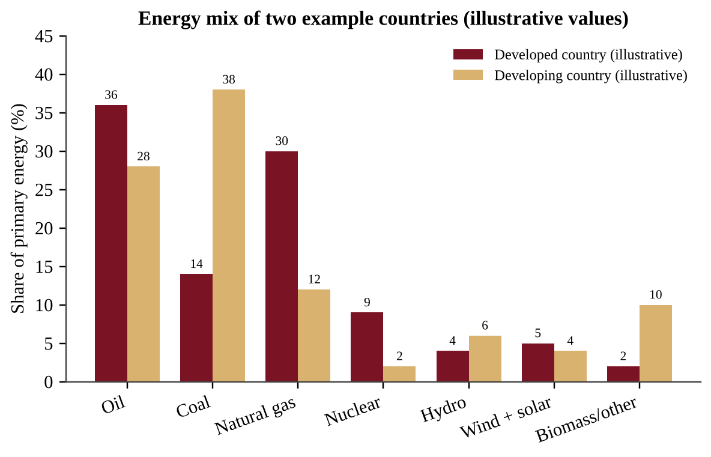
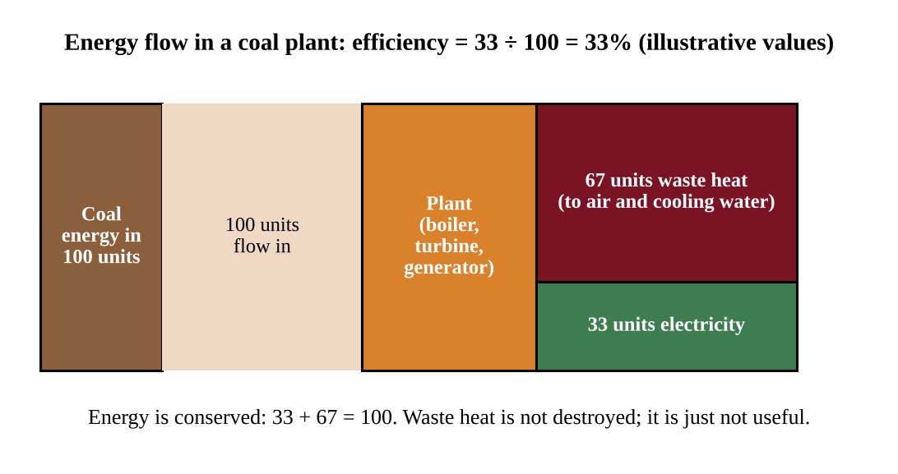
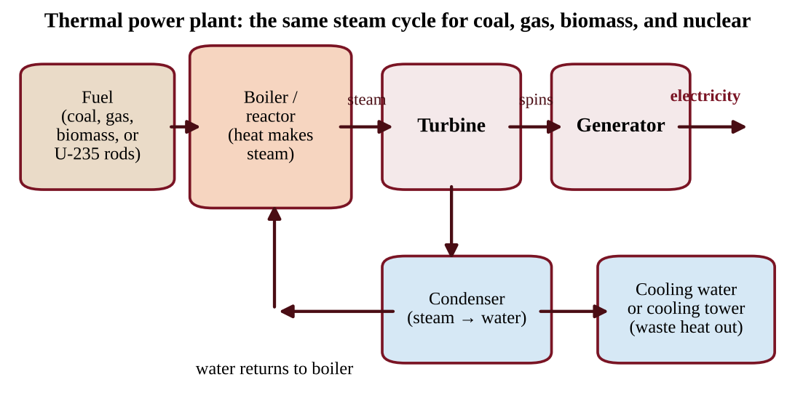
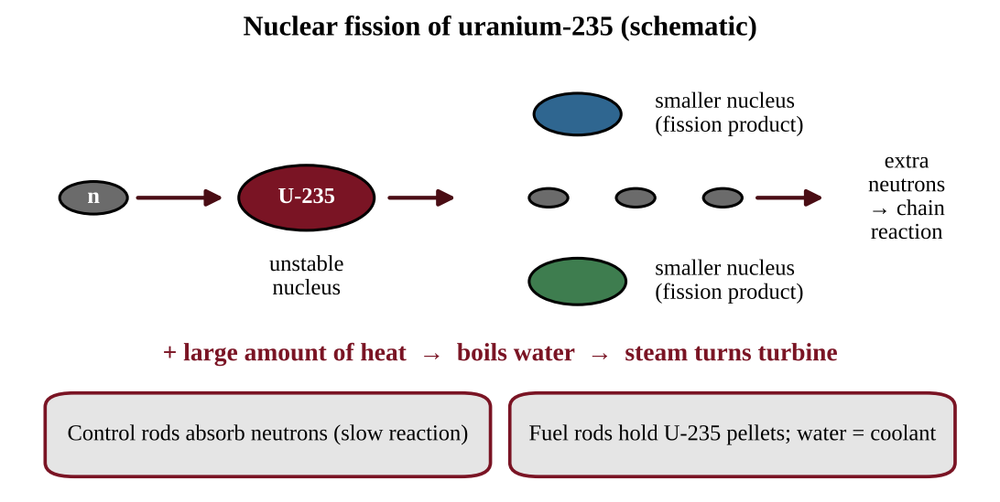
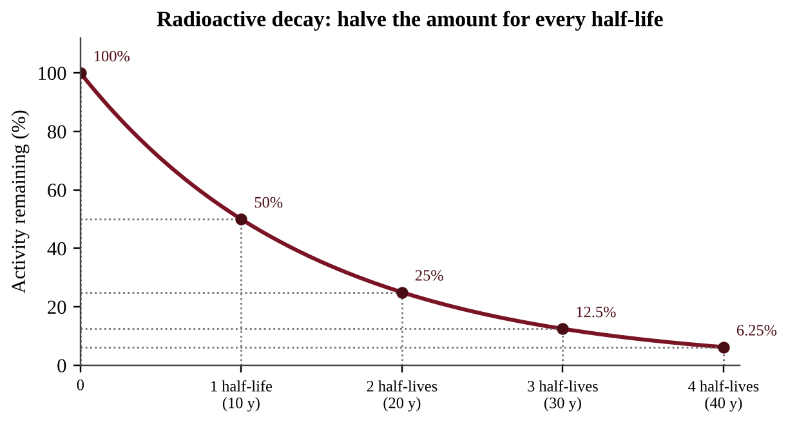
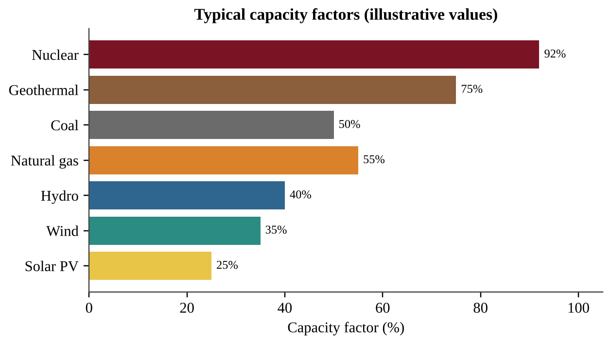
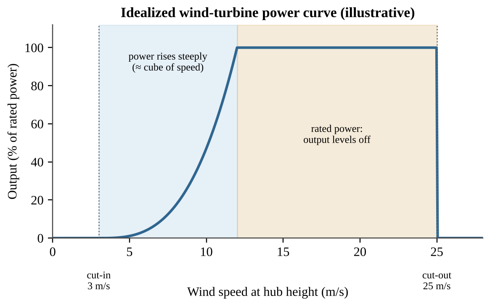

# Unit 6 — Energy Resources and Consumption

:::box objectives
- Tell renewable from nonrenewable energy sources and explain why the difference matters.
- Describe who uses energy, which sources dominate, and what drives changes in demand.
- Identify fuel types, how fossil fuels, nuclear, biomass, solar, hydro, geothermal, hydrogen and wind systems generate power, and what each costs the environment.
- Use energy, power, efficiency, capacity factor, cost, payback, EROEI, half-life and per-capita math with correct units.
- Describe household and large-scale ways to conserve energy.
:::

Energy is the "currency" of modern life. Every light, phone charge, bus ride and loaf of bread depends on it, and every energy choice leaves an environmental bill: air pollution, land use, water use, waste, or habitat change. This unit has two jobs. First, learn how each energy source works and what its trade-offs are. Second, learn the arithmetic that lets you compare them fairly. On the AP exam, Unit 6 is worth 10–15% of the points, and calculation questions from this unit appear very often in the free-response section.

## Topic 6.1 — Renewable and Nonrenewable Resources

:::box objectives
- Identify differences between nonrenewable and renewable energy sources (ENG-3.A).
:::

:::box simple
Think of a bank account. A **nonrenewable** source is a savings account with a fixed balance: each withdrawal leaves less, and the bank does not refill it in your lifetime. A **renewable** source is a paycheck: new money arrives continuously, but you can only spend what arrives each pay period.
:::

### The two categories

**Nonrenewable energy sources** exist in a fixed amount and are replaced so slowly that, on a human timescale, they are not replaced at all. Coal, crude oil and natural gas formed from organisms buried over millions of years. Uranium-235, the fuel for nuclear plants, is mined from ores that formed with the Earth itself. Using these sources means transforming stored energy that cannot easily be put back.

**Renewable energy sources** are replenished naturally at or near the rate we consume them, and they can be reused. Sunlight, wind, flowing water, the heat of the Earth's interior and fast-growing plant biomass fit here. Notice the phrase *at or near the rate of consumption*. Wood is renewable only if trees are replanted and regrow as fast as they are cut. A forest cut faster than it regrows is being mined, not harvested.

:::box define
**Nonrenewable energy source** — an energy source that exists in a fixed amount and cannot be replaced at the rate it is used.

**Renewable energy source** — an energy source that is replenished naturally at or near the rate of consumption and can be reused.

**Fossil fuel** — a fuel formed from the buried remains of ancient organisms: coal, crude oil and natural gas.
:::

| Source | Category | Why |
|---|---|---|
| Coal, oil, natural gas | Nonrenewable | Formed over millions of years; used far faster than formed |
| Uranium-235 | Nonrenewable | Fixed supply of ore |
| Sunlight, wind, moving water | Renewable | Driven continuously by solar energy and gravity |
| Geothermal heat | Renewable | Heat flows continuously from Earth's interior (if water use is sustainable) |
| Biomass | Renewable if regrown | Plants regrow within years to decades |

:::box mistake
- "Renewable means clean." Not always. Burning biomass releases particulates and nitrogen oxides, and a large dam floods habitat. Renewable describes supply, not pollution.
- "Nuclear is renewable because it makes no air pollution." Nuclear is **nonrenewable**; uranium is finite. "Clean air" and "renewable" are separate questions.
- "Nonrenewable means it will run out tomorrow." It means it is used up faster than it forms; supplies may last decades, but they decline.
:::

:::box strategy
When a question asks you to "identify" or "distinguish," state the test explicitly: *is it replenished at or near the rate of use?* Then apply it to the named source in a short clause.
:::

:::box example
id: SG-U6-E001
A student sorts five energy sources into two columns: wind, uranium-235, natural gas, sunlight, and coal. (a) List which belong in the nonrenewable column. (b) Using the definition of nonrenewable, explain in one sentence why natural gas is placed there even though it burns more cleanly than coal. (c) One of the nonrenewable sources releases no air pollutants during operation. Identify it.
:::

:::box summary
- Nonrenewable: fixed amount, not replaced on human timescales. Renewable: replenished at or near the rate of use.
- Renewable does not automatically mean low impact; nonrenewable does not mean "runs out soon."
:::

## Topic 6.2 — Global Energy Consumption

:::box objectives
- Describe trends in energy consumption (ENG-3.B): unequal distribution, the dominance of fossil fuels, and what drives demand.
- Calculate energy use per person and energy shares, with correct units.
:::

:::box simple
Energy use follows wealth and industry. A country with factories, cars, air conditioning and many appliances uses far more energy per person than a country where most people cook with wood and have little electricity. As poorer countries industrialize, their total demand rises, and today that growth is met mainly by fossil fuels.
:::

### Who uses energy, and from what?

The use of energy is **not evenly distributed**. Developed countries have a small share of the world's people but use a large share of its energy, so their energy use **per capita** (per person) is high. Developing countries use less per person, but they have most of the world's population and their total demand is growing fastest.

Worldwide, the **most widely used sources are fossil fuels**: oil, coal and natural gas together supply the large majority of primary energy. Renewable energy, including hydro, wind, solar and biomass, supplies a smaller share, although it is growing quickly.

### Trends and their causes

- **Industrialization raises demand.** Factories, mining, transport, cement and steel need energy, and rising incomes mean more electricity, vehicles and appliances.
- **Development increases fossil-fuel reliance.** Developing countries often rely first on traditional biomass (firewood, charcoal, dung) because it is nearby and free. As incomes rise they shift to coal, oil and gas, which are concentrated, transportable and often cheap, so fossil fuel use increases before cleaner sources catch up.
- **Availability, price and government regulation shape choices.** A country with abundant coal tends to burn coal. A price rise in oil pushes users toward alternatives. Subsidies, carbon taxes, emission standards and renewable-energy mandates change which source is cheapest or required.

**Reading Figure 6.1.** Notice the pattern before using numbers. The developing country gets a much larger share from coal (38% versus 14%) and from biomass (10% versus 2%), while the developed country relies more on oil and natural gas and has more nuclear. Both countries are dominated by fossil fuels: add oil, coal and gas to get 80% and 78%. A good analysis states the pattern, gives one comparison with numbers, and links it to a cause such as local resources or stage of development.

:::box formula
**Energy per capita** = total energy used ÷ population

**Percent share** = (energy from one source ÷ total energy) × 100

**Percent change** = (new − old) ÷ old × 100

Units: energy in joules (J), megajoules (MJ = 10⁶ J), gigajoules (GJ = 10⁹ J), exajoules (EJ = 10¹⁸ J); or kWh. Per capita is reported as J, GJ or kWh per person per year.

Conversions: 1 kWh = 3.6 × 10⁶ J = 3.6 MJ. 1 BTU ≈ 1,055 J. 1 kWh ≈ 3,412 BTU.
:::

:::box apply
**Worked example.** A country of 50 million people uses 4.0 × 10¹⁸ J (4.0 EJ) of energy in a year, and 3.0 EJ of that comes from fossil fuels.

Per capita: 4.0 × 10¹⁸ J ÷ 5.0 × 10⁷ people = 8.0 × 10¹⁰ J per person = 80 GJ per person.
Fossil share: 3.0 ÷ 4.0 × 100 = 75%.
If next year's total use is 4.4 EJ, percent change = (4.4 − 4.0) ÷ 4.0 × 100 = 10% increase.
:::

:::box strategy
Always write the units in each line of a calculation and cancel them. If your answer to "energy per person" has units of J/person/year, it must come from J/year divided by people. Big powers of ten are the usual error source; write them in scientific notation.
:::

:::box example
id: SG-U6-E002
Country A has 300 million people and uses 90 EJ of energy in a year. Country B has 1,500 million people and uses 45 EJ. (a) Calculate each country's energy use per person in GJ. (b) Calculate how many times greater Country A's per-person use is than Country B's. (c) Country B gets 60% of its energy from coal. Calculate the energy from coal in EJ. (d) Describe one reason Country B's total use is likely to rise over the next 20 years.
:::

### Total demand, doubling time and energy history

Total demand depends on both population and use per person, so a country with low use per person but a huge population (China is the standard case) can still have very large total energy use and CO₂ emissions.

:::box formula
**Total energy use** = energy per capita × population

**Doubling time (years)** = 70 ÷ annual growth rate (%)   (rule of 70)

**Percent of capacity used** = demand ÷ plant capacity × 100
:::

The rule of 70 works for any steady percentage growth: at 3.5% per year, demand doubles in 70 ÷ 3.5 = 20 years. For a table of towns, find each town's demand (people × kW per person), add them, and compare with plant capacity.

Energy history: wood gave way to coal in the 1800s (deforestation, and coal's higher energy content), then oil and gas overtook coal in the 1900s as vehicles multiplied. On a graph of **shares**, a source can fall in share while its **amount** still rises, so check the axis. State only causes the data support: a falling coal share beside a rising gas share shows competition, not by itself a cause such as price.

:::box example
id: SG-U6-E013
A city of 400,000 people uses 3.0 kW per person and a town of 90,000 uses 5.0 kW per person; one 2,000 MW plant serves both. (a) Calculate the percent of capacity used. (b) Demand grows 3.5% per year; use the rule of 70 to estimate the doubling time. (c) Explain why the plant will be overloaded before that time has passed.
:::

:::box summary
- Energy use is uneven: higher per person in developed countries; demand grows fastest where industrialization is happening.
- Fossil fuels are the most widely used sources globally; developing countries lean more on fossil fuels as they develop.
- Availability, price and regulation influence which sources people choose.
:::

## Topic 6.3 — Fuel Types and Uses

:::box objectives
- Identify types of fuels and their uses (ENG-3.C), including cogeneration.
- Calculate efficiency and combined efficiency of cogeneration.
:::

:::box simple
Fuels are "energy in a package." The better packed (more energy per kilogram, less water and ash), the more useful and usually the more expensive. Wood is a loose package; gasoline is a compact one.
:::

### Fuels you must know

- **Wood.** Used as firewood and as **charcoal** (wood heated with little oxygen so that it is mostly carbon). It is common in developing countries because it is accessible and often free. Heavy use can cause deforestation, and indoor smoke harms health.
- **Peat.** Partially decomposed plant material from waterlogged bogs. It is the early stage on the way to coal, burns smokily, and is dug and dried for fuel. Peat bogs also store large amounts of carbon, so harvesting them releases CO₂.
- **Coal.** Formed from buried plant matter that was compressed and heated. **Heat, pressure and depth of burial** determine the type. Three types are used as fuel: **lignite** (soft, brown, lowest energy content, least buried), **bituminous** (the most commonly burned type, medium to high energy) and **anthracite** (hard, shiny, highest carbon and energy content, most heat and pressure). Higher rank means more carbon, more energy per kilogram, and less moisture.
- **Natural gas.** Mostly **methane (CH₄)**. It is the **cleanest fossil fuel** per unit of energy: it releases less CO₂ and almost no particulates or sulfur dioxide. Leaked methane is itself a strong greenhouse gas.
- **Crude oil and tar sands.** Crude oil is pumped from underground reservoirs. **Tar sands** are a mix of clay, sand, water and a thick tar-like hydrocarbon called **bitumen**; oil is recovered from them by mining or by heating the deposit, which takes a lot of energy and water and disturbs land.
- **Refined fuels.** Crude oil is separated by boiling point into specialized fuels: gasoline for cars, diesel for trucks and trains, kerosene for jet fuel, heating oil, and propane. Each fuel's properties match a use; a jet engine and a lawn mower need different fuels.

### Cogeneration

Making electricity in a thermal power plant wastes about two-thirds of the fuel's energy as heat. **Cogeneration** (combined heat and power, CHP) captures that heat and uses it for something useful, such as heating buildings or supplying industrial steam, while the same fuel also produces electricity. The result is a much higher total efficiency, so less fuel is burned and less pollution is released for the same useful output.

:::box formula
**Efficiency (%)** = (useful energy output ÷ total energy input) × 100

**Cogeneration efficiency (%)** = (electrical output + useful heat output) ÷ fuel energy input × 100

Energy is conserved: input = useful output + waste (lost) energy. Use the same unit (J, kWh or BTU) for every term.
:::

:::box define
**Cogeneration** — using one fuel source to produce both useful heat and electricity.

**Bitumen** — thick, tar-like hydrocarbon in tar sands.

**Charcoal** — fuel made by heating wood with little oxygen.
:::

:::box mistake
- Saying "efficiency means energy is lost." Energy is never destroyed. Waste heat is still energy, just spread out and not useful for the task.
- Calling natural gas "pollution-free." It is the cleanest fossil fuel, not a clean one.
:::

:::box example
id: SG-U6-E003
A cogeneration plant burns fuel containing 200 MJ of energy. It produces 60 MJ of electricity and delivers 90 MJ of useful heat to nearby buildings. (a) Calculate the plant's overall efficiency. (b) Calculate the energy that is wasted, in MJ. (c) Explain why a plant that produced only the 60 MJ of electricity would need more fuel to supply the same electricity plus the same heating.
:::

:::box summary
- Know wood and charcoal, peat, coal ranks (lignite < bituminous < anthracite), natural gas (mostly methane, cleanest fossil fuel), crude oil and tar sands (bitumen).
- Crude oil is refined into specialized fuels.
- Cogeneration uses waste heat, raising overall efficiency.
:::

## Topic 6.4 — Distribution of Natural Energy Resources

:::box objectives
- Identify where natural energy resources occur (ENG-3.D) and explain why their distribution is not uniform.
:::

:::box simple
You can only find a resource where nature made it. Coal needs ancient swamps; oil and gas need ancient seas and the right rock traps. Where those conditions never happened, there is no deposit, no matter how much people want one.
:::

The global distribution of natural energy resources such as ores, coal, crude oil and natural gas is **not uniform**. It depends on each region's **geologic history**: what environments existed there millions of years ago, how sediments were buried, and how rock layers were folded and sealed.

- **Coal** formed in warm, wet, swampy lowlands where large amounts of plant matter were buried. Such regions (for example parts of North America, China, India, Russia, Australia and Europe) now have coal beds.
- **Oil and natural gas** formed from marine microorganisms buried in sedimentary basins, then trapped under impermeable rock. The Middle East, parts of Russia, North America and offshore basins are rich in oil and gas; many countries have none.
- **Uranium ores** occur where particular geological processes concentrated the mineral, in countries such as Kazakhstan, Canada and Australia.
- **Renewable resources are also uneven.** Geothermal heat is best near tectonic plate boundaries and volcanic hot spots (Iceland, parts of the Pacific Ring of Fire); sunlight is strongest in low-latitude, cloud-free regions; wind is steadier on coasts, plains and mountain passes.

Uneven distribution has consequences. Countries without resources must import, so prices and politics affect them; resource-rich countries may gain income, and resource extraction can lead to conflict or environmental damage.

When a question gives a map or table of reserves and production, describe where resources are concentrated, compare regions, and connect the pattern to a geologic cause. To compare regions fairly on a graph, divide a region's share of world reserves by its share of world consumption. A ratio above 1 marks a region that holds more than it uses (likely an exporter); below 1 marks an importer. The Middle East holds the largest share of proven oil reserves and has long led petroleum exports; the United States has very large coal reserves. At current rates, proven oil reserves last the fewest decades, natural gas somewhat longer and coal far longer. A useful ratio is **reserves-to-production (R/P)**, which estimates how long known reserves would last at the current rate of use.

:::box formula
**R/P ratio (years)** = proven reserves ÷ annual production

Units: reserves and production must use the same unit (for example billion barrels and billion barrels per year). The result assumes production stays constant and no new reserves are found.
:::

:::box apply
A region has 150 billion barrels of proven oil reserves and produces 3.0 billion barrels per year. R/P = 150 ÷ 3.0 = 50 years. If annual production rises to 5.0 billion barrels, the same reserves would last 30 years. Faster use shortens the lifetime of a fixed resource.
:::

:::box mistake
R/P is not a prediction of the "day oil runs out." Reserves change with technology and price, and use changes with demand. Present it as an estimate under stated assumptions.
:::

:::box example
id: SG-U6-E004
A country has proven natural gas reserves of 240 billion cubic meters (bcm) and produces 4.0 bcm per year. (a) Calculate the R/P ratio in years. (b) Production rises by 25%. Calculate the new annual production and the new R/P ratio. (c) Explain, using geologic history, why a country with no ancient sedimentary basins is unlikely to have natural gas reserves.
:::

:::box summary
- Coal, oil, gas and ores are unevenly distributed because of regional geologic history.
- Renewable resources are uneven too (geothermal at plate boundaries, sun and wind by climate and geography).
- R/P = reserves ÷ annual production estimates reserve lifetime at current use.
:::

## Topic 6.5 — Fossil Fuels

:::box objectives
- Describe the use and methods of fossil fuels in power generation (ENG-3.E).
- Describe the effects of fossil fuels on the environment (ENG-3.F).
:::

:::box simple
A fossil-fuel power plant is a giant kettle. Burn fuel to boil water; the steam spins a turbine like a pinwheel; the turbine spins a generator that makes electricity.
:::

### Combustion and power generation

**Combustion** is a chemical reaction between a fuel and oxygen that releases energy. For hydrocarbon fuels the products are carbon dioxide and water. For methane, the main component of natural gas:

CH₄ + 2 O₂ → CO₂ + 2 H₂O + energy

Real fuels also contain impurities (sulfur, nitrogen, metals), and combustion in air makes nitrogen oxides, so burning fossil fuels produces SO₂, NOₓ, particulates and, when oxygen is limited, carbon monoxide (CO).

:::box process
Fuel burned in boiler → heat boils water → high-pressure steam → steam spins turbine → turbine spins generator → electricity → steam cooled in condenser and returned as water (waste heat released to air or cooling water)
:::

Natural gas plants can also use a **combined cycle**: hot exhaust gas first spins a gas turbine, then heats water to run a steam turbine, giving higher efficiency than a coal plant.

### Extraction methods

- **Surface (strip) mining** removes soil and rock above shallow coal. It is cheaper and safer for workers but destroys habitat, erodes soil and can send acidic, metal-rich drainage into streams. *Mountaintop removal* is an extreme form.
- **Subsurface mining** uses shafts and tunnels for deep coal. It is more expensive and dangerous (collapses, gas explosions, lung disease) and can cause land subsidence and acid mine drainage.
- **Drilling** pumps oil and gas from wells on land or offshore. Spills, leaks, habitat disruption and, in offshore drilling, risk of blowouts are concerns.
- **Hydraulic fracturing (fracking)** injects water, sand and chemicals at high pressure to crack tight rock and free oil or gas. It can **contaminate groundwater** if wells or wastewater storage fail, and can release **volatile organic compounds (VOCs)** and methane to the air. It also uses large volumes of water, and disposal of the wastewater is a concern.
- **Tar sand extraction** uses mining or heating of the deposit and is energy- and water-intensive.

### Environmental effects of using fossil fuels

- **Climate:** combustion releases CO₂, a greenhouse gas; natural gas leaks release methane.
- **Air quality:** SO₂ and NOₓ cause acid deposition and smog; particulates harm lungs; mercury is released from burning coal.
- **Water:** thermal pollution from cooling water, oil spills, mine drainage.
- **Land:** mining scars, habitat loss.

Why do societies keep using them? They are energy dense, widely available, easy to store and transport, and supported by existing infrastructure, so they are often the lowest-cost choice at the point of use.

:::box define
**Combustion** — chemical reaction of a fuel with oxygen that releases energy, producing CO₂ and H₂O for fossil fuels.

**Hydraulic fracturing (fracking)** — injecting fluid at high pressure into rock to open cracks and release oil or gas.

**Volatile organic compounds (VOCs)** — carbon-based chemicals that evaporate easily and can form smog.
:::

:::box mistake
- Saying water is the *source* of energy in a steam plant. Water is only the working fluid that carries heat.
:::

:::box strategy
For "describe the environmental effects of X," name a specific pollutant or impact, say where it goes (air, water, land) and what harm it causes. "It pollutes" earns no credit; "SO₂ forms sulfuric acid that acidifies lakes" does.
:::

:::box example
id: SG-U6-E005
Methane burns according to CH₄ + 2 O₂ → CO₂ + 2 H₂O. Use atomic masses C = 12, H = 1, O = 16. (a) Calculate the mass of CO₂, in kg, released when 16 kg of methane is burned completely. (b) A gas-fired plant produces electricity with an efficiency of 40%. If it uses 500 MWh of fuel energy in an hour, calculate its electrical output in MWh and the energy released as waste heat. (c) Identify the energy transformation sequence from heat to electricity in the plant.
:::

### Power, fuel and emissions in a plant

A plant's efficiency links the electricity it sends out to the fuel energy it must take in. Everything that is not electricity ends up as waste heat, mostly at the condenser. Work in **power** (MW = MJ/s) and keep the plant's electrical output and its thermal (fuel) input separate.

:::box formula
**Fuel (thermal) power in** = electrical power out ÷ efficiency (as a decimal)

**Waste heat** = power in − power out

**Fuel mass** = fuel energy needed ÷ energy content of the fuel (MJ/kg)

**CO₂ emitted** = energy (kWh) × emission factor (kg CO₂/kWh), or fuel burned × emission per unit of fuel

**Average emission factor of a grid** = Σ (share of each source × its factor)

**CO₂ avoided by switching** = energy × (old factor − new factor)
:::

:::box apply
**Worked example.** A 300 MW electric plant runs at 40% efficiency on coal containing 25 MJ/kg. Power in = 300 ÷ 0.40 = 750 MW, so waste heat = 750 − 300 = 450 MW. Fuel use = 750 MJ/s ÷ 25 MJ/kg = 30 kg/s = 108 metric tons per hour (30 × 3,600 ÷ 1,000).
A grid that is 60% coal (1.0 kg CO₂/kWh), 30% gas (0.45) and 10% wind (0) averages 0.60 × 1.0 + 0.30 × 0.45 + 0 = 0.735 kg CO₂/kWh. Unit helpers: 1 GWh = 10⁶ kWh; 1 metric ton = 1,000 kg.
:::

Three more points. In fracturing, the sand **props the new cracks open**, and wastewater injected deep underground can trigger small earthquakes. Coal pollution is cut by **scrubbers** (remove SO₂), filters and precipitators (capture particulates), low-sulfur coal and fuel switching. A utility bill leaves out the **external costs** (illness, lost workdays, ecosystem damage) that society pays. Natural gas is called a **bridge fuel** because it emits less CO₂ and almost no SO₂ per unit of energy than coal, though methane leaks limit the benefit.

:::box example
id: SG-U6-E014
A coal plant delivers 200 MW of electric power at 32% efficiency; its coal holds 24 MJ/kg and it emits 1.0 kg CO₂ per kWh. (a) Calculate the waste heat in MW. (b) Calculate the coal burned per hour in metric tons. (c) A gas plant emitting 0.45 kg CO₂/kWh replaces it. Calculate the CO₂ avoided in 8,000 operating hours, in metric tons.
:::

:::box summary
- Combustion: fuel + O₂ → CO₂ + H₂O + energy. Heat → steam → turbine → generator → electricity.
- Extraction methods: surface and subsurface mining, drilling, fracking, tar sand mining, each with land, water or air impacts.
- Fracking risks: groundwater contamination and VOC release.
:::

## Topic 6.6 — Nuclear Power

:::box objectives
- Describe nuclear energy in power generation (ENG-3.G) and its environmental effects (ENG-3.H).
- Use half-life to calculate remaining radioactivity.
:::

:::box simple
A nuclear plant is also a giant kettle, but the heat comes from splitting atoms instead of burning anything. A tiny amount of uranium releases a huge amount of heat, but the leftover waste stays dangerous for a very long time.
:::

### Fission in a reactor

Nuclear power comes from **fission**. A neutron strikes an atom of **uranium-235 (U-235)**, which is stored in **fuel rods**. The nucleus splits into smaller nuclei and releases heat plus extra neutrons, which strike other U-235 nuclei, creating a **chain reaction**. The heat boils water; the steam turns a turbine; the turbine spins a generator (the same steam cycle as in Figure 6.3).

{w=0.8}

Key parts: **fuel rods** (U-235 pellets), **control rods** (absorb neutrons to slow or stop the reaction), **coolant/moderator** (usually water that removes heat), a **containment structure** (thick concrete and steel shell), and a cooling system.

### Radioactivity and waste

**Radioactivity** occurs when the nucleus of a radioactive isotope loses energy by emitting radiation. Spent fuel contains radioactive isotopes. U-235 and some fission products stay radioactive for a very long time, so **waste disposal** is the core challenge: spent fuel is first stored in cooling pools, then in dry casks, and long-term plans call for deep geologic repositories that remain stable for thousands of years. Low-level waste (gloves, equipment) is less hazardous.

### Advantages and disadvantages

- **Nonrenewable**: uranium is mined and finite.
- **No air pollutants or CO₂ from operation**, so it is considered cleaner for air and climate.
- Releases **thermal pollution** (warm cooling water can harm aquatic life) and **hazardous solid waste**.
- Very high capacity factor (see Figure 6.5), high construction cost, long building time.
- Mining uranium disturbs land and can leave radioactive tailings.
- Accident risk is low but consequences can be severe.
- Nuclear plants make **electricity only**, so they cannot by themselves replace oil, which is also needed for transport fuels and petrochemicals.

### Accidents

- **Three Mile Island (USA, 1979):** a partial meltdown caused by equipment failure and operator error; containment held and only a small radiation release occurred, but the accident reshaped public trust and regulation.
- **Chernobyl (Ukraine, then USSR, 1986):** a reactor explosion and fire released large amounts of radioactive material across Europe. A wide exclusion zone remains and many people were exposed, with long-term health effects and contaminated land.
- **Fukushima Daiichi (Japan, 2011):** an earthquake and tsunami knocked out cooling power; reactors overheated and released radiation, requiring evacuation and long cleanup, and contaminated water had to be managed.

### Half-life math

A radioactive isotope's **half-life** is the time for half of the nuclei in a sample to decay. After each half-life, the amount remaining is halved, and the radioactivity falls the same way. It sets the rate of decay and tells us how long waste stays dangerous.

:::box formula
**Remaining amount** = initial amount × (½)ⁿ, where n = elapsed time ÷ half-life

Or halve the amount once for each half-life that passes. Elapsed time and half-life must use the same time unit.

Example: 800 units with half-life 5 years. After 15 years n = 3, so 800 → 400 → 200 → 100 units.
:::

:::box apply
Iodine-131 has a half-life of about 8 days and concentrates in the thyroid, so it is a short-term hazard after accidents. Cesium-137 has a half-life of about 30 years, so land contaminated with it stays hazardous for decades. Plutonium and uranium isotopes with half-lives of thousands to millions of years are why repositories must work over very long periods.
:::

:::box define
**Fission** — splitting of a heavy nucleus into smaller nuclei, releasing heat and neutrons.

**Chain reaction** — neutrons released by fission cause further fissions.

**Half-life** — time for half of a radioactive sample to decay.

**Radioactivity** — emission of radiation by an unstable nucleus losing energy.
:::

:::box mistake
- Believing a half-life means the sample is gone after two half-lives. It is 25% remaining, not zero.
- Thinking "a long half-life means a more intense source." A long half-life decays slowly, so each unit is *less* intense per second but stays dangerous far longer.
- Calling nuclear "emission-free" in every way. It emits no air pollutants in operation but does produce thermal pollution and hazardous solid waste.
:::

:::box example
id: SG-U6-E006
A waste sample contains an isotope with a half-life of 8 days. The sample's activity is 640 units today. (a) Calculate its activity after 32 days. (b) Calculate how many days are needed for the activity to fall to 10 units. (c) A second isotope in the same waste has a half-life of 24,000 years. Explain why that isotope, not the first, drives the need for very long-term storage.
:::

### More on cooling, waste and half-life

In most reactors the reactor water, the steam loop and a separate **cooling loop** through the condenser stay sealed apart. The cooling water leaving the condenser carries the plant's waste heat; discharged to a river it causes **thermal pollution** (warm water holds less dissolved oxygen and can exceed organisms' tolerance), and intakes can trap fish. Cooling towers reduce the heat released. **Low-level waste** (tools, clothing) is short-lived and stored in shielded containers; **high-level waste** (spent fuel) stays hazardous for thousands of years and needs deep geologic storage. Radioactive iodine is absorbed by the thyroid, so thyroid cancer is the typical health effect of an accident.

{w=0.8}

**Half-life skills.** (1) 50%, 25%, 12.5%, 6.25% are 1, 2, 3, 4 half-lives; 1/16 is (½)⁴. (2) *Find the half-life* as elapsed time ÷ number of halvings, or read the time at which a curve falls to half its start. (3) A common rule of thumb treats waste as essentially decayed after about 10 half-lives (about 0.1% left). The longest-lived isotope controls storage time.

:::box example
id: SG-U6-E015
A strontium-90 sample (half-life 29 years) has an activity of 480 units. (a) Calculate its activity after 87 years. (b) Calculate the time to fall to 6.25% of the start. (c) A different isotope falls from 0.80 mol to 0.10 mol in 21 days. Calculate its half-life.
:::

:::box summary
- Fission of U-235 in fuel rods releases heat; steam turbine; generator. Control rods slow the reaction.
- Nuclear is nonrenewable, no air pollutants in operation, but thermal pollution and long-lived hazardous waste.
- Three Mile Island, Chernobyl and Fukushima are the accident case studies.
- Half-life math: halve the amount for each half-life elapsed.
:::

## Topic 6.7 — Energy from Biomass

:::box objectives
- Describe the effects of using biomass in power generation on the environment (ENG-3.I).
- Calculate energy return on energy investment (EROEI).
:::

:::box simple
Biomass is stored sunlight in plants. Burn it and you get heat; the carbon it releases was recently taken from the air by the plant, so, if the plants are regrown, the carbon cycle is roughly balanced. The catch is that growing, harvesting and processing it also take energy.
:::

**Biomass** is organic material from plants and animals used as fuel: wood, crop residues, manure, and fuel crops. Burning biomass produces heat at relatively low cost, which is why it is the main fuel for cooking and heating for billions of people. But combustion also produces **CO₂, carbon monoxide, nitrogen oxides, particulates and VOCs**, and in homes without chimneys, indoor smoke causes respiratory disease. **Overharvesting trees for fuel causes deforestation**, which removes habitat, causes soil erosion and removes carbon sinks.

### Biofuels

**Ethanol** is alcohol made by fermenting sugars from corn, sugarcane or other crops. It can replace some gasoline (blends such as E10 and E85). Burning ethanol does not introduce *additional* carbon into the atmosphere in the sense that the carbon was absorbed by the crop recently, but the **energy return on energy investment (EROEI)** of ethanol is **low**, because farming (fertilizer, machinery), transport and distillation all use energy, often from fossil fuels. Growing fuel crops can also compete with food crops for land and water and add fertilizer runoff.

:::box formula
**EROEI** = energy delivered by the fuel ÷ energy invested to obtain it

**Net energy** = energy delivered − energy invested

EROEI > 1 means a net energy gain. The higher it is, the more attractive the source. Both quantities must be in the same units (for example MJ per liter).
:::

:::box apply
A distillery uses 8.0 MJ of energy to grow, harvest and process the corn for each liter of ethanol, and the liter contains 21 MJ. EROEI = 21 ÷ 8.0 = 2.6; net energy = 21 − 8.0 = 13 MJ per liter. By contrast, a high-quality oil field that returns 15 MJ for every 1 MJ invested has an EROEI of 15.
:::

:::box mistake
- "Biomass is carbon neutral, so it has no climate impact." Only true when regrowth truly replaces what is burned, and fossil fuel inputs for farming and processing add CO₂.
:::

:::box example
id: SG-U6-E007
Producing one liter of a biofuel requires 12 MJ of energy inputs, and the liter contains 24 MJ of usable energy. A gasoline-like crude oil source returns 18 MJ for each 1.0 MJ invested. (a) Calculate the biofuel's EROEI and its net energy per liter. (b) State which source returns more energy per unit invested. (c) Describe two environmental effects of replacing forest with fuel crops.
:::

### Net energy, land use and blends

The net gain from an investment is (EROEI − 1) × energy invested: an EROEI of 1.56 turns 100 MJ invested into 156 MJ delivered, a net gain of 56 MJ.

Biofuel questions chain calculations. **Land** = fuel volume ÷ yield per hectare. **Water** = land × irrigation per hectare. **Blend emissions** = each component's volume × its life-cycle factor, added (in B20, 20% of the volume uses the biodiesel factor). Biofuel factors are not zero because farming, fertilizer, processing and trucking burn fossil fuel.

Compare fuels pollutant by pollutant: wood pellets give far less fossil CO₂ than natural gas but more particulates and nitrogen oxides. State both sides. Irrigated fuel crops in dry regions also compete with food for water and land.

:::box example
id: SG-U6-E016
A fleet uses 200,000 L of fuel a year. Petroleum diesel emits 3.2 kg CO₂e per liter over its life cycle and biodiesel 1.1. The fleet changes to 30% biodiesel by volume; the crop yields 1,500 L/ha per year and needs 5,000 m³/ha of irrigation. (a) Calculate the percent reduction in emissions. (b) Calculate the hectares and irrigation water needed. (c) A fuel has an EROEI of 3.0; calculate its net gain per 100 MJ invested.
:::

:::box summary
- Biomass burning is cheap but releases CO₂, CO, NOₓ, particulates and VOCs; overharvesting causes deforestation.
- Ethanol can substitute for gasoline, and burning it adds no extra carbon beyond what the crop absorbed, but its EROEI is low.
:::

## Topic 6.8 — Solar Energy

:::box objectives
- Describe solar energy in power generation (ENG-3.J) and its environmental effects (ENG-3.K).
- Calculate capacity factor, energy produced, cost savings and payback.
:::

:::box simple
Solar energy is free sunshine caught two ways: panels that turn light directly into electricity, and heat collectors that warm water or air. The challenge is that the sun does not always shine and the equipment costs money upfront.
:::

### Three kinds of solar systems

- **Photovoltaic (PV) cells** capture light energy and transform it **directly into electrical energy**. Output depends on sunlight, so it falls on cloudy days and is zero at night. PV can be rooftop (small, distributed) or in large solar farms.
- **Active solar** systems use mechanical and electrical equipment (pumps, fans, collectors) to heat a liquid and to **collect and store** the energy captured from the sun, for example solar water heaters with storage tanks. Large "concentrating" plants use mirrors to focus sunlight on a fluid to make steam.
- **Passive solar** systems absorb heat directly from the sun **without mechanical or electric equipment**. Examples: large south-facing windows (in the Northern Hemisphere), thick dark thermal-mass floors, and overhangs that block summer sun. Passive systems do not collect or store energy for later use except as the heat held in the building itself.

### Environmental effects

Solar has **low environmental impact and produces clean energy** (no air pollution or CO₂ during operation), but equipment can be **expensive**. Manufacturing panels needs mining and energy. Large solar farms can **harm desert ecosystems** by clearing land, disturbing soil and fragmenting habitat of species such as desert tortoises. Rooftop solar avoids this land use.

### Energy, power and capacity factor

Many students lose points by mixing up **power** and **energy**. Power is the *rate* of using or producing energy; energy is power multiplied by time. A 1 kW heater running for 1 hour uses 1 kilowatt-hour (kWh) of energy.

:::box formula
**Energy = Power × Time**  (kWh = kW × h; J = W × s)

**Electricity cost** = energy (kWh) × price ($/kWh)

**Capacity factor (%)** = actual energy produced ÷ (rated capacity × hours) × 100

**Payback period (years)** = upfront cost ÷ annual savings

Units: 1 kW = 1,000 W; 1 MW = 1,000 kW; 1 W = 1 J/s; a year has 8,760 hours. A plant's **capacity** (kW or MW) is its maximum output; the capacity factor tells you how much of that maximum it actually delivers on average.
:::

**Reading Figure 6.5.** A plant that produces power around the clock (nuclear, geothermal) has a high capacity factor. Solar PV and wind are lower because the sun sets and the wind varies, not because the equipment is poor. So a 100 MW solar farm cannot be compared to a 100 MW nuclear plant on capacity alone; compare the energy actually produced.

:::box apply
**Worked example.** A rooftop PV array has a rated capacity of 5.0 kW. Over a year it produces 7,300 kWh.
Possible output at full power all year = 5.0 kW × 8,760 h = 43,800 kWh.
Capacity factor = 7,300 ÷ 43,800 × 100 = 16.7%.
At $0.14 per kWh, savings = 7,300 × 0.14 = $1,022 per year. If the system cost $9,000, payback = 9,000 ÷ 1,022 ≈ 8.8 years.
:::

:::box mistake
- Mixing kW and kWh. kW is a rate (power); kWh is an amount (energy). A utility bill charges for kWh.
- Using 24 hours instead of 8,760 hours (or the wrong number of days) in the capacity-factor denominator.
- Calling passive solar "no technology." It is design, not machines; it uses no mechanical or electric equipment.
:::

:::box strategy
For payback questions, compute annual savings first, then divide. State that payback ignores things such as panel degradation and maintenance, and note that after payback the energy is essentially free for the rest of the system's life.
:::

:::box example
id: SG-U6-E008
A 6.0 kW solar PV system installed for $12,000 produces 10,000 kWh in one year. Electricity costs $0.15 per kWh. (a) Calculate the system's capacity factor for the year. (b) Calculate the annual savings and the payback period in years. (c) Express the year's production in megajoules (1 kWh = 3.6 MJ). (d) Distinguish passive solar heating from active solar heating in one sentence.
:::

### Sizing PV and building a solar system

The energy a PV array makes depends on how much sunlight lands on it and what fraction the cells convert (their **efficiency**, typically 15–22%).

:::box formula
**PV energy (kWh/day)** = area (m²) × sunlight (kWh/m²/day) × efficiency (decimal)
:::

A home system has **panels** (make direct current, DC), an **inverter** (changes DC to AC for appliances) and optionally a **battery** (stores energy for night). A grid-connected system can skip the battery by selling surplus and buying power at night. Concentrating plants use mirrors to reach the high temperatures needed for steam; an insulated hot-water or molten-salt tank is their **storage element**. Sunlight is strongest and steadiest near the equator; at high latitudes the sun is lower and seasons swing widely, so a site with large winter shortfalls needs more storage or backup. Panels face the equator. PV output peaks near midday but home demand often peaks in the evening.

:::box example
id: SG-U6-E017
A school installs 800 m² of PV panels at 19% efficiency on a site averaging 4.8 kWh/m² of sunlight per day. The school uses 400,000 kWh per year at $0.13 per kWh, and the grid emits 0.45 kg CO₂ per kWh. (a) Calculate the array's annual output. (b) Calculate the percent of use supplied, the annual savings and the CO₂ avoided in metric tons. (c) Describe one mismatch between PV output and school demand, and propose a response.
:::

:::box summary
- PV: sunlight → electricity directly. Active: equipment collects and stores heat. Passive: building design absorbs heat with no equipment.
- Solar is clean and low-impact but expensive and limited by sunlight; big farms can harm deserts.
- Energy (kWh) = power (kW) × time (h). Capacity factor = actual ÷ possible. Payback = cost ÷ annual savings.
:::

## Topic 6.9 — Hydroelectric Power

:::box objectives
- Describe hydroelectricity in power generation (ENG-3.L) and its environmental effects (ENG-3.M).
- Justify hydropower as a solution by explaining its advantages.
:::

:::box simple
Moving water pushes a turbine. A dam stores water high up, like a battery that can be released on demand; when the water falls through pipes, it spins the turbine.
:::

### Types of hydroelectric power

- **Dam and reservoir.** A dam across a river collects water in a **reservoir**. Released water flows through the dam, **spins a turbine** and then a generator. The water's stored (potential) energy becomes kinetic energy, then electricity. Operators can release more water when demand is high, so hydro can be adjusted quickly.
- **Run-of-river.** **Turbines placed in small rivers** use the flowing water directly without a large reservoir. They flood much less land but produce less power and depend on the river's flow.
- **Tidal energy.** Turbines placed in tidal flows are turned by the in-and-out movement of tides. It is predictable, but suitable sites are limited and equipment must survive harsh marine conditions.
- **Pumped storage** (a related idea): surplus electricity pumps water uphill; later, the water runs back down through turbines. It stores energy rather than producing it.

### Advantages and effects

Advantages (use these to **justify** hydropower): no air pollution or fuel waste during operation; renewable supply driven by the water cycle; low operating cost and long plant life; flood control, irrigation and recreation from reservoirs; can supply power on demand.

Disadvantages: construction is **expensive**; reservoirs flood forests, farms and towns, forcing people to relocate and causing **loss or change of habitat**; dams block fish migration (such as salmon), trap sediment that would nourish downstream floodplains and deltas, change river temperature and flow, and decaying plants in new reservoirs release methane and CO₂. Output falls in droughts.

Responses to these problems include **fish ladders** and managed river flows. **Dam removal** can restore fish migration, sediment flow and downstream floodplains (whose seasonal floods deposit nutrient-rich silt), but it gives up electricity, irrigation water and recreation, and may release stored sediment. A reservoir also loses water by evaporation: volume lost = surface area × depth evaporated, after converting km² to m² (× 10⁶) and m³ to liters (× 1,000). Wave converters are another renewable ocean source.

:::box apply
A planned dam would generate electricity with no air pollutants and supply peak power, so a planner can justify it using those two advantages. A strong answer also acknowledges one trade-off, such as fish migration, and proposes a response such as fish ladders or environmental flow releases.
:::

:::box define
**Reservoir** — artificial lake formed behind a dam.

**Run-of-river hydro** — turbines in a flowing river with little or no storage.

**Tidal energy** — electricity from turbines turned by tidal flows.
:::

:::box mistake
- "Hydro has no environmental impact." It changes habitat, river flow and sediment even though it emits no air pollutants.
:::

:::box example
id: SG-U6-E009
A dam has a rated capacity of 1,200 MW and operates at a capacity factor of 45%. (a) Calculate the electrical energy it generates in a year, in MWh. (b) An average home in the region uses 10,000 kWh per year. Calculate how many homes the dam could supply. (c) Describe two ecological effects of building the dam and identify one advantage that could be used to justify it.
:::

:::box example
id: SG-U6-E018
A reservoir of 80 km² loses 1.5 m of water to evaporation yearly. A city of 600,000 people uses 120 L per person per day. (a) Calculate the evaporated volume in m³. (b) Calculate the city's annual use in m³ and the evaporation as a percent of it.
:::

:::box summary
- Hydro uses falling or flowing water to spin turbines: dams with reservoirs, small-river turbines, and tidal flow.
- No air pollution or waste; expensive to build; habitat loss and changed river ecosystems.
:::

## Topic 6.10 — Geothermal Energy

:::box objectives
- Describe geothermal energy in power generation (ENG-3.N) and its environmental effects (ENG-3.O).
:::

:::box simple
The Earth is hot inside. In a few places the heat is close to the surface. Pump water down, let the rock heat it, bring it back as steam, and use the steam to spin a generator.
:::

**Geothermal energy** uses the **heat stored in the Earth's interior**. Wells are drilled to hot rock and water; heated water returns to the surface as steam, which drives a turbine and generator. The cooled water is usually injected back underground. The best sites are near plate boundaries and volcanic areas where hot rock is near the surface (for example Iceland, Kenya's Rift Valley, and the western United States).

Geothermal plants run day and night and have high capacity factors, so they provide steady "baseload" power. Smaller-scale **geothermal heat pumps** use the stable temperature of shallow ground to heat and cool buildings. Plants come in three designs: **dry steam** (natural steam spins the turbine), **flash** (very hot, high-pressure water turns to steam when pressure drops) and **binary** (hot water heats a second fluid that boils at a lower temperature). Hot fluid can carry corrosive salts, and venting steam is noisy.

**Limits and effects.** The cost of drilling and accessing geothermal energy can be **prohibitively expensive**, and good sites are **not easily accessible in many parts of the world**. Plants can release **hydrogen sulfide (H₂S)**, a gas with a rotten-egg smell that is toxic at high concentrations. Other issues include dissolved minerals and salts in the water, land use at drilling sites, possible small earthquakes, and local depletion of a reservoir if water is removed faster than it recharges.

:::box summary
- Heat from the Earth's interior heats water → steam → turbine → generator.
- Steady and low-emission, but limited to certain locations, costly, and can release hydrogen sulfide.
:::

## Topic 6.11 — Hydrogen Fuel Cell

:::box objectives
- Describe hydrogen fuel cells in power generation (ENG-3.P) and their environmental effects (ENG-3.Q).
:::

:::box simple
A hydrogen fuel cell is like a battery that you refill with hydrogen gas. Hydrogen and oxygen go in, electricity and water come out. No flame is needed.
:::

A **hydrogen fuel cell** uses hydrogen as fuel. Hydrogen combines with oxygen from the air to form water and release energy as electricity:

2 H₂ + O₂ → 2 H₂O + electrical energy (and some heat)

**Water is the only product** at the point of use, so a fuel-cell vehicle has no tailpipe CO₂ or air pollutants. Fuel cells are an alternative to nonrenewable fuels in cars, buses, backup power and some buildings.

**The catch: hydrogen is not an energy source, it is an energy carrier.** There is almost no free hydrogen gas on Earth, so it has to be made, and making it requires energy. Hydrogen produced by **electrolysis** (using electricity to split water into H₂ and O₂) produces no CO₂ if the electricity is from renewable sources. Today, most hydrogen is made from natural gas, which does release CO₂. Hydrogen made from natural gas (steam reforming) or coal gasification releases CO₂ at the plant; electrolysis powered by wind or solar has the lowest net CO₂. Other drawbacks: the technology is **expensive**, hydrogen is hard to store and transport (it is a very light gas, stored at high pressure or very low temperature), and a refueling network is limited.

:::box process
Renewable electricity → splits water (electrolysis) → hydrogen gas stored → fuel cell combines H₂ + O₂ → electricity + water → motor or grid
:::

:::box formula
**Overall system efficiency** = (useful energy delivered ÷ energy originally put in) × 100. When a chain has several steps, multiply step efficiencies: for electrolysis (η₁) then fuel cell (η₂), overall = η₁ × η₂.
:::

:::box mistake
"Hydrogen fuel cells are always zero-emission." The cell itself emits only water, but if the hydrogen comes from natural gas or from fossil-fueled electricity, CO₂ is released upstream.
:::

:::box example
id: SG-U6-E010
Producing 1.0 kg of hydrogen by electrolysis uses 55 kWh of electricity. A fuel cell converts that 1.0 kg of hydrogen back into 20 kWh of electricity. (a) Calculate the overall efficiency of the electricity-to-hydrogen-to-electricity chain. (b) The electricity for electrolysis comes from a coal plant that emits 0.9 kg of CO₂ per kWh. Calculate the CO₂ emitted to produce the 1.0 kg of hydrogen. (c) Explain why this fuel cell is not "zero-emission" in this case, even though its only exhaust is water.
:::

:::box summary
- Fuel cell: H₂ + O₂ → H₂O + electricity; water is the emission.
- Low impact and no CO₂ when hydrogen comes from water using clean electricity, but expensive and still needs energy to make hydrogen.
:::

## Topic 6.12 — Wind Energy

:::box objectives
- Describe wind energy in power generation (ENG-3.R) and its environmental effects (ENG-3.S).
:::

:::box simple
A wind turbine is the opposite of a household fan: moving air spins the blades, and the blades turn a generator.
:::

**Wind turbines** use the **kinetic energy of moving air** to spin blades connected to a shaft and a **generator**, producing electricity. Wind is driven by uneven heating of the Earth by the sun, so it is renewable. Wind farms are placed where winds are strong and steady: plains, ridges, coasts and offshore. Offshore sites have stronger, steadier winds but cost more to build and maintain. Power available in wind rises very rapidly with wind speed, so site choice matters.

**Advantages:** renewable and clean (no air pollution or CO₂ during operation), no fuel cost, and land between turbines can still be farmed or grazed. **Disadvantages:** wind is **intermittent**, so output varies and backup or storage is needed; birds and bats may be **killed if they fly into spinning blades**; noise, visual impact; and building farms disturbs land or seabed. Siting away from migration routes, slowing blades at certain times, and painting blades are ways to reduce bird and bat deaths.

:::box apply
**Worked example.** A wind farm has 20 turbines rated 3.0 MW each, so its capacity is 60 MW. With a capacity factor of 35%, annual energy = 60 MW × 8,760 h × 0.35 = 183,960 MWh. If this displaces electricity from a plant that emits 0.8 tonnes CO₂ per MWh, avoided CO₂ = 183,960 × 0.8 ≈ 147,000 tonnes per year.
:::

:::box strategy
Common FRQ move: "Propose a solution" for a region that wants more wind power. Name the benefit (clean, renewable), name one drawback (bird/bat deaths or intermittency), and give a specific response to it (siting away from flyways, battery storage, or pairing with other sources).
:::

:::box example
id: SG-U6-E011
A wind farm has 40 turbines, each rated at 2.5 MW, and operates at a capacity factor of 35%. (a) Calculate the farm's annual electricity generation in MWh. (b) The farm replaces electricity from a coal plant that emits 0.9 tonnes of CO₂ per MWh. Calculate the CO₂ emissions avoided per year. (c) Identify one environmental drawback of the wind farm and one action that would reduce it.
:::

The power in wind rises with the **cube** of wind speed. Doubling the speed gives 2³ = 8 times the power, and 5.0 m/s versus 7.5 m/s gives (7.5 ÷ 5.0)³ ≈ 3.4 times. A turbine's **power curve** shows what it actually delivers.

{w=0.8}

**Reading a curve.** Read the output at each speed and divide for a ratio. **Curtailment** means holding blades still at low wind: if bat deaths are highest in light winds when little power is made, a higher cut-in speed on migration nights saves many bats and costs little electricity. Choose such a rule from a table by finding where harm is highest and energy lowest.

:::box example
id: SG-U6-E019
One site averages 6.0 m/s and another 9.0 m/s. (a) Calculate how many times more power the wind carries at the second site. (b) Bat deaths per turbine-night are 0.9 at 3–5 m/s, 0.4 at 5–7 m/s and 0.1 above 7 m/s. Propose an operating rule and justify it with the data. (c) Explain why output stops rising above rated speed.
:::

:::box summary
- Wind: kinetic energy of air → turbine → generator → electricity.
- Renewable and clean, but intermittent, and birds and bats may be killed by blades.
:::

## Topic 6.13 — Energy Conservation

:::box objectives
- Describe methods for conserving energy at home and on a large scale (ENG-3.T).
- Calculate energy savings, fuel economy, cost and payback.
:::

:::box simple
The cheapest, cleanest unit of energy is the one you never use. Conservation means using less energy for the same job (efficiency) or doing without some of the job (behavior change).
:::

### Around the home (ENG-3.T.1)

- **Adjust the thermostat**: lower it in winter and raise it in summer. Heat flow depends on the temperature difference between inside and outside, so a smaller difference means less heating or cooling.
- **Conserve water**, especially hot water: heating water takes a lot of energy, and treating and pumping water uses electricity too.
- **Use energy-efficient appliances** (ENERGY STAR refrigerators, LED bulbs, heat pumps). An LED gives the same light as an incandescent bulb using about one-sixth of the power.
- **Insulation, sealing and efficient windows.** Insulation is rated by **R-value**: higher R-value means slower heat flow. Sealing air leaks around doors and windows often saves more than anything else per dollar.
- **Conservation landscaping**: shade trees on the sun side reduce summer cooling needs, windbreaks cut winter heat loss, and native, drought-tolerant plants reduce watering.

### On a larger scale (ENG-3.T.2)

- **Improving fuel economy** of vehicles. In the United States, **CAFE** (Corporate Average Fuel Economy) standards set average fuel-economy targets for automakers' fleets.
- **Hybrid vehicles** (engine plus battery; regenerative braking recovers energy) and **BEVs, battery electric vehicles** (no tailpipe emissions; their total emissions depend on how the electricity is produced).
- **Public transportation**, carpooling and urban planning that shortens trips: one bus or train moves many people on less fuel per person.
- **Green building design**: orientation to sun, thick insulation, cool or green roofs, daylighting, efficient heating and cooling, and use of recycled materials. Rating systems such as LEED certify these features.

**Running cost per mile.** Gasoline: price ÷ mpg ($3.75 ÷ 25 = $0.15 per mile). Electric: charging energy = charger kW × hours (4.0 × 7.0 = 28 kWh), times the electricity price. CO₂ = gallons burned × CO₂ per gallon. Policies that push conservation include rebates, tax credits, fuel taxes, efficiency standards such as CAFE, and public charging stations.

### Efficiency and the "rebound" idea

An efficiency gain saves energy only if use does not rise to cancel it. Some people drive more after buying a more efficient car (called the rebound effect). Policies can pair efficiency with price signals or standards.

:::box formula
**Fuel economy** = distance ÷ fuel used (miles per gallon, mpg; or km per liter)

**Fuel used** = distance ÷ fuel economy

**Annual cost savings** = (energy or fuel saved) × price

**Payback period (years)** = extra upfront cost ÷ annual savings

**Energy saved (kWh)** = (power_old − power_new in kW) × hours of use

Insulation: heat loss rate is proportional to (temperature difference) ÷ (R-value). Doubling the R-value halves the heat flow for the same temperature difference.
:::

:::box apply
**Worked example.** An incandescent bulb uses 60 W and an LED bulb gives the same light with 9 W. Used 4 hours per day for 365 days: energy saved = (0.060 − 0.009) kW × 4 h × 365 = 74.5 kWh per year. At $0.15/kWh this is about $11.17 per year. If the LED costs $3.00, payback = 3.00 ÷ 11.17 ≈ 0.27 year, about 3 months.
:::

:::box mistake
- Comparing cars by miles per gallon *differences*. Going from 15 to 20 mpg saves more fuel than going from 40 to 45 mpg over the same distance. Convert to gallons used before comparing.
- Forgetting that a BEV is only as clean as the grid that charges it.
- Counting only upfront price. The cheapest appliance may cost more over its lifetime.
:::

:::box strategy
For payback and cost questions, set up a three-line plan: (1) energy or fuel saved per year, (2) money saved per year, (3) upfront cost ÷ yearly savings. Label units at every step.
:::

:::box example
id: SG-U6-E012
A household drives 12,000 miles per year. Its current car gets 25 mpg. A hybrid gets 40 mpg and costs $4,200 more. Gasoline costs $3.50 per gallon. (a) Calculate the gallons of gasoline used per year by each car. (b) Calculate the annual fuel cost savings with the hybrid. (c) Calculate the payback period for the extra cost, in years. (d) Describe one factor not included in the calculation that could make the real payback longer or shorter.
:::

:::box summary
- Home: thermostat, water conservation, efficient appliances, insulation and sealing, conservation landscaping.
- Large scale: better fuel economy (CAFE), hybrids and BEVs, public transit, green building design.
- Conservation is usually the cheapest and cleanest "source" of energy.
:::

### Math & Skills Toolkit

**1. Power versus energy.** Power is the rate (W, kW, MW). Energy is power × time (J, kWh). If a question gives kW and hours, the answer is kWh. If it gives kWh and hours, divide to get kW.

**2. Unit conversions.** Write every conversion as a fraction equal to 1 and cancel units.

| Conversion | Value |
|---|---|
| 1 kWh | 3.6 × 10⁶ J = 3.6 MJ |
| 1 kWh | ≈ 3,412 BTU |
| 1 BTU | ≈ 1,055 J |
| 1 MW | 1,000 kW = 10⁶ W |
| 1 year | 8,760 hours |
| Prefixes | k = 10³, M = 10⁶, G = 10⁹, T = 10¹², P = 10¹⁵, E = 10¹⁸ |

**3. Efficiency.** Efficiency = useful output ÷ total input × 100. Chains multiply: a plant at 35% sending power through a line at 90% delivers 0.35 × 0.90 = 31.5% of the fuel energy. Efficiency can never exceed 100%.

**4. Capacity factor.** CF = actual energy ÷ (capacity × time). Rearranged: energy = capacity × time × CF.

**5. Cost and payback.** Cost = kWh × price. Payback = upfront cost ÷ annual savings. Lifetime savings = annual savings × lifetime − upfront cost. Cost per kWh over a lifetime = total cost ÷ (annual kWh × years).

**6. Energy return.** EROEI = energy out ÷ energy in. Above 1 is a net gain.

**7. Half-life.** Remaining = initial × (½)ⁿ with n = time ÷ half-life.

**8. Energy-source comparison.** Use this table to structure a "compare two sources" answer.

| Source | Main advantage | Main environmental drawback |
|---|---|---|
| Coal | Cheap, abundant | CO₂, SO₂, particulates, mining damage |
| Natural gas | Cleanest fossil fuel | CO₂, methane leaks, fracking effects |
| Oil | Portable liquid fuel | CO₂, spills, air pollutants |
| Nuclear | No air pollutants, high output | Long-lived waste, thermal pollution, accident risk |
| Biomass | Low cost, available | Particulates, deforestation, low EROEI (ethanol) |
| Solar | Clean, low impact | Cost, sunlight-limited, desert land use |
| Hydro | No air pollution, on demand | Habitat change, expense |
| Geothermal | Steady output | Site-limited, cost, H₂S |
| Hydrogen fuel cell | Water-only emission | Expensive, energy needed to make H₂ |
| Wind | Clean, renewable | Intermittent, bird and bat deaths |

**9. Graph and table skills.** For any energy table or chart: (a) read the title and units, (b) state the largest and smallest values, (c) compare using numbers, (d) give a cause. Always use "per capita" or "percent" when comparing countries of different sizes.

**10. Designing and analyzing an energy investigation** (fracking and groundwater, panel direction, bats and wind speed).
- *Hypothesis (if–then):* "If methane is measured farther from the well pad, then concentrations will be lower." The **independent variable** is what you change or compare (distance, panel direction); the **dependent variable** is what you measure (methane in mg/L, kWh).
- *Controls:* keep other factors **constant** (same method, depth, tilt, season). Take a **baseline** before the activity and use an untouched **control site**.
- *Reliability:* take **replicates** at each location and repeat over time.
- *Natural variation:* a change counts only if it exceeds the spread of the baseline readings. A distance graph typically falls, then levels off at the background value.

:::box example
id: SG-U6-E020
A town asks whether a new wind farm raises noise at nearby homes. (a) State an if–then hypothesis and identify the independent and dependent variables. (b) Describe a design with a baseline, a control location and replicates. (c) Explain how you would decide that an increase exceeds normal variation.
:::

**11. Command-word reminders.** *Calculate*: show formula, substitution and units. *Describe*: state facts about the source or effect. *Explain*: give a cause-and-effect reason. *Justify*: support a choice with a reason from the data or science. *Propose a solution*: name an action and say how it helps.

:::box summary
**Unit 6 at a glance**
- Nonrenewable (coal, oil, gas, uranium) exist in fixed amounts; renewable sources are replenished at or near the rate of use.
- Fossil fuels dominate world energy; use per person is highest in developed countries; demand and fossil-fuel use rise with industrialization; availability, price and regulation shape choices.
- Fuels: wood and charcoal, peat, coal (lignite, bituminous, anthracite), natural gas (mostly methane, cleanest fossil fuel), crude oil and tar sands, refined fuels; cogeneration uses heat and electricity from one fuel.
- Distribution of resources follows geologic history; R/P = reserves ÷ annual production.
- Fossil and nuclear plants use the steam cycle; combustion yields CO₂ and H₂O; fracking risks groundwater contamination and VOCs.
- Nuclear: U-235 fission, control rods, no air pollutants but thermal pollution and long-lived waste; Three Mile Island, Chernobyl, Fukushima; half-life halves the amount per period.
- Biomass: cheap heat but pollutants and deforestation; ethanol low EROEI. Solar: PV, active and passive; clean but costly. Hydro: dams, run-of-river, tidal; habitat loss. Geothermal: Earth's heat; H₂S and cost. Hydrogen fuel cell: water emission but energy needed to make H₂. Wind: clean but bird and bat deaths.
- Conservation at home and at scale is the cheapest source; calculate savings and payback with energy = power × time.
:::
