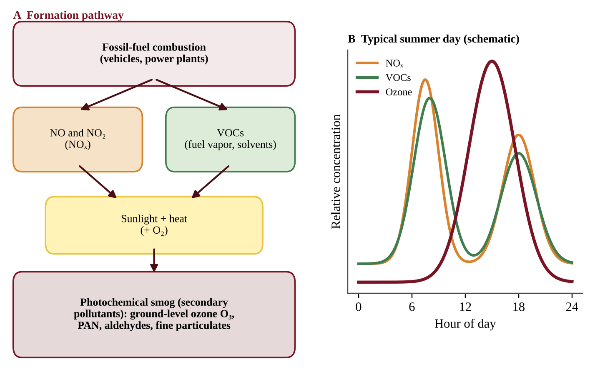
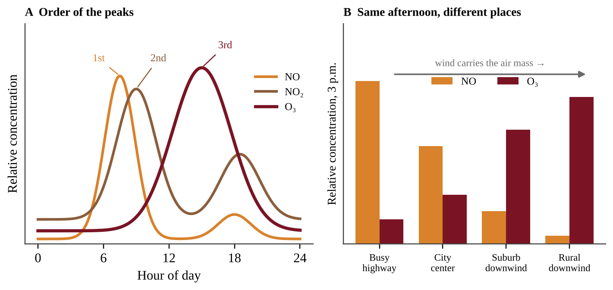
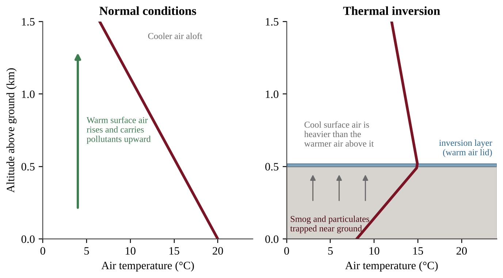
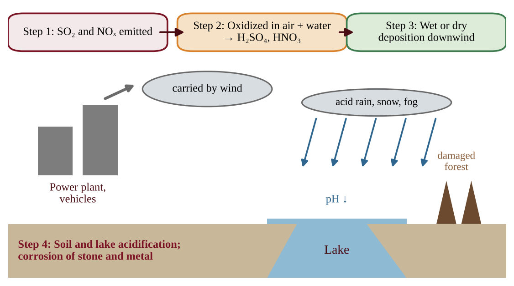
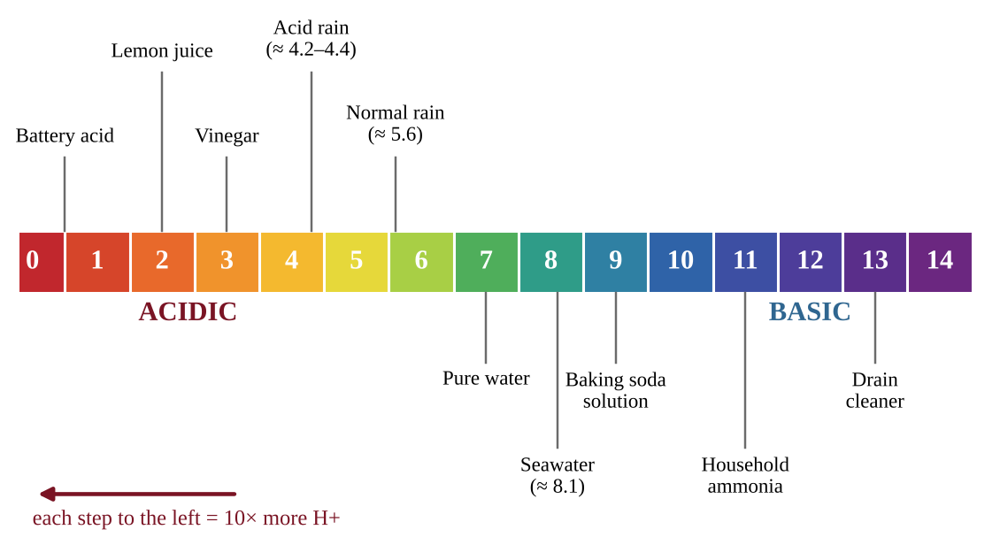

# Unit 7 — Atmospheric Pollution

## Topic 7.1 — Introduction to Air Pollution

:::box objectives
- Identify the major air pollutants, their sources, and their effects on people and ecosystems (STB-2.A).
- Link coal combustion and fossil-fuel combustion to specific pollutants.
- Distinguish primary pollutants from secondary pollutants.
- Explain how the Clean Air Act and the regulation of lead cut lead in the air.
:::

:::box simple
The air around you is mostly nitrogen and oxygen. **Air pollution** is anything added to that mix, in an amount large enough to harm living things or materials. Most of it comes from one habit: burning things. When a fuel burns, the carbon, sulfur and nitrogen in it, and the nitrogen in the air itself, end up as gases and tiny solid specks that go up the chimney or out the tailpipe.
:::

### Why burning makes pollution

A perfect fuel burned with plenty of oxygen would give only CO₂ and water. Real fuels are not perfect. Coal and oil carry sulfur and metals. Hot flames in engines force nitrogen from the air to combine with oxygen. Engines and furnaces also burn imperfectly, leaving carbon monoxide, unburned hydrocarbons and soot. Complete burning of a hydrocarbon gives only CO₂ and water (CH₄ + 2O₂ → CO₂ + 2H₂O). Everything else is an impurity or a sign of a hot or incomplete burn: SO₂ from sulfur in the fuel, NOₓ from the hot flame, and CO, VOCs and soot from incomplete burning.

### The pollutants to know

In the United States the Environmental Protection Agency (EPA) tracks six "criteria" pollutants under the Clean Air Act: carbon monoxide, lead, nitrogen dioxide, ground-level ozone, particulate matter, and sulfur dioxide. The table adds the other emissions the CED names.

| Pollutant | Main sources | Main effects |
|---|---|---|
| Carbon dioxide (CO₂) | Burning any carbon fuel (coal, oil, gas); respiration; decomposition | Traps heat (climate change, Unit 9); not toxic at normal outdoor levels |
| Carbon monoxide (CO) | Incomplete combustion: vehicles, furnaces, stoves, wildfires | Binds to hemoglobin, blocking oxygen delivery; headaches, death at high doses |
| Sulfur dioxide (SO₂) | Coal-burning power plants, diesel fuel, smelters, volcanoes | Lung irritation; forms acid rain; forms fine sulfate particles |
| Nitrogen oxides (NOₓ) | Vehicle engines, power plants (hot combustion of air) | Lung irritation; ozone and smog; nitric acid in acid rain |
| Particulate matter (PM) | Coal and diesel combustion, dust, construction, wildfires | Lung and heart disease; haze; soot on buildings |
| Hydrocarbons / VOCs | Unburned fuel, fuel vapor, solvents, trees | Smog ingredient; some are toxic |
| Lead (Pb) | Leaded gasoline (historic), old paint, smelters | Damage to the nervous system, especially in children |
| Toxic metals (e.g., mercury) | Coal combustion, waste incineration | Nerve damage; travels on wind, falls into water, where microbes make toxic methylmercury that builds up in food webs |
| Ground-level ozone (O₃) | Formed in the air from NOₓ + VOCs + sunlight | Lung damage, asthma attacks, plant damage; also a greenhouse gas |

Two details the CED stresses. First, **coal combustion** releases CO₂, SO₂, toxic metals and particulates all at once, which is why coal plants are the main target of control devices (Topic 7.6). Second, **sulfur dioxide** depends on the sulfur in the fuel: diesel and other high-sulfur fuels release more SO₂, while low-sulfur fuels release less.

### Primary and secondary pollutants

:::box define
**Primary pollutant** — a pollutant released straight into the air from its source, in the form in which it harms (CO, SO₂, soot, lead).
**Secondary pollutant** — a pollutant that forms in the air when primary pollutants react, often with sunlight or water (ozone, PAN, nitric acid, sulfuric acid).
**Criteria pollutant** — one of the six common pollutants the EPA regulates by setting health-based air quality standards.
**Tropospheric (ground-level) ozone** — O₃ in the air we breathe. It is a harmful secondary pollutant here, unlike the protective stratospheric ozone layer.
:::

A simple test: *can you point to a pipe it came out of?* If yes, it is probably primary. If it only appears after a reaction in the air, it is secondary. NO from an engine is primary; the O₃ it helps create is secondary.

:::box process
Burning fossil fuel → primary pollutants (CO, SO₂, NOₓ, VOCs, PM) → reactions in air with sunlight, oxygen and water → secondary pollutants (O₃, PAN, HNO₃, H₂SO₄, fine sulfate and nitrate particles) → health and ecosystem damage downwind
:::

### Lead: a regulation success story

Lead was once added to gasoline to stop engine knock. Cars spread it through every city. Under the Clean Air Act the EPA ordered lead removed from fuel. Blood-lead levels in children and lead in the air dropped dramatically. The exam lesson: **regulating a pollutant at its source works**; lead is the standard example.

### The Clean Air Act and trend graphs

The Clean Air Act (CAA) is the main U.S. air law. It lets the EPA set health-based limits for the criteria pollutants and regulate emissions from power plants, factories and vehicles. Its 1990 amendments targeted acid rain by capping total SO₂ emissions from power plants. CO₂ is not a criteria pollutant.

Trend graphs often use an **index**: the starting year is set to 100 and every later value is a percentage of it. An index of 40 means the pollutant fell to 40% of its starting level, a decrease of 60%. Compare lines by how far they move from 100, not by their original units. Lines that all fall while a law was in force *support* its effectiveness but do not prove it, because other changes (cleaner engines, fuel switching) happened too. A pollutant the law does not target, such as atmospheric CO₂, can keep rising.

:::box example
id: SG-U7-E010
An index graph (1990 = 100) shows these values for 2020: SO₂ emissions 35, NOₓ emissions 52, lead emissions 6, atmospheric CO₂ concentration 118.
(a) Calculate the percent decrease in SO₂ emissions.
(b) Identify the pollutant that fell the most and the one that rose.
(c) Explain why the graph alone does not prove regulation caused the SO₂ decline.
:::

:::box mistake
- Calling ozone "bad" everywhere. High in the stratosphere it blocks UV light and protects us. At ground level it is a pollutant.
- Saying CO₂ is a criteria pollutant. It is a greenhouse gas, but it is not one of the six criteria pollutants.
- Thinking that secondary means "less harmful". Ozone and acids are often more harmful than the pollutants that made them.
:::

:::box example
id: SG-U7-E001
Five air pollutants are listed: (1) carbon monoxide from a car exhaust pipe, (2) ground-level ozone measured on a hot afternoon, (3) sulfur dioxide from a coal plant stack, (4) nitric acid dissolved in rainwater, (5) soot from a diesel truck.
(a) Classify each as a primary or a secondary pollutant.
(b) For the two you classified as secondary, name one primary pollutant that is a precursor to each.
(c) Identify which of the five is an asphyxiant and explain, in one sentence, how it harms the body.
:::

:::box summary
- Burning fuel produces CO₂, CO, SO₂, NOₓ, VOCs, particulates, toxic metals and (historically) lead.
- Coal releases CO₂, SO₂, toxic metals and particulates; fossil-fuel combustion releases NOₓ, CO, hydrocarbons and PM.
- Primary pollutants are emitted directly; secondary pollutants form in the air from them.
- The Clean Air Act and the EPA's removal of lead from fuel sharply cut atmospheric lead.
:::

## Topic 7.2 — Photochemical Smog

:::box objectives
- Explain the causes and effects of photochemical smog and ways to reduce it (STB-2.B).
- Describe how NOₓ, VOCs, sunlight and heat produce ozone and other pollutants.
- Interpret daily and seasonal patterns of NOₓ and ozone.
:::

:::box simple
Smog is a **recipe**. Ingredients: nitrogen oxides from engines and VOCs from fuel vapor and plants. Cooking conditions: strong sunlight and warm air. Product: ground-level ozone and a brown, stinging haze. No sun, no smog; too few engines, too little smog.
:::

### The chemistry at the level you need

1. Vehicles and power plants emit **NO**, which converts in the air to **NO₂**.
2. Sunlight splits NO₂ into NO and a free oxygen atom (O).
3. The oxygen atom joins an oxygen molecule (O₂) to make **ozone (O₃)**.
4. In clean air, ozone would quickly react back with NO. VOCs change this: they convert NO back to NO₂ without using up ozone, so the cycle repeats and **ozone builds up**.
5. VOCs and NOₓ also form other irritants such as PAN (peroxyacetyl nitrate), aldehydes and fine particles. Together they give photochemical smog its brownish haze.

:::box define
**Photochemical smog** — a mixture of secondary pollutants (mainly ozone) formed when sunlight and heat drive reactions between nitrogen oxides and volatile organic compounds.
**Volatile organic compound (VOC)** — a carbon-based chemical that evaporates or sublimates at room temperature, such as gasoline vapor and formaldehyde. Trees give off natural VOCs.
**Precursor** — a chemical that reacts to form a secondary pollutant (NOₓ and VOCs are the precursors of ozone).
:::

### Reading the daily pattern

Look at panel B of Figure 7.1. NOₓ and VOCs peak early, during the morning commute. Ozone lags and peaks in the **afternoon**, when sunlight and heat have had hours to drive the reactions. Ozone then falls after sunset because the reactions need light. This lag is a standard data-interpretation point, and why people are advised to exercise in the morning on bad-ozone days.

Ozone is also higher in **summer**: more intense sunlight, longer days, and higher temperatures that speed reactions and make fuels and plants release more VOCs.

### Telling NO, NO₂ and ozone apart

**NO** comes straight from engines, so it rises and peaks first with the morning rush, then falls as it turns into **NO₂**, a reddish-brown gas that tints smog and peaks a little later. **Ozone** peaks last. Place matters too. Fresh NO reacts with ozone and removes it, so beside a busy highway NO is high and O₃ is low. As the polluted air drifts downwind, the NO is used up, sunlight keeps driving the reactions, and ozone is highest in suburbs and rural areas **downwind** of the city, peaking later the farther the air has traveled. Low ozone at a busy road does not mean clean air.

### Factors that shape smog

Many vehicles (so smog is mainly urban); strong sunlight and heat; basins ringed by mountains (Los Angeles, Mexico City); windless weather; and thermal inversions (Topic 7.3).

### Effects and reduction

Smog causes **respiratory problems** (coughing, asthma attacks, reduced lung function) and **eye irritation**. Ozone also injures crop and forest leaves and cracks rubber.

Since the precursors are NOₓ and VOCs, smog is reduced by **cutting NOₓ and VOCs**: catalytic converters, vapor recovery nozzles, low-VOC paints, public transit, electric vehicles, and limiting driving on high-ozone days.

:::box apply
A valley city checks NO₂ at 8 a.m. and ozone at 3 p.m. A school moves outdoor practice to 7 a.m., because the chemistry predicts the ozone peak in the afternoon.
:::

:::box mistake
- Saying NOₓ and ozone peak at the same time. NOₓ peaks with the morning rush; ozone peaks later in the afternoon.
- Describing smog as "smoke plus fog". The word here means photochemical smog, a chemical product, not a mixture of smoke and fog.
:::

:::box strategy
For "explain why ozone peaks in the afternoon" give a cause-and-effect chain: morning traffic releases NOₓ and VOCs → sunlight and rising temperature drive reactions during the day → ozone accumulates → peak in mid-to-late afternoon.
:::

:::box example
id: SG-U7-E002
A monitoring station in a city recorded these hourly averages on a hot, sunny summer day.

| Time | NO₂ (ppb) | Ozone (ppb) |
|---|---|---|
| 6:00 | 18 | 12 |
| 8:00 | 40 | 20 |
| 10:00 | 25 | 45 |
| 12:00 | 15 | 70 |
| 14:00 | 12 | 95 |
| 16:00 | 14 | 88 |
| 18:00 | 30 | 60 |
| 20:00 | 20 | 35 |

(a) Identify the time of the NO₂ peak and the time of the ozone peak.
(b) Calculate how many hours separate the two peaks.
(c) Explain, using the chemistry of smog, why the ozone peak comes later than the NO₂ peak.
(d) Predict how the ozone curve would change on a cool, cloudy day with the same traffic, and justify your prediction.
:::

:::box summary
- Photochemical smog = NOₓ + VOCs + sunlight and heat → ozone and other pollutants.
- NOₓ peaks in the morning; ozone peaks in the afternoon and is highest in summer.
- Dense vehicle traffic makes smog an urban problem; weather and topography make it worse.
- Smog causes breathing problems and eye irritation; it is reduced by cutting NOₓ and VOCs.
:::

## Topic 7.3 — Thermal Inversion

:::box objectives
- Describe a thermal inversion and how it relates to air pollution (STB-2.C).
- Compare the normal temperature gradient with an inversion using a graph.
:::

:::box simple
Normally the ground warms the air above it, and warm air rises, carrying pollution up and away like a chimney. In an inversion, the layers are upside-down: cool air sits under a layer of warm air. The warm air above is a lid. The cool air below cannot rise through it, so pollution stays trapped where we live.
:::

### Normal conditions

Sunlight warms the ground, and the ground warms the air next to it. Temperature falls with height through the troposphere, so warm, light surface air rises and mixes, carrying pollutants up and diluting them.

### Inversion

In a **thermal (temperature) inversion** the usual pattern is altered: the air temperature at the surface is **cooler** than the air at a higher altitude. The warmer, less dense air above acts as a lid. Because cool surface air is denser than the warm air over it, it will not rise. Air stops mixing vertically, and pollutants, especially **smog and particulates**, are trapped close to the ground.

How to read Figure 7.3: temperature is on the x-axis and altitude on the y-axis. A line sloping to the upper left (cooler with height) is normal. A stretch bending to the right (warmer with height) is the inversion layer, the warm lid.

:::box define
**Thermal inversion** — a layer of warm air above cooler air near the ground, reversing the normal drop in temperature with height and trapping pollutants.
**Temperature gradient** — the change in air temperature with altitude.
:::

:::box process
Clear, calm night → ground loses heat quickly and chills the air near it (or warm air flows over cold air in a valley) → cool dense air sits under warmer air → no vertical mixing → pollutants trapped near the surface → concentration of smog and particulates rises → health problems
:::

Inversions usually break up when the sun heats the ground, but a strong one can last for days and cause serious pollution episodes.

**What favors an inversion.** Long, clear, calm nights, when the ground loses heat to space and chills the air above it (cloud cover works like a blanket and prevents this); cold winter ground or snow; and valleys or basins ringed by mountains, where cold air drains and pools and the slopes block wind. This is why winter inversions raise **particulates** (heating smoke plus trapped air), while **ozone** is mainly a summer problem.

**Where the pollution sits.** Pollutants are trapped in the cooler, denser air *below the top of the warm layer*. If temperature rises from the ground up, the trapped layer is the air near the ground. If it first falls and then rises higher up, the trapped layer is everything below the height where the line turns warmer. Where the line again falls with height, normal mixing resumes.

:::box strategy
If a graph of temperature versus altitude is given, find the altitude range where the line moves toward warmer temperatures as altitude increases. That layer is the inversion, and the pollutants will be trapped below it.
:::

:::box example
id: SG-U7-E003
A weather balloon measured the air temperature above a valley town on two mornings.

| Altitude above ground (m) | Day X temperature (°C) | Day Y temperature (°C) |
|---|---|---|
| 0 | 14 | 6 |
| 250 | 12 | 9 |
| 500 | 10 | 12 |
| 750 | 8 | 11 |

(a) Identify which day had a thermal inversion and state the altitude range in which it occurred.
(b) Calculate the temperature change from 0 m to 500 m on Day Y.
(c) The town measured fine particulate matter of 15 µg/m³ on one of the days and 55 µg/m³ on the other. Predict which day had which value and explain.
:::

:::box summary
- Normally air cools with altitude, and warm surface air rises and disperses pollution.
- In an inversion, surface air is cooler than the air above it, forming a lid.
- Inversions trap smog and particulates near the ground, raising concentrations.
:::

## Topic 7.4 — Atmospheric CO₂ and Particulates

:::box objectives
- Describe natural sources of CO₂ and particulates (STB-2.D).
- Distinguish natural from human sources, and recognize that natural does not mean harmless.
:::

:::box simple
Not all air pollution is man-made. Living things, volcanoes, fires and wind all put CO₂ and dust into the air. It becomes a *pollution* problem when people add so much that the balance changes, or when a big eruption or wildfire overloads the air.
:::

### Natural sources of CO₂

- **Respiration.** Every plant, animal, fungus and microbe releases CO₂ when it breaks down food for energy.
- **Decomposition.** Decomposers in soil and water release CO₂ from dead organisms.
- **Volcanic eruptions.** Volcanoes vent CO₂ from deep in Earth, along with SO₂ and ash.

These flows are normally balanced by photosynthesis and ocean uptake (the carbon cycle, Unit 1). Human burning of fossil fuels adds extra CO₂ on top of the natural flows, so atmospheric CO₂ has risen steadily since the Industrial Revolution (Unit 9).

### Natural sources of particulates

Particulate matter (PM) is made of tiny solid and liquid particles suspended in air. **PM10** is 10 µm or smaller; **PM2.5** is 2.5 µm or smaller. The smaller the particle, the deeper it penetrates your lungs, and PM2.5 can reach the bloodstream.

Natural sources include:

- volcanic ash;
- wildfire smoke;
- dust storms and wind-blown soil;
- sea spray salt;
- pollen and mold spores;
- sulfate and organic particles formed from natural gases.

:::box define
**Particulate matter (PM)** — solid or liquid particles small enough to stay suspended in the air; classified by diameter (PM10, PM2.5).
**Anthropogenic** — caused by human activity.
:::

### Natural versus human

A natural source can still do damage: wildfire smoke or volcanic ash causes respiratory problems and blocks sunlight. The key difference is that people can control human sources: coal and diesel combustion, construction, farming and road dust add particulates, and fossil-fuel burning is the largest source of added CO₂. Policy focuses on these *additional* flows.

### Designing and judging an air-quality investigation

- **Hypothesis:** an if–then statement that names the direction (*If new carpet releases VOCs, then the renovated wing will have more formaldehyde*).
- **Variables:** the *independent variable* is what you compare or change (location, distance, time); the *dependent variable* is what you measure, with a unit (µg/m³). **Controlled variables** stay the same: instrument, height, hours, ventilation.
- **Control or background site:** a sensor upwind of the source, outdoors, or in an unaffected room measures what is there anyway. Source contribution ≈ downwind reading − background reading.
- **Replication:** many sites, days or samples; compare means and spread. A few days leaves room for chance.
- **Confounding variable:** something else that changes with the independent variable and could explain the result (wind direction when comparing distances from a plant). Measure it or hold it constant.
- **Correlation is not proof of cause.** Say data are *consistent with* or *support* a cause, give the mechanism, and name a factor not ruled out. To judge a policy, compare before and after in the same season, check that the change followed the policy, and note other causes.
- **Fair test with living things:** change one factor only; keep light, temperature and seed type equal and include a neutral-water control.

:::box example
id: SG-U7-E011
A town suspects that a new gravel quarry raises PM10 in a neighborhood 1 km to its east; the wind usually blows from the west.
(a) State a testable hypothesis with direction.
(b) Identify the independent and dependent variables and two controlled variables.
(c) Describe where and when to place monitors and what an upwind site is for.
(d) Higher PM10 is found at the east site. Explain why this alone does not prove the quarry is the cause.
:::

:::box example
id: SG-U7-E004
A valley town recorded PM2.5 (µg/m³) on six winter days. Days 3, 4 and 6 had a thermal inversion; Days 1, 2 and 5 did not.

| Day | 1 | 2 | 3 | 4 | 5 | 6 |
|---|---|---|---|---|---|---|
| PM2.5 | 14 | 11 | 46 | 58 | 17 | 52 |

(a) Describe the relationship between inversion and PM2.5 shown by the data.
(b) Calculate the mean PM2.5 for the inversion days and for the non-inversion days.
(c) Calculate the percent by which the inversion-day mean exceeds the non-inversion mean. Round to the nearest whole percent.
(d) Propose one action the town could take to lower winter PM2.5 and justify it.
:::

:::box summary
- Natural CO₂ sources: respiration, decomposition, volcanic eruptions.
- Natural particulates: volcanic ash, wildfire smoke, dust, sea spray, pollen, spores.
- Natural does not mean harmless, but human activity adds large extra amounts of both.
- PM2.5 is finer and more dangerous to health than coarse PM10.
:::

## Topic 7.5 — Indoor Air Pollutants

:::box objectives
- Identify indoor air pollutants and classify them by source (STB-2.E).
- Describe the effects of indoor pollutants, including radon exposure (STB-2.F).
- Explain patterns in data, such as radon test results.
:::

:::box simple
We spend most of our time indoors. A closed building traps whatever is inside: gases leaking from furniture, smoke from burning, radioactive gas from the soil below. Indoor air can be more polluted than outdoor air because there is less dilution.
:::

### Three kinds of sources

| Source type | Examples |
|---|---|
| Natural | Radon, mold, dust |
| Human-made (building materials and furnishings) | Insulation, VOCs from furniture, paneling, carpets; formaldehyde from building materials and upholstery; lead from paint; asbestos |
| Combustion | Carbon monoxide, nitrogen oxides, sulfur dioxide, particulates, tobacco smoke |

### Key pollutants

:::box define
**Asphyxiant** — a gas that harms by starving the body of oxygen. **Carbon monoxide (CO)** is an odorless, colorless asphyxiant: it binds to hemoglobin far more strongly than oxygen does.
**Particulate indoor pollutants** — asbestos, dust and smoke.
**Radon-222** — a naturally occurring radioactive gas formed by the decay of uranium in some rocks and soils.
**Formaldehyde** — a VOC released from building materials, furniture, upholstery and carpets; an eye and lung irritant and a carcinogen.
:::

- **Carbon monoxide** comes from faulty furnaces, gas stoves and heaters, wood stoves and idling cars in garages. At high concentration it causes headaches, dizziness and death. A CO detector is the safeguard because humans cannot sense it.
- **Asbestos** fibers from old insulation, floor tiles and roofing become dangerous when disturbed and inhaled, causing lung scarring, lung cancer and mesothelioma.
- **VOCs and formaldehyde** off-gas from new carpet, paneling, glues, paints and cleaners and cause irritation and headaches.
- **Lead** from old paint chips and dust harms the nervous system, especially in young children.
- **Mold** grows in damp places and triggers allergies and asthma.
- **Combustion products** (NOₓ, SO₂, particulates, tobacco smoke) irritate lungs. Cooking over open indoor fires is a leading cause of smoke illness in many developing regions.

### Radon

Radon is the unusual one. Uranium in some rocks and soils decays through a series of steps to radium and then to **radon-222**, a gas that moves up through soil. It enters homes through cracks in foundations and walls, gaps around pipes and floor drains, and also **dissolved in well water**. Radon cannot be seen or smelled. Once inhaled, it and its decay products emit radiation inside the lungs.

Radon-induced lung cancer is the **second leading cause of lung cancer in the United States**, after smoking. Homeowners can test with a simple kit, and the EPA recommends action at 4 pCi/L (picocuries per liter) or more.

:::box process
Uranium in rock and soil → decays to radon-222 gas → gas rises through soil → enters basement through cracks (or is carried in well water) → builds up in a closed house → inhaled → radiation damages lung tissue → increased lung cancer risk
:::

### Cutting exposure indoors

Remove the source first, then ventilate outdoors, then detect or filter.

| Pollutant | Ways to reduce exposure |
|---|---|
| Carbon monoxide | Repair and vent combustion appliances, use CO detectors, never run engines in a garage, or switch to an electric stove |
| Radon | Test; seal foundation cracks; sub-slab pipe and fan; treat well water |
| Asbestos | Leave sealed material undisturbed; licensed workers remove or seal it |
| Mold | Fix leaks, control humidity, ventilate, remove damp material |
| VOCs, formaldehyde | Choose low-VOC products; ventilate; let new materials off-gas before use |
| Lead paint | Keep paint intact; wet-clean dust; certified removal |
| Smoke from cooking fires | Chimney or vented, cleaner-burning stove; cleaner fuel; no smoking indoors |

**Children** are at greater risk: they breathe more air per kilogram of body weight, their lungs and nervous systems are still developing, and they play near floors and put hands in their mouths. Indoor pollutants cause asthma, respiratory disease, lung cancer and headaches; skin cancer comes from ultraviolet light, not indoor air.

:::box apply
A basement test shows 6.3 pCi/L. The owners seal foundation cracks and add a vent pipe and fan under the slab; a retest shows a much lower reading.
:::

:::box mistake
- Saying radon is a chemical pollutant from factories. It is natural and radioactive.
- Thinking that a new, tightly sealed home is automatically safe. Tight sealing can trap indoor pollutants if ventilation is poor.
- Classing carbon monoxide as a particulate. It is a gas and an asphyxiant.
- Masking a pollutant (air fresheners, incense) or opening one window while the source keeps burning. Remove the source or vent it outdoors.
:::

:::box example
id: SG-U7-E005
A health department tested the basements of five homes for radon. The EPA action level is 4.0 pCi/L.

| Home | 1 | 2 | 3 | 4 | 5 |
|---|---|---|---|---|---|
| Radon (pCi/L) | 2.1 | 5.6 | 3.9 | 8.4 | 3.0 |

(a) Identify which homes exceed the action level and calculate the percentage of tested homes that do.
(b) Calculate the mean radon level for the five homes.
(c) Explain how radon gas enters a house from the ground.
(d) Propose one way to reduce radon in Home 4 and justify why it works.
:::

:::box summary
- Indoor pollutants come from natural sources (radon, mold, dust), human-made materials (VOCs, formaldehyde, asbestos, lead paint) and combustion (CO, NOₓ, SO₂, particulates, tobacco smoke).
- CO is an asphyxiant; asbestos, dust and smoke are particulates.
- Radon-222 comes from uranium decay, seeps in through foundations and well water, and is the second leading cause of lung cancer in the U.S.
:::

## Topic 7.6 — Reduction of Air Pollutants

:::box objectives
- Explain how air pollutants can be reduced at the source (STB-2.G).
- Describe how vapor recovery nozzles, catalytic converters, wet and dry scrubbers and electrostatic precipitators work.
- Use evidence to support a solution.
:::

:::box simple
There are three ways to attack air pollution. **Use less** of the dirty thing (conservation). **Switch** to something cleaner (alternative fuels). **Capture** what is made before it escapes (control devices). Laws then make people actually do it.
:::

### Strategies

- **Regulatory practices:** the Clean Air Act, emission standards, air quality standards, permits, fuel standards (such as removing lead and cutting sulfur).
- **Conservation:** driving less, public transit, efficient buildings and appliances, which cut fuel burned and all its pollutants at once.
- **Alternative fuels:** natural gas instead of coal, renewable electricity, electric vehicles, low-sulfur fuels.
- **Control devices** (below).

### Devices to know

:::box define
**Vapor recovery nozzle** — a device on a gasoline pump that stops fuel vapors (VOCs) escaping while a vehicle is refueled.
**Catalytic converter** — a device in a vehicle's exhaust system that uses metal catalysts (platinum, palladium, rhodium) to convert CO, NOₓ and hydrocarbons into less harmful CO₂, N₂, O₂ and H₂O.
**Wet scrubber** — a device that sprays water or a water-and-limestone mixture through exhaust to dissolve or capture gases such as SO₂ and to trap particles.
**Dry scrubber** — a device that injects a dry powder (such as lime) into exhaust that reacts with acidic gases and is then filtered out.
**Electrostatic precipitator** — a device that gives particles an electric charge so they stick to oppositely charged plates, from which they are shaken off and collected.
:::

:::box process
Catalytic converter: CO + O₂ → CO₂; NO → N₂ + O₂; hydrocarbons + O₂ → CO₂ + H₂O. Wet scrubber: SO₂ in flue gas + water–limestone spray → solid calcium sulfite/sulfate sludge, cleaner gas out the stack. Electrostatic precipitator: charged particles → attracted to plates → collected as ash.
:::

Which device for which job? A **catalytic converter** is for the gases in vehicle exhaust, not for particulates. **Scrubbers** remove SO₂ (and some other gases and particulates) from power plant exhaust. An **electrostatic precipitator** removes **particulates only**, not gases. Coal power plants often use scrubbers *and* precipitators together. Vapor recovery nozzles address VOC evaporation at the pump.

### Trade-offs

Control devices create waste (scrubber sludge, ash), use energy and cost money, and a catalytic converter does nothing about CO₂. Using less fuel is generally cheaper and cleaner than capturing pollutants afterward. Fuel switching has trade-offs too: low-sulfur coal costs more, natural gas still emits CO₂, and wind and solar are intermittent.

### Calculations with emissions

:::box formula
**Sulfur to SO₂:** S + O₂ → SO₂. With atomic mass 32 for S and molecular mass 64 for SO₂, every 1 metric ton of S gives 2 metric tons of SO₂.
mass of S = mass of fuel × (% sulfur ÷ 100)
uncontrolled SO₂ = mass of S × (64 ÷ 32)
SO₂ removed = uncontrolled SO₂ × (% removal ÷ 100); SO₂ emitted = uncontrolled SO₂ − removed
**Cost per metric ton removed** = annual cost ($/yr) ÷ SO₂ removed (metric tons/yr)
**Inventory** = number of sources × activity each (miles/yr) × emission factor (g/mile)
:::

For an inventory, write units as fractions so unwanted units cancel (dimensional analysis), using conversion fractions equal to 1, such as 1 metric ton ÷ 10⁶ g. Use the "ton" the problem defines (a U.S. ton is about 907,000 g). Compare options by cost per ton *removed*: a smaller bill can still cost more per ton if it removes much less.

:::box example
id: SG-U7-E012
A city runs 400 diesel buses. Each travels 30,000 miles per year and emits 0.35 g of particulates per mile. A filter on every bus cuts particulates by 80% and costs $9,000 per bus, spread over 10 years.
(a) Calculate the fleet's yearly particulate emissions in kilograms.
(b) Calculate the kilograms removed per year.
(c) Calculate the yearly cost per kilogram removed.
:::

:::box example
id: SG-U7-E013
A power plant burns 5.0 × 10⁵ metric tons of oil per year. The oil is 0.8% sulfur by mass and all of the sulfur becomes SO₂. A dry scrubber removes 85% of the SO₂ and costs $15 million per year.
(a) Calculate the mass of sulfur burned each year.
(b) Calculate the SO₂ the plant would release with no scrubber.
(c) Calculate the SO₂ emitted with the scrubber.
(d) Calculate the scrubber's cost per metric ton of SO₂ removed.
:::

:::box mistake
- Claiming an electrostatic precipitator removes SO₂. It removes particulates only.
- Saying a catalytic converter removes CO₂. It *produces* CO₂ from CO.
- Forgetting that devices create waste products that need disposal.
- Calling taller smokestacks a fix. They dilute and move the pollution farther downwind; the amount emitted is unchanged.
:::

:::box strategy
In a "propose a solution" question, state the device or policy, say exactly which pollutant it cuts, give the mechanism in one line, and add one drawback or trade-off. That earns the justify point.
:::

:::box example
id: SG-U7-E006
A region has two coal-burning power plants and a population of 400,000. Plant A emits 180,000 metric tons of SO₂ per year; Plant B emits 70,000 metric tons per year. Plant A installs wet scrubbers that remove 90% of its SO₂. Plant B makes no change.
(a) Calculate the region's total SO₂ emissions after the installation.
(b) Calculate the percent decrease in the region's total SO₂ emissions.
(c) Calculate the region's SO₂ emissions per person after the installation, in kilograms per person per year.
(d) Identify one by-product of operating a wet scrubber and one pollutant the scrubber does not reduce.
:::

:::box summary
- Reduce pollutants with regulation, conservation and alternative fuels, plus control devices.
- Vapor recovery nozzle: stops fuel vapor at the pump.
- Catalytic converter: turns CO, NOₓ, hydrocarbons into CO₂, N₂, O₂, H₂O.
- Wet and dry scrubbers remove gases (and particles); electrostatic precipitators remove particulates.
:::

## Topic 7.7 — Acid Rain

:::box objectives
- Describe the formation of acid deposition and its sources (STB-2.H).
- Describe its effects on soils, water bodies, structures and regions with different bedrock (STB-2.I).
- Use the pH scale to compare acidity.
:::

:::box simple
When coal and fuels burn they release SO₂ and NOₓ. In the air these gases turn into **sulfuric acid and nitric acid**, which fall to Earth in rain, snow, fog or dry particles, often hundreds of kilometers from where they started. The land and water that receive them are made more acidic.
:::

### How acid deposition forms

**Acid deposition** includes both **wet deposition** (acid rain, snow, fog) and **dry deposition** (acidic gases and particles settling out). It begins with two gases:

- **Sulfur oxides**: SO₂ from coal-burning power plants (and natural sources such as volcanoes) reacts with oxygen and water in air to form sulfuric acid (H₂SO₄).
- **Nitrogen oxides**: NOₓ from motor vehicles and coal-burning power plants (and natural sources such as lightning) reacts to form nitric acid (HNO₃).

### The pH scale

:::box formula
pH = −log₁₀[H⁺], where [H⁺] is the hydrogen ion concentration in moles per liter.
The scale runs 0 to 14: below 7 is acidic, 7 is neutral, above 7 is basic.
**Each whole pH unit is a factor of 10 in H⁺ concentration.**
Change of 1 unit = 10× difference; change of 2 units = 10² = 100×; change of 3 units = 1000×.
:::

Clean rain is already slightly acidic, about **pH 5.6**, because CO₂ dissolves in it to form weak carbonic acid. Rain is called **acid rain** when its pH is below about 5.6, and typical acid rain is pH 4.2 to 4.4. A change from pH 5.6 to 4.6 is not a small step: rain at pH 4.6 has ten times the hydrogen ions of rain at 5.6.

Differences need not be whole numbers: pH 4.3 versus 5.6 is 1.3 units, so 10^1.3 ≈ 20 times the H⁺ (use the 10ˣ key; never say "1.3 times"). From concentration, pH = −log: [H⁺] = 1 × 10⁻⁵ mol/L is pH 5.

### Effects

1. **Soils.** Acid leaches nutrients such as calcium and magnesium away and frees toxic aluminum, harming tree roots and weakening forests. Leaves and needles are damaged, and trees tolerate cold, insects and disease less well, especially at high elevations bathed in acid fog.
2. **Lakes and streams.** Falling pH harms fish eggs, amphibians and invertebrates; many fish species decline below about pH 5. Released aluminum and other metals are toxic to fish.
3. **Structures.** Acid dissolves limestone and marble and corrodes metals in buildings, statues and bridges.
4. **Human health.** The acids form fine particles that reach the lungs.

### Why some places are hit harder

Acid deposition mainly hits communities **downwind** of coal-burning power plants. In the eastern United States, winds carry Midwest emissions to the Northeast and eastern Canada.

**Bedrock and soil make a difference.** Limestone (calcium carbonate) and soils rich in carbonate **buffer** acid: they neutralize it and keep lake pH near neutral. Lakes on granite and thin, sandy soils have little neutralizing capacity, so they acidify quickly. 

:::box define
**Acid deposition** — the falling of acids and acid-forming pollutants from the air as wet (rain, snow, fog) or dry (gases, particles) deposition.
**Buffering capacity** — the ability of water or soil to neutralize acids and resist a drop in pH; limestone bedrock supplies it.
**Downwind** — in the direction the wind blows, away from the source.
:::

:::box process
Burning coal and fuels → SO₂ and NOₓ emitted → oxidized in air and dissolved in water → H₂SO₄ and HNO₃ → carried downwind → wet and dry deposition → soil and lake pH falls → nutrient loss, aluminum release, fish and tree damage, stone corrosion
:::

### Solutions

Reduce the gases at the source: scrubbers on power plants, low-sulfur coal and fuels, switching to natural gas and renewables, catalytic converters, and cap-and-trade programs. Short-term local fixes include adding crushed limestone ("liming") to acidified lakes, which treats symptoms rather than the cause. Recovery lags behind emission cuts: after decades of acid input, soils have lost much of their calcium and magnesium, so lake pH rises more slowly than emissions fall and may stay below its natural level for years.

:::box apply
A plant's SO₂ falls as acid on a granite-based mountain lake hundreds of kilometers downwind. Nearby residents see little damage, but the remote lake loses its fish.
:::

:::box mistake
- Saying pH 4 is "twice as acidic" as pH 5. It is ten times.
- Calling pure rain "pH 7". Clean rain is about 5.6 because of dissolved CO₂.
- Assuming that acid rain only falls near the source. Wind carries it downwind for long distances.
- Forgetting dry deposition and natural sources (volcanoes, lightning).
- Writing that taller smokestacks solve acid rain. They only carry the acid farther downwind.
:::

:::box strategy
Questions on acid rain nearly always want a full chain: source → gas → acid → deposition site → effect. If a map or data on bedrock is given, decide whether the area can buffer acid (limestone) or not (granite).
:::

:::box example
id: SG-U7-E007
Three rain samples were collected: Sample A has pH 5.6, Sample B has pH 4.6, and Sample C has pH 3.6.
(a) Rank the samples from most acidic to least acidic.
(b) Calculate how many times greater the hydrogen ion concentration of Sample C is than that of Sample A.
(c) Identify the two gaseous pollutants most responsible for rain with a pH below 5.6 and name one human source of each.
(d) Explain why clean, unpolluted rain has a pH below 7.
:::

:::box example
id: SG-U7-E014
Rain over a downwind forest has a pH of 4.2; rain over a remote ocean has a pH of 5.6. A lake sample has an H⁺ concentration of 1 × 10⁻⁶ mol/L.
(a) Calculate how many times greater the H⁺ concentration of the forest rain is than that of the ocean rain.
(b) Calculate the pH of the lake sample and state whether it is acidic.
(c) A lake has pH 6.3. Calculate how many times lower its H⁺ concentration is than the forest rain's.
:::

:::box example
id: SG-U7-E008
Two lakes receive acid rain of the same pH from the same distant power plants. Lake P lies on granite bedrock with thin soil; its pH fell from 6.0 to 5.0 over 30 years. Lake Q lies on limestone bedrock and its pH stayed at 7.1.
(a) Calculate the factor by which the hydrogen ion concentration of Lake P increased.
(b) Explain why Lake Q's pH did not fall.
(c) Predict which lake has the greater risk of fish loss and justify.
(d) Propose one action at the source and one local action that would help Lake P, and state which treats the cause.
:::

:::box summary
- Acid deposition comes from SO₂ (coal plants, volcanoes) and NOₓ (vehicles, coal plants) converting to H₂SO₄ and HNO₃.
- Each pH unit is a tenfold change in H⁺; clean rain is about 5.6.
- Effects: acidified soils and lakes, aluminum release, forest decline, corrosion of stone and metal.
- Downwind communities are hit most; limestone bedrock buffers, granite does not.
:::

## Topic 7.8 — Noise Pollution

:::box objectives
- Describe human activities that produce noise pollution and its effects (STB-2.J).
- Use the decibel scale to compare sound levels.
- Describe effects on animals in ecosystems.
:::

:::box simple
Noise is unwanted sound. It leaves nothing behind in the air, yet it can raise stress, damage hearing and drown out the signals animals use to find food and mates. **Noise pollution** is sound loud enough or constant enough to harm.
:::

### Sources and the decibel scale

In cities the main sources are **transportation** (road traffic, trains, aircraft), **construction**, and **domestic and industrial activity** (machinery, power tools, lawn equipment, loud music).

Sound loudness is measured in **decibels (dB)** on a logarithmic scale, like pH. **Every increase of 10 dB means ten times more sound intensity.** An increase of 20 dB is 100 times the intensity, and 30 dB is 1000 times.

| Sound | Approx. level (dB) |
|---|---|
| Whisper | 30 |
| Normal conversation | 60 |
| Busy city traffic | 80 |
| Chain saw | 110 |
| Jet taking off nearby | 130 |

Hearing damage depends on both level and time. Noise-versus-wildlife data show correlation unless other factors are controlled (see Topic 7.4). Long exposure to levels around 85 dB or higher can cause permanent hearing loss, and very loud sounds cause damage in minutes.

:::box formula
Intensity ratio = 10^(Δ dB ÷ 10)
where Δ dB is the difference between two sound levels in decibels.
Example form: a 30 dB difference gives 10³ = 1000 times the intensity; a 25 dB difference gives 10^2.5 ≈ 320 times.
:::

### Effects on people

**Physiological stress** (higher heart rate, raised blood pressure, disturbed sleep) and **hearing loss**, plus difficulty concentrating and learning.

### Effects on animals

- **Stress** hormones rise.
- **Masking** of sounds animals use to communicate or hunt: birds must sing louder or at higher pitch near roads, and ship noise interferes with whale and dolphin calls and sonar.
- **Damaged hearing** from very loud sources such as blasts and sonar.
- **Changed migration routes**, as animals avoid noisy zones.

### Reducing noise

Quieter engines and mufflers, sound barriers, buffer zones and zoning, speed limits, quiet pavement, restricting night flights and ship speeds, and ear protection for workers. Like other pollutants, it is best controlled at the source.

:::box define
**Noise pollution** — sound at levels high enough to cause physiological stress and hearing loss.
**Decibel (dB)** — the unit of sound level; every 10 dB represents a tenfold change in intensity.
**Masking** — when noise covers up sounds that animals use to communicate, find prey or detect predators.
:::

:::box example
id: SG-U7-E009
A factory floor measures 95 dB with all machines running. Workers wearing no hearing protection spend 8 hours a day there. A quiet office elsewhere in the building measures 55 dB. Near the factory, a wetland supports a population of frogs that call at night to attract mates.
(a) Calculate how many times greater the sound intensity is on the factory floor than in the quiet office.
(b) Explain why a worker is at risk of hearing loss at 95 dB.
(c) Describe how noise from the factory could reduce frog breeding success.
(d) Propose one source-level and one worker-level control to reduce harm.
:::

:::box summary
- Noise pollution is sound that is loud enough to cause stress and hearing loss.
- Sources: transportation, construction, domestic and industrial activity.
- Decibels are logarithmic: +10 dB = 10× the intensity.
- Wildlife are stressed, masked, damaged and pushed to change their migration routes.
:::

### Math & Skills Toolkit

:::box formula
**pH change:** factor = 10^(difference in pH), also for non-whole differences (1.3 units ≈ 20×). Lower pH is more acidic: pH 4 has 10× more H⁺ than pH 5, and 100× more than pH 6.
**ppm and ppb:** 1 ppm = 1 part per million (1 in 10⁶); 1 ppb = 1 part per billion (1 in 10⁹). So 1 ppm = 1000 ppb. Convert by multiplying ppm by 1000 to get ppb, or dividing ppb by 1000 to get ppm.
**Emissions per capita:** emissions per person = total emissions ÷ population (watch units: 1 metric ton = 1000 kg).
**Percent change:** percent change = (new − old) ÷ old × 100. A negative answer is a decrease.
**Percent removal:** remaining = original × (1 − percent removed ÷ 100).
**Decibels:** intensity ratio = 10^(Δ dB ÷ 10).
:::

:::box strategy
Show the setup in every calculation: formula, numbers with units, then the answer with units. On FRQ 3 you earn points for the correct setup even if you slip in arithmetic. Check that the answer is reasonable (a scrubber cannot remove more than 100%, and a pH difference of 2 means ×100).
:::

:::box summary
**Unit 7 at a glance**
- Air pollutants come largely from burning fossil fuels: CO₂, CO, SO₂, NOₓ, VOCs, particulates, toxic metals; lead was cut by Clean Air Act regulation.
- Primary pollutants are emitted directly; secondary pollutants form in the air. Ozone is the key secondary pollutant of photochemical smog (NOₓ + VOCs + sunlight and heat), peaking in the afternoon and in summer.
- A thermal inversion puts cool air under warm air and traps smog and particulates near the ground.
- Natural sources of CO₂ and particulates exist (respiration, decomposition, volcanoes, dust, fire), but human sources add more.
- Indoor pollutants come from natural, human-made and combustion sources; CO is an asphyxiant and radon is a leading cause of lung cancer.
- Control devices: vapor recovery nozzles, catalytic converters, wet and dry scrubbers, electrostatic precipitators; also regulation, conservation and alternative fuels.
- Acid deposition (H₂SO₄ and HNO₃ from SO₂ and NOₓ) acidifies soils and lakes and corrodes structures, most strongly downwind and where bedrock cannot buffer; every pH unit is ×10.
- Noise pollution (dB, ×10 per 10 dB) causes stress and hearing loss in people and masking and stress in wildlife.
:::
