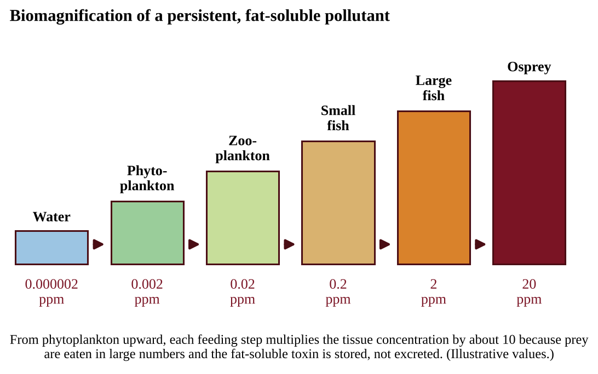
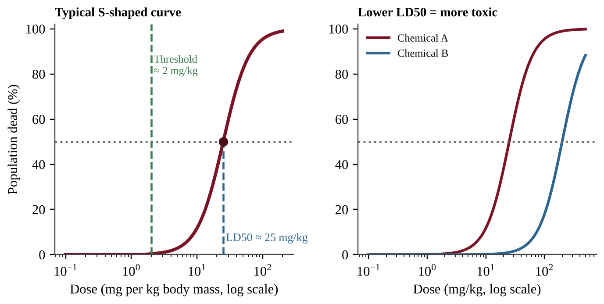
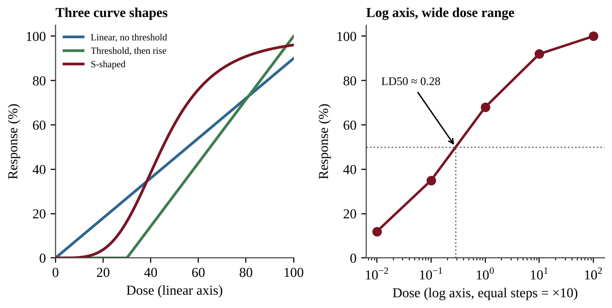

# Unit 8 — Aquatic and Terrestrial Pollution

Every pollution story here asks three questions: where did it come from, what did it do to the ecosystem, and how do we stop it? Keep asking them and the 15 topics become one connected idea.

## Topic 8.1 — Sources of Pollution

:::box objectives
- Distinguish point sources from nonpoint sources of pollution.
- Give examples of each and explain why one type is harder to regulate.
:::

:::box simple
Imagine you find a puddle of dirty water. If you can follow it back to one pipe, you have found a **point source**. If the dirt arrived from the whole neighborhood at once, washed in by rain from every lawn, street, and field, you have a **nonpoint source**. One pipe can be fixed with a filter or a fine. A whole neighborhood is much harder to fix.
:::

A **pollutant** is any substance, or form of energy such as heat or noise, that is added to the environment faster than natural processes can remove it, and that harms living things. Pollution can enter air, water, or soil, and pollutants often move between them. A chemical sprayed on a field can enter the air as a drift, the soil as a residue, and a river as runoff.

:::box define
**Point source** — a single, identifiable place where a pollutant enters the environment, such as a smokestack or a waste discharge pipe.
**Nonpoint source** — a diffuse source spread over a wide area with no single outlet, such as pesticide spraying or urban runoff.
:::

### Why the difference matters

A point source has a location, an owner, and a measurable flow. Regulators can place a monitor on the pipe, set a permit limit, and fine the owner who exceeds it. A nonpoint source has thousands of small contributors: every driveway that leaks oil, every farm that spreads fertilizer, every lawn that is over-treated. Rain collects these contributions and carries them to the nearest stream. Because no single outlet exists, nonpoint pollution is harder to identify, measure, and control, and in many watersheds it is now the larger problem. In the United States the **Clean Water Act** works mainly through permits that limit what a point source may discharge; a limit can be checked against a measurement at the pipe, so a reading above it is a violation. The **Safe Drinking Water Act** sets limits for contaminants in public drinking water.

:::box mistake
- Thinking that "nonpoint" means "natural." A nonpoint source can be entirely human-caused, such as lawn fertilizer.
- Calling a very large source a nonpoint source. A giant factory is still a point source if the pollutant leaves through an identifiable outlet. Size is not the test; identifiability is.
:::

:::box example
id: SG-U8-E001
For each source, state whether it is a point source or a nonpoint source and justify your choice in one sentence: (i) exhaust leaving the stack of a coal-fired power plant; (ii) oil and tire residue washed from a city's streets into storm drains during a rainstorm; (iii) treated wastewater leaving a municipal plant through a single underwater pipe; (iv) fertilizer washing off 200 separate cornfields into a river. Then explain why a regulator could set a measurable discharge limit for only some of these.
:::

:::box summary
- A point source has one identifiable outlet; a nonpoint source is diffuse.
- Point sources are easier to monitor and regulate; nonpoint sources require changes in land use across a whole area.
- Examples: smokestack and discharge pipe (point); pesticide spraying and urban runoff (nonpoint).
:::

## Topic 8.2 — Human Impacts on Ecosystems

:::box objectives
- Explain tolerance ranges and how pollutants stress organisms.
- Describe the human impacts on aquatic ecosystems listed in the course: coral reef damage, oil spills, dead zones, oxygen sag, heavy metals, litter, sediment, and mercury.
- Read and explain an oxygen sag curve, and use dissolved oxygen and BOD correctly.
:::

:::box simple
Every living thing has a "comfort zone" for each environmental factor: temperature, pH, salt, oxygen, toxins. Inside the zone it thrives. Pushed toward the edges it gets stressed. Pushed beyond the edges it dies. Human pollution often pushes water outside the comfort zone of the species living there.
:::

### Range of tolerance

Organisms have a **range of tolerance** for every pollutant and every physical factor. Within an **optimum range** an organism can maintain homeostasis, which means keeping its internal conditions steady. Outside that range it experiences physiological stress, then limited growth and reduced reproduction, and in extreme cases death. Different species have different ranges. A trout needs cold, well-oxygenated water; a carp tolerates warm, low-oxygen water. This is why species composition is a useful indicator of water quality. Finding stoneflies and mayflies suggests clean water; finding only sludge worms suggests heavy organic pollution.

### Coral reefs

Reefs are damaged by rising ocean temperature (corals expel their symbiotic algae, called bleaching), by sediment runoff that smothers them and blocks light, and by destructive fishing such as dynamite or bottom trawling.

### Oil spills

Oil in marine water harms life in several ways. Hydrocarbons in the oil are toxic and kill organisms directly. Oil that floats coats the feathers of birds and the fur of marine mammals, which destroys their insulation and buoyancy. Some components of oil sink to the bottom and kill bottom-dwelling organisms. Oil that washes ashore has economic costs because it can close fisheries and drive away tourists from beaches.

### Dead zones, dissolved oxygen, and the oxygen sag curve

**Dissolved oxygen (DO)** is oxygen gas dissolved in water, measured in mg/L. Fish and most aquatic animals need roughly 5 mg/L or more; below about 2 mg/L most cannot survive. Oxygen enters water from the atmosphere and from photosynthesis, and it is removed by respiration and decomposition.

When organic waste such as sewage or manure enters a stream, bacteria decompose it using oxygen. The amount of oxygen microbes would need to break down the organic matter in a water sample is called **biochemical oxygen demand (BOD)**. High BOD means a heavy load of decomposable material and predicts a drop in DO. Clean streams have low BOD; raw sewage has very high BOD.

An **oxygen sag curve** is a plot of dissolved oxygen versus distance from a source of pollution, usually excess nutrients and biological refuse. It has a recognizable shape.

{w=0.8}

:::box process
Organic waste enters stream → bacteria decompose it and consume oxygen (BOD) → DO falls downstream → minimum DO (the sag) where decomposition outpaces re-aeration → waste is used up while oxygen enters from air and photosynthesis → DO recovers toward saturation.
:::

**How to read the graph.** The horizontal axis is distance downstream. Before the discharge point the water sits near its saturation DO. The steepest fall is just below the outfall, the lowest point marks where oxygen is most scarce (fish kills occur here), and the rise afterward shows recovery. A larger waste load, warmer water, or slow flow makes the sag deeper and longer; a treated discharge (lower BOD) makes it shallower. If the lowest value falls below the tolerance level for a species, that species disappears from the affected stretch.

BOD is often plotted on the same axes as DO. Because the two are linked, the curves mirror each other: BOD jumps at the outfall, falls as microbes consume the waste, and DO is lowest a little farther downstream, where the waste is still being broken down faster than oxygen enters. As BOD returns toward its upstream value, DO climbs back. A jump in BOD with a drop in DO marks the discharge point.

{w=0.8}

**Which species live where.** Each species needs a minimum DO. Where the curve sits below 7 mg/L, sensitive insect larvae such as stonefly nymphs vanish; below about 5 mg/L, most fish and mussels vanish; the lowest stretch keeps only tolerant animals such as sludge worms.

### Reading water-quality data from a table

Questions often give measurements from several stream sites and ask which site is downstream of a particular source. First find the unaffected reference site (clear, high DO, low nutrients), then compare each site with it and match the pattern:

| Likely source | Turbidity (cloudiness) | Nutrients (N, P) | DO | Other signs |
|---|---|---|---|---|
| Construction site or eroding bank | Much higher | About the same | About the same or slightly lower | Settled silt, fewer sight-feeding fish |
| Fertilizer or animal-manure runoff | Little change | Much higher | Lower | Algal bloom; manure also adds pathogens |
| Raw or poorly treated sewage | Higher | Higher | Much lower | High BOD; many pathogens; few sensitive species |
| Heated cooling water | No change | No change | Lower | Temperature clearly higher |

**Oceanic dead zones** are areas of low oxygen in the world's oceans caused by increased nutrient pollution. The mechanism, covered in Topic 8.5, is the same as the sag: nutrients cause algal growth, decomposers consume the oxygen when the algae die.

### Other impacts

- **Heavy metals** such as lead, arsenic, and cadmium from industry, especially mining and the burning of fossil fuels, can reach groundwater and contaminate drinking water supplies. Lead, for example, comes from old paint, old water pipes, and the leaded gasoline of the past; it damages the nervous system, and children are the most vulnerable.
- **Litter** that reaches water is unsightly, but it can also cause intestinal blockage and choking in wildlife and carry toxic substances into the food chain.
- **Sediment** in waterways reduces light penetration, which harms primary producers and visual predators (animals that hunt by sight). When it settles, it smothers and disrupts habitats such as spawning gravel and coral.
- **Mercury.** Elemental mercury, released by coal burning and mining, enters aquatic environments, where bacteria convert it into highly toxic **methylmercury**, the form that accumulates in organisms (see Topic 8.8).

:::box define
**Dissolved oxygen (DO)** — the concentration of oxygen gas dissolved in water, in mg/L.
**BOD** — biochemical oxygen demand; the oxygen consumed by microbes decomposing organic matter in water. More organic waste means higher BOD and lower DO.
**Dead zone** — a region of water so low in oxygen (hypoxic) that most animals cannot live there.
:::

:::box mistake
- Saying the sag is caused by the pollutant being "poisonous." In an organic-waste sag the oxygen is used up by bacteria feeding on the waste.
- Thinking DO keeps falling forever. The curve rises again because the waste is used up and the water re-aerates.
- Mixing up BOD and DO: high BOD goes with low DO.
:::

:::box example
id: SG-U8-E002
A stream receives treated effluent from a cannery at kilometer 10. Dissolved oxygen was measured at several sites:

| Distance (km) | DO (mg/L) |
|---|---|
| 0 | 8.8 |
| 10 | 8.8 |
| 15 | 6.5 |
| 20 | 4.2 |
| 30 | 2.9 |
| 40 | 3.6 |
| 60 | 6.1 |
| 80 | 8.0 |

(a) Identify the site with the lowest DO and give its value. (b) List the sampled sites where DO was below the 5 mg/L level needed by most fish. (c) Calculate the percent decrease in DO from the discharge point (km 10) to the lowest value. (d) Explain, using BOD, why DO falls between km 10 and km 30, and explain why it rises between km 40 and km 80.
:::

:::box summary
- Organisms have a range of tolerance; outside their optimum range they suffer stress, reduced growth and reproduction, or death.
- Reefs are damaged by warming, sediment, and destructive fishing; oil harms by toxicity, coating, sinking, and economic loss.
- Oxygen sag curve: DO drops below an organic-waste source, bottoms out, then recovers. High BOD means low DO.
- Dead zones, heavy metals in groundwater, litter, sediment, and methylmercury are further impacts.
:::

## Topic 8.3 — Endocrine Disruptors

:::box objectives
- Describe what endocrine disruptors are.
- Describe their effects on organisms and ecosystems.
:::

:::box simple
Hormones are the body's chemical text messages. Glands send the messages and cells with the right receptors read them. An endocrine disruptor is a chemical that sends fake messages, blocks real ones, or scrambles the sending. The cells then do the wrong thing at the wrong time, even at very low concentrations.
:::

The **endocrine system** is the set of glands that release hormones controlling growth, development, metabolism, and reproduction. **Endocrine disruptors** are chemicals that can interfere with the endocrine system of animals. Some mimic natural hormones (for example, imitating estrogen), some block hormone receptors, and some change how much hormone the body makes. Examples include certain pesticides, PCBs, some plastics chemicals, and compounds from medications that pass through sewage treatment and enter rivers.

Effects on ecosystems arise because hormones control development and reproduction, so disruption shows up there first. Endocrine disruptors can lead to birth defects, developmental disorders, and gender imbalances in fish and other species. In a documented pattern, fish living downstream of wastewater outfalls show male fish developing female traits, which skews sex ratios, lowers breeding success, and can shrink the whole population. Because amphibians absorb chemicals through thin skin and develop in water, they are especially vulnerable.

:::box define
**Endocrine disruptor** — a chemical that can interfere with the endocrine system of animals by imitating, blocking, or altering hormone signals.
:::

:::box summary
- Endocrine disruptors interfere with animals' hormone systems.
- Results: birth defects, developmental disorders, gender imbalances in fish and other species, and thus reduced reproduction.
:::

## Topic 8.4 — Human Impacts on Wetlands and Mangroves

:::box objectives
- Define wetlands and describe the ecological services they provide.
- Identify the threats to wetlands and mangroves and describe responses.
:::

:::box simple
A wetland is nature's sponge and kidney. It soaks up floodwater like a sponge, filters pollutants like a kidney, and shelters a huge number of species. When people fill in or drain wetlands, they lose all of those free services at once.
:::

**Wetlands** are areas where water covers the soil, either part or all of the time. They include marshes, swamps, bogs, and **mangroves**, which are salt-tolerant forests along tropical and subtropical coasts, with tangled roots that stand in the water.

### Ecological services

- **Water purification and filtration.** Plants and microbes trap sediment and remove excess nutrients and some toxins as water slows and passes through.
- **Flood protection.** Wetlands store large volumes of floodwater and release it slowly, and mangroves and coastal marshes absorb wave energy and storm surge.
- **Habitat.** Wetlands are nurseries for fish and shellfish and refuge for birds and many other animals. Mangrove roots shelter juvenile fish that later live on reefs and in open water.

### Threats

Threats to wetlands and mangroves include commercial development (filling land for buildings, roads, and aquaculture ponds), dam construction (which changes water flow and sediment supply), overfishing, and pollutants from agriculture and industrial waste. When a wetland is lost, nearby communities lose natural flood control and water treatment, and they must build levees and treatment plants at great cost.

Responses include laws limiting wetland filling, restoring drained wetlands, replanting mangroves, buffer zones, and cutting upstream fertilizer runoff.

Wetlands also have economic value: nursery habitat supports fisheries, scenery supports tourism, and storm and flood buffering lowers property damage.

### Calculating how much a wetland removes

A pollutant **load** is the mass that moves past a point in a given time. It equals concentration × volume of water. A useful shortcut: a concentration of 1 mg/L is the same as 1 g/m³ (because 1 m³ = 1,000 L and 1 g = 1,000 mg), so mg/L × m³ gives grams.

:::box formula
Load (g/day) = concentration (mg/L) × flow (m³/day)
Load (kg/day) = load in g ÷ 1,000
Mass removed = load × fraction removed (percent ÷ 100)
:::

*Illustration.* A canal carries 10,000 m³/day with 3 mg/L of phosphate: load = 3 × 10,000 = 30,000 g = 30 kg/day. A marsh removing 50% removes 15 kg/day; if it is drained, that extra 15 kg/day reaches the lake.

:::box example
id: SG-U8-E011
A drainage ditch carries 25,000 m³ of water per day containing 8 mg/L of nitrate-nitrogen. A wetland along the ditch removes 45% of the nitrate-nitrogen before the water reaches a lake. (a) Calculate the nitrate-nitrogen load entering the wetland, in kg per day. (b) Calculate the mass the wetland removes each day, in kg, and the mass that reaches the lake. (c) The wetland is drained for a parking lot. Calculate the additional nitrate-nitrogen, in kg per year, that reaches the lake. (d) Name two other services the community loses.
:::

:::box define
**Wetland** — an area where water covers the soil all or part of the time.
**Mangrove** — a salt-tolerant coastal forest wetland that stabilizes shorelines and shelters young fish.
:::

## Topic 8.5 — Eutrophication

:::box objectives
- Explain how excess fertilizers and detergents cause eutrophication and algal blooms.
- Explain why blooms lead to low dissolved oxygen and fish kills.
- Contrast eutrophic, hypoxic, and oligotrophic waters; name human causes.
:::

:::box simple
Fertilizer is plant food. Dump it into a lake and the algae feast, covering the surface in green. But algae live briefly. When they die, bacteria eat them and use up the water's oxygen. Fish suffocate. More food led, in a chain, to less oxygen.
:::

**Eutrophication** occurs when a body of water is enriched in nutrients, mainly nitrogen and phosphorus. Nutrients are usually limiting in aquatic ecosystems, so adding them triggers rapid growth of algae and aquatic plants. A **limiting nutrient** is the one in shortest supply, so adding it increases growth the most. In most freshwater lakes it is phosphorus; in many coastal marine waters it is nitrogen.

{w=0.8}

:::box process
Fertilizer, manure, detergent, or sewage runs into water → nutrient (N, P) levels rise → algal bloom → algae shade the plants below and eventually die → decomposers digest the dead algae and use oxygen → dissolved oxygen falls (hypoxia) → fish and other organisms die.
:::

The increase in nutrients causes an algal bloom. When the bloom dies, microbes digest the algae, along with the oxygen in the water, leading to a decrease in dissolved oxygen levels. The lack of oxygen can result in large die-offs of fish and other aquatic organisms. The bloom may also block sunlight, killing submerged plants, and some algae release toxins.

**Anthropogenic causes** of eutrophication are agricultural runoff (fertilizer and animal manure) and wastewater release (sewage and phosphate detergents). Natural eutrophication happens slowly over centuries as a lake fills with sediment; human-caused (cultural) eutrophication can happen in a few years.

:::box define
**Eutrophic** — a water body enriched in nutrients, with frequent algal blooms and low dissolved oxygen.
**Oligotrophic** — a water body with very low nutrients, stable algae populations, clear water, and high dissolved oxygen.
**Hypoxic** — low in dissolved oxygen.
:::

**Solutions** include limiting fertilizer use and applying it at the right time and amount, planting buffer strips and keeping wetlands along streams, banning phosphate detergents, upgrading wastewater plants to remove nitrogen and phosphorus (tertiary treatment), and managing manure.

:::box mistake
- Saying the algae "use up the oxygen." The living algae produce oxygen in daylight. The oxygen is consumed by bacteria decomposing the dead algae.
- Describing eutrophic water as "clean" because it looks green and productive.
:::

:::box strategy
In a cause-and-effect FRQ about eutrophication, write the full chain with each link, naming the nutrient and the oxygen-consuming step: nutrients → bloom → death → decomposition → low DO → die-off. Missing the decomposition link is the most common lost point.
:::

### Designing an investigation of a pollution problem

Free-Response Question 1 follows one pattern. Build your answer in this order.

1. **Question and hypothesis.** Write an "if … then …" prediction that can be tested: *If runoff from the fertilized lawns adds nutrients to the pond, then nitrate and phosphate concentrations will be higher at sites closer to the lawns than at sites farther away.*
2. **Variables.** The **independent variable** is what you change or compare (distance from the source, nutrient added); the **dependent variable** is what you measure (nitrate, chlorophyll, DO).
3. **Control and constants.** A **control** receives no treatment (a site above the source, or a container with no added nutrient). **Constants** are factors held the same or recorded for every sample: depth, time of day, temperature, recent rainfall, method.
4. **Procedure.** Say *where* (sites above and below the source), *when* and *how often* (same time of day, weekly through the season, and after rain), and name the measurement and tool (nitrate test kit, DO meter).
5. **Replication.** Take several samples per site and on several dates, then average them; this lowers the effect of chance.6. **Analysis.** Graph the averaged dependent variable against the independent variable and state the supporting pattern (for example, nitrate highest at the outfall and falling downstream). A control and a plausible mechanism strengthen a claim of cause.

**Which nutrient limits growth?** Use identical containers of lake water, each with the same light, temperature, and starting algae, and give them four treatments: nothing (control), nitrogen only, phosphorus only, and both. Replicate each treatment and measure chlorophyll after several days. If only the phosphorus treatments grow much more than the control, phosphorus is limiting. Using different lake locations for each nutrient would change the location along with the nutrient.

**Biomagnification hypothesis.** A testable form is: *If a pollutant biomagnifies in this food web, then tissue concentration will be higher at each higher trophic level.*

:::box example
id: SG-U8-E012
A farm pond turns green each July after a nearby field is fertilized. A student suspects that phosphorus in the runoff is the cause. Four sampling sites are available: S1 in the drainage ditch next to the field, S2 at the pond inlet, S3 at the pond center, and S4 in a similar pond with no farm nearby. (a) Write an "if … then …" hypothesis. (b) Identify the independent and dependent variables and the site that serves as the control. (c) Describe a sampling plan that states when and how often samples are taken and how replication is achieved. (d) Name two variables that must be kept constant or recorded at every site. (e) Describe results that would support the hypothesis.
:::

:::box example
id: SG-U8-E003
In an outdoor experiment, four identical tanks received lake water and the same number of fish. Different amounts of phosphate were added once at the start. After 14 days:

| Tank | Phosphate added (mg/L) | Algal density (cells per mL) | DO at the bottom (mg/L) |
|---|---|---|---|
| 1 | 0 | 2,000 | 8.1 |
| 2 | 0.05 | 18,000 | 6.4 |
| 3 | 0.20 | 95,000 | 3.2 |
| 4 | 0.50 | 210,000 | 1.1 |

(a) Identify the control tank. (b) Describe the trend in algal density and in bottom DO as phosphate increases. (c) Explain, step by step, how higher phosphate led to lower bottom DO. (d) Classify tank 1 and tank 4 as oligotrophic-like or eutrophic-like.
:::

:::box summary
- Eutrophication is nutrient enrichment; causes include fertilizer runoff and wastewater.
- Blooms die, decomposers use oxygen, DO falls, and fish die; low DO is called hypoxia.
- Oligotrophic water has few nutrients, stable algae, and high DO.
:::

## Topic 8.6 — Thermal Pollution

:::box objectives
- Describe the effects of thermal pollution on aquatic ecosystems.
- Explain why warm water holds less dissolved oxygen.
:::

:::box simple
Think of a soda: a cold bottle stays fizzy but a warm one goes flat quickly because gas escapes from warm liquid. Water works the same way for oxygen. Warm water holds less. If a factory heats a river, the fish face two problems at once: less oxygen in the water and a faster metabolism that demands more.
:::

**Thermal pollution** occurs when heat released into the water produces negative effects to the organisms in that ecosystem. The usual source is **cooling water**: power plants and factories take in river water, use it to carry off waste heat, and return it warmer.

**Why warm water is a problem.** Warm water does not contain as much dissolved oxygen as cold water. Also, the metabolic rates of cold-blooded aquatic animals rise with temperature, so they need more oxygen just when less is available. Cold-water species such as trout have narrow tolerance ranges and may die or leave.

| Water temperature (°C) | 5 | 10 | 20 | 30 |
|---|---|---|---|---|
| Maximum DO at saturation (mg/L, fresh water, sea level) | 12.8 | 11.3 | 9.1 | 7.5 |

Heat also enters streams when clear-cutting removes the shade of streamside trees, so sunlight warms the water directly, and when runoff crosses hot pavement. Cooling towers, recycled cooling water, waste-heat reuse, and shade trees along streams reduce thermal pollution.

:::box define
**Thermal pollution** — heat added to water by human activities that harms organisms.
:::

:::box example
id: SG-U8-E004
A power plant takes in river water at 10°C and discharges it at 30°C. Use the saturation table above. (a) Calculate the percent decrease in the maximum DO the water can hold when it warms from 10°C to 30°C. (b) State two reasons, other than the lower oxygen capacity, that the warmed discharge could harm cold-water fish. (c) Propose one engineering and one landscape solution that would reduce the thermal impact.
:::

:::box summary
- Thermal pollution is heat added to water by humans, mainly power-plant cooling water.
- Warm water holds less oxygen and speeds up organisms' metabolism, so stress and fish kills occur.
- Cooling towers, shade, and heat reuse reduce the problem.
:::

## Topic 8.7 — Persistent Organic Pollutants (POPs)

:::box objectives
- Explain why POPs persist in the environment.
- Describe why they accumulate in fatty tissues and why they travel long distances.
:::

:::box simple
Most natural substances are like paper: microbes eventually digest them. POPs are like plastic: man-made molecules that microbes do not know how to break. They last for years, they dissolve in fat rather than water, so animals store them, and they ride the wind and ocean currents far from where they were first used.
:::

**Persistent organic pollutants (POPs)** do not easily break down in the environment because they are synthetic, carbon-based molecules (such as DDT and PCBs). Since decomposers have no enzymes evolved for these structures, they remain in soil, sediment, and water for years or decades. "Organic" here means carbon-based, not "grown without pesticides."

POPs can be toxic to organisms because they are soluble in fat (lipid-soluble) rather than water. Water-soluble chemicals are excreted in urine; fat-soluble ones are retained and accumulate in organisms' fatty tissues, such as body fat, liver, and eggs (Topic 8.8).

POPs can travel over long distances via wind and water before being redeposited. Evaporating in warm regions, riding air currents, and condensing in cold regions, they can contaminate places where they were never used, such as Arctic wildlife and the people who eat it.

:::box define
**POP** — a synthetic, carbon-based pollutant that resists breakdown, dissolves in fat, and can be transported long distances. Examples: DDT, PCBs.
:::

## Topic 8.8 — Bioaccumulation and Biomagnification

:::box objectives
- Define bioaccumulation and biomagnification and tell them apart.
- Calculate concentrations in a food chain.
- Describe the effects of DDT, mercury, and PCBs on organisms, including humans.
:::

:::box simple
**Bioaccumulation** happens inside one animal: it takes in a pollutant faster than it gets rid of it, so the amount in its body keeps rising over its lifetime. **Biomagnification** happens up a food chain: a predator eats many contaminated prey, so the concentration climbs at each step. An osprey ends up with far more toxin per gram than the water it fishes in.
:::

**Bioaccumulation** is the selective absorption and concentration of elements or compounds by cells in a living organism, most commonly fat-soluble compounds. **Biomagnification** is the increase in concentration of substances per unit of body tissue that occurs in successively higher trophic levels of a food chain or food web.

Why does it magnify? Only about 10% of energy passes up each trophic level, so a predator eats many prey over its lifetime; if the toxin is stored and not excreted, the predator collects the whole load. A common rule of thumb is about **10× per trophic level**, though real factors vary.

{w=0.8}

:::box formula
Biomagnification factor (BMF) = concentration in the consumer ÷ concentration in its food (or the trophic level below)
Concentration at level *n* ≈ starting concentration × (BMF)ⁿ
Units: ppm, ppb, or mg/kg of tissue (the same units for both levels).
:::

For example, if plankton hold 0.04 ppm and each step multiplies by 10, small fish hold 0.4 ppm, larger fish 4 ppm, and a fish-eating bird 40 ppm after three steps (0.04 × 10³ = 40).

### Effects

Effects in an ecosystem include **eggshell thinning** and developmental deformities in top carnivores at the higher trophic levels. DDT famously thinned the eggshells of birds of prey such as eagles, ospreys, and peregrine falcons, so eggs broke in the nest and populations crashed. Humans also experience harmful effects from biomagnification, including issues with the reproductive, nervous, and circulatory systems.

Three substances to know: **DDT** (insecticide), **PCBs** (industrial chemicals), and **mercury** (converted to methylmercury by aquatic bacteria; it harms the nervous system, which is why people are advised to limit large predatory fish). All three bioaccumulate and have major impacts.

Mercury follows a clear path: coal burning releases it to the air, wind carries it, rain or dry fallout deposits it on lakes and oceans, bacteria convert it to methylmercury, and it biomagnifies in fish. Eating fish from lower trophic levels exposes a person to less toxin than eating large predators. A persistent chemical banned in one country can still turn up in its people because it lasts for years and arrives in imported food.

:::box define
**Bioaccumulation** — the buildup of a substance, especially a fat-soluble one, in the tissues of a single organism over time.
**Biomagnification** — the increase in a substance's concentration per unit of tissue at successively higher trophic levels.
:::

:::box mistake
- Using the terms interchangeably. Accumulation is within one organism's body over time; magnification is across trophic levels.
- Assuming the producers have the highest concentrations. They have the lowest tissue concentration among organisms in the chain; the top consumer has the highest.
- Saying the pollutant "disappears" at each step. The food chain concentrates it.
:::

:::box example
id: SG-U8-E005
Tissue samples from a pond food chain contained the following concentrations of a persistent pesticide:

| Organism | Trophic level | Concentration (ppm) |
|---|---|---|
| Algae | Producer | 0.8 |
| Minnows | Primary consumer | 6.4 |
| Trout | Secondary consumer | 52 |
| Heron | Tertiary consumer | 416 |

(a) Calculate the biomagnification factor for each step (consumer ÷ food), rounded to one decimal. (b) Calculate the overall factor from algae to heron. (c) Explain why the heron's concentration is much higher than the algae's even though the pond water is only slightly contaminated. (d) Identify one effect this pesticide might have on the heron population.
:::

:::box summary
- Bioaccumulation: buildup in one organism; biomagnification: increase up trophic levels.
- Fat-soluble, persistent, non-excretable substances such as DDT, PCBs, and methylmercury do both.
- Effects: eggshell thinning and deformities in top predators; reproductive, nervous, and circulatory harm in humans.
:::

## Topic 8.9 — Solid Waste Disposal

:::box objectives
- Describe the types and sources of solid waste, including e-waste.
- Describe the parts of a sanitary landfill and what controls decomposition in it.
- Compare landfills, incineration, and ocean dumping, and describe the problems of illegal dumping.
:::

:::box simple
Throw something "away" and it does not vanish; it goes somewhere. Most places bury it in a lined landfill, some burn it, and some dump it where it should not go. Each choice trades one problem for another: buried trash can leak liquid and gas, burned trash makes smoke and ash.
:::

**Solid waste** is any discarded material that is not a liquid or a gas. It is generated in domestic, industrial, business, and agricultural sectors. **Electronic waste (e-waste)** is composed of discarded electronic devices including televisions, cell phones, and computers; it contains valuable metals but also hazardous materials such as lead and mercury.

### Landfills

Solid waste is most often disposed of in landfills. A **sanitary municipal landfill** is engineered to limit harm. It consists of a **bottom liner** (plastic or clay), a **storm water collection system**, a **leachate collection system**, a **cap** (cover), and a **methane collection system**. Leachate is the polluted liquid that forms when water percolates through waste. Without a liner, leachate can contaminate groundwater; without gas collection, methane (a greenhouse gas that is also flammable) escapes.

:::box process
Rain falls on the waste → water seeps down and picks up dissolved contaminants (leachate) → liner stops it from reaching groundwater → collection pipes pump it to treatment. Meanwhile, microbes decompose organic waste → methane and CO₂ form → gas wells collect the methane for flaring or energy.
:::

Landfills can still contaminate groundwater and release harmful gases when liners fail or when they were built before modern standards. Crushed or shredded waste releases more contaminants into water than large pieces because smaller pieces expose more surface area. Factors in landfill decomposition include the **composition of the trash** and the **conditions needed for microbial decomposition**: moisture, temperature, and oxygen availability. Tightly compacted, covered waste is deprived of oxygen and moisture, so even paper and food can last for decades, and plastics last far longer.

### Incineration

Waste can also be burned at high temperatures. Incineration significantly reduces the volume of solid waste (often by about 90%) but releases air pollutants such as particulates, NOₓ, SO₂, and sometimes toxic metals and dioxins, and leaves ash that must be disposed of, often as hazardous waste. When the heat is used to generate electricity, the process is called waste-to-energy.

### Illegal dumping and ocean dumping

Some items are not accepted in sanitary landfills and may be disposed of illegally, leading to environmental problems. One example is used rubber tires, which, when left in piles, become breeding grounds for mosquitoes that can spread disease. Tire piles also burn and release toxic smoke. Some countries dispose of waste by dumping it in the ocean. This practice, along with other sources of plastic, has led to large floating islands of trash in the oceans. Wildlife can become entangled in the waste and can ingest it. Plastic is especially persistent because few microbes can break it down, so it lasts for decades to centuries and only breaks into smaller pieces. Cutting the flow of plastic at its source (using less, reusing, recycling incentives) is more effective than cleaning up what has already spread.

**Hazardous waste** (toxic, flammable, or corrosive: batteries, paint, motor oil, pesticides) needs special handling. Two U.S. laws apply: **RCRA** regulates hazardous waste from creation to disposal ("cradle to grave"), and **CERCLA** (the Superfund law) pays for and organizes cleanup of abandoned or uncontrolled hazardous waste sites,.

:::box define
**Solid waste** — discarded material that is not a liquid or a gas.
**E-waste** — discarded electronic devices such as televisions, phones, and computers.
**Leachate** — liquid that has percolated through waste and carries dissolved contaminants.
:::

:::box summary
- Solid waste is any discarded non-liquid, non-gas material; e-waste is discarded electronics.
- A sanitary landfill has a liner, storm water system, leachate system, cap, and methane collection.
- Incineration cuts volume but releases air pollutants; illegal and ocean dumping cause serious harm.
:::

## Topic 8.10 — Waste Reduction Methods

:::box objectives
- Describe reduction practices (reuse, recycling, composting, e-waste handling, landfill mitigation) and their benefits and drawbacks.
- Calculate waste per capita and percent diversion.
:::

:::box simple
The best trash is trash that never exists. After that, use it again, then turn it into something new, then recover energy, and only then bury it. The more you move up this ladder, the less damage is done at the landfill.
:::

**Recycling** is a process by which certain solid waste materials are processed and converted into new products. Recycling is one way to reduce the current global demand on minerals (for example aluminum and copper), but this process is energy-intensive and can be costly (collection, sorting, and reprocessing). It still usually takes far less energy to recycle aluminum than to mine and refine new aluminum.

**Composting** is the process of organic matter such as food scraps, paper, and yard waste decomposing. The product of this decomposition can be used as fertilizer or a soil conditioner. Drawbacks to composting include odor and rodents, which are reduced by good management.

**E-waste** can be reduced by recycling and reuse. E-wastes may contain hazardous chemicals, including heavy metals such as lead and mercury, which can leach from landfills into groundwater if they are not disposed of properly.

**Landfill mitigation strategies** range from burning waste for energy to restoring habitat on former landfills for use as parks. The combustion of gases produced from decomposition of organic material in landfills can be used to turn turbines and generate electricity. This process reduces landfill volume.

| Method | Main benefit | Main drawback |
|---|---|---|
| Landfill | Cheap; methane can be captured | Land use; leachate and gas risks |
| Incineration | Volume cut ~90%; energy | Air pollutants; toxic ash |
| Recycling | Saves minerals and landfill space | Energy-intensive, costly |
| Composting | Makes fertilizer; diverts organics | Odor, rodents |

### Calculations

**Waste per capita** = total waste ÷ population (then use dimensional analysis to change units).
**Percent diversion** = (mass recycled + mass composted) ÷ total waste generated × 100.

:::box formula
Per capita waste = total mass of waste ÷ number of people (kg per person per day or per year)
Percent diversion = (mass diverted from disposal ÷ total mass generated) × 100
Years of landfill life = remaining capacity ÷ annual mass buried (same mass units)
:::

*Worked illustration.* A town of 20,000 people generates 14,600 metric tons of waste per year. Per capita: 14,600 t × 1,000 kg/t ÷ 20,000 people = 730 kg per person per year, and 730 ÷ 365 = 2.0 kg per person per day. If 3,650 t is recycled and composted, the diversion is 3,650 ÷ 14,600 × 100 = 25%.

**Source reduction** means making less waste in the first place, for example by redesigning products with less packaging. It is the preferred strategy, ahead of reuse and recycling, because the waste never has to be collected or processed.

### Landfill space and landfill energy

Landfill capacity is measured in volume, but waste is measured in mass, so you need the density of the compacted waste. Convert units first, then divide.

:::box formula
Volume (m³) = mass (kg) ÷ density (kg/m³)
Landfill life (years) = remaining capacity (m³) ÷ volume buried per year (m³/yr)
Electricity from landfill gas (MJ) = gas volume (m³) × energy content (MJ/m³) × efficiency (as a decimal)
Electricity (kWh) = energy (MJ) ÷ 3.6, because 1 kWh = 3.6 MJ
:::

*Illustration.* A landfill receives 30,000 metric tons per year at a compacted density of 500 kg/m³. Mass = 30,000 × 1,000 = 3.0 × 10⁷ kg; volume = 3.0 × 10⁷ ÷ 500 = 6.0 × 10⁴ m³ per year. With 1.2 × 10⁶ m³ of space left, life = 1.2 × 10⁶ ÷ 6.0 × 10⁴ = 20 years. If part of the waste is diverted, only the remainder is buried.

*Energy illustration.* 5.0 × 10⁵ m³ of methane at 36 MJ/m³ is 1.8 × 10⁷ MJ; at 30% efficiency that is 5.4 × 10⁶ MJ = 1.5 × 10⁶ kWh, enough for 1.5 × 10⁶ ÷ 8,000 ≈ 190 homes using 8,000 kWh per year.

**Scientific notation.** To divide, divide the coefficients and subtract the exponents: (5 × 10⁴) ÷ (2 × 10¹²) = 2.5 × 10⁻⁸.

:::box mistake
- Treating all diversion as free. Recycling and composting need energy, money, and clean sorting.
- Dividing in the wrong order for per capita (waste ÷ people, not people ÷ waste).
- Forgetting to convert tons to kilograms or years to days.
:::

:::box example
id: SG-U8-E006
A city of 125,000 people sends 82,125 metric tons of solid waste to its landfill in one year (365 days). (a) Calculate the waste per person per day, in kilograms. (b) The city sets a goal of reducing the per capita rate by 20%. Calculate the goal in kilograms per person per day and the annual mass of waste, in metric tons, if the population stays the same. (c) Name two methods, one for plastics and metals and one for food scraps, that could help meet the goal.
:::

:::box example
id: SG-U8-E007
A county landfill has 1,200,000 metric tons of remaining capacity. At present 40,000 t of waste is buried each year. The county considers a plan that would recycle 25% and compost 15% of the 40,000 t generated each year, burying only the remainder. (a) Calculate the percent diversion under the plan. (b) Calculate the number of years the landfill will last under the current practice and under the plan. (c) Describe one benefit and one drawback of the plan other than landfill life.
:::

:::box example
id: SG-U8-E013
A town of 80,000 people produces 1.6 kg of solid waste per person per day. It recycles 20% and composts 10%; the rest goes to a landfill and is compacted to 550 kg/m³. The landfill has 2.0 × 10⁶ m³ of space left. (a) Calculate the mass landfilled in one year (365 days), in metric tons. (b) Calculate the volume this occupies, in m³ per year. (c) Calculate how many years the landfill will last. (d) The landfill also captures 4.0 × 10⁵ m³ of methane per year at 36 MJ/m³ and burns it in a generator that is 35% efficient. Calculate the electricity produced, in kWh per year.
:::

:::box summary
- Reduce and reuse first; then recycle, compost, and recover energy; landfill last.
- Recycling saves minerals but is energy-intensive and costly; composting makes fertilizer but can cause odor and rodents.
- E-waste contains lead and mercury and should be recycled or reused; landfill gas can run turbines.
- Per capita = waste ÷ people; diversion % = diverted ÷ generated × 100.
:::

## Topic 8.11 — Sewage Treatment

:::box objectives
- Describe primary, secondary, and tertiary sewage treatment and disinfection.
- Interpret a flow diagram of a treatment plant.
- Calculate the percent removal of BOD at each stage.
:::

:::box simple
A sewage plant is a series of cleaning steps. First, take out what you can pick or settle out. Second, let bacteria eat the dissolved waste. Third, polish the water to remove leftovers. Finally, kill germs before letting the water go.
:::

Sewage (wastewater from toilets, sinks, and industry) carries organic matter, nutrients, and disease-causing microbes. Without treatment it would produce high BOD, oxygen sags, eutrophication, and disease.

{w=0.85}

- **Primary treatment** is the physical removal of large objects, often through screens and grates, followed by the settling of solid waste in the bottom of a tank. It removes solids and some of the BOD without using biology.
- **Secondary treatment** is a biological process in which bacteria break down organic matter into carbon dioxide and inorganic sludge, which settles in the bottom of a tank. The tank is **aerated** to increase the rate at which the bacteria break down the organic matter, because the bacteria are aerobic and need oxygen. This stage removes most of the remaining BOD.
- **Tertiary treatment** is the use of ecological or chemical processes to remove any pollutants left in the water after primary and secondary treatment. Examples are constructed wetlands, filters, and chemical precipitation of phosphorus or biological removal of nitrogen to reduce nutrients that cause eutrophication.
- **Disinfection.** Prior to discharge the treated water is exposed to one or more disinfectants (usually chlorine, ozone, or UV light) to kill bacteria.

:::box process
Raw sewage → screens and grates remove large objects → settling tank removes solids (primary sludge) → aerated tank where bacteria digest organic matter (secondary) → sludge settles → chemical or ecological polishing removes nutrients and leftovers (tertiary) → chlorine, ozone, or UV kills pathogens → release or reuse.
:::

:::box define
**Primary treatment** — physical removal by screens and settling.
**Secondary treatment** — aerated biological breakdown of organic matter by bacteria.
**Tertiary treatment** — ecological or chemical removal of remaining pollutants.
**Disinfection** — killing pathogens with chlorine, ozone, or UV light before discharge.
:::

:::box example
id: SG-U8-E008
A treatment plant measured BOD at three points: raw sewage entering, 240 mg/L; after the primary settling tank, 168 mg/L; after the aerated secondary tank, 21 mg/L. (a) Calculate the percent of BOD removed by primary treatment, relative to the raw sewage. (b) Calculate the percent of the remaining BOD removed by the secondary stage, relative to the water entering the secondary tank. (c) Calculate the overall percent removal. (d) Explain why the secondary stage removes BOD by a different mechanism than the primary stage, and why aeration is required.
:::

:::box summary
- Primary: physical (screens and settling). Secondary: aerated bacteria convert organics to CO₂ and sludge. Tertiary: chemical or ecological removal of leftover pollutants such as nutrients.
- Disinfection (chlorine, ozone, UV) kills pathogens before discharge.
- Percent removal = (in − out) ÷ in × 100.
:::

## Topic 8.12 — Lethal Dose 50% (LD50)

:::box objectives
- Define LD50 and use it to compare toxicity.
- Use LD50 to calculate a dose for a given body mass.
:::

:::box simple
To compare how poisonous two chemicals are, scientists ask: how much does it take to kill half of a test group? That amount is the LD50. A tiny LD50 means very toxic; a huge LD50 means much less toxic.
:::

**Lethal dose 50% (LD50)** is the dose of a chemical that is lethal to 50% of the population of a particular species. It is determined in controlled tests on groups of test animals given different doses, and it is usually reported as milligrams of the chemical per kilogram of body mass (mg/kg), so that animals of different sizes can be compared. Because the dose is per kilogram, the total dose for an individual is the LD50 multiplied by its body mass.

:::box formula
Total dose (mg) = dose (mg/kg) × body mass (kg)
LD50 comparison: the **lower** the LD50, the **more toxic** the chemical.
Units: mg of chemical per kg of body mass (mg/kg).
:::

*Illustration.* If a pesticide has an LD50 of 40 mg/kg in rats, a 0.25 kg rat given 10 mg has received 10 ÷ 0.25 = 40 mg/kg, so about half of rats given this dose would be expected to die.

**How many times more toxic?** Divide the larger LD50 by the smaller one. The chemical with the smaller LD50 is that many times more toxic. If chemical A has an LD50 of 12 mg/kg and chemical B has 480 mg/kg, then 480 ÷ 12 = 40, so A is 40 times more toxic than B (it takes one-fortieth of the dose). Do not subtract the two values.

The LD50 measures death only (not illness or cancer), applies to one species and one route of exposure, and says nothing about long-term low-level exposure. It is also not a safe dose: some animals die at doses well below the LD50, and the LD50 for rats cannot be assumed for humans, whose size and metabolism differ.

:::box define
**LD50** — the dose of a chemical lethal to 50% of a test population of one species.
:::

## Topic 8.13 — Dose Response Curve

:::box objectives
- Describe and interpret a dose response curve.
- Identify threshold, LD50, and compare toxicity of chemicals from graphs.
:::

:::box simple
A dose response curve answers the question "how much is too much?" The x-axis shows how much of a substance an organism gets. The y-axis shows how many are affected or how strong the effect is. More dose, more effect, usually in an S-shape.
:::

A **dose response curve** describes the effect on an organism or mortality rate in a population based on the dose of a particular toxin or drug. The dose goes on the horizontal axis (often on a logarithmic scale because the doses span a wide range) and the response (percent of the population affected or dying) on the vertical axis.

{w=0.9}

### Reading the curve

1. **Flat start (threshold).** At very low doses there may be no measurable effect. The dose below which no effect is seen is the **threshold dose**. Some substances, such as some carcinogens, may have no safe threshold in practice.
2. **Steep middle.** Over a narrow range of doses the response climbs rapidly; small increases in dose cause big increases in effect.
3. **Plateau.** At high doses nearly everyone is affected, so the curve levels off near 100%.
4. **LD50.** Draw a horizontal line from 50% on the y-axis to the curve, then drop down to the x-axis. That x-value is the LD50.
5. **Comparing chemicals.** A curve shifted to the left reaches 50% at a smaller dose, so that chemical is more toxic. A steeper curve means a narrow range between "no effect" and "high effect," which makes a safe dose harder to set.

**Risk reasoning.** Risk depends on hazard and exposure: a very toxic chemical sealed in a drum poses low risk; a moderately toxic one in daily drinking water may pose high risk.

### Curve shapes, log axes, and toxicity tests

{w=0.9}

- **Shapes.** A *threshold* curve is flat until a dose is reached. A *linear, no-threshold* curve rises from the first dose, so even a small dose has some effect (the working assumption for many carcinogens). A curve can also *fall* with dose when a drug lowers the response being measured, so read the axis labels first. Most mortality curves are S-shaped.
- **Reading a point.** To find the response at a given dose, go up from the dose to the curve, then across to the y-axis. A dose below the LD50 can still kill some animals, so it is never automatically "safe."
- **Log axis.** When doses range from 0.001 to 100, a log axis spaces each tenfold step equally. Equal gaps on the axis mean multiplication, not addition. To interpolate an LD50 between two plotted doses, interpolate the exponent: if 35% die at 0.1 and 68% die at 1, then 50% is (50 − 35) ÷ (68 − 35) = 0.45 of the way from the exponent −1 to the exponent 0, so the exponent is −0.55 and the dose is 10⁻⁰·⁵⁵ ≈ 0.28.
- **Expected deaths.** Multiply the percent by the number exposed: 30% of 40,000 organisms is 12,000.

**Setting up a toxicity test.** Expose several identical groups of one species to different doses, plus a **control group** that receives none. Keep temperature, age, food, and exposure time the same and use many animals per group. Dose is the independent variable; percent responding is the dependent variable. Results apply to the test species and exposure time only.

:::box define
**Dose response curve** — a graph of the effect on an organism, or mortality in a population, versus the dose of a toxin or drug.
**Threshold dose** — the highest dose at which no effect is observed.
:::

:::box mistake
- Reading the dose on the y-axis. Dose is on the x-axis; response is on the y-axis.
- Picking the dose for 50% response by looking at the 50 on the x-axis. The 50 is on the y-axis.
- Saying the chemical with the curve farther right is more toxic. It is less toxic.
:::

:::box example
id: SG-U8-E009
Two insecticides were tested on separate groups of identical laboratory mice, with the following percent mortality after 24 hours:

| Insecticide X dose (mg/kg) | 5 | 10 | 20 | 40 | 80 |
|---|---|---|---|---|---|
| Mice dead (%) | 8 | 22 | 46 | 72 | 94 |

| Insecticide Y dose (mg/kg) | 100 | 200 | 400 | 800 |
|---|---|---|---|---|
| Mice dead (%) | 30 | 52 | 80 | 96 |

(a) For each insecticide, estimate the LD50 by linear interpolation between the two tested doses whose mortalities bracket 50%. Give the answer to the nearest 1 mg/kg. (b) State which insecticide is more toxic and justify your answer using the LD50 values. (c) Using your rounded LD50 for insecticide X, calculate the total dose, in mg, for a mouse of body mass 0.025 kg. (d) Give one limitation of using LD50 to decide whether either insecticide is safe in a river.
:::

:::box example
id: SG-U8-E014
Brine shrimp (100 per dish) were exposed to a salt of a heavy metal. A control dish received no metal. After 48 hours:

| Concentration (mg/L) | Shrimp dead (of 100) |
|---|---|
| 0 (control) | 3 |
| 0.01 | 8 |
| 0.1 | 24 |
| 1 | 61 |
| 10 | 93 |
| 100 | 100 |

(a) Explain why a log scale is appropriate for the concentration axis and describe how you would set up the axes. (b) Estimate the concentration that kills 50% by interpolating the exponent between the two doses that bracket 50%. (c) Explain why the control dish matters.
:::

:::box summary
- A dose response curve plots response against dose; it is typically S-shaped, with a threshold and a plateau.
- LD50 is read at 50% response; a curve farther left means a lower LD50 and greater toxicity.
- Risk depends on both toxicity (dose response) and exposure.
:::

## Topic 8.14 — Pollution and Human Health

:::box objectives
- Identify human health issues linked to pollution: dysentery, mesothelioma, and respiratory problems from ozone.
- Explain why linking a pollutant to a health outcome is difficult and describe research methods.
:::

:::box simple
When people get sick, many things could be responsible: air, water, food, jobs, genes, habits. Pinning an illness on one pollutant means untangling a knot of causes. Scientists do it with careful studies that compare exposed groups to similar unexposed groups.
:::

It can be difficult to establish a cause and effect between pollutants and human health issues because humans experience exposure to a variety of chemicals and pollutants. People also move, change jobs, have different genes, and may not show disease for decades (a latency period). This is why investigations use large samples, control groups, and statistics to find associations, and then look for mechanisms that explain them.

| Health issue | Linked pollutant or cause | Key facts |
|---|---|---|
| **Dysentery** | Untreated sewage in streams and rivers | Intestinal infection with severe diarrhea; spreads when drinking water is contaminated with feces |
| **Mesothelioma** | Asbestos | A cancer of the lining of the lungs and chest, caused mainly by asbestos fibers that are inhaled (insulation and old building materials); appears decades after exposure |
| **Respiratory problems** | Elevated tropospheric (ground-level) ozone | Ozone irritates the airways and reduces lung function, worsening asthma and other lung disease |

### Research methods

A **controlled experiment** (used with lab animals, or in cell studies) changes one variable, the dose, while holding others constant. For people, researchers use **epidemiological studies** that compare the rates of disease among people with different exposures. These show correlation; further evidence, such as a dose response relationship (more exposure, more disease), a plausible biological mechanism, and consistent results in several studies, builds the case for causation.

:::box define
**Epidemiology** — the study of how often diseases occur in different groups of people and what factors are associated with them.
**Latency period** — the delay between exposure and the appearance of disease.
:::

:::box summary
- Cause and effect between pollutants and illness is hard to establish because of multiple exposures.
- Untreated sewage in water causes dysentery; asbestos causes mesothelioma; elevated ground-level ozone harms the lungs.
- Studies rely on controls, large samples, and dose-dependent patterns.
:::

## Topic 8.15 — Pathogens and Infectious Diseases

:::box objectives
- Explain how human pathogens cycle through the environment and how they adapt.
- Describe the specific diseases named in the course, their causes, and their transmission.
- Explain how climate, poverty, and sanitation affect disease spread.
:::

:::box simple
A pathogen is a germ that causes disease. It needs a way to get from one host to the next: through water, air, bites from insects, or contact. Break the route (clean water, sewage treatment, mosquito control) and you stop the disease, even if the germ is still around.
:::

A **pathogen** is an organism or virus that causes disease. **Vectors** are animals, such as mosquitoes, that carry pathogens from one host to another. Pathogens adapt to take advantage of new opportunities to infect and spread through human populations: crowding, travel, changes in land use, and contact between people and animals. Pathogens also move through the environment in cycles: from an infected person or animal, into water, air, or a vector, and into a new host.

Specific pathogens can occur in many environments regardless of the appearance of sanitary conditions. Clear-looking water or a clean-looking kitchen can still carry bacteria, so appearance is not a reliable test; water must be tested or treated.

### Climate and poverty

As equatorial-type climate zones spread north and south into what are currently subtropical and temperate climate zones, pathogens, infectious diseases, and any associated vectors are spreading into these areas where the disease has not previously been known to occur. Warmer conditions allow mosquitoes to survive in new regions and for more months of the year.

Poverty-stricken, low-income areas often lack sanitary waste disposal and have contaminated drinking water supplies, leading to havens and opportunities for the spread of infectious diseases. Crowding and poor nutrition add to the problem. Other drivers of spread are flooding, which mixes sewage with drinking water; warmer temperatures, which extend the range and season of vectors; and air travel, which can carry a pathogen between continents within a day. A table showing more cases where sewer coverage is lower is an association that fits the fecal-contamination route; it does not alone rule out other causes. Providing clean water and sewage treatment is therefore one of the most powerful public health measures.

### Diseases to know

| Disease | Type of pathogen | Spread / source |
|---|---|---|
| **Plague** | Bacterium | Carried by infected animals such as rodents and their fleas; transferred to humans by the bite of an infected organism or contact with contaminated fluids or tissues |
| **Tuberculosis (TB)** | Bacterium | Typically attacks the lungs; spread by breathing in bacteria from the bodily fluids of an infected person |
| **Malaria** | Parasite | Bites from infected mosquitoes; most often found in sub-Saharan Africa |
| **West Nile virus** | Virus | Bites from infected mosquitoes |
| **SARS** | Virus; a form of pneumonia | Transferred by inhaling or touching infected fluids |
| **MERS** | Virus; respiratory illness | Transferred from animals to humans |
| **Zika** | Virus | Bites from infected mosquitoes; can also be transmitted through sexual contact |
| **Cholera** | Bacterium | Contracted from infected water |

:::box process
Infected host sheds the pathogen (feces, fluids, blood) → pathogen enters environment (water, air, or a vector) → new person exposed (drinking, breathing, bite, contact) → infection → more shedding. Break any arrow, and the cycle stops: treat sewage, purify water, control vectors, isolate the sick.
:::

:::box define
**Pathogen** — an organism or virus that causes disease.
**Vector** — an organism that carries a pathogen from one host to another.
:::

:::box example
id: SG-U8-E010
Three villages along one river were surveyed for cholera during one rainy season:

| Village | Drinking water | Sewage handling | Cases per 10,000 people |
|---|---|---|---|
| A | Chlorinated, from a protected well | Latrines connected to a treatment plant | 2 |
| B | Untreated river water | Latrines connected to a treatment plant | 14 |
| C | Untreated river water | Open disposal upstream of the intake | 61 |

(a) Calculate how many times higher the case rate is in village C than in village A. (b) Make a claim about the factor most strongly associated with the difference between A and B, and support it with data. (c) Explain the transmission route that links open sewage disposal to cases in village C. (d) State one reason this survey alone cannot prove that sewage handling caused the difference in cases, and propose one low-cost intervention for village C.
:::

:::box summary
- Pathogens adapt to new opportunities and can occur even where conditions look sanitary.
- Spreading warm climates carry diseases and vectors into new regions; poverty and poor sanitation create havens.
- Know the routes: plague (infected animals, fleas), TB (inhaled bacteria), malaria, West Nile, Zika (mosquitoes), SARS (infected fluids), MERS (animal to human), cholera (infected water).
:::

### Math & Skills Toolkit

Most Unit 8 calculations use a handful of tools. Always show the formula, the substitution with units, and the answer with units.

**1. Percent change or percent removal.** (initial − final) ÷ initial × 100. Example: DO drops from 8.0 to 3.0 mg/L, so (8.0 − 3.0) ÷ 8.0 × 100 = 62.5% decrease. Use the same idea for BOD removal at a treatment stage.

**2. Biomagnification.** Factor = consumer ÷ food. Over several steps multiply the factors: 5 × 5 × 5 = 125. To project a concentration forward, multiply the starting value by the factor for each trophic step.

**3. Per capita and unit conversion (dimensional analysis).** Write the units as fractions and cancel them. Example: 9,000 t/yr × 1,000 kg/t ÷ 365 days/yr ÷ 15,000 people = 1.64 kg per person per day.

**4. Percent diversion.** (recycled + composted) ÷ total generated × 100.

**5. Landfill life and dose.** Landfill life = remaining capacity ÷ annual waste buried. Total dose = (mg/kg) × body mass in kg (convert grams to kilograms first).

**6. Reading S-curves.** Locate 50% on the y-axis, go across to the curve, then down to the x-axis. Interpolate between two bracketing points if no exact value is plotted: LD50 ≈ low dose + [(50 − low response) ÷ (high response − low response)] × (high dose − low dose).

:::box summary
**Unit 8 at a glance.**
- Point sources have one outlet; nonpoint sources are diffuse.
- Pollutants push organisms outside their tolerance range; organic waste raises BOD and lowers DO (oxygen sag); nutrients cause eutrophication; warm water holds less oxygen.
- Endocrine disruptors upset hormones; wetlands and mangroves purify, protect, and shelter.
- POPs persist and dissolve in fat; they bioaccumulate in one body and biomagnify up the food chain.
- Waste: sanitary landfills, incineration, recycling, composting; sewage: primary, secondary, tertiary, disinfection.
- LD50 and dose response curves compare toxicity (lower LD50, more toxic); pathogens spread by water, air, vectors, and animals, and climate and poverty widen the risk.
:::
