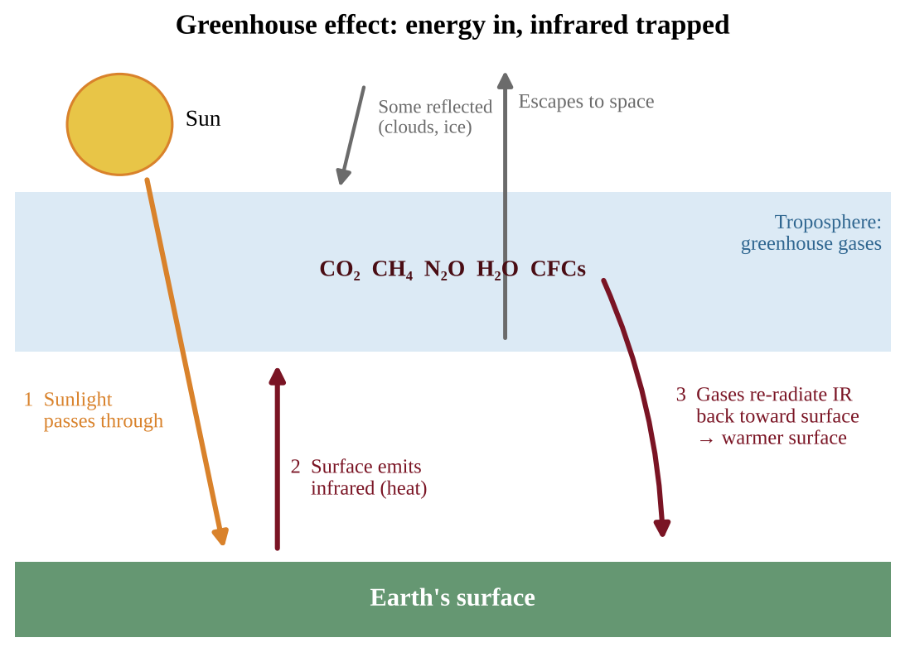

# Unit 9 — Global Change

Unit 9 carries 15–20% of the AP exam, the heaviest weight of any unit. It ties together almost everything you have learned: energy, atmospheric layers, the carbon cycle, population ecology, pollution and conservation. The big idea is simple to state and hard to master: **local and regional human activities can have impacts at the global level**, and **the health of a species is closely tied to its ecosystem, so even minor environmental changes can have large effects.** Every topic in this unit is a case study of one of those two ideas.

## Topic 9.1 — Stratospheric Ozone Depletion

:::box objectives
- Explain why stratospheric ozone matters to life on Earth.
- Describe the natural and human causes of ozone depletion, including the CFC reaction cycle.
- Connect lower ozone to higher ultraviolet (UV) exposure and to human health effects.
:::

:::box simple
Ozone in the stratosphere is a thin sunscreen wrapped around the planet. Humans released long-lived chemicals (CFCs) that drift up, get broken apart by sunlight, and free chlorine atoms. Each chlorine atom destroys ozone over and over, so the sunscreen thins and more UV reaches the ground.
:::

### Where the ozone is, and why it matters

Ozone (O₃) is a molecule made of three oxygen atoms. It is found in two places, and the same molecule plays opposite roles. **Tropospheric ozone**, near the ground, is an air pollutant that irritates lungs (you met it in smog, Unit 7). **Stratospheric ozone** sits mostly between about 15 and 35 km above the surface, with the highest concentrations near 20–30 km. This is the "good" ozone, and this topic is about it.

Stratospheric ozone is formed and destroyed continuously by sunlight. High-energy UV radiation splits an oxygen molecule (O₂) into two oxygen atoms; each atom can attach to another O₂ to make O₃. Ozone in turn absorbs UV radiation, especially the harmful UV-B and UV-C wavelengths, and is split apart again, converting that energy to heat. Under natural conditions creation and destruction are roughly balanced, so the ozone layer holds a steady thickness. In symbols: O₂ + UV → O + O; O + O₂ → O₃; O₃ + UV → O₂ + O. Because ozone absorbs UV and turns it into heat, the stratosphere warms with altitude, the reverse of the troposphere (Unit 4).

The layer matters because **UV radiation damages living tissue**. UV-B can damage DNA and proteins. Early life on Earth was confined to the oceans, where water shielded it from UV. The evolution of an ozone layer, produced as photosynthesis added oxygen to the atmosphere, helped make life on land possible. Today the layer continues to protect land organisms and the shallow-water plankton that anchor ocean food webs.

### What depletes ozone

**Anthropogenic (human) causes.** The key culprits are **chlorofluorocarbons (CFCs)**, synthetic compounds of carbon, chlorine and fluorine. They were used as refrigerants and air-conditioning coolants, as propellants in aerosol cans, as blowing agents for foam, and as solvents. CFCs are stable and unreactive in the lower atmosphere, which is exactly why they were considered safe and why they are a problem: they survive long enough (decades to a century) to drift upward into the stratosphere. Related ozone-depleting substances include halons (fire suppressants, which contain bromine), carbon tetrachloride and methyl bromide (a soil fumigant).

**Natural causes.** Some ozone loss is natural. Volcanic eruptions and the formation of ice crystals in polar stratospheric clouds play a role. During the long Antarctic winter, air circulates in an isolated polar vortex and becomes extremely cold, so thin ice clouds (polar stratospheric clouds) form. During the dark winter, reactions on the surfaces of these ice crystals convert stable chlorine "storage" compounds into reactive forms such as Cl₂. Little ozone is lost yet, because freeing chlorine atoms needs sunlight. When sunlight returns at the beginning of the Antarctic spring, UV splits the reactive chlorine into free Cl atoms, and ozone is destroyed rapidly until the air warms and the clouds break up. This is why the Antarctic **ozone hole** (a large seasonal thinning of the layer) appears each September–October. The natural cold-vortex conditions set the timing, but the chlorine that makes the hole so severe comes from human-made chemicals.

:::box process
CFC at the surface (stable) → carried by winds and mixing up into the stratosphere → UV-C breaks a C–Cl bond, freeing a chlorine atom (Cl) → Cl + O₃ → ClO + O₂ (ozone destroyed) → ClO + O → Cl + O₂ (Cl regenerated) → the same Cl atom attacks another ozone molecule → one Cl atom can destroy thousands of ozone molecules.
:::

{w=0.85}

The word to remember is **catalyst**. A catalyst speeds up a reaction without being used up. Because chlorine comes out of the cycle unchanged, a small amount of CFC can wreck an enormous amount of ozone. That is why a trace gas measured in parts per trillion can thin a layer that spans the globe.

### Reading ozone data

Ozone is measured as a **column**: the total amount of O₃ in a vertical strip of air, in **Dobson units (DU)**. A typical global value is about 300 DU, and values below about 220 DU are called an ozone hole. To read an ozone graph or table, find (1) the season of the minimum (September–October over Antarctica), (2) how deep the minimum is in different years, and (3) the direction of the trend. A strong answer links a **lagged** ozone record to the chlorine record: ozone cannot rise until stratospheric chlorine has fallen for years, so the ozone minimum and hole area bottom out *after* chlorine peaks. "Recovered" means back to the earlier (about 1980) level, so a minimum that has risen from 100 DU to 125 DU has improved but has not recovered.

### Effects of more UV at the surface

When stratospheric ozone decreases, **more UV radiation reaches Earth's surface**. For humans this raises the risk of **skin cancer** and **cataracts** (clouding of the eye's lens), and can suppress immune function. Higher UV also harms phytoplankton and the larvae of fish and amphibians, lowers crop yields, and damages plastics and paints. In tank experiments, phytoplankton under a UV-blocking filter photosynthesize more than those under natural or boosted UV. Because phytoplankton are the base of marine food webs and a major CO₂ sink, UV damage can travel up the food web. Places close to the ozone hole, such as southern Australia and Chile, show the clearest rise in UV-related skin cancer.

:::box define
**Ozone layer** — the region of the stratosphere with relatively high O₃ concentration that absorbs most incoming UV-B and UV-C.
**CFC (chlorofluorocarbon)** — a stable, human-made compound containing chlorine; the main cause of anthropogenic ozone loss.
**Catalyst** — a substance that accelerates a reaction without being consumed.
**Ozone hole** — a seasonal, severe thinning of the ozone layer over a polar region, strongest over Antarctica in spring.
:::

:::box mistake
- Mixing up the two ozones: ground-level ozone is a pollutant; stratospheric ozone is protective. "Ozone is good" and "ozone is bad" are both wrong without a location.
- Saying ozone depletion causes global warming. Ozone depletion lets in more UV; it is a different problem (though CFCs are also greenhouse gases, see Topic 9.3).
- Saying UV causes skin cancer "by heat." UV damages DNA directly; it is not a temperature effect.
- Expecting global warming to change surface UV. Warming does not; only the ozone layer's thickness does.
:::

:::box strategy
When asked to describe how CFCs deplete ozone, name the sequence: CFCs reach the stratosphere, UV frees chlorine, chlorine breaks down ozone, and chlorine is regenerated (catalyst). Finish by linking to the impact: more UV at the surface, skin cancer and cataracts.
:::

:::box example
id: SG-U9-E001
A city's meteorological office reports that over ten years, the average stratospheric ozone concentration above the region fell, while a separate monitor shows ground-level ozone in the same city rose. (a) Identify which of the two changes increases the UV that reaches residents and explain why. (b) State one human health effect of the increased UV exposure and one effect of the increased ground-level ozone.
:::

:::box summary
- Stratospheric ozone absorbs harmful UV and made life on land possible.
- CFCs are stable, rise to the stratosphere, and release chlorine under UV; chlorine is a catalyst.
- Natural factors (polar vortex, ice crystals melting in Antarctic spring) set the timing of the ozone hole.
- Less ozone → more UV → skin cancer, cataracts, damage to plankton and crops.
:::

## Topic 9.2 — Reducing Ozone Depletion

:::box objectives
- Describe the chemicals that have been used as substitutes for CFCs.
- Explain the success and limits of the Montreal Protocol approach.
:::

:::box simple
We solved a global problem by removing the cause at its source: governments agreed to stop making the chemicals. The substitutes are better for ozone, but one family of them is a powerful greenhouse gas, so solving one problem can create another.
:::

### The Montreal Protocol

In the 1970s and 1980s, scientists linked CFCs to ozone loss, and observers documented the Antarctic ozone hole. In 1987 nations signed the **Montreal Protocol on Substances that Deplete the Ozone Layer**, an international agreement to phase out the production and use of CFCs, halons and other ozone-depleting substances. It was later strengthened several times, and nearly every country joined. It is widely seen as the most successful international environmental treaty, for three reasons: the science was clear, affordable substitutes existed, and the treaty let developing countries phase out on a slower schedule with financial help.

Because CFCs persist for decades, recovery is slow. Chlorine levels in the stratosphere peaked in the late 1990s and have been declining since; the ozone layer is expected to return to earlier levels around the middle of this century. This lag is a useful example of how long environmental problems can take to reverse.

### Substitutes for CFCs

Replacements have come in generations:

| Substitute | Contains chlorine? | Ozone effect | Other concern |
|---|---|---|---|
| HCFCs (hydrochlorofluorocarbons) | Yes, but less | Much less depleting than CFCs; interim step | Greenhouse gases; also being phased out |
| HFCs (hydrofluorocarbons) | No | Do not deplete ozone | Many are strong greenhouse gases |
| Hydrocarbons, ammonia, CO₂ as coolants | No | None | Some flammable or toxic; need careful design |

**HFCs** are the substitute the CED highlights. Because they contain no chlorine, they do not harm the ozone layer. But some HFCs trap heat many hundreds to thousands of times more strongly per molecule than CO₂ (their GWP is high), so their growing use in air conditioning worsens climate change. This is why an amendment to the Montreal Protocol (adopted in 2016) now phases down HFCs as well. The lesson for the exam: **a solution to one environmental problem can create an unintended consequence elsewhere**, and evaluating substitutes means checking more than one impact.

Two separate scales rate a chemical. **Ozone depletion potential (ODP)** compares its ozone-destroying power with a CFC reference of 1. **GWP** compares its heat trapping with CO₂. A substance can score 0 on one and high on the other (an HFC has ODP 0 yet GWP in the thousands), so never use one scale to answer a question about the other. To convert a release into CO₂e, multiply its mass by its GWP: 4 kg of a gas with GWP 1,500 acts like 6,000 kg of CO₂.

:::box define
**Montreal Protocol** — the 1987 international treaty that phased out ozone-depleting substances.
**HFC (hydrofluorocarbon)** — a CFC substitute containing no chlorine; ozone-safe but often a potent greenhouse gas.
**Phase-out** — a scheduled, step-by-step reduction in production and use of a substance until it is eliminated.
:::

:::box mistake
- Writing that the Montreal Protocol "fixed" the ozone layer. It stopped new damage; recovery takes decades.
- Calling HFCs "harmless." They are ozone-safe, not climate-safe.
:::

:::box example
id: SG-U9-E002
Three coolants are being considered for a new refrigeration plant. Coolant X contains chlorine and has low heat-trapping ability. Coolant Y contains no chlorine and has a very high heat-trapping ability per molecule. Coolant Z contains no chlorine and has low heat-trapping ability but is flammable. (a) Which coolant would harm the stratospheric ozone layer most? Explain using the chlorine cycle. (b) Which coolant would contribute most to the greenhouse effect per kilogram released? (c) Make a claim for which coolant should be chosen and justify it, naming one precaution you would take.
:::

:::box example
id: SG-U9-E013
A monitoring station reports stratospheric chlorine (ppb) and the lowest yearly ozone column over a polar site (DU): 1985: 2.2 ppb, 190 DU; 1995: 3.6 ppb, 120 DU; 2005: 3.5 ppb, 110 DU; 2015: 3.0 ppb, 120 DU. A refrigerant has an ODP of 0.04 and a GWP of 900. (a) Calculate the percent decrease in chlorine from 1995 to 2015. (b) Explain why ozone in 2015 was still below its 1985 value although chlorine had been falling for 20 years. (c) Calculate the CO₂e of releasing 50 kg of the refrigerant and state whether it harms ozone more or less than a CFC (ODP 1).
:::

:::box summary
- The Montreal Protocol (1987) phased out CFCs and other ozone-depleting substances.
- Substitutes: HCFCs (interim), HFCs (no chlorine but often high GWP), and non-halogen options.
- Recovery is slow because CFCs persist; solutions can create new problems.
:::

## Topic 9.3 — The Greenhouse Effect

:::box objectives
- Identify the principal greenhouse gases and explain why water vapor is not a major driver of climate change.
- Explain how the greenhouse effect sets Earth's surface temperature.
- Identify the sources and relative potency (GWP) of the greenhouse gases.
:::

:::box simple
Sunlight passes through the atmosphere and warms the ground. The ground sends the energy back out as invisible infrared heat. Greenhouse gases absorb some of that heat and re-emit it in all directions, including back down, like a blanket that slows heat loss. Without the blanket Earth would be frozen; with a thicker blanket, Earth gets hotter.
:::

### The natural greenhouse effect: an energy balance

Earth receives most of its energy as **shortwave radiation** (visible light and some UV) from the Sun. Roughly 30% is reflected straight back to space by clouds, aerosols, ice and bright surfaces (this reflectivity is the **albedo**). The rest is absorbed by the atmosphere and surface, warming them. A warm surface emits **longwave (infrared) radiation**. To keep a steady temperature, Earth must send out as much energy as it absorbs.

Greenhouse gases are transparent to incoming sunlight but absorb outgoing infrared. After absorbing it, they re-emit infrared in every direction; about half goes outward to space and part goes back downward, warming the surface and lower atmosphere further. Nitrogen (N₂) and oxygen (O₂), which make up about 99% of air, do not absorb infrared significantly, so they are not greenhouse gases.

This natural **greenhouse effect is essential**: it keeps the average surface temperature near 15°C instead of about −18°C, which would freeze the oceans. The environmental problem is the **enhanced greenhouse effect**: human activities add greenhouse gases, strengthening the blanket and raising the equilibrium temperature.

{w=0.85}

:::box process
More greenhouse gas in the atmosphere → more outgoing infrared absorbed and re-emitted downward → less net heat escapes to space → energy balance shifts (Earth absorbs more than it emits) → lower atmosphere, land and oceans warm → warming continues until outgoing radiation again matches incoming energy at a higher temperature.
:::

### Following the energy in numbers

Energy budgets are often drawn with units out of 100 arriving sunlight units. Two checks always work: (1) at the **surface**, sunlight absorbed + infrared returned from the atmosphere = infrared emitted by the surface; (2) at the **top of the atmosphere**, reflected sunlight + infrared escaping to space = sunlight arriving. In the figure, 45 + 75 = 120 is both what the surface absorbs and what it emits, and 30 + 15 + 55 = 100 balances the sunlight. The surface receives more energy from the atmosphere (75) than from the Sun (45), which is the greenhouse effect in one number. More greenhouse gas raises the 75 and lowers the 15 that escapes straight through, so the budget is briefly out of balance until a warmer surface emits enough to restore it. That last step is a **negative feedback**: a warmer surface emits more infrared, which limits how far warming can go.

{w=0.8}

Not every particle warms. **Aerosols** such as sulfate droplets from volcanoes or coal smoke scatter sunlight back to space and cool the surface for a few years, the opposite push to CO₂.

### The principal greenhouse gases

The CED's principal greenhouse gases are carbon dioxide (CO₂), methane (CH₄), water vapor (H₂O), nitrous oxide (N₂O) and chlorofluorocarbons (CFCs).

**Water vapor** is the most abundant greenhouse gas and a powerful absorber, yet it is not counted as a major cause of human-driven climate change. Its **residence time** in the atmosphere is short (days), so it cycles out as rain or snow. Its concentration is controlled by temperature rather than by emissions: human activity does not directly add much, and the amount of vapor rises or falls in response to warming (a feedback, see Topic 9.5).

### Sources and potency of each gas

**Global warming potential (GWP)** compares how much heat a gas traps relative to CO₂ over a set period (usually 100 years), per unit mass. CO₂ is the reference, so its **GWP = 1**. A gas with GWP 28 traps about 28 times as much heat as the same mass of CO₂. Remember the CED order: **CFCs have the highest GWP, followed by nitrous oxide, then methane**, with CO₂ lowest.

| Gas | Main sources | Approx. GWP (100 yr) | Notes |
|---|---|---|---|
| CO₂ | Burning fossil fuels, deforestation, cement production | 1 | Largest total effect because emitted in huge amounts and long-lived |
| CH₄ | Livestock digestion, rice paddies, landfills, natural-gas leaks, wetlands, thawing permafrost | about 25–30 | Shorter life (about a decade) but much stronger per molecule |
| N₂O | Synthetic fertilizer and manure, fuel combustion, industrial processes | about 265–300 | Also depletes stratospheric ozone |
| CFCs | Old refrigerants, foams, aerosols | thousands (up to about 10,000+) | Very potent but present in small amounts; now declining |

CO₂, CH₄, N₂O and water vapor all have natural sources as well as human ones. **CFCs and HFCs have no natural source**, so any amount in the air is human-made. They are so potent because each molecule absorbs infrared at wavelengths CO₂ lets through, and persists for decades to centuries. Ground-level ozone, formed by sunlight acting on NOₓ and volatile organic compounds, is also a greenhouse gas. Methane forms where organic matter decays **without oxygen**: wetlands, rice paddies, landfills, manure lagoons and the guts of cattle and termites. Burning biomass, including forest fires, releases mainly CO₂.

**Which carbon counts?** Burning fossil fuel moves carbon that was locked underground for millions of years into the air, a net addition. Burning recently grown plant material (wood, or biogas from manure) returns carbon that plants took from the air a short time ago, so analysts often treat it as part of the existing cycle, though it still releases CO₂. **Burning methane** (CH₄ + 2O₂ → CO₂ + 2H₂O) converts a gas with GWP about 28 into CO₂ with GWP 1; 16 g of CH₄ yields 44 g of CO₂, so 1 t of CH₄ gives 2.75 t of CO₂. The warming effect still falls sharply.

Two ideas matter together. **Potency** (GWP) tells you how strong a gas is per kilogram. **Total contribution** depends on potency *and* how much is emitted and how long it stays. CO₂ has the lowest GWP yet is the largest driver because humans emit billions of tonnes of it a year and part of it stays for centuries.

:::box formula
**CO₂-equivalent (CO₂e) = mass of gas × GWP**
Mass in tonnes (or kg) of the gas; GWP is a unitless multiplier; CO₂e is in the same mass unit as the input. Use CO₂e to add different gases into one total.
:::

:::box define
**Greenhouse effect** — warming of Earth's lower atmosphere and surface because gases absorb and re-emit outgoing infrared radiation.
**Global warming potential (GWP)** — a gas's heat-trapping ability relative to the same mass of CO₂.
**Residence time** — the average time a molecule stays in the atmosphere before being removed.
**Albedo** — the fraction of incoming sunlight a surface reflects.
:::

:::box mistake
- "The greenhouse effect is bad." The natural effect is necessary for life; the **enhanced** effect is the problem.
- "Greenhouse gases trap sunlight." They mainly absorb outgoing **infrared** from the surface.
- Listing water vapor as the main reason for climate change because it is "the most abundant." Short residence time and control by temperature are the key points.
- Confusing the ozone hole with the greenhouse effect.
- Treating the energy budget as "energy gets trapped forever." At equilibrium energy out equals energy in; the greenhouse effect only raises the temperature at which that balance is reached.
:::

:::box strategy
If a question gives amounts of several gases and asks which has the biggest climate impact, calculate CO₂e (mass × GWP) for each. Do not pick the gas with the highest GWP automatically.
:::

:::box example
id: SG-U9-E003
A dairy and crop farm reports its annual emissions: 600 tonnes of CO₂, 40 tonnes of CH₄ and 3 tonnes of N₂O. Use GWP values of 1 for CO₂, 28 for CH₄ and 265 for N₂O. (a) Calculate the farm's total emissions in tonnes of CO₂e. (b) Calculate the percentage of the total that comes from methane. (c) Identify one source of each of the three gases on a farm.
:::

:::box example
id: SG-U9-E014
In a simplified budget, 100 units of sunlight arrive. Clouds and ice reflect 28; the atmosphere absorbs 22 and the surface absorbs 50. The surface emits 130 units of infrared, of which 10 pass directly to space. (a) Calculate how many units of infrared the atmosphere returns to the surface. (b) Calculate how many units the atmosphere emits to space. (c) Extra greenhouse gas now absorbs 4 of the 10 units that used to pass directly to space. Predict the immediate effect on the total energy leaving Earth compared with the 100 units arriving, the long-term effect on surface temperature, and the feedback that finally restores balance.
:::

:::box summary
- Greenhouse gases absorb outgoing infrared and re-emit it; the natural effect keeps Earth habitable.
- Principal gases: CO₂, CH₄, H₂O, N₂O, CFCs. Water vapor is not a major driver (short residence time).
- GWP is relative to CO₂ = 1; CFCs > N₂O > CH₄ > CO₂.
:::

## Topic 9.4 — Increases in the Greenhouse Gases

:::box objectives
- Explain how concentrations of greenhouse gases have changed and why.
- Identify threats to human health and the environment from increasing greenhouse gases: sea-level rise, disease vector spread, and population movements.
- Interpret visual representations (graphs, ice-core records) of greenhouse gas trends.
:::

:::box simple
For hundreds of thousands of years CO₂ rose and fell inside a fairly narrow range. Since the Industrial Revolution it has shot far above that range, and the cause is us. More gas means a thicker blanket, and a thicker blanket means a warmer planet with consequences for coasts, health and people.
:::

### Reading the record: ice cores and the Keeling curve

Two data sets are essential in AP Environmental Science.

**Ice cores.** In Antarctica and Greenland, snow piles up year after year and is compressed into ice that traps tiny bubbles of ancient air. Scientists drill long cylinders of ice and measure the gases in those bubbles. Deeper ice is older, so the cores give a record going back about 800,000 years. The ratios of oxygen isotopes in the ice also provide an estimate of past temperatures. Over that time, atmospheric CO₂ cycled between roughly 180 parts per million (ppm) in cold glacial periods and about 280 ppm in warm interglacial periods, and **temperature and CO₂ rose and fell together**. These natural swings were triggered by slow changes in Earth's orbit and tilt, and amplified by feedbacks.

**The Keeling curve.** Beginning in 1958, direct measurements of CO₂ at an observatory on Mauna Loa, Hawaii, far from city pollution, recorded a steady, accelerating rise from about 315 ppm to well over 420 ppm today. The line has a small up-and-down sawtooth pattern each year: in the Northern Hemisphere growing season plants take up CO₂ and the concentration dips; in the winter, plants and soil release it and the concentration climbs. Underneath the seasonal wiggle, each year is higher than the last. That long-term climb matches the amount of fossil fuel burned and land cleared.

Putting the two together: today's CO₂ is about 50% higher than the pre-industrial level of about 280 ppm, and higher than anything in the ice-core record. Methane and nitrous oxide have also risen well above their pre-industrial concentrations.

**Reading an ice-core graph.** (1) Match the peaks and troughs of CO₂ and temperature: they rise and fall together. (2) Quote values, such as the 180–300 ppm range of the past, and compare them with the dashed line for today, which lies far above it. (3) Use careful verbs: CO₂ and temperature "coincided" or are "closely linked." Do not claim that CO₂ alone caused every change, or that CO₂ always rose first; the natural cycles were started by orbital changes, with CO₂ and other feedbacks amplifying them. (4) If asked to scale a temperature change per ppm, state the assumption that CO₂ is the only driver and that the relationship is constant, and note that other gases, aerosols and feedbacks break it.

### Why concentrations are rising

- **CO₂:** fossil fuel combustion for electricity, transport and industry; deforestation and forest fires (remove carbon-absorbing trees and release stored carbon when burned or decayed); cement production. Rail and efficient vehicles cut CO₂ because they burn less fuel per passenger or tonne moved.
- **CH₄:** expanded livestock herds, rice cultivation, landfills, leaks from gas production, and thawing permafrost.
- **N₂O:** fertilizer use and manure.
- **Fluorinated gases:** refrigeration and industrial uses.

### Threats to human health and the environment

CED-required consequences of excess greenhouse gases include:

- **Rising sea level** from melting ice sheets and from the thermal expansion of ocean water (Topic 9.5).
- **Disease vectors spreading from the tropics toward the poles.** Mosquitoes and ticks that carry malaria, dengue and Lyme disease are limited by cold. As winters shorten and temperatures rise, their ranges expand into new latitudes and higher elevations, exposing people who have no immunity or prepared public-health systems. The same happens up mountains: mosquitoes moving to higher, once-cold elevations bring malaria to forest birds that had a disease-free refuge and West Nile virus to higher towns.
- **Changes in population dynamics and movements.** Drought, flooded coasts, failed crops and heat can reduce a region's carrying capacity for people and other species, pushing human migration (climate refugees) and changing birth, death and migration patterns in both the places people leave and those they move to.

:::box mistake
- Interpreting the seasonal wiggle in a CO₂ graph as evidence the trend is up and down overall. The *annual average* is the trend.
- Saying CO₂ is the only greenhouse gas that has increased.
:::

:::box example
id: SG-U9-E004
Atmospheric CO₂ was about 280 ppm before the Industrial Revolution and 420 ppm in a recent year. (a) Calculate the percent increase. (b) An ice-core record shows that CO₂ over the last 800,000 years never exceeded 300 ppm. Explain in one or two sentences what this comparison suggests about the present concentration. (c) A graph of CO₂ measured monthly at one observatory shows a yearly zigzag. Explain what causes the zigzag and why it does not contradict the long-term increase.
:::

:::box summary
- Ice cores give an 800,000-year record; CO₂ ranged about 180–280 ppm and tracked temperature.
- The Keeling curve shows a continuous rise since 1958 with a seasonal sawtooth.
- Human sources: fossil fuels, deforestation, agriculture, refrigerants.
- Threats: sea-level rise, vector-borne disease spread, migration and shifting population dynamics.
:::

## Topic 9.5 — Global Climate Change

:::box objectives
- Explain how climate change, over short and long terms, affects ecosystems.
- Describe effects: temperature, permafrost and sea ice, sea level, soil, circulation and ocean currents.
- Explain positive feedback loops in polar regions and the loss of ice-dependent habitat.
- Distinguish mitigation from adaptation.
:::

:::box simple
Climate has always changed, but now it is changing faster, and the polar regions change fastest because melting ice triggers a runaway loop: ice reflects sunlight, so when it melts the dark surface beneath absorbs more heat, which melts more ice.
:::

### Climate change through geologic time

Earth's climate has shifted between ice ages and warm periods many times, recorded in ice cores, ocean sediments and tree rings. Natural drivers include changes in Earth's orbit and tilt, solar output, volcanic eruptions and shifts in greenhouse gas levels. What is different now is the **speed** and the **cause**: average global temperature has risen by about 1.1–1.2°C since the late 1800s, far faster than natural transitions, and the pattern matches the rise in human-emitted greenhouse gases.

**Weather** is the condition of the atmosphere at a place and time; **climate** is the long-term average (30 years or more). A single cold winter does not disprove warming, just as one hot day does not prove it.

### Feedback loops

A **positive feedback loop** amplifies a change (the output pushes the system further in the same direction). A **negative feedback loop** counteracts a change and tends to stabilize the system. Positive feedbacks speed up climate change; negative ones slow it.

{w=0.9}

Key positive feedbacks:

- **Ice–albedo.** Snow and ice are bright and reflect much sunlight. Warming melts them, exposing darker water and land that absorb more sunlight, which causes more warming and more melting. Because polar regions are covered in ice and snow, they show a **faster response time** to global climate change than most places, and the Arctic warms roughly two to four times faster than the global average.
- **Permafrost thaw.** Frozen tundra soil stores vast quantities of dead plant matter. When it thaws, microbes decompose it and release CO₂ and **methane**, adding greenhouse gas, which warms the Arctic further, thawing more permafrost. The **active layer** is the surface soil that thaws each summer above the permafrost; as it deepens, more buried carbon becomes available to microbes. Thawing also makes the ground unstable, so buildings, roads and pipelines tilt or collapse. Adaptation options include foundations on piles driven into stable ground, insulated pads, or relocating buildings.
- **Vegetation albedo.** Taller, darker shrubs spreading across tundra poke above the snow and absorb more sunlight than snow-covered ground, adding to the warming.
- **Water vapor.** Warmer air holds more water vapor, a greenhouse gas, which adds warming.
- **Declining ocean uptake.** Warmer water dissolves less CO₂, leaving more in the air.

Negative feedbacks exist too: more CO₂ can boost plant growth in some places, and a warmer planet radiates more infrared to space. Scientists study these to decide how strongly Earth will respond.

### Effects on the physical environment

- **Rising temperatures** and more frequent extreme heat.
- **Melting permafrost and sea ice**, as above.
- **Rising sea level**, from two sources: (1) **thermal expansion**, because water expands as it warms, and (2) **melting land ice** (mountain glaciers and the Greenland and Antarctic ice sheets), which adds new water to the ocean. Melting of floating sea ice does not raise sea level noticeably (like an ice cube in a full glass), but it contributes to the albedo feedback.
- **Displacement of coastal populations** as flooding, storm surge and saltwater intrusion into groundwater make low-lying areas uninhabitable. Island nations and river deltas are exposed first. Estuaries and marshes suffer too: salt water moves farther upstream and kills species with narrow salt tolerance, and drowned marsh and mangrove nurseries disappear. Where seawalls or development sit just inland, wetlands cannot migrate and are squeezed out. Policy choices include zoning and building codes that discourage coastal building, limiting subsidized flood insurance, restoring wetlands as buffers, and planned retreat. For numbers, convert rate × time to the same unit before using a flooding table (see the toolkit).
- **Atmospheric circulation.** Winds carry heat around the planet. Warm air rises at the equator and flows poleward in giant overturning loops called **Hadley cells**; the **jet stream** is a fast river of air near the tropopause that steers storms. A warming climate shifts the temperature contrast driving these systems, so cells can widen and the jet stream can become wavier, changing rainfall belts, drought and storm tracks.
- **Ocean currents.** Currents, sometimes called the ocean conveyor belt, carry heat across the globe. Cold, salty water sinks in the North Atlantic and drives circulation. Melting ice adds fresh water, which is less dense and sinks less readily, so the conveyor may slow. A change could shift climates, especially in coastal regions such as northwestern Europe, which relies on warm Atlantic water.
- **Soils.** Higher temperatures increase evaporation and microbial decomposition; changing rainfall can mean drought (which leaves soil bare and dry) or intense storms (which increase erosion). Soil viability for crops can decline and erosion can increase.

### Effects on ecosystems

- **Species ranges shift** toward the poles and uphill; those unable to move or adapt decline, such as mountaintop species with no higher ground and cold-water fish whose streams warm. Timing mismatches arise when, for example, insects emerge earlier than the birds that feed on them.
- **Ice-dependent species** such as polar bears and seals lose hunting and breeding platforms as sea ice shrinks; algae under the ice, the base of the food web, are lost too.
- **Marine ecosystems and sea level.** Rising seas create new shallow habitat over now-flooded continental shelves, a positive effect for some species. But communities that depend on light, like seagrass beds and corals, can find themselves deeper than the **photic zone** (the sunlit surface layer where photosynthesis is possible) and decline. Coastal wetlands and mangroves can be squeezed between rising water and human development.

### Responses: mitigation and adaptation

**Mitigation** reduces the cause: cut greenhouse gas emissions (renewable energy, efficiency, public transit, reducing methane leaks) or remove carbon (reforestation, soil carbon storage). **Adaptation** reduces the damage from changes already happening: sea walls, drought-tolerant crops, early-warning systems, managed retreat from flood-prone land, wildlife corridors. A strong answer says we need both, because mitigation limits how bad things get while adaptation helps societies cope with what cannot be avoided.

:::box define
**Positive feedback loop** — a process in which a change produces effects that amplify the original change.
**Negative feedback loop** — a process in which a change produces effects that reduce the original change.
**Permafrost** — ground frozen for two or more years, holding large stores of carbon.
**Mitigation** — action to reduce the causes (emissions) of climate change.
**Adaptation** — action to adjust to the effects of climate change.
:::

:::box process
Warming → sea ice and snow melt → albedo falls (less sunlight reflected) → more sunlight absorbed by dark ocean and land → more warming → more melt.
Warming → permafrost thaws → decomposition releases CO₂ and CH₄ → greenhouse effect strengthens → more warming → more thaw.
:::

:::box mistake
- Calling every feedback "good" or "bad" — positive and negative are about direction (amplify or dampen), not about whether the result is desirable.
- Claiming melting sea ice raises sea level the way melting land ice does.
- Writing "global warming" and "ozone depletion" as the same thing.
- Forgetting thermal expansion when explaining sea-level rise.
:::

:::box strategy
In a feedback FRQ, write the chain one link at a time, then state the label ("positive feedback, because the change is amplified"). Always give the specific mechanism (albedo, methane release) rather than "ice melts and it gets hotter."
:::

:::box example
id: SG-U9-E005
The table shows global mean sea level rise measured by satellites for a small island nation's region.

| Year | Sea level above 2000 baseline (mm) |
|---|---|
| 2000 | 0 |
| 2010 | 32 |
| 2020 | 66 |

(a) Calculate the average rate of rise per year for 2000–2010 and for 2010–2020. (b) State whether the rate is speeding up or slowing and by how many mm/yr. (c) Identify the two main physical processes that raise sea level in a warming world.
:::

:::box example
id: SG-U9-E006
In a high-latitude lake region, a scientist records that each year the ice-free period lengthens, exposing dark water. (a) Describe how this is a positive feedback loop, including the role of albedo. (b) Explain why a loop in which warmer air increases evaporation, forming bright low clouds that reflect more sunlight, would be a negative feedback loop. (c) Identify one effect on an ice-dependent species.
:::

:::box summary
- Climate has changed naturally; present change is faster and linked to human greenhouse gases.
- Positive feedback (ice–albedo, permafrost methane) amplifies warming, especially at the poles.
- Sea level rises from thermal expansion plus melting land ice.
- Impacts: ocean currents, Hadley cells and jet stream, soil and coasts, ice-dependent species.
- Mitigation cuts causes; adaptation reduces damage.
:::

## Topic 9.6 — Ocean Warming

:::box objectives
- Explain the causes of ocean warming.
- Describe effects on marine species and ecosystems, including coral bleaching.
:::

:::box simple
The oceans are Earth's heat sponge. They soak up most of the extra heat trapped by greenhouse gases. Warmer water stresses animals that are adapted to narrow temperature ranges, and in coral reefs the stress makes corals expel the algae that feed them.
:::

### Cause: the oceans absorb the excess heat

Ocean warming is caused by the **increase in greenhouse gases** in the atmosphere. Water has a very high heat capacity, so the oceans absorb the large majority (more than 90%) of the extra heat trapped by the enhanced greenhouse effect. Surface waters warm first; the heat is mixed to deeper layers slowly. Because the oceans are so large and change temperature slowly, they also keep warming long after emissions are reduced, which is why ocean changes lag behind the atmosphere.

### Effects on marine species and ecosystems

- **Loss of habitat.** Species with narrow temperature tolerances lose suitable range. Cold-water fish, kelp forests and sea-ice communities shrink; many species move toward cooler waters near the poles, changing fisheries and food webs.
- **Metabolic changes.** Many marine animals are ectotherms, so their body temperatures follow the water. Warming speeds their metabolism and raises their oxygen needs, while **warmer water holds less dissolved oxygen**. The combination can stress fish and invertebrates, reduce growth, and cause lower oxygen zones.
- **Reproductive changes.** Spawning, hatching and larval survival are timed to temperature. In some species the sex ratio is set by temperature (as in sea turtles, where warm nests produce more females). Mismatches between larvae and their plankton food can reduce recruitment.
- **Stratification.** Warm surface water is less dense and mixes less with colder deep water, limiting the upwelling of nutrients that fuels productive fisheries.

### Coral bleaching

Reef-building corals are animals that host microscopic algae (zooxanthellae) in their tissues. The algae photosynthesize and give the coral most of its food and color; the coral provides shelter and nutrients (a mutualism). When water temperatures stay a degree or two above the normal summer maximum for several weeks, the algae produce harmful compounds and the coral expels them. Without the algae the transparent coral tissue shows the white skeleton: this is **coral bleaching**. Bleached corals are not dead, but they are starving. If temperatures fall soon enough, algae can re-colonize and **some corals recover**; if the stress lasts too long, the **corals die**, and the reef loses the habitat that supports a quarter of marine species, the fisheries and the coastal protection reefs provide. Bleaching is made worse by ocean acidification, pollution, and sediment runoff (Topic 9.7).

:::box define
**Ectotherm** — an organism whose body temperature depends on the surrounding environment.
**Coral bleaching** — the loss of symbiotic algae from coral tissue under stress, leaving the coral white.
**Mutualism** — an interaction that benefits both species.
:::

:::box mistake
- Saying bleached coral is always dead.
- Saying coral bleaching is caused by ocean acidification. Bleaching is caused mainly by heat stress, though acidification harms coral in a different way.
- Forgetting the oxygen effect: warm water holds less dissolved oxygen.
:::

:::box example
id: SG-U9-E007
A coral reef's summer maximum sea temperature is normally 29.0°C. During one summer the water stays at 30.8°C for six weeks, and many corals turn white. Three months later, survey teams find that corals in a shaded, deeper part of the reef have regained their color while corals on the shallow, sunny flat are covered in algae growth and have no living tissue. (a) Calculate by how many degrees the water exceeded the normal maximum. (b) Explain what the corals lost to turn white and why this harms them. (c) State which part of the reef shows recovery and which shows mortality, and cite the evidence from the survey.
:::

:::box summary
- Ocean warming is caused by greenhouse gases; oceans absorb most of the excess heat.
- Effects: habitat loss and range shifts, faster metabolism, less dissolved oxygen, reproductive changes.
- Coral bleaching: loss of algae under heat stress; some recover, some die.
:::

## Topic 9.7 — Ocean Acidification

:::box objectives
- Explain the causes and effects of ocean acidification, using chemical equations.
- Identify human activities that raise atmospheric CO₂ and therefore acidify oceans.
- Explain how acidification harms corals and other shell-building organisms.
:::

:::box simple
The ocean absorbs a big share of the CO₂ we emit. In the water, CO₂ forms a weak acid that releases hydrogen ions, so the pH drops. The extra hydrogen ions also use up the carbonate ions that corals and shellfish need to build their hard parts.
:::

### The chemistry

Ocean acidification is the **decrease in pH of the oceans, primarily due to increased CO₂ in the atmosphere**. The oceans absorb roughly a quarter to a third of the CO₂ humans emit. When CO₂ dissolves in seawater it reacts with water:

CO₂ + H₂O ⇌ H₂CO₃ (carbonic acid)
H₂CO₃ ⇌ H⁺ + HCO₃⁻ (bicarbonate)

The released hydrogen ions (H⁺) lower the pH. Some of the H⁺ is then consumed by carbonate ions (CO₃²⁻):

H⁺ + CO₃²⁻ ⇌ HCO₃⁻

The net effect is that more CO₂ means more H⁺ **and less carbonate**. Shell- and skeleton-building animals make calcium carbonate from calcium and carbonate ions:

Ca²⁺ + CO₃²⁻ → CaCO₃

With less carbonate available, building shells costs more energy, and in sufficiently acidic water calcium carbonate can start to **dissolve**.

{w=0.9}

### Understanding pH numbers

The pH scale is **logarithmic**: a change of 1 pH unit is a 10-fold change in H⁺ concentration. Average surface ocean pH has dropped from about 8.2 to about 8.1 since the Industrial Revolution. That 0.1 decrease means H⁺ concentration has risen by a factor of 10^0.1 ≈ 1.26, or about **26%**. The ocean is still slightly basic (pH above 7), so "acidification" means it is becoming *less basic*, moving toward the acid side of the scale. For other drops use the formula below on a calculator, then subtract 1 and multiply by 100 to get a percent:

| pH drop | Factor 10^drop | Increase in H⁺ |
|---|---|---|
| 0.05 | 1.12 | 12% |
| 0.10 | 1.26 | 26% |
| 0.20 | 1.58 | 58% |
| 0.30 | 2.00 | 100% |
| 1.00 | 10 | 900% |

A pH graph and a CO₂ graph for the same years mirror each other: as atmospheric CO₂ climbs, ocean pH falls (an inverse relationship).

**Local pH can swing far more than the global average.** In coastal **upwelling**, winds push surface water offshore and draw up cold deep water, which holds extra CO₂ from the decay of sinking organic matter and so has a lower pH. On top of an ocean already acidified by the atmosphere, upwelled water can fall low enough to kill oyster larvae that are building their first shells. A hatchery can respond by drawing intake water only when its pH is high, or by adding a base to raise pH; the first limits production time, the second adds cost and chemical handling.

### Causes and effects

Human activities that raise atmospheric CO₂, and therefore acidify the ocean, include **burning fossil fuels, vehicle emissions and deforestation**. Note that the cause is the same as for global warming, which is why acidification is sometimes called the other CO₂ problem.

Effects:
- **Damage to corals and shellfish.** Corals, oysters, clams, sea urchins and tiny planktonic snails called pteropods have calcium carbonate shells or skeletons. Acidification makes it harder to build and maintain them, so growth slows, larvae are weak, and structures dissolve.
- **Food web consequences.** Pteropods and other calcifying plankton are food for fish such as salmon; shellfish fisheries lose income. Reefs lose structure that shelters fish and shields shorelines.
- **Synergy with warming.** Coral exposed to both heat stress and acidification fares worse than from either alone.

:::box define
**Ocean acidification** — the decline in ocean pH caused mainly by absorption of atmospheric CO₂.
**Carbonic acid (H₂CO₃)** — a weak acid formed when CO₂ dissolves in water.
**Calcification** — the process by which organisms build calcium carbonate shells or skeletons.
:::

:::box formula
**Change in H⁺ concentration = 10^(pH₁ − pH₂)** (as a ratio: new [H⁺] ÷ old [H⁺])
pH₁ is the higher (earlier) value; pH₂ is the lower (later) value. Each 1.0 pH decrease means 10 times more H⁺; each 0.3 decrease means about 2 times more.
:::

:::box mistake
- Saying the ocean is "now acidic." It is still basic, only less so.
- Thinking a drop from 8.2 to 8.1 is "small" (it is a 26% increase in H⁺).
- Mixing up bleaching (heat) and acidification (carbonate loss).
- Forgetting that the ocean's absorption of CO₂ is what causes the pH change.
:::

:::box strategy
If asked to "explain how burning fossil fuels harms coral reefs," write the chain: CO₂ rises → more dissolves in ocean → H₂CO₃ forms → H⁺ rises and pH falls → carbonate decreases → calcium carbonate skeletons harder to build. Add a second effect (warming) for extra points where allowed.
:::

:::box example
id: SG-U9-E008
Average surface-ocean pH in a monitored bay was 8.20 in 1990 and 8.10 in 2020. (a) By what factor did the hydrogen ion concentration change between those years? Express it as a percent increase. (b) Write the chemical equation showing how dissolved CO₂ combines with water to form carbonic acid. (c) Explain why this change makes it harder for oysters in the bay to build shells.
:::

:::box summary
- CO₂ + H₂O ⇌ H₂CO₃ ⇌ H⁺ + HCO₃⁻; more H⁺ lowers pH and removes carbonate.
- Causes: fossil fuels, vehicles, deforestation (all raise atmospheric CO₂).
- Corals and shellfish struggle to build calcium carbonate structures.
- pH is logarithmic: 0.1 pH unit ≈ 26% more H⁺.
:::

## Topic 9.8 — Invasive Species

:::box objectives
- Explain what invasive species are and why they are a problem.
- Relate invasiveness to species traits (generalist, r-selected).
- Describe strategies to control invasive species.
:::

:::box simple
An invasive species is an organism that moves into a place where it did not evolve and spreads in a way that harms the native community. The newcomer is often a tough, fast-breeding generalist that has escaped the predators and diseases that kept it in check at home.
:::

### What makes a species invasive

A **native species** evolved in an ecosystem. A **non-native** (introduced) species arrives from elsewhere. Many non-natives do no harm (most crops and garden plants stay where they are put). An **invasive species** is one that can live, and sometimes thrive, outside its normal habitat and spreads so that it **threatens native species**. Invasive species can occasionally be beneficial (for instance, providing food or erosion control), but they are classified as invasive when they threaten natives.

Ways they arrive: ballast water of cargo ships, shipping crates and packing wood, the pet and aquarium trade, deliberate introduction for farming, sport or ornamental use, and accidental transport on boats, vehicles or clothes. Global trade and travel increase these pathways. Boat hulls, trailers, bilge and bait water carry aquatic invaders from lake to lake, canals open new routes, and roads and trails carry seeds on tires, shoes and animals into disturbed ground beside them, which is why invasive plants are often densest near trails and roads.

### Traits of successful invaders

Invasive species are often **generalist, r-selected species**, so they may **outcompete native species for resources**:

- **Generalists** tolerate a wide range of conditions and eat many kinds of food, so they can survive in many habitats.
- **r-selected** traits: rapid growth, early maturity, many offspring, short lifespan, effective dispersal, so population numbers can explode.
- **Few natural enemies** in the new range (predators, parasites and diseases that control them at home are absent), often called "enemy release."
- Aggressive behavior or traits like allelopathy (chemicals that suppress other plants).

Natives, especially specialists on islands, often lack defenses against these new predators or competitors.

Invaders also change the **physical environment**, which makes life harder for natives. Invasive earthworms eat the leaf litter that shades and feeds forest soil, leaving it drier, more eroded and less fertile; a deep-rooted shrub can draw down soil moisture until native grasses fail; filter-feeding zebra mussels clear the water, so more light reaches the bottom and plant growth changes; and nitrogen fallout from air pollution can favor fast-growing invasive grasses over slow native wildflowers.

### Reading invasion data

Compare the *shape* of a graph of area or numbers over time. **Linear** growth adds the same amount each year. **Exponential** (accelerating) growth adds more each year; the curve bends upward and the population doubles every fixed time, so after n doublings the size is N₀ × 2ⁿ. For example, 25 ha that doubles every 5 years covers 25 × 2³ = 200 ha after 15 years. **Logistic** growth bends upward and then levels off near the carrying capacity. The management lesson is the same each time: while the invader is on the upward bend, control is cheap and effective, and each year of delay costs more.

### Examples and effects

- **Zebra mussels** (Great Lakes, from ballast water) clog water intakes and filter out the plankton that native species need.
- **Kudzu** vine smothers trees in the southeastern United States.
- **Burmese pythons** in the Everglades prey on native mammals and birds.
- **Cane toads** in Australia poison native predators that eat them.
- **Lionfish** in the Atlantic and Caribbean eat reef fish that have no defenses.
- **Emerald ash borer** kills millions of ash trees.

Consequences include loss of native biodiversity and extinctions, altered food webs and nutrient cycles, economic costs (damage to crops, infrastructure and fisheries), disruption of ecosystem services, and sometimes spread of disease.

### Controlling invasive species

Control is easiest early. Strategies, each with trade-offs:

| Strategy | Example | Advantage | Disadvantage |
|---|---|---|---|
| Prevention | Inspecting cargo, cleaning boats, ballast-water rules, bans on selling certain plants | Cheapest, most effective | Requires monitoring and cooperation |
| Physical removal | Hand-pulling plants, trapping, hunting | Targeted, no chemicals | Labor-intensive; hard for large populations |
| Chemical control | Herbicides, pesticides | Fast, covers large areas | Can harm non-target species; resistance |
| Biological control | Releasing a natural predator or pathogen from the species' home range (ideally one that attacks only the pest, such as a virus infecting only rabbits) | Self-sustaining | The control species may attack natives or itself become invasive |
| Habitat management | Prescribed burns, restoring native vegetation | Strengthens natives | Needs ongoing effort |
| Legislation and education | Laws on transport and release of species; public awareness campaigns | Broad impact | Enforcement challenges |

:::box define
**Invasive species** — a non-native species that spreads and threatens native species or ecosystems.
**Generalist** — a species that tolerates a wide range of conditions and uses many resources.
**r-selected species** — a species with high reproductive rate and little parental care (see Unit 3).
**Biological control** — using a living organism to suppress a pest species.
:::

:::box mistake
- Equating "non-native" with "invasive." Only those that spread and cause harm are invasive.
- Saying invasive species are always predators. Many are plants, insects or pathogens.
- Recommending biological control without noting its risk.
:::

:::box example
id: SG-U9-E009
A shrub introduced as a garden ornamental has spread into a wetland. A 2-hectare study plot was surveyed twice.

| Year | Native sedge cover (% of plot) | Introduced shrub cover (% of plot) |
|---|---|---|
| 2018 | 80 | 5 |
| 2024 | 44 | 38 |

(a) Calculate the percent change in native sedge cover from 2018 to 2024. (b) Identify two traits of the shrub that could explain its spread. (c) Propose one control method and state one disadvantage of it.
:::

:::box summary
- Invasive species thrive outside their native range and threaten natives.
- Typical invaders: generalist, r-selected, few natural enemies.
- Control: prevention first; removal, chemicals, biological control, habitat management, laws; each has trade-offs.
:::

## Topic 9.9 — Endangered Species

:::box objectives
- Explain how species become endangered or extinct.
- Explain why species differ in their vulnerability and the role of selective pressures and competition.
- Describe and evaluate strategies to protect species.
:::

:::box simple
A species is in danger when its numbers are low and falling and it can't easily adapt or move. Specialists with small ranges, slow reproduction and heavy hunting pressure are most at risk. Protecting species means protecting habitat, stopping illegal killing, and backing both with law.
:::

### Categories of risk

Conservation organizations classify species by how close they are to extinction. The International Union for Conservation of Nature (IUCN) Red List uses categories running from Least Concern, through Near Threatened, **Vulnerable, Endangered, Critically Endangered**, to Extinct in the Wild and Extinct. In the United States the **Endangered Species Act (1973)** protects species listed as endangered (in danger of extinction throughout all or a large part of their range) or threatened (likely to become endangered). The international treaty **CITES** regulates trade in wild plants and animals.

### How species become endangered

A variety of factors can lead to a species being threatened with extinction:

- **Being extensively hunted or collected** (overharvest, poaching for ivory, horn, fur, pets).
- **Having a limited diet** (a specialist that depends on one food, like pandas and bamboo or koalas and eucalyptus; if the food goes, the species goes).
- **Being outcompeted by invasive species.**
- **Having specific and limited habitat requirements** (a narrow range, an island or a single mountain top).
- Other risk factors are K-selected traits (large body, slow maturity, few offspring, so populations recover slowly), small population size (inbreeding and loss of genetic diversity), and being a top predator.

Not every species is at equal risk. **Not all species are in danger of extinction when exposed to the same changes.** Generalists and those able to **adapt** (through variation in behavior or genes) or to **move to a new environment** (disperse) are less likely to go extinct. A species that can't do either, like an island specialist, is more vulnerable.

**Small populations** are fragile for three reasons: chance events such as a storm or disease can remove a large share of them; a bottleneck leaves little genetic diversity, so inbreeding and weak response to new stresses follow (Unit 2); and mates are hard to find. This is why small island populations, and species such as cheetahs that passed through a bottleneck, are prone to extinction.

### Selective pressures and competition

**Selective pressures** are any factors that change the behaviors and fitness of organisms in an environment: predation, disease, climate change, food shortage, a new competitor, hunting. Individuals with traits that help them survive and reproduce under the pressure leave more offspring, so over generations the population evolves. But evolution requires time and genetic variation. When change is faster than adaptation, the population shrinks.

Species in an ecosystem **compete for resources such as territory, food, mates and habitat**. If a human-caused change intensifies competition (an invader eats the same prey, land is cleared so fewer territories exist), the weaker competitor may become endangered or extinct.

### Protecting species

- **Criminalizing poaching** and trade in endangered species, with enforcement and penalties.
- **Protecting animal habitats** through national parks, reserves and conservation easements, since habitat loss is the leading cause.
- **Legislation** such as the Endangered Species Act and CITES, which restrict harm, require recovery plans and limit trade.

**Match the strategy to the threat.** Given a table or graph of threats, find the largest category and choose the action that targets it. If habitat loss affects the most species, paying landowners to keep land undeveloped (conservation easements) or creating reserves protects more species than any other single step. Extinction-by-century graphs show higher bird and mammal losses in the 1900s, matching faster land clearing, hunting and introduced species. To compare centuries, subtract the bar values (a difference) or compute a percent change. For a population whose births add 5% a year and whose deaths (including poaching) remove 9%, the net change is −4% a year; the Rule of 70 (Unit 3) gives about 70 ÷ 4 ≈ 18 years to halve.

Each has trade-offs: protected areas can limit land use for local communities; captive breeding is costly and may produce animals that cannot survive in the wild; laws are effective only if enforced.

:::box define
**Endangered species** — a species at risk of extinction across all or a large part of its range.
**Extinction** — the permanent loss of a species.
**Specialist** — a species with a narrow niche (limited diet or habitat).
**Selective pressure** — a factor in the environment that affects survival and reproduction.
**Endemic species** — a species found naturally in only one region.
:::

:::box apply
A small island lizard lives only on one 12 km² island, eats a single kind of berry, and lays two eggs a year. Rats, introduced by ships, now eat the eggs, and a hurricane has destroyed part of the berry forest. Every risk factor is stacked: small range, specialist diet, low reproduction, new predator, and habitat loss. A recovery plan removes the rats, fences the remaining forest, replants berries, and sets up a captive-breeding colony as insurance.
:::

:::box mistake
- Claiming that all species will go extinct under the same environmental change. Vulnerability varies with traits.
- Saying habitat loss is the same as extinction. It is a leading cause, not a synonym.
- Treating "endangered" as meaning "no individuals remain."
:::

:::box strategy
If asked "why is species A more at risk than species B," compare them trait by trait: range size, diet breadth, reproduction rate, population size, hunting pressure and ability to disperse. Use "because" statements.
:::

:::box example
id: SG-U9-E010
Two mammals live in the same mountain forest that is being logged and warmed by a changing climate. Species P is a generalist omnivore that breeds at one year of age, produces five young per year and can move to nearby valleys. Species Q eats only the bark of one tree species, breeds at five years of age with one young every two years, and lives only above 2,000 m. (a) Identify which species is more at risk of extinction and give three traits that support your claim. (b) Define selective pressure and give one example from this scenario. (c) Propose one strategy to protect Species Q and describe one limitation of it.
:::

:::box summary
- Risk rises with hunting, narrow diet, limited habitat, small population, K-selected traits and invasive competitors.
- Species differ in vulnerability; adaptability and ability to move reduce risk.
- Selective pressures and competition shape survival.
- Protection: anti-poaching laws, habitat protection, legislation, plus supporting actions.
:::

## Topic 9.10 — Human Impacts on Biodiversity

:::box objectives
- Use HIPPCO to explain the main factors that decrease biodiversity.
- Explain habitat fragmentation, its causes and effects.
- Explain how climate change and domestication affect biodiversity.
- Describe and evaluate strategies to conserve biodiversity.
:::

:::box simple
Biodiversity is falling because of six human pressures that you can remember with the word HIPPCO. The biggest idea is that most species aren't killed directly. Their home is removed, chopped into pieces, polluted or changed faster than they can adjust.
:::

### HIPPCO

**Biodiversity** includes genetic diversity within species, species diversity within ecosystems, and ecosystem diversity across a region. High biodiversity gives ecosystems stability and resilience, and provides food, medicines, materials, pollination, water purification and recreation. The main drivers of its decline are summarized by **HIPPCO**:

{w=0.85}

| Letter | Factor | How it reduces biodiversity |
|---|---|---|
| **H** | Habitat destruction | Conversion to farms, cities, mines; loss of forests, wetlands and reefs; fragmentation |
| **I** | Invasive species | Outcompete or prey on natives (Topic 9.8) |
| **P** | Population growth (human) | More people use more land, water and resources, increasing every other pressure |
| **P** | Pollution | Pesticides, plastics, nutrients, oil and heavy metals poison or alter habitats |
| **C** | Climate change | Warming, shifting rainfall, sea-level rise, ocean acidification |
| **O** | Over-exploitation | Overhunting, overfishing, overharvesting, illegal wildlife trade |

### Habitat fragmentation

**Habitat fragmentation** occurs when large habitats are broken into smaller, isolated areas. Its causes include the construction of **roads and pipelines**, **clearing for agriculture or development**, and **logging**.

Fragmentation does harm even if some habitat is left:
- Each patch holds fewer individuals, so populations are small and more vulnerable to chance events and inbreeding.
- Animals cannot move between patches to find mates, food or new territory, and gene flow is cut.
- **Edge effects.** The boundary of a patch has more light, wind and temperature extremes, more predators and parasites (cowbirds, for example, lay eggs in forest birds' nests), and more invasive species. A smaller patch has proportionally more edge and less protected interior. (A 10 × 10 km square has a perimeter of 40 km; four 5 × 5 km squares have the same total area but a total perimeter of 80 km.)
- Roads cause mortality when animals try to cross.

The scale at which fragmentation becomes harmful **varies from species to species**. A road may be a minor inconvenience to a bird that flies, and a barrier to a salamander or a large carnivore that needs a wide range. Species that need large territories or interior habitat are hit hardest.

### Counting interior habitat

If the edge zone is w wide on every side, the interior of a rectangle a × b is **(a − 2w) × (b − 2w)**; if a side is 2w or shorter, the interior is zero. A road or pipeline creates new edges, so apply the rule to each piece separately and add. The percent of interior habitat left is new interior ÷ old interior × 100.

{w=0.85}

### Climate change, domestication

**Climate change** can cause habitat loss via changes in temperature, precipitation and sea-level rise: mountain species run out of higher ground, coral reefs bleach, coastal wetlands drown, and arid regions expand.

**Domestication.** Some organisms have been somewhat or completely domesticated and are **managed for economic returns**, such as honeybee colonies and domestic livestock. Domestication can reduce the **genetic diversity** of that organism: farmers select a few high-yield breeds and clone or replicate them, so thousands of local varieties disappear and the remaining population is vulnerable to a single disease or climate stress. Wild relatives can also be displaced or hybridize with domestic forms. Large areas of habitat are converted for livestock and monoculture crops, adding to habitat loss.

### Strategies to mitigate loss of biodiversity

- **Creating protected areas** (parks, reserves, marine protected areas).
- **Habitat corridors:** strips of habitat connecting fragments (wildlife overpasses and underpasses, riparian strips) that let animals move and genes flow.
- **Sustainable land use:** agroforestry, selective logging, rotational grazing, sustainable fisheries, compact urban development.
- **Restoring lost habitat:** replanting forests, rewetting wetlands, removing dams, restoring reefs.
- Addressing the other HIPPCO factors: controlling invasives, cutting pollution and greenhouse gases, regulating harvest.

Evaluate them honestly: protected areas conserve the most but can restrict local livelihoods and may be too small or isolated without corridors; corridors cost land and money and may also help invasives or disease move; restoration is slow and rarely recreates the original ecosystem; sustainable-use rules require monitoring and enforcement.

:::box define
**Biodiversity** — the variety of life: genetic, species and ecosystem diversity.
**HIPPCO** — habitat destruction, invasive species, population growth, pollution, climate change, over-exploitation.
**Habitat fragmentation** — the division of a large habitat into smaller, isolated patches.
**Edge effect** — the change in conditions at the boundary of a habitat patch.
**Habitat corridor** — a strip of habitat connecting isolated patches.
:::

:::box apply
A highway cuts a forest that is home to a population of bears. The state builds a wildlife overpass planted with native trees and fences the road to funnel animals to it. Camera traps record bears using the crossing and roadkill falls. This corridor reconnects the patches, though the highway still occupies habitat and the structure cost millions.
:::

:::box mistake
- Treating HIPPCO as a list to memorize without examples. Each letter needs a mechanism and an example.
- Saying fragmentation reduces total habitat area only; the problem is also isolation and edge effects.
- Assuming domesticated species have no biodiversity concerns.
:::

:::box example
id: SG-U9-E011
A square reserve measures 10 km on each side. Assume that within 1 km of any edge the habitat is "edge habitat," and the remaining area is "interior habitat." A new road and pipeline cross the reserve and divide it into four equal squares, each 5 km on a side, with the same edge-zone width of 1 km on every side of every square. (a) Calculate the interior area of the original reserve and of the four squares combined. (b) Calculate the percentage of the total area that is interior habitat in each case. (c) Explain how this change would affect a forest-interior bird and name one measure that could help it.
:::

:::box summary
- HIPPCO: habitat destruction, invasive species, population growth, pollution, climate change, over-exploitation.
- Fragmentation isolates small populations and creates edge effects; the harmful scale depends on the species.
- Domestication can reduce genetic diversity.
- Solutions: protected areas, corridors, sustainable land use, restoration, with trade-offs.
:::

### Math & Skills Toolkit

This unit's calculations are short, but they appear on both multiple-choice and free-response questions. Practice them until they are automatic.

**1. CO₂-equivalent (CO₂e).** Multiply the mass of each gas by its GWP, then add.

*Pattern:* total CO₂e = (mass₁ × GWP₁) + (mass₂ × GWP₂) + …

*Demonstration (invented numbers):* a landfill releases 200 t of CH₄ and a nearby plant releases 1,000 t of CO₂. With GWP of CH₄ = 25: CH₄ contributes 200 × 25 = 5,000 t CO₂e, CO₂ contributes 1,000 × 1 = 1,000 t CO₂e. Total = 6,000 t CO₂e. Methane is 5,000 ÷ 6,000 × 100 ≈ 83% of the climate effect even though its tonnage is small. Always keep units: tonnes of CO₂e.

**2. Percent change.**

:::box formula
**Percent change = (new value − old value) ÷ old value × 100**
A positive result is an increase; a negative result is a decrease. The old (starting) value is always the denominator.
:::

*Demonstration:* summer sea-ice extent falls from 7.0 million km² to 4.2 million km². Change = 4.2 − 7.0 = −2.8; −2.8 ÷ 7.0 = −0.40; so −40%. Do not divide by the new value.

**3. Rate of change from a graph or table.** Rate = (change in y) ÷ (change in x), with units. Read two points on the line, subtract, divide. *Demonstration:* a CO₂ graph passes through 340 ppm in 1980 and 390 ppm in 2010. Rate = (390 − 340) ÷ (2010 − 1980) = 50 ÷ 30 ≈ 1.7 ppm per year. A steeper segment means a faster rate; a curve that bends upward means an accelerating rate. Compare rates for different intervals to say whether change is speeding up.

**4. Logarithmic pH comparison.** The ratio of H⁺ concentrations is 10 raised to the pH difference. A decline of 0.2 gives 10^0.2 ≈ 1.58, so about 58% more H⁺.

**5. Cost per unit of benefit.** To compare solutions, divide total cost by total benefit: for instance cost per tonne of CO₂e avoided = total cost ÷ (annual reduction × number of years).

**6. Multi-step scaling with units.** Write the chain and let the units cancel. Sea-level rise = rate × time, then convert (4 mm/yr × 50 yr = 200 mm = 0.2 m). People affected = area × density; cost per person = cost ÷ people. Volume = area × thickness (convert mm to m first); mass = volume × density. *Demonstration (invented):* a reef of 3 × 10⁶ m² adds 2 mm of limestone a year at 2,000 kg/m³: volume = 3 × 10⁶ × 0.002 = 6,000 m³; mass = 6,000 × 2,000 = 1.2 × 10⁷ kg per year. To turn **carbon mass into CO₂ mass** multiply by 44 ÷ 12 ≈ 3.67; to turn **burned CH₄ into CO₂** multiply by 44 ÷ 16 = 2.75.

**7. Net effect of an action.** Subtract what the action adds from what it avoids. *Demonstration:* flaring 100 t of CH₄ avoids 100 × 28 = 2,800 t CO₂e but creates 100 × 2.75 = 275 t of CO₂. Net = 2,800 − 275 = 2,525 t CO₂e less. (If the problem says to ignore the CO₂ from burning, skip the 275.)

**8. Targets, declines and projections.** A target "x% below baseline" is baseline × (1 − x ÷ 100); the yearly cut needed is (current − target) ÷ years left. A y% decline leaves old × (1 − y ÷ 100). To project a linear trend, find the rate, then years needed = (goal − now) ÷ rate. For CO₂ at 410 ppm in 2014 and 430 ppm in 2024 the rate is 2 ppm/yr, so 460 ppm arrives in (460 − 430) ÷ 2 = 15 years, in 2039. Say the assumption: the trend stays constant, but feedbacks can speed or slow it, and a quantity such as ice cannot fall below zero. Also distinguish **percentage points** from **percent change**: if calcification falls from 90% to 60% of a reference, it dropped 30 percentage points, but the percent decrease is 30 ÷ 90 = 33%.

**9. Costs and payback.** Total cost over n years = one-time cost + (annual cost × n); add up each option over the same period before comparing. Payback time = cost ÷ annual savings or payments. *Demonstration:* a $90,000 system earning $15,000 a year pays back in 90,000 ÷ 15,000 = 6 years.

**Reading graphs: a quick checklist.**
- Identify axes, units and the time span.
- Quote at least two data values when describing a trend.
- Describe shape: rising, falling, accelerating, seasonal cycle.
- Say what a trend shows and what it can't show (correlation vs. cause).
- For "illustrative" or "model" data, reason from the pattern, not from memorized real values.
- For a scatter plot, state the direction (positive or negative), strength (tight or scattered) and a pair of values; two lines on one graph mean read each against its own axis.

:::box example
id: SG-U9-E012
A city is choosing between two ten-year plans to reduce greenhouse gases. Plan A (replace coal heating with a district heat network) costs $18 million and cuts emissions by 1,500 t CO₂e per year. Plan B (capture methane at the landfill) costs $6 million and captures 400 t of CH₄ per year; use a GWP of 25 for CH₄ to convert captured methane to CO₂e. Assume each plan works for the whole ten years and ignore interest. (a) Calculate the total CO₂e avoided by each plan over ten years. (b) Calculate the cost per tonne of CO₂e avoided for each plan. (c) Make a claim for which plan the city should fund first and give one advantage and one disadvantage of the plan you chose. (d) Classify each plan as mitigation or adaptation.
:::

:::box example
id: SG-U9-E015
A farm captures 300 t of CH₄ a year from manure and burns it. Use GWP = 28 for CH₄. (a) Calculate the CO₂ produced by burning it, using 44 ÷ 16, and the net change in CO₂e per year. (b) The farm's emissions were 20,000 t CO₂e before the project. Calculate the percent reduction. (c) The farm pledges to end 25% below its original emissions in 8 years. Calculate the target and the average yearly cut needed from its current level after the project. (d) The system cost $420,000 and earns $35,000 a year from selling the gas. Calculate the payback time.
:::

### Designing and judging an investigation

Free-response questions on this unit often ask you to design or criticize an investigation. Use this checklist.

- **Question and hypothesis.** State a testable "If … then …" prediction that names the direction: *if distance from a trail increases, then invasive shrub density will decrease and native wildflower richness will increase.*
- **Variables.** The **independent variable** is what you change or compare (pH, temperature, distance, UV level). The **dependent variable** is what you measure in response (survival, photosynthesis, species richness). **Controlled variables** are everything else you keep the same (temperature, salinity, light, plot size, season, source of the organisms).
- **Control group.** A comparison group that does not receive the treatment, or receives the normal condition: tanks at present-day pH, plots without the removal, a sheltered tank with UV filtered out.
- **Replication.** Use several tanks, plots or sites per treatment and average them, so chance differences in one tank or plot do not decide the result. More replicates and repeating the whole experiment make results more reliable.
- **Random and matched sampling.** Choose plot locations or assign treatments randomly, and match the plots on soil, slope, tree cover and elevation. Otherwise a hidden variable, such as nearness to a reserve, may explain the difference.
- **Gradient (transect) design.** To test an effect of distance, lay a line from the trail or edge and sample equal-size plots at set distances (for instance 0, 50, 100, 200 m), with several lines; count in the same way and season.
- **Observation versus experiment.** Surveys show an association. Showing a cause needs a manipulation, such as fencing, caging or removing the species, with a control. A before-and-after count in one plot cannot separate the treatment from a different year.
- **Predicted results and limits.** Say what pattern would support the hypothesis (a steady rise or fall across the treatment levels, not just any difference), and name one limit: small sample, one site, short time, or a variable not measured.

| Weak design | Better design |
|---|---|
| One invaded site compared with one uninvaded site on one day | Many matched plots, with treated and untreated plots in each |
| Temperature allowed to differ between pH tanks | Same temperature, salinity, light and source colony in every tank; only pH changes |
| Treated plots all placed near a reserve | Randomly assign which plots are treated |
| One count before and one after | Concurrent treated and control plots, counted at the same times |

:::box example
id: SG-U9-E016
A lake association wants to know whether a floating invasive plant lowers dissolved oxygen (DO) and the number of native fish species. They can remove the plant from some bays. (a) Write an "if … then …" hypothesis. (b) Identify the independent and dependent variables. (c) Describe a design that includes a control group, replication and a method of choosing bays. (d) Identify two variables to keep similar across bays. (e) Describe the pattern of results that would support the hypothesis and name one limitation of the study.
:::

:::box summary
**Unit 9 at a glance**
- **Ozone (9.1–9.2):** CFCs → Cl catalyst → less stratospheric ozone → more UV (skin cancer, cataracts). Montreal Protocol worked; HFCs are ozone-safe but potent greenhouse gases.
- **Greenhouse effect (9.3–9.4):** greenhouse gases absorb outgoing infrared; natural effect makes Earth habitable, human additions enhance it. GWP: CFCs > N₂O > CH₄ > CO₂ = 1; water vapor is short-lived. Ice cores and the Keeling curve document the rise.
- **Climate change (9.5):** warming, melting permafrost and ice, sea-level rise (thermal expansion plus land-ice melt), altered circulation and currents; positive feedbacks amplify change, especially at the poles. Mitigation reduces causes; adaptation reduces damage.
- **Oceans (9.6–9.7):** oceans absorb heat and CO₂; warming drives habitat loss, metabolic and reproductive effects, and coral bleaching; CO₂ + H₂O ⇌ H₂CO₃ lowers pH and removes carbonate, impairing shell and coral growth.
- **Biodiversity (9.8–9.10):** invasive generalist r-selected species outcompete natives; specialists with limited ranges, slow reproduction and hunting pressure are most endangered; HIPPCO drives biodiversity loss; fragmentation, domestication and climate change reduce habitat and diversity; protected areas, corridors, laws, sustainable use and restoration are the main responses, each with trade-offs.
- **Skills:** CO₂e = mass × GWP; percent change; rate of change; logarithmic pH comparison; cost per unit of benefit.
:::
