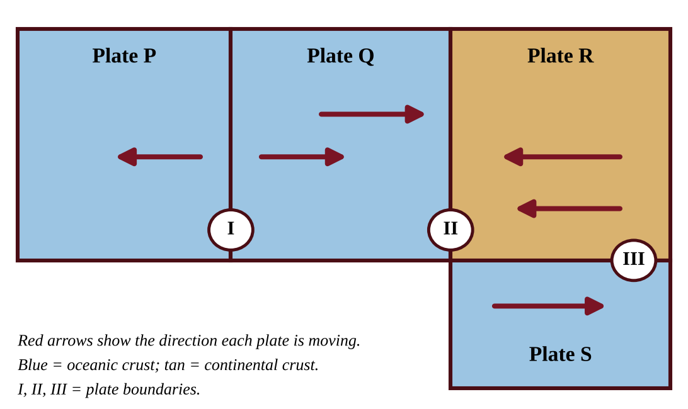
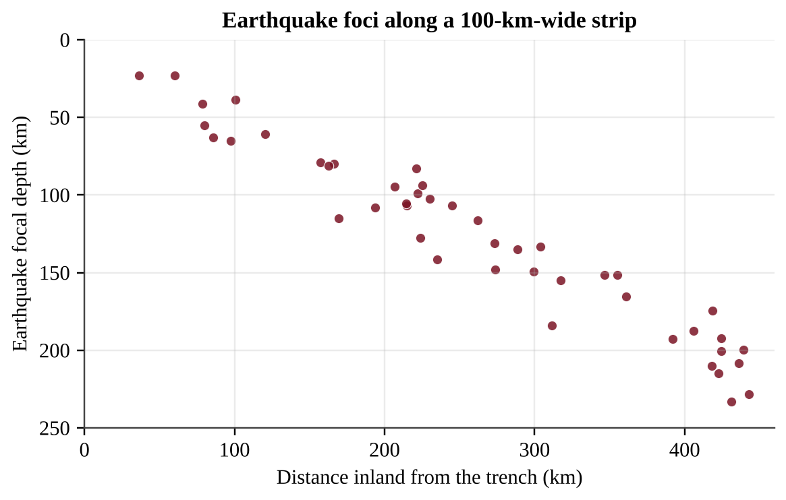
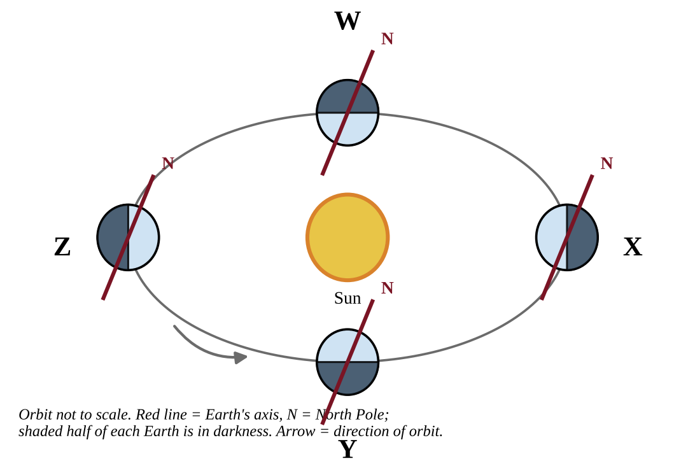
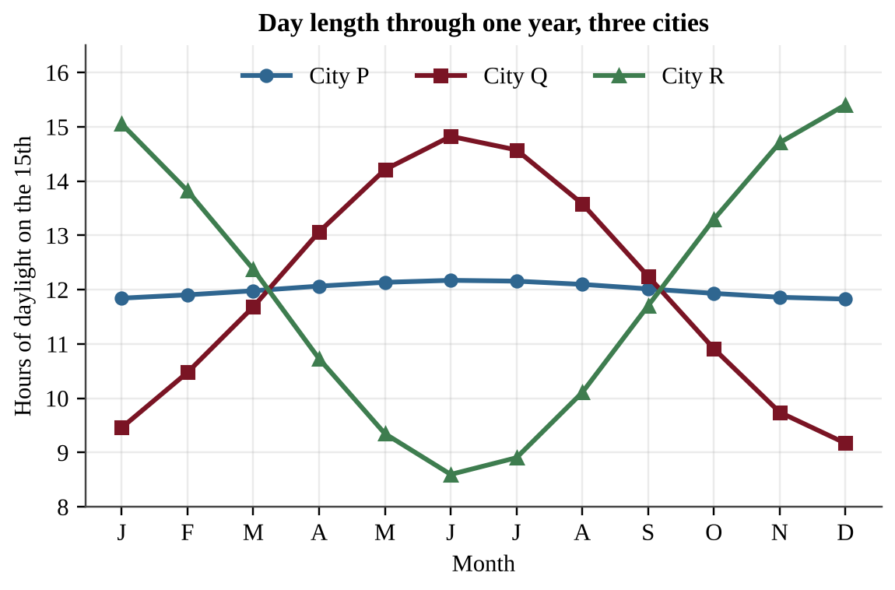
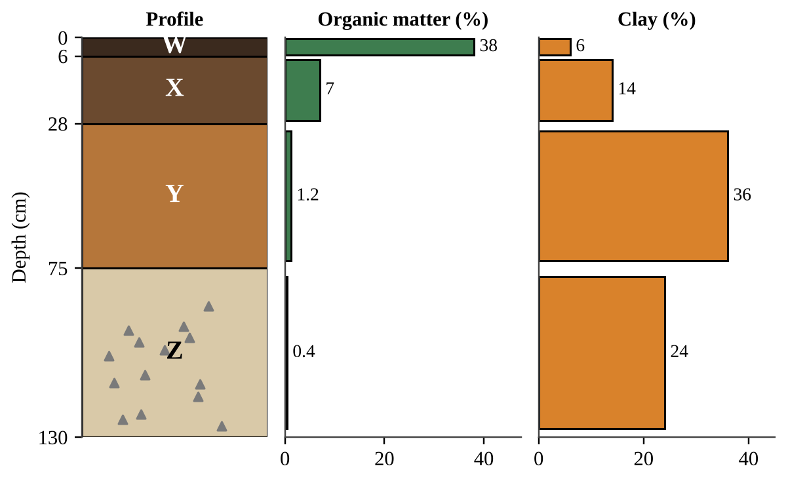
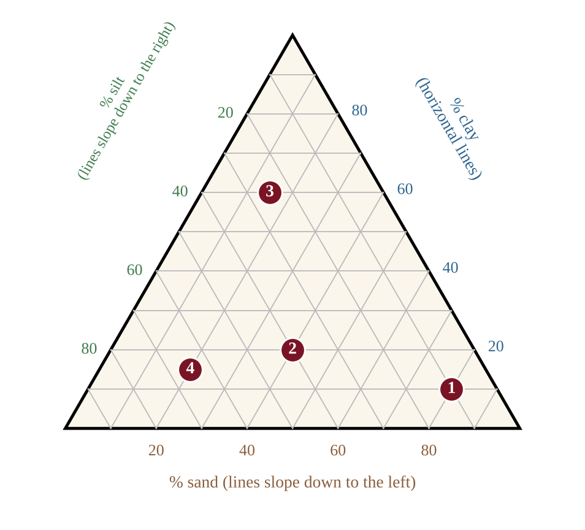
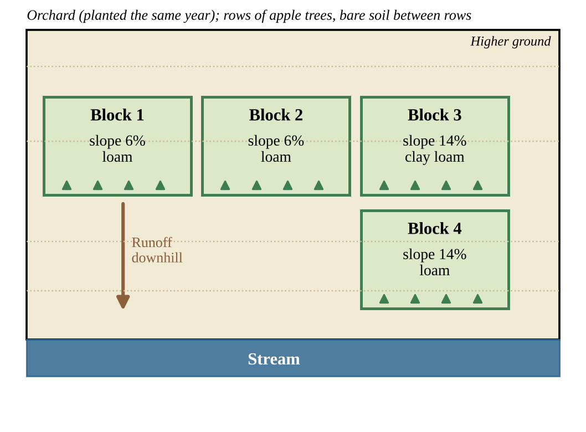

# Chapter 1 — The Earth

:::box note
**Chapter 1 — The Earth.** 40 multiple-choice questions (Section A) and 2 free-response questions (Section B) classified under Unit I of the academy structure. Questions are ordered by section of the chapter and then by difficulty. Complete solutions are in Book Three, Part II, Chapter 1.
:::

## Section A — Multiple-Choice Questions

:::q QB-C1-MCQ001 | chapter=1 | sec=1 | unit=0 | topic=ext | diff=1
Geologists divide Earth's 4.6-billion-year history into nested units of time. Which list places these units in order from the longest to the shortest?
A) Eon, era, period, epoch
B) Era, eon, epoch, period
C) Eon, period, era, epoch
D) Epoch, period, era, eon
:::

:::q QB-C1-MCQ002 | chapter=1 | sec=1 | unit=0 | topic=ext | diff=2
The figure shows the four eons of Earth's history on a timeline. Approximately what percent of Earth's 4.6-billion-year history is represented by Eon 4?

{w=0.85}

A) 12%
B) 1%
C) 54%
D) 88%
:::

:::q QB-C1-MCQ003 | chapter=1 | sec=1 | unit=0 | topic=ext | diff=3
A geologist dates a granite using a radioactive isotope with a half-life of 0.70 billion years. Laboratory analysis shows that 12.5% of the original parent isotope remains in the rock and the rest has decayed to its daughter product. Which value is the best estimate of the age of the granite?
A) 0.70 billion years
B) 1.4 billion years
C) 2.1 billion years
D) 5.6 billion years
:::

:::q QB-C1-MCQ004 | chapter=1 | sec=2 | unit=4 | topic=4.1 | diff=1
Which layer of Earth makes up the largest share of the planet's volume?
A) Crust
B) Inner core
C) Outer core
D) Mantle
:::

:::q QB-C1-MCQ005 | chapter=1 | sec=2 | unit=4 | topic=4.1 | diff=2
The diagram shows four layers of Earth, labeled W through Z, with some of their properties. Seismologists note that S-waves, which cannot travel through liquids, are never detected after passing through the deep interior. Which layer is liquid, and what is the evidence?

{w=0.85}

A) Layer Y, because S-waves are blocked when they reach it
B) Layer Z, because it is the hottest layer and must therefore be molten
C) Layer X, because the heat of the mantle causes it to convect
D) Layer W, because P-waves travel slowly through it
:::

:::q QB-C1-MCQ006 | chapter=1 | sec=2 | unit=4 | topic=4.1 | diff=3
Two oceanic plates meet at a convergent boundary. Plate P is 5 million years old, and Plate Q is 120 million years old. Both plates are made of the same basalt and gabbro. Which statement best predicts what will happen?
A) Plate P will subduct because it is younger, hotter and weaker.
B) Plate P will subduct because young lithosphere is thicker than old lithosphere.
C) Plate Q will subduct because it is older, cooler and denser.
D) Neither plate will subduct because two oceanic plates of the same composition always form mountains.
:::

:::q QB-U4-MCQ001 | unit=4 | topic=4.1 | diff=1
Two oceanic plates converge, and the older, denser plate sinks beneath the other. Which landform is most likely to develop on the overriding plate?
A) A rift valley with new crust forming along its axis
B) A mid-ocean ridge running parallel to the boundary
C) A long transform fault that offsets the seafloor
D) A curved chain of volcanic islands (an island arc)
:::

:::q QB-U4-MCQ002 | unit=4 | topic=4.1 | diff=1
Which statement best describes how an earthquake occurs along a locked fault?
A) Rising magma fractures the crust, and the escaping gases make the ground shake along the fault.
B) The plates stop moving completely, and the stored thermal energy escapes as seismic waves.
C) The fault slips smoothly and continuously, so the stored energy is released at a steady rate.
D) Stress builds until it exceeds the strength of the fault, and the stored energy is released as the rocks slip.
:::

:::q QB-U4-MCQ014 | unit=4 | topic=4.1 | diff=2

Plate Q is oceanic crust and Plate R is continental crust. Which statement best describes events along Boundary II?
A) Plates Q and R pull apart, forming a rift valley with new crust.
B) Plate Q sinks beneath Plate R, producing a trench, volcanoes, and earthquakes on Plate R.
C) Plates Q and R slide horizontally past each other, causing shallow earthquakes but no volcanoes.
D) Plate R sinks beneath Plate Q, producing volcanoes on the ocean floor.
:::

:::q QB-U4-MCQ015 | unit=4 | topic=4.1 | diff=2

Earthquakes in a coastal region occur at increasing depth with increasing distance inland from the trench. Which process best explains this pattern?
A) A mantle plume rises vertically beneath the trench and fractures the overlying rock.
B) Two plates slide horizontally past each other along a near-vertical fault.
C) A cool, dense oceanic plate descends into the mantle at an angle beneath the neighboring plate.
D) New crust forms along a ridge and pushes older crust inland.
:::

:::q QB-U4-MCQ036 | unit=4 | topic=4.1 | diff=3
A volcanic island chain forms as a plate moves over a stationary hot spot. The table shows the distance of three extinct volcanic islands from the active volcano above the hot spot and the age of each.

| Island | Distance from active hot spot (km) | Age (millions of years) |
|---|---|---|
| B | 300 | 6.0 |
| C | 750 | 15 |
| D | 1,250 | 25 |

An island lies 1,600 km from the hot spot along the same chain. Which choice gives the plate's speed and the predicted age of this island?
A) 0.5 cm/yr; 320 million years
B) 5 cm/yr; 32 million years
C) 5 cm/yr; 320 million years
D) 50 cm/yr; 3.2 million years
:::

:::q QB-U4-MCQ037 | unit=4 | topic=4.1 | diff=3
A mountain range of tall, folded peaks lies where two continental plates are colliding. The region has frequent earthquakes but no active volcanoes. Which explanation is best?
A) One plate subducts deeply, but its magma cools before it can reach the surface.
B) The plates slide past each other, so crust is neither compressed nor destroyed.
C) Neither continental plate is dense enough to subduct, so the crust thickens instead of melting.
D) The plates are moving apart, so pressure on the underlying mantle is released.
:::

:::q QB-C1-MCQ007 | chapter=1 | sec=4 | unit=4 | topic=4.1 | diff=1
What is the name for the point on Earth's surface that lies directly above the place where an earthquake's rupture begins?
A) Focus
B) Epicenter
C) Fault scarp
D) Seismic gap
:::

:::q QB-C1-MCQ008 | chapter=1 | sec=4 | unit=4 | topic=4.1 | diff=2
On the moment magnitude scale, a magnitude 7.0 earthquake is compared with a magnitude 5.0 earthquake. Which statement is correct?
A) The ground shaking is about 2 times larger, and about 2 times more energy is released.
B) The ground shaking is about 20 times larger, and about 200 times more energy is released.
C) The ground shaking is about 100 times larger, and about 1,000 times more energy is released.
D) The ground shaking is about 100 times larger, and about 100 times more energy is released.
:::

:::q QB-C1-MCQ009 | chapter=1 | sec=4 | unit=4 | topic=4.1 | diff=3
A station records the seismogram shown. Assume that P-waves travel through the crust at 6.0 km/s and S-waves travel at 3.5 km/s. Which value is the best estimate of the distance from the station to the epicenter?

{w=0.85}

A) 88 km
B) 140 km
C) 240 km
D) 336 km
:::

:::q QB-C1-MCQ010 | chapter=1 | sec=5 | unit=4 | topic=4.1 | diff=1
Which event is the most common cause of large, destructive tsunamis?
A) Strong winds from a tropical storm blowing across the ocean surface
B) The gravitational pull of the Moon at spring tide
C) Slow horizontal sliding of plates at a transform boundary
D) Sudden vertical movement of the seafloor during a subduction-zone earthquake
:::

:::q QB-C1-MCQ011 | chapter=1 | sec=5 | unit=4 | topic=4.1 | diff=2
The speed of a tsunami in the open ocean is given by v = √(g × d), where g = 9.8 m/s² and d is the water depth. A tsunami crosses an open ocean that is 4,000 m deep. A coastal city lies 3,564 km from the earthquake that generated the wave. Approximately how long will the wave take to reach the city?
A) 1.4 hours
B) 5.0 hours
C) 18 hours
D) 65 hours
:::

:::q QB-C1-MCQ012 | chapter=1 | sec=5 | unit=4 | topic=4.1 | diff=2
A tsunami is barely noticeable as a wave of low height in deep open water, but it can be many meters tall when it reaches a gently sloping coast. Which explanation is best?
A) The wave slows in shallow water, so its energy is concentrated into a taller wave.
B) The wave speeds up in shallow water, which stretches the water upward into a much taller wave.
C) Onshore winds add energy to the wave as it approaches the coast.
D) Friction with the shoreline removes energy, which makes the water pile up.
:::

:::q QB-C1-MCQ013 | chapter=1 | sec=6 | unit=4 | topic=4.1 | diff=1
The chain of volcanoes around the Pacific Ocean known as the Ring of Fire is mainly the result of which process?
A) Seafloor spreading at divergent boundaries that are separating continents
B) Transform motion along faults where plates slide past each other
C) Subduction of oceanic plates beneath other plates at convergent boundaries
D) Erosion of mountains by glaciers
:::

:::q QB-C1-MCQ014 | chapter=1 | sec=6 | unit=4 | topic=4.1 | diff=2
The table gives the properties of the magma of three volcanoes. Which volcano is most likely to erupt explosively?

| Volcano | Silica in magma (%) | Dissolved gas |
|---|---|---|
| P | 49 | High |
| Q | 56 | Low |
| R | 70 | Moderate |

A) Volcano P, because it has the greatest gas content, so its pressure builds fastest
B) Volcano Q, because intermediate silica magma is always the most explosive
C) Volcano P, because low-silica magma is hotter and erupts with greater force
D) Volcano R, because its high-silica magma is viscous and traps gas until pressure builds
:::

:::q QB-C1-MCQ015 | chapter=1 | sec=6 | unit=4 | topic=4.1 | diff=2
A chain of volcanic islands formed as the Pacific Plate moved over a stationary hot spot. The table gives the age of each island and its distance from the island that sits over the hot spot now.

| Island | Age (million years) | Distance from hot spot (km) |
|---|---|---|
| Q | 1.5 | 105 |
| R | 4.0 | 280 |
| S | 5.5 | 385 |

What is the average speed of the plate, in cm per year?
A) 0.7
B) 7.0
C) 70
D) 700
:::

:::q QB-U4-MCQ011 | unit=4 | topic=4.7 | diff=1
Which statement best explains why the Northern Hemisphere has warmer summers than winters?
A) In summer Earth is closer to the Sun than it is in winter, so it receives more energy.
B) The Sun gives off noticeably more energy in June than in December, which warms the whole planet.
C) In summer the Northern Hemisphere is tilted toward the Sun, giving more direct sunlight and longer days.
D) Earth rotates faster in summer, so the Sun heats the surface more strongly.
:::

:::q QB-U4-MCQ030 | unit=4 | topic=4.7 | diff=2

In the figure, the axis of Earth keeps the same direction in space throughout the orbit. Which position corresponds to the Northern Hemisphere summer solstice?
A) Position W
B) Position X
C) Position Y
D) Position Z
:::

:::q QB-U4-MCQ031 | unit=4 | topic=4.7 | diff=2
At the March equinox, why is the solar radiation received per square meter of surface lower at 60° N than at the equator, even at local noon?
A) Earth is much farther from the Sun at 60° N than it is at the equator, so less energy arrives.
B) At the equinox, daylight at 60° N lasts far fewer hours than daylight at the equator.
C) The Sun's rays strike at a more oblique angle, spreading the energy over a larger area.
D) Cooler air at 60° N reflects more of the incoming rays back into space before they reach the surface.
:::

:::q QB-U4-MCQ032 | unit=4 | topic=4.7 | diff=2

Which interpretation of the graph is best supported?
A) City Q is closest to the equator because its day length changes the most, and City R is in the Northern Hemisphere.
B) City P is nearest the equator because its day length changes least, and City R is south of the equator because its longest days are in December.
C) City P is closest to the equator because its day length is longest in June, and City Q is in the Southern Hemisphere.
D) City R is closest to the equator because its day length is the greatest of the three, and City P is near the pole.
:::

:::q QB-U4-MCQ041 | unit=4 | topic=4.7 | diff=3
The intensity of sunlight on a horizontal surface at noon is proportional to cos z, where z is the angle between the Sun's rays and the vertical. At noon on the June solstice the Sun is directly overhead at 23.5° N, and at noon on the December solstice it is directly overhead at 23.5° S. Approximately how many times greater is the noon intensity of sunlight on a horizontal surface at 40° N on the June solstice than on the December solstice?
A) 0.47
B) 1.3
C) 2.1
D) 3.8
:::

:::q QB-U4-MCQ003 | unit=4 | topic=4.2 | diff=1
Soils develop from parent material. Which of the following best describes parent material?
A) The rock or sediment that is weathered to form the mineral part of a soil
B) The dark surface layer of humus and partly decomposed leaves in the soil
C) The dissolved nutrients that plant roots take up from the soil water
D) The solid, unweathered bedrock that lies below every soil profile
:::

:::q QB-U4-MCQ004 | unit=4 | topic=4.2 | diff=1
Assume parent material, slope, and time are the same at four sites. At which site would soil form most rapidly?
A) A cold, dry site where water and biological activity are limited
B) A hot, arid site where rainfall is very low
C) A warm, humid site where chemical weathering and decomposition are fastest
D) A cold, wet site where water is present but frozen much of the year
:::

:::q QB-U4-MCQ005 | unit=4 | topic=4.2 | diff=1
How do soils help protect the quality of water that moves through them?
A) Soil changes every dissolved pollutant into harmless minerals, no matter how much is applied.
B) Soil particles and organisms filter, adsorb, and break down some contaminants as water percolates.
C) Soil prevents water from reaching groundwater, so pollutants cannot spread below the surface.
D) Soil increases surface runoff, which dilutes pollutants before they can enter streams.
:::

:::q QB-U4-MCQ006 | unit=4 | topic=4.3 | diff=1
Which soil particle class, when it dominates a soil, generally gives the highest permeability?
A) Sand, because its large particles leave large, well-connected pores
B) Silt, because its medium particles pack together loosely
C) Clay, because its many tiny pores add up to the largest passageways
D) Loam, because a mixture of particle sizes opens the widest channels
:::

:::q QB-U4-MCQ016 | unit=4 | topic=4.2 | diff=2

The figure shows a soil profile with four horizons (W–Z) and the organic matter and clay content of each. Z contains fragments of partly weathered rock. Which horizon is most likely the subsoil (B horizon), where fine particles and dissolved minerals carried down from above accumulate?
A) Horizon Y, because it has the most clay and little organic matter
B) Horizon W, because it has the highest organic matter and lies closest to the surface
C) Horizon X, because it is the first layer below the surface and holds the most humus
D) Horizon Z, because it contains rock fragments and the lowest organic matter
:::

:::q QB-U4-MCQ017 | unit=4 | topic=4.3 | diff=2
A soil scientist tests four soil samples. The composition of each is given below and plotted on the soil texture triangle.

| Sample | Sand (%) | Silt (%) | Clay (%) |
|---|---|---|---|
| 1 | 80 | 10 | 10 |
| 2 | 40 | 40 | 20 |
| 3 | 15 | 25 | 60 |
| 4 | 20 | 65 | 15 |

Which sample would most likely have the greatest water-holding capacity and the lowest permeability?
A) Sample 1, because the large pores of sand hold the greatest amount of water
B) Sample 2, because loam balances all particle sizes and so holds the most water
C) Sample 4, because silt always has the smallest pores of any soil particle
D) Sample 3, because its high clay content gives tiny pores that hold water but pass it slowly
:::

:::q QB-U4-MCQ018 | unit=4 | topic=4.3 | diff=2
A clay soil can have more total pore space (porosity) than a sandy soil, yet water moves through the clay much more slowly. Which statement best explains this?
A) Clay particles are larger than sand particles and block the pores that sand leaves open.
B) Clay soils contain less water-holding capacity than sandy soils, so they fill with air.
C) The pores in sand are smaller than those in clay, so water is drawn out of sand more quickly.
D) The pores in clay are extremely small, so water is held tightly by adhesion and moves through slowly.
:::

:::q QB-U4-MCQ019 | unit=4 | topic=4.3 | diff=2
A student places 300 g of oven-dried soil in a funnel lined with filter paper above a graduated cylinder. She pours 200 mL of water onto each soil and measures the water that has drained into the cylinder after 15 minutes. Soil X drains 150 mL, and Soil Y drains 60 mL. Which conclusion is best supported?
A) Soil Y has the greater water-holding capacity: it retained about 140 mL, compared with about 50 mL for Soil X.
B) Soil X has the greater water-holding capacity, because 150 mL of water passed through it.
C) The soils have equal water-holding capacity, because the same 200 mL was added to each.
D) Soil X has the greater water-holding capacity, because it retained 150 mL and Soil Y retained 60 mL.
:::

:::q QB-U4-MCQ020 | unit=4 | topic=4.3 | diff=2
A ring pushed into the ground is filled with 40 mm of water. The water completely soaks into Field P in 16 minutes and into Field Q in 200 minutes. A storm delivers rain at 30 mm per hour. Assuming the infiltration rates stay constant, which prediction is correct?
A) Field P produces about 120 mm of runoff per hour, and Field Q absorbs all of the rain.
B) Both fields absorb all of the rain, because every soil infiltrates some water.
C) Field P absorbs all of the rain, and Field Q produces about 18 mm of runoff for each hour of rain.
D) Field Q produces about 30 mm of runoff per hour, because its infiltration is negligible.
:::

:::q QB-U4-MCQ021 | unit=4 | topic=4.3 | diff=2
A vegetable farm on a soil that is 80% sand irrigates once a week with a large application. Plants show water stress by day 5, and soil tests show water has moved below the root zone. Which change is most consistent with the properties of this soil?
A) Apply smaller amounts of water more often, because the soil has high permeability and low water-holding capacity.
B) Apply even larger amounts less often, so that sand pores fill and hold the water for the whole week.
C) Stop irrigating, because sandy soils have the greatest water-holding capacity of all soils.
D) Add more sand to the field, which will increase the volume of water the soil can hold.
:::

:::q QB-U4-MCQ038 | unit=4 | topic=4.2 | diff=3
A student wants to test whether grass cover reduces soil erosion. She prepares two trays of the same soil. Tray 1 has bare soil on a 10° slope. Tray 2 has grass sod on a 25° slope. She applies simulated rain from the same sprinkler for 5 minutes and measures the dry mass of sediment collected from each tray. Tray 2 loses much less sediment. Which change would most improve the validity of her conclusion about grass cover?
A) Apply rain to the grass tray for twice as long so the test is more rigorous
B) Measure only the volume of runoff from each tray and ignore the sediment
C) Replace the bare soil in Tray 1 with sand so that the soils are different
D) Set both trays at the same slope so that ground cover is the only difference between them
:::

:::q QB-C1-MCQ016 | chapter=1 | sec=9 | unit=0 | topic=ext | diff=1
Which process forms metamorphic rock?
A) Heat and pressure change an existing rock without melting it completely
B) Magma cools and crystallizes underground
C) Layers of sediment are compacted and cemented together
D) Wind and water break rock into fragments
:::

:::q QB-C1-MCQ017 | chapter=1 | sec=9 | unit=0 | topic=ext | diff=2
The diagram shows a version of the rock cycle. Each arrow is numbered. Which arrow represents the compaction and cementation of loose grains into solid rock?

{w=0.85}

A) Arrow 2
B) Arrow 3
C) Arrow 4
D) Arrow 5
:::

:::q QB-C1-MCQ018 | chapter=1 | sec=9 | unit=0 | topic=ext | diff=3
A geologist collects two igneous rocks. Their mineral compositions are the same, but their textures differ.

| Rock | Mineral composition | Average crystal size |
|---|---|---|
| 1 | 50% plagioclase, 50% pyroxene | less than 0.5 mm |
| 2 | 50% plagioclase, 50% pyroxene | about 5 mm |

Which interpretation is best supported by the data?
A) Rock 1 cooled quickly near the surface, and Rock 2 cooled slowly at depth.
B) Rock 1 cooled slowly at depth, and Rock 2 cooled quickly near the surface.
C) Rock 2 formed by the compaction of sediments, and Rock 1 formed from magma.
D) The rocks formed from magmas of different compositions.
:::

## Section B — Free-Response Questions

:::q QB-C1-FRQ001 | chapter=1 | sec=4 | unit=4 | topic=4.1 | diff=3 | frqtype=2 | pts=10
Along the western coast of a continent, an oceanic plate moves toward the continent and sinks into the mantle at an offshore trench. Seismologists recorded earthquake foci along a line running inland from the trench and noted where volcanoes occur. The results are shown in the figure. The table gives selected foci and three recent earthquakes in the region.

{w=0.9}

| Distance inland from trench (km) | 40 | 80 | 120 | 160 | 200 | 240 | 280 |
|---|---|---|---|---|---|---|---|
| Focal depth (km) | 12 | 38 | 61 | 88 | 110 | 136 | 160 |

| Earthquake | Magnitude | Focal depth (km) | Shaking intensity at epicenter (Modified Mercalli) |
|---|---|---|---|
| X | 6.8 | 15 | IX |
| Y | 6.8 | 105 | VI |
| Z | 5.6 | 10 | VII |

(a) Describe the relationship between the distance of the foci from the trench and their depth. [1]
(b) Identify the type of plate boundary shown in the figure. [1]
(c) Using the table of selected foci, calculate the slope of the line (km of depth gained per km of horizontal distance) between 40 km and 280 km from the trench. [2]
(d) Explain why the volcanoes form about 200 km inland of the trench rather than at the trench. [2]
(e) Earthquake X has a magnitude of 6.8 and earthquake Z has a magnitude of 5.6. Each increase of 1.0 in magnitude corresponds to about 31.6 times more energy released. Calculate how many times more energy was released by earthquake X than by earthquake Z. [1]
(f) Earthquakes X and Y have the same magnitude. Make a claim about how focal depth affects the shaking felt at the surface, and justify it using the data in the table. [2]
(g) Propose one action that a coastal community could take to reduce loss of life from earthquakes in this region, and justify your proposal. [1]
:::

:::q QB-U4-FRQ001 | unit=4 | topic=4.2 | diff=2 | frqtype=1 | pts=10
Growers manage an apple orchard on a hillside above a stream. After heavy rains the stream runs muddy, and the growers suspect that soil is washing off the orchard rows, where the soil between the trees is kept bare by tilling. A grower proposes planting a perennial grass cover between the tree rows to reduce erosion. The orchard has four blocks, all planted in the same year with the same tree variety. The slope and soil texture of each block are shown below. The growers can install identical sediment traps at the downhill edge of any block and can measure rainfall with a rain gauge.

{w=0.8}

(a) Identify the environmental problem that the growers are trying to address. [1]
(b) Write a testable hypothesis, in if–then form, that predicts how a grass cover will affect soil loss from the orchard. [1]
(c) Identify the independent variable and the dependent variable in the investigation. [2]
(d) Identify the two blocks that should be used to test the hypothesis, and explain why you chose them. [2]
(e) Describe a procedure for the investigation. Include how the treatments will be applied, how soil loss will be measured, and how the reliability of the results will be improved. [2]
(f) Describe the pattern of results that would support the hypothesis. [1]
(g) Propose one additional practice, other than grass cover between rows, that the growers could use to reduce soil loss from the orchard, and justify your proposal. [1]
:::
