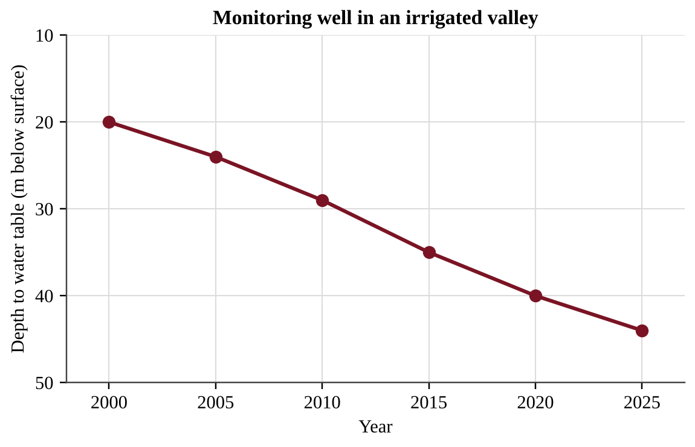
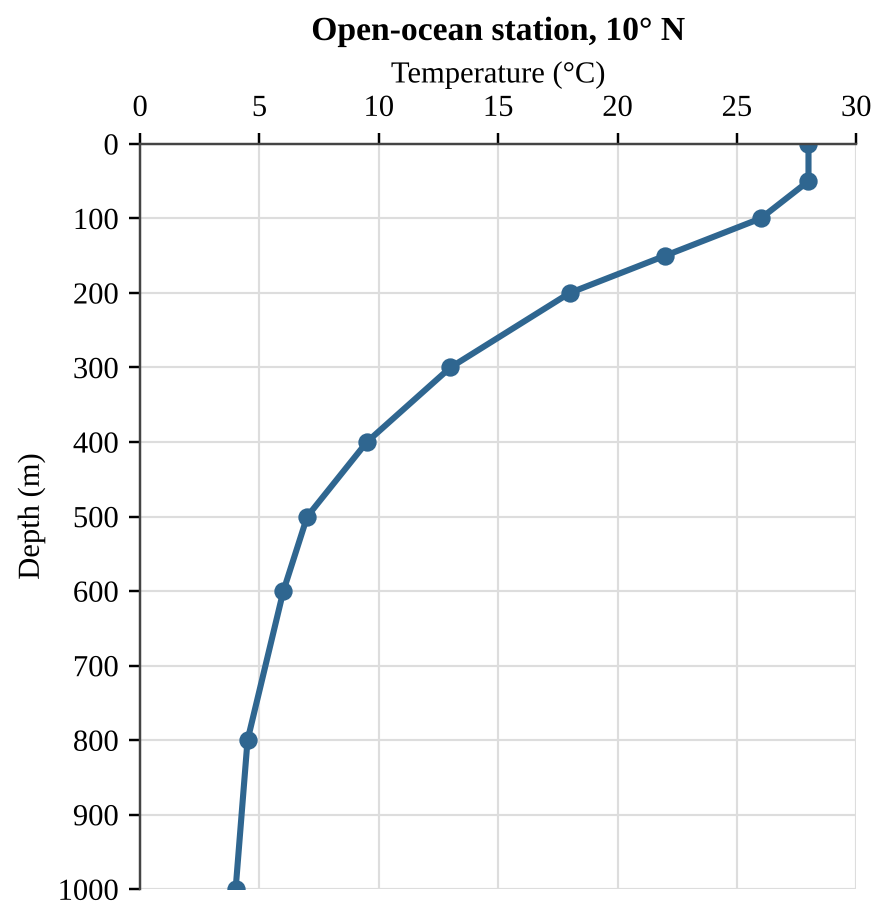
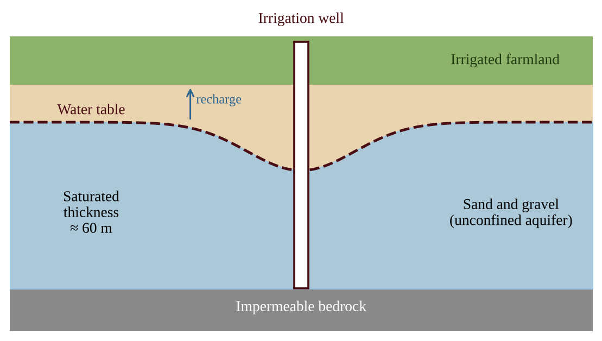

# Chapter 3 — Global Water Resources and Use

:::box note
**Chapter 3 — Global Water Resources and Use.** 25 multiple-choice questions (Section A) and 3 free-response questions (Section B) classified under Unit I of the academy structure. Questions are ordered by section of the chapter and then by difficulty. Complete solutions are in Book Three, Part II, Chapter 3.
:::

## Section A — Multiple-Choice Questions

:::q QB-C3-MCQ001 | chapter=3 | sec=1 | unit=0 | topic=ext | diff=1
Ice floats on liquid water, which allows lakes in cold regions to freeze from the top down while liquid water remains beneath. Which statement best explains why ice is less dense than liquid water?
A) The covalent O–H bonds in ice are stronger than those in liquid water, so ice contains fewer molecules per unit volume.
B) Hydrogen bonds hold the molecules of ice in an open, regular lattice, so the molecules are farther apart on average than in liquid water.
C) Ice contains trapped air and dissolved salts, which are less dense than water molecules.
D) Water molecules in ice move faster than those in liquid water, so they spread out and occupy more space.
:::

:::q QB-C3-MCQ002 | chapter=3 | sec=1 | unit=0 | topic=ext | diff=2
The table gives an estimate of how Earth's freshwater is stored.

| Freshwater reservoir | Volume (million km³) |
|---|---|
| Glaciers and ice caps | 24.0 |
| Fresh groundwater | 10.5 |
| Lakes, soil moisture, atmosphere, rivers, and other | 0.5 |
| **Total freshwater** | **35.0** |

Approximately what percentage of Earth's freshwater is stored as fresh groundwater?
A) 3%
B) 10.5%
C) 70%
D) 30%
:::

:::q QB-C3-MCQ003 | chapter=3 | sec=1 | unit=0 | topic=ext | diff=3
Water has a specific heat of 4.18 J/g·°C. A 2.0 kg sample of water absorbs 41.8 kJ of heat and warms by 5.0 °C. The same amount of heat is absorbed by 2.0 kg of dry sand, which has a specific heat of 0.80 J/g·°C. Assuming no heat is lost, what is the approximate temperature increase of the sand?
A) 26 °C
B) 5.0 °C
C) 1.0 °C
D) 52 °C
:::

:::q QB-U4-MCQ010 | unit=4 | topic=4.6 | diff=1
A ridge of high ground that separates one watershed from the neighboring watershed is called a
A) floodplain.
B) divide.
C) delta.
D) recharge zone.
:::

:::q QB-U4-MCQ026 | unit=4 | topic=4.6 | diff=2

Rain washes nitrate fertilizer from the field shown into the stream it borders. Assuming nitrate stays dissolved in the flowing water, which sites would most likely show elevated nitrate?
A) Sites 3 and 4 only
B) Sites 1, 3, and 4
C) Sites 2 and 3 only
D) Sites 1 and 2 only
:::

:::q QB-U4-MCQ027 | unit=4 | topic=4.6 | diff=2
Loggers clear-cut the forest on the steep, thin-soiled slopes of the upper part of a watershed, leaving bare soil. Which downstream change is most likely over the next several years?
A) Lower peak stream flows, because water spreads evenly across bare soil
B) Higher peak stream flows after storms and increased sediment (turbidity) in the stream
C) Cleaner, clearer stream water, because the soil is no longer disturbed by roots
D) Greater groundwater recharge, because bare soil absorbs more rain than forest soil
:::

:::q QB-U4-MCQ028 | unit=4 | topic=4.6 | diff=2
A watershed has an area of 250 km². It receives an average of 1,000 mm of precipitation per year, and 35% of the precipitation leaves the watershed as runoff in the river. What is the average annual runoff volume?
A) 8.8 × 10⁴ m³
B) 8.8 × 10⁷ m³
C) 2.5 × 10⁸ m³
D) 7.1 × 10⁸ m³
:::

:::q QB-U4-MCQ029 | unit=4 | topic=4.6 | diff=2
Two watersheds of equal area receive the same storm. Watershed R is mostly forest; Watershed U is mostly roofs and parking lots. The table shows the discharge of each stream at the outlet.

| Hours after storm began | 0 | 2 | 4 | 6 | 8 | 10 | 12 |
|---|---|---|---|---|---|---|---|
| Watershed R (m³/s) | 2 | 3 | 6 | 9 | 8 | 6 | 4 |
| Watershed U (m³/s) | 2 | 14 | 30 | 22 | 12 | 6 | 3 |

Which statement is best supported by the data?
A) Watershed U's peak was about 3 times higher than R's and came 2 hours earlier, consistent with less infiltration.
B) Watershed R had the higher peak discharge, because its forest soil released water more quickly than U's.
C) Both watersheds reached the same peak discharge, but Watershed U reached it later than R did.
D) Watershed U drained more slowly, because its discharge stayed above R's after 10 hours of the storm.
:::

:::q QB-C3-MCQ004 | chapter=3 | sec=3 | unit=0 | topic=ext | diff=1
A hydrologist compares four earth materials as possible aquifers. Porosity is the fraction of the volume that is open space; permeability describes how easily water moves through the material.

| Material | Porosity | Permeability |
|---|---|---|
| Clay | 45% | Very low |
| Unfractured granite | 1% | Very low |
| Shale | 6% | Very low |
| Sand and gravel | 25% | Very high |

Which material would make the most productive aquifer, and why?
A) Clay, because it has the highest porosity and therefore stores the most water that can be pumped out.
B) Unfractured granite, because its dense structure keeps stored water from escaping.
C) Sand and gravel, because it is both porous and permeable, so it stores water and lets it flow to a well.
D) Shale, because low permeability prevents the water from draining away.
:::

:::q QB-C3-MCQ005 | chapter=3 | sec=3 | unit=0 | topic=ext | diff=2
The graph shows the depth to the water table in a monitoring well in a valley where crops are irrigated with groundwater.

Assume the water table continues to decline at the average rate for 2000–2025. In which year will the water table reach a depth of 60 m?
A) 2037
B) 2042
C) 2050
D) 2062
:::

:::q QB-C3-MCQ006 | chapter=3 | sec=3 | unit=0 | topic=ext | diff=3
An unconfined aquifer lies beneath a 50 km² recharge area. The area receives 600 mm of precipitation per year, and 12% of it infiltrates to the aquifer. Wells withdraw 5.0 × 10⁶ m³ of water from the aquifer each year. Assuming recharge and withdrawal are the only inputs and outputs, what is the net annual change in the volume of water stored in the aquifer?
A) +1.4 × 10⁶ m³
B) +2.5 × 10⁷ m³
C) −5.0 × 10⁶ m³
D) −1.4 × 10⁶ m³
:::

:::q QB-C3-MCQ007 | chapter=3 | sec=4 | unit=9 | topic=9.5 | diff=1
Which of the following melting events would most directly add water to the ocean and raise global sea level by a measurable amount?
A) Melting of the Greenland ice sheet, which rests on land
B) Melting of floating Arctic sea ice
C) Melting of a floating Antarctic ice shelf
D) Melting of seasonal sea ice formed from frozen seawater around Antarctica
:::

:::q QB-C3-MCQ008 | chapter=3 | sec=4 | unit=9 | topic=9.5 | diff=2
Scientists estimate the yearly mass balance of an ice sheet.

| Process | Mass (Gt per year) |
|---|---|
| Snowfall (accumulation) | 740 |
| Surface melt runoff | 600 |
| Iceberg calving | 590 |

About 360 Gt of ice sheet mass loss raises global mean sea level by 1 mm. If these rates stay constant, how many years will it take for this ice sheet to raise sea level by 50 mm?
A) 15 years
B) 24 years
C) 40 years
D) 400 years
:::

:::q QB-C3-MCQ009 | chapter=3 | sec=4 | unit=9 | topic=9.5 | diff=3
An ice shelf is a thick, floating platform of ice attached to an ice sheet on land. Which statement best describes the effect of an ice shelf collapsing?
A) It immediately raises sea level by an amount equal to the volume of the shelf, because the shelf was holding water out of the ocean.
B) It has no effect on the ice sheet, because the shelf and the grounded ice are separate and unrelated bodies of ice.
C) It lowers sea level, because the newly exposed ocean surface absorbs more sunlight and evaporates much more water.
D) It adds little sea level directly, but it removes support that holds back grounded glaciers, which can then flow faster.
:::

:::q QB-C3-MCQ010 | chapter=3 | sec=5 | unit=0 | topic=ext | diff=1
The deep-ocean circulation sometimes called the global conveyor belt is driven mainly by
A) strong surface winds that push water to great depths in the open ocean
B) the gravitational pull of the Moon on deep ocean water
C) differences in density, with cold, salty water sinking at high latitudes
D) rivers flowing into the ocean and pushing water downward
:::

:::q QB-C3-MCQ011 | chapter=3 | sec=5 | unit=9 | topic=9.6 | diff=2
The graph shows the temperature of the water column at an open-ocean station in the tropics.

{w=0.55}

Which statement is best supported by the data?
A) Temperature falls fastest between about 100 m and 200 m, where a thermocline separates warm surface water from cold deep water.
B) Temperature decreases at a constant rate from the surface to 1000 m.
C) Temperature is nearly uniform below 200 m.
D) Water at 1000 m is warmer than water at 500 m.
:::

:::q QB-C3-MCQ012 | chapter=3 | sec=5 | unit=9 | topic=9.7 | diff=3
Because the ocean absorbs atmospheric CO₂, average surface-ocean pH in an enclosed experimental basin falls from 8.2 to 7.9 under high CO₂ conditions. Recall that pH = −log₁₀[H⁺]. Compared with the starting condition, the hydrogen ion concentration in the basin is now
A) about 3 times as high
B) about 2 times as high
C) about 30% higher
D) about 10 times as high
:::

:::q QB-U5-MCQ004 | unit=5 | topic=5.5 | diff=1
Approximately what share of human freshwater consumption worldwide is used for agriculture?
A) About 7%
B) About 30%
C) About 50%
D) About 70%
:::

:::q QB-U5-MCQ019 | unit=5 | topic=5.5 | diff=2
The figure shows a cross-section of a flood-irrigated field in an arid valley after 25 years of irrigation with pumped groundwater. Farmers report declining yields, and some plants have wilted in the wet soil.

Which pair of processes does the figure illustrate?
A) Salinization from salty rainfall, and waterlogging from a water table that has dropped far below the roots
B) Eutrophication from fertilizer runoff, and desertification from overgrazing
C) Saltwater intrusion from coastal pumping, and soil compaction from heavy machinery
D) Salinization from salts left behind as irrigation water evaporates, and waterlogging from a water table that has risen into the root zone
:::

:::q QB-U5-MCQ020 | unit=5 | topic=5.5 | diff=2
A grower irrigates 25 ha of crops by furrow irrigation, in which about one-third of the applied water is lost to evaporation and runoff. The crop needs 6,000 m³ of water per hectare delivered to its roots. If the grower switches to drip irrigation, in which about 5% of the applied water is lost, how much less water in total must be applied?
A) 7.5 × 10⁴ m³
B) 6.7 × 10⁴ m³
C) 4.3 × 10⁴ m³
D) 7.5 × 10³ m³
:::

:::q QB-U5-MCQ021 | unit=5 | topic=5.5 | diff=2
Which statement about irrigation methods is accurate?
A) Spray irrigation loses about one-third of the water and needs no energy to operate.
B) Furrow irrigation is the most efficient method, losing only about 5% of the water.
C) Drip irrigation is inexpensive to install, which is why it is the most widely used method worldwide.
D) Flood irrigation loses about 20% of the water to evaporation and runoff and can cause waterlogging.
:::

:::q QB-U5-MCQ037 | unit=5 | topic=5.5 | diff=3
Farmers pump an aquifer that currently has 24 m of saturated thickness. Pumping lowers the water table by 0.9 m per year, and natural recharge raises it by 0.1 m per year. If these rates stay constant, about how many years until the aquifer is depleted?
A) 24 years
B) 27 years
C) 30 years
D) 240 years
:::

:::q QB-C3-MCQ013 | chapter=3 | sec=7 | unit=0 | topic=ext | diff=1
Since the 1960s the Aral Sea in Central Asia has lost most of its surface area and volume. What was the primary cause?
A) Overfishing, which removed the organisms that regulate the sea's water level
B) A decline in global sea level that left the inland sea stranded
C) Contamination of the sea by industrial wastewater, which killed the plants that hold the shoreline in place
D) Diversion of the rivers that feed the sea to irrigate cotton and other crops
:::

:::q QB-C3-MCQ014 | chapter=3 | sec=7 | unit=0 | topic=ext | diff=2
Hydrologists classify water availability by renewable freshwater per person per year: adequate (> 1,700 m³), stress (1,000–1,700 m³), scarcity (500–1,000 m³), and absolute scarcity (< 500 m³). A country has 12.0 km³ of renewable freshwater per year (1 km³ = 10⁹ m³) and is projected to grow from 14 million people today to 26 million people by 2050, with no change in its water supply. In 2050 the country will be in which category?
A) Absolute scarcity
B) Scarcity
C) Stress
D) Adequate
:::

:::q QB-C3-MCQ015 | chapter=3 | sec=7 | unit=0 | topic=ext | diff=3
In a farming region, the water table has fallen 8 m in 15 years. Farmers say the decline is only due to a long drought, while a water agency claims that irrigation pumping is the main cause. Which evidence would best support the agency's claim?
A) Rainfall records showing three years of below-average precipitation
B) Reports from farmers that several shallow wells have gone dry
C) Water-table measurements showing steady declines in the irrigated area but no decline in a nearby area with the same climate and no pumping
D) The finding that the average well in the region is deeper than 30 m
:::

## Section B — Free-Response Questions

:::q QB-U4-FRQ003 | unit=4 | topic=4.6 | diff=3 | frqtype=3 | pts=10
Kestrel Creek drains a watershed with an area of 180 km². The watershed receives an average of 1,100 mm of precipitation per year, and 40% of the precipitation leaves the watershed as runoff in Kestrel Creek. Monitoring shows that the creek carries an average suspended sediment concentration of 150 mg/L. Cropland covers 30% of the watershed, and you may assume that all of the sediment in the creek comes from erosion of the cropland. The soil on the cropland has a bulk density of 1.3 metric tons per cubic meter (1.3 t/m³), and soil forms on the cropland at an average rate of 0.05 mm per year.

Use these conversions as needed: 1 km² = 10⁶ m²; 1 m³ = 1,000 L; 1 metric ton = 10⁹ mg; 1 year = 3.15 × 10⁷ s.

(a) Calculate the volume of runoff, in cubic meters, that flows out of the watershed in one year. Show your work. [2]
(b) Calculate the average discharge of Kestrel Creek in cubic meters per second. Show your work. [2]
(c) Calculate the mass of sediment, in metric tons, carried by the creek in one year. Show your work. [2]
(d) Calculate the average depth, in millimeters, of soil lost from the cropland in one year. Show your work. [2]
(e) Justify whether the rate of soil loss on the cropland is sustainable, using your answer to part (d). [1]
(f) Propose one action that farmers in the watershed could take to reduce the amount of sediment entering the creek. [1]
:::

:::q QB-C3-FRQ001 | chapter=3 | sec=3 | unit=0 | topic=ext | diff=3 | frqtype=3 | pts=10
A valley in a semi-arid region depends on an unconfined aquifer of sand and gravel for crop irrigation. The diagram shows a cross section of the valley, and the table gives data collected by the regional water authority.

| Aquifer data | Value |
|---|---|
| Area of the aquifer | 120 km² (1.20 × 10⁸ m²) |
| Specific yield (fraction of aquifer volume that drains when the water table falls) | 0.15 |
| Average decline of the water table | 0.80 m per year |
| Total groundwater pumped for irrigation | 3.00 × 10⁷ m³ per year |
| Depth from the current water table to the bottom of the deepest well screen | 30 m |

(a) Calculate the volume of water lost from storage in the aquifer each year (in m³). Show your work. [2]
(b) Assuming pumping is the only outflow, calculate the average annual natural recharge to the aquifer (in m³ per year). Show your work. [2]
(c) If the water table continues to decline at the same rate, calculate the number of years until the water table reaches the bottom of the deepest well screen. [1]
(d) Describe one environmental or social consequence, other than wells running dry, that is likely if groundwater withdrawal continues to exceed recharge, and explain how it occurs. [2]
(e) The authority proposes switching to drip irrigation, which would reduce total pumping by 25%. Calculate the new annual storage deficit (in m³ per year), assuming recharge does not change. [1]
(f) Based on your answer to (e), make a claim about whether drip irrigation alone is sufficient to stop the decline of the water table, and propose one additional action that would help bring withdrawals and recharge into balance. Justify your proposal. [2]
:::

:::q QB-U5-FRQ002 | unit=5 | topic=5.5 | diff=2 | frqtype=2 | pts=10
Farmers in an arid plains region irrigate with groundwater from a shallow aquifer that is recharged slowly by rainfall. The table and graph show irrigated cropland, groundwater pumped for irrigation, and the average saturated thickness of the aquifer (the thickness of water-bearing rock) between 1960 and 2020.

| Year | Irrigated cropland (thousand ha) | Groundwater pumped (million m³/yr) | Saturated thickness (m) |
|---|---|---|---|
| 1960 | 40 | 300 | 62 |
| 1970 | 90 | 700 | 58 |
| 1980 | 160 | 1,350 | 50 |
| 1990 | 210 | 1,700 | 42 |
| 2000 | 230 | 1,850 | 35 |
| 2010 | 225 | 1,600 | 30 |
| 2020 | 215 | 1,300 | 27 |

Most of the cropland is irrigated by flood irrigation.

(a) Describe the trend in the aquifer's saturated thickness from 1960 to 2020. [1]
(b) Calculate the average annual rate of decline in saturated thickness, in meters per year, from 1970 to 2000. Show your work. [1]
(c) Explain why the saturated thickness continued to decrease between 2000 and 2020 even though the amount of groundwater pumped decreased. [2]
(d) Make a claim about whether groundwater use in this region in 2020 was sustainable, and justify your claim with data from the table. [2]
(e) Describe one environmental problem that flood irrigation can cause on this cropland, and explain how it occurs. [2]
(f) Propose one solution that would extend the life of the aquifer, and describe one advantage and one drawback of your solution. [2]
:::
