# Chapter 9 — Pollution

:::box note
**Chapter 9 — Pollution.** 64 multiple-choice questions (Section A) and 7 free-response questions (Section B) classified under Unit VI of the academy structure. Questions are ordered by section of the chapter and then by difficulty. Complete solutions are in Book Three, Part II, Chapter 9.
:::

## Section A — Multiple-Choice Questions

:::q QB-U7-MCQ001 | unit=7 | topic=7.1 | diff=1
Which of the following is a secondary air pollutant?
A) Carbon monoxide released from a vehicle tailpipe
B) Lead released from the burning of leaded fuel
C) Ground-level ozone formed from reactions of nitrogen oxides and volatile organic compounds in sunlight
D) Sulfur dioxide released from the combustion of coal
:::

:::q QB-U7-MCQ005 | unit=7 | topic=7.6 | diff=1
Gasoline vapors escape into the air each time a driver refuels a car. Which pollution control device on the fuel pump directly reduces this release?
A) Vapor recovery nozzle
B) Catalytic converter
C) Electrostatic precipitator
D) Wet scrubber
:::

:::q QB-U7-MCQ007 | unit=7 | topic=7.3 | diff=1
Which statement correctly describes a thermal inversion?
A) The air at the surface is warmer than the air above it, so pollutants rise and mix quickly into the upper atmosphere.
B) Strong upward air currents carry surface pollutants into the upper atmosphere.
C) A layer of warmer air lies above cooler air near the ground, limiting vertical mixing.
D) Strong winds blow along the surface and disperse pollutants over a wide area.
:::

:::q QB-U7-MCQ009 | unit=7 | topic=7.1 | diff=1
Concentrations of lead in the atmosphere of the United States fell dramatically after the Clean Air Act was passed. Which EPA action was primarily responsible?
A) Requiring scrubbers on coal-burning power plants
B) Limiting carbon dioxide emissions from power plants
C) Requiring vapor recovery nozzles at gas stations
D) Phasing out lead additives in motor fuel
:::

:::q QB-U7-MCQ012 | unit=7 | topic=7.3 | diff=2
Figure 2 shows air temperature at different heights above the ground in a valley city on two mornings.

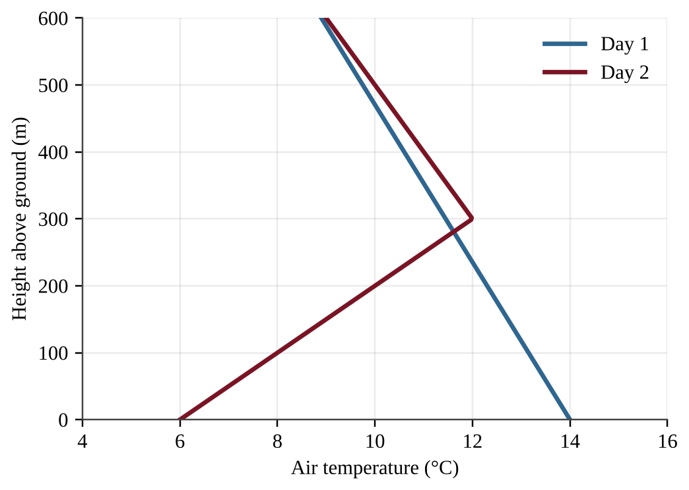{w=0.7}

On which morning would smog and particulates be most likely to build up near the ground, and why?
A) Day 1, because temperature decreases with height, which holds pollutants in place
B) Day 2, because the cooler air aloft dissolves pollutants and returns them to the surface
C) Day 2, because the warmer layer above the cool surface air limits vertical mixing
D) Day 1, because the warm surface air destroys pollutants chemically before they can rise
:::

:::q QB-U7-MCQ013 | unit=7 | topic=7.6 | diff=2
A catalytic converter on a gasoline-powered car converts which pollutants into which less harmful products?
A) Carbon monoxide, nitrogen oxides, and unburned hydrocarbons into carbon dioxide, nitrogen gas, and water
B) Carbon dioxide, nitrogen gas, and water into carbon monoxide, nitrogen oxides, and hydrocarbons
C) Sulfur dioxide and particulates into calcium sulfate sludge
D) Lead and mercury into harmless mineral salts
:::

:::q QB-U7-MCQ016 | unit=7 | topic=7.6 | diff=2
Figure 3 shows the exhaust path of a coal-burning power plant that has two pollution control devices.

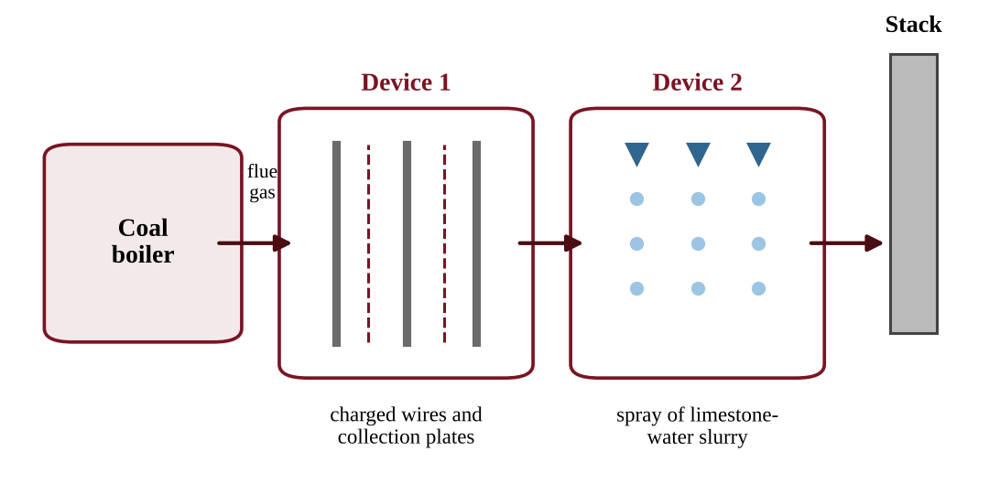{w=0.85}

Which statement correctly describes how these devices reduce emissions?
A) Device 1 removes sulfur dioxide gas using a limestone slurry, and Device 2 removes fly ash particles using electric charge.
B) Device 1 removes sulfur dioxide gas, and Device 2 removes nitrogen oxides.
C) Device 1 removes fly ash particles using electric charge, and Device 2 removes sulfur dioxide by reacting it with a limestone slurry.
D) Both devices remove carbon dioxide so that it cannot reach the stack.
:::

:::q QB-U7-MCQ018 | unit=7 | topic=7.1 | diff=2
Which set of pollutants is released directly by the combustion of coal in a power plant?
A) Carbon dioxide, sulfur dioxide, particulates, and toxic metals such as mercury
B) Ozone, chlorofluorocarbons, peroxyacyl nitrates, and formaldehyde
C) Radon, mold spores, asbestos, and dust
D) Methane, ammonia, and nitrous oxide only
:::

:::q QB-U7-MCQ022 | unit=7 | topic=7.3 | diff=2
Which set of conditions is most likely to produce a persistent thermal inversion over a city surrounded by mountains in winter?
A) Strong winds that mix the air across the valley
B) Thick cloud cover that keeps the ground warm all night
C) A warm surface heated by strong afternoon sun
D) Clear, calm nights when the ground cools quickly and the surrounding mountains block air movement
:::

:::q QB-U7-MCQ023 | unit=7 | topic=7.6 | diff=2
A coal-burning power plant would emit 1,200 metric tons of sulfur dioxide per year with no controls. After a scrubber that removes 92% of the SO₂ is installed, how much SO₂ does the plant emit per year?
A) 9.6 metric tons
B) 92 metric tons
C) 96 metric tons
D) 1,104 metric tons
:::

:::q QB-U7-MCQ029 | unit=7 | topic=7.6 | diff=3
A utility emits 8,000 metric tons of SO₂ per year and is comparing two options.

- Option 1: Install scrubbers that remove 90% of the SO₂ at a cost of $36 million per year.
- Option 2: Switch to low-sulfur coal that cuts SO₂ emissions by 60% at a cost of $14.4 million per year.

Which option has the lower cost per metric ton of SO₂ removed, and what is that cost?
A) Option 2, about $3,000 per metric ton
B) Option 1, about $5,000 per metric ton
C) Option 2, about $1,800 per metric ton
D) Option 1, about $4,500 per metric ton
:::

:::q QB-U7-MCQ030 | unit=7 | topic=7.6 | diff=3
A city's 250,000 vehicles each travel an average of 12,000 miles per year and emit 0.4 g of NOₓ per mile. A new rule requires catalytic converter upgrades that cut NOₓ emissions per mile by 75%. Using 1 metric ton = 10⁶ g, how many metric tons of NOₓ per year will the rule prevent?
A) 300
B) 1,200
C) 90
D) 900
:::

:::q QB-U7-MCQ031 | unit=7 | topic=7.3 | diff=3
A weather balloon measured air temperature on a winter morning above a valley city.

| Height above ground (m) | 0 | 100 | 200 | 300 | 400 | 500 |
|---|---|---|---|---|---|---|
| Temperature (°C) | 4 | 6 | 9 | 11 | 10 | 8 |

Based on these data, which prediction about fine particulate matter from local vehicles and heating is best supported?
A) Concentrations will be highest at 300–500 m, where the air is coolest.
B) Concentrations will be highest near the surface, because the 0–300 m layer is stable and limits mixing.
C) Concentrations will be highest at 400–500 m, because the temperature falls normally there.
D) Concentrations will be the same at all heights because gases diffuse evenly.
:::

:::q QB-U7-MCQ034 | unit=7 | topic=7.1 | diff=3
Figure 6 shows national trends from 1990 to 2020, each expressed as an index with the 1990 value set to 100.

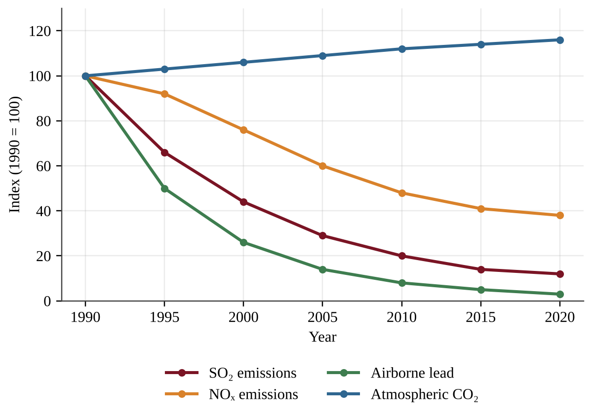{w=0.8}

Which interpretation is best supported by Figure 6?
A) Emission controls and fuel standards aimed at SO₂, NOₓ, and lead coincided with large declines in those pollutants, while CO₂, which those measures do not remove, continued to rise.
B) Because NOₓ fell less than SO₂, catalytic converters must be less effective than scrubbers.
C) Because lead fell the most, the regulation of lead must have caused the decline in SO₂.
D) Rising CO₂ shows that overall air quality for human health worsened between 1990 and 2020.
:::

:::q QB-U7-MCQ002 | unit=7 | topic=7.4 | diff=1
Which of the following is a natural source of atmospheric carbon dioxide?
A) Decomposition of leaf litter by soil microbes
B) Combustion of natural gas in a home furnace
C) Heating of limestone in cement kilns
D) Burning of diesel fuel in cargo ships
:::

:::q QB-U7-MCQ004 | unit=7 | topic=7.5 | diff=1
Which indoor air pollutant is classified as an asphyxiant because it interferes with the delivery of oxygen to body tissues?
A) Radon
B) Carbon monoxide
C) Formaldehyde
D) Asbestos
:::

:::q QB-U7-MCQ008 | unit=7 | topic=7.2 | diff=1
Photochemical smog forms when sunlight drives chemical reactions among which two groups of pollutants?
A) Sulfur dioxide and particulate matter
B) Nitrogen oxides and volatile organic compounds
C) Carbon monoxide and lead
D) Carbon dioxide and water vapor
:::

:::q QB-U7-MCQ010 | unit=7 | topic=7.5 | diff=1
How does radon-222 most commonly enter a home?
A) It seeps up from soil and rock through cracks in the foundation and basement floor.
B) It evaporates from the adhesives used under new carpeting.
C) It is released when natural gas burns in a stove or furnace.
D) It is produced by mold growing on damp walls.
:::

:::q QB-U7-MCQ011 | unit=7 | topic=7.2 | diff=2
Figure 1 shows the concentrations of three pollutants measured at an urban site during one sunny July day.

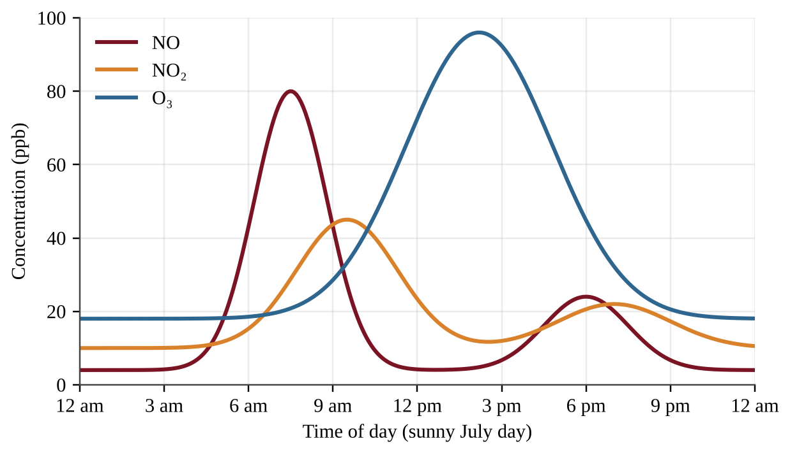{w=0.8}

Which statement best explains why the ozone peak occurs several hours after the nitric oxide (NO) peak?
A) Ozone is emitted directly from vehicle tailpipes during the afternoon commute.
B) Ozone forms from reactions of nitrogen oxides and VOCs driven by sunlight, so it accumulates as light intensity and temperature rise.
C) Sunlight breaks down nitrogen oxides in the morning, which delays the formation of ozone until evening.
D) Ozone forms only after all of the NO has been removed from the air by rainfall.
:::

:::q QB-U7-MCQ014 | unit=7 | topic=7.5 | diff=2
A school measured indoor air in a classroom before and after a summer renovation that installed new particleboard cabinets and wall-to-wall carpet.

| Indoor pollutant | Before renovation | After renovation |
|---|---|---|
| Formaldehyde (ppb) | 11 | 78 |
| Carbon monoxide (ppm) | 1 | 1 |
| Radon (pCi/L) | 2.1 | 2.0 |
| PM2.5 (µg/m³) | 8 | 9 |

Which conclusion is best supported by the data?
A) Radon-bearing soil gas is entering through new cracks in the floor.
B) The gas furnace is burning fuel incompletely.
C) Mold is growing in the damp basement.
D) The new cabinets and carpet are releasing volatile organic compounds into the room.
:::

:::q QB-U7-MCQ017 | unit=7 | topic=7.4 | diff=2
Which of the following lists contains only natural sources of particulate matter?
A) Wildfires, diesel trucks, and volcanic eruptions
B) Windblown dust, coal fly ash, and sea spray
C) Pollen, tire wear, and wildfire smoke
D) Volcanic ash, windblown dust, and sea spray
:::

:::q QB-U7-MCQ020 | unit=7 | topic=7.2 | diff=2
A city wants to reduce the number of summer days on which photochemical smog forms. Which action would most directly target the cause?
A) Installing scrubbers on all coal-burning power plants
B) Cutting emissions of nitrogen oxides and VOCs by expanding public transit
C) Banning the use of leaded paint in older buildings
D) Raising the height of smokestacks on industrial facilities
:::

:::q QB-U7-MCQ024 | unit=7 | topic=7.5 | diff=2
Short-term radon test kits were placed on the lowest lived-in level of four homes. The EPA action level for radon is 4.0 pCi/L.

| Home | Radon (pCi/L) |
|---|---|
| 1 | 2.8 |
| 2 | 3.9 |
| 3 | 4.6 |
| 4 | 7.2 |

Which homes should install a radon mitigation system?
A) Home 4 only
B) Homes 3 and 4 only
C) Homes 2, 3, and 4
D) All four homes
:::

:::q QB-U7-MCQ025 | unit=7 | topic=7.2 | diff=2
Figure 5 shows ozone concentrations on one summer day at three sites along the downwind direction from a large city.

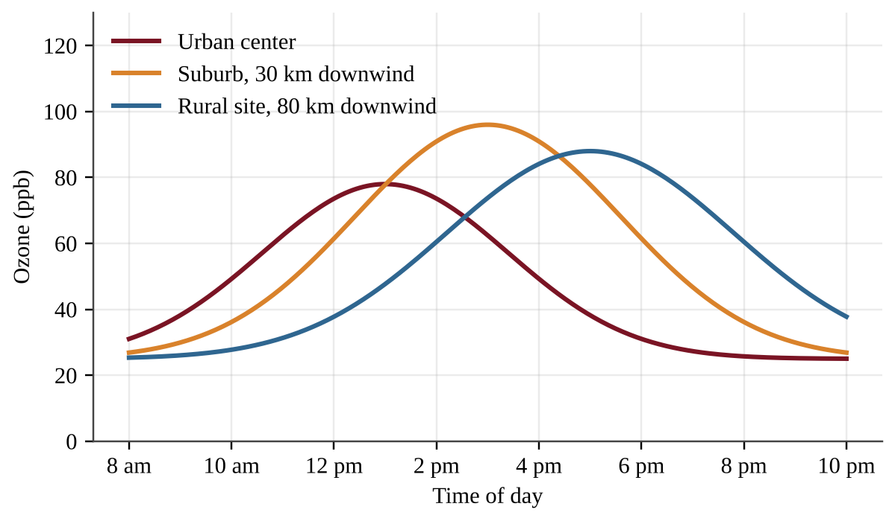{w=0.8}

Which conclusion is best supported by Figure 5?
A) Ozone peaks earliest at the rural site because it has the cleanest air.
B) Ozone is released directly from the city center and is carried unchanged to the other sites.
C) Ozone concentration is the same at all three sites at 2 p.m.
D) The ozone peak occurs later at sites farther downwind, consistent with ozone forming as polluted air travels.
:::

:::q QB-U7-MCQ026 | unit=7 | topic=7.4 | diff=2
Researchers measure CO₂ concentrations 1 km downwind of an active volcanic vent. They also place an identical sensor 1 km upwind of the vent. What is the main purpose of the upwind sensor?
A) It measures the background CO₂ from other sources so the vent's contribution can be estimated.
B) It doubles the sample size of the downwind sensor.
C) It calibrates the downwind sensor for changes in its own accuracy.
D) It measures how much CO₂ nearby plants absorb from the vent.
:::

:::q QB-U7-MCQ006 | unit=7 | topic=7.7 | diff=1
Which pair of air pollutants contributes most to the formation of acid deposition?
A) Carbon dioxide and methane
B) Carbon monoxide and ozone
C) Lead and mercury
D) Sulfur dioxide and nitrogen oxides
:::

:::q QB-U7-MCQ015 | unit=7 | topic=7.7 | diff=2
Two lakes in the same region receive rain with an average pH of 4.5. Their measured pH values differ.

| Lake | Bedrock of watershed | Lake water pH |
|---|---|---|
| Flint Lake | Granite | 4.9 |
| Marl Lake | Limestone | 6.8 |

Which statement best explains the difference?
A) Marl Lake receives much more precipitation than Flint Lake.
B) The limestone around Marl Lake contains carbonates that neutralize acid before it lowers the lake pH.
C) Granite releases basic compounds that raise the pH of Marl Lake.
D) Limestone is a source of sulfur dioxide that raises the pH of Marl Lake.
:::

:::q QB-U7-MCQ021 | unit=7 | topic=7.7 | diff=2
A coal-burning power plant lies in a region where the prevailing wind blows from west to east. Four communities are being compared for risk of damage from acid deposition from this plant.

| Community | Location relative to plant | Underlying rock and soil |
|---|---|---|
| Town E | 150 km east | Thin soils over granite |
| Town F | 20 km west | Limestone-rich soils |
| Town G | 150 km east | Limestone-rich soils |
| Town H | 20 km west | Thin soils over granite |

Which community is most likely to suffer the greatest harm from acid deposition?
A) Town E
B) Town F
C) Town G
D) Town H
:::

:::q QB-U7-MCQ028 | unit=7 | topic=7.7 | diff=3
Unpolluted rain has a pH of about 5.6. Rain in a downwind region has an average pH of 4.3. Because the pH scale is logarithmic, with each whole unit representing a tenfold change in hydrogen ion concentration, about how many times greater is the hydrogen ion concentration in the downwind rain?
A) 1.3 times
B) 13 times
C) 20 times
D) 200 times
:::

:::q QB-U7-MCQ032 | unit=7 | topic=7.7 | diff=3
A student tests how acid rain affects seed germination. Twenty bean seeds are placed in each of three dishes. The dishes are watered daily with vinegar solutions of pH 6, pH 5, and pH 4. The pH 6 dish sits on a sunny windowsill, the pH 5 dish sits on a shelf in the room, and the pH 4 dish is in a dark cabinet. Germination is counted after one week. Which modification would most improve the student's ability to attribute differences in germination to pH?
A) Use a different bean variety in each dish
B) Use vinegar for the pH 4 dish and lemon juice for the pH 5 dish
C) Place all dishes in the same light and temperature conditions and add a control dish watered with neutral water
D) Count only the tallest seedling in each dish
:::

:::q QB-U8-MCQ004 | unit=8 | topic=8.6 | diff=1
A power plant takes in river water to cool its equipment and returns the warmed water to the river. Which change is most likely in the river just downstream of the discharge?
A) Dissolved oxygen increases because warm water holds more gas.
B) Dissolved oxygen is unchanged because temperature does not affect gases.
C) Sediment increases because warm water carries more soil.
D) Dissolved oxygen decreases because warm water holds less oxygen.
:::

:::q QB-U8-MCQ018 | unit=8 | topic=8.6 | diff=2
A river upstream of a power plant is 15 °C. The plant's discharge raises the river to 25 °C downstream. Assume the water is saturated with oxygen at both temperatures.

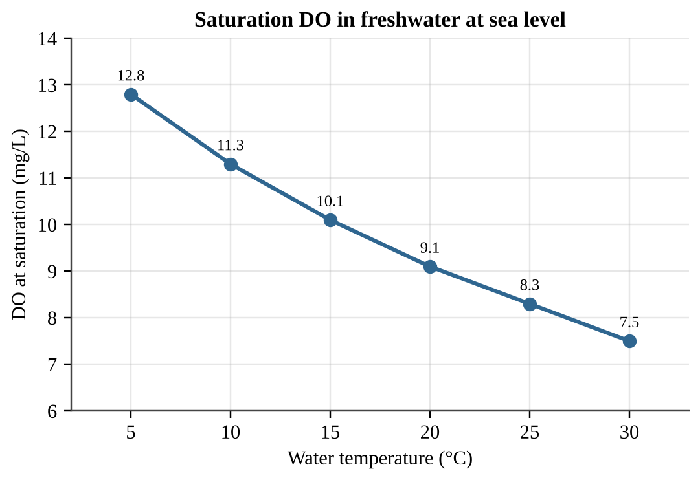{w=0.8}

By about what percentage does the saturation DO decrease from the upstream to the downstream temperature?
A) 8%
B) 18%
C) 22%
D) 82%
:::

:::q QB-U7-MCQ003 | unit=7 | topic=7.8 | diff=1
Which of the following is a documented effect of chronic noise pollution on wildlife?
A) Increased absorption of ultraviolet light by skin and feathers
B) Faster decomposition of animal waste in affected habitats
C) Greater genetic diversity within each affected species
D) Masking of sounds that animals use to communicate or locate prey
:::

:::q QB-U7-MCQ019 | unit=7 | topic=7.8 | diff=2
Figure 4 shows typical sound levels near six common sources. The dashed line marks 85 dB, the level above which long daily exposure is considered a risk to hearing.

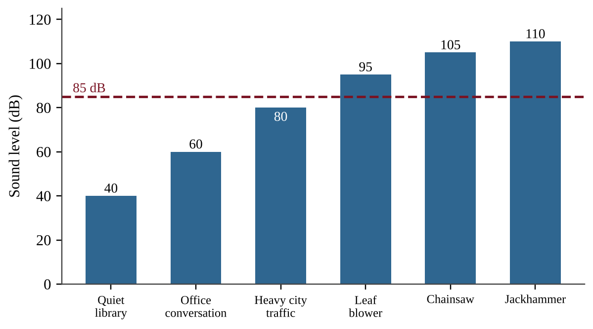{w=0.8}

Which conclusion is best supported by Figure 4?
A) Only construction equipment exceeds the 85 dB level.
B) Heavy city traffic exceeds the 85 dB level, so nearby residents should wear hearing protection.
C) Three of the six sources exceed 85 dB, so workers who use them for long periods risk hearing loss.
D) The chainsaw is below the 85 dB level, so it is safe to use all day without protection.
:::

:::q QB-U7-MCQ027 | unit=7 | topic=7.8 | diff=2
Ecologists counted songbird nests at four distances from a busy highway and recorded the average sound level at each location.

| Distance from highway (m) | Sound level (dB) | Nests that fledged young (%) |
|---|---|---|
| 50 | 72 | 38 |
| 200 | 60 | 52 |
| 500 | 48 | 71 |
| 1,000 | 45 | 74 |

Which inference is best supported by the data?
A) Highway noise is the proven cause of every nest failure.
B) Nest success is lower where noise is higher, which is consistent with noise interfering with communication, although other factors were not ruled out.
C) Nest success depends only on distance from the highway and is unrelated to noise.
D) Noise above 45 dB prevents all nesting.
:::

:::q QB-U7-MCQ033 | unit=7 | topic=7.8 | diff=3
Read the following excerpt from a research summary.

"Between 2012 and 2022, the number of ships using Harrow Strait doubled. Over the same period, underwater recorders showed a steady rise in low-frequency noise, and visual surveys counted 40% fewer fin whale sightings. Fin whales communicate over long distances with low-frequency calls. The authors conclude that ship noise probably contributed to the decline by masking these calls, but they note that populations of the whales' prey were not surveyed."

Which statement best describes the authors' reasoning?
A) The authors prove that ship noise caused the decline by means of a controlled experiment.
B) The authors argue that prey scarcity is the sole cause of the decline and that noise played no role in it.
C) The authors reject any link because noise and sightings were measured with different methods.
D) The authors support a link with correlated trends and a plausible mechanism, but acknowledge an unmeasured factor.
:::

:::q QB-U8-MCQ001 | unit=8 | topic=8.1 | diff=1
Which of the following is an example of a nonpoint source of water pollution?
A) Wastewater flowing from a pipe at a textile factory
B) An overflow pipe at a sewage treatment plant
C) Fertilizer and pesticides washed by rain from many farm fields into a river
D) Fuel leaking from a single underground tank at a gas station
:::

:::q QB-U8-MCQ003 | unit=8 | topic=8.4 | diff=1
Mangrove forests along a tropical coast are cleared to build shrimp ponds. Which ecological service is most directly reduced for the nearby villages?
A) Buffering against storm surge and coastal flooding
B) Conversion of saltwater into drinking water
C) Production of oil that fuels fishing boats
D) Removal of ultraviolet light from sunlight
:::

:::q QB-U8-MCQ009 | unit=8 | topic=8.2 | diff=1
A pollutant in a stream rises above the optimum range for a fish species but stays below the level that kills fish quickly. Which outcome is most likely for the fish population?
A) All fish die within hours.
B) Physiological stress, slower growth and reduced reproduction
C) No effect, because every organism tolerates every level of a pollutant equally
D) Faster growth, because organisms always adapt immediately
:::

:::q QB-U8-MCQ011 | unit=8 | topic=8.5 | diff=2
A lake receives large inputs of phosphorus, and an algal bloom develops and then dies. Which process is the main cause of the fish kill that follows the collapse of the bloom?
A) Dead algae release heat that warms the water above the fish's tolerance.
B) Algal cells clog the gills of the fish.
C) Phosphorus poisons the gills of the fish at the concentrations found in lakes.
D) Microbes digesting the dead algae use up the dissolved oxygen.
:::

:::q QB-U8-MCQ012 | unit=8 | topic=8.5 | diff=2
Heavy rain washed lawn fertilizer into Lake Tamarack in late May. The lake was sampled monthly.

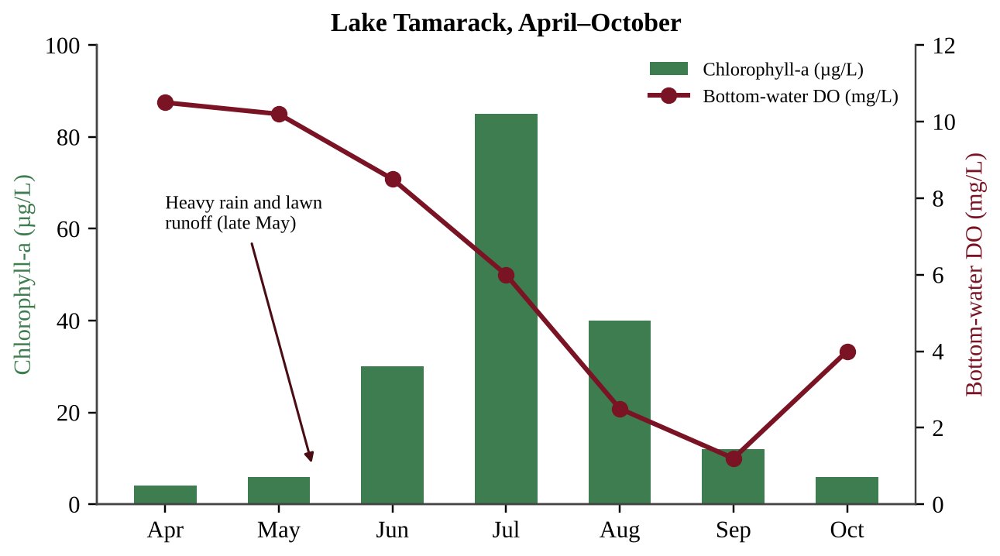{w=0.85}

Which conclusion is best supported by the data?
A) Bottom-water DO declined after July because there were fewer algae left to produce oxygen by photosynthesis.
B) Higher chlorophyll concentrations cause higher DO in every month because of photosynthesis.
C) Bottom-water DO was lowest after the chlorophyll peak, consistent with decomposers using oxygen on dead algae.
D) Because chlorophyll returned to its April level by October, the nutrient input had no ecological effect.
:::

:::q QB-U8-MCQ013 | unit=8 | topic=8.1 | diff=2
A county measured the annual nitrogen load reaching a river from four sources.

| Source | Nitrogen load (kg/yr) |
|---|---|
| Wastewater treatment plant outfall pipe | 9,000 |
| Food-processing plant discharge pipe | 6,000 |
| Runoff from cropland | 36,000 |
| Runoff from residential lawns and streets | 9,000 |

What percentage of the total nitrogen load comes from nonpoint sources?
A) 75%
B) 25%
C) 60%
D) 15%
:::

:::q QB-U8-MCQ014 | unit=8 | topic=8.2 | diff=2
Deforestation on hillsides above a tropical coast greatly increases the amount of sediment carried to the sea. Which is the most direct way this sediment harms nearby coral reefs?
A) It raises the salinity of the water above the tolerance of the coral.
B) It reduces the light reaching the coral's photosynthetic algae and smothers coral as it settles.
C) It adds oxygen to the water, which burns the coral's tissues.
D) It attracts fishing boats that damage the reef.
:::

:::q QB-U8-MCQ015 | unit=8 | topic=8.2 | diff=2
Weeks after a tanker spill, dead clams and crabs are found on the seafloor 15 km from shore, although no oil is visible on the surface there. Which statement best explains this observation?
A) Surface oil blocked sunlight from reaching the sediments.
B) Seabirds carried oil down to the bottom.
C) Oil dissolved completely and became harmless to bottom dwellers.
D) Some components of oil sink to the ocean floor and kill bottom-dwelling organisms.
:::

:::q QB-U8-MCQ017 | unit=8 | topic=8.4 | diff=2
A developer fills in a floodplain marsh upstream of a town. After the next heavy rain, the town floods more severely than in the past. Which statement best explains the change?
A) The marsh used to absorb storm water and release it slowly, and its loss let runoff reach the river faster.
B) The marsh plants used to release extra water to the river by transpiration.
C) Filling the marsh increased the soil's ability to store storm water.
D) The loss of the marsh increased groundwater recharge, which raised the river.
:::

:::q QB-U8-MCQ028 | unit=8 | topic=8.5 | diff=3
Researchers want to determine whether nitrogen or phosphorus limits algal growth in Lake Corbin. Which design best answers the question?
A) Add both nitrogen and phosphorus to every container and vary the light level.
B) Add nitrogen to containers filled at one end of the lake and phosphorus to containers filled at the other end.
C) Use identical containers of lake water with four replicated treatments (none, N, P, N + P), the same light and temperature, and measure chlorophyll after 10 days.
D) Add increasing amounts of nitrogen to a single container of lake water and measure chlorophyll each day for two weeks.
:::

:::q QB-U8-MCQ030 | unit=8 | topic=8.2 | diff=3
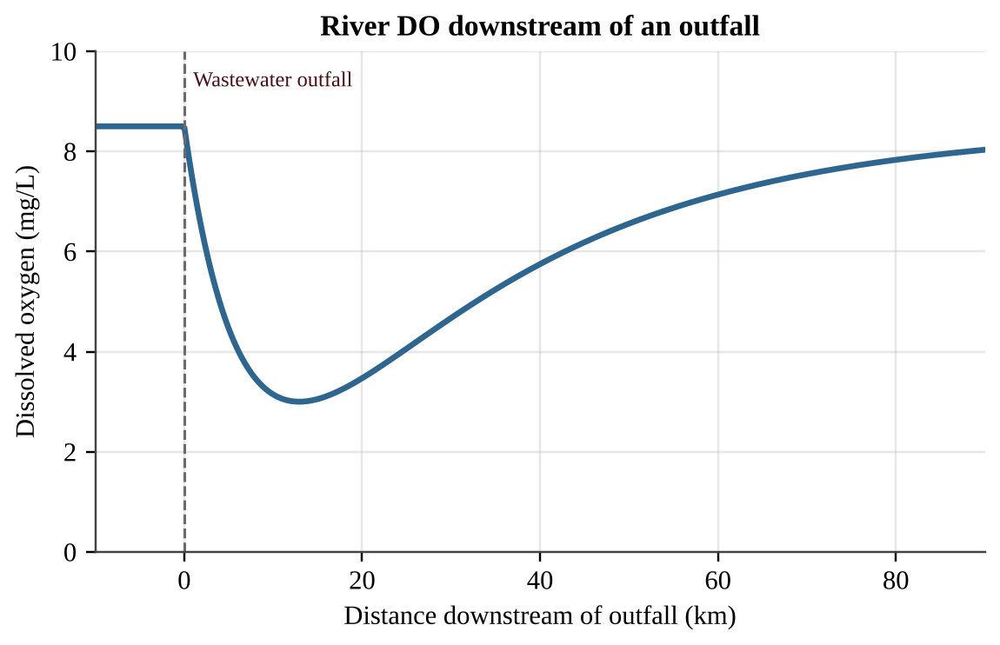{w=0.85}

The outfall discharges untreated organic waste. Which statement best explains why DO keeps falling for about 13 km below the outfall and then rises?
A) The concentration of organic waste is highest 13 km downstream.
B) The water becomes colder as it moves downstream, so it holds less oxygen than before.
C) Photosynthesis by decomposing bacteria adds oxygen to the water after 13 km.
D) Decomposers use oxygen faster than it is replaced until much of the waste is gone; then reoxygenation exceeds use.
:::

:::q QB-C9-MCQ001 | chapter=9 | sec=7 | unit=8 | topic=8.1 | diff=1
Pollutants that enter an aquifer often remain there for decades, while similar pollutants in a fast-flowing river may be diluted or removed within weeks. Which statement best explains this difference?
A) Groundwater receives more sunlight than river water, and the extra light chemically fixes pollutants in place.
B) Groundwater moves slowly and has little mixing, aeration, or sunlight, so pollutants are neither diluted nor broken down quickly.
C) Aquifer sediments contain more dissolved oxygen than river water, and this stops microbes from degrading pollutants.
D) Pollutants in aquifers cannot dissolve in groundwater, so they simply accumulate at the top of the water table.
:::

:::q QB-C9-MCQ002 | chapter=9 | sec=7 | unit=8 | topic=8.1 | diff=2
An unlined municipal landfill sits above an unconfined sand aquifer. Groundwater flows from west to east. Chloride concentrations in four monitoring wells are shown; the regional background concentration is 10–15 mg/L.

Which conclusion is best supported by the data?
A) The contamination originates upgradient of the landfill, because Well A is the westernmost well.
B) The plume has spread northward, because Well D is close to the landfill.
C) Chloride has been completely broken down by microbes between Well B and Well C.
D) Leachate from the landfill is entering the aquifer and moving east, with concentration decreasing downgradient as the plume is diluted and dispersed.
:::

:::q QB-C9-MCQ003 | chapter=9 | sec=7 | unit=8 | topic=8.1 | diff=2
Groundwater in a sandy aquifer flows at 0.40 m per day. A fuel spill occurs at a point 292 m directly upgradient of a drinking-water well. Assuming the contaminant moves with the groundwater and is not degraded, approximately how long will it take to reach the well?
A) 2.0 years
B) 0.80 years
C) 0.32 years
D) 7.3 years
:::

:::q QB-C9-MCQ004 | chapter=9 | sec=8 | unit=8 | topic=ext | diff=1
A technician measures a high biochemical oxygen demand (BOD) in a water sample from a stream. This result most directly indicates that the water contains
A) a large amount of dissolved minerals that make the water hard.
B) a high concentration of suspended clay particles that scatter light.
C) a large amount of biodegradable organic matter that microbes will consume oxygen to decompose.
D) a high concentration of dissolved oxygen that supports many fish species.
:::

:::q QB-C9-MCQ005 | chapter=9 | sec=8 | unit=8 | topic=ext | diff=2
Students tested water at three stream sites.

| Site | Dissolved oxygen (mg/L) | BOD₅ (mg/L) | Fecal coliform (CFU/100 mL) |
|---|---|---|---|
| 1 | 9.1 | 1.5 | 20 |
| 2 | 3.2 | 12.0 | 4,800 |
| 3 | 6.8 | 4.0 | 300 |

Which interpretation is best supported by the data?
A) Site 2 is most likely just downstream of a sewage input, because high BOD and fecal coliform occur together with low dissolved oxygen.
B) Site 1 is the most polluted, because it has the highest dissolved oxygen.
C) Site 3 is unaffected by human activity, because its fecal coliform count is below that of Site 2.
D) Site 2 has the best habitat for most fish, because its BOD is the highest.
:::

:::q QB-C9-MCQ006 | chapter=9 | sec=8 | unit=8 | topic=ext | diff=3
To estimate the BOD₅ of a wastewater sample, a technician places 5.0 mL of the wastewater in a 300 mL bottle and fills the rest with oxygen-saturated dilution water. The dissolved oxygen is 8.5 mg/L at the start and 4.5 mg/L after five days of dark incubation at 20°C. What is the BOD₅ of the undiluted wastewater?
A) 0.067 mg/L
B) 4.0 mg/L
C) 240 mg/L
D) 1,200 mg/L
:::

:::q QB-C9-MCQ007 | chapter=9 | sec=9 | unit=8 | topic=ext | diff=1
During drinking-water treatment, aluminum sulfate (alum) is added to raw water in a rapid-mix basin. The main purpose of this step is to
A) kill bacteria and viruses before the water enters the distribution system.
B) remove dissolved gases such as hydrogen sulfide.
C) increase the dissolved oxygen concentration of the water.
D) cause fine suspended particles to clump together so that they can settle out.
:::

:::q QB-C9-MCQ008 | chapter=9 | sec=9 | unit=8 | topic=ext | diff=2
A city that disinfects its drinking water with chlorine finds that trihalomethanes (disinfection byproducts that form when chlorine reacts with dissolved organic matter) are rising in the distribution system after heavy spring runoff. Which action would most directly address the cause while still protecting the public from pathogens?
A) Stop disinfecting the water until the runoff season ends, then restart once the organic matter has cleared.
B) Remove more organic matter before disinfection, for example by enhanced coagulation or activated carbon filtration.
C) Add more chlorine at the plant so that the extra chlorine uses up more of the organic matter as byproducts.
D) Filter the water through a coarse screen at the plant outlet to remove trihalomethanes after they form.
:::

:::q QB-C9-MCQ009 | chapter=9 | sec=9 | unit=8 | topic=ext | diff=3
Water entering a treatment plant has a chlorine demand of 1.1 mg/L. Operators want a free chlorine residual of 0.40 mg/L at the end of treatment. The plant treats 40 million liters of water per day. Approximately how many kilograms of chlorine must be added each day?
A) 16 kg
B) 44 kg
C) 60 kg
D) 600 kg
:::

:::q QB-U8-MCQ008 | unit=8 | topic=8.11 | diff=1
Which process takes place during the primary treatment of sewage?
A) Bacteria in an aerated tank break down organic matter.
B) Ultraviolet light kills disease-causing bacteria.
C) Screens remove large objects and solids settle to the bottom of a tank.
D) A constructed wetland removes remaining nutrients.
:::

:::q QB-U8-MCQ024 | unit=8 | topic=8.11 | diff=2
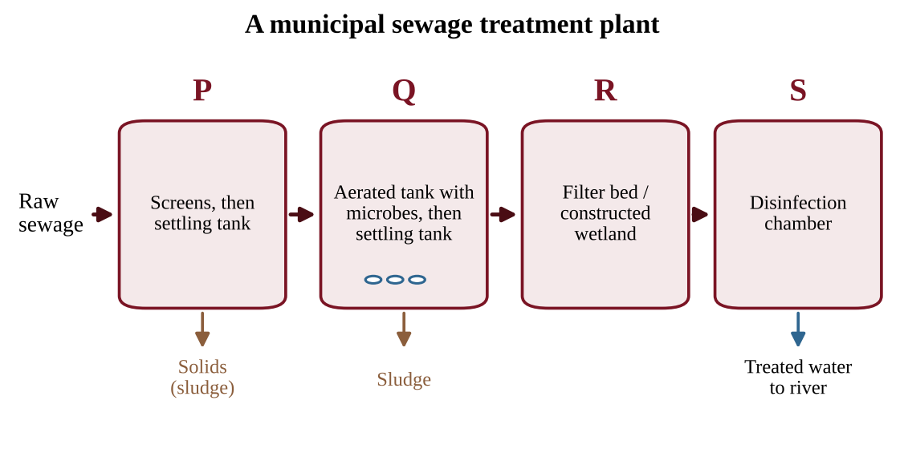{w=0.9}

Which statement best describes the treatment that occurs in tank Q?
A) Screens and grates remove large objects from the incoming sewage.
B) Solids settle by gravity alone, with no biological activity involved.
C) Microbes break down organic matter, and added air speeds up the process.
D) Chemical or ecological processes remove nutrients left after earlier stages.
:::

:::q QB-U8-MCQ006 | unit=8 | topic=8.9 | diff=1
A sanitary municipal landfill is built with a bottom liner of compacted clay or plastic. The main purpose of the liner is to
A) keep leachate from seeping into the groundwater.
B) speed up decomposition by trapping oxygen in the waste.
C) collect methane so it can be burned for electricity.
D) keep rainwater from entering the top of the landfill.
:::

:::q QB-U8-MCQ010 | unit=8 | topic=8.10 | diff=1
A town generates 480 metric tons of solid waste in one month and recycles 120 metric tons of it. What is the town's recycling rate for the month?
A) 25%
B) 33%
C) 75%
D) 400%
:::

:::q QB-U8-MCQ021 | unit=8 | topic=8.9 | diff=2
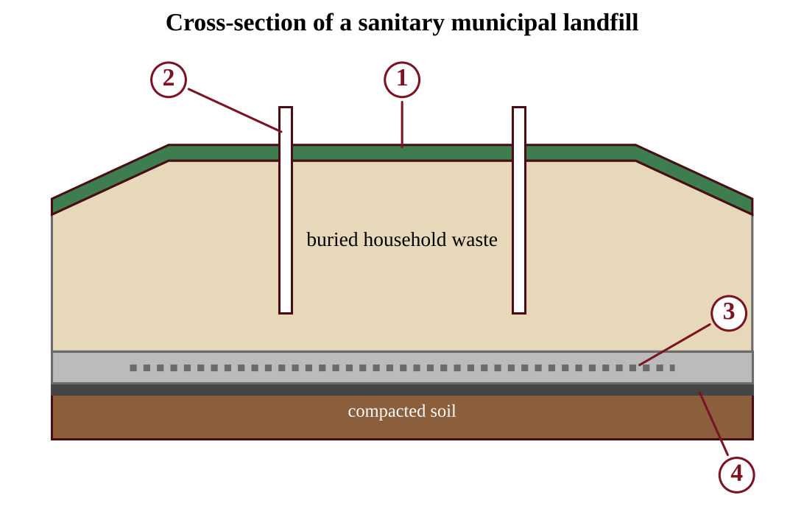{w=0.8}

Which numbered component collects the water that has trickled through the waste so that it can be pumped out and treated?
A) 3
B) 1
C) 2
D) 4
:::

:::q QB-U8-MCQ022 | unit=8 | topic=8.10 | diff=2
A household has a drawer of old phones and laptops. Which option is most effective at keeping the lead and mercury in them out of groundwater?
A) Mixing them with household trash in a municipal landfill, where leachate can eventually escape
B) Burning them in a backyard fire pit
C) Burying them in a pit on the property
D) Taking them to a certified e-waste recycler that recovers the materials
:::

:::q QB-U8-MCQ023 | unit=8 | topic=8.10 | diff=2
A town generates 150,000 tons of municipal solid waste per year. Currently 30% is recycled, 10% is composted, and the rest is landfilled. A new plan raises composting to 25% and leaves recycling unchanged. How many fewer tons will be landfilled each year?
A) 15,000
B) 22,500
C) 37,500
D) 67,500
:::

:::q QB-U8-MCQ033 | unit=8 | topic=8.10 | diff=3
A landfill captures 2.0 × 10⁶ m³ of methane per year. Each m³ of methane releases 36 MJ of energy when burned. A generator converts 30% of that energy to electricity. One household uses 10,000 kWh per year (1 kWh = 3.6 MJ). About how many households could be supplied?
A) 600
B) 2,000
C) 2,160
D) 7,200
:::

## Section B — Free-Response Questions

:::q QB-U7-FRQ003 | unit=7 | topic=7.6 | diff=3 | frqtype=3 | pts=10
A coal-burning power plant burns 2.0 × 10⁶ metric tons of coal per year. The coal is 1.5% sulfur by mass. When the coal burns, all of the sulfur is converted to sulfur dioxide by the reaction S + O₂ → SO₂. The atomic mass of sulfur is 32 and the molecular mass of SO₂ is 64.

The plant's owners are considering a wet scrubber that removes 95% of the SO₂ from the flue gas at a total cost of $48 million per year.

(a) Calculate the mass of sulfur, in metric tons, in the coal burned each year. [1]

(b) Calculate the mass of SO₂, in metric tons, that the plant would release each year without any control device. Show your work. [2]

(c) Calculate the mass of SO₂, in metric tons per year, that the plant would release with the scrubber operating. [1]

(d) Calculate the cost of the scrubber per metric ton of SO₂ removed. Report your answer to two significant figures. [2]

(e) Describe two effects of acid deposition on communities and ecosystems downwind of the plant. [2]

(f) Propose one way, other than installing the scrubber, that the owners could reduce SO₂ emissions, and describe one trade-off of your proposal. [2]
:::

:::q QB-U7-FRQ004 | unit=7 | topic=7.3 | diff=3 | frqtype=2 | pts=10
A mountain-ringed city monitors fine particulate matter (PM2.5) during winter. On some days a thermal inversion forms. The table and Figure 9 show eight days of data. Inversion days are those on which the temperature at 300 m is higher than the temperature at the surface.

| Date | Surface temperature (°C) | Temperature at 300 m (°C) | Daily mean PM2.5 (µg/m³) |
|---|---|---|---|
| Dec 2 | 2 | −1 | 14 |
| Dec 3 | 3 | 0 | 18 |
| Dec 4 | −4 | 3 | 61 |
| Dec 5 | −5 | 4 | 78 |
| Dec 6 | −3 | 5 | 92 |
| Dec 7 | 1 | −2 | 23 |
| Dec 8 | 4 | 1 | 12 |
| Dec 9 | −6 | 2 | 85 |

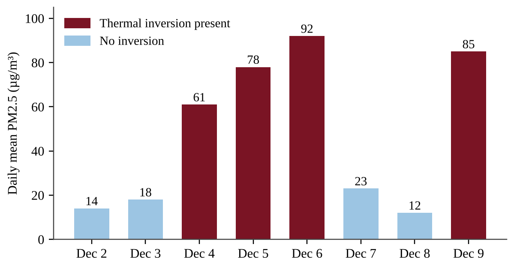{w=0.85}

(a) Describe the relationship between the presence of a thermal inversion and the daily mean PM2.5 concentration. [1]

(b) Calculate the mean PM2.5 concentration for the inversion days and for the non-inversion days. Show your work. [2]

(c) Explain how a thermal inversion causes pollutant concentrations near the ground to increase. [2]

(d) Identify one human activity that contributes PM2.5 to the air of a city in winter. [1]

(e) Identify one human health effect of breathing high concentrations of particulate matter. [1]

(f) Propose a solution that the city could apply on forecast inversion days, and justify it. [2]

(g) Make a claim about whether eight days of data are sufficient to conclude that inversions cause high PM2.5, and support your claim. [1]
:::

:::q QB-U7-FRQ001 | unit=7 | topic=7.5 | diff=2 | frqtype=1 | pts=10
After a summer renovation of Wing B of Maple Ridge Middle School, several teachers and students in Wing B reported headaches and eye irritation. Few such complaints came from Wing A, which was not renovated. Wing B received new carpet, particleboard cabinets, and fresh paint. Figure 7 is a floor plan of the two wings, each with four classrooms. A single ventilation unit serves both wings.

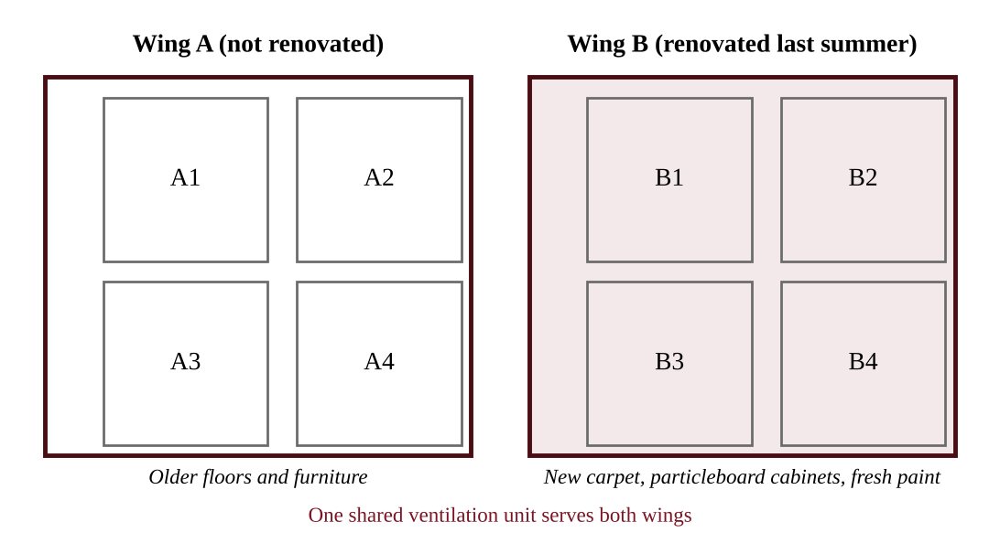{w=0.85}

The school's environmental science club proposes to test whether the renovation materials are releasing an indoor air pollutant.

(a) Identify one category of indoor air pollutant that is the most likely cause of the complaints in Wing B, and identify one building material that could be its source. [1]

(b) State a testable hypothesis for the investigation, including the predicted direction of the difference between the wings. [1]

(c) Identify the independent variable and the dependent variable, and identify two variables that should be controlled. [2]

(d) Describe a procedure for collecting the data, including where and when the air samples will be taken and how the investigation will address variability. [3]

(e) Describe the results that would support the hypothesis. [1]

(f) Propose one action the school could take to reduce occupants' exposure. [1]

(g) Justify your proposed action by explaining how it would lower the concentration of the pollutant. [1]
:::

:::q QB-U7-FRQ002 | unit=7 | topic=7.7 | diff=2 | frqtype=2 | pts=10
A coal-burning power plant has been upwind of two lakes for several decades. Lake Alder lies in a watershed with granite bedrock and thin soils. Lake Birch lies in a watershed with limestone bedrock. Beginning in 1990 the plant installed scrubbers and other controls. Figure 8 shows the plant's annual SO₂ emissions and the pH of both lakes.

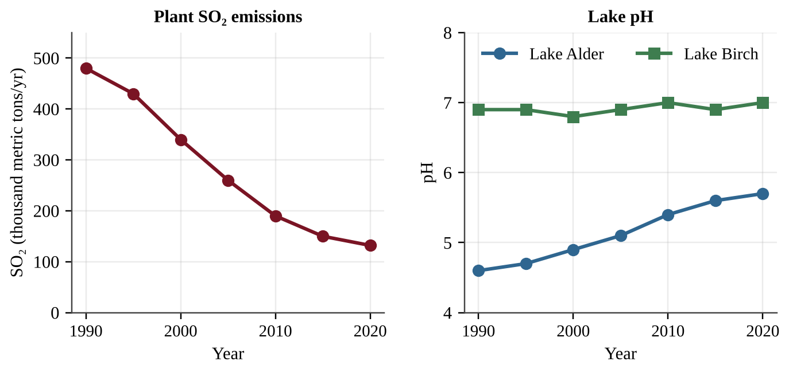{w=0.9}

| Year | SO₂ emissions (thousand metric tons/yr) | Lake Alder pH | Lake Birch pH |
|---|---|---|---|
| 1990 | 480 | 4.6 | 6.9 |
| 2000 | 340 | 4.9 | 6.8 |
| 2010 | 190 | 5.4 | 7.0 |
| 2020 | 132 | 5.7 | 7.0 |

(a) Describe the relationship between the plant's SO₂ emissions and the pH of Lake Alder from 1990 to 2020. [1]

(b) Calculate the percent decrease in the plant's SO₂ emissions from 1990 to 2020. Show your work. [1]

(c) Explain why the pH of Lake Birch stayed near 7 even when SO₂ emissions were highest. [2]

(d) Describe how sulfur dioxide released from the plant's stack becomes acid deposition downwind. [1]

(e) Identify two environmental or economic effects of acid deposition other than the acidification of lakes. [2]

(f) Make a claim about whether reducing SO₂ alone will fully restore Lake Alder, and justify your claim with data from the figure or table. [1]

(g) Propose a solution, other than scrubbers, that would further reduce acid deposition in the region, and justify why it would work. [2]
:::

:::q QB-U8-FRQ001 | unit=8 | topic=8.5 | diff=2 | frqtype=1 | pts=10
Cedar Pond is a small recreational pond that receives water from two inlet streams. Inlet 1 drains a housing development with fertilized lawns and storm drains. Inlet 2 drains a forested hillside. For the past two summers, residents have seen dense green scum on the pond in July, and several dead fish washed up in August. Residents suspect that lawn fertilizer in the runoff is responsible. A student team plans to test this idea using four sampling sites, S1 through S4.

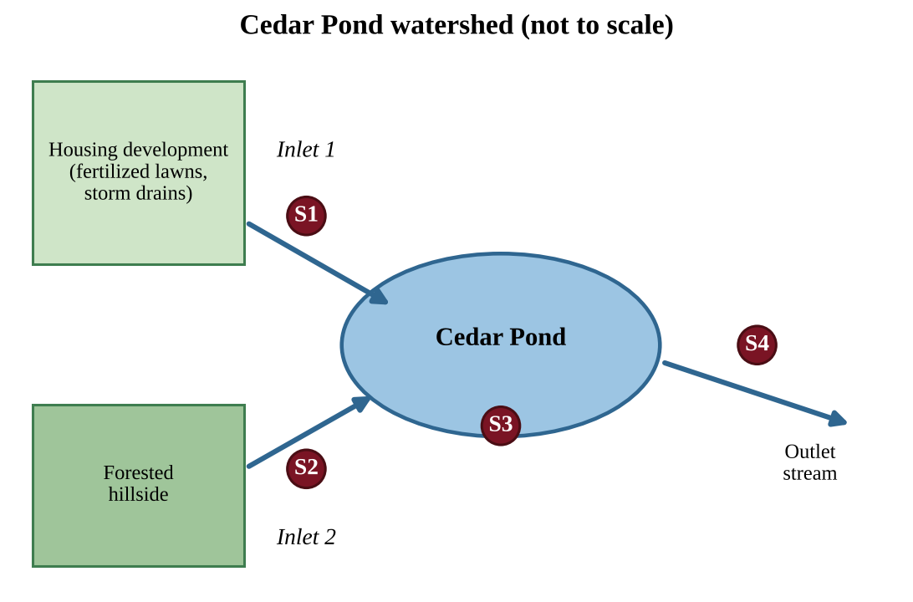{w=0.85}

(a) Identify the environmental problem the residents have observed in Cedar Pond. [1]
(b) State a testable hypothesis, in if-then form, that links the runoff from the housing development to the problem identified in part (a). [1]
(c) Identify the independent variable and the dependent variable for the team's investigation. [2]
(d) Describe a procedure the team could follow to test the hypothesis. In your description, identify at least one nutrient or water-quality measurement, state when and how often samples are collected at the four sites, and identify one variable that must be kept constant or recorded for every sample. [3]
(e) Describe the pattern of data across the four sites that would support the hypothesis. [1]
(f) Explain how a bloom of algae in the pond can lead to the August fish kill. [1]
(g) Propose one action the housing development could take to reduce nutrient runoff into Inlet 1 and justify why it would work. [1]
:::

:::q QB-C9-FRQ001 | chapter=9 | sec=8 | unit=8 | topic=8.1 | diff=3 | frqtype=1 | pts=10
A stream flows from forested headwaters past a fertilized cornfield and then past a small town. Wastewater from the town's treatment plant is discharged into the stream. Residents have noticed dead fish and thick algal mats about 1.5 km downstream of the outfall. A student group wants to design an investigation to determine whether nutrient pollution from the cornfield, the wastewater plant, or both is responsible for the water-quality problem.

(a) Identify the environmental problem that the students are investigating, and name the process by which excess nutrients lead to fish deaths. [1]
(b) State a hypothesis for the investigation in "if … then … because" form. [1]
(c) Identify the independent variable and one dependent variable of the investigation. [2]
  (i) Independent variable
  (ii) Dependent variable
(d) Describe a sampling procedure, including where along the stream samples would be collected and how many samples would be taken, so that the two possible sources can be compared. [2]
(e) Identify two variables that the students should keep constant when collecting samples. [1]
(f) Describe the pattern of results that would support the claim that the wastewater plant is the main source of the problem. [1]
(g) Propose one solution to reduce the problem and justify why it would work. [2]
:::

:::q QB-U8-FRQ003 | unit=8 | topic=8.10 | diff=3 | frqtype=3 | pts=10
The city of Riverton has a population of 250,000. Residents generate an average of 1.8 kg of municipal solid waste (MSW) per person per day. Currently 22% of the MSW is recycled and 12% is composted. The rest is landfilled. Landfilled waste is compacted to a density of 600 kg/m³. The city's landfill has 4.0 × 10⁶ m³ of unused capacity. (1 metric ton = 1,000 kg; use 365 days per year.)

(a) Calculate the mass of MSW generated by Riverton in one year, in metric tons. Show your work. [2]
(b) Calculate the mass of MSW landfilled in one year, in metric tons. [1]
(c) Calculate the volume of landfill space used in one year, in m³. [2]
(d) Calculate the number of years until the landfill is full at the current rate. [1]
(e) The city proposes to raise the combined recycling and composting rate from 34% to 50% of MSW. Calculate how many years the landfill's remaining capacity would last under the proposal. [2]
(f) Describe one drawback of a larger composting program, and propose one change besides increased recycling or composting that would further extend the life of the landfill. Justify your proposal. [2]
:::
