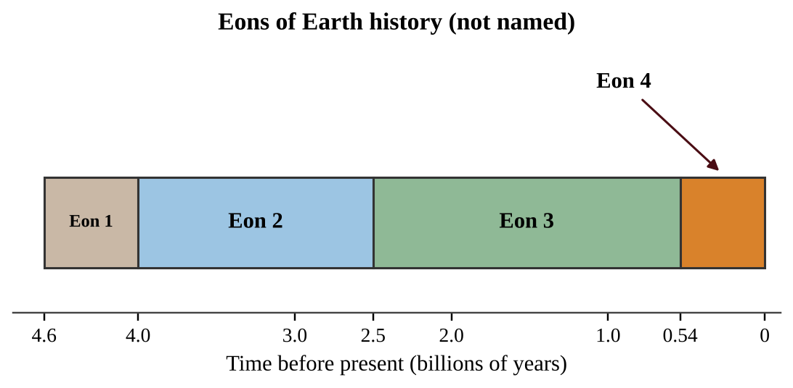
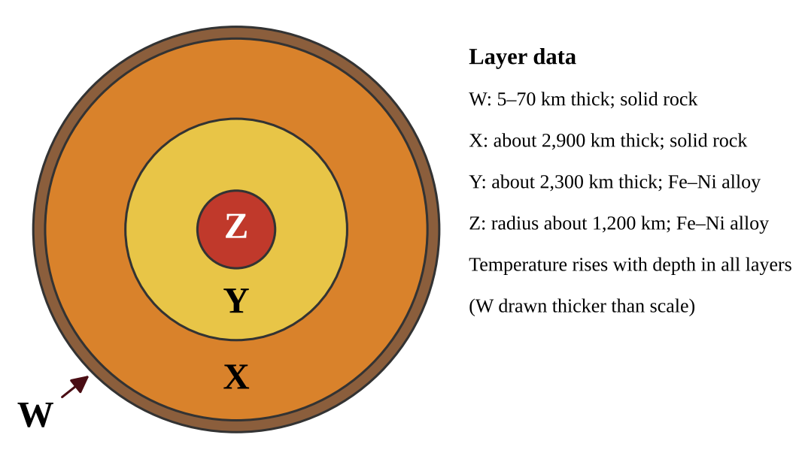
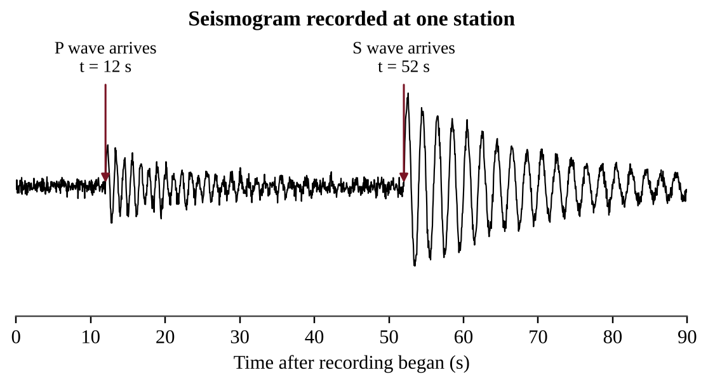
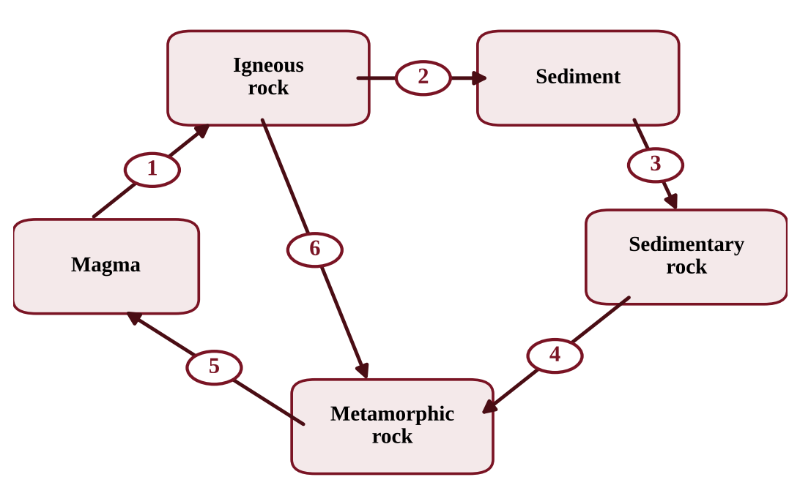
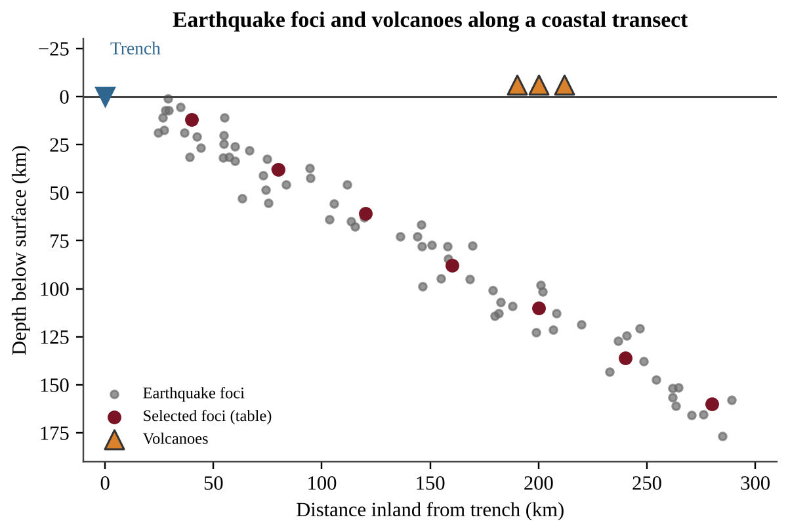

:::q QB-C1-MCQ001 | chapter=1 | sec=1 | unit=0 | topic=ext | diff=1
Geologists divide Earth's 4.6-billion-year history into nested units of time. Which list places these units in order from the longest to the shortest?
A) Eon, era, period, epoch
B) Era, eon, epoch, period
C) Eon, period, era, epoch
D) Epoch, period, era, eon
:::

:::q QB-C1-MCQ002 | chapter=1 | sec=1 | unit=0 | topic=ext | diff=2
The figure shows the four eons of Earth's history on a timeline. Approximately what percent of Earth's 4.6-billion-year history is represented by Eon 4?

{w=0.85}

A) 12%
B) 1%
C) 54%
D) 88%
:::

:::q QB-C1-MCQ003 | chapter=1 | sec=1 | unit=0 | topic=ext | diff=3
A geologist dates a granite using a radioactive isotope with a half-life of 0.70 billion years. Laboratory analysis shows that 12.5% of the original parent isotope remains in the rock and the rest has decayed to its daughter product. Which value is the best estimate of the age of the granite?
A) 0.70 billion years
B) 1.4 billion years
C) 2.1 billion years
D) 5.6 billion years
:::

:::q QB-C1-MCQ004 | chapter=1 | sec=2 | unit=4 | topic=4.1 | diff=1
Which layer of Earth makes up the largest share of the planet's volume?
A) Crust
B) Inner core
C) Outer core
D) Mantle
:::

:::q QB-C1-MCQ005 | chapter=1 | sec=2 | unit=4 | topic=4.1 | diff=2
The diagram shows four layers of Earth, labeled W through Z, with some of their properties. Seismologists note that S-waves, which cannot travel through liquids, are never detected after passing through the deep interior. Which layer is liquid, and what is the evidence?

{w=0.85}

A) Layer Y, because S-waves are blocked when they reach it
B) Layer Z, because it is the hottest layer and must therefore be molten
C) Layer X, because the heat of the mantle causes it to convect
D) Layer W, because P-waves travel slowly through it
:::

:::q QB-C1-MCQ006 | chapter=1 | sec=2 | unit=4 | topic=4.1 | diff=3
Two oceanic plates meet at a convergent boundary. Plate P is 5 million years old, and Plate Q is 120 million years old. Both plates are made of the same basalt and gabbro. Which statement best predicts what will happen?
A) Plate P will subduct because it is younger, hotter and weaker.
B) Plate P will subduct because young lithosphere is thicker than old lithosphere.
C) Plate Q will subduct because it is older, cooler and denser.
D) Neither plate will subduct because two oceanic plates of the same composition always form mountains.
:::

:::q QB-C1-MCQ007 | chapter=1 | sec=4 | unit=4 | topic=4.1 | diff=1
What is the name for the point on Earth's surface that lies directly above the place where an earthquake's rupture begins?
A) Focus
B) Epicenter
C) Fault scarp
D) Seismic gap
:::

:::q QB-C1-MCQ008 | chapter=1 | sec=4 | unit=4 | topic=4.1 | diff=2
On the moment magnitude scale, a magnitude 7.0 earthquake is compared with a magnitude 5.0 earthquake. Which statement is correct?
A) The ground shaking is about 2 times larger, and about 2 times more energy is released.
B) The ground shaking is about 20 times larger, and about 200 times more energy is released.
C) The ground shaking is about 100 times larger, and about 1,000 times more energy is released.
D) The ground shaking is about 100 times larger, and about 100 times more energy is released.
:::

:::q QB-C1-MCQ009 | chapter=1 | sec=4 | unit=4 | topic=4.1 | diff=3
A station records the seismogram shown. Assume that P-waves travel through the crust at 6.0 km/s and S-waves travel at 3.5 km/s. Which value is the best estimate of the distance from the station to the epicenter?

{w=0.85}

A) 88 km
B) 140 km
C) 240 km
D) 336 km
:::

:::q QB-C1-MCQ010 | chapter=1 | sec=5 | unit=4 | topic=4.1 | diff=1
Which event is the most common cause of large, destructive tsunamis?
A) Strong winds from a tropical storm blowing across the ocean surface
B) The gravitational pull of the Moon at spring tide
C) Slow horizontal sliding of plates at a transform boundary
D) Sudden vertical movement of the seafloor during a subduction-zone earthquake
:::

:::q QB-C1-MCQ011 | chapter=1 | sec=5 | unit=4 | topic=4.1 | diff=2
The speed of a tsunami in the open ocean is given by v = √(g × d), where g = 9.8 m/s² and d is the water depth. A tsunami crosses an open ocean that is 4,000 m deep. A coastal city lies 3,564 km from the earthquake that generated the wave. Approximately how long will the wave take to reach the city?
A) 1.4 hours
B) 5.0 hours
C) 18 hours
D) 65 hours
:::

:::q QB-C1-MCQ012 | chapter=1 | sec=5 | unit=4 | topic=4.1 | diff=2
A tsunami is barely noticeable as a wave of low height in deep open water, but it can be many meters tall when it reaches a gently sloping coast. Which explanation is best?
A) The wave slows in shallow water, so its energy is concentrated into a taller wave.
B) The wave speeds up in shallow water, which stretches the water upward into a much taller wave.
C) Onshore winds add energy to the wave as it approaches the coast.
D) Friction with the shoreline removes energy, which makes the water pile up.
:::

:::q QB-C1-MCQ013 | chapter=1 | sec=6 | unit=4 | topic=4.1 | diff=1
The chain of volcanoes around the Pacific Ocean known as the Ring of Fire is mainly the result of which process?
A) Seafloor spreading at divergent boundaries that are separating continents
B) Transform motion along faults where plates slide past each other
C) Subduction of oceanic plates beneath other plates at convergent boundaries
D) Erosion of mountains by glaciers
:::

:::q QB-C1-MCQ014 | chapter=1 | sec=6 | unit=4 | topic=4.1 | diff=2
The table gives the properties of the magma of three volcanoes. Which volcano is most likely to erupt explosively?

| Volcano | Silica in magma (%) | Dissolved gas |
|---|---|---|
| P | 49 | High |
| Q | 56 | Low |
| R | 70 | Moderate |

A) Volcano P, because it has the greatest gas content, so its pressure builds fastest
B) Volcano Q, because intermediate silica magma is always the most explosive
C) Volcano P, because low-silica magma is hotter and erupts with greater force
D) Volcano R, because its high-silica magma is viscous and traps gas until pressure builds
:::

:::q QB-C1-MCQ015 | chapter=1 | sec=6 | unit=4 | topic=4.1 | diff=2
A chain of volcanic islands formed as the Pacific Plate moved over a stationary hot spot. The table gives the age of each island and its distance from the island that sits over the hot spot now.

| Island | Age (million years) | Distance from hot spot (km) |
|---|---|---|
| Q | 1.5 | 105 |
| R | 4.0 | 280 |
| S | 5.5 | 385 |

What is the average speed of the plate, in cm per year?
A) 0.7
B) 7.0
C) 70
D) 700
:::

:::q QB-C1-MCQ016 | chapter=1 | sec=9 | unit=0 | topic=ext | diff=1
Which process forms metamorphic rock?
A) Heat and pressure change an existing rock without melting it completely
B) Magma cools and crystallizes underground
C) Layers of sediment are compacted and cemented together
D) Wind and water break rock into fragments
:::

:::q QB-C1-MCQ017 | chapter=1 | sec=9 | unit=0 | topic=ext | diff=2
The diagram shows a version of the rock cycle. Each arrow is numbered. Which arrow represents the compaction and cementation of loose grains into solid rock?

{w=0.85}

A) Arrow 2
B) Arrow 3
C) Arrow 4
D) Arrow 5
:::

:::q QB-C1-MCQ018 | chapter=1 | sec=9 | unit=0 | topic=ext | diff=3
A geologist collects two igneous rocks. Their mineral compositions are the same, but their textures differ.

| Rock | Mineral composition | Average crystal size |
|---|---|---|
| 1 | 50% plagioclase, 50% pyroxene | less than 0.5 mm |
| 2 | 50% plagioclase, 50% pyroxene | about 5 mm |

Which interpretation is best supported by the data?
A) Rock 1 cooled quickly near the surface, and Rock 2 cooled slowly at depth.
B) Rock 1 cooled slowly at depth, and Rock 2 cooled quickly near the surface.
C) Rock 2 formed by the compaction of sediments, and Rock 1 formed from magma.
D) The rocks formed from magmas of different compositions.
:::

:::q QB-C1-FRQ001 | chapter=1 | sec=4 | unit=4 | topic=4.1 | diff=3 | frqtype=2 | pts=10
Along the western coast of a continent, an oceanic plate moves toward the continent and sinks into the mantle at an offshore trench. Seismologists recorded earthquake foci along a line running inland from the trench and noted where volcanoes occur. The results are shown in the figure. The table gives selected foci and three recent earthquakes in the region.

{w=0.9}

| Distance inland from trench (km) | 40 | 80 | 120 | 160 | 200 | 240 | 280 |
|---|---|---|---|---|---|---|---|
| Focal depth (km) | 12 | 38 | 61 | 88 | 110 | 136 | 160 |

| Earthquake | Magnitude | Focal depth (km) | Shaking intensity at epicenter (Modified Mercalli) |
|---|---|---|---|
| X | 6.8 | 15 | IX |
| Y | 6.8 | 105 | VI |
| Z | 5.6 | 10 | VII |

(a) Describe the relationship between the distance of the foci from the trench and their depth. [1]
(b) Identify the type of plate boundary shown in the figure. [1]
(c) Using the table of selected foci, calculate the slope of the line (km of depth gained per km of horizontal distance) between 40 km and 280 km from the trench. [2]
(d) Explain why the volcanoes form about 200 km inland of the trench rather than at the trench. [2]
(e) Earthquake X has a magnitude of 6.8 and earthquake Z has a magnitude of 5.6. Each increase of 1.0 in magnitude corresponds to about 31.6 times more energy released. Calculate how many times more energy was released by earthquake X than by earthquake Z. [1]
(f) Earthquakes X and Y have the same magnitude. Make a claim about how focal depth affects the shaking felt at the surface, and justify it using the data in the table. [2]
(g) Propose one action that a coastal community could take to reduce loss of life from earthquakes in this region, and justify your proposal. [1]
:::
