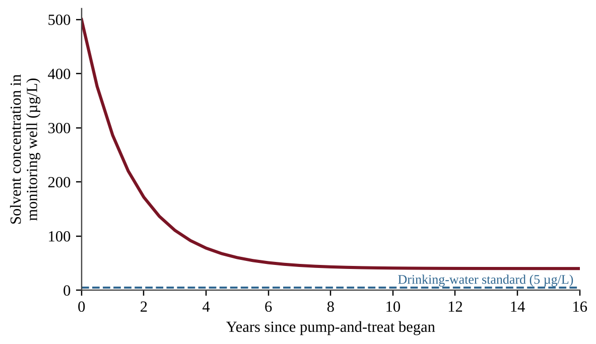

:::q QB-C10-MCQ001 | chapter=10 | sec=4 | unit=8 | topic=8.9 | diff=1
A company cleaning up diesel-contaminated soil adds nutrients and oxygen to the soil to stimulate the growth of native microbes. What is this method called, and what does it rely on?
A) Bioremediation, which relies on microbes to break down the fuel
B) Phytoremediation, which relies on plants to absorb the fuel through their roots
C) Pump-and-treat, which relies on extracting contaminated water and filtering it
D) Incineration, which relies on high temperatures to destroy the fuel
:::

:::q QB-C10-MCQ002 | chapter=10 | sec=4 | unit=8 | topic=8.9 | diff=2
Which statement best describes the approach of the U.S. Superfund law (CERCLA) to abandoned hazardous-waste sites?
A) The federal government pays all cleanup costs and may not seek money from anyone else.
B) It applies only to spills that occur after the law was passed.
C) It requires that contaminated soil at every site be excavated and shipped to another state.
D) Parties responsible for the contamination can be held liable for cleanup costs, and federal funds are used when no responsible party can pay.
:::

:::q QB-C10-MCQ003 | chapter=10 | sec=4 | unit=8 | topic=8.9 | diff=3
A pump-and-treat system was installed to clean groundwater contaminated by a chlorinated solvent. The graph shows the solvent concentration in a monitoring well.

Which explanation best accounts for the concentration leveling off at a value well above the standard after year 8?
A) The pumps were removing more water than the aquifer could supply.
B) The solvent is slowly released from clay layers and soil particles into the flowing groundwater, so removal becomes much slower.
C) Microbes in the aquifer produce new solvent as they respire.
D) The drinking-water standard rises as concentrations fall.
:::

:::q QB-C10-MCQ004 | chapter=10 | sec=5 | unit=8 | topic=8.9 | diff=1
A secure hazardous-waste landfill must contain lead- and mercury-bearing waste indefinitely. Which statement best explains why a long-term containment approach is needed for these wastes?
A) Their toxicity falls by half every few decades through radioactive decay.
B) Soil microbes convert them into harmless compounds within a few years.
C) They are elements that do not decay or biodegrade, so they remain hazardous unless they are kept isolated.
D) They evaporate quickly, so the main concern is air pollution at the site.
:::

:::q QB-C10-MCQ005 | chapter=10 | sec=5 | unit=8 | topic=8.9 | diff=2
A facility plans to keep each radioactive isotope isolated for ten half-lives.

| Isotope | Half-life |
|---|---|
| Iodine-131 | 8 days |
| Strontium-90 | 29 years |
| Cesium-137 | 30 years |
| Plutonium-239 | 24,100 years |

Which isotope sets the longest required isolation time, and approximately how long is that time?
A) Iodine-131, about 80 days
B) Strontium-90, about 290 years
C) Cesium-137, about 300 years
D) Plutonium-239, about 241,000 years
:::

:::q QB-C10-MCQ006 | chapter=10 | sec=5 | unit=8 | topic=8.9 | diff=2
A stored waste has an activity of 640 becquerels per gram (Bq/g) from an isotope with a half-life of 12 years. The waste can be released from controlled storage when its activity falls to 10 Bq/g. How long must it be stored?
A) 60 years
B) 72 years
C) 64 years
D) 768 years
:::

:::q QB-C10-MCQ007 | chapter=10 | sec=7 | unit=ext | topic=ext | diff=1
A paper mill discharges wastewater into a river, and downstream fishers lose income because fish populations decline. The mill's selling price does not include this loss. Which statement correctly names the loss and a way to address it?
A) The loss is a subsidy, and it is addressed by lowering taxes on the mill.
B) The loss is a benefit of the mill, and it is addressed by increasing production.
C) The loss is a negative externality, and a pollution fee equal to the damage per unit can internalize the cost.
D) The loss is a positive externality, and it is addressed by banning all fishing.
:::

:::q QB-C10-MCQ008 | chapter=10 | sec=7 | unit=ext | topic=ext | diff=2
A regulator creates a cap-and-trade program for sulfur dioxide. The cap is set below current total emissions and tradable allowances are issued. Firm X can cut emissions for $50 per tonne, and Firm Y can cut emissions only for $400 per tonne. The allowance price settles at $200 per tonne. Which outcome is most likely?
A) Firm X cuts emissions and sells allowances to Firm Y, so the cap is met at lower total cost.
B) Firm Y cuts emissions and sells allowances to Firm X, so the cap is met at lower total cost.
C) Total emissions rise because trading moves pollution from one firm to another.
D) The allowance price falls to zero because neither firm needs to cut emissions.
:::

:::q QB-C10-MCQ009 | chapter=10 | sec=7 | unit=ext | topic=ext | diff=3
A company removes a pollutant from its waste stream. The table shows the total cost of reaching each removal level.

| Pollutant removed | Total cost (million US$) |
|---|---|
| 50% | 2 |
| 80% | 5 |
| 90% | 10 |
| 99% | 40 |

What is the marginal cost of each additional percentage point of removal between 90% and 99%?
A) $0.40 million
B) $4.4 million
C) $3.3 million
D) $30 million
:::

:::q QB-C10-FRQ001 | chapter=10 | sec=4 | unit=8 | topic=8.9 | diff=3 | frqtype=3 | pts=10
A former dry-cleaning site has contaminated an aquifer with a chlorinated solvent. The contaminated plume contains 2.0 × 10⁶ m³ of groundwater at an average solvent concentration of 0.50 mg/L (1 m³ = 1,000 L). The town proposes a pump-and-treat system that withdraws 400 m³ of groundwater per day. For this problem, assume that the extracted water averages 0.50 mg/L of solvent for the whole project. The system has a capital cost of $1.2 million and an operating cost of $350,000 per year. Cleaning the aquifer is expected to prevent health and property damages worth $0.60 million per year while the system operates.

(a) Calculate the total mass of solvent in the plume. Express your answer in kilograms. [2]
(b) Calculate the number of years required to remove all of the solvent. Round up to a whole number of years. [2]
(c) Using your answer to (b), calculate the total cost of the project in millions of dollars. [1]
(d) Using your answer to (b), calculate the benefit-cost ratio of the project. [1]
(e) Make a claim about whether the project is economically justified, and justify it using your answer to (d). [1]
(f) Explain why the actual cleanup time is likely to be longer than the time calculated in (b). [1]
(g) Propose one additional or alternative cleanup method for this site and describe one advantage of it. [2]
:::
