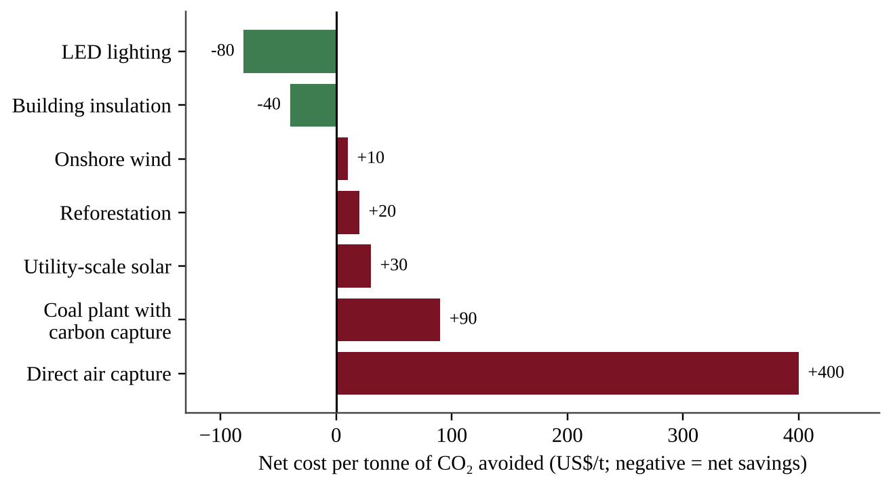

:::q QB-C11-MCQ001 | chapter=11 | sec=5 | unit=9 | topic=9.5 | diff=1
Which of the following actions is an example of climate change mitigation rather than adaptation?
A) Replacing a coal-fired power plant with a wind farm
B) Building a seawall to protect a coastal town from storm surge
C) Planting drought-tolerant crop varieties
D) Opening cooling centers during heat waves
:::

:::q QB-C11-MCQ002 | chapter=11 | sec=5 | unit=9 | topic=9.5 | diff=2
A planning agency compares options for reducing CO₂ emissions.

Which conclusion is best supported by the figure?
A) Reforestation is more expensive per tonne than direct air capture.
B) Some measures reduce emissions and also save money, so they can be adopted at negative net cost.
C) Renewable electricity always costs more than carbon capture at fossil-fuel plants.
D) Direct air capture should be adopted first because it has the largest value.
:::

:::q QB-C11-MCQ003 | chapter=11 | sec=5 | unit=9 | topic=9.5 | diff=2
A country emits 400 million tonnes of CO₂ per year. It adopts a carbon tax of $50 per tonne, and emissions then fall by 12%. What is the annual revenue from the tax after emissions fall?
A) $20 billion
B) $2.4 billion
C) $17.6 billion
D) $22.4 billion
:::

:::q QB-C11-MCQ004 | chapter=11 | sec=5 | unit=9 | topic=9.5 | diff=3
A utility proposes adding carbon capture and storage (CCS) to a coal-fired power plant. Which evaluation of this proposal is most accurate?
A) CCS removes the need for coal mining, so mining impacts end.
B) CCS makes the plant emit more CO₂ per unit of electricity because capture is a chemical process.
C) CCS stores CO₂ permanently without any need for monitoring, because the gas turns into rock immediately.
D) CCS can greatly reduce CO₂ released from the plant, but it uses extra energy and requires secure long-term geologic storage.
:::
