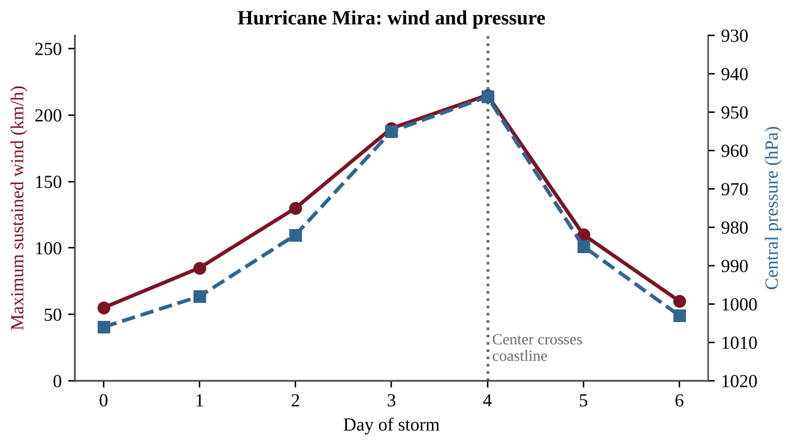

:::q QB-C2-MCQ001 | chapter=2 | sec=1 | unit=4 | topic=4.4 | diff=1
Which gas is the most abundant in dry air near Earth's surface?
A) Oxygen
B) Argon
C) Carbon dioxide
D) Nitrogen
:::

:::q QB-C2-MCQ002 | chapter=2 | sec=1 | unit=4 | topic=4.4 | diff=2
Which component of the lower atmosphere varies the most from place to place and over time, ranging from nearly 0% to about 4% of the air by volume?
A) Water vapor
B) Nitrogen
C) Oxygen
D) Argon
:::

:::q QB-C2-MCQ003 | chapter=2 | sec=1 | unit=4 | topic=4.4 | diff=2
The concentration of carbon dioxide in the air of a classroom is 425 ppm by volume. How many liters of carbon dioxide are present in 2,000 L of this air?
A) 0.0085 L
B) 0.085 L
C) 0.85 L
D) 8.5 L
:::

:::q QB-C2-MCQ004 | chapter=2 | sec=5 | unit=4 | topic=4.5 | diff=1
Which condition is most necessary for a tropical cyclone to form and strengthen?
A) Cold, deep ocean water below 10°C
B) A continental interior far from the ocean
C) A location exactly on the equator, where the Coriolis effect is strongest
D) Warm ocean surface water, about 26.5°C or higher, over a large area
:::

:::q QB-C2-MCQ005 | chapter=2 | sec=5 | unit=4 | topic=4.5 | diff=2
The graph shows the maximum sustained wind speed and the central pressure of a hurricane over six days. Which statement best explains the rapid decrease in wind speed between Day 4 and Day 5?

{w=0.85}

A) The warm sea surface under the storm became even warmer.
B) The central pressure fell, which weakens the winds.
C) The storm moved over land, which cut it off from warm ocean water and increased friction.
D) The Coriolis effect increased sharply near the coast.
:::

:::q QB-C2-MCQ006 | chapter=2 | sec=5 | unit=4 | topic=4.5 | diff=3
A hurricane's center is 600 km from a coastal city and moves toward the city at a steady 18 km/h. Winds too strong for safe travel arrive 12 hours before the center. The city needs 30 hours to evacuate its residents. If officials order the evacuation now, which statement is correct?
A) The evacuation can finish in time because the center will not arrive for about 33 hours.
B) The evacuation cannot finish before unsafe winds arrive, which is in about 21 hours.
C) The evacuation can finish in time because unsafe winds will not arrive for about 45 hours.
D) The evacuation cannot finish because the center will arrive in less than 1 hour.
:::
