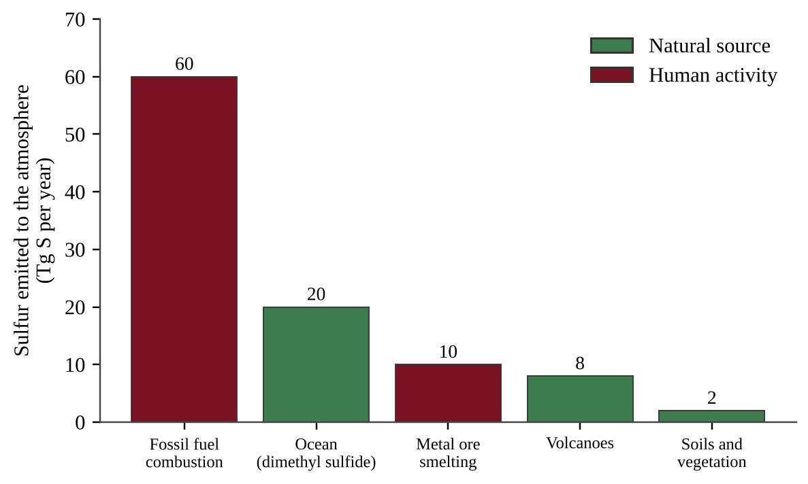

:::q QB-C5-MCQ001 | chapter=5 | sec=4 | unit=1 | topic=ext | diff=1
Which of the following is the largest natural reservoir of sulfur on Earth?
A) The atmosphere, as sulfur dioxide gas
B) Sedimentary rocks and ocean sediments, in minerals such as gypsum and pyrite
C) Living biomass, in proteins
D) Soil organic matter
:::

:::q QB-C5-MCQ002 | chapter=5 | sec=4 | unit=1 | topic=ext | diff=2
The graph shows estimated annual emissions of sulfur to the atmosphere from several sources.

What percentage of the total sulfur emitted to the atmosphere comes from human activities?
A) 30%
B) 43%
C) 60%
D) 70%
:::

:::q QB-C5-MCQ003 | chapter=5 | sec=4 | unit=1 | topic=ext | diff=3
A large volcanic eruption injects several million tons of sulfur dioxide (SO₂) into the stratosphere. Which outcome is most likely over the following one to two years?
A) Global average surface temperature falls slightly, because SO₂ is converted to sulfate aerosols that reflect incoming sunlight.
B) Global average surface temperature rises, because SO₂ is a strong absorber of outgoing infrared radiation.
C) Stratospheric ozone increases, because sulfate particles convert O₂ to O₃.
D) Sulfur is permanently removed from the cycle, because the eruption deposits it in the stratosphere.
:::

:::q QB-C5-MCQ004 | chapter=5 | sec=6 | unit=1 | topic=ext | diff=1
Which statement correctly matches an element with its role in the human body?
A) Nitrogen is the main mineral in bones and teeth, where it combines with calcium.
B) Phosphorus forms the peptide bonds that link amino acids together in proteins.
C) Sulfur is found in amino acids such as cysteine and methionine, helping proteins keep their shape.
D) Carbon forms the phosphate groups in the backbone of DNA.
:::

:::q QB-C5-MCQ005 | chapter=5 | sec=6 | unit=1 | topic=ext | diff=2
Protein makes up about 17% of the body mass of a 70 kg adult, and protein is about 16% nitrogen by mass. Approximately how much nitrogen is contained in the protein in this person's body?
A) 0.19 kg
B) 1.9 kg
C) 11.9 kg
D) 19 kg
:::

:::q QB-C5-MCQ006 | chapter=5 | sec=6 | unit=1 | topic=ext | diff=3
Nitrogen gas (N₂) makes up about 78% of the air a person breathes, yet a person whose diet lacks protein can develop a nitrogen deficiency. Which statement best explains this?
A) The concentration of N₂ in inhaled air is too low for the lungs to absorb it.
B) Human cells can break the strong triple bond in N₂ only during exercise, when oxygen use is high.
C) Nitrogen gas dissolves in blood only as nitrate, which the body cannot use.
D) Humans cannot convert N₂ into usable forms, so they obtain nitrogen from amino acids in food that ultimately trace back to nitrogen fixed by bacteria.
:::
