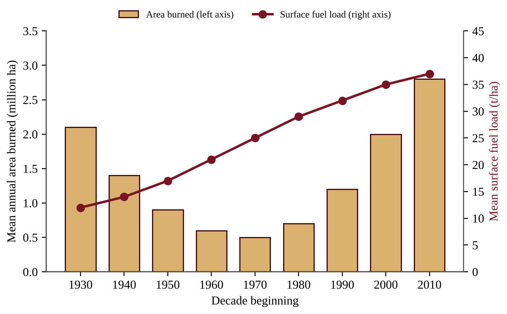
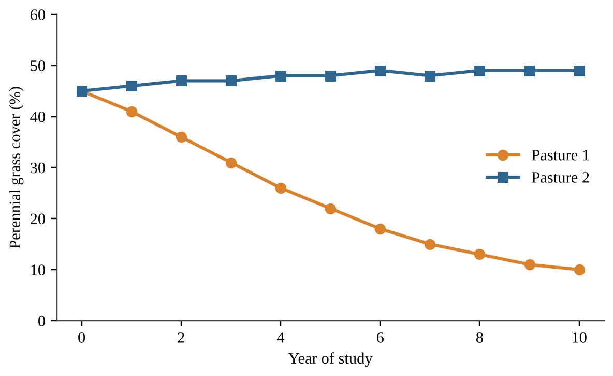
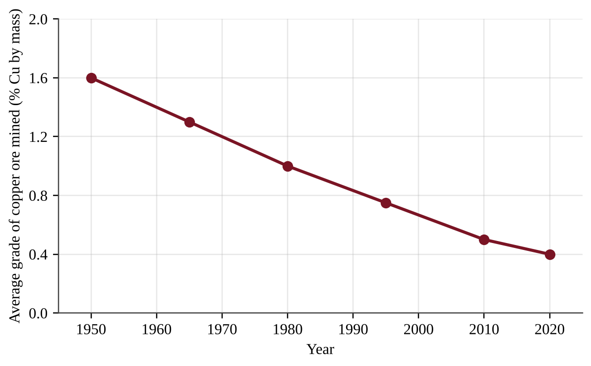

:::q QB-C7-MCQ001 | chapter=7 | sec=7 | unit=5 | topic=ext | diff=1
Ponderosa pine forests in the western United States historically experienced low-intensity surface fires every 5 to 15 years. Which of the following is an ecological benefit of such fires?
A) They permanently eliminate every woody plant from the understory and prevent the plants from returning.
B) They release nutrients from litter into the soil and reduce the fuel that could carry a later fire into the tree crowns.
C) They increase the thickness of the organic layer on the forest floor, which stores more water.
D) They stop seeds of fire-adapted species from germinating, which keeps the forest open.
:::

:::q QB-C7-MCQ002 | chapter=7 | sec=7 | unit=5 | topic=ext | diff=2
Fire scars on a cross-section of an old ponderosa pine record low-intensity surface fires in the years 1812, 1829, 1841, 1860, 1872, 1889, and 1901. What was the mean fire-return interval at this site?
A) 12 years
B) 15 years
C) 17 years
D) 89 years
:::

:::q QB-C7-MCQ003 | chapter=7 | sec=7 | unit=5 | topic=ext | diff=3
Two neighboring ponderosa pine stands burned in the same wildfire under the same weather and wind. Stand 1 had been thinned and treated with a prescribed burn three years earlier, and most of its mature trees survived. Stand 2 had not burned for about 90 years and contained dense young fir saplings and shrubs beneath the mature pines; almost all of its trees died. Which statement best explains the difference?
A) In Stand 2 the saplings and shrubs acted as ladder fuels that carried fire from the ground into the tree crowns, producing a crown fire.
B) In Stand 1 the thinning left more dead wood on the surface, and this wood absorbed heat that would otherwise have reached the crowns.
C) The mature pines in Stand 2 were weakened because pines need regular fire for cellular respiration.
D) The prescribed burn in Stand 1 raised the moisture content of the soil, which stopped the wildfire from entering the stand.
:::

:::q QB-C7-MCQ004 | chapter=7 | sec=8 | unit=5 | topic=ext | diff=1
Which of the following is a likely long-term consequence of excluding fire for many decades from a forest that evolved with frequent fires?
A) Faster nutrient cycling because dead plant material decomposes more slowly
B) Fewer small trees and shrubs in the understory
C) Greater abundance of species whose seeds need fire to germinate
D) Accumulation of dead fuel and dense small trees, which raises the risk of a high-intensity crown fire
:::

:::q QB-C7-MCQ005 | chapter=7 | sec=8 | unit=5 | topic=ext | diff=2
A family owns a home in the wildland–urban interface, where houses border a fire-prone forest. Which action would most reduce the chance that the house is ignited by a wildfire?
A) Replace the wood-shake roof with noncombustible roofing and clear brush and leaf litter from the area within about 10 m of the house
B) Plant a dense row of evergreen shrubs against the walls to act as a windbreak
C) Stack firewood against the outside wall so that embers cannot reach the siding
D) Water the forest beyond the property line during the dry season and leave the area near the house unchanged
:::

:::q QB-C7-MCQ006 | chapter=7 | sec=8 | unit=5 | topic=ext | diff=3
A region adopted a policy of rapid wildfire suppression in 1930. The graph shows the mean annual area burned and the mean surface fuel load for each decade since then.

Which conclusion is best supported by the graph and by what is known about fire ecology?
A) Suppression never reduced the area burned, because the area burned in the 1930s was larger than in the 1960s.
B) Fuel load had no effect on fires, because fuel load rose steadily while area burned first fell and then rose.
C) Suppression was followed by decades of smaller burned areas, but the accumulating fuel is consistent with the larger area burned in the most recent decades.
D) The rise in area burned after 1980 must have been caused by a sudden increase in lightning ignitions, because fuel load changed at a constant rate.
:::

:::q QB-C7-MCQ007 | chapter=7 | sec=10 | unit=5 | topic=5.4 | diff=1
Which of the following is the most likely long-term result of sustained overgrazing on semiarid rangeland?
A) Soil organic matter increases because of the large amount of manure deposited.
B) Water infiltration improves because hooves loosen the soil surface.
C) The number of native bunchgrass species increases as grazing opens space.
D) Palatable perennial grasses decline, bare soil and erosion increase, and unpalatable shrubs spread.
:::

:::q QB-C7-MCQ008 | chapter=7 | sec=10 | unit=5 | topic=5.4 | diff=2
A 500-ha rangeland produces 1,600 kg of dry forage per hectare each year. To protect the plants, managers allow cattle to eat only 50% of this forage. Each cow–calf pair eats 12 kg of dry forage per day. How many cow–calf pairs can the rangeland support for a full 365-day year?
A) 46
B) 91
C) 183
D) 33,333
:::

:::q QB-C7-MCQ009 | chapter=7 | sec=10 | unit=5 | topic=5.4 | diff=3
Two adjacent pastures with the same soils, rainfall, and stocking rate (0.4 animal units per hectare) were monitored for ten years. Pasture 1 was grazed continuously all season. In Pasture 2 the herd was moved among paddocks so that each paddock was grazed for a short time and then rested for months.

Which statement is best supported by these data?
A) Grazing management that includes rest periods can maintain grass cover at a stocking rate that causes decline under continuous grazing.
B) Pasture 2 must have had a lower stocking rate, because its grass cover did not decline.
C) The decline in Pasture 1 shows that the pasture had reached its natural carrying capacity and was stable.
D) Perennial grass cover is unaffected by grazing, because both pastures started at the same value.
:::

:::q QB-C7-MCQ010 | chapter=7 | sec=12 | unit=5 | topic=5.10 | diff=1
Which of the following is a major ecological impact of building a new highway through a large forest?
A) Increased habitat connectivity, because the road forms a corridor that animals use to cross the forest
B) Reduced edge habitat, because roads remove the boundaries between forest patches
C) Habitat fragmentation, which isolates animal populations and makes crossing the road dangerous
D) Increased infiltration of rainwater, because the road surface is compacted
:::

:::q QB-C7-MCQ011 | chapter=7 | sec=12 | unit=5 | topic=5.10 | diff=2
A county installed wildlife fencing and two underpasses along a 12-km highway segment. Before installation, there were 48 deer–vehicle collisions per year. After installation, there were 9 per year. By approximately what percent did collisions decrease?
A) 19%
B) 39%
C) 81%
D) 433%
:::

:::q QB-C7-MCQ012 | chapter=7 | sec=12 | unit=5 | topic=5.10 | diff=2
A watershed was monitored before and after a highway, parking areas, and a commercial district were built on part of it.

| Measurement | Before development | After development |
|---|---|---|
| Impervious surface (% of watershed) | 5 | 30 |
| Time from peak rainfall to peak stream flow (h) | 6 | 2 |
| Peak stream flow after a 50-mm storm (m³/s) | 12 | 31 |
| Late-summer stream flow (m³/s) | 0.9 | 0.4 |

Which interpretation is best supported by the data?
A) The paved surfaces increased evapotranspiration, which lowered the late-summer stream flow.
B) Rainwater reached the stream more slowly, which raised the peak stream flow.
C) The development increased infiltration, which shortened the time to peak flow.
D) Less infiltration and more surface runoff produced a flashier stream and probably reduced groundwater recharge, which lowered the dry-season flow.
:::

:::q QB-C7-MCQ013 | chapter=7 | sec=13 | unit=5 | topic=5.1 | diff=1
A federal agency manages its land under a multiple-use, sustained-yield mandate that allows timber harvest, livestock grazing, recreation, and watershed protection. Which agency is this?
A) U.S. Forest Service
B) National Park Service
C) U.S. Environmental Protection Agency
D) National Wildlife Refuge System
:::

:::q QB-C7-MCQ014 | chapter=7 | sec=13 | unit=5 | topic=5.1 | diff=2
Which activity is generally prohibited in a designated wilderness area but allowed on much of the surrounding National Forest land?
A) Hiking and backpacking on trails
B) Building roads for commercial timber harvest
C) Camping in primitive sites
D) Fishing with a state license
:::

:::q QB-C7-MCQ015 | chapter=7 | sec=13 | unit=5 | topic=5.1 | diff=2
A western state has a total area of 25.0 million ha. The table shows the area of federal land in the state by managing agency.

| Agency | Area (million ha) |
|---|---|
| Bureau of Land Management | 7.0 |
| U.S. Forest Service | 3.5 |
| National Park Service | 0.8 |
| U.S. Fish and Wildlife Service | 0.4 |
| Department of Defense | 0.8 |

Approximately what percent of the state's total land area is managed by the Bureau of Land Management and the U.S. Forest Service, which both manage for multiple use?
A) 28%
B) 42%
C) 50%
D) 84%
:::

:::q QB-C7-MCQ016 | chapter=7 | sec=15 | unit=5 | topic=5.9 | diff=1
The market price of copper rises sharply and stays high for several years. Which change is most likely?
A) Known copper reserves decrease because the metal is used up more quickly.
B) Known copper reserves stay the same because the amount of copper in Earth's crust is fixed.
C) Mining companies stop exploring, because high prices show that deposits are running out.
D) Known copper reserves increase because lower-grade deposits become economically recoverable.
:::

:::q QB-C7-MCQ017 | chapter=7 | sec=15 | unit=5 | topic=5.9 | diff=2
A copper mine processes 40,000 metric tons (t) of ore per day. The ore contains 0.50% copper by mass, and the mill recovers 90% of the copper. How many tonnes of copper are recovered per day?
A) 18 t
B) 20 t
C) 162 t
D) 180 t
:::

:::q QB-C7-MCQ018 | chapter=7 | sec=15 | unit=5 | topic=5.9 | diff=3
The graph shows the average grade of copper ore mined worldwide.

Assume that the same fraction of copper is recovered from the ore in both years. How many times more ore had to be mined and processed in 2020 than in 1950 to obtain one tonne of copper?
A) 0.25
B) 1.2
C) 4
D) 16
:::

:::q QB-C7-MCQ019 | chapter=7 | sec=17 | unit=5 | topic=ext | diff=1
Which of the following best defines a country's gross domestic product (GDP) per capita?
A) The total value of the goods and services produced within a country in a year, divided by its population
B) The total value of all natural resources in a country, divided by its land area
C) The average yearly income that the government collects in taxes from each citizen
D) The total value of a country's exports minus its imports in a year
:::

:::q QB-C7-MCQ020 | chapter=7 | sec=17 | unit=5 | topic=5.11 | diff=2
The table shows data for three countries. Ecological footprint and biocapacity are in global hectares (gha) per person.

| Country | GDP per capita (US$) | Ecological footprint (gha) | Biocapacity (gha) |
|---|---|---|---|
| P | 52,000 | 8.1 | 3.6 |
| Q | 9,500 | 2.9 | 4.5 |
| R | 1,900 | 1.0 | 0.8 |

Which statement is best supported by the table?
A) Country P has an ecological reserve of 4.5 gha per person.
B) Country Q has an ecological deficit of 1.6 gha per person.
C) Country R has an ecological reserve of 0.2 gha per person.
D) Country Q has an ecological reserve of 1.6 gha per person, so its demand is still below what its ecosystems regenerate.
:::

:::q QB-C7-MCQ021 | chapter=7 | sec=17 | unit=5 | topic=ext | diff=3
Over 30 years, the forest cover of a wealthy, high-consumption country increased, while the country's imports of timber, palm oil, and beef from tropical countries rose steeply. Which statement best explains how the country's domestic forest cover can rise even as its total environmental impact does not fall?
A) Increased forest cover automatically offsets all land-use impacts that occur in other countries.
B) Palm oil and beef production do not require land, so imports have no effect on forests abroad.
C) Imports can shift land clearing and its impacts to exporting countries, so the importer's footprint is partly located abroad.
D) Higher GDP always leads to lower consumption of land-based products, so imports must be small.
:::

:::q QB-C7-FRQ001 | chapter=7 | sec=15 | unit=5 | topic=5.9 | diff=3 | frqtype=3 | pts=10
The Cerro Alto copper mine is an open-pit mine. The mining company reports the following data. Assume that all rock processed through the mill is ore, that the mass of ore processed equals the mass of ore mined, and that everything that is not recovered as copper becomes tailings.

| Quantity | Value |
|---|---|
| Ore in the reserve | 600 million tonnes |
| Average ore grade (copper by mass) | 0.60% |
| Mill recovery of copper | 88% |
| Ore processed per year | 30 million tonnes |
| A second, unmined deposit nearby: ore grade | 0.35% |

(a) Calculate the total mass of copper, in tonnes, contained in the reserve. Show your work. [1]

(b) Calculate the mass of copper, in tonnes, that the mill recovers in one year. Show your work. [2]

(c) Calculate the number of years the reserve will last at the current rate of ore processing. Show your work. [1]

(d) Calculate the mass of tailings, in tonnes, produced in one year. Show your work. [1]

(e) Calculate the mass of ore, in tonnes, that must be processed to recover one tonne of copper from the second deposit, assuming the same 88% recovery. Show your work. [2]

(f) Explain how a sustained rise in the price of copper could change the amount of copper counted as reserves, even though the amount of copper in the crust does not change. [1]

(g) Propose one solution that would reduce the amount of tailings produced per tonne of copper supplied to society, and justify your proposal. [2]
:::
