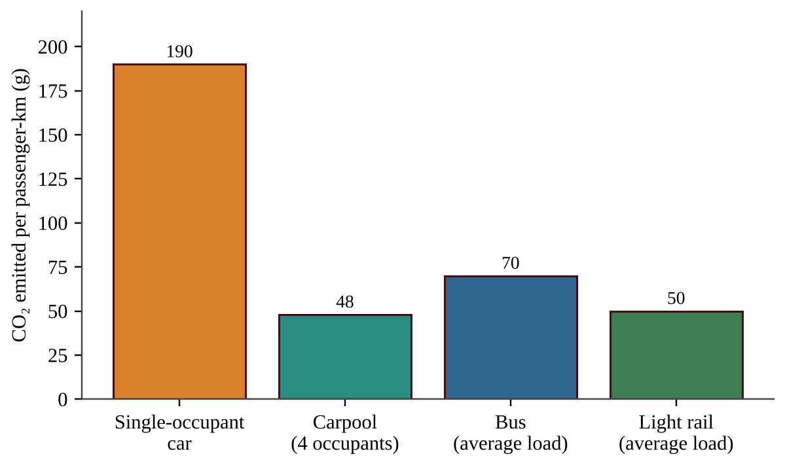

:::q QB-C8-MCQ001 | chapter=8 | sec=1 | unit=6 | topic=ext | diff=1
A coal-fired power plant converts the chemical energy in coal into electricity, but a large share of the energy leaves the plant as waste heat. Which statement explains this using the laws of thermodynamics?
A) Energy is destroyed when the coal is burned, so less energy is available than was in the fuel.
B) With enough design improvements and no friction, a heat engine could convert all of its input heat into work.
C) The total energy of the plant and its surroundings decreases each time energy is converted.
D) Every conversion of energy into work also converts some energy into lower-quality, dispersed heat, so no real engine is 100% efficient.
:::

:::q QB-C8-MCQ002 | chapter=8 | sec=1 | unit=6 | topic=ext | diff=2
A power plant burns fuel at a rate that supplies 2,400 MW of thermal energy and delivers 840 MW of electricity to the grid. At what rate does the plant release waste heat to the environment?
A) 1,560 MW
B) 840 MW
C) 2,400 MW
D) 3,240 MW
:::

:::q QB-C8-MCQ003 | chapter=8 | sec=1 | unit=6 | topic=ext | diff=3
A homeowner can supply 100 kWh of heat to a house either with a natural gas furnace that is 90% efficient or with an electric resistance heater (100% efficient at the house) powered by a coal plant that is 35% efficient, with 92% of the electricity surviving transmission. About how many times more fuel energy is needed for the electric heater than for the furnace?
A) 0.36
B) 2.6
C) 2.8
D) 3.1
:::

:::q QB-C8-MCQ004 | chapter=8 | sec=6 | unit=6 | topic=6.13 | diff=1
Why do hybrid-electric cars usually achieve better fuel economy than similar conventional cars in stop-and-go city driving?
A) Regenerative braking captures kinetic energy as electricity stored in the battery, and the engine can shut off when the car is stopped.
B) The battery creates new energy that is added to the energy from the gasoline.
C) The electric motor makes the car heavier, which lets it coast farther.
D) Hybrid cars burn a fuel with a much higher energy content than gasoline.
:::

:::q QB-C8-MCQ005 | chapter=8 | sec=6 | unit=6 | topic=6.13 | diff=2
A driver replaces a car that uses 8.0 L of gasoline per 100 km with one that uses 5.0 L per 100 km. The driver travels 15,000 km per year, and burning 1 L of gasoline releases 2.3 kg of CO₂. How many kilograms of CO₂ per year does the change avoid?
A) 450 kg
B) 1,035 kg
C) 1,725 kg
D) 2,760 kg
:::

:::q QB-C8-MCQ006 | chapter=8 | sec=6 | unit=6 | topic=6.13 | diff=3
An electric car uses 0.18 kWh of electricity per km. A comparable gasoline car emits 0.170 kg CO₂ per km. Consider only emissions from fuel combustion and electricity generation. The table shows the emissions from generating electricity in three regions.

| Region | Grid emissions (kg CO₂ per kWh) |
|---|---|
| A (mostly coal) | 1.10 |
| B (mixed) | 0.40 |
| C (mostly hydro and wind) | 0.05 |

Which statement is best supported by these data?
A) The electric car emits less CO₂ per km than the gasoline car in all three regions.
B) The electric car emits more CO₂ per km than the gasoline car in all three regions.
C) The difference in emissions depends only on the efficiency of the car, not on how the electricity is produced.
D) The electric car emits less than the gasoline car in regions B and C but more in region A, so its benefit depends on the electricity source.
:::

:::q QB-C8-MCQ007 | chapter=8 | sec=7 | unit=6 | topic=6.13 | diff=1
Why can a well-used city bus emit less CO₂ per passenger-kilometer than private cars?
A) Buses and trains do not use fossil fuels.
B) A bus always uses less fuel per vehicle-kilometer than a car.
C) The fuel burned and the emissions are shared among many passengers, so each passenger is responsible for a smaller share.
D) Mass transit eliminates the need to build roads and rails.
:::

:::q QB-C8-MCQ008 | chapter=8 | sec=7 | unit=6 | topic=6.13 | diff=2
The graph shows the CO₂ emitted per passenger-km for four ways of commuting.

A commuter drives alone 20 km to work and 20 km home on 250 days per year. About how many kilograms of CO₂ per year would the commuter avoid by switching to the bus?
A) 700 kg
B) 1,200 kg
C) 1,400 kg
D) 1,900 kg
:::

:::q QB-C8-MCQ009 | chapter=8 | sec=7 | unit=6 | topic=6.13 | diff=3
A city bus emits 1.2 kg CO₂ per km. A single-occupant car emits 0.16 kg CO₂ per km. What is the smallest whole number of passengers the bus must carry on average to emit less CO₂ per passenger-km than a single-occupant car?
A) 6
B) 7
C) 8
D) 13
:::
