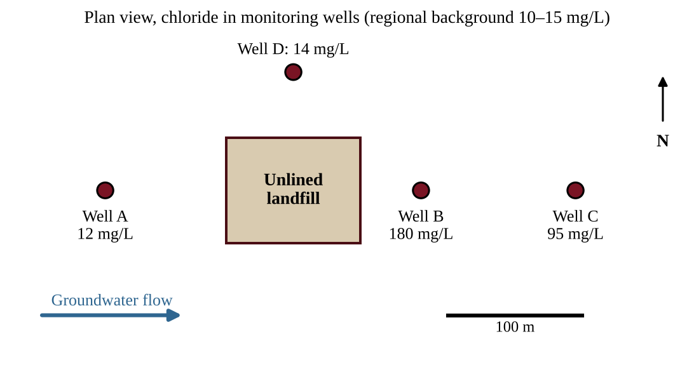
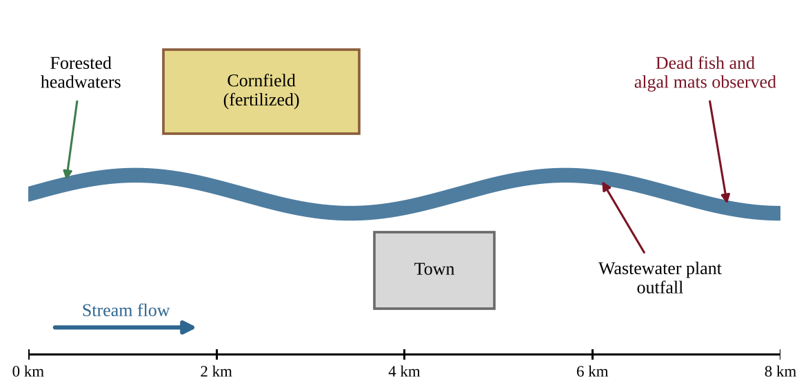

:::q QB-C9-MCQ001 | chapter=9 | sec=7 | unit=8 | topic=8.1 | diff=1
Pollutants that enter an aquifer often remain there for decades, while similar pollutants in a fast-flowing river may be diluted or removed within weeks. Which statement best explains this difference?
A) Groundwater receives more sunlight than river water, which fixes pollutants in place.
B) Groundwater moves slowly and has little mixing, aeration, or sunlight, so pollutants are neither diluted nor broken down quickly.
C) Aquifer sediments contain more oxygen than river water, which stops microbes from degrading pollutants.
D) Pollutants in aquifers cannot dissolve in water, so they accumulate at the water table.
:::

:::q QB-C9-MCQ002 | chapter=9 | sec=7 | unit=8 | topic=8.1 | diff=2
An unlined municipal landfill sits above an unconfined sand aquifer. Groundwater flows from west to east. Chloride concentrations in four monitoring wells are shown; the regional background concentration is 10–15 mg/L.

Which conclusion is best supported by the data?
A) The contamination originates upgradient of the landfill, because Well A is the westernmost well.
B) The plume has spread northward, because Well D is close to the landfill.
C) Chloride has been completely broken down by microbes between Well B and Well C.
D) Leachate from the landfill is entering the aquifer and moving east, with concentration decreasing downgradient as the plume is diluted and dispersed.
:::

:::q QB-C9-MCQ003 | chapter=9 | sec=7 | unit=8 | topic=8.1 | diff=2
Groundwater in a sandy aquifer flows at 0.40 m per day. A fuel spill occurs at a point 292 m directly upgradient of a drinking-water well. Assuming the contaminant moves with the groundwater and is not degraded, approximately how long will it take to reach the well?
A) 2.0 years
B) 0.80 years
C) 0.32 years
D) 7.3 years
:::

:::q QB-C9-MCQ004 | chapter=9 | sec=8 | unit=8 | topic=ext | diff=1
A technician measures a high biochemical oxygen demand (BOD) in a water sample from a stream. This result most directly indicates that the water contains
A) a large amount of dissolved minerals that make the water hard.
B) a high concentration of suspended clay particles that scatter light.
C) a large amount of biodegradable organic matter that microbes will consume oxygen to decompose.
D) a high concentration of dissolved oxygen that supports many fish species.
:::

:::q QB-C9-MCQ005 | chapter=9 | sec=8 | unit=8 | topic=ext | diff=2
Students tested water at three stream sites.

| Site | Dissolved oxygen (mg/L) | BOD₅ (mg/L) | Fecal coliform (CFU/100 mL) |
|---|---|---|---|
| 1 | 9.1 | 1.5 | 20 |
| 2 | 3.2 | 12.0 | 4,800 |
| 3 | 6.8 | 4.0 | 300 |

Which interpretation is best supported by the data?
A) Site 2 is most likely just downstream of a sewage input, because high BOD and fecal coliform occur together with low dissolved oxygen.
B) Site 1 is the most polluted, because it has the highest dissolved oxygen.
C) Site 3 is unaffected by human activity, because its fecal coliform count is below that of Site 2.
D) Site 2 has the best habitat for most fish, because its BOD is the highest.
:::

:::q QB-C9-MCQ006 | chapter=9 | sec=8 | unit=8 | topic=ext | diff=3
To estimate the BOD₅ of a wastewater sample, a technician places 5.0 mL of the wastewater in a 300 mL bottle and fills the rest with oxygen-saturated dilution water. The dissolved oxygen is 8.5 mg/L at the start and 4.5 mg/L after five days of dark incubation at 20°C. What is the BOD₅ of the undiluted wastewater?
A) 0.067 mg/L
B) 4.0 mg/L
C) 240 mg/L
D) 1,200 mg/L
:::

:::q QB-C9-MCQ007 | chapter=9 | sec=9 | unit=8 | topic=ext | diff=1
During drinking-water treatment, aluminum sulfate (alum) is added to raw water in a rapid-mix basin. The main purpose of this step is to
A) kill bacteria and viruses before the water enters the distribution system.
B) remove dissolved gases such as hydrogen sulfide.
C) increase the dissolved oxygen concentration of the water.
D) cause fine suspended particles to clump together so that they can settle out.
:::

:::q QB-C9-MCQ008 | chapter=9 | sec=9 | unit=8 | topic=ext | diff=2
A city that disinfects its drinking water with chlorine finds that trihalomethanes (disinfection byproducts that form when chlorine reacts with dissolved organic matter) are rising in the distribution system after heavy spring runoff. Which action would most directly address the cause while still protecting the public from pathogens?
A) Stop disinfecting the water until the runoff season ends.
B) Remove more organic matter before disinfection, for example by enhanced coagulation or activated carbon filtration.
C) Add more chlorine at the plant so that more of the organic matter is converted to byproducts.
D) Filter the water through a coarse screen to remove trihalomethanes after they form.
:::

:::q QB-C9-MCQ009 | chapter=9 | sec=9 | unit=8 | topic=ext | diff=3
Water entering a treatment plant has a chlorine demand of 1.1 mg/L. Operators want a free chlorine residual of 0.40 mg/L at the end of treatment. The plant treats 40 million liters of water per day. Approximately how many kilograms of chlorine must be added each day?
A) 16 kg
B) 44 kg
C) 60 kg
D) 600 kg
:::

:::q QB-C9-FRQ001 | chapter=9 | sec=8 | unit=8 | topic=8.1 | diff=3 | frqtype=1 | pts=10
A stream flows from forested headwaters past a fertilized cornfield and then past a small town. Wastewater from the town's treatment plant is discharged into the stream. Residents have noticed dead fish and thick algal mats about 1 km downstream of the outfall. A student group wants to design an investigation to determine whether nutrient pollution from the cornfield, the wastewater plant, or both is responsible for the water-quality problem.

(a) Identify the environmental problem that the students are investigating, and name the process by which excess nutrients lead to fish deaths. [1]
(b) State a hypothesis for the investigation in "if … then … because" form. [1]
(c) Identify the independent variable and one dependent variable of the investigation. [2]
  (i) Independent variable
  (ii) Dependent variable
(d) Describe a sampling procedure, including where along the stream samples would be collected and how many samples would be taken, so that the two possible sources can be compared. [2]
(e) Identify two variables that the students should keep constant when collecting samples. [1]
(f) Describe the pattern of results that would support the claim that the wastewater plant is the main source of the problem. [1]
(g) Propose one solution to reduce the problem and justify why it would work. [2]
:::
