# Predicted Practice Exam 1

:::box note
**Format and timing (2026 AP Environmental Science exam).** This is a complete predicted exam. Section I has 80 multiple-choice questions (60% of the score) and is allotted 90 minutes. Section II has 3 free-response questions (40% of the score, 10 points each) and is allotted 70 minutes. A calculator is allowed for both sections.

**Instructions.** In Section I, choose the single best answer for each question. There is no penalty for guessing. In Section II, answer every part of every question, show all calculations with units, and use complete sentences when a task verb asks you to describe, explain, justify, or propose. Question 1 asks you to design an investigation, Question 2 asks you to analyze quantitative data, and Question 3 asks you to analyze an environmental problem using calculations.
:::

## Section I — Multiple-Choice Questions (80)

:::q PE1-MCQ001 | unit=1 | topic=1.3 | diff=1
A river meets the Pacific Ocean in a broad coastal bay. Which description best fits the estuary biome that forms where the fresh water and seawater mix?
A) Brackish water whose salinity shifts with the tides and river flow, supporting high productivity
B) Fresh water of constant low salinity that stays nutrient-poor because rain keeps diluting it
C) Fully marine water of stable salinity and low productivity because strong tides scour the bottom
D) Cold, nutrient-poor water in which sunlight never reaches the sediment or the producers
:::

:::q PE1-MCQ002 | unit=1 | topic=1.5 | diff=1
On a temperate farm, a grower plants soybeans one year and corn the next, and applies much less fertilizer to the corn. Which process most directly explains the extra nitrogen available to the corn?
A) Denitrifying bacteria convert nitrate in the soil into N₂ gas that the corn roots then absorb
B) Nitrogen-fixing bacteria in soybean root nodules convert atmospheric N₂ into ammonia that remains in the soil
C) Nitrification converts N₂ in the air directly into nitrate inside the soybean leaves after harvest
D) Leaching carries nitrate from deep soil layers upward to the corn roots during the spring rains
:::

:::q PE1-MCQ003 | unit=1 | topic=1.8 | diff=2
Researchers studying a salt marsh on a Pacific island coast measured a gross primary productivity (GPP) of 3,400 kcal/m²/yr. Respiration by the marsh producers used 1,500 kcal/m²/yr. What is the net primary productivity (NPP) of the marsh?
A) 1,500 kcal/m²/yr
B) 1,900 kcal/m²/yr
C) 3,400 kcal/m²/yr
D) 4,900 kcal/m²/yr
:::

:::q PE1-MCQ004 | unit=1 | topic=1.11 | diff=2
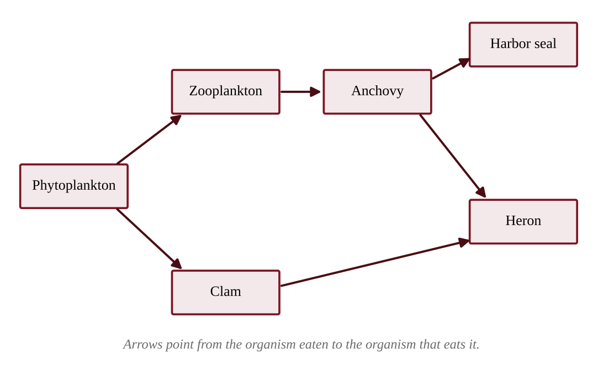{w=0.8}

According to the food web shown, which statement is correct?
A) The heron acts as both a secondary consumer and a tertiary consumer
B) The anchovy is a primary consumer because it is the smallest fish in the web
C) The zooplankton are secondary consumers because they eat microscopic organisms
D) The harbor seal and the clam feed at the same trophic level
:::

:::q PE1-MCQ005 | unit=1 | topic=1.10 | diff=2
In a kelp forest off a Pacific island, producers store 480,000 kJ/m²/yr of net primary productivity. The food chain is kelp → sea urchins → sea otters → orcas. If energy transfer between trophic levels is 10%, how much energy per square meter per year is available to the orcas?
A) 48 kJ/m²/yr
B) 480 kJ/m²/yr
C) 4,800 kJ/m²/yr
D) 48,000 kJ/m²/yr
:::

:::q PE1-MCQ006 | unit=1 | topic=1.4 | diff=3
Mangrove soils store large amounts of carbon. A coastal reserve measured the carbon in the top 1 m of soil before and after part of a mangrove forest was drained for shrimp ponds.

| Condition | Soil carbon (Mg C per hectare) |
|---|---|
| Intact mangrove | 380 |
| Five years after draining | 290 |

Drainage exposes the formerly waterlogged soil to oxygen, and assume all of the lost carbon was oxidized to CO₂ (1 Mg C = 3.67 Mg CO₂). About how much CO₂ was released per hectare?
A) 24 Mg CO₂
B) 90 Mg CO₂
C) 330 Mg CO₂
D) 1,390 Mg CO₂
:::

:::q PE1-MCQ007 | unit=2 | topic=2.2 | diff=1
A coastal village relies on a mangrove stand that weakens storm waves during typhoons and protects homes behind it. Which category of ecosystem service does this protection represent?
A) A provisioning service, because it supplies a material good
B) A cultural service, because it provides recreational value
C) A supporting service, because it cycles nutrients for other services
D) A regulating service, because it moderates a natural hazard
:::

:::q PE1-MCQ008 | unit=2 | topic=2.7 | diff=1
A volcanic eruption builds a new island of bare lava rock near Hawaiʻi. Which organisms are most likely to colonize the island first, and why?
A) Hardwood trees, which grow quickly on fresh lava and shade out other species
B) Lichens and mosses, which can grow on bare rock and begin forming soil
C) Grasses and shrubs, which need a deep layer of fertile soil to germinate
D) Large grazing mammals, whose manure forms the first soil on bare rock
:::

:::q PE1-MCQ009 | unit=2 | topic=2.3 | diff=2
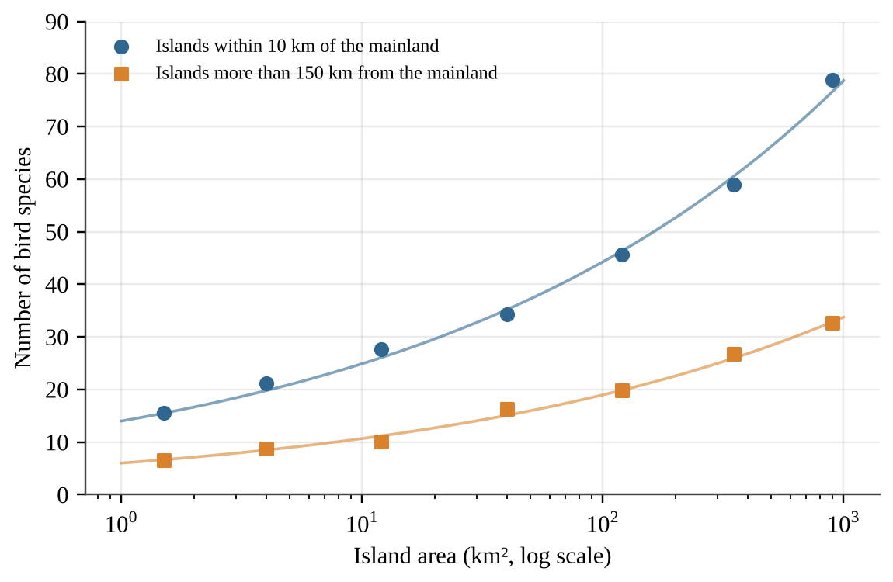{w=0.8}

Which conclusion is best supported by the graph?
A) Near-mainland islands hold more species than distant islands of the same area, and richness rises with area
B) Distance from the mainland changes species richness only for small islands, those under about 10 km²
C) Species richness on distant islands stays about the same whatever the island area
D) Distant islands support more species at every island area because they have fewer competing species
:::

:::q PE1-MCQ010 | unit=2 | topic=2.4 | diff=2
Heavy rain floods an estuary and lowers its salinity to 8 ppt for three weeks. The table shows the salinity tolerance range of four sessile species living there.

| Species | Salinity tolerance (ppt) |
|---|---|
| Estuarine clam | 5–30 |
| Pacific oyster | 12–32 |
| Blue mussel | 15–35 |
| Acorn barnacle | 20–35 |

Which species is most likely to survive the flood event?
A) The estuarine clam, because 8 ppt lies inside its range of 5–30 ppt
B) The Pacific oyster, because its range spans 20 ppt, which is wide enough to buffer salinity swings
C) The blue mussel, because it tolerates the highest salinities and therefore the greatest stress
D) The acorn barnacle, because species with narrow ranges are the best adapted to stable salinity
:::

:::q PE1-MCQ011 | unit=2 | topic=2.7 | diff=3
After a typhoon flattened sections of a Pacific island forest, ecologists surveyed plots that had been recovering for different lengths of time.

| Time since the typhoon | Tree species per plot |
|---|---|
| 2 years | 18 |
| 8 years | 31 |
| 25 years | 36 |
| 80 years | 24 |

Which explanation best accounts for the lower richness in the 80-year plot?
A) Shade-tolerant late-successional trees have competitively excluded many sun-loving early-successional species
B) The 80-year plot lost species because primary succession starts again after every typhoon that strikes
C) Old forests have more disturbance, so the plot has been reset to bare mineral soil several times
D) Tree species richness declines as forests age because the soil gradually loses all of its nutrients
:::

:::q PE1-MCQ012 | unit=3 | topic=3.1 | diff=1
On a small Pacific island, one bird species feeds only on nectar from a single native flower, and a second bird species eats seeds, insects, and fruit. A disease eliminates the flower. What is the most likely result?
A) Both species will decline equally because they share the same island habitat
B) The nectar specialist will decline sharply, while the generalist can switch to other foods
C) The generalist will decline faster because it is less efficient at using any one food
D) Neither species will be affected because birds can digest any type of plant material
:::

:::q PE1-MCQ013 | unit=3 | topic=3.2 | diff=1
Polar bears in the Arctic are K-selected species. Which set of traits is characteristic of K-selected species?
A) Many offspring, little parental care, short life span, and rapid growth after a disturbance
B) Few offspring, no parental care, short life span, and populations far below carrying capacity
C) Few offspring, extensive parental care, long life span, and populations near carrying capacity
D) Many offspring, extensive parental care, long life span, and a very small body size
:::

:::q PE1-MCQ014 | unit=3 | topic=3.7 | diff=1
A country has a total fertility rate (TFR) of 1.4, low infant mortality, and almost no immigration. Replacement-level fertility is about 2.1 children per woman. Which outcome is most likely over the next several decades?
A) The population will keep growing indefinitely because the death rate is low
B) The population will stabilize because any TFR below 2.1 makes births equal deaths
C) The population will grow rapidly because fewer children are dying in infancy
D) The population will shrink and the share of older residents will increase
:::

:::q PE1-MCQ015 | unit=3 | topic=3.3 | diff=2
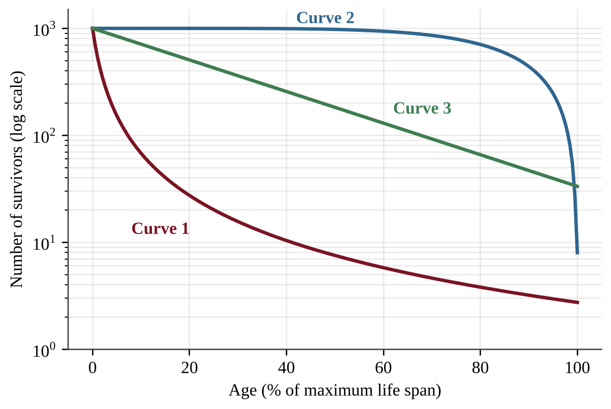{w=0.75}

Pacific oysters release millions of eggs, most of the larvae die within days, and the few that settle on a hard surface can live for years. Which curve best represents the survivorship of oysters, and why?
A) Curve 2, because most individuals survive until near the maximum life span
B) Curve 3, because the death rate is nearly constant across all ages
C) Curve 1, because the largest mortality occurs early in life and survivors live long
D) Curve 2, because high parental investment gives young a high chance of survival
:::

:::q PE1-MCQ016 | unit=3 | topic=3.4 | diff=2
Deer introduced to a temperate island multiplied rapidly and then leveled off at about 800 animals. Which factor is density-dependent and most likely helped hold the population near its carrying capacity?
A) A severe windstorm that kills about the same percentage of deer in any given year
B) A volcanic eruption that buries part of the island's grazing land under thick ash
C) A hard freeze that kills deer in about the same proportion whatever the herd size
D) Greater competition for winter forage and faster spread of disease when deer are crowded
:::

:::q PE1-MCQ017 | unit=3 | topic=3.5 | diff=2
An island nation has a crude birth rate of 14 per 1,000 people, a crude death rate of 6 per 1,000, 2 immigrants per 1,000, and 4 emigrants per 1,000 each year. What is the annual population growth rate?
A) 0.6%
B) 0.8%
C) 1.0%
D) 6.0%
:::

:::q PE1-MCQ018 | unit=3 | topic=3.9 | diff=2
A small Pacific island nation installs clean-water systems and vaccination clinics, but its birth rates remain high for now. According to the demographic transition model, what is happening?
A) Stage 1, in which both rates are high and fluctuating, so the population stays about the same
B) Stage 3, in which birth rates fall sharply, so the population growth rate slows to zero
C) Stage 4, in which both rates are low, so the population stabilizes at a high number
D) Stage 2, in which death rates fall faster than birth rates, so the population grows rapidly
:::

:::q PE1-MCQ019 | unit=3 | topic=3.6 | diff=2
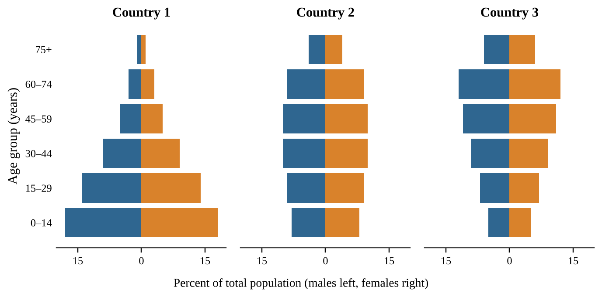

Assuming no migration, which country is most likely to see its population shrink over the next 30 years, and why?
A) Country 1, because its large youngest group indicates a high rate of infant mortality that will cut the population
B) Country 3, because its narrow base means fewer young people are reaching reproductive ages than the older groups leaving them
C) Country 2, because its large middle-aged groups will soon die in numbers that exceed all births
D) No country, because every population keeps growing as long as its older residents remain healthy
:::

:::q PE1-MCQ020 | unit=3 | topic=3.5 | diff=3
A coastal city of 600,000 people grows at a constant 2.8% per year. Using the rule of 70, which population is expected after 50 years?
A) 1,200,000
B) 1,440,000
C) 2,400,000
D) 4,800,000
:::

:::q PE1-MCQ021 | unit=3 | topic=3.8 | diff=3
A national health survey in three provinces produced these data.

| Province | Girls in secondary school (%) | Women using modern contraception (%) | TFR |
|---|---|---|---|
| North | 22 | 18 | 5.4 |
| Central | 51 | 40 | 3.6 |
| South | 83 | 68 | 2.1 |

Which conclusion is best supported?
A) Female education directly causes lower fertility, which shows that contraception has no real effect on it
B) Contraceptive use has no relationship to fertility, because education alone already explains the pattern
C) Education and contraceptive use are both associated with lower fertility, but the data cannot show which one causes it
D) Fertility declines only when national income rises, as these data from the three provinces demonstrate
:::

:::q PE1-MCQ022 | unit=4 | topic=4.2 | diff=1
A soil scientist digs a profile in a temperate forest near the Pacific Northwest coast. Which horizon consists mostly of partly decomposed leaves, needles, and other plant litter?
A) The A horizon beneath the surface
B) The B horizon, where clay and minerals accumulate
C) The O horizon at the surface
D) The C horizon of weathered parent material
:::

:::q PE1-MCQ023 | unit=4 | topic=4.1 | diff=1
The Aleutian Islands form an arc of volcanic islands above a deep ocean trench in the North Pacific. At which type of plate boundary did this island chain most likely form?
A) A divergent boundary, where two plates move apart along a mid-ocean ridge
B) A convergent boundary, where dense oceanic crust sinks beneath another plate
C) A transform boundary, where two plates slide horizontally past each other
D) A convergent boundary, where two continental plates collide to form folded mountains
:::

:::q PE1-MCQ024 | unit=4 | topic=4.4 | diff=1
In which layer of the atmosphere does temperature rise with increasing altitude because the ozone layer absorbs ultraviolet radiation?
A) The troposphere
B) The mesosphere
C) The stratosphere
D) The exosphere
:::

:::q PE1-MCQ025 | unit=4 | topic=4.3 | diff=2
A student performs a jar test on a soil sample using water and a dispersing agent. Sand settles first, then silt, then clay. The cumulative depth of sediment is 3.6 cm after 1 minute, 7.2 cm after 2 hours, and 9.0 cm after 24 hours. What percent of the soil sample is silt?
A) 20%
B) 40%
C) 60%
D) 80%
:::

:::q PE1-MCQ026 | unit=4 | topic=4.5 | diff=2
Many of the world's large deserts lie near 30° N and 30° S latitude. Which process best explains this pattern?
A) Ocean currents near 30° always flow away from the land, which prevents any evaporation from happening there
B) The Coriolis effect stops winds from blowing near 30°, so moisture cannot be transported across the region
C) Sunlight is weakest near 30° latitude, which prevents clouds from forming over the land surface
D) Air that rose at the equator and lost its moisture sinks near 30°, warming and suppressing cloud formation
:::

:::q PE1-MCQ027 | unit=4 | topic=4.8 | diff=2
Precipitation was measured along an east-west line across a mountain range in the Pacific Northwest, with prevailing winds from the west.

| Station | Elevation (m) | Annual precipitation (mm) |
|---|---|---|
| Coast | 20 | 2,800 |
| Windward slope | 800 | 3,400 |
| Crest | 1,500 | 2,100 |
| Leeward valley | 400 | 380 |

Which process best explains the very low precipitation in the leeward valley?
A) Cold ocean currents block moisture from reaching any inland station, whatever the elevation
B) Air forced up the windward slope cools and drops its moisture, then warms and dries as it descends the lee side
C) Air rising on the lee side expands and cools, which forms clouds that stay over the crest
D) The leeward valley lies at lower elevation, and low elevations receive less rain at every latitude
:::

:::q PE1-MCQ028 | unit=4 | topic=4.6 | diff=2
A storm drops 40 mm of rain on a 5.0 km² urban watershed. Because of pavement and roofs, 85% of the rainfall becomes surface runoff (runoff coefficient = 0.85). What volume of runoff reaches the river?
A) 30,000 m³
B) 170,000 m³
C) 200,000 m³
D) 235,000 m³
:::

:::q PE1-MCQ029 | unit=4 | topic=4.6 | diff=2
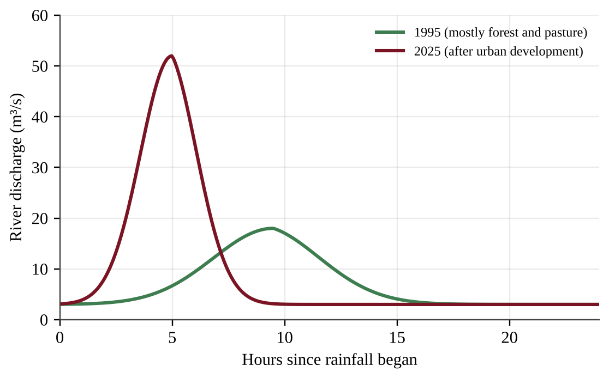{w=0.8}

Which change in the hydrograph is most likely caused by the development of the watershed?
A) A lower peak discharge that arrives later, because more water infiltrates and recharges groundwater
B) A higher peak discharge that arrives later, because pavement and buildings store rainfall before releasing it
C) A higher peak discharge that arrives sooner, because impervious surfaces and storm drains move water quickly to the river
D) No change in the timing of the peak, because only the volume of rainfall controls the shape of the curve
:::

:::q PE1-MCQ030 | unit=4 | topic=4.9 | diff=3
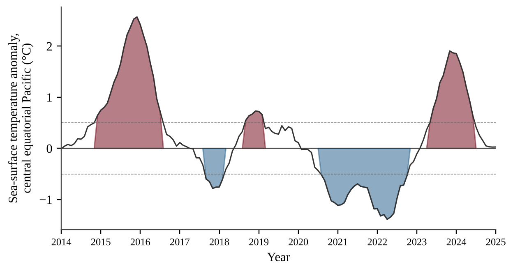

During which interval was upwelling of cold, nutrient-rich water off the coast of Peru most likely strongest, and why?
A) 2015–2016, when the strongly positive anomaly marked an El Niño with strengthened trade winds that drove upwelling
B) 2017–2018, when the anomaly was briefly positive and warm water piled up near South America
C) 2023–2024, when positive anomalies strengthened the trade winds and cooled the eastern Pacific
D) 2021–2022, when the strongly negative anomaly marked a La Niña with strong trade winds pushing warm water west
:::

:::q PE1-MCQ031 | unit=4 | topic=4.7 | diff=3
In the Arctic, fresh sea ice has an albedo of about 0.80 and open ocean water has an albedo of about 0.07. Suppose 300 W/m² of sunlight reaches the surface. How much more solar energy is absorbed per square meter when the ice is replaced by open water?
A) 21 W/m²
B) 219 W/m²
C) 240 W/m²
D) 279 W/m²
:::

:::q PE1-MCQ032 | unit=5 | topic=5.1 | diff=1
Fishing boats from several villages harvest herring from the same open-access bay. Each boat owner keeps adding nets because the catch from each extra net belongs entirely to that owner. Which concept does this behavior illustrate?
A) The tragedy of the commons, because each user gains fully while the cost of depletion is shared by all
B) Sustainable yield, because harvesting more fish each year keeps the fish population growing steadily
C) Bioaccumulation, because the fish absorb toxins from the water faster than they can excrete them
D) Ecological succession, because heavily fished bays recover to a climax community within a year or two
:::

:::q PE1-MCQ033 | unit=5 | topic=5.2 | diff=1
A steep Pacific Northwest hillside above a salmon-bearing stream is clearcut. Which short-term effect on the stream is most likely?
A) Higher sediment loads and warmer water because erosion increases and streamside shade is lost
B) Lower water temperature because there are fewer leaves to absorb heat from the sun
C) Clearer water because the roots of cut trees filter the runoff more effectively
D) Greater dissolved oxygen because larger volumes of falling leaves enter the water
:::

:::q PE1-MCQ034 | unit=5 | topic=5.9 | diff=1
Tailings from a surface mine contain sulfide minerals that are exposed to air and rainwater. Which environmental problem is most directly associated with this situation?
A) Acid mine drainage that lowers stream pH and releases dissolved metals
B) Cultural eutrophication that fertilizes the stream and triggers algal blooms
C) Thermal pollution that raises the stream temperature and drives out cold-water fish
D) Saltwater intrusion that raises the salinity of the stream and its surrounding wetlands
:::

:::q PE1-MCQ035 | unit=5 | topic=5.5 | diff=2
A temperate-zone orchard uses flood irrigation, applying 1,000 m³ of water per hectare in a season while the trees use 450 m³ per hectare. Drip irrigation would deliver the same 450 m³ to the trees but apply 520 m³ per hectare because of small losses. By what percentage would switching to drip irrigation reduce the water applied?
A) 45%
B) 48%
C) 52%
D) 86%
:::

:::q PE1-MCQ036 | unit=5 | topic=5.7 | diff=2
A farm grows 5,000 kg of corn per hectare. Corn provides 3,500 kcal/kg, and beef provides 2,500 kcal/kg. Feedlot cattle need 8 kg of corn to gain 1 kg of beef. About how many times more food energy per hectare would people obtain by eating the corn directly rather than feeding all of it to cattle?
A) 0.09
B) 1.4
C) 8
D) 11
:::

:::q PE1-MCQ037 | unit=5 | topic=5.8 | diff=2
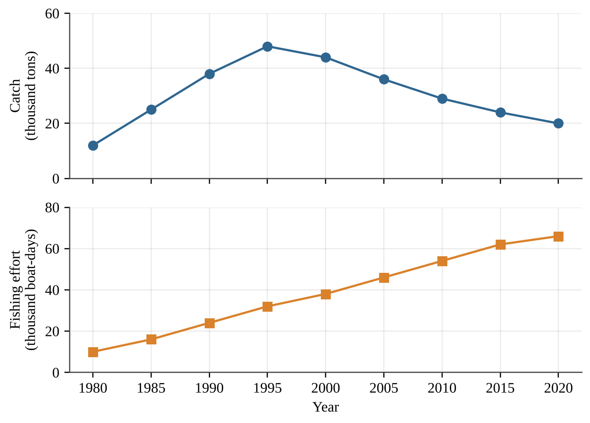{w=0.8}

Which interpretation of the data is best supported?
A) After 1995, catch per unit of effort fell while effort kept rising, consistent with an overfished stock
B) Rising effort after 2000 helped the stock rebuild, so catch should soon start to rise again
C) The decline in catch after 1995 happened because fishers gradually reduced their fishing effort
D) Catch per unit of effort stayed constant through 2020, so the stock remained healthy
:::

:::q PE1-MCQ038 | unit=5 | topic=5.13 | diff=2
A mid-size coastal city plans to rebuild a large parking lot so that less polluted stormwater reaches a nearby estuary. Which design change would be most effective?
A) Add curbs and larger storm drains that carry rainwater directly to the creek
B) Increase the paved area so that the rain flows off faster before it can pick up pollutants
C) Salt the pavement each winter so that snowmelt moves through the drains quickly
D) Replace asphalt with permeable pavers over a gravel reservoir and add planted bioswales along the edges
:::

:::q PE1-MCQ039 | unit=5 | topic=5.3 | diff=2
Data from a rice-growing region during the Green Revolution are shown below.

| Year | Rice yield (t/ha) | Nitrogen fertilizer (kg/ha) | Irrigated cropland (%) |
|---|---|---|---|
| 1965 | 2.0 | 12 | 20 |
| 1985 | 3.4 | 58 | 41 |
| 2005 | 4.6 | 125 | 57 |

Which environmental concern is most directly linked to the trends shown?
A) Fertilizer runoff that causes eutrophication and heavier withdrawals from rivers and aquifers
B) Declining yields as the soil becomes depleted of nitrogen from overuse of fertilizer
C) Reduced fossil fuel use on farms because of lower demand for machinery and pumping
D) Greater genetic diversity among the rice varieties as more farmers adopt irrigation
:::

:::q PE1-MCQ040 | unit=5 | topic=5.11 | diff=3
A city of 250,000 people has an ecological footprint of 3.8 global hectares (gha) per person. The biocapacity available to the city's region is 620,000 gha. By what percentage must the per-person footprint fall for the city to live within its regional biocapacity, assuming the population stays constant?
A) 35%
B) 53%
C) 65%
D) 153%
:::

:::q PE1-MCQ041 | unit=5 | topic=5.14 | diff=3
In an apple orchard, growers sprayed the same miticide each year and tracked the percentage of the mite population that survived a standard dose.

| Year of spraying | 1 | 2 | 3 | 4 | 5 |
|---|---|---|---|---|---|
| Mites surviving a standard dose (%) | 2 | 9 | 31 | 68 | 93 |

Which statement best explains the trend, and which management response is most consistent with integrated pest management (IPM)?
A) Each spraying selected for mites already carrying resistance genes; rotating methods and using biological controls would slow the trend
B) Each mite individually became more resistant after repeated exposure, so growers should raise the dose and spray more often
C) The pesticide caused the resistance mutations, so growers should spray less often but keep using only the same chemical
D) The mite population is migrating into the orchard from other farms, so growers should spray the entire valley each season
:::

:::q PE1-MCQ042 | unit=6 | topic=6.1 | diff=1
A Pacific island utility wants to replace diesel generators with another energy source. Which option below is a renewable energy source?
A) Liquefied natural gas turbines
B) Ocean wave energy converters
C) A uranium-fueled micro-reactor
D) Coal-fired boilers
:::

:::q PE1-MCQ043 | unit=6 | topic=6.6 | diff=1
Which statement about electricity generation from nuclear fission is accurate?
A) It emits almost no CO₂ in operation but produces spent fuel that stays radioactive for thousands of years
B) It emits large amounts of SO₂ and soot because uranium ore is burned in the reactor core
C) Its spent fuel becomes harmless within a few years and can be disposed of in ordinary landfills
D) It is considered renewable because the chain reaction in the fuel rods can never run out
:::

:::q PE1-MCQ044 | unit=6 | topic=6.9 | diff=1
A large dam with a reservoir is proposed on a river with a salmon run. Which impact is most directly associated with the dam?
A) Increased river sediment downstream because the reservoir releases more soil than the river carried before
B) Higher river temperatures downstream because the dam gives off waste heat from its turbines
C) Blocked upstream fish migration and trapped sediment that would otherwise build downstream deltas and estuaries
D) More air pollution near the river because hydroelectric turbines burn small amounts of fuel
:::

:::q PE1-MCQ045 | unit=6 | topic=6.2 | diff=2
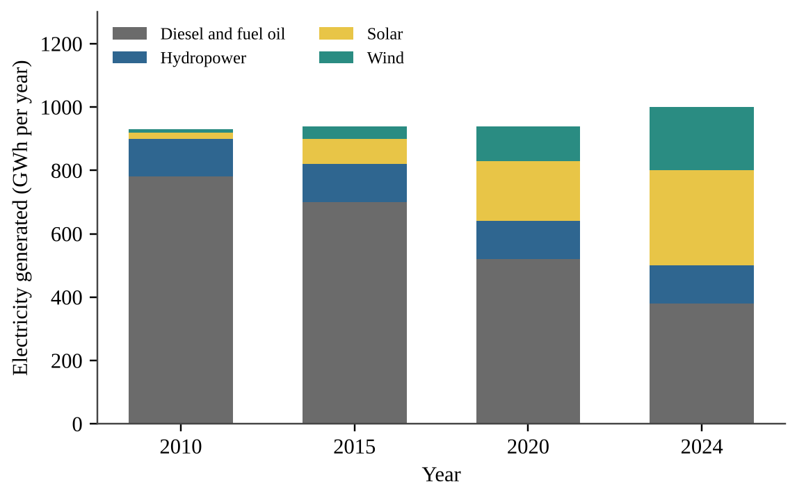{w=0.8}

What percentage of the island's electricity in 2024 came from wind and solar combined?
A) 20%
B) 30%
C) 38%
D) 50%
:::

:::q PE1-MCQ046 | unit=6 | topic=6.12 | diff=2
The power available in the wind is proportional to the cube of wind speed. Site A has an average wind speed of 5.0 m/s at hub height, and Site B has an average of 7.5 m/s. About how many times greater is the wind power available at Site B?
A) 1.5
B) 2.3
C) 3.0
D) 3.4
:::

:::q PE1-MCQ047 | unit=6 | topic=6.8 | diff=2
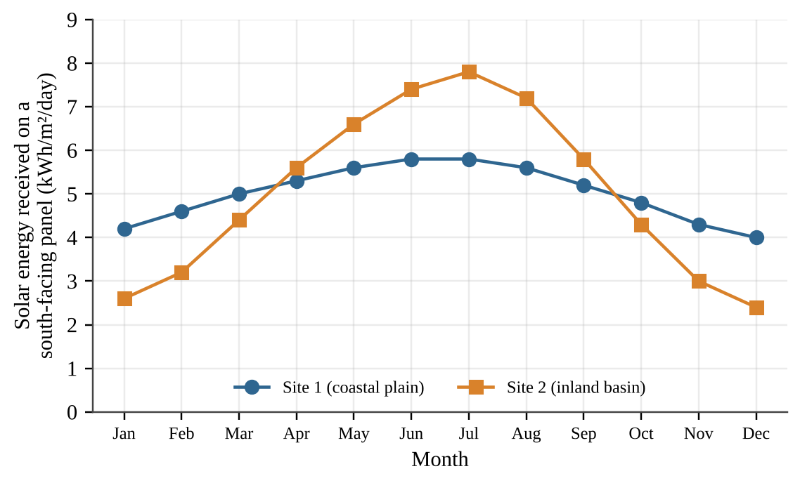{w=0.8}

A utility will build a solar farm with very little battery storage and wants steady output across the year. Which conclusion is best supported?
A) Site 2 should be chosen because its higher summer peak means it collects more energy over the whole year
B) Site 1 collects more energy than Site 2 in every month, so it is the better site in all seasons
C) Site 1 would need less storage or backup generation because its monthly output varies much less through the year
D) Site 2 should be chosen because its winter output is higher than Site 1 and balances its summer peak
:::

:::q PE1-MCQ048 | unit=6 | topic=6.13 | diff=2
A school replaces 200 incandescent bulbs rated at 40 W with LED bulbs rated at 8 W. The lights are on 6 hours per day for 180 days per year. How much electricity does the school save each year?
A) 1,728 kWh
B) 6,912 kWh
C) 8,640 kWh
D) 69,120 kWh
:::

:::q PE1-MCQ049 | unit=6 | topic=6.5 | diff=2
Which environmental concern is most specifically associated with hydraulic fracturing (fracking) to obtain natural gas?
A) It uses large volumes of water, and wastewater can contaminate groundwater or, injected deep, trigger small earthquakes
B) It releases long-lived radioactive waste that must be stored in deep underground repositories for many centuries
C) It floods river valleys and displaces whole communities when the production wells are drilled
D) It emits sulfur-rich particulates when wet biomass is burned in the production process
:::

:::q PE1-MCQ050 | unit=6 | topic=6.12 | diff=3
A wind farm has a nameplate capacity of 40 MW and a capacity factor of 0.32. An average household in the region uses 10,000 kWh per year. About how many households can the wind farm supply in a year?
A) 1,120
B) 11,200
C) 35,040
D) 112,128
:::

:::q PE1-MCQ051 | unit=6 | topic=6.11 | diff=3
A city plans to replace gasoline buses with hydrogen fuel cell buses. Which statement is most accurate regarding the environmental benefit?
A) Hydrogen is a primary energy source that can be mined directly, so its use adds no emissions
B) Hydrogen produced by electrolysis always has zero carbon emissions, regardless of the source of electricity
C) The overall benefit depends on how the hydrogen is produced, since a fuel cell only converts stored chemical energy
D) Fuel cells emit large amounts of nitrogen oxides because they burn hydrogen at very high temperatures
:::

:::q PE1-MCQ052 | unit=7 | topic=7.1 | diff=1
Which of the following is a secondary air pollutant in a mid-size city?
A) Carbon monoxide released from incomplete combustion of fuel in car engines
B) Sulfur dioxide released directly from coal-fired power plants near the city
C) Ground-level ozone formed from NOₓ and volatile organic compounds reacting in sunlight
D) Lead dust released from older leaded-paint removal operations in the city
:::

:::q PE1-MCQ053 | unit=7 | topic=7.5 | diff=1
A home in a mid-size city built over granite bedrock has a radon test result above the recommended action level. What is the most likely source of the radon?
A) Combustion of natural gas in the home's furnace, which releases radon gas into the living space
B) Outgassing of formaldehyde from the plywood and glue used in the home's furniture
C) Radioactive decay of uranium in the underlying rock, with the gas seeping in through foundation cracks
D) Vehicle exhaust from the city's streets, which enters the home through open windows
:::

:::q PE1-MCQ054 | unit=7 | topic=7.2 | diff=2
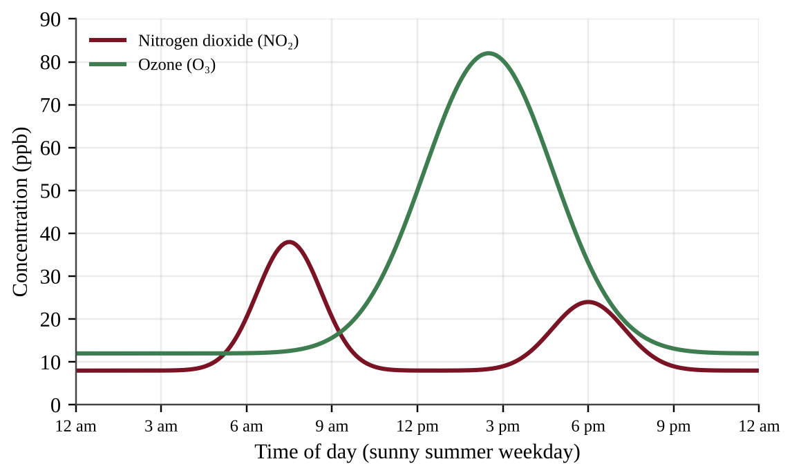{w=0.8}

Which explanation best accounts for the ozone peak occurring in the afternoon, after the morning NO₂ peak?
A) Ozone is emitted directly from tailpipes on busy city streets at midday when traffic is at its heaviest
B) NO₂ is converted to ozone only at night, when the air is cooler and winds are calm
C) Ozone concentrations peak when NO₂ is highest because the two pollutants are emitted together by vehicles
D) Sunlight drives photochemical reactions of NOₓ and VOCs from rush hour, so ozone accumulates as the sun climbs
:::

:::q PE1-MCQ055 | unit=7 | topic=7.3 | diff=2
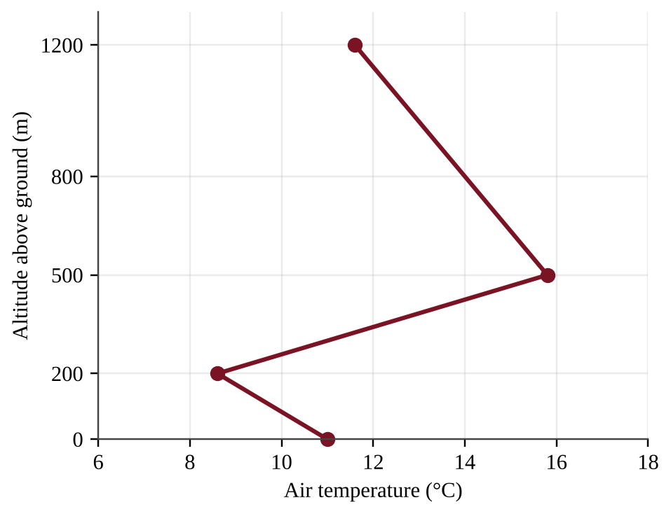{w=0.6}

Which statement best describes how this temperature profile affects air pollution near the ground?
A) Between 0 m and 200 m, temperature decreases with altitude, so the layer is stable and traps pollutants
B) Between 500 m and 1,200 m, temperature decreases with altitude, so the layer prevents any vertical mixing
C) Across the full profile, temperature differs little, so pollutants spread evenly through the whole depth
D) Between 200 m and 500 m, temperature rises with altitude, so the warm layer acts as a lid over the pollutants
:::

:::q PE1-MCQ056 | unit=7 | topic=7.6 | diff=2
A coal-fired power plant near a mid-size city emits 4,800 tons of SO₂ per year. Installing flue-gas desulfurization (scrubbers) removes 92% of the SO₂. How much SO₂ will the plant emit per year after the scrubbers are installed?
A) 384 tons
B) 440 tons
C) 4,416 tons
D) 4,800 tons
:::

:::q PE1-MCQ057 | unit=7 | topic=7.7 | diff=2
Two lakes in the same region receive acid rain of the same pH. One lake sits on granite bedrock and the other on limestone bedrock. Why is the granite lake more likely to become acidified?
A) Granite releases hydrogen ions that lower the pH, while limestone absorbs rainfall
B) Limestone retains more acid because it dissolves slowly, which keeps the lake pH low
C) Limestone contains calcium carbonate that neutralizes acid, while granite provides little buffering
D) Granite lakes receive more rainfall because rock type changes the amount of precipitation
:::

:::q PE1-MCQ058 | unit=7 | topic=7.4 | diff=3
A city monitors fine particulate matter (PM2.5) at four sites in summer and winter.

| Site | Summer PM2.5 (µg/m³) | Winter PM2.5 (µg/m³) |
|---|---|---|
| Downtown (heavy traffic) | 14 | 16 |
| Highway corridor | 22 | 24 |
| Valley residential area | 9 | 38 |
| Hilltop park | 6 | 8 |

Which hypothesis best explains why only the valley residential site shows a large winter increase?
A) Heavier winter traffic, because traffic is greatest at the valley residential site
B) Industrial emissions that rise in winter and affect all four sites equally
C) Residential wood burning combined with winter thermal inversions trapping smoke in the valley
D) Photochemical reactions that create more particles in the weak winter sunlight
:::

:::q PE1-MCQ059 | unit=8 | topic=8.5 | diff=1
Fertilizer from cornfields washes into a coastal bay. Which sequence correctly describes the resulting cultural eutrophication?
A) More nutrients → algal bloom → algae photosynthesis raises dissolved oxygen → fish populations increase
B) More nutrients → water cools → algae die and release oxygen → fish populations increase
C) More sediment → light penetration increases → algae bloom disappears → dissolved oxygen rises
D) More nutrients → algal bloom → algae die and are decomposed by aerobic bacteria → dissolved oxygen falls → fish die
:::

:::q PE1-MCQ060 | unit=8 | topic=8.6 | diff=1
A power plant discharges heated cooling water into a river. What is the most direct effect on aquatic life downstream?
A) Warm water holds more dissolved oxygen, which speeds the growth of cold-water fish
B) Warm water raises the salinity of the river, which kills freshwater fish within hours
C) Warm water lowers the amount of algae in the river, which starves the fish of food
D) Warm water holds less dissolved oxygen, which stresses cold-water fish such as trout
:::

:::q PE1-MCQ061 | unit=8 | topic=8.8 | diff=2
Concentrations of a persistent organic pollutant (PCBs) were measured in an Arctic marine food chain.

| Organism | PCB concentration (ppm) |
|---|---|
| Ice algae | 0.002 |
| Arctic cod | 0.07 |
| Ringed seal | 1.4 |
| Polar bear | 20 |

The concentration in polar bears is how many times the concentration in the ice algae?
A) 20
B) 286
C) 700
D) 10,000
:::

:::q PE1-MCQ062 | unit=8 | topic=8.11 | diff=2
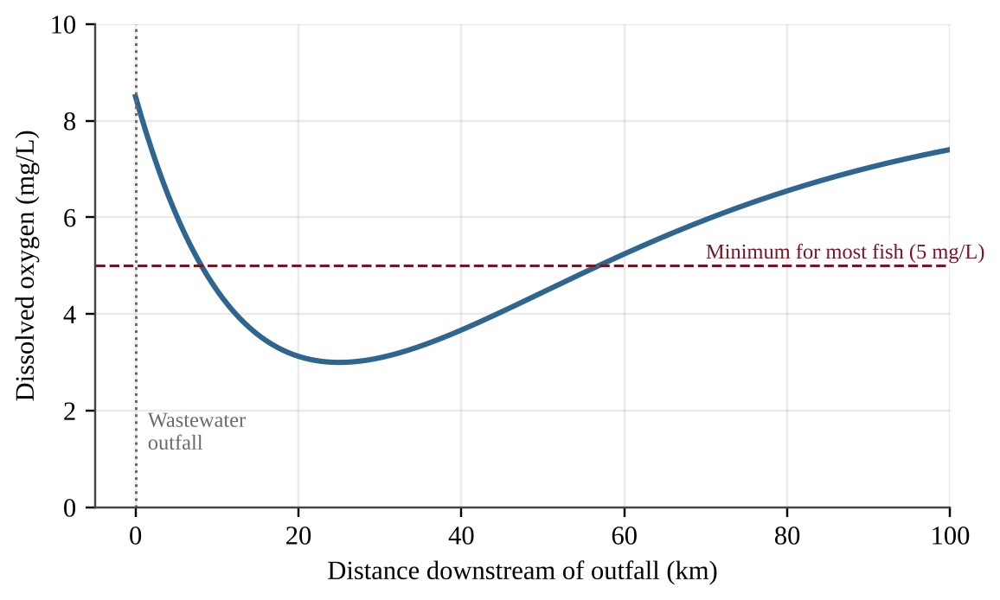{w=0.8}

Which explanation best accounts for the lowest dissolved oxygen occurring about 25 km downstream rather than at the outfall?
A) The outfall water is hottest at 25 km, so oxygen is least soluble at that distance
B) Aerobic bacteria decomposing the organic waste use oxygen faster than it is replenished until the waste is used up
C) Photosynthesis by phytoplankton reaches its daily peak 25 km downstream, which removes oxygen from the water
D) The river becomes much shallower at 25 km, so oxygen can no longer dissolve from the air
:::

:::q PE1-MCQ063 | unit=8 | topic=8.10 | diff=2
A mid-size city generates 120,000 tons of municipal solid waste per year. It recycles 21,600 tons, composts 14,400 tons, and landfills the remaining 84,000 tons. What percent of the city's waste is diverted from the landfill?
A) 12%
B) 18%
C) 30%
D) 70%
:::

:::q PE1-MCQ064 | unit=8 | topic=8.12 | diff=2
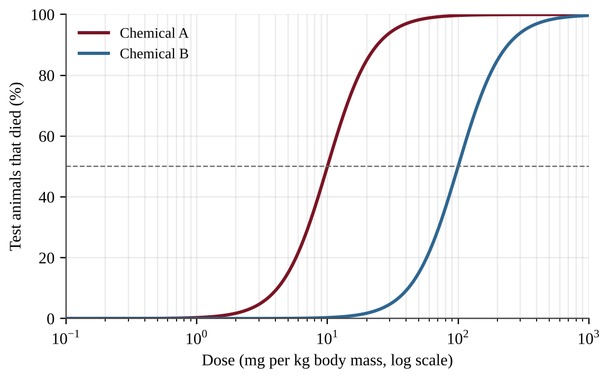{w=0.8}

Which statement is supported by the graph?
A) Chemical B is about 10 times more toxic than Chemical A because its curve lies farther to the right
B) Chemical A is about 10 times less toxic than Chemical B because it kills 50% at the lower dose
C) Chemical A is about 10 times more toxic than Chemical B because its LD50 is about 10 times lower
D) The two chemicals are equally toxic because both eventually kill 100% of the test animals
:::

:::q PE1-MCQ065 | unit=8 | topic=8.4 | diff=3
A tidal creek delivers 40,000 m³ of water per day to a bay, with a nitrate-nitrogen concentration of 5 mg/L. A salt marsh along the creek removes 60% of the nitrate-nitrogen before the water reaches the bay. If the marsh is filled to build a port, how much additional nitrate-nitrogen will reach the bay each day?
A) 12 kg
B) 80 kg
C) 120 kg
D) 200 kg
:::

:::q PE1-MCQ066 | unit=9 | topic=9.1 | diff=1
How do chlorofluorocarbons (CFCs) reduce the ozone layer?
A) UV light frees chlorine atoms from CFCs in the stratosphere, and each atom catalytically destroys many ozone molecules
B) CFCs react with ozone in the troposphere, which prevents it from rising into the stratosphere where it is needed
C) CFCs absorb infrared radiation in the stratosphere, which warms the air and causes ozone molecules to decompose
D) CFCs dissolve in ocean water and release chlorine, which then rises to the stratosphere as a gas
:::

:::q PE1-MCQ067 | unit=9 | topic=9.3 | diff=1
Which statement best describes the natural greenhouse effect?
A) Greenhouse gases absorb visible light from the Sun before it reaches the surface, which keeps the surface cool and stable
B) Greenhouse gases reflect sunlight back to space, which keeps the average surface temperature constant over time
C) Greenhouse gases in the stratosphere absorb ultraviolet light and release it as heat that warms the oceans
D) Greenhouse gases absorb infrared radiation from Earth's surface and re-emit part of it downward, warming the lower atmosphere
:::

:::q PE1-MCQ068 | unit=9 | topic=9.8 | diff=1
Which set of characteristics makes a species most likely to become invasive after it is introduced to a Pacific island?
A) Low reproductive rate, a specialist diet, and strong dependence on one native host plant
B) High reproductive rate, a generalist diet, and few natural predators or diseases in the new range
C) Long life span, small population size, and a need for stable, undisturbed habitat
D) High reproductive rate, a specialist diet, and strong control by predators from its home range
:::

:::q PE1-MCQ069 | unit=9 | topic=9.9 | diff=1
Which international agreement regulates trade in threatened and endangered species such as sea turtles and elephants?
A) The Montreal Protocol on substances that deplete the ozone layer
B) The Kyoto Protocol on greenhouse gas emission targets
C) The Basel Convention on transboundary movement of hazardous waste
D) CITES, the Convention on International Trade in Endangered Species
:::

:::q PE1-MCQ070 | unit=9 | topic=9.2 | diff=2
Production of CFCs was largely phased out under the Montreal Protocol beginning in the late 1980s, yet the Antarctic ozone layer is not expected to recover fully until about the middle of this century. Which statement best explains the delay?
A) CFCs persist for decades to a century, so chlorine keeps reaching the stratosphere after emissions fall
B) The replacement compounds used since the phase-out destroy ozone faster than CFCs did in the past
C) Ozone is destroyed only during the Antarctic winter, so recovery cannot begin until each winter ends
D) Ozone is rebuilt slowly because the ozone layer cannot form again once chlorine is present in the air
:::

:::q PE1-MCQ071 | unit=9 | topic=9.4 | diff=2
Over a 100-year period, one ton of methane (CH₄) traps as much heat as about 28 tons of CO₂ (global warming potential of 28). A landfill near a mid-size city leaks 50 tons of CH₄ per year. What is this leakage in tons of CO₂ equivalent per year?
A) 1.8
B) 50
C) 78
D) 1,400
:::

:::q PE1-MCQ072 | unit=9 | topic=9.5 | diff=2
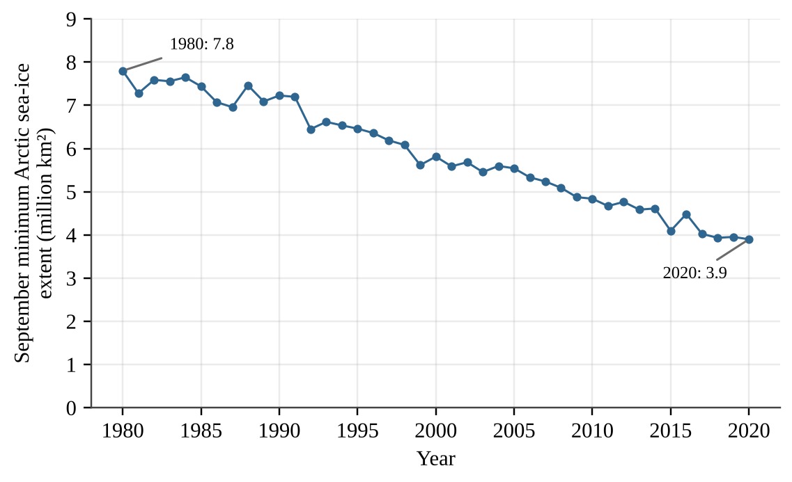{w=0.8}

By about what percent did the September minimum extent of Arctic sea ice decrease between 1980 and 2020?
A) 3.9%
B) 50%
C) 100%
D) 200%
:::

:::q PE1-MCQ073 | unit=9 | topic=9.5 | diff=2
Which process is a positive feedback in Arctic warming?
A) Warmer air increases plant growth, which absorbs more CO₂ and so lowers the temperature of the air
B) Thawing permafrost releases cold fresh water that cools the ocean surface and slows the warming
C) Thawing permafrost releases CO₂ and CH₄ from decomposing organic matter, causing more warming and more thawing
D) Warming leads to more sea ice in autumn, which reflects sunlight and cools the Arctic surface
:::

:::q PE1-MCQ074 | unit=9 | topic=9.6 | diff=2
Residents of a low Pacific atoll are concerned about rising sea level. Which pair of factors is the main contributor to global sea-level rise?
A) Thermal expansion of warming seawater and meltwater from land-based glaciers and ice sheets
B) Melting of floating Arctic sea ice and increased evaporation from tropical oceans
C) Increased rainfall on the oceans and melting of ice shelves that float on the ocean surface
D) Contraction of warming seawater and the growth of ice sheets over Greenland
:::

:::q PE1-MCQ075 | unit=9 | topic=9.7 | diff=2
Hatcheries for Pacific oysters on the Oregon coast have reported die-offs of larvae when upwelled seawater has unusually low pH. Which explanation is most accurate?
A) Lower pH raises the carbonate ion concentration, which makes the larval shells too thick to open
B) Lower pH warms the seawater, which reduces its salinity and dissolves the larval shells
C) Lower pH reduces the nitrate supply, which starves the larvae of nitrogen needed to make shells
D) Lower pH reduces carbonate ion availability, so larvae have difficulty building calcium carbonate shells
:::

:::q PE1-MCQ076 | unit=9 | topic=9.4 | diff=2
Atmospheric CO₂ measured at a Pacific mountain observatory was 316 ppm in 1959 and 421 ppm in 2023. What was the average annual increase in CO₂ concentration over this period?
A) 0.61 ppm per year
B) 1.6 ppm per year
C) 6.6 ppm per year
D) 105 ppm per year
:::

:::q PE1-MCQ077 | unit=9 | topic=9.1 | diff=2
Which statement correctly compares ozone in the troposphere with ozone in the stratosphere?
A) Ground-level ozone is a secondary pollutant that harms lungs and plants, while stratospheric ozone absorbs UV-B
B) Ground-level ozone is emitted directly from tailpipes, while stratospheric ozone forms from smokestack emissions
C) Both layers of ozone absorb UV-B radiation and benefit living organisms, so both should be increased
D) Stratospheric ozone harms lung tissue, while ground-level ozone shields plants from UV-B radiation
:::

:::q PE1-MCQ078 | unit=9 | topic=9.7 | diff=3
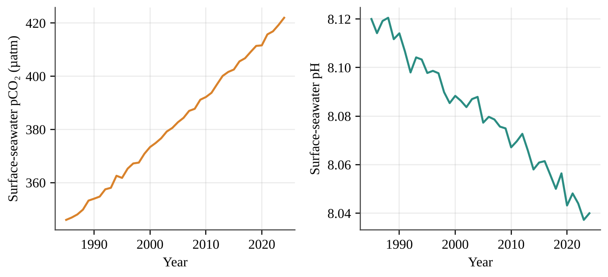

The pH scale is logarithmic: a decrease of 1.0 pH unit means a tenfold increase in hydrogen ion (H⁺) concentration. By about what percent did the H⁺ concentration increase between 1985 and 2024?
A) 1%
B) 8%
C) 20%
D) 80%
:::

:::q PE1-MCQ079 | unit=9 | topic=9.10 | diff=3
Native forest birds on a Pacific island were surveyed along an elevation gradient. Avian malaria, carried by mosquitoes, is a major cause of bird death.

| Elevation band | Native forest cover (%) | Mosquitoes | Native birds (per ha) |
|---|---|---|---|
| 0–600 m | 35 | Abundant | 2 |
| 600–1,200 m | 80 | Present, moderate | 9 |
| Above 1,200 m | 85 | Rare (too cold) | 41 |

Which interpretation is best supported, and what is the implication for climate warming?
A) Forest cover alone explains bird abundance, so warming that increases forest growth would help the birds
B) Mosquitoes do not influence bird numbers, so warming would have no effect on the birds at any elevation
C) Birds prefer high elevations because they are far from people, so warming would not change their distribution
D) Cool temperatures limit mosquitoes at high elevation, so warming could push mosquitoes upslope and shrink the birds' refuge
:::

:::q PE1-MCQ080 | unit=9 | topic=9.8 | diff=3
European green crabs recently invaded a Pacific coast estuary. Managers suspect they reduce the density of native clams. Which investigation design would best test this hypothesis?
A) Compare clam density in one invaded estuary with that in one distant crab-free estuary measured on a single day
B) Set up replicate plots at matched tidal height and sediment, cage half to exclude crabs, and compare clams over a season
C) Count the clams in one plot before and again after the first crabs were seen in that plot, then compare them
D) Survey many plots once and conclude that crabs reduce clams because the plots with more crabs have fewer clams
:::

## Section II — Free-Response Questions (3)

:::q PE1-FRQ001 | unit=8 | topic=8.5 | diff=2 | frqtype=1 | pts=10
Harbor Bay is a Pacific coastal estuary that supports a commercial oyster fishery. Two creeks drain temperate farmland (corn and vegetables) into the bay. Harbor Creek flows through a 40-hectare salt marsh that was restored in 2019, whereas Mill Creek reaches the bay with no marsh. During summer, oyster growers report that dissolved oxygen (DO) near the mouth of Mill Creek often falls below 3 mg/L at dawn and that thick green algal mats cover the mud flats. Managers suspect that nitrogen fertilizer carried by drainage ditches is causing the problem, and they wonder whether the restored marsh is intercepting nitrogen in Harbor Creek. The map shows four existing water-quality access points (H1, H2, M1, M2).

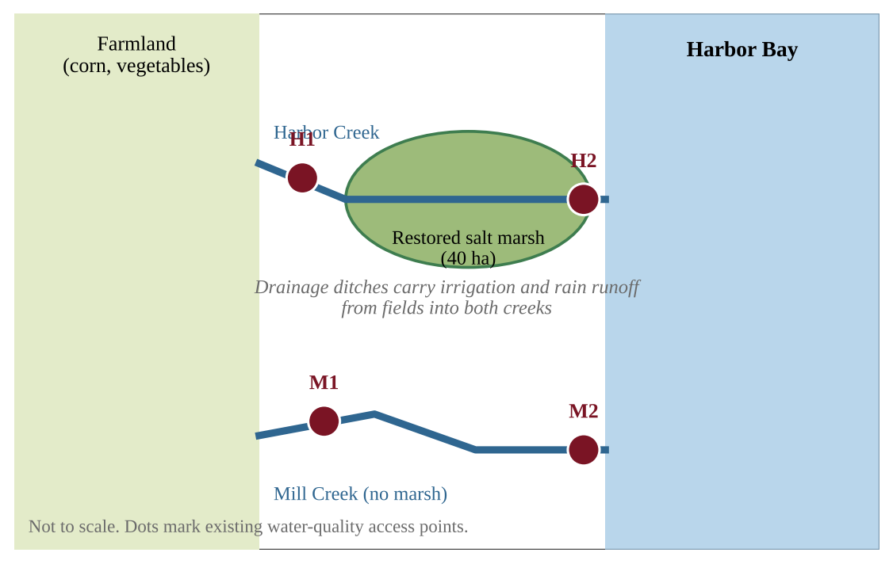{w=0.85}

You have one summer growing season, a boat, and standard field equipment (water-sample bottles, a nitrate test kit or spectrophotometer, a dissolved-oxygen meter, and a thermometer).

(a) Identify the environmental problem described in the scenario. [1]

(b) Write a testable hypothesis, in the form of a prediction, about nitrate concentration at the access point nearest the bay compared with the access point nearest the farmland in each creek. [1]

(c) For an investigation that tests your hypothesis, identify:
  (i) the independent variable [1]
  (ii) the dependent variable [1]

(d) Identify one variable that must be controlled (held constant) in your investigation and explain why it must be controlled. [1]

(e) Describe a procedure for collecting the data, including where, when, and how often samples will be taken and how replication will be achieved. [2]

(f) Describe how you would analyze the data to determine whether your hypothesis is supported. [1]

(g) Propose a solution that would reduce low-oxygen events in Harbor Bay and justify your proposal with an environmental or ecological reason. [2]
:::

:::q PE1-FRQ002 | unit=9 | topic=9.5 | diff=2 | frqtype=2 | pts=10
Scientists have monitored a coastal tundra site on the Arctic coast of Alaska since 2000. The table shows data collected every five years. The active layer is the upper layer of ground that thaws each summer above the permafrost.

| Year | Mean July air temperature (°C) | Active-layer depth (cm) | Shrub cover (% of ground) |
|---|---|---|---|
| 2000 | 3.1 | 42 | 12 |
| 2005 | 3.4 | 45 | 14 |
| 2010 | 4.0 | 52 | 19 |
| 2015 | 4.6 | 60 | 25 |
| 2020 | 5.1 | 68 | 31 |
| 2025 | 5.7 | 77 | 38 |

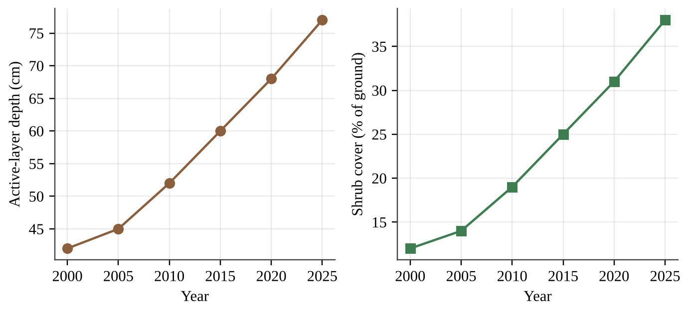{w=0.9}

(a) Describe the trend in active-layer depth between 2000 and 2025, using data from the table. [1]

(b) Calculate the percent increase in active-layer depth from 2000 to 2025. Show your work. [1]

(c) Explain how thawing of permafrost can act as a positive feedback that increases the rate of global warming. [2]

(d) Tall shrubs are darker than snow-covered tundra and stick up above the snow. Explain one way that increasing shrub cover could further warm the tundra. [1]

(e) A student claims that rising July temperature is responsible for the increase in shrub cover.
  (i) Make a claim about whether the data support the student's claim. [1]
  (ii) Justify your claim with evidence from the table, including one limitation of the data. [1]

(f) Assuming the recent trend continues, predict the active-layer depth in 2030 and explain how you made your prediction. [1]

(g) A village on the coast has buildings built directly on the frozen ground. Propose a solution to reduce damage to the buildings from thawing permafrost and justify your proposal. [2]
:::

:::q PE1-FRQ003 | unit=6 | topic=6.8 | diff=2 | frqtype=3 | pts=10
Willow Creek Farm is a 120-hectare corn and dairy farm in a temperate Pacific Northwest valley. The owner is considering a solar array on the barn roofs and a change in fertilizer practice. Use the data below. Assume that the array supplies the farm's electricity use first (up to the farm's annual use) and that any surplus is sold to the grid.

| Quantity | Value |
|---|---|
| Farm electricity use | 310,000 kWh per year |
| Solar array nameplate capacity | 250 kW |
| Capacity factor of the array | 18% |
| Installed cost of the array | $325,000 |
| Value of electricity used on the farm | $0.13 per kWh |
| Price paid for surplus electricity sold to the grid | $0.06 per kWh |
| Grid emission factor (CO₂ displaced) | 0.40 kg CO₂ per kWh |
| Lifespan of the array | 25 years |
| Nitrogen fertilizer on corn | 160 kg N per hectare on 120 hectares |
| Expected reduction in nitrogen use with cover crops | 25% |

Assume that 1 year = 8,760 hours.

(a) Calculate the electricity, in kWh, that the array will generate in one year. Show your work. [2]

(b) Calculate the total annual financial benefit of the array (value of electricity used on the farm plus the income from surplus electricity sold). Show your work. [2]

(c) Calculate the simple payback period, in years, for the array. Show your work. [1]

(d) Calculate the metric tons of CO₂ emissions avoided over the 25-year lifespan, assuming all of the electricity generated displaces grid electricity. Show your work. [1]

(e) Calculate the mass of nitrogen fertilizer, in kg, that would be saved each year by using cover crops. Show your work. [1]

(f) Explain one environmental or siting limitation of relying on solar electricity at this temperate farm. [1]

(g) Propose a solution that would help the farm meet its electricity needs at night and during dark winter weeks, and justify your proposal. [2]
:::
