# Predicted Practice Exam 2

:::box note
**Format and timing (2026 AP Environmental Science).** This predicted exam follows the structure of the AP exam: Section I has 80 multiple-choice questions (90 minutes, 60% of the score); Section II has 3 free-response questions (70 minutes, 40% of the score, 10 points each). A scientific or four-function calculator is allowed on both sections.

**Instructions.** In Section I, choose the single best answer for each question and mark it on your answer sheet; there is no penalty for guessing. In Section II, answer every part in complete sentences where an explanation is requested, show all work for calculations, and include units. Question 1 asks you to design an investigation, question 2 asks you to analyze and interpret quantitative data, and question 3 asks you to analyze an environmental problem by doing calculations.
:::

## Section I — Multiple-Choice Questions (80)

:::q PE2-MCQ001 | unit=1 | topic=1.2 | diff=1
The soils beneath lowland tropical rainforests in the Amazon basin and Borneo are often thin and nutrient-poor, even though the vegetation is extremely productive. Which statement best explains this?
A) Frequent wildfires volatilize the nutrients in the soil during each dry season.
B) Most nutrients are held in living biomass and are recycled quickly, so little accumulates in the soil.
C) Cool temperatures slow decomposition, so nutrient-rich organic matter remains locked in frozen ground.
D) Dense shade prevents soil microorganisms from decomposing leaf litter on the forest floor.
:::

:::q PE2-MCQ002 | unit=1 | topic=1.3 | diff=1
A coastal estuary in Southeast Asia is bordered by mangroves, and its salinity ranges from 5 to 25 ppt over the tidal cycle. Which description best fits this aquatic biome?
A) Deep, cold water where sunlight never penetrates, so food webs depend on organic matter from above.
B) Brackish, nutrient-rich water that is highly productive and serves as a nursery for juvenile fish and shellfish.
C) Permanently stratified, nutrient-poor water with little primary production near the surface.
D) Freshwater with fast flow and low productivity because few nutrients enter from the surrounding land.
:::

:::q PE2-MCQ003 | unit=1 | topic=1.8 | diff=2
Researchers measured carbon fixation in a lowland tropical forest plot. Gross primary productivity (GPP) was 3,200 g C/m²/yr, and plants released 2,000 g C/m²/yr through cellular respiration. What was the net primary productivity (NPP) of the plot?
A) 1,200 g C/m²/yr
B) 1,600 g C/m²/yr
C) 2,000 g C/m²/yr
D) 5,200 g C/m²/yr
:::

:::q PE2-MCQ004 | unit=1 | topic=1.10 | diff=2
In a coastal food chain, phytoplankton (trophic level 1) fix 80,000 kcal/m²/yr. Energy passes from phytoplankton to zooplankton, then to sardines, and finally to tuna (trophic level 4). Assuming 10% of energy is transferred at each step, how much energy reaches the tuna?
A) 8 kcal/m²/yr
B) 80 kcal/m²/yr
C) 800 kcal/m²/yr
D) 8,000 kcal/m²/yr
:::

:::q PE2-MCQ005 | unit=1 | topic=1.4 | diff=2
Large areas of tropical peat swamp forest in Southeast Asia are drained and burned for plantations. Which statement best describes the effect on the carbon cycle?
A) Carbon in the atmosphere moves into the peat because plantation crops photosynthesize faster than forest trees.
B) Carbon stored in peat and trees moves to the atmosphere as CO₂ through combustion and faster decomposition.
C) Carbon stored in peat is converted into fossil fuels within a few years once it is exposed to heat.
D) Carbon moves from the atmosphere to the ocean sediments because burning produces carbonate rock directly.
:::

:::q PE2-MCQ006 | unit=1 | topic=1.11 | diff=3
The food web below describes a coral reef community. 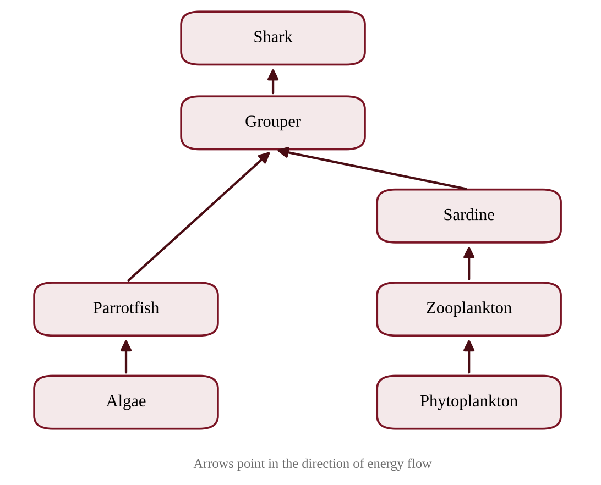
Overfishing removes almost all of the grouper from the reef. Which short-term change is most likely?
A) Zooplankton abundance rises because sardines are released from predation.
B) Algae biomass rises because fewer groupers are present to graze on it.
C) Parrotfish abundance rises and algae biomass falls.
D) Shark abundance rises because the food chain becomes shorter.
:::

:::q PE2-MCQ007 | unit=2 | topic=2.1 | diff=1
Which statement best defines a biodiversity hotspot?
A) A region in which all species are legally protected by national governments and international treaties.
B) A region dominated by generalist species that tolerate human disturbance and spread widely.
C) A region with exceptionally high numbers of endemic species that has lost a large share of its original habitat.
D) A region with the largest area of intact forest and the lowest human population density on Earth.
:::

:::q PE2-MCQ008 | unit=2 | topic=2.2 | diff=1
Villagers on a Vietnamese coast depend on mangroves that buffer storm surge, trap sediment, and shelter juvenile shrimp that are later harvested and sold. Which pair correctly classifies two of these benefits as ecosystem services?
A) Sediment trapping is a cultural service; shrimp harvest is a regulating service.
B) Sediment trapping is a provisioning service; shrimp harvest is a supporting service.
C) Storm-surge buffering is a provisioning service; shrimp harvest is a cultural service.
D) Storm-surge buffering is a regulating service; shrimp harvest is a provisioning service.
:::

:::q PE2-MCQ009 | unit=2 | topic=2.3 | diff=2
A survey counted forest bird species in 16 forest fragments of different sizes in a biodiversity hotspot. The fitted line is shown. 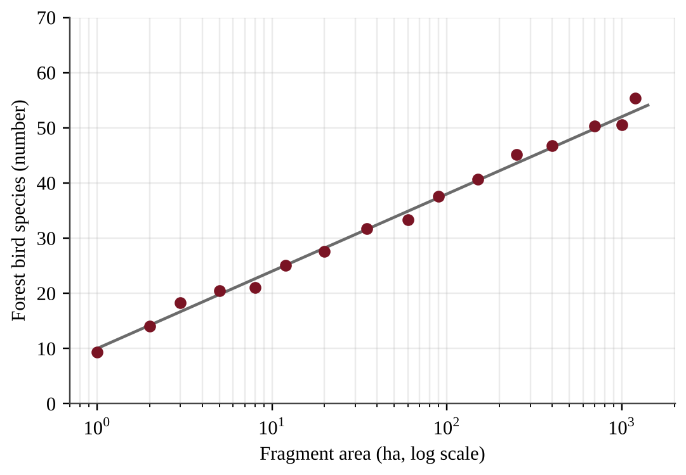
Based on the fitted line, about how many bird species are expected in a 300-ha fragment?
A) 38
B) 41
C) 45
D) 52
:::

:::q PE2-MCQ010 | unit=2 | topic=2.7 | diff=2
A logging concession in a lowland tropical forest is abandoned. The soil and seed bank remain intact. Which description of the recovery is most accurate?
A) A climax community re-establishes immediately because the soil was never removed.
B) Secondary succession begins with fast-growing, light-demanding pioneer plants.
C) Primary succession begins with lichens that slowly form new soil from rock.
D) Secondary succession begins with shade-tolerant canopy trees that dominate immediately.
:::

:::q PE2-MCQ011 | unit=2 | topic=2.4 | diff=3
Growth rates of three reef-building coral species were measured across water temperatures. 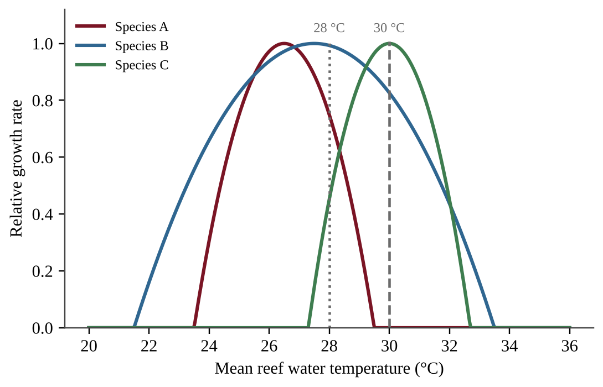
A reef warms from 28 °C to 30 °C for several months. Which prediction is best supported by the graph?
A) All three species would grow at similar rates because each tolerates 30 °C.
B) Species C would be eliminated first because it has the highest optimum temperature.
C) Species A would fall outside its tolerance limits, while species C would grow best.
D) Species B would be eliminated first because it has the widest tolerance range.
:::

:::q PE2-MCQ012 | unit=3 | topic=3.1 | diff=1
Two bird species live in a forest in Borneo. Species X eats only the figs of one tree species and nests only in hollows of old-growth trees. Species Y eats fruit, insects, and seeds and nests in many habitat types. After the forest is converted to a mosaic of plantations and small woodlots, which prediction is most reasonable?
A) Species Y is more likely to persist because its broad niche lets it use the altered habitat.
B) Species X is more likely to persist because specialization reduces competition with other birds.
C) Species X is more likely to persist because old-growth hollows form quickly in plantations.
D) Both species are equally likely to persist because both are birds that can fly between habitats.
:::

:::q PE2-MCQ013 | unit=3 | topic=3.2 | diff=1
Which set of traits best describes an r-selected species such as a sardine?
A) Large body size, late maturity, many offspring, and extensive parental care.
B) Small body size, early maturity, many offspring, and little parental care.
C) Small body size, early maturity, few offspring, and a long life span.
D) Large body size, late maturity, few offspring, and extensive parental care.
:::

:::q PE2-MCQ014 | unit=3 | topic=3.3 | diff=2
Sea turtles lay about 100 eggs per nest and give no parental care. Most hatchlings die, but turtles that reach adulthood can live for decades. 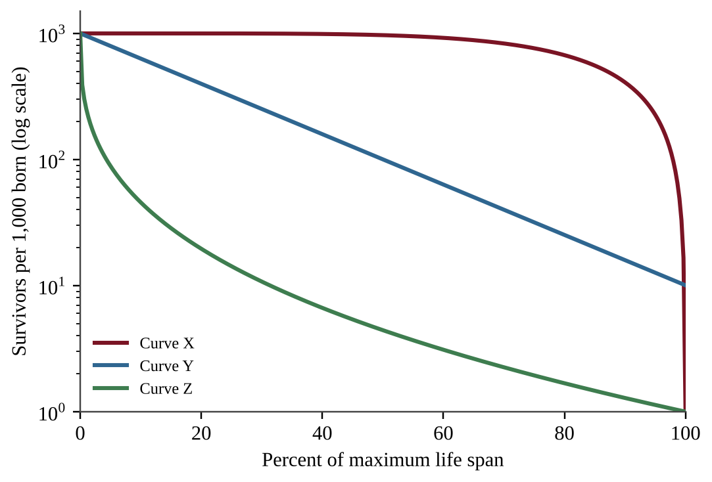
Which curve best represents sea turtles?
A) Curve Z, because mortality is highest early in life.
B) Curve Y, because parental care is minimal.
C) Curve Y, because the death rate is constant throughout life.
D) Curve X, because most individuals survive until old age.
:::

:::q PE2-MCQ015 | unit=3 | topic=3.4 | diff=2
Which change would most likely reduce the carrying capacity of an orangutan population living in an isolated forest fragment?
A) Logging that removes the trees that produce fruit each year.
B) A ban on hunting that lowers the death rate of adults.
C) Building a forest corridor that links the fragment to a larger forest.
D) A single typhoon that temporarily kills 20% of the orangutans.
:::

:::q PE2-MCQ016 | unit=3 | topic=3.5 | diff=2
A rapidly growing city reports the following annual rates per 1,000 residents: births 14, deaths 6, immigration 5, emigration 1. What is the city's annual population growth rate?
A) 0.8%
B) 1.2%
C) 1.3%
D) 1.4%
:::

:::q PE2-MCQ017 | unit=3 | topic=3.6 | diff=2
The age structure diagrams below show two countries. 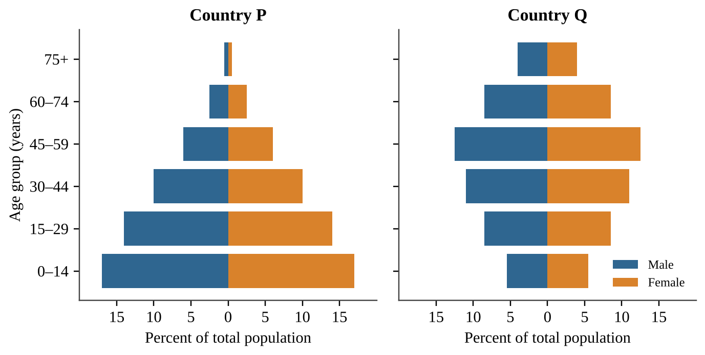
Which statement is best supported by the diagrams?
A) Country Q will probably face a shrinking workforce and a growing share of elderly people, while Country P will keep growing for decades.
B) Country Q has the faster growth rate because it has more people in the oldest age groups.
C) The two countries will grow at similar rates because both have people in every age group.
D) Country P will stop growing within a decade because most of its people are past reproductive age.
:::

:::q PE2-MCQ018 | unit=3 | topic=3.7 | diff=2
Replacement-level fertility in most countries is about 2.1 children per woman. A megacity in East Asia reports a total fertility rate of 0.9. Which factor most likely contributes to such a low rate?
A) High housing costs and greater educational and career opportunities for women.
B) Limited access to contraception and family planning services.
C) High infant mortality that leads parents to have fewer children.
D) A need for children to provide labor on family farms.
:::

:::q PE2-MCQ019 | unit=3 | topic=3.8 | diff=2
In some countries, the total fertility rate has fallen to replacement level (2.1), yet the population continues to grow for several decades. What is the best explanation?
A) Immigration is always greater than emigration whenever fertility declines.
B) Death rates are rising faster than birth rates, which raises the population.
C) A large share of the population is of reproductive age or younger, so births still exceed deaths.
D) Fertility rate is an inaccurate measure and is always lower than the real birth rate.
:::

:::q PE2-MCQ020 | unit=3 | topic=3.5 | diff=3
A megacity of 8 million people is growing at 2.8% per year. Use the rule of 70 and assume the growth rate stays constant. About how large will the population be after 50 years?
A) 16 million
B) 19 million
C) 32 million
D) 64 million
:::

:::q PE2-MCQ021 | unit=3 | topic=3.9 | diff=3
The graph shows the demographic transition model with a vertical line marking the position of Country M. 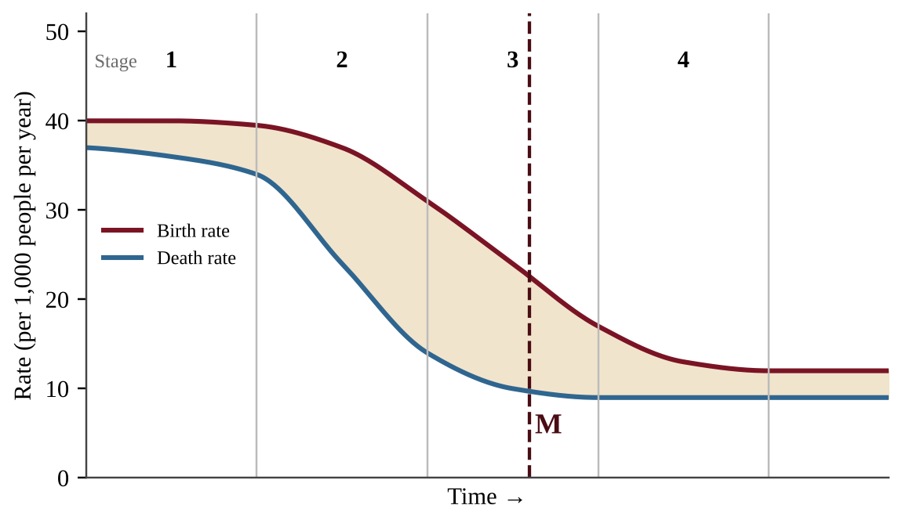
Which statement best describes Country M and the most likely cause of its trend?
A) It is in Stage 3: the death rate is rising because of aging, so the population is declining.
B) It is in Stage 4: birth and death rates are low and nearly equal, so the population is stable.
C) It is in Stage 2: improved sanitation and medicine are lowering death rates faster than birth rates, so growth is accelerating.
D) It is in Stage 3: urbanization, education and contraceptive access are lowering the birth rate, so growth is slowing but still positive.
:::

:::q PE2-MCQ022 | unit=4 | topic=4.1 | diff=1
Tokyo, Manila and Jakarta lie near subduction zones, where an oceanic plate sinks beneath another plate. Which hazards are most characteristic of such a boundary?
A) Earthquakes and explosive volcanoes caused by melting of the descending plate.
B) Gentle shield volcanoes formed where new crust is created at a mid-ocean ridge.
C) Earthquakes only, because the plates slide horizontally past one another without melting.
D) Mountain building without earthquakes, because the plates move smoothly.
:::

:::q PE2-MCQ023 | unit=4 | topic=4.2 | diff=1
A steep hillside forest in Madagascar is cleared for farming. Which soil layer is lost first, and why does erosion increase?
A) The parent material (C horizon), because it is the layer in contact with the surface.
B) The subsoil (B horizon), because it holds the most organic matter and is exposed first.
C) The bedrock (R horizon), because rain dissolves it faster once the trees are removed.
D) The topsoil (A horizon), because roots and canopy no longer slow the movement of runoff.
:::

:::q PE2-MCQ024 | unit=4 | topic=4.4 | diff=1
Most weather occurs in, and ground-level pollutants such as smog accumulate in, which layer of the atmosphere?
A) The troposphere, the lowest layer, which holds most of the atmosphere's mass and water vapor.
B) The thermosphere, where temperatures are highest and auroras form.
C) The stratosphere, which contains the ozone layer and very little water vapor.
D) The mesosphere, where most meteors burn up as they enter the atmosphere.
:::

:::q PE2-MCQ025 | unit=4 | topic=4.3 | diff=2
Students measured the water percolation rate (how fast water drains through soil) in three soils from an irrigated area.

| Soil | Sand (%) | Silt (%) | Clay (%) | Percolation rate (mm/h) |
|---|---|---|---|---|
| X | 65 | 25 | 10 | 40 |
| Y | 40 | 40 | 20 | 15 |
| Z | 10 | 45 | 45 | 2 |

Which conclusion is best supported by the data?
A) Percolation rate is unrelated to soil texture because all three soils contain some silt.
B) Soil Z is best for crops that need rapid drainage because it has the fewest sand particles.
C) As clay content increases, percolation speeds up because clay particles are the largest.
D) As clay content increases, percolation slows because the pore spaces are smaller.
:::

:::q PE2-MCQ026 | unit=4 | topic=4.5 | diff=2
Tropical rainforests occur mainly near the equator. Which explanation based on global wind and pressure patterns is best?
A) Intense sunlight makes moist air rise at the equator, where it cools and releases heavy rainfall.
B) Prevailing westerly winds deposit moisture from the oceans uniformly across all tropical land.
C) Air sinks at the equator and warms, which absorbs moisture and produces steady rainfall.
D) The Coriolis effect pushes cold, wet air from the poles to the equator throughout the year.
:::

:::q PE2-MCQ027 | unit=4 | topic=4.6 | diff=2
A megacity draws drinking water from a reservoir fed by a watershed of mountain forests and farms. Which activity within the watershed would most likely reduce the quality of the city's drinking water?
A) Adding wetlands that filter nutrients from agricultural runoff before it reaches the reservoir.
B) Terracing farmland to slow the flow of water down slopes.
C) Restoring native vegetation along streams to trap sediment before it reaches the water.
D) Clearing steep forested slopes for plowed fields, which increases sediment and nutrient runoff.
:::

:::q PE2-MCQ028 | unit=4 | topic=4.7 | diff=2
Jakarta (6° S) has a nearly constant temperature through the year, while Seoul (37° N) has hot summers and cold winters. What is the best explanation?
A) Seoul receives more solar energy in winter because it faces the Sun more directly.
B) Jakarta is warmed throughout the year by the Moon's gravitational pull on tropical oceans.
C) Near the equator, the angle of the Sun and the day length change very little through the year.
D) Earth is much closer to the Sun during Seoul's summer than during Jakarta's warmest month.
:::

:::q PE2-MCQ029 | unit=4 | topic=4.8 | diff=2
The windward side of the Western Ghats in India receives about 2,500 mm of rain per year, while the interior plateau on the leeward side receives about 600 mm. What best explains this difference?
A) Moist air rises on the windward slope, cools and drops rain, then descends dry on the leeward side.
B) Air descending on the windward slope warms and absorbs moisture from the ocean surface.
C) The leeward plateau is much closer to the equator, so it receives more intense sunlight and rain.
D) Ocean currents divert rain clouds away from the interior in every season.
:::

:::q PE2-MCQ030 | unit=4 | topic=4.3 | diff=3
A researcher wants to know whether adding compost increases the water retained by a sandy soil. She fills three identical columns with the same sandy soil, mixing in 0%, 5% and 10% compost by volume (one column of each), pours 500 mL of water through each, and measures the water retained after drainage stops. Which change would most improve her ability to draw a reliable conclusion?
A) Use at least three replicate columns for each compost level and compare the mean retained water.
B) Use a different soil type for each compost level to increase variation among treatments.
C) Pour more water through the 10% compost column to test its limits.
D) Remove the 0% compost column because only soils with compost are of interest.
:::

:::q PE2-MCQ031 | unit=4 | topic=4.9 | diff=3
The graphs show sea-surface temperature (SST) anomalies in the eastern Pacific and annual landings of a coastal anchovy fishery. 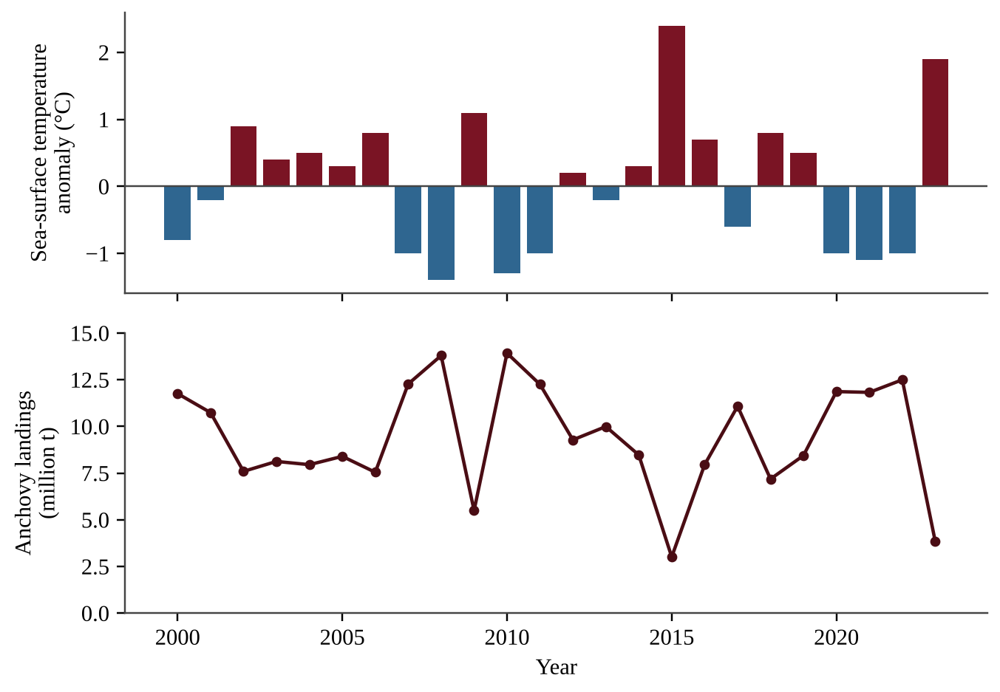
Which explanation best accounts for the low landings in years with large positive SST anomalies?
A) Weakened trade winds reduce upwelling of cold, nutrient-rich water, so phytoplankton and the anchovies that eat them decline.
B) Strengthened trade winds increase upwelling of nutrient-rich water, which reduces the plankton that anchovies eat.
C) Warm anomalies increase fishing effort, so anchovies are caught too quickly to be counted.
D) Warmer water holds more dissolved oxygen, which draws anchovies to deeper water where nets cannot reach them.
:::

:::q PE2-MCQ032 | unit=5 | topic=5.1 | diff=1
Dozens of small boats fish in a shared coastal lagoon with no catch limits. Each fisher increases effort even though fish stocks are falling. Which statement best explains this behavior?
A) Government regulations require every boat to catch a fixed quota each day.
B) Each fisher owns a part of the lagoon and manages it for long-term profit.
C) Fishers are unaware that fish are a renewable resource that can recover.
D) Each fisher gets the full benefit of an extra catch while the cost of depletion is shared among all users.
:::

:::q PE2-MCQ033 | unit=5 | topic=5.2 | diff=1
Compared with selective cutting, clearcutting a hillside forest is most likely to cause which effect?
A) Greater retention of soil nutrients because fewer roots are decomposing.
B) Greater soil erosion and sediment in nearby streams.
C) A smaller change in the stream's water temperature and flow.
D) More shade on the forest floor, which favors shade-tolerant seedlings.
:::

:::q PE2-MCQ034 | unit=5 | topic=5.9 | diff=1
Streams near an abandoned gold and copper mine have a pH of 3.5 and contain high concentrations of dissolved metals. Which process most likely caused this pollution?
A) Heated cooling water from the mine increasing stream temperatures.
B) Excess nitrogen from fertilizers causing algal blooms and oxygen depletion.
C) Chlorofluorocarbons released from mine tailings destroying stratospheric ozone.
D) Exposed sulfide minerals reacting with air and water to produce sulfuric acid.
:::

:::q PE2-MCQ035 | unit=5 | topic=5.5 | diff=2
A farm in a region with a falling water table wants to reduce groundwater pumping for irrigation. Which method best meets this goal?
A) Drip irrigation, because water is delivered slowly at the base of each plant with little evaporation.
B) Flood irrigation, because water covers the whole field and is fully absorbed by roots.
C) Furrow irrigation, because water flows in channels that prevent any seepage.
D) Spraying water high into the air at midday so it cools the crop.
:::

:::q PE2-MCQ036 | unit=5 | topic=5.7 | diff=2
Poultry requires about 2.2 kg of feed to produce 1 kg of meat, and beef requires about 7.0 kg. A megacity eats 90,000 kg of chicken per day. If the same mass of meat were beef, how much additional feed would be needed per day?
A) 198,000 kg
B) 432,000 kg
C) 630,000 kg
D) 828,000 kg
:::

:::q PE2-MCQ037 | unit=5 | topic=5.8 | diff=2
Data from a coastal fishery are shown. 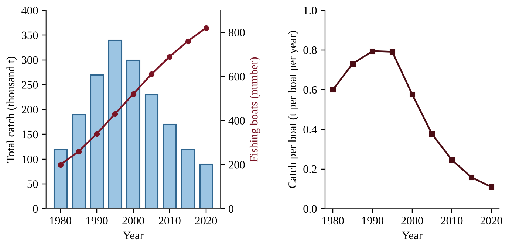
Which conclusion is best supported by the data for 2000–2020?
A) Total catch fell because fewer boats were fishing.
B) The fishery is sustainable because catch per boat remains well above its 1980 value.
C) Fish stocks are recovering because the number of boats keeps rising.
D) Fish stocks have been depleted: more boats are fishing, yet each boat catches less.
:::

:::q PE2-MCQ038 | unit=5 | topic=5.16 | diff=2
Which of the following is a recognized environmental disadvantage of coastal shrimp aquaculture (fish farming) compared with wild-capture fisheries?
A) Higher bycatch of sea turtles and other non-target species.
B) Greater use of fossil fuels for towing trawl nets over the sea floor.
C) Lower yield per hectare than that of wild-capture fishing.
D) Nutrient-rich, antibiotic-laden pond effluent that can pollute nearby waters.
:::

:::q PE2-MCQ039 | unit=5 | topic=5.13 | diff=2
The graph shows stream discharge after the same storm in two watersheds. One is a densely paved district of a large Asian city and the other is a forested catchment. 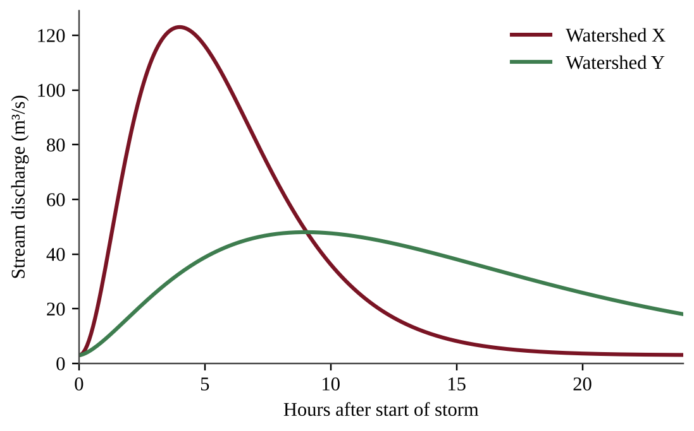
Which option correctly identifies the urban watershed, explains the pattern and names a way to reduce its peak?
A) Watershed Y; its lower peak reflects fast storm pipes, so widening them would flatten the peak.
B) Watershed Y; impervious surfaces temporarily store water and delay the peak, so storm drains would flatten it.
C) Watershed X; impervious surfaces speed runoff and reduce infiltration, so permeable pavement would lower its peak.
D) Watershed X; forest soils quickly shed water, so planting more trees would raise its peak.
:::

:::q PE2-MCQ040 | unit=5 | topic=5.11 | diff=3
A country has an ecological footprint of 3.0 global hectares (gha) per person and a biocapacity of 1.2 gha per person. Its population is 50 million. What is the country's total ecological deficit?
A) 60 million gha
B) 90 million gha
C) 150 million gha
D) 210 million gha
:::

:::q PE2-MCQ041 | unit=5 | topic=5.14 | diff=3
Scouting in a rice field in the Philippines finds 6 brown planthoppers per plant stem. The economic threshold for treatment is 10 per stem, and predatory spiders are abundant. Which action best follows integrated pest management (IPM)?
A) Apply a preventive insecticide on a fixed weekly schedule all season.
B) Spray a broad-spectrum insecticide now to prevent any future outbreak.
C) Release a non-native predator immediately to eliminate all planthoppers.
D) Do not spray; keep monitoring and protect the natural predators.
:::

:::q PE2-MCQ042 | unit=6 | topic=6.1 | diff=1
Which pair consists of two nonrenewable energy resources?
A) Biomass and coal
B) Coal and uranium
C) Geothermal and natural gas
D) Wind and uranium
:::

:::q PE2-MCQ043 | unit=6 | topic=6.5 | diff=1
Many fast-growing Asian cities depend on coal for electricity. Compared with natural gas, burning coal releases which of the following per unit of energy produced?
A) More CO₂, sulfur dioxide and particulate matter.
B) The same amount of CO₂ but less sulfur dioxide.
C) Less CO₂ and fewer particulates because it burns hotter.
D) Less CO₂ but more methane.
:::

:::q PE2-MCQ044 | unit=6 | topic=6.3 | diff=1
Coal is classified into ranks. Which rank contains the most carbon and releases the most energy per kilogram when burned?
A) Peat
B) Bituminous coal
C) Anthracite
D) Lignite
:::

:::q PE2-MCQ045 | unit=6 | topic=6.2 | diff=2
The graph shows the share of each energy source in the electricity supply of four countries. 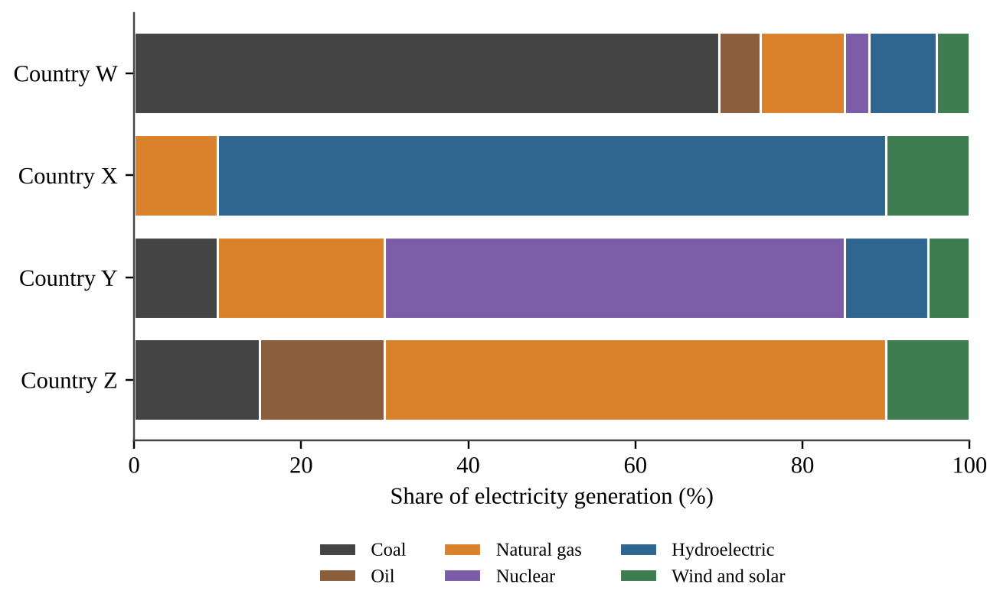
Which country's electricity supply would be most vulnerable to a multi-year drought, and why?
A) Country Z, because natural gas plants stop operating when river levels fall.
B) Country W, because coal plants require large amounts of rainfall to produce steam.
C) Country Y, because nuclear power is the largest share and requires the most water.
D) Country X, because most of its electricity is generated by hydroelectric dams that depend on river flow.
:::

:::q PE2-MCQ046 | unit=6 | topic=6.6 | diff=2
A coastal Asian megacity is considering a nuclear power plant. Which statement is most accurate?
A) Operation emits little CO₂, but spent fuel is radioactive and needs secure storage for thousands of years.
B) Uranium is a renewable resource, so waste storage is not a long-term concern.
C) Nuclear plants release no heat to the environment, so they cannot cause thermal pollution.
D) Operation releases large amounts of SO₂, but the waste is safe to handle within a few years.
:::

:::q PE2-MCQ047 | unit=6 | topic=6.9 | diff=2
Which of the following is a well-documented ecological effect of a large hydroelectric dam on a river downstream?
A) Higher seasonal flood peaks that maintain downstream wetlands.
B) Greater deposition of sediment on the floodplains because flows become more variable.
C) Trapped sediment reduces nutrient delivery to floodplains and the delta.
D) Increased upstream migration of fish to spawning grounds.
:::

:::q PE2-MCQ048 | unit=6 | topic=6.7 | diff=2
A program replaces open wood fires in rural homes with improved biomass cookstoves. Which statement about burning biomass is most accurate?
A) It releases more sulfur dioxide than coal because wood contains more sulfur.
B) It is always carbon-neutral because plants absorb CO₂ whenever they grow, regardless of harvest rate.
C) It can be nearly carbon-neutral if regrowth reabsorbs the CO₂ released, but combustion still produces particulates and carbon monoxide.
D) It produces no air pollutants because the fuel is a natural product.
:::

:::q PE2-MCQ049 | unit=6 | topic=6.8 | diff=2
A 250 MW solar farm in a desert produces 438,000 MWh of electricity in one year (8,760 hours). What is its capacity factor?
A) 5%
B) 20%
C) 25%
D) 50%
:::

:::q PE2-MCQ050 | unit=6 | topic=6.13 | diff=3
A hospital replaces 1,000 fluorescent tubes (60 W each) with LEDs (24 W each). Each runs 4,000 hours per year, electricity costs $0.12 per kWh, and the LEDs cost $27 each. What is the simple payback period?
A) 0.9 years
B) 1.6 years
C) 2.3 years
D) 3.1 years
:::

:::q PE2-MCQ051 | unit=6 | topic=6.12 | diff=3
A wind farm has 60 turbines rated at 3 MW each and a capacity factor of 35%. An average household uses 4,000 kWh per year. About how many households can the wind farm supply in one year (8,760 hours)?
A) 13,800
B) 138,000
C) 394,000
D) 1,380,000
:::

:::q PE2-MCQ052 | unit=7 | topic=7.1 | diff=1
Which of the following is a secondary air pollutant?
A) Lead particles released directly from smelters.
B) Carbon monoxide released from incomplete combustion in car engines.
C) Sulfur dioxide released directly from coal-burning plants.
D) Ground-level ozone formed from NOₓ and volatile organic compounds in sunlight.
:::

:::q PE2-MCQ053 | unit=7 | topic=7.5 | diff=1
Families in many rural homes cook over open fires indoors with poor ventilation. Which pollutants are most strongly associated with the health effects of this practice?
A) Sulfur dioxide and heavy-metal vapors from industrial smelters.
B) Chlorofluorocarbons and halons.
C) Particulate matter and carbon monoxide.
D) Tropospheric ozone and nitrogen dioxide from vehicles.
:::

:::q PE2-MCQ054 | unit=7 | topic=7.3 | diff=2
A city in a basin has severe smog on calm winter mornings, when a layer of warm air lies above cooler air at the surface. Why does this condition worsen air pollution?
A) The warm layer acts as a lid that prevents surface air and pollutants from rising and dispersing.
B) Strong winds in the cool layer carry pollutants into the surrounding region.
C) The warm layer absorbs the pollutants and destroys them before they reach people.
D) The cool air above the warm layer lifts pollutants high into the atmosphere.
:::

:::q PE2-MCQ055 | unit=7 | topic=7.6 | diff=2
Which device removes sulfur dioxide from the exhaust gases of a coal-fired power plant?
A) An electrostatic precipitator.
B) A catalytic converter.
C) A positive crankcase ventilation valve.
D) A flue-gas desulfurization system (scrubber).
:::

:::q PE2-MCQ056 | unit=7 | topic=7.2 | diff=2
Air-quality monitors in a city measured pollutant concentrations through a sunny day. 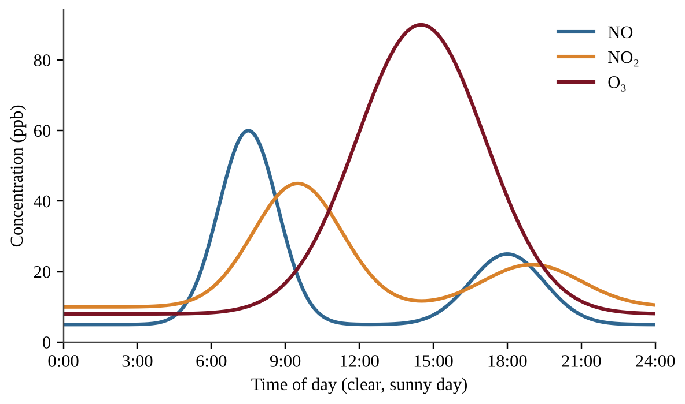
Which statement best explains why ozone peaks in the afternoon instead of during the morning rush hour?
A) Vehicles emit most of their ozone directly in the afternoon.
B) Sunlight-driven reactions of NO₂ and volatile organic compounds take hours to produce ozone.
C) Nitrogen oxides are produced only by sunlight and not by vehicles.
D) Ozone is removed by sunlight in the morning and reformed at night.
:::

:::q PE2-MCQ057 | unit=7 | topic=7.4 | diff=3
To compare fine-particle (PM2.5) pollution with distance from a coal plant, researchers place identical monitors at 0.5, 2, 5 and 10 km along a line east of the plant and record readings for a month. Which additional measurement would best reduce a confounding factor in the interpretation?
A) Wind speed and direction at the monitoring sites.
B) The height of each monitor above the ground, chosen at random.
C) A single midday reading at each site instead of daily averages.
D) Using a different brand of monitor at each distance.
:::

:::q PE2-MCQ058 | unit=7 | topic=7.7 | diff=3
Rain over a region downwind of coal-fired power plants and smelters has an average pH of 4.2. Unpolluted rain has a pH of about 5.6. About how many times more acidic is the polluted rain?
A) 1.4
B) 14
C) 25
D) 140
:::

:::q PE2-MCQ059 | unit=8 | topic=8.1 | diff=1
Which of the following is a point source of water pollution?
A) Airborne mercury from coal plants falling on a lake.
B) Fertilizer washing off many farm fields into a stream after rain.
C) Oil and heavy metals washing from city streets into storm drains.
D) A pipe that discharges untreated wastewater from a factory into a river.
:::

:::q PE2-MCQ060 | unit=8 | topic=8.9 | diff=1
An unlined open dump in a developing megacity contaminates nearby groundwater. Which feature of a modern sanitary landfill most directly prevents this?
A) Impermeable liners and a leachate collection system.
B) Leaving waste uncovered so rain washes toxic compounds away.
C) Mixing discarded electronics with the garbage to speed decomposition.
D) Daily burning of waste to reduce its volume.
:::

:::q PE2-MCQ061 | unit=8 | topic=8.5 | diff=2
Dissolved oxygen (DO) and biochemical oxygen demand (BOD) were measured downstream of a sewage outfall. 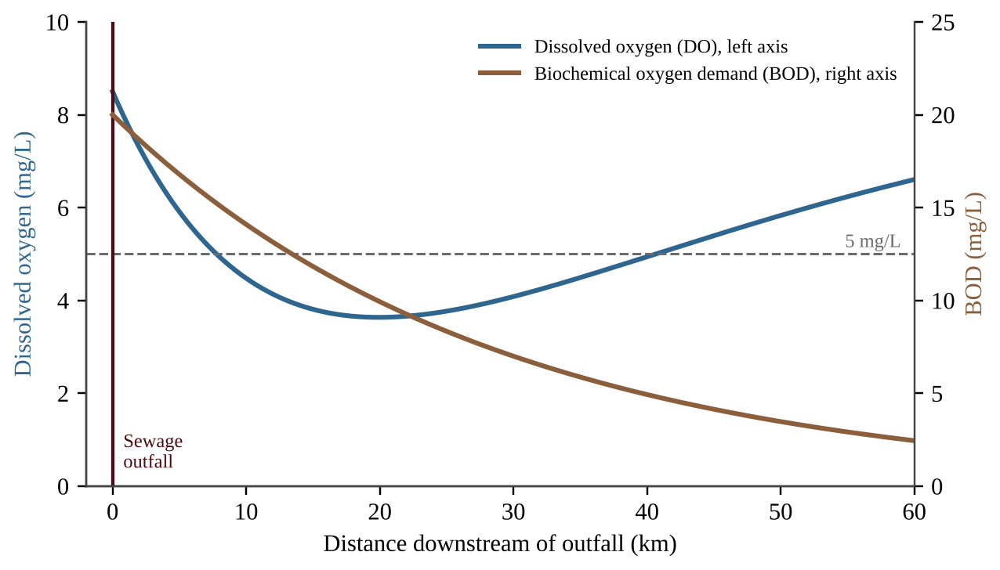
Which statement best explains why DO reaches its lowest value several kilometers below the outfall?
A) The sewage itself contains no oxygen and is not diluted until the stream reaches that point.
B) Algae in the stream stop photosynthesizing as soon as the sewage enters, so oxygen is never produced.
C) Decomposers consume oxygen as they break down the organic waste faster than oxygen is replaced.
D) BOD increases with distance, so more oxygen is needed far from the outfall.
:::

:::q PE2-MCQ062 | unit=8 | topic=8.8 | diff=2
Mercury concentrations in a marine food chain were measured.

| Organism | Trophic level | Mercury (ppm) |
|---|---|---|
| Phytoplankton | 1 | 0.002 |
| Zooplankton | 2 | 0.010 |
| Sardine | 3 | 0.050 |
| Tuna | 4 | 0.400 |

By what factor is the concentration in tuna higher than in phytoplankton, and what is this process of increase through the food chain called?
A) 200-fold; bioaccumulation
B) 200-fold; biomagnification
C) 20-fold; bioaccumulation
D) 20-fold; biomagnification
:::

:::q PE2-MCQ063 | unit=8 | topic=8.10 | diff=2
A city of 12 million people produces 1.1 kg of municipal solid waste per person per day and recycles 22% of it. Approximately how many metric tons of waste are not recycled each year (365 days)?
A) 1.06 million t
B) 3.76 million t
C) 4.82 million t
D) 5.88 million t
:::

:::q PE2-MCQ064 | unit=8 | topic=8.13 | diff=3
Two chemicals were tested on laboratory animals. 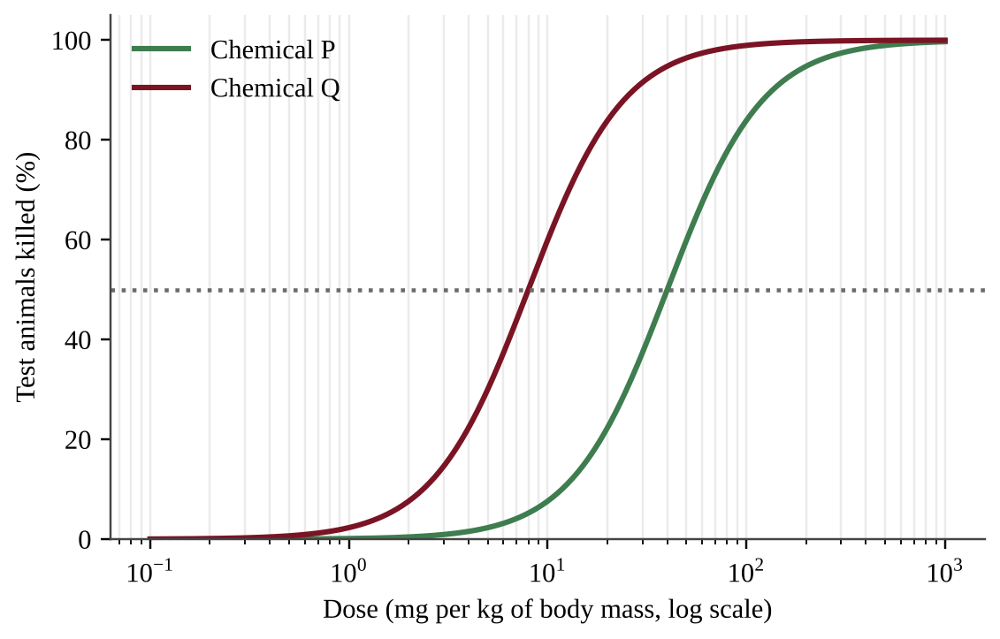
Which statement is best supported by the graph?
A) The chemicals are equally toxic because both eventually kill all of the animals.
B) Chemical Q is about eight times more toxic than P because its LD50 is about 8 mg/kg and P's is 1 mg/kg.
C) Chemical Q is about five times more toxic than P because its LD50 is about one-fifth as large.
D) Chemical P is about five times more toxic than Q because its LD50 is about five times larger.
:::

:::q PE2-MCQ065 | unit=8 | topic=8.15 | diff=3
Public-health officials in a monsoon-flooded megacity compared four districts.

| District | Households connected to sewers (%) | Cholera cases per 100,000 |
|---|---|---|
| 1 | 90 | 12 |
| 2 | 60 | 55 |
| 3 | 20 | 210 |
| 4 | 5 | 380 |

Which statement is the best conclusion from the data?
A) Cholera spreads mainly through the air in districts with fewer sewers.
B) Districts with less sewer coverage had higher cholera rates, which is consistent with fecal contamination of drinking water; expanding sewage collection could reduce cases.
C) Because district 1 has some cholera, sewers have no effect on the spread of the disease.
D) Sewer coverage is the only cause of cholera, so no other factors need to be considered.
:::

:::q PE2-MCQ066 | unit=9 | topic=9.1 | diff=1
Which statement best describes how chlorofluorocarbons (CFCs) deplete stratospheric ozone?
A) CFCs produce ground-level ozone that rises through the atmosphere and displaces the ozone layer.
B) CFCs react with CO₂ in the troposphere and form acids that rise to the stratosphere.
C) CFCs absorb ultraviolet radiation and warm the stratosphere, which breaks down ozone.
D) Ultraviolet radiation breaks CFCs apart, and the released chlorine atoms repeatedly convert ozone to oxygen.
:::

:::q PE2-MCQ067 | unit=9 | topic=9.2 | diff=1
Which action has been most responsible for the recovery of stratospheric ozone since the 1990s?
A) The installation of scrubbers on coal-fired power plants worldwide.
B) The ban on lead in gasoline in most countries.
C) The reduction of carbon dioxide emissions under the Kyoto Protocol.
D) The international phase-out of CFCs and other ozone-depleting substances under the Montreal Protocol.
:::

:::q PE2-MCQ068 | unit=9 | topic=9.3 | diff=1
Which statement best describes the natural greenhouse effect?
A) Greenhouse gases reflect visible sunlight back into space, which cools the lower atmosphere.
B) Greenhouse gases absorb infrared radiation from Earth's surface and re-emit some of it downward, warming the lower atmosphere.
C) Greenhouse gases trap incoming ultraviolet radiation before it reaches Earth's surface.
D) Greenhouse gases in the ozone layer block heat from leaving the stratosphere.
:::

:::q PE2-MCQ069 | unit=9 | topic=9.8 | diff=1
The golden apple snail, introduced to Asian rice paddies from South America, has spread rapidly and damages young rice plants. Which trait most likely helped it become invasive?
A) A narrow range of tolerance for temperature and salinity.
B) A specialized diet restricted to one plant species.
C) A high reproductive rate and few natural predators in the new range.
D) Slow maturation and long periods between breeding seasons.
:::

:::q PE2-MCQ070 | unit=9 | topic=9.4 | diff=2
Flooded rice paddies emit methane (CH₄). A farm emits 150 kg CH₄ per hectare per year. If the global warming potential of methane over 100 years is 28 times that of CO₂, what is the farm's annual emission per hectare in CO₂ equivalents?
A) 5.4 kg CO₂e
B) 150 kg CO₂e
C) 4,200 kg CO₂e
D) 42,000 kg CO₂e
:::

:::q PE2-MCQ071 | unit=9 | topic=9.4 | diff=2
Atmospheric CO₂ was monitored for nine years. 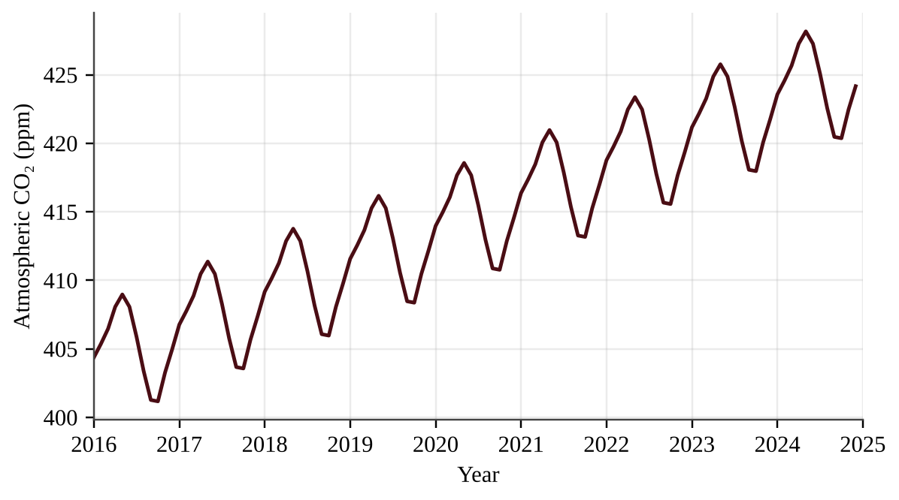
Which statement best explains the yearly oscillation and the long-term upward trend?
A) The yearly oscillation is caused by seasonal volcanic activity, and the upward trend by natural ocean cooling.
B) The oscillation results from ocean outgassing in summer, and the upward trend from reduced respiration by plants.
C) Seasonal photosynthesis in the Northern Hemisphere removes CO₂ in the growing season, while fossil fuel burning and deforestation add more CO₂ than is removed over the long term.
D) The oscillation reflects changes in the Sun's output, and the trend reflects slower decomposition of soil carbon.
:::

:::q PE2-MCQ072 | unit=9 | topic=9.5 | diff=2
Low-lying delta cities such as Dhaka and Jakarta face rising seas. Which pair of processes accounts for most of the current rise in global sea level?
A) Thermal expansion of seawater and melting of land-based glaciers and ice sheets.
B) Land subsidence and increased evaporation from the oceans.
C) Melting of Arctic sea ice and increased river discharge.
D) Thermal expansion of seawater and melting of floating sea ice.
:::

:::q PE2-MCQ073 | unit=9 | topic=9.6 | diff=2
The graph shows coral bleaching and maximum summer sea-surface temperature (SST) at a reef over 13 years. 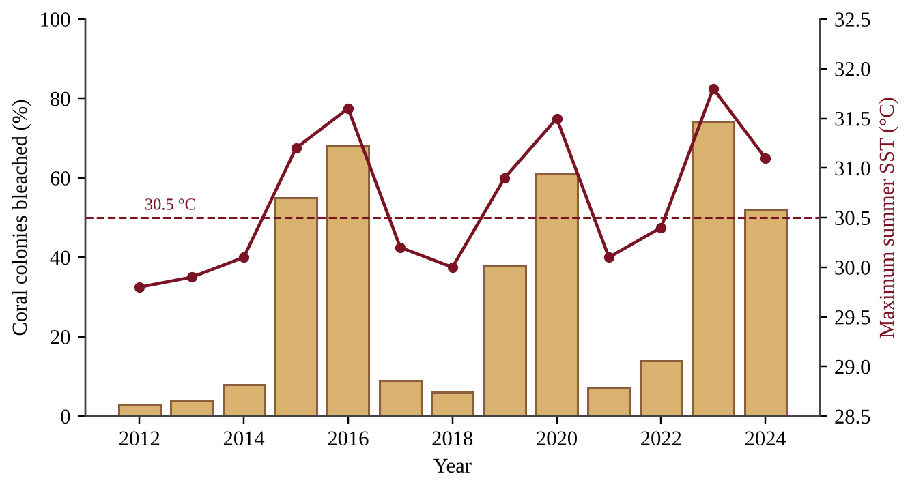
Which statement is best supported by the data?
A) Bleaching exceeded 35% only in years when maximum SST was above 30.5 °C.
B) Bleaching was highest in years when maximum SST was below 30.5 °C.
C) Bleaching is unrelated to water temperature at this reef.
D) Bleaching has decreased steadily since 2012 as corals adapted to warmer water.
:::

:::q PE2-MCQ074 | unit=9 | topic=9.7 | diff=2
Surface ocean pH has declined from about 8.2 to 8.1 since the Industrial Revolution. By approximately what percent has the hydrogen ion concentration increased?
A) 1%
B) 10%
C) 26%
D) 100%
:::

:::q PE2-MCQ075 | unit=9 | topic=9.9 | diff=2
Pangolins are among the most heavily trafficked wild mammals. Which international agreement specifically regulates cross-border trade in threatened species?
A) The Basel Convention on hazardous waste.
B) The Convention on International Trade in Endangered Species (CITES).
C) The Montreal Protocol.
D) The Ramsar Convention on wetlands.
:::

:::q PE2-MCQ076 | unit=9 | topic=9.10 | diff=2
Forest area in three regions of a biodiversity hotspot was measured in 2000 and 2020. 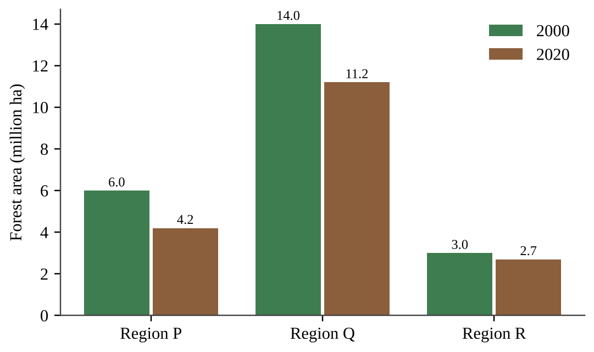
Which region lost the greatest percentage of its forest, and what was the loss?
A) Region P, 30%
B) Region Q, 20%
C) Region R, 10%
D) Region Q, 2.8 million ha
:::

:::q PE2-MCQ077 | unit=9 | topic=9.3 | diff=2
As Arctic summer sea ice melts, dark ocean water is exposed. Which statement best describes the resulting feedback?
A) No feedback: ocean water at 0 °C does not alter the energy balance.
B) A positive feedback: higher albedo means more energy is absorbed, causing more warming.
C) A negative feedback: lower albedo means more energy is reflected, which cools the surface.
D) A positive feedback: lower albedo means more solar energy is absorbed, causing more warming and more melting.
:::

:::q PE2-MCQ078 | unit=9 | topic=9.4 | diff=3
A project restores 5,000 hectares of mangrove forest that stores 6 metric tons of carbon per hectare per year. Carbon (atomic mass 12) is stored as part of CO₂ (molecular mass 44). About how much CO₂ is removed from the atmosphere each year?
A) 8,200 t
B) 30,000 t
C) 110,000 t
D) 360,000 t
:::

:::q PE2-MCQ079 | unit=9 | topic=9.8 | diff=3
To test whether removing invasive lionfish raises native fish richness, researchers removed lionfish from four reef patches near a marine reserve and left four patches farther from the reserve untouched. Mean native species per patch rose from 18 to 24 in removal patches and from 17 to 18 in the others. Which is the most serious limitation of this design?
A) A comparison group of untouched patches was included.
B) Four patches per treatment is too many to analyze statistically.
C) Native fish were counted both before and after the lionfish were removed.
D) Patches were not assigned at random, so proximity to the reserve may explain the difference.
:::

:::q PE2-MCQ080 | unit=9 | topic=9.2 | diff=3
Hydrofluorocarbons (HFCs) replaced CFCs in refrigeration. HFCs contain no chlorine, but many are thousands of times more effective than CO₂ at trapping heat. Which statement best evaluates this replacement?
A) It makes ozone depletion worse because HFCs react with stratospheric oxygen.
B) It has no environmental effect because HFCs are used in closed systems.
C) It solves both ozone depletion and climate change because HFCs have no chlorine.
D) It protects the ozone layer but increases the greenhouse effect, so a transition to low-GWP substitutes is needed.
:::

## Section II — Free-Response Questions (3)

:::q PE2-FRQ001 | unit=9 | topic=9.10 | diff=2 | frqtype=1 | pts=10
**Question 1 (10 points).** Across Southeast Asia, lowland rainforest, one of the most species-rich ecosystems on Earth, is being replaced by oil-palm plantations. The remaining forest survives in fragments. A conservation biologist is studying a 400-ha rainforest fragment that is bordered on one side by a plantation, as shown in the diagram. A pilot study found that leaf-litter temperature was 31.5 °C at the forest edge and 29.0 °C at 300 m inside the forest, and that humidity was lower at the edge.

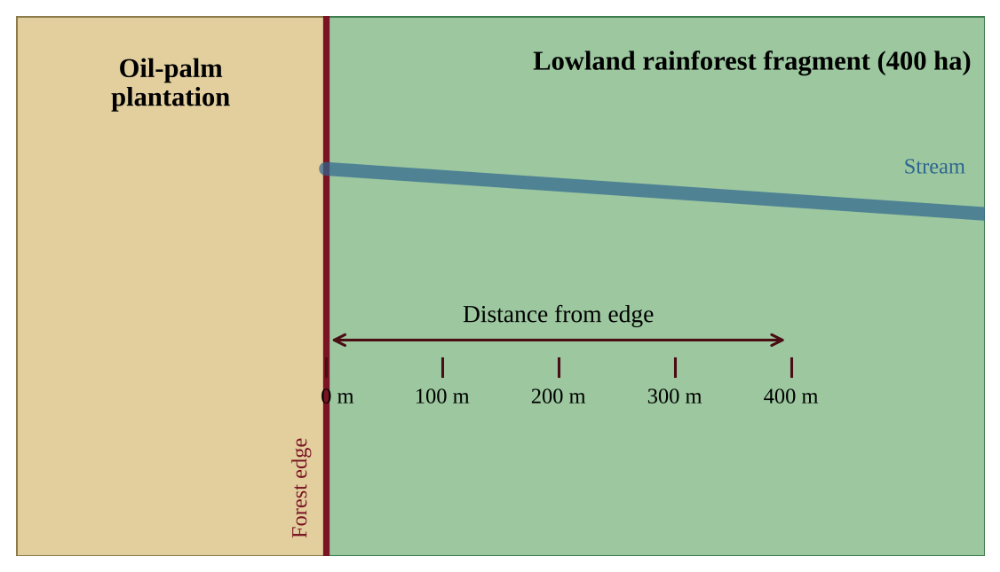

The biologist wants to investigate whether the number of forest-interior understory bird species changes with distance from the forest edge.

(a) Identify the environmental problem illustrated by the scenario. [1]

(b) Write a testable hypothesis for the investigation, including the predicted direction of the relationship. [1]

(c) Identify the independent variable and the dependent variable of the investigation. [2]

(d) Describe a procedure the biologist could use to collect data, including the locations of sampling, how replication will be achieved, and how birds will be counted in a standardized way. [3]

(e) Identify one variable that the biologist should keep constant (control) and explain why. [1]

(f) Describe the pattern of results that would support your hypothesis. [1]

(g) Propose one action that could reduce the loss of forest-interior bird species and justify your proposal using an ecological principle. [1]
:::

:::q PE2-FRQ002 | unit=7 | topic=7.4 | diff=2 | frqtype=2 | pts=10
**Question 2 (10 points).** A megacity in South Asia has experienced severe air pollution, and public-health officials monitor the concentration of fine particulate matter (PM2.5) and hospital admissions for respiratory illness. In 2022 the city began phasing out coal-fired boilers in industry and created a low-emission zone that limits older diesel vehicles in the center of the city. Table 1 gives annual data.

**Table 1.** Annual mean PM2.5 and respiratory admissions

| Year | Annual mean PM2.5 (µg/m³) | Respiratory admissions per 100,000 residents |
|---|---|---|
| 2017 | 118 | 410 |
| 2018 | 124 | 428 |
| 2019 | 131 | 447 |
| 2020 | 126 | 441 |
| 2021 | 134 | 462 |
| 2022 | 121 | 438 |
| 2023 | 104 | 401 |
| 2024 | 92 | 372 |

Figure 1 shows the monthly mean PM2.5 in 2024 and the number of days each month on which a thermal inversion was recorded.

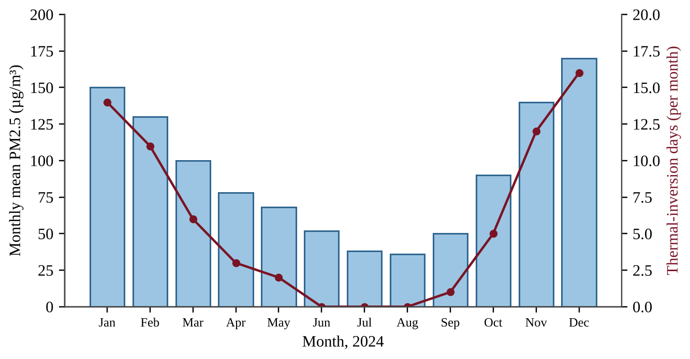

(a) Describe the trend in the annual mean PM2.5 concentration from 2017 to 2021. [1]

(b) Calculate the percent change in annual mean PM2.5 between 2021 and 2024. Show your work. [2]

(c) Describe the relationship between annual mean PM2.5 and respiratory admissions shown in Table 1. [1]

(d) Identify one factor other than PM2.5 that could also affect respiratory admissions and explain why this limits the conclusion that PM2.5 alone caused the changes. [1]

(e) Using Figure 1, explain why PM2.5 is highest in December and January. In your answer, describe the pattern shown in the figure and explain how thermal inversions affect pollutant concentrations. [2]

(f) Justify the claim that the 2022 policies contributed to the decline in PM2.5 after 2021, using data from Table 1. [2]

(g) Propose one additional action to reduce PM2.5 in the city and describe one advantage or disadvantage of the action. [1]
:::

:::q PE2-FRQ003 | unit=6 | topic=6.9 | diff=3 | frqtype=3 | pts=10
**Question 3 (10 points).** A river in Southeast Asia is dammed to supply electricity and water to a megacity of 5.0 million people. The dam and reservoir have the characteristics given in the table. The alternative would be to generate the same electricity at a coal-fired power plant.

| Characteristic | Value |
|---|---|
| Installed capacity of hydroelectric plant | 800 MW |
| Capacity factor | 0.50 |
| Surface area of reservoir | 200 km² |
| Evaporation from reservoir surface | 1.2 m per year |
| CO₂ emitted by coal-fired generation | 0.95 metric tons per MWh |
| Household and commercial water use in the city | 150 L per person per day |

Useful conversions: 1 year = 8,760 hours; 1 km² = 10⁶ m²; 1 m³ = 1,000 L.

(a) Calculate the electricity generated by the hydroelectric plant in one year, in MWh. Show your work. [2]

(b) Calculate the mass of CO₂, in metric tons per year, that would be emitted if the same amount of electricity were instead produced by the coal-fired plant. Show your work. [2]

(c) Calculate the volume of water, in m³ per year, that evaporates from the reservoir. Show your work. [1]

(d) Calculate the city's annual water use in m³ per year, and then compare it with the volume that evaporates from the reservoir by calculating the evaporation as a percentage of the city's water use. [2]

(e) Describe one environmental disadvantage of the dam for ecosystems downstream. [1]

(f) Propose one action to reduce the environmental or social effects of the dam and justify it. [2]
:::
