# Predicted Exam 3

:::box note
**Exam format and timing (2026 AP Environmental Science)**
- Section I: 80 multiple-choice questions, 90 minutes, 60% of the exam score. Each question has four choices (A–D) and one best answer.
- Section II: 3 free-response questions, 70 minutes, 40% of the exam score, 10 points each: (1) design an investigation, (2) analyze and interpret quantitative data, (3) analyze an environmental problem and perform calculations.
- A scientific or four-function calculator is allowed for both sections. Show your work in calculation questions and include units.
- Suggested pacing: about 1 minute 7 seconds per multiple-choice question and about 23 minutes per free-response question.
- Mark only one answer per multiple-choice question; there is no penalty for guessing, so answer every question. Write free-response answers in complete sentences, using the task verbs in each part.
:::

## Section I — Multiple-Choice Questions (80)

:::q PE3-MCQ001 | unit=1 | topic=1.11 | diff=1
A savanna food chain is grass → zebra → lion. Which statement about the lion is correct?
A) It is a primary consumer because it feeds on another animal.
B) It is a tertiary consumer and receives about 10% of the energy fixed by the grass.
C) It is a secondary consumer and receives about 90% of the energy stored in the zebra's tissues.
D) It is a secondary consumer and receives about 10% of the energy stored in the zebra's tissues.
:::

:::q PE3-MCQ002 | unit=1 | topic=1.5 | diff=1
Acacia trees in an African savanna have root nodules that contain bacteria. These bacteria increase the nitrogen available to nearby grasses. Which process do the bacteria carry out?
A) Nitrification, which converts nitrogen gas into nitrate
B) Denitrification, which converts nitrate into ammonium in the soil
C) Nitrogen fixation, which converts atmospheric N₂ into ammonia
D) Ammonification, which converts atmospheric N₂ into amino acids
:::

:::q PE3-MCQ003 | unit=1 | topic=1.2 | diff=2
The graphs show mean monthly precipitation (bars, left axis) and mean monthly temperature (line, right axis, same scale in all three panels) at three sites.

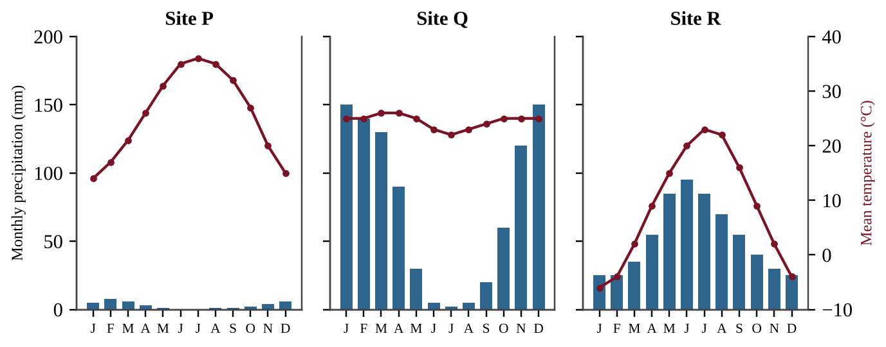

Which biome best describes Site Q?
A) Hot desert, because several months receive almost no precipitation at all
B) Temperate grassland, because rainfall is concentrated in the warmest months
C) Tropical rainforest, because total annual rainfall is high and temperatures stay warm
D) Tropical savanna, because warmth all year is combined with a long dry season
:::

:::q PE3-MCQ004 | unit=1 | topic=1.10 | diff=2
Net primary productivity of a savanna plot is 250,000 kJ per year. Energy passes through the chain grass → grasshopper → lizard → hawk. Assuming 10% of energy is transferred between trophic levels, about how much energy per year is available to the hawk, a tertiary consumer?
A) 25 kJ
B) 250 kJ
C) 2,500 kJ
D) 25,000 kJ
:::

:::q PE3-MCQ005 | unit=1 | topic=1.8 | diff=2
Researchers measure gross primary productivity (GPP) of 3,200 g C/m²/yr on a grassland plot. The plants respire 1,950 g C/m²/yr. What is the net primary productivity (NPP) of the plot?
A) 1,250 g C/m²/yr
B) 1,950 g C/m²/yr
C) 3,200 g C/m²/yr
D) 5,150 g C/m²/yr
:::

:::q PE3-MCQ006 | unit=1 | topic=1.4 | diff=3
A rancher plows 100 ha of native prairie and plants wheat. Over the next decade, soil carbon in the field declines. Which explanation is best?
A) Tillage breaks up soil aggregates and exposes organic matter to oxygen, so microbes release more CO₂.
B) Plowing kills soil bacteria, so organic carbon is slowly oxidized by chemical reactions without any biological activity.
C) Fertilizer applied to the wheat converts soil carbon into methane that escapes as a gas, lowering soil carbon.
D) Deep tillage moves carbon-rich topsoil below the water table, where it dissolves and is carried away as CO₂.
:::

:::q PE3-MCQ007 | unit=2 | topic=2.6 | diff=1
Which of the following is an example of a behavioral adaptation to life in a hot desert?
A) Foraging mainly at night, when air temperatures are lower
B) Producing very concentrated urine to conserve water
C) Storing water in thick, fleshy stems
D) Having large, thin ears that release body heat
:::

:::q PE3-MCQ008 | unit=2 | topic=2.2 | diff=1
Deep-rooted native grasses on a savanna watershed slow runoff and reduce downstream flooding. Which ecosystem service category does this best represent?
A) Provisioning service
B) Cultural service
C) Supporting service
D) Regulating service
:::

:::q PE3-MCQ009 | unit=2 | topic=2.7 | diff=2
After a lightning-caused fire burns a grassland, grasses resprout within weeks from surviving roots and the soil seed bank. Why is this recovery classified as secondary succession?
A) The soil remained intact and still contained seeds and roots.
B) No soil was left, so pioneer species had to colonize bare rock.
C) Fire is a human-caused disturbance, and primary succession follows only natural disturbances.
D) The community immediately returned to its climax stage without intermediate stages.
:::

:::q PE3-MCQ010 | unit=2 | topic=2.3 | diff=2
Remnant grassland patches in a farming region were surveyed. All lie in a landscape in which the nearest source of grassland birds is a large national park.

| Patch | Area (ha) | Distance to park (km) | Bird species recorded |
|---|---|---|---|
| W | 400 | 2 | 41 |
| X | 400 | 25 | 29 |
| Y | 20 | 2 | 22 |
| Z | 20 | 25 | 12 |

Which conclusion is best supported by the table?
A) Species richness depends only on patch area, so distance from the source park has no effect on richness.
B) Richness is higher in larger patches and in patches nearer the source park, as island biogeography predicts.
C) Species richness is higher in patches farther from the park because there are fewer competitors for resources.
D) Species richness depends only on distance from the source park, so patch area has no effect on richness.
:::

:::q PE3-MCQ011 | unit=2 | topic=2.4 | diff=3
Two grass species grow on a rangeland. The graph shows the relative abundance of each along a gradient of mean annual rainfall. A prolonged drought lowers rainfall at one site to the value marked by the dashed line.

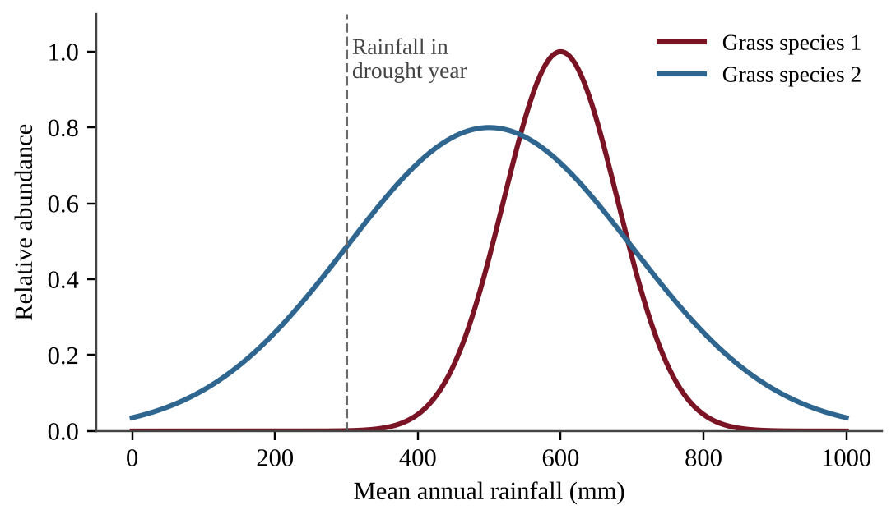

Which prediction is best supported by the graph?
A) Species 1 will persist because it has the highest peak abundance, which shows that it has greater tolerance.
B) Both species will disappear because 300 mm is below the optimum rainfall for each.
C) Species 2 will persist at lower abundance because 300 mm is within its tolerance range, but Species 1 will likely disappear.
D) Species 2 will disappear because 300 mm is below its optimum, while Species 1 is a generalist that tolerates drought.
:::

:::q PE3-MCQ012 | unit=3 | topic=3.1 | diff=1
A grassland bird feeds almost exclusively on the seeds of one native grass. An invasive shrub replaces that grass across much of the bird's range. What will most likely happen to the bird population?
A) It will remain stable because birds can quickly switch to a wide variety of foods.
B) It will increase because the shrub removes competitors for seeds.
C) It will decline sharply because the bird is a specialist with a narrow niche.
D) It will stay unchanged because specialists are less affected than generalists by habitat change.
:::

:::q PE3-MCQ013 | unit=3 | topic=3.2 | diff=1
African elephants live more than 60 years, usually give birth to a single calf every few years, and provide extended parental care. Which description fits elephant life history?
A) r-selected, with many small offspring and early maturity
B) r-selected, because large body size allows rapid exponential growth
C) K-selected, because individuals reproduce rapidly when resources are abundant
D) K-selected, with few offspring and high parental investment
:::

:::q PE3-MCQ014 | unit=3 | topic=3.7 | diff=1
The total fertility rate (TFR) of a Latin American country fell from 6.0 in 1960 to 1.9 in 2020. Which pair of changes most likely contributed?
A) Higher infant mortality and greater reliance on children for farm labor
B) Expanded education for girls and wider access to contraception
C) Slower urbanization and lower costs of raising children
D) Lower average income and reduced access to family-planning services
:::

:::q PE3-MCQ015 | unit=3 | topic=3.3 | diff=2
A female desert tortoise lays about ten eggs. Most hatchlings are eaten or die of heat, but the few that reach adulthood may live more than 50 years. The graph shows three survivorship curves (log scale).

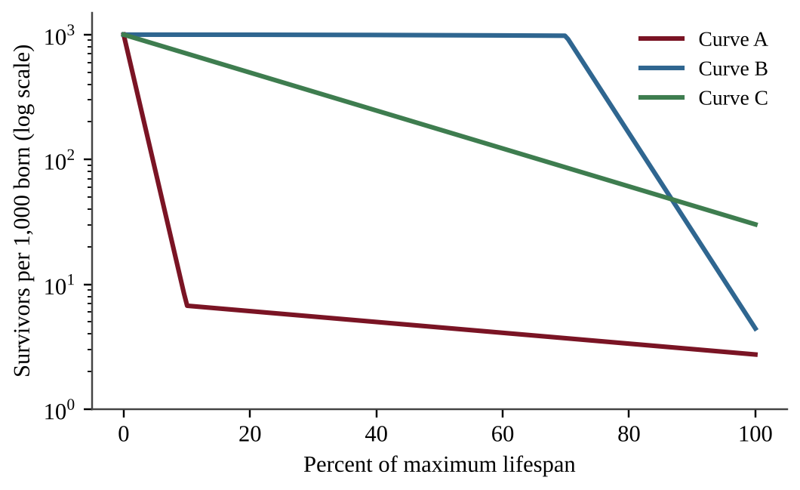

Which curve best represents the tortoise?
A) Curve B, because most individuals survive until they are near the maximum lifespan
B) Curve C, because the chance of dying is about the same at every age of life
C) Curve B, because long-lived species always have low juvenile mortality rates
D) Curve A, because few individuals survive the juvenile stage but survivors live long
:::

:::q PE3-MCQ016 | unit=3 | topic=3.4 | diff=2
Sheep were released on an isolated island with no predators and no later additions or removals of sheep. The graph shows the population over time.

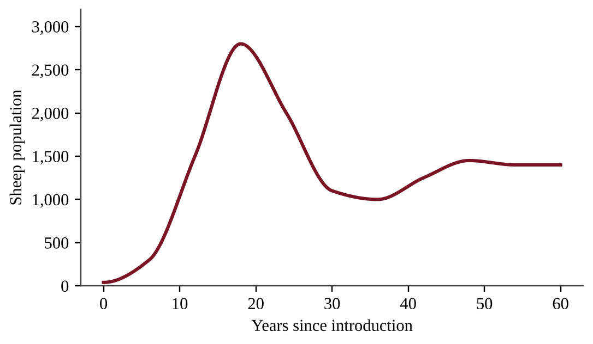

Which statement best interprets the population after year 18?
A) The carrying capacity is about 2,800 sheep, and the population has been in permanent decline since year 18.
B) The population grew exponentially for the entire 60 years, so resources never limited it.
C) The population overshot the island's carrying capacity, and forage depletion drove it to a lower, steadier level.
D) Immigration of sheep from the mainland stabilized the population near 1,400 animals.
:::

:::q PE3-MCQ017 | unit=3 | topic=3.5 | diff=2
A country in East Africa has a population growth rate of 2.8% per year. Using the rule of 70, about how long will it take for its population to double if the growth rate stays constant?
A) 7 years
B) 25 years
C) 28 years
D) 196 years
:::

:::q PE3-MCQ018 | unit=3 | topic=3.8 | diff=2
Country E in southern Europe has a total fertility rate of 1.4. In one year it records 9 births, 11 deaths, 6 immigrants, and 2 emigrants per 1,000 people. What is its annual population growth rate?
A) −0.2%
B) +0.2%
C) +0.4%
D) +2.0%
:::

:::q PE3-MCQ019 | unit=3 | topic=3.6 | diff=2
The age-structure diagrams show three countries.

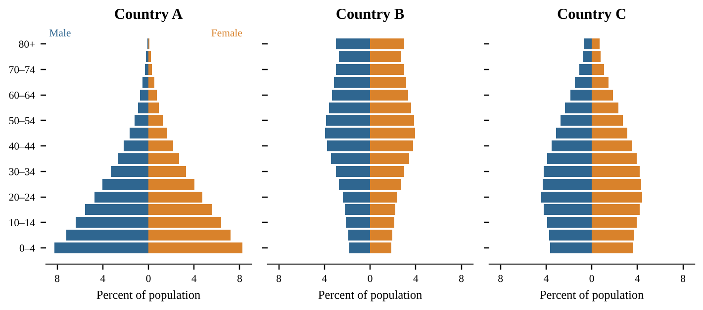

Suppose each country's fertility rate fell immediately to replacement level (2.1). Which country's population would most likely keep growing for several decades, and why?
A) Country A, because its large pre-reproductive cohorts will move into childbearing ages
B) Country B, because its largest cohorts are middle-aged and will live longer
C) Country C, because its birth rate will exceed its death rate for the next 100 years
D) Country B, because replacement fertility always produces growth in aging societies
:::

:::q PE3-MCQ020 | unit=3 | topic=3.6 | diff=2
Country B in southern Europe has 12% of its population under age 15, 64% aged 15–64, and 24% aged 65 or older. About how many working-age people (15–64) are there for each person aged 65 or older?
A) 0.4
B) 2.7
C) 3.2
D) 5.3
:::

:::q PE3-MCQ021 | unit=3 | topic=3.9 | diff=3
The graph shows birth and death rates over 120 years in a Latin American country.

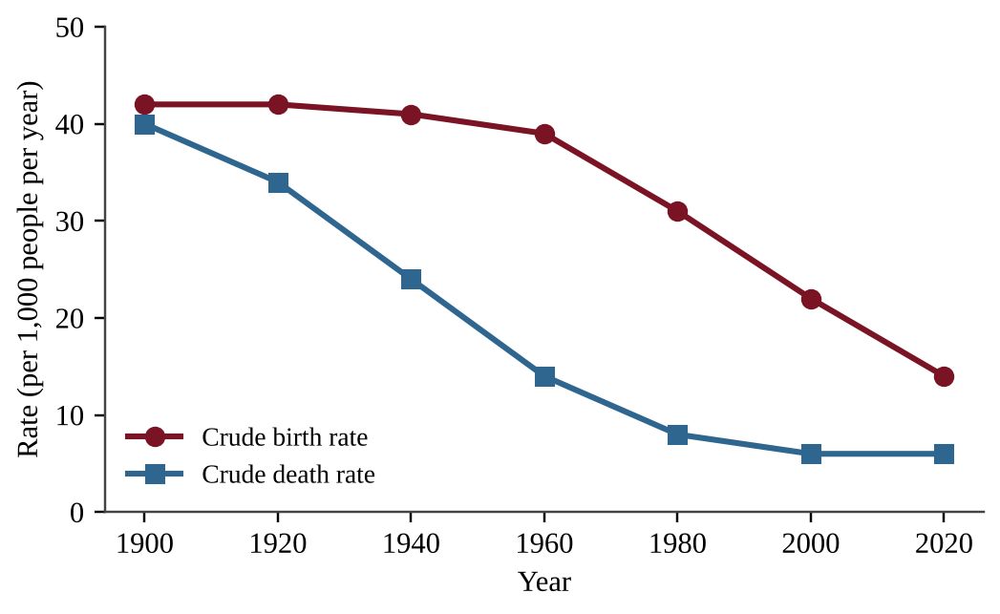

When was natural increase greatest, and why?
A) Near 1960, when death rates had fallen sharply but birth rates stayed high, a gap of about 25 per 1,000
B) Near 1900, when both rates were high, which gave the largest natural increase of the century
C) Near 1980, when falling birth rates produced a gap of about 23 per 1,000, the maximum gap
D) Near 2020, when very low death rates produced the largest gap between the two rates
:::

:::q PE3-MCQ022 | unit=4 | topic=4.4 | diff=1
Which layer of the atmosphere contains most of Earth's weather and most of its water vapor?
A) Stratosphere
B) Troposphere
C) Mesosphere
D) Thermosphere
:::

:::q PE3-MCQ023 | unit=4 | topic=4.1 | diff=1
The East African Rift is a long valley where the crust is slowly being pulled apart and where volcanoes and hot springs occur. Which type of plate boundary is forming it?
A) Convergent boundary, where one plate subducts beneath another
B) Transform boundary, where plates slide horizontally past each other
C) Divergent boundary, where plates move apart and magma rises
D) Convergent boundary, where two continental plates collide to form folded mountains
:::

:::q PE3-MCQ024 | unit=4 | topic=4.2 | diff=1
In a grassland soil profile, which horizon is the mineral topsoil rich in humus where most plant roots and soil organisms are found?
A) B horizon
B) A horizon
C) C horizon
D) Bedrock
:::

:::q PE3-MCQ025 | unit=4 | topic=4.5 | diff=2
Many of the world's large hot deserts, including the Sahara, lie near 30° N and 30° S latitude. What best explains this pattern?
A) Dry air descending near 30° warms and absorbs moisture rather than releasing it as precipitation.
B) Moist air rising near 30° drops its water on the way to higher latitudes.
C) Strong solar heating at 30° makes air rise rapidly, creating a low-pressure zone with clear skies.
D) Trade winds blowing from the equator carry nearly all the moisture past 30° toward the poles.
:::

:::q PE3-MCQ026 | unit=4 | topic=4.3 | diff=2
Three soil samples were tested for how fast water enters the soil and how much water is held after drainage.

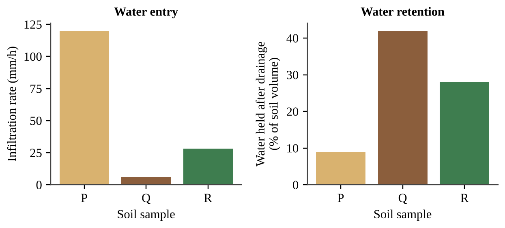

Which description of soil Q is best supported by the data?
A) Sand-rich, with large pores that allow rapid water entry and quick drainage
B) Clay-rich, with tiny pores that slow water entry but hold water tightly
C) Sand-rich, because it holds the most water after drainage
D) Loam with balanced pores, giving intermediate infiltration and retention
:::

:::q PE3-MCQ027 | unit=4 | topic=4.6 | diff=2
Overgrazing strips ground cover from a cattle ranch located in the headwaters of a watershed. Which downstream effect is most likely?
A) More runoff and sediment reach the stream, increasing turbidity and flood peaks.
B) Less sediment reaches the stream because bare soil absorbs more rain.
C) Groundwater recharge increases because water moves quickly across the surface.
D) Stream nutrient levels fall because grazing removes plant material.
:::

:::q PE3-MCQ028 | unit=4 | topic=4.2 | diff=2
A 40-ha rangeland loses soil to erosion at 9.0 metric tons per hectare per year, while new soil forms at 1.5 metric tons per hectare per year. If these rates continue for 20 years, what is the net soil loss from the entire rangeland?
A) 150 metric tons
B) 1,200 metric tons
C) 6,000 metric tons
D) 7,200 metric tons
:::

:::q PE3-MCQ029 | unit=4 | topic=4.7 | diff=2
Why is it summer in the Southern Hemisphere when it is winter in the Northern Hemisphere in December?
A) Earth is closer to the Sun in December, which heats the Southern Hemisphere more than the Northern.
B) Earth's axis is tilted, so the Southern Hemisphere is angled toward the Sun and gets more direct light.
C) Earth rotates more slowly in December, which gives the Southern Hemisphere longer days and shorter nights.
D) Ocean currents carry heat across the equator in December and warm the whole Southern Hemisphere.
:::

:::q PE3-MCQ030 | unit=4 | topic=4.8 | diff=2
The diagram shows moist ocean air moving inland over a mountain range.

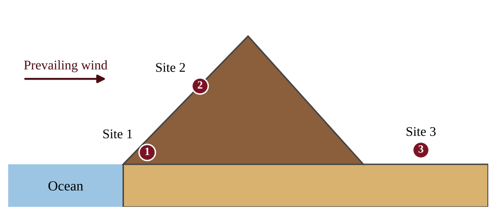

At which site is annual precipitation most likely lowest, and why?
A) Site 1, because it is at the lowest elevation, where air holds the least moisture
B) Site 2, because thin air at high elevation holds less moisture
C) Site 3, because air descending the leeward slope warms and holds its remaining moisture
D) Site 2, because winds are strongest at the summit and blow rain away
:::

:::q PE3-MCQ031 | unit=4 | topic=4.9 | diff=3
The graph shows sea-surface temperature anomalies off the coast of Peru and the catch of anchovies in the same years.

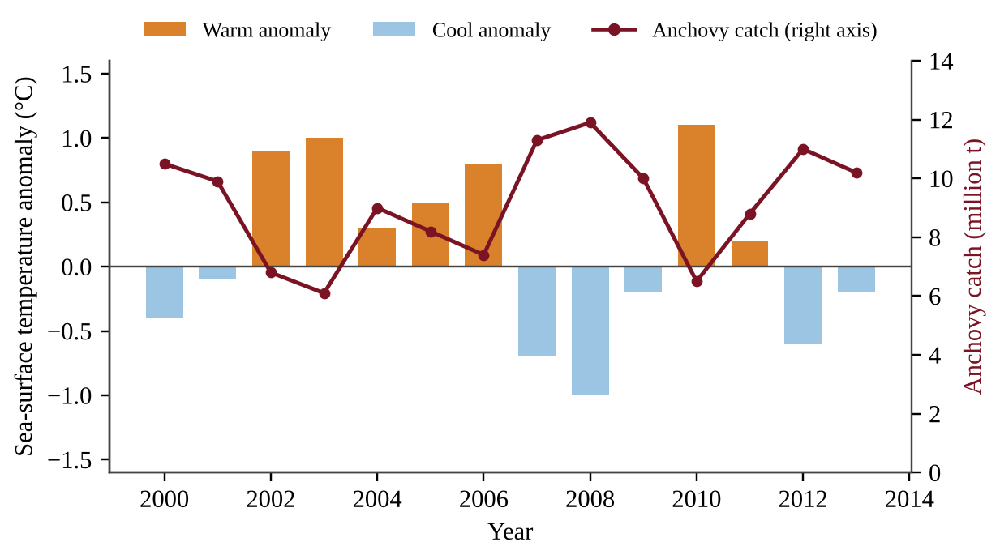

Which statement is best supported by the data and by what is known about El Niño?
A) Warm anomalies coincide with higher catches because warmer water speeds up anchovy growth and reproduction.
B) There is no relationship between temperature anomalies and catches, because the catch varies randomly from year to year.
C) Cold anomalies coincide with lower catches because cold water holds less dissolved oxygen for fish.
D) Warm anomalies coincide with lower catches, consistent with weakened upwelling that reduces nutrient supply.
:::

:::q PE3-MCQ032 | unit=5 | topic=5.1 | diff=1
Herders in a semi-arid region graze cattle on shared communal pasture. Each herder gains the full benefit from adding one more animal, but the damage from overgrazing is shared by everyone. Which concept best explains why the pasture is likely to be degraded?
A) Bioaccumulation
B) Ecological succession
C) The precautionary principle
D) The tragedy of the commons
:::

:::q PE3-MCQ033 | unit=5 | topic=5.7 | diff=1
Compared with continuous grazing, which practice best reduces damage to rangeland vegetation?
A) Keeping the herd in one pasture all year so manure is concentrated
B) Grazing the same paddock every year at the start of the growing season
C) Removing ground cover so livestock can reach grass roots
D) Moving livestock among paddocks so grazed plants can recover
:::

:::q PE3-MCQ034 | unit=5 | topic=5.5 | diff=2
In an arid region, farmers flood-irrigate their fields with river water for several decades. Crop yields decline and a white crust appears on the soil surface. What is the most likely cause?
A) Evaporating irrigation water leaves dissolved salts behind, causing salinization.
B) Acid rain has leached nitrogen and other nutrients out of the soil.
C) Heavy tractors have compacted the soil so that much more water infiltrates.
D) Heavy rainfall has flushed nutrients out of the root zone.
:::

:::q PE3-MCQ035 | unit=5 | topic=5.3 | diff=2
Which is a documented environmental drawback of the high-yield crop varieties introduced during the Green Revolution?
A) They produce lower yields per hectare than the traditional varieties they replaced.
B) They increase soil organic matter, which lowers the fertilizer needs of later crops.
C) They require much less water, which raises local groundwater levels.
D) They depend on heavy fertilizer, pesticide, and water inputs and reduce crop genetic diversity.
:::

:::q PE3-MCQ036 | unit=5 | topic=5.14 | diff=2
A sorghum cooperative adopts integrated pest management (IPM). Which action is part of IPM?
A) Scouting fields and spraying only when pest numbers exceed an economic threshold
B) Spraying a broad-spectrum pesticide on a fixed calendar schedule every season
C) Planting the same crop every year so that pest populations stay predictable
D) Eliminating natural predators of pests so that they cannot spread crop diseases
:::

:::q PE3-MCQ037 | unit=5 | topic=5.8 | diff=2
The graphs show fishing effort and catch in an inland lake fishery.

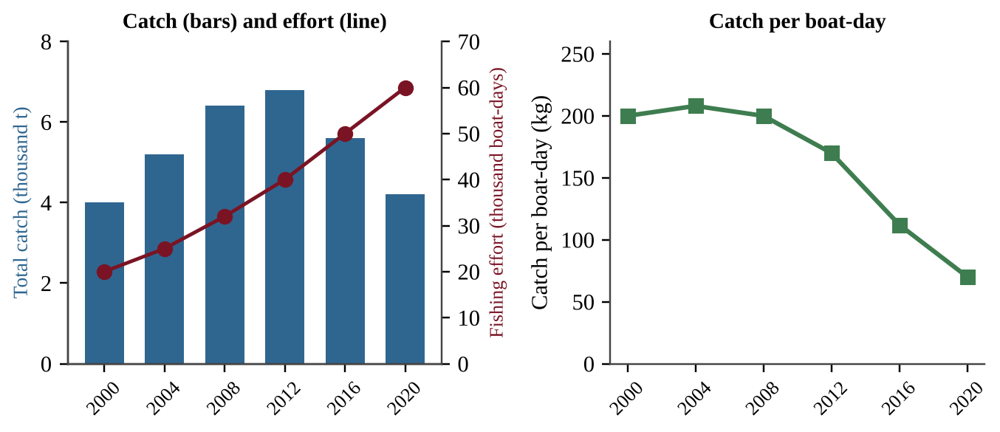

Which interpretation is best supported?
A) Effort kept rising while catch per boat-day fell, indicating that the stock is being depleted.
B) Falling catch per boat-day shows that the fish population is increasing in the lake.
C) Total catch rose until 2012, so the stock was not overfished in any year of the record.
D) Rising effort shows that the fish stock is recovering and can support more boats.
:::

:::q PE3-MCQ038 | unit=5 | topic=5.9 | diff=2
Which is a direct environmental impact of open-pit (surface) mining?
A) Habitat destruction and waste rock that can produce acidic runoff
B) Increased groundwater recharge across the mined area
C) Higher soil fertility at the site as deep layers are exposed
D) Reduced sediment in nearby streams due to removal of vegetation
:::

:::q PE3-MCQ039 | unit=5 | topic=5.7 | diff=2
A rancher manages 800 ha of rangeland. Forage production averages 2,400 kg of dry matter per hectare per year, and to prevent overgrazing no more than 50% may be eaten by cattle. Each cow eats about 4,000 kg of forage per year. What is the maximum number of cows the rangeland can support sustainably?
A) 120 cows
B) 240 cows
C) 480 cows
D) 960 cows
:::

:::q PE3-MCQ040 | unit=5 | topic=5.11 | diff=3
Country K has 25 million people, an average ecological footprint of 4.5 global hectares (gha) per person, and a biocapacity of 2.7 gha per person. What is Country K's total ecological deficit?
A) 1.8 million gha
B) 45 million gha
C) 67.5 million gha
D) 112.5 million gha
:::

:::q PE3-MCQ041 | unit=5 | topic=5.13 | diff=3
A 40-ha neighborhood (400,000 m²) receives a 25 mm rainstorm. Runoff volume = rainfall depth × area × runoff coefficient (C). C is 0.90 for impervious surfaces and 0.20 for vegetated surfaces. The neighborhood is now 50% impervious; after rain gardens and permeable pavement are installed it will be 20% impervious. By how much does runoff from this storm decrease?
A) 2,100 m³
B) 3,400 m³
C) 5,500 m³
D) 8,900 m³
:::

:::q PE3-MCQ042 | unit=6 | topic=6.1 | diff=1
Which of the following energy sources is nonrenewable?
A) Heat from Earth's interior used for geothermal power
B) Wind
C) Flowing river water used for hydroelectric power
D) Uranium-235 used in nuclear fission
:::

:::q PE3-MCQ043 | unit=6 | topic=6.5 | diff=1
Natural gas is often called a "bridge fuel" in the transition away from coal. Which statement best supports this description?
A) Burning it releases less CO₂, and almost no SO₂, per unit of energy than coal does.
B) It is a renewable fuel because natural gas forms continuously in shallow soils and wetlands.
C) Burning it releases no carbon dioxide, only water vapor and heat.
D) Leaks of methane during extraction and transport have no effect on climate.
:::

:::q PE3-MCQ044 | unit=6 | topic=6.6 | diff=1
Which is a significant disadvantage of nuclear power compared with natural gas power plants?
A) It releases more CO₂ per kilowatt-hour than a gas plant does during operation.
B) It continuously emits large amounts of SO₂ from burning its uranium fuel.
C) It produces more particulate air pollution than a gas plant during normal operation.
D) Spent fuel stays radioactive for thousands of years and needs secure storage.
:::

:::q PE3-MCQ045 | unit=6 | topic=6.10 | diff=1
Geothermal power plants such as those in the Rift Valley of Kenya can be built only in certain regions. Why?
A) Geothermal plants require large amounts of daily sunlight to heat the rock beneath them.
B) Geothermal plants require strong, steady winds to drive the turbines that make electricity.
C) Hot water or steam must be near the surface, which occurs mainly near plate boundaries or hot spots.
D) Geothermal plants must be located near coal or gas deposits that supply the heat for steam.
:::

:::q PE3-MCQ046 | unit=6 | topic=6.5 | diff=2
Which environmental concern is most directly associated with hydraulic fracturing (fracking) to obtain natural gas?
A) Release of radioactive spent fuel rods into nearby surface waters
B) Thermal pollution from the cooling water of steam turbines
C) Large water use and possible groundwater contamination by fracturing fluid or wastewater
D) Acid mine drainage from open-pit excavation of the shale
:::

:::q PE3-MCQ047 | unit=6 | topic=6.7 | diff=2
Burning fuelwood from savanna woodlands can be considered carbon-neutral only if which condition is met?
A) The wood is burned in an open fire rather than in a closed, efficient stove.
B) The wood releases no CO₂ when it burns, because it is a renewable resource.
C) The land is permanently cleared after harvest and then planted with annual crops.
D) The harvested trees regrow fast enough to re-absorb about as much CO₂ as burning releases.
:::

:::q PE3-MCQ048 | unit=6 | topic=6.6 | diff=2
A nuclear waste sample contains an isotope with a half-life of 30 years. Its initial activity is 800 units. What will its activity be after 90 years?
A) 25 units
B) 100 units
C) 267 units
D) 400 units
:::

:::q PE3-MCQ049 | unit=6 | topic=6.13 | diff=2
A school replaces 200 fluorescent fixtures (80 W each) with LED fixtures (30 W each). Each fixture operates 3,000 hours per year, and electricity costs $0.12 per kilowatt-hour. What are the annual electricity savings?
A) $2,160
B) $3,600
C) $5,760
D) $36,000
:::

:::q PE3-MCQ050 | unit=6 | topic=6.2 | diff=3
The graph shows the shares of electricity generation by source in three countries.

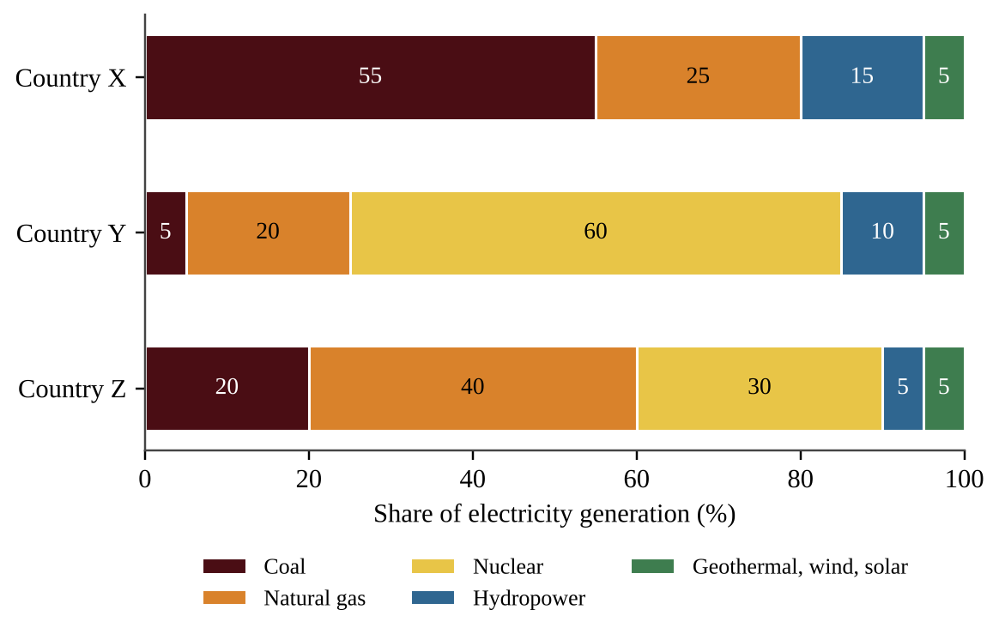

Average CO₂ emissions are 1.0 kg per kWh for coal and 0.45 kg per kWh for natural gas; the other sources are treated as zero. What are the average emissions per kWh of Country Z's electricity?
A) 0.18 kg CO₂/kWh
B) 0.20 kg CO₂/kWh
C) 0.38 kg CO₂/kWh
D) 0.60 kg CO₂/kWh
:::

:::q PE3-MCQ051 | unit=6 | topic=6.6 | diff=3
A pressurized-water reactor produces 3,000 MW of thermal power. Its steam turbines convert 33% of this heat to electricity. At what rate is waste heat released to the cooling water?
A) 990 MW
B) 2,010 MW
C) 3,000 MW
D) 9,091 MW
:::

:::q PE3-MCQ052 | unit=7 | topic=7.3 | diff=1
What happens during a thermal inversion over a valley city?
A) Cool air above warm surface air lets pollutants rise and disperse.
B) Strong winds increase and sweep pollutants out of the valley.
C) A layer of warm air above cooler surface air traps pollutants near the ground.
D) Surface air warms and rises, carrying pollutants into the stratosphere.
:::

:::q PE3-MCQ053 | unit=7 | topic=7.5 | diff=1
Which statement about radon-222 is accurate?
A) It is a gas from incomplete combustion that binds to hemoglobin and causes oxygen deprivation.
B) It is a radioactive gas from natural uranium decay that builds up in basements and raises lung cancer risk.
C) It is a volatile organic compound released by new carpets and paints that irritates the eyes.
D) It is a fungal spore that grows on damp building materials and triggers allergies and asthma.
:::

:::q PE3-MCQ054 | unit=7 | topic=7.7 | diff=2
Unpolluted rain has a pH of about 5.6. Rain collected downwind of a coal-fired power plant has a pH of 4.6. How many times more acidic is the polluted rain?
A) 1.0 times
B) 10 times
C) 100 times
D) 1,000 times
:::

:::q PE3-MCQ055 | unit=7 | topic=7.8 | diff=2
Noise at a quarry fence is 60 dB, and at the edge of the pit it is 80 dB. The decibel scale is logarithmic, with each 10 dB increase representing a tenfold increase in sound intensity. How many times more intense is the sound at the pit edge?
A) 1.3 times
B) 20 times
C) 100 times
D) 1,000 times
:::

:::q PE3-MCQ056 | unit=7 | topic=7.5 | diff=2
The graph shows 24-hour average indoor PM2.5 concentrations in kitchens using three cooking methods.

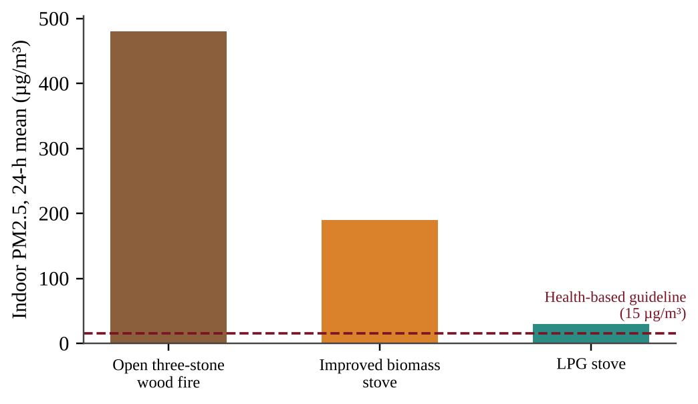

By what percent does switching from the open wood fire to an LPG stove reduce indoor PM2.5?
A) 6%
B) 60%
C) 94%
D) 1,500%
:::

:::q PE3-MCQ057 | unit=7 | topic=7.6 | diff=2
Families in a rural area cook on open wood fires inside poorly ventilated huts. Which action would most effectively reduce residents' exposure to indoor particulates and carbon monoxide?
A) Using air fresheners and incense to mask the smell of the smoke
B) Cooking only at night when the indoor air is cooler
C) Opening one small window while still cooking over the open fire
D) Replacing the open fire with a clean-burning stove vented outdoors
:::

:::q PE3-MCQ058 | unit=7 | topic=7.2 | diff=3
The graph shows hourly concentrations of nitrogen oxides and ozone at an urban site on a sunny day.

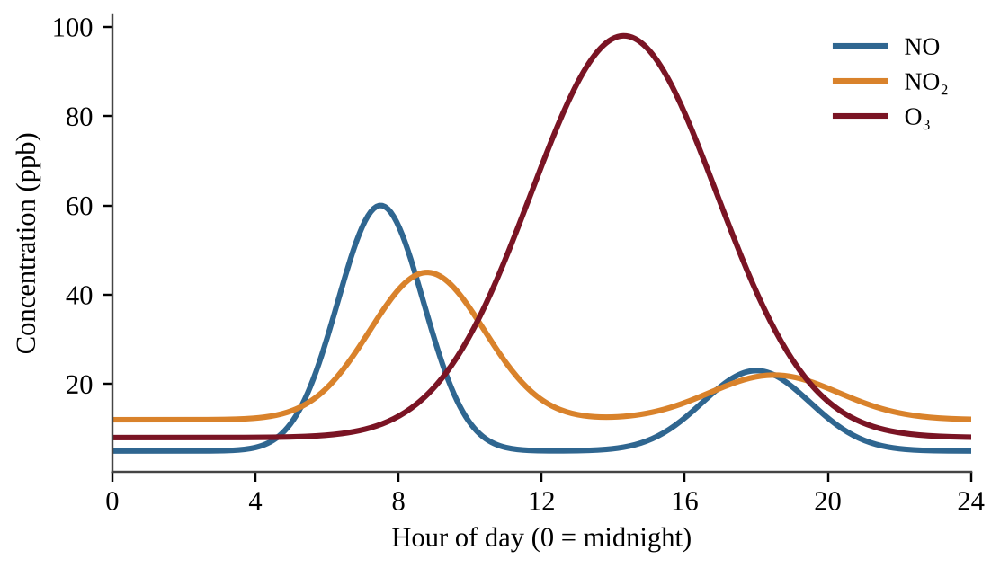

Which best explains why ozone peaks in the early afternoon rather than during the morning rush hour?
A) Vehicles emit ozone directly from their tailpipes, and traffic is heaviest in the afternoon.
B) A thermal inversion forms at midday and traps the ozone near the ground until evening.
C) Sunlight drives reactions of NO₂ and volatile organic compounds that form ozone, which takes hours to build up.
D) Ozone from the stratosphere sinks to the surface once the morning traffic has ended.
:::

:::q PE3-MCQ059 | unit=8 | topic=8.11 | diff=1
In a municipal sewage treatment plant, which stage uses aerobic microorganisms to break down dissolved and suspended organic matter?
A) Primary treatment, which screens and settles solids
B) Tertiary treatment, which removes nitrogen and phosphorus
C) Chlorine disinfection before discharge
D) Secondary treatment
:::

:::q PE3-MCQ060 | unit=8 | topic=8.15 | diff=1
A village well tests positive for fecal coliform bacteria. This most directly indicates that the water is contaminated with:
A) Excess nitrate from fertilizer runoff into the well
B) Dissolved heavy metals such as lead or arsenic
C) Fecal matter, so disease-causing pathogens may be present
D) Low dissolved oxygen from algal blooms and decay
:::

:::q PE3-MCQ061 | unit=8 | topic=8.5 | diff=2
Dissolved oxygen (DO) was measured along a river downstream from a wastewater outfall.

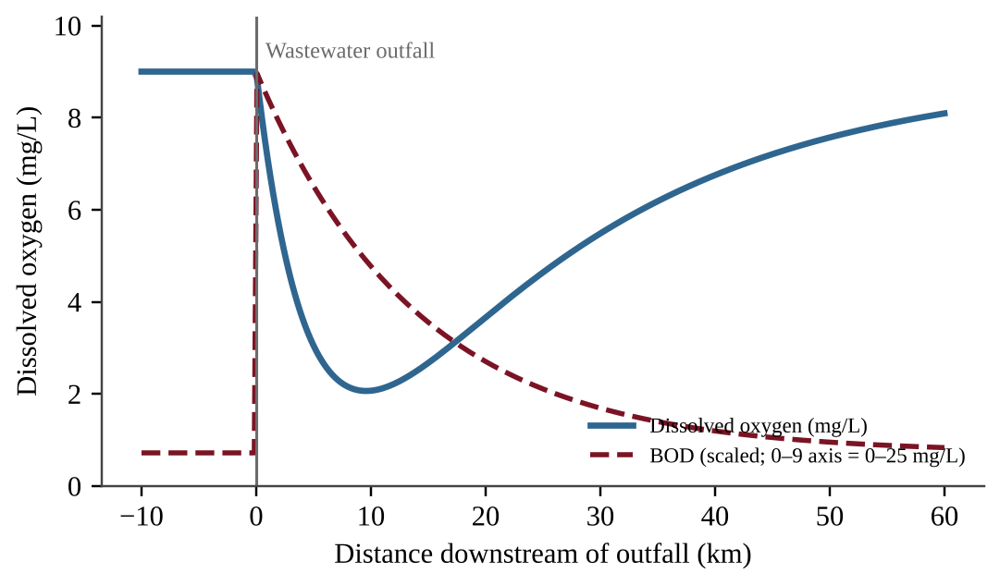

| Organism | Minimum DO needed (mg/L) |
|---|---|
| Stonefly nymph | 7 |
| Freshwater mussel | 5 |
| Carp | 3 |
| Tubifex worm | 1 |

Which organism would most likely be found at the point of lowest DO?
A) Tubifex worm
B) Stonefly nymph
C) Freshwater mussel
D) Carp
:::

:::q PE3-MCQ062 | unit=8 | topic=8.12 | diff=2
The graph shows the percent of test animals killed by two toxicants at increasing doses.

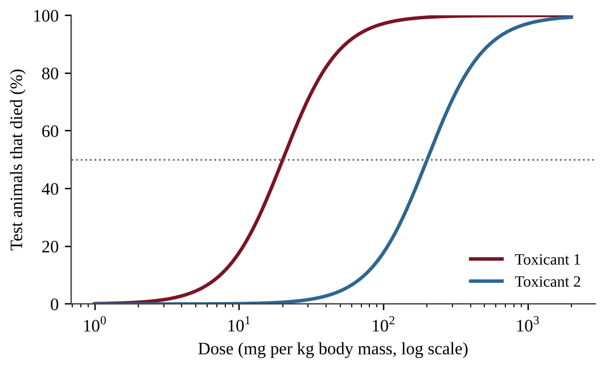

Which statement is best supported by the graph?
A) Toxicant 2 is more toxic because a larger dose is needed to kill half the animals.
B) The two toxicants are equally toxic because each eventually kills 100% of animals.
C) Toxicant 1 is less toxic because its curve lies farther to the left.
D) Toxicant 1 is more toxic; about one-tenth the dose of Toxicant 2 kills half the animals.
:::

:::q PE3-MCQ063 | unit=8 | topic=8.8 | diff=2
The table shows the concentration of a persistent pesticide in organisms of a lake food web.

| Organism | Concentration (ppm, wet weight) |
|---|---|
| Phytoplankton | 0.04 |
| Zooplankton | 0.3 |
| Small fish | 1.6 |
| Large fish | 5 |
| Osprey | 25 |

By what factor is the concentration in the osprey higher than in phytoplankton?
A) 5
B) 62.5
C) 625
D) 6,250
:::

:::q PE3-MCQ064 | unit=8 | topic=8.10 | diff=2
A city of 200,000 people generates 2.0 kg of municipal solid waste per person per day. The city recycles and composts 30% of the waste, and the rest goes to a landfill. How many metric tons of waste are sent to the landfill per year? (Use 365 days.)
A) 280 metric tons per year
B) 43,800 metric tons per year
C) 102,200 metric tons per year
D) 146,000 metric tons per year
:::

:::q PE3-MCQ065 | unit=8 | topic=8.3 | diff=3
Biologists sampled male fish at sites along a river that receives treated wastewater. They recorded the percentage of males with eggs developing in their testes (a sign of hormone disruption).

| Site | Males with eggs in testes (%) |
|---|---|
| Upstream of outfall | 4 |
| At outfall | 41 |
| 5 km downstream | 22 |
| 15 km downstream | 9 |

Which conclusion is best supported by the data?
A) Something in the treated wastewater likely disrupts hormones in fish, with the effect weakening downstream; the chemical is not identified.
B) The data prove that estrogen from birth control pills is the specific cause of the effect on the fish.
C) The data show that conventional wastewater treatment removes all endocrine-disrupting compounds.
D) Because some upstream males are affected, endocrine disruptors are unrelated to the wastewater discharge.
:::

:::q PE3-MCQ066 | unit=9 | topic=9.1 | diff=1
How do chlorofluorocarbons (CFCs) destroy ozone in the stratosphere?
A) Each chlorine atom reacts with a single ozone molecule and is permanently used up in the reaction.
B) CFCs absorb UV light and convert the stratospheric ozone directly into carbon dioxide.
C) UV light frees chlorine atoms, and each atom catalyzes the breakdown of many ozone molecules.
D) CFCs sink to the troposphere, where they react with ozone at ground level and destroy it.
:::

:::q PE3-MCQ067 | unit=9 | topic=9.3 | diff=1
Which statement best describes how greenhouse gases warm Earth's lower atmosphere?
A) They absorb infrared radiation from Earth's surface and re-emit part of it back toward the surface.
B) They reflect most incoming visible light back to space before it can reach the surface.
C) They absorb ultraviolet radiation in the stratosphere and release that energy as heat to the surface.
D) They increase the amount of energy that is emitted by the Sun toward Earth.
:::

:::q PE3-MCQ068 | unit=9 | topic=9.8 | diff=1
Which characteristic most helps a non-native plant become invasive in a new rangeland?
A) Slow growth and low seed production, which let it avoid competition with native plants
B) Rapid growth and seed production plus no natural herbivores or diseases from its native range
C) A requirement for soil fungi that are found only in its native range
D) A narrow tolerance range for temperature and for rainfall
:::

:::q PE3-MCQ069 | unit=9 | topic=9.2 | diff=1
Which statement best describes the Montreal Protocol?
A) An international treaty that sets binding limits on global CO₂ emissions from industry
B) An international agreement that regulates trade in endangered species and their products
C) A national law that regulates pollutant discharges into the surface waters of a country
D) A treaty that phased out production of ozone-depleting substances such as CFCs
:::

:::q PE3-MCQ070 | unit=9 | topic=9.4 | diff=2
A ranching region has 5,000 cattle, and each animal emits an average of 60 kg of methane (CH₄) per year. Over 100 years, the global warming potential of methane is 28 times that of CO₂. What is the herd's annual emission in metric tons of CO₂ equivalent?
A) 11
B) 300
C) 8,400
D) 84,000
:::

:::q PE3-MCQ071 | unit=9 | topic=9.4 | diff=2
The graph shows atmospheric CO₂ concentration measured at a remote station for 11 years.

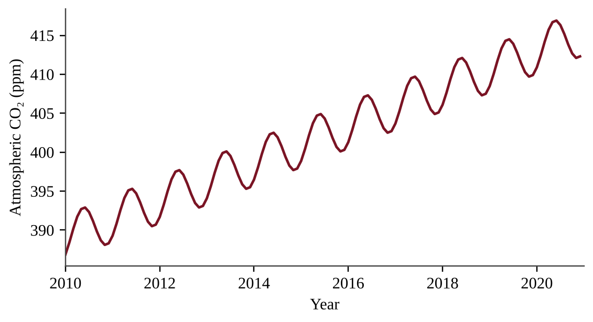

Which statement best explains the pattern?
A) The yearly cycle reflects changes in solar output, while the long-term rise reflects seasonal plant growth and decay.
B) The yearly cycle is caused by ocean upwelling, while the long-term rise reflects increased volcanic eruptions worldwide.
C) The yearly cycle is measurement error, while the long-term rise shows that natural sources are the main cause.
D) The yearly cycle reflects seasonal plant uptake and respiration, while the long-term rise reflects fossil fuel burning and land clearing.
:::

:::q PE3-MCQ072 | unit=9 | topic=9.5 | diff=2
Which is an example of a positive feedback loop in the climate system?
A) Warming thaws Arctic permafrost, releasing CH₄ and CO₂ that cause further warming.
B) Warming increases plant growth, which removes more CO₂ from the atmosphere.
C) Higher CO₂ concentrations increase ocean uptake, reducing atmospheric CO₂.
D) A warmer surface radiates more heat to space, which reduces warming.
:::

:::q PE3-MCQ073 | unit=9 | topic=9.6 | diff=2
Which pair of consequences results directly from ocean warming?
A) Sea-level rise from melting of floating sea ice and higher ocean pH
B) Sea-level rise from thermal expansion of seawater and coral bleaching
C) Higher dissolved oxygen levels and expansion of cold-water fisheries
D) Reduced thermal expansion of seawater and greater absorption of atmospheric CO₂
:::

:::q PE3-MCQ074 | unit=9 | topic=9.8 | diff=2
A thorny shrub invaded a rangeland, and surveys of the infested area are shown.

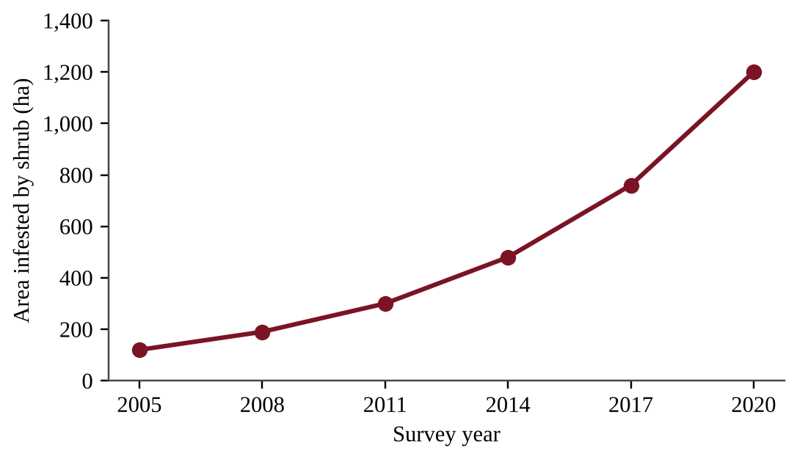

Which statement best describes the pattern and its management implication?
A) The infested area is increasing at a constant rate, so control can be delayed with no added cost.
B) The infested area is leveling off, showing the population has reached its carrying capacity.
C) The infested area is decreasing, showing that native grasses are outcompeting the shrub.
D) The infested area is increasing at an accelerating rate, so early control is more effective than waiting.
:::

:::q PE3-MCQ075 | unit=9 | topic=9.8 | diff=2
Land managers propose releasing a leaf beetle from an invasive shrub's native range to reduce the shrub's spread. What is the greatest risk of this biological control?
A) The beetle may feed on native plants or itself become a new invasive species.
B) The beetle will contaminate groundwater with pesticide residues from its body.
C) The beetle will increase the soil's salt content and cause salinization.
D) The beetle will raise the need for herbicides to protect the native grasses.
:::

:::q PE3-MCQ076 | unit=9 | topic=9.9 | diff=2
Illegal killing of rhinos for their horns has sharply reduced their populations in African savannas. Which pair correctly identifies the threat and an appropriate management response?
A) Overexploitation; anti-poaching enforcement and efforts to reduce demand
B) Invasive species; removing non-native grazers from the rhino habitat
C) Pollution; adding wastewater treatment plants near the rhino habitat
D) Habitat loss; establishing wildlife corridors between reserves
:::

:::q PE3-MCQ077 | unit=9 | topic=9.7 | diff=3
The average pH of surface ocean water has dropped from 8.20 to 8.10 since pre-industrial times. By about what percent has the hydrogen ion concentration increased?
A) 1%
B) 10%
C) 26%
D) 100%
:::

:::q PE3-MCQ078 | unit=9 | topic=9.10 | diff=3
A 10 km × 10 km grassland reserve is divided by roads and farms into four separate 5 km × 5 km fragments. Edge effects extend 1 km inward from every boundary, and only the interior beyond that is high-quality habitat. What is the total interior habitat area after fragmentation?
A) 28 km²
B) 36 km²
C) 64 km²
D) 100 km²
:::

:::q PE3-MCQ079 | unit=9 | topic=9.8 | diff=3
Researchers hypothesize that grazing by native antelope limits the establishment of an invasive shrub in a savanna. Which design best tests this hypothesis?
A) Compare shrub density in one fenced plot and one unfenced plot at a single site after several years.
B) Count shrubs along random transects and correlate shrub density with counts of antelope dung along each.
C) Remove all shrubs from the fenced plots only and compare grass cover in fenced and unfenced plots.
D) Set up paired fenced and unfenced plots at several similar sites, seed all plots equally, and compare seedling survival.
:::

:::q PE3-MCQ080 | unit=9 | topic=9.1 | diff=3
The Antarctic ozone hole forms each September and October, not during the dark polar winter. Which explanation is best?
A) Chlorine forms only in sunlight, so ozone is lost evenly throughout the entire summer and autumn.
B) Spring warming releases CFCs from melting ice, and the released CFCs immediately destroy ozone.
C) Winter winds carry CFCs to the equator, from which they return to the pole in spring.
D) Winter cold forms polar stratospheric clouds that activate chlorine, and spring sunlight then drives ozone destruction.
:::

## Section II — Free-Response Questions (3)

:::q PE3-FRQ001 | unit=9 | topic=9.8 | diff=3 | frqtype=1 | pts=10
On a semi-arid savanna rangeland in East Africa, a pastoral community grazes cattle and goats. Thirty years ago a thorny, deep-rooted shrub from another continent was planted along village boundaries to provide fuelwood and shade. The shrub has since spread across the rangeland. Herders report that perennial grasses are disappearing, livestock are losing weight, and soil under dense shrub thickets looks hard and crusted.

A rangeland ecologist surveyed 36 plots of equal size, 12 in each of three categories based on shrub canopy cover: not invaded (0%), lightly invaded (1–30%), and heavily invaded (more than 60%). She measured perennial grass cover and soil moisture in the top 20 cm at the end of the dry season. The mean values are shown below.

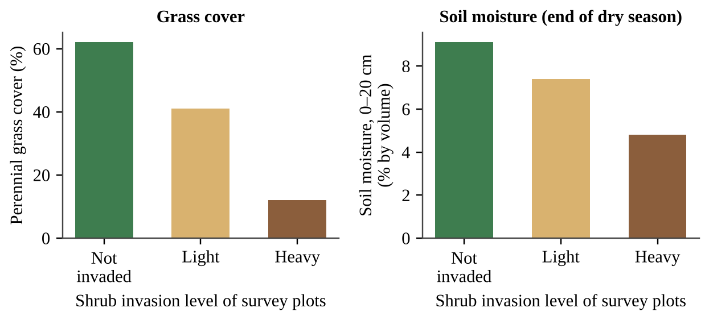

The ecologist hypothesizes that the shrub reduces grass cover by drawing down soil moisture. She plans an experiment to test whether removing the shrub restores grass growth.

(a) (i) Identify the type of environmental problem described in the scenario. [1]
    (ii) Describe the relationship between the level of shrub invasion and end-of-dry-season soil moisture shown in the figure. [1]
(b) Write a testable hypothesis, in "if … then …" form, for the shrub-removal experiment. [1]
(c) Identify the independent variable and the dependent variable in the experiment. [2]
(d) Identify one variable that must be controlled in the experiment and explain why it must be controlled. [1]
(e) Describe a procedure for the experiment. Include (i) how the treatments and replication will be set up and (ii) how and when the dependent variable will be measured. [2]
(f) Describe how the results would be used to decide whether the data support or refute the hypothesis. [1]
(g) Propose one solution, other than shrub removal alone, for restoring the rangeland and justify it. [1]
:::

:::q PE3-FRQ002 | unit=3 | topic=3.9 | diff=3 | frqtype=2 | pts=10
Three countries in different regions are tracked over time. Country A is in East Africa, Country B is in southern Europe, and Country C is in Latin America. Table 1 gives 2020 vital statistics, Table 2 gives infant mortality and age structure, and the figure shows total fertility rate (TFR) from 1960 to 2020.

**Table 1. 2020 vital rates (per 1,000 people per year)**

| Country | Birth rate | Death rate | Net migration |
|---|---|---|---|
| A | 41 | 9 | −1 |
| B | 8 | 11 | +3 |
| C | 15 | 6 | −1 |

**Table 2. Infant mortality and age structure**

| Country | Infant deaths per 1,000 births, 2000 | Infant deaths per 1,000 births, 2020 | % of population under 15, 2020 | % of population 65 and older, 2020 |
|---|---|---|---|---|
| A | 88 | 44 | 46 | 3 |
| B | 5 | 3 | 13 | 22 |
| C | 28 | 12 | 22 | 10 |

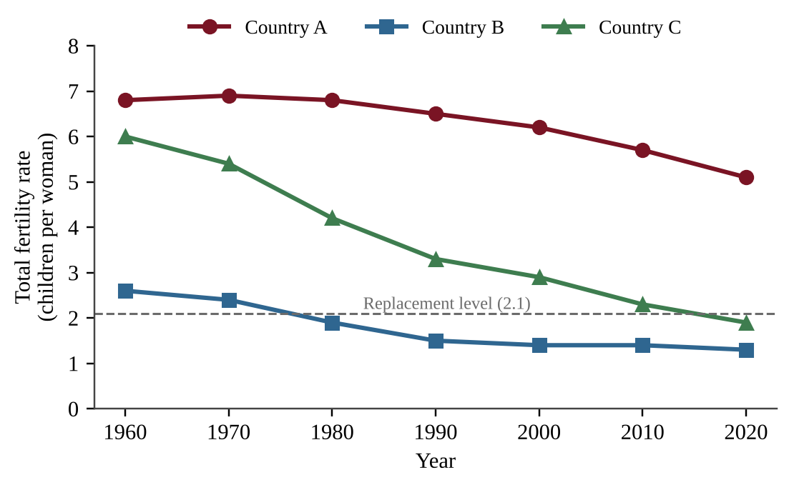

(a) Describe the trend in the TFR of Country C from 1960 to 2020. [1]
(b) Calculate the annual percent population growth rate of Country A in 2020, including migration. Show your work. [1]
(c) Using data for Country A, explain why its population is likely to keep growing for decades even if its TFR were to fall to replacement level soon. [2]
(d) Identify the stage of the demographic transition that best describes Country A in 2020 and justify your answer with two pieces of data from the tables. [2]
(e) Make a claim about which of the three countries will face the greatest difficulty supporting its older residents in the next 20 years, and justify your claim with data. [2]
(f) Propose one solution that Country A could use to lower its TFR and justify it using evidence from the data. [2]
:::

:::q PE3-FRQ003 | unit=5 | topic=5.7 | diff=3 | frqtype=3 | pts=10
A 2,500-ha ranch in a semi-arid savanna produces beef. The grass on the ranch has a net primary productivity of 3,000 kg of dry matter per hectare per year, and each kilogram of dry grass contains 16 megajoules (MJ) of energy. The ranch's grazing plan allows cattle to consume 40% of this production each year. Cattle convert 10% of the energy they eat into body tissue, and 40% of the energy in cattle body tissue is edible meat. An adult person needs about 10 MJ of food energy per day.

(a) Calculate the total energy contained in the grass produced on the ranch each year, in MJ. Show your work. [1]
(b) Calculate the amount of energy stored in cattle body tissue each year, in MJ, if cattle consume the planned 40% of the grass. [2]
(c) Calculate the number of people whose food energy needs for an entire year (365 days) could be met by the edible meat. [2]
(d) A proposal would plow the same 2,500 ha to grow sorghum for people to eat directly. The sorghum would yield 1,000 kg per hectare per year with an energy content of 15 MJ per kilogram. Calculate the number of people it could feed for one year, and calculate how many times larger this number is than your answer to part (c). [2]
(e) Each cow eats about 4,000 kg of forage per year, and the ranch currently keeps 900 cattle. Determine whether the herd exceeds the amount of forage that the grazing plan allows, and by what percent. [1]
(f) Explain, in terms of energy transfer between trophic levels, why the sorghum could feed so many more people than the beef. [1]
(g) Propose one management solution to prevent overgrazing on the ranch and justify your proposal. [1]
:::
