# Predicted Practice Exam 4

:::box note
**Format and timing (2026 AP Environmental Science).** This is a complete practice exam in two sections. Section I has 80 multiple-choice questions (60% of the score) and takes 90 minutes. Section II has 3 free-response questions (40% of the score) worth 10 points each and takes 70 minutes. A scientific or four-function calculator is allowed on both sections.

**Instructions.** In Section I choose the one best answer for each question; there is no penalty for guessing, so answer every question. In Section II write your answers in complete sentences, show every step of each calculation with units, and use the task verbs (calculate, describe, explain, identify, justify, make a claim, propose a solution) as cues for the type of response each part requires. Answer each part in order.
:::

## Section I — Multiple-Choice Questions (80)

:::q PE4-MCQ001 | unit=1 | topic=1.2 | diff=1
Surveyors working at a high-latitude site describe long, dark winters, a thin seasonally thawed soil layer above permanently frozen ground, very slow decomposition, and vegetation limited to mosses, lichens, sedges, and low shrubs. Which biome are they describing?

A) Arctic tundra
B) Taiga (boreal forest)
C) Temperate grassland
D) Cold desert
:::

:::q PE4-MCQ002 | unit=1 | topic=1.3 | diff=1
A river empties into a bay. In the shallow zone where fresh and salt water mix, the water is brackish and nutrient-rich, and many commercially important fish and shellfish spend their juvenile stages there. Which aquatic biome is this?

A) Coral reef
B) Lake littoral zone
C) Open-ocean pelagic zone
D) Estuary
:::

:::q PE4-MCQ003 | unit=1 | topic=1.5 | diff=2
After a desert field is flood-irrigated, parts of the soil become waterlogged and oxygen-poor. Bacteria in these zones convert nitrate (NO₃⁻) in the soil into nitrogen gas (N₂), which returns to the atmosphere. Which nitrogen cycle process is this?

A) Nitrification
B) Ammonification
C) Nitrogen fixation
D) Denitrification
:::

:::q PE4-MCQ004 | unit=1 | topic=1.10 | diff=2
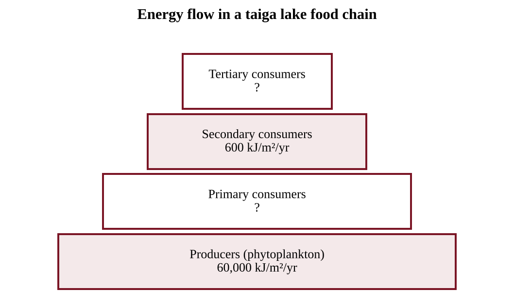{w=0.8}

Assume the same percentage of energy is transferred from each trophic level to the next. What is that percentage, and how much energy reaches the tertiary consumers?

A) 10% per level; 60 kJ/m²/yr
B) 1% per level; 6 kJ/m²/yr
C) 10% per level; 6 kJ/m²/yr
D) 1% per level; 60 kJ/m²/yr
:::

:::q PE4-MCQ005 | unit=1 | topic=1.8 | diff=2
A boreal forest stand has a gross primary productivity (GPP) of 1,300 g C/m²/yr, and its plants release 780 g C/m²/yr through cellular respiration. What is the net primary productivity (NPP) of the stand?

A) 520 g C/m²/yr
B) 780 g C/m²/yr
C) 1,300 g C/m²/yr
D) 2,080 g C/m²/yr
:::

:::q PE4-MCQ006 | unit=1 | topic=1.4 | diff=3
Researchers measured carbon flows at a tundra site over one year. Positive GPP is carbon taken up by plants; respiration is carbon released by plants and soil microbes combined.

| Season | GPP (g C/m²) | Ecosystem respiration (g C/m²) |
|---|---|---|
| Winter | 0 | 45 |
| Spring | 40 | 35 |
| Summer | 230 | 160 |
| Fall | 60 | 80 |

Which conclusion is best supported by the data?

A) The site is a net carbon source of about 10 g C/m² for the year, because respiration continues in winter when there is no uptake.
B) The site is a net carbon sink of about 330 g C/m² for the year, because that is the total carbon taken up by plants.
C) The site is a small net carbon sink of about 10 g C/m² for the year, because annual GPP exceeds annual respiration.
D) The site is carbon neutral for the year, because summer uptake exactly cancels respiration in the other seasons.
:::

:::q PE4-MCQ007 | unit=2 | topic=2.2 | diff=1
Along a tropical coast, dense mangrove forests absorb wave energy during storms, reducing shoreline erosion and flood damage to nearby villages. This benefit is best classified as which type of ecosystem service?

A) Provisioning
B) Cultural
C) Regulating
D) Supporting
:::

:::q PE4-MCQ008 | unit=2 | topic=2.1 | diff=1
Farmer A plants a single cotton cultivar across all of her fields. Farmer B plants six cultivars that differ in disease and drought resistance. A new fungal disease sweeps through the valley. Which type of biodiversity best explains why Farmer B is less likely to lose her entire crop?

A) Species diversity
B) Genetic diversity
C) Ecosystem diversity
D) Habitat diversity
:::

:::q PE4-MCQ009 | unit=2 | topic=2.7 | diff=2
Five years after a wildfire burned a section of taiga, the area is covered by fireweed, grasses, and aspen seedlings growing in the surviving soil. Which statement correctly identifies the process and the reason?

A) Primary succession, because all of the trees were removed by the fire.
B) Secondary succession, because the climax community has already returned.
C) Primary succession, because fireweed is a pioneer species.
D) Secondary succession, because soil and a seed bank remained after the disturbance.
:::

:::q PE4-MCQ010 | unit=2 | topic=2.3 | diff=2
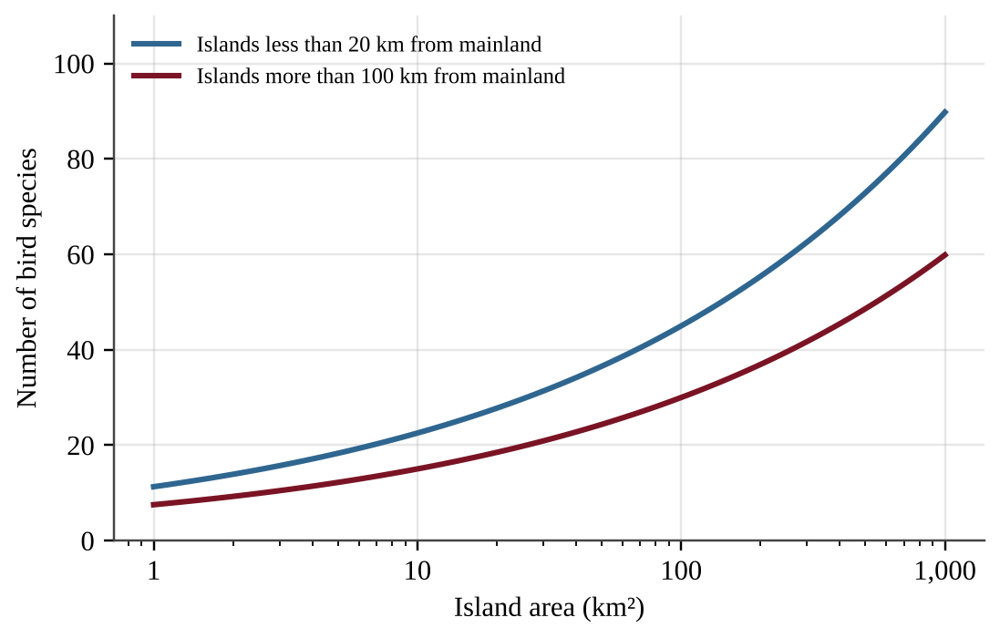{w=0.8}

Island P is 100 km² and lies 12 km from the mainland. Island Q is also 100 km² but lies 150 km from the mainland. Which statement best explains the difference in bird species richness expected on the two islands?

A) Island Q should have fewer species because its isolation lowers the rate at which new species arrive.
B) Island Q should have fewer species because its small area raises the extinction rate on the island.
C) Island Q should have more species because fewer mainland competitors are able to reach it.
D) The islands should have the same richness because area alone determines the number of species.
:::

:::q PE4-MCQ011 | unit=2 | topic=2.4 | diff=3
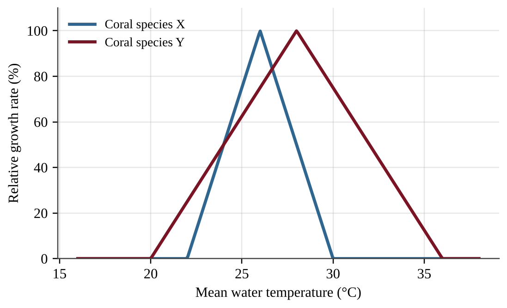{w=0.8}

A lagoon currently has a mean water temperature of 28°C. Because of ocean warming, the mean temperature rises to 31°C. Based on the figure, which prediction for the lagoon's coral community is best supported?

A) Species Y will persist with reduced growth, but species X will exceed its tolerance range and decline.
B) Both species will grow faster because higher temperatures increase metabolic rates in coral tissue.
C) Species X will persist because it is a specialist adapted to warm water, while species Y will decline.
D) Both species will stop growing because 31°C is above the upper tolerance limit of each species.
:::

:::q PE4-MCQ012 | unit=3 | topic=3.1 | diff=1
Caribou in northern taiga feed almost entirely on ground lichens that grow in old, undisturbed forest. Coyotes in the same region eat rodents, birds, berries, and carrion. If wildfires destroy much of the lichen-rich forest, which prediction is best supported?

A) Coyotes will be affected more because generalists need a single habitat.
B) Caribou will be affected more because they are specialists with a narrow niche.
C) Both species will be affected equally because both depend on the forest.
D) Neither species will be affected because wildfires are natural events.
:::

:::q PE4-MCQ013 | unit=3 | topic=3.2 | diff=1
After each pesticide spray, a spider mite population on a cotton farm rebounds within weeks. Mites mature in days, lay hundreds of eggs, and give no parental care. Which statement describes this species and the reason for the rebound?

A) It is r-selected, and it lives near carrying capacity where competition is intense.
B) It is K-selected, and its offspring survive well because of parental care.
C) It is r-selected, and its high reproductive rate allows rapid population recovery.
D) It is K-selected, and its long life span lets the population recover slowly.
:::

:::q PE4-MCQ014 | unit=3 | topic=3.3 | diff=1
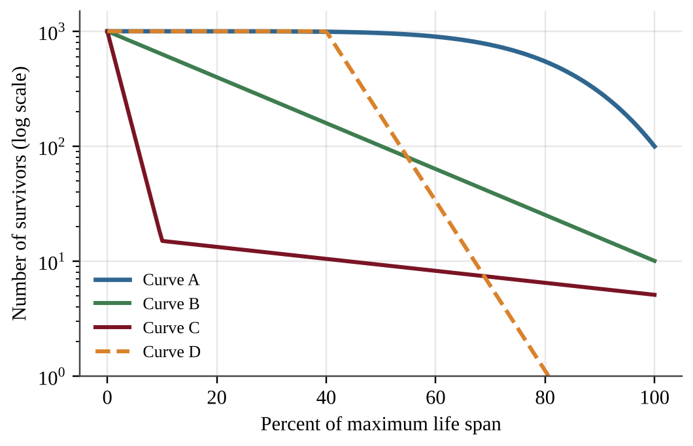{w=0.8}

A broadcast-spawning reef coral releases millions of larvae each year. Most larvae die within days, but the few that settle and survive can live for decades. Which curve in the figure best represents this pattern?

A) Curve A
B) Curve B
C) Curve C
D) Curve D
:::

:::q PE4-MCQ015 | unit=3 | topic=3.5 | diff=2
In one year a country of 5,000,000 people recorded 110,000 births, 40,000 deaths, 20,000 immigrants, and 10,000 emigrants. What was the population growth rate for the year?

A) 0.8%
B) 1.2%
C) 1.4%
D) 1.6%
:::

:::q PE4-MCQ016 | unit=3 | topic=3.4 | diff=2
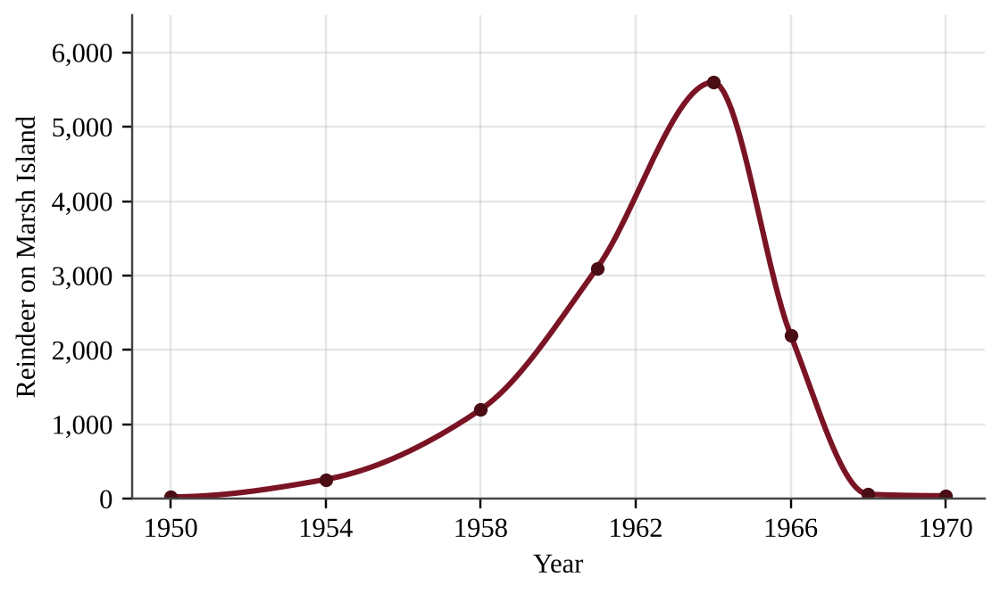{w=0.8}

In 1950, 25 reindeer were introduced to a 300 km² Arctic island that has no predators. Which statement best explains the decline in the population between 1964 and 1968?

A) Predators colonized the island and killed most of the herd within a few years.
B) The carrying capacity of the island increased, so the population adjusted downward to match.
C) The herd overshot the carrying capacity, depleted its lichen, and the capacity then fell.
D) Birth rates rose sharply after 1964, which caused density-independent mortality to increase.
:::

:::q PE4-MCQ017 | unit=3 | topic=3.6 | diff=2
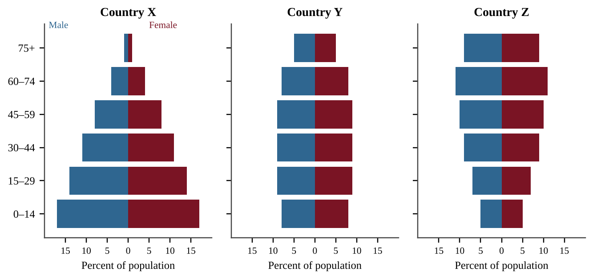

Even if the total fertility rate fell to the replacement level immediately in all three countries, which country would most likely continue to add the most people over the next 30 years?

A) Country Y, because its evenly distributed age groups produce the fastest growth.
B) Country X, because its large group under age 15 will soon reach reproductive age.
C) Country Z, because its large group of older adults will produce more children.
D) All three equally, because replacement fertility stops growth immediately in every country.
:::

:::q PE4-MCQ018 | unit=3 | topic=3.7 | diff=2
A country tracked its total fertility rate (TFR) and the percentage of women who had completed secondary school.

| Year | TFR (children per woman) | Women with secondary education (%) |
|---|---|---|
| 1990 | 5.2 | 12 |
| 2000 | 4.1 | 28 |
| 2010 | 3.0 | 47 |
| 2020 | 2.2 | 65 |

Which statement is best supported by the data? (Replacement-level fertility is about 2.1.)

A) As the percentage of educated women increased, the TFR decreased, showing an association between the two variables.
B) The increase in women's education caused the TFR to fall, because the two changed together.
C) The TFR has been above 4 throughout the period, so the country is far from replacement level.
D) By 2020 the TFR was below replacement level, so the population is already declining.
:::

:::q PE4-MCQ019 | unit=3 | topic=3.8 | diff=2
A country has had a total fertility rate of about 1.3 for several decades and has little immigration. Which outcome is most likely if this pattern continues?

A) The population will double within the next two decades because of momentum.
B) The proportion of children will rise, causing overcrowded schools in most cities.
C) The country will move back to stage 2 of the demographic transition.
D) The share of older adults will rise while the working-age group shrinks, raising the burden on workers.
:::

:::q PE4-MCQ020 | unit=3 | topic=3.9 | diff=3
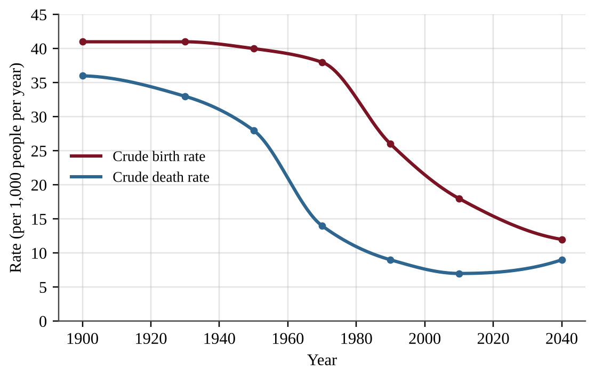{w=0.85}

According to the graph, what was the annual rate of natural increase in 1970, and approximately how long would it take the population to double at that rate (rule of 70)?

A) 2.4%; about 29 years
B) 5.2%; about 13 years
C) 0.24%; about 290 years
D) 2.4%; about 170 years
:::

:::q PE4-MCQ021 | unit=3 | topic=3.4 | diff=3
Researchers measured per capita birth and death rates in a deer population at five densities.

| Density (deer per km²) | Births per deer per year | Deaths per deer per year |
|---|---|---|
| 2 | 0.52 | 0.10 |
| 4 | 0.44 | 0.16 |
| 6 | 0.36 | 0.22 |
| 8 | 0.28 | 0.28 |
| 10 | 0.20 | 0.34 |

A drought reduces food and raises the death rate by 0.07 deaths per deer per year at every density, while birth rates are unchanged. Assuming the trends in the table are linear, what is the new carrying capacity?

A) 8 deer per km²
B) 7 deer per km²
C) 6 deer per km²
D) 5 deer per km²
:::

:::q PE4-MCQ022 | unit=4 | topic=4.1 | diff=1
Along the western coast of South America, a dense oceanic plate slides beneath the continental plate. Which set of features is most likely to be found there?

A) A deep trench with a volcanic arc and frequent earthquakes
B) A mid-ocean ridge where new oceanic crust forms from rising magma
C) A continental rift valley where the crust is stretched and pulled apart
D) A transform fault with horizontal sliding motion and no volcanism
:::

:::q PE4-MCQ023 | unit=4 | topic=4.2 | diff=1
In a desert valley, native shrubs were removed to plant cotton, leaving bare soil between rows during the windy season. Which result is most likely?

A) Increased wind and water erosion of topsoil
B) Faster formation of new soil horizons
C) Greater accumulation of organic matter in the topsoil
D) Increased infiltration and reduced runoff
:::

:::q PE4-MCQ024 | unit=4 | topic=4.3 | diff=1
A farmer in a desert valley irrigates a sandy soil and a clay soil with the same volume of water. Which statement correctly describes the sandy soil?

A) It has low permeability and high water-holding capacity, so the water stays near the surface.
B) It has high permeability and high water-holding capacity, so it is ideal for crops.
C) It has low permeability and low water-holding capacity, so the water runs off.
D) It has high permeability and low water-holding capacity, so the water drains quickly.
:::

:::q PE4-MCQ025 | unit=4 | topic=4.4 | diff=2
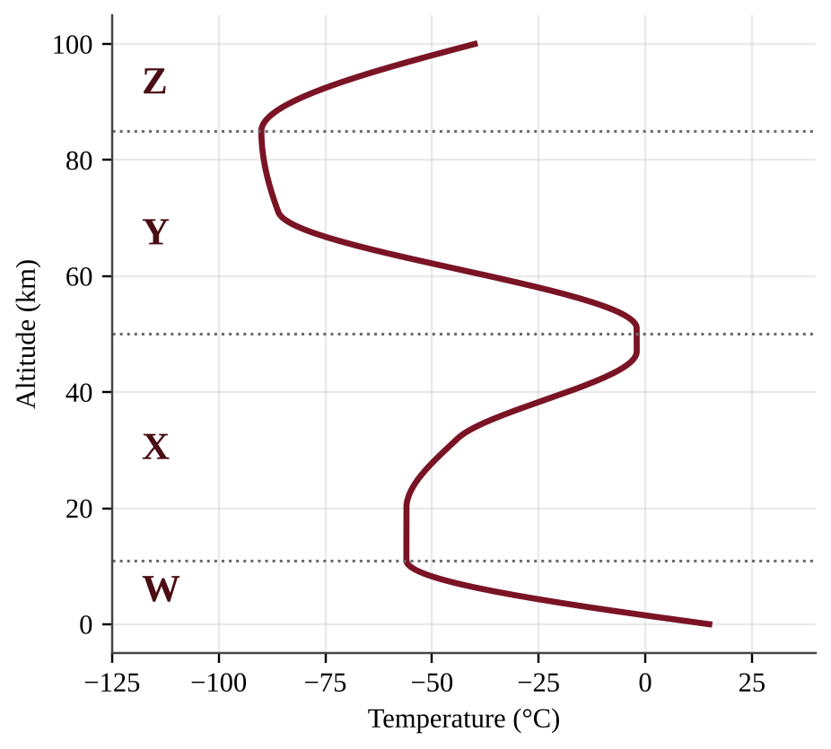{w=0.6}

Which layer contains most of the ozone that absorbs harmful ultraviolet radiation, and why does temperature increase with altitude in the upper part of that layer?

A) Layer W; ozone produced from pollution absorbs infrared radiation.
B) Layer Y; greenhouse gases trap heat that rises from the surface.
C) Layer X; heat radiating from Earth's surface warms the air higher up.
D) Layer X; ozone absorbs ultraviolet radiation and converts it to heat.
:::

:::q PE4-MCQ026 | unit=4 | topic=4.5 | diff=2
Many of the world's largest deserts lie near 30° north and 30° south latitude. Which statement best explains this pattern?

A) Air rising near 30° cools and condenses, but the ocean there is too cold to supply moisture.
B) Polar easterlies carry cold, dry air from the poles to 30° latitude.
C) Sunlight is most intense at 30° latitude, evaporating nearly all of the available water.
D) Moist air rises at the equator, loses its water, and descends near 30°, drying the land below.
:::

:::q PE4-MCQ027 | unit=4 | topic=4.3 | diff=2
A student compares the drainage of two desert soils. She pours 250 mL of water onto 200 g of soil A in a wide funnel and 250 mL onto 400 g of soil B in a narrow funnel, then records the volume of water collected after 5 minutes. Which change would most improve the validity of the comparison?

A) Use equal masses of soil in identical funnels for both soils.
B) Use more water for the soil that appears to contain more clay.
C) Record the volume collected after different times for each soil.
D) Repeat the test several times with soil A only.
:::

:::q PE4-MCQ028 | unit=4 | topic=4.7 | diff=2
Sunlight reaching the Arctic surface delivers 200 W/m². Sea ice has an albedo of 0.85, and open ocean has an albedo of 0.07. When the ice melts and exposes open water, how much more solar energy is absorbed per square meter?

A) 14 W/m²
B) 30 W/m²
C) 156 W/m²
D) 170 W/m²
:::

:::q PE4-MCQ029 | unit=4 | topic=4.8 | diff=2
A desert lies on the leeward (downwind) side of a mountain range. Moist winds blow in from the ocean on the opposite side. Which sequence best explains the desert?

A) Air descends on the windward side, warms and absorbs moisture, then rises and cools on the leeward side.
B) Air rises on the windward side, cools and drops precipitation, then descends and warms on the leeward side.
C) Air rises on the leeward side, drops its precipitation, and flows toward the ocean.
D) Air is forced upward on both sides of the mountains, so both sides receive equal precipitation.
:::

:::q PE4-MCQ030 | unit=4 | topic=4.9 | diff=3
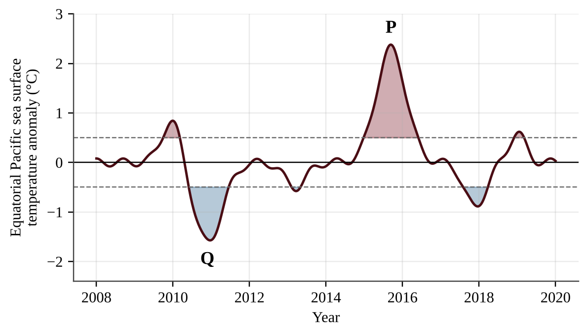{w=0.85}

Which statement best describes the conditions most likely present near point P compared with normal conditions?

A) Strengthened trade winds, increased upwelling off South America, more anchovies, and drought in coastal Peru
B) Weakened trade winds, increased upwelling off South America, more anchovies, and drought in coastal Peru
C) Strengthened trade winds, reduced upwelling off South America, fewer anchovies, and heavy rain in coastal Peru
D) Weakened trade winds, reduced upwelling off South America, fewer anchovies, and heavy rain in coastal Peru
:::

:::q PE4-MCQ031 | unit=4 | topic=4.6 | diff=3
A desert river watershed has an area of 25 km² and receives 600 mm of precipitation per year. About 30% of the precipitation becomes surface runoff that carries fertilizer and pesticide residues toward a reservoir. What is the annual runoff volume? (1 km² = 10⁶ m²; 1 m = 1,000 mm)

A) 4.5 × 10³ m³
B) 4.5 × 10⁶ m³
C) 1.5 × 10⁷ m³
D) 4.5 × 10⁹ m³
:::

:::q PE4-MCQ032 | unit=5 | topic=5.1 | diff=1
Fishing boats from many villages harvest a shared, unregulated coastal fishery. Each fisher receives the full profit from each additional fish caught, but the cost of a declining fish population is shared by everyone. Which concept best explains the likely outcome?

A) Maximum sustainable yield
B) Tragedy of the commons
C) Ecological footprint
D) Green Revolution
:::

:::q PE4-MCQ033 | unit=5 | topic=5.3 | diff=1
Which of the following is a negative environmental consequence associated with the Green Revolution's high-yield, irrigated monocultures?

A) Greater water withdrawal and fertilizer runoff
B) Reduced soil salinization in irrigated arid regions
C) Greater genetic diversity among the crop varieties grown
D) Lower fossil fuel use per hectare of farmland
:::

:::q PE4-MCQ034 | unit=5 | topic=5.4 | diff=1
Farmers in an arid valley irrigate heavily for many decades. Crop yields decline, and a white crust appears on the soil surface. Which process is the most likely cause?

A) Acid deposition from nearby power plants
B) Eutrophication of the soil from excess nitrogen
C) Leaching of calcium from the topsoil by heavy rain
D) Salinization as evaporation leaves dissolved salts behind
:::

:::q PE4-MCQ035 | unit=5 | topic=5.14 | diff=2
Which of the following is the best example of integrated pest management (IPM)?

A) Spraying a broad-spectrum pesticide on a fixed 10-day schedule all season long
B) Switching to a different synthetic pesticide each year but spraying every field at planting time
C) Applying a single heavy dose of pesticide before planting to eliminate all pests for the season
D) Scouting fields, setting pheromone traps, releasing beneficial insects, and spraying only above an economic threshold
:::

:::q PE4-MCQ036 | unit=5 | topic=5.11 | diff=2
The table lists the ecological footprint and biocapacity of four countries in global hectares (gha) per person.

| Country | Footprint (gha/person) | Biocapacity (gha/person) |
|---|---|---|
| P | 2.1 | 4.8 |
| Q | 5.6 | 1.9 |
| R | 3.0 | 3.0 |
| S | 1.2 | 0.8 |

Which statement is best supported by the data?

A) Country P has the largest ecological deficit because it has the greatest biocapacity.
B) Country Q has the largest deficit, using 3.7 gha per person more than its land regenerates.
C) Country R is running a deficit of 3.0 gha per person because its footprint is 3.0.
D) Country S is sustainable because it has the smallest footprint of the four countries.
:::

:::q PE4-MCQ037 | unit=5 | topic=5.5 | diff=2
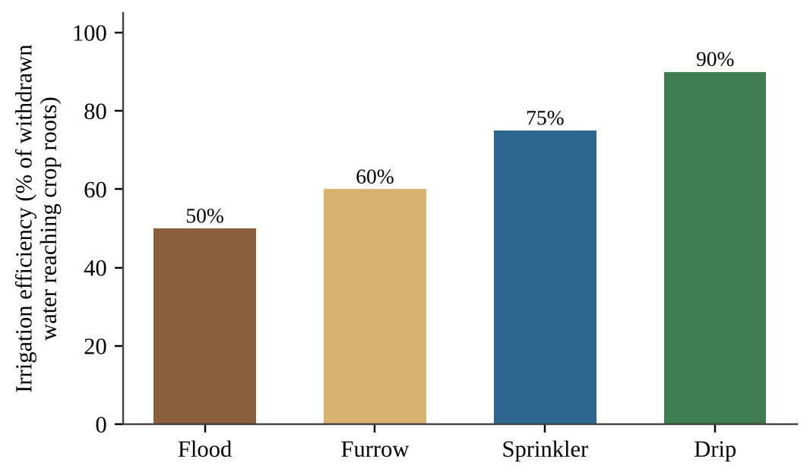{w=0.7}

A desert farm needs 4,500 m³ of water per hectare to reach crop roots each season. If the farm switches from flood irrigation to drip irrigation, how much less water must be withdrawn per hectare?

A) 1,800 m³
B) 4,000 m³
C) 5,000 m³
D) 9,000 m³
:::

:::q PE4-MCQ038 | unit=5 | topic=5.8 | diff=2
A coastal fishery recorded the following data.

| Year | Total catch (tonnes) | Fishing boats |
|---|---|---|
| 2000 | 90,000 | 150 |
| 2010 | 95,000 | 300 |
| 2020 | 70,000 | 450 |

Which conclusion is best supported?

A) Total catch increased every decade, so fish stocks are healthy and can support more boats.
B) Catch per boat increased because more boats were fishing, so each boat became more efficient.
C) Catch per boat fell from 600 to about 156 tonnes as boats tripled, consistent with overfishing.
D) The decline in total catch in 2020 shows that fishing effort was too low to sustain the fleet.
:::

:::q PE4-MCQ039 | unit=5 | topic=5.13 | diff=2
A desert city experiences street flooding during short, intense monsoon storms because most surfaces are paved. Which action would most directly reduce peak runoff?

A) Replace parking-lot asphalt with permeable pavement and build retention basins
B) Widen storm drains so water reaches the river faster and street flooding ends
C) Pave additional vacant lots so more surface area directs water to drains
D) Spread road salt to melt standing water after storms
:::

:::q PE4-MCQ040 | unit=5 | topic=5.16 | diff=3
A salmon farm produces 200,000 kg of fish per year. Its feed conversion ratio is 1.3 kg of feed per kg of salmon, the feed is 30% fishmeal by mass, and each kg of fishmeal requires 4.5 kg of wild-caught forage fish. How many kilograms of wild forage fish are needed per year?

A) 78,000 kg
B) 260,000 kg
C) 351,000 kg
D) 1,170,000 kg
:::

:::q PE4-MCQ041 | unit=5 | topic=5.6 | diff=3
A pest population of 2,000,000 insects contains 0.1% individuals that carry a gene for resistance to an insecticide. A spray kills 99% of the susceptible insects and none of the resistant insects. What percentage of the survivors is resistant?

A) 0.1%
B) 1%
C) 9.1%
D) 50%
:::

:::q PE4-MCQ042 | unit=6 | topic=6.1 | diff=1
Which list contains only nonrenewable energy resources?

A) Coal, geothermal heat, oil
B) Natural gas, uranium, wood from managed forests
C) Coal, natural gas, uranium
D) Oil, hydropower, uranium
:::

:::q PE4-MCQ043 | unit=6 | topic=6.7 | diff=1
A county in a desert region proposes to meet part of its transportation fuel needs with ethanol made from irrigated corn. Which is a potential disadvantage of this plan?

A) Cropland and irrigation water may shift from food to fuel, raising food prices and water demand.
B) Burning ethanol releases radioactive waste that must be stored for centuries.
C) Corn plants cannot absorb CO₂ from the atmosphere during photosynthesis.
D) Ethanol contains no usable energy compared with gasoline or diesel.
:::

:::q PE4-MCQ044 | unit=6 | topic=6.11 | diff=1
A city bus is powered by a hydrogen fuel cell. Which substance is the only emission from its tailpipe?

A) Carbon dioxide and water vapor
B) Nitrogen oxides
C) Water vapor
D) Fine particulate matter
:::

:::q PE4-MCQ045 | unit=6 | topic=6.6 | diff=2
Which statement correctly describes electricity generation at a nuclear fission power plant?

A) Fusion of hydrogen nuclei releases heat to make steam; the waste is harmless within a few decades.
B) Fission of uranium-235 makes steam; it emits little CO₂, but spent fuel stays radioactive for millennia.
C) Burning uranium releases about as much CO₂ per kWh as burning coal does.
D) Splitting uranium atoms produces electricity directly without a steam cycle or cooling water.
:::

:::q PE4-MCQ046 | unit=6 | topic=6.2 | diff=2
A natural gas power plant uses fuel containing 9.0 × 10⁹ kJ of energy per hour and delivers 3.6 × 10⁹ kJ of electricity per hour. What is its efficiency, and how much energy is released as waste heat each hour?

A) 40%; 3.6 × 10⁹ kJ
B) 60%; 5.4 × 10⁹ kJ
C) 60%; 3.6 × 10⁹ kJ
D) 40%; 5.4 × 10⁹ kJ
:::

:::q PE4-MCQ047 | unit=6 | topic=6.8 | diff=2
A 50-MW solar photovoltaic farm in a desert has a capacity factor of 30%. About how much electricity does it generate in a year of 8,760 hours?

A) 13,140 MWh
B) 131,400 MWh
C) 219,000 MWh
D) 438,000 MWh
:::

:::q PE4-MCQ048 | unit=6 | topic=6.13 | diff=2
A school replaces 200 incandescent bulbs (60 W each) with LED bulbs (9 W each). Each bulb is on 8 hours a day for 180 days a year. How much electrical energy does the school save per year?

A) 29,784 kWh
B) 17,280 kWh
C) 14,688 kWh
D) 2,592 kWh
:::

:::q PE4-MCQ049 | unit=6 | topic=6.11 | diff=2
Hydrogen is an energy carrier rather than a primary energy source, so its climate benefit depends on how it is produced. Which production method has the lowest net CO₂ emissions?

A) Steam reforming of natural gas with the CO₂ vented to the air
B) Electrolysis of water using electricity from wind and solar farms
C) Electrolysis of water using electricity from a coal-fired plant
D) Gasification of coal to produce a hydrogen-rich gas
:::

:::q PE4-MCQ050 | unit=6 | topic=6.5 | diff=3
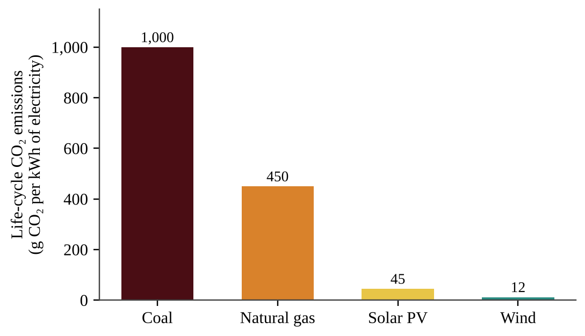{w=0.7}

A utility replaces 2,000 GWh of coal-fired electricity per year with natural gas generation. (1 GWh = 10⁶ kWh; 1 metric ton = 10⁶ g.) Approximately how much CO₂ is avoided each year?

A) 1.1 × 10³ metric tons
B) 9.0 × 10⁵ metric tons
C) 1.1 × 10⁶ metric tons
D) 2.0 × 10⁶ metric tons
:::

:::q PE4-MCQ051 | unit=6 | topic=6.7 | diff=3
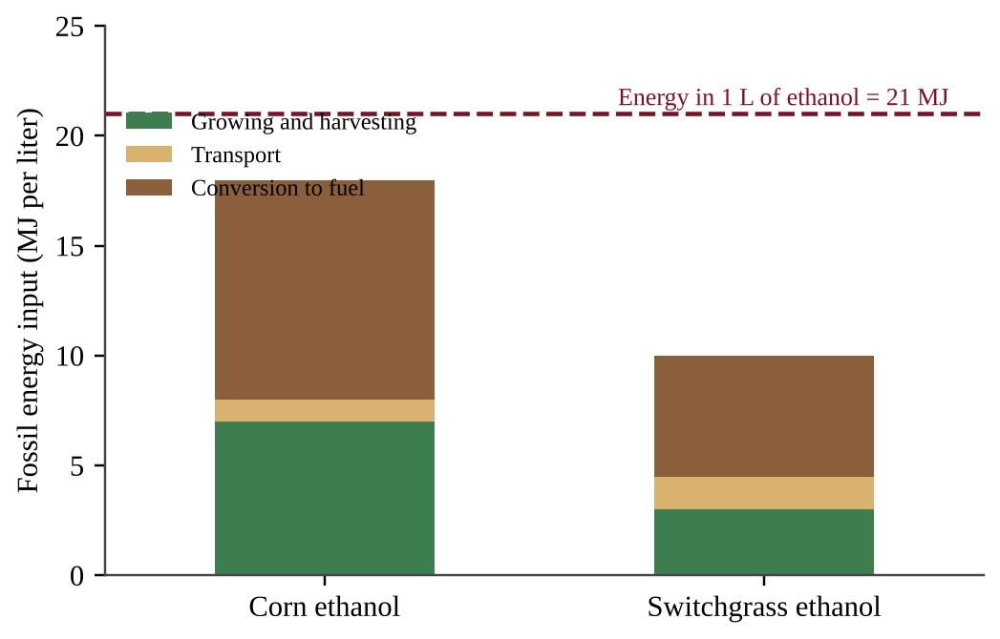{w=0.8}

Net energy equals the energy contained in the fuel minus the fossil energy used to make it. Which conclusion is supported by the figure?

A) Corn ethanol provides about 1.8 times as much net energy per liter as switchgrass ethanol.
B) Both fuels provide the same net energy because each liter contains 21 MJ.
C) Switchgrass ethanol provides about 2.1 times as much net energy per liter as corn ethanol.
D) Switchgrass ethanol provides about 3.7 times as much net energy per liter as corn ethanol.
:::

:::q PE4-MCQ052 | unit=7 | topic=7.1 | diff=1
Ground-level ozone is not emitted directly by vehicle tailpipes. It forms in the air when nitrogen oxides and volatile organic compounds react in sunlight. How should ground-level ozone be classified?

A) Secondary pollutant
B) Primary pollutant
C) Particulate pollutant
D) Persistent organic pollutant
:::

:::q PE4-MCQ053 | unit=7 | topic=7.7 | diff=1
Which pair of air pollutants is primarily responsible for acid deposition?

A) Carbon dioxide and methane
B) Carbon monoxide and ozone
C) Chlorofluorocarbons and halons
D) Sulfur dioxide and nitrogen oxides
:::

:::q PE4-MCQ054 | unit=7 | topic=7.2 | diff=2
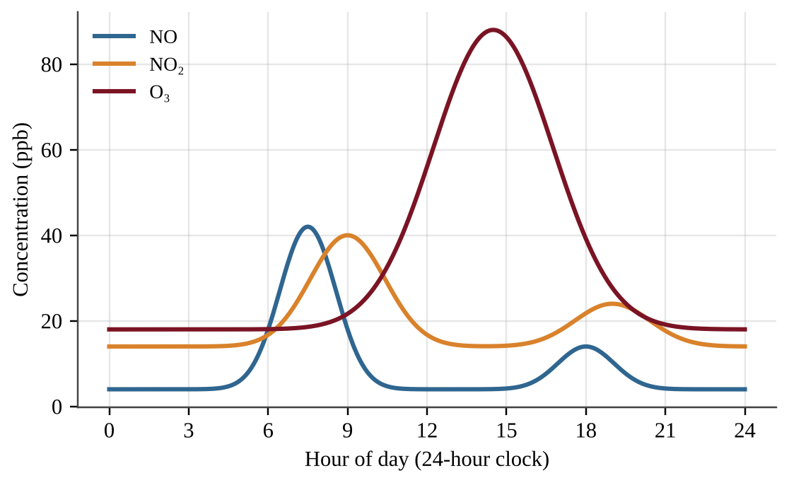{w=0.85}

Which statement best explains why the ozone peak occurs in the early afternoon rather than during the morning rush hour?

A) Vehicles emit ozone directly, and traffic emissions of ozone peak in the afternoon.
B) Ozone is produced only after the NO₂ concentration has fallen to zero in the afternoon.
C) Sunlight-driven reactions of NO₂ and VOCs take hours to build ozone, and NO removes ozone in the morning.
D) Cooler afternoon air lets ozone persist near the ground instead of breaking down.
:::

:::q PE4-MCQ055 | unit=7 | topic=7.3 | diff=2
In winter, a basin city sits under a layer of warm air that lies above colder air at the surface. Smog accumulates over several days. Which statement best explains why pollutants accumulate?

A) Cold surface air rises quickly and carries pollutants into the stratosphere.
B) Strong winter sunlight causes the pollutants to react faster than they are emitted.
C) Warm surface air spreads the pollutants evenly through the troposphere.
D) The warm layer above the cold surface air stops vertical mixing, trapping pollutants near the ground.
:::

:::q PE4-MCQ056 | unit=7 | topic=7.4 | diff=2
Smoke from a large boreal wildfire raises the concentration of PM2.5 in a city 800 km away. Why is PM2.5 especially hazardous to human health?

A) The particles are large enough to be trapped easily by nose hairs.
B) The particles are radioactive and cause cancer within hours.
C) The particles convert to ozone in the stratosphere and thin the ozone layer.
D) The particles are small enough to penetrate deep into the lungs and may enter the bloodstream.
:::

:::q PE4-MCQ057 | unit=7 | topic=7.5 | diff=2
A homeowner finds that the basement radon level is 6 pCi/L, above the recommended action level of 4 pCi/L. Radon is a radioactive gas produced by the decay of uranium in soil and rock. Which action is the most effective way to lower the level?

A) Seal foundation cracks and vent soil gas from beneath the slab with a pipe and fan
B) Install a carbon monoxide detector and test it every month in the basement
C) Place an ozone generator in the basement and run it whenever the room is occupied
D) Replace the gas stove with an electric stove and ventilate the kitchen
:::

:::q PE4-MCQ058 | unit=7 | topic=7.6 | diff=3
A coal-fired plant burns 2.0 × 10⁶ metric tons of coal per year. The coal is 1.5% sulfur by mass, and each metric ton of sulfur burned forms 2.0 metric tons of SO₂. A scrubber removes 92% of the SO₂. How many metric tons of SO₂ does the plant emit per year?

A) 2,400 metric tons
B) 4,800 metric tons
C) 55,200 metric tons
D) 60,000 metric tons
:::

:::q PE4-MCQ059 | unit=8 | topic=8.5 | diff=1
Fertilizer runoff enters a shallow lake. Which sequence best describes the resulting eutrophication?

A) Excess nutrients → algal bloom → decomposition of dead algae by aerobic bacteria → low dissolved oxygen
B) Excess nutrients → higher dissolved oxygen → growth of fish populations → decline in algae
C) Warm water inflow → decrease in algae → increased dissolved oxygen → fish kill
D) Excess nutrients → algal bloom → more sunlight reaches submerged plants → higher dissolved oxygen
:::

:::q PE4-MCQ060 | unit=8 | topic=8.10 | diff=1
A county wants to reduce the volume of solid waste sent to its landfill. Which of the following is an example of source reduction, the preferred waste management strategy?

A) Placing recycling bins on every street corner of the city
B) Collecting yard waste at the curb for composting at a central facility
C) Burning trash in an incinerator that generates electricity for the grid
D) Requiring product designs that use less packaging
:::

:::q PE4-MCQ061 | unit=8 | topic=8.3 | diff=2
In ponds near irrigated fields, male frogs exposed to a herbicide in the water develop ovarian tissue. Which statement best describes how a chemical can cause this kind of effect?

A) It destroys the immune cells that protect the frogs from infectious disease.
B) It acidifies the pond water until the frogs' bones begin to dissolve.
C) It only has effects at doses well above the LD50 for the species.
D) It interferes with hormone signaling in the endocrine system, even at very low doses.
:::

:::q PE4-MCQ062 | unit=8 | topic=8.12 | diff=2
Insecticide A has an LD50 of 12 mg/kg in rats, and insecticide B has an LD50 of 480 mg/kg in rats. Which statement is correct?

A) B is 40 times more toxic than A, because B has the larger LD50 value.
B) The two are equally toxic because each one kills 50% of the animals at its own LD50.
C) A is 40 times more toxic than B, because one-fortieth of the dose kills half of the test animals.
D) A is 468 times more toxic than B because the LD50 values differ by 468 mg/kg.
:::

:::q PE4-MCQ063 | unit=8 | topic=8.8 | diff=2
A persistent organic pollutant was measured in tissues of organisms in a lake food chain.

| Organism | Concentration (µg/kg of tissue) |
|---|---|
| Zooplankton | 5 |
| Small fish | 40 |
| Lake trout | 320 |
| Osprey | 4,000 |

By what factor did the concentration increase from zooplankton to osprey?

A) 3,995
B) 800
C) 12.5
D) 8
:::

:::q PE4-MCQ064 | unit=8 | topic=8.13 | diff=3
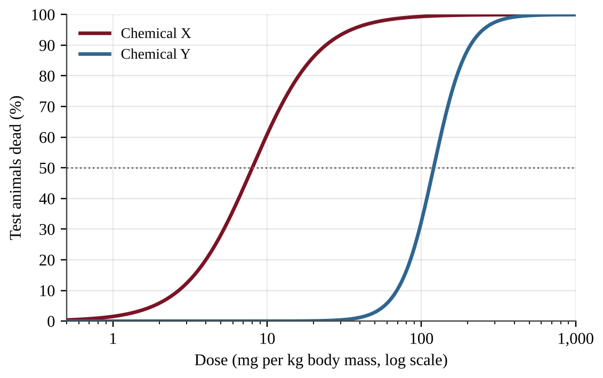{w=0.85}

Which interpretation of the dose-response curves is best supported by the figure?

A) Chemical X is about 15 times more toxic than Chemical Y, based on LD50 values of about 8 and 120 mg/kg.
B) Chemical Y is more toxic than Chemical X because its dose-response curve is steeper.
C) The chemicals are equally toxic because both curves eventually reach 50% mortality.
D) Chemical Y is about 15 times more toxic than Chemical X because its LD50 is larger.
:::

:::q PE4-MCQ065 | unit=8 | topic=8.9 | diff=3
A city generates 600,000 metric tons of municipal solid waste per year. Of this, 28% is recycled, 12% is composted, and 10% is incinerated (ignore ash). The rest is landfilled at a compacted density of 0.75 metric tons per m³. A landfill has 12 million m³ of remaining capacity. About how many years until it is full?

A) 40 years
B) 30 years
C) 25 years
D) 15 years
:::

:::q PE4-MCQ066 | unit=9 | topic=9.1 | diff=1
Which group of human-made compounds is the primary cause of the thinning of the stratospheric ozone layer?

A) Chlorofluorocarbons (CFCs)
B) Sulfur dioxide and nitrogen oxides
C) Carbon dioxide and methane
D) Volatile organic compounds
:::

:::q PE4-MCQ067 | unit=9 | topic=9.3 | diff=1
Which statement best describes the greenhouse effect?

A) Greenhouse gases reflect incoming visible sunlight back to space, cooling the surface.
B) Greenhouse gases create gaps in the atmosphere that let more ultraviolet radiation reach the surface.
C) Gases such as CO₂ absorb infrared radiation from the surface and re-emit some of it downward.
D) Greenhouse gases absorb ultraviolet radiation in the stratosphere and radiate it to the ground.
:::

:::q PE4-MCQ068 | unit=9 | topic=9.6 | diff=1
Global mean sea level is rising as the climate warms. Which two processes contribute most to this rise?

A) Thermal expansion of warming seawater and melting of glaciers and ice sheets on land
B) Thermal expansion of seawater and melting of floating Arctic sea ice in summer
C) Increased evaporation from the ocean and melting of floating sea ice
D) Melting of floating sea ice and increased river runoff into the sea
:::

:::q PE4-MCQ069 | unit=9 | topic=9.8 | diff=1
Which set of characteristics makes a nonnative species most likely to become invasive?

A) Slow reproduction, a narrow diet, and many natural predators in the new range
B) Rapid reproduction, tolerance of many conditions, and no natural predators or pathogens in the new range
C) A few offspring with extensive parental care and a requirement for a single host plant
D) A narrow tolerance range and dependence on stable, undisturbed habitat
:::

:::q PE4-MCQ070 | unit=9 | topic=9.2 | diff=2
The Montreal Protocol phased out the production of ozone-depleting substances, but the Antarctic ozone layer is expected to take decades to recover. Which statement best explains this delay?

A) CFCs persist in the atmosphere for decades, so chlorine continues to be released in the stratosphere.
B) Countries continue to produce CFCs at the same rates as before the agreement was signed.
C) The replacement compounds destroy ozone faster than the CFCs they replaced did.
D) Ozone formation requires carbon dioxide levels to decline before the layer can recover.
:::

:::q PE4-MCQ071 | unit=9 | topic=9.4 | diff=2
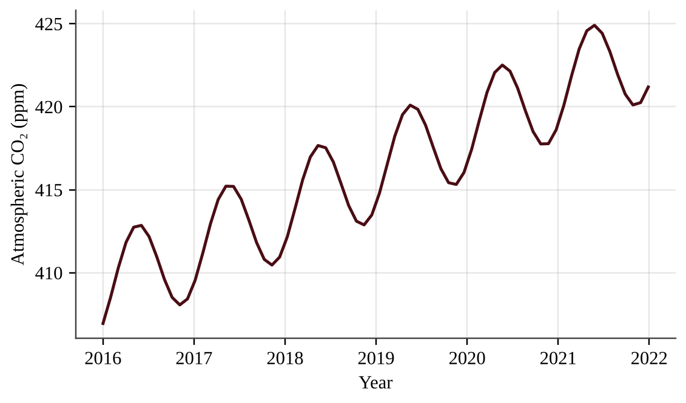{w=0.85}

Which statement best explains the regular yearly rise and fall superimposed on the long-term trend?

A) Fossil fuel combustion occurs only during the winter heating season in northern countries.
B) Northern plants absorb CO₂ in the growing season, and respiration and decay return it in winter.
C) Volcanic eruptions follow a regular annual schedule that peaks each spring.
D) The ocean releases CO₂ only in summer and absorbs CO₂ only in winter each year.
:::

:::q PE4-MCQ072 | unit=9 | topic=9.5 | diff=2
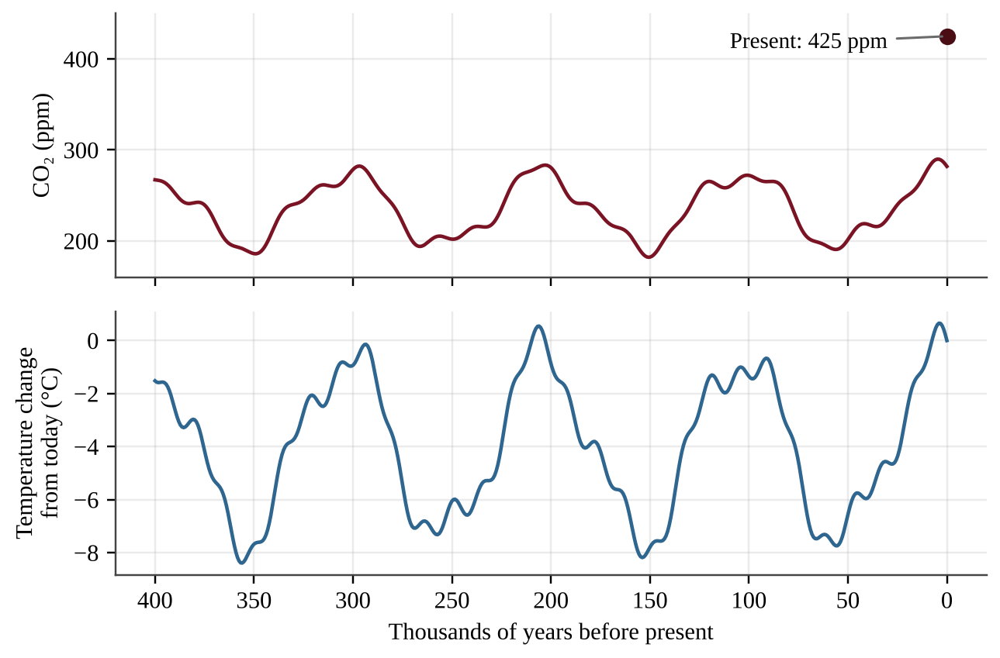{w=0.85}

Which conclusion is best supported by the figure?

A) CO₂ concentration has always risen before temperature during each warming period shown in the record.
B) Warmer periods coincided with higher CO₂, and present-day CO₂ is far above the range of the ice-core record.
C) The present CO₂ concentration lies within the natural range of the past 400,000 years.
D) Temperature changes in the record were caused only by changes in atmospheric CO₂ concentration.
:::

:::q PE4-MCQ073 | unit=9 | topic=9.7 | diff=2
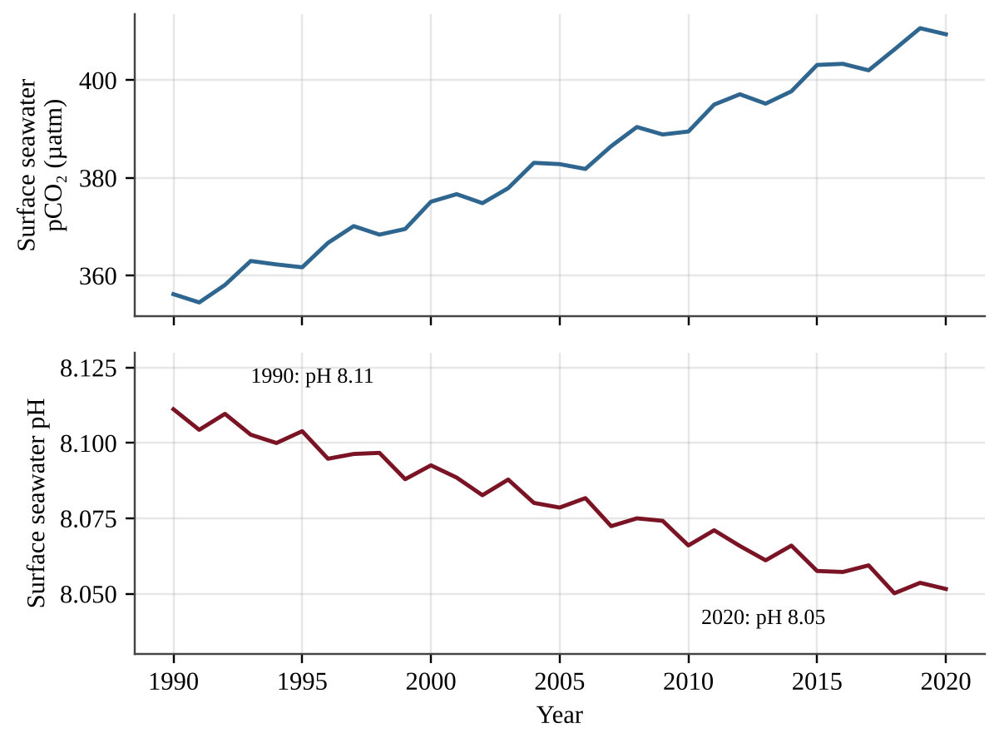{w=0.8}

Because pH is a logarithmic scale, a change of 1 pH unit corresponds to a tenfold change in hydrogen ion concentration. By approximately what percentage did the hydrogen ion concentration increase from 1990 to 2020?

A) 0.7%
B) 6%
C) 15%
D) 60%
:::

:::q PE4-MCQ074 | unit=9 | topic=9.6 | diff=2
During a marine heat wave, the corals on a reef turn white. Which statement best explains coral bleaching?

A) Rising ocean pH dissolves the corals' calcium carbonate skeletons and exposes the white rock beneath.
B) Excess nutrients cause algae to overgrow the coral and bleach its tissue with chlorine.
C) Heat stress makes corals expel their symbiotic algae, leaving transparent tissue and cutting off much of their food supply.
D) Ultraviolet radiation from a thinner ozone layer directly burns the coral tissue and removes pigment.
:::

:::q PE4-MCQ075 | unit=9 | topic=9.9 | diff=2
An international agreement in which more than 180 nations regulate or ban trade in listed species and their products, such as elephant ivory and certain tropical hardwoods, is called which of the following?

A) The U.S. Endangered Species Act
B) The Montreal Protocol
C) The Kyoto Protocol
D) CITES
:::

:::q PE4-MCQ076 | unit=9 | topic=9.10 | diff=2
A pipeline corridor and access road cut through intact taiga, dividing a large forest into smaller patches. Which effect is most likely for an interior-forest species such as the American marten?

A) Increased interior habitat, which lets populations grow larger over time
B) Higher genetic diversity because isolated populations can no longer interbreed
C) Reduced competition from generalist species that avoid the forest edges
D) Less habitat area and more edge effects, isolating populations and limiting gene flow
:::

:::q PE4-MCQ077 | unit=9 | topic=9.4 | diff=2
Thawing permafrost in a region releases 5,000 metric tons of methane (CH₄) per year. Methane has a 100-year global warming potential of 28 relative to CO₂. What is the annual release in CO₂ equivalents?

A) 179 metric tons
B) 5,028 metric tons
C) 140,000 metric tons
D) 1,400,000 metric tons
:::

:::q PE4-MCQ078 | unit=9 | topic=9.5 | diff=3
A country emitted 480 million metric tons (Mt) of CO₂e in 2015 and has pledged to reach 30% below its 2015 level by 2035. Emissions in 2025 were 440 Mt. What average annual reduction is needed from 2025 to 2035 to meet the pledge?

A) 5.2 Mt per year
B) 10.4 Mt per year
C) 13.2 Mt per year
D) 14.4 Mt per year
:::

:::q PE4-MCQ079 | unit=9 | topic=9.3 | diff=3
Which of the following responses to Arctic warming is a negative feedback that slows further warming?

A) Thawing permafrost releases methane and CO₂ from decomposing organic matter.
B) As the surface warms, it emits more infrared energy to space, which limits further warming.
C) Melting sea ice exposes dark ocean water that absorbs more sunlight.
D) Warmer air holds more water vapor, which absorbs additional infrared radiation.
:::

:::q PE4-MCQ080 | unit=9 | topic=9.2 | diff=3
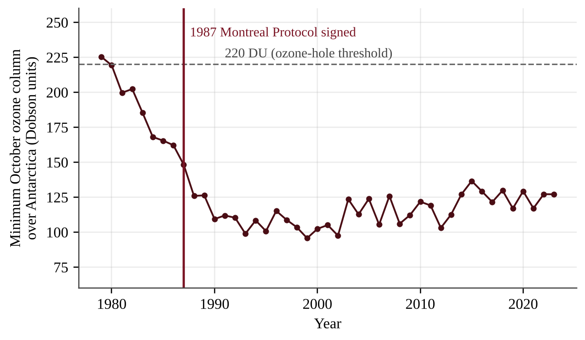{w=0.85}

Which conclusion is best supported by the figure?

A) The ozone minimum began to rise immediately after the 1987 agreement was signed.
B) By 2023 the ozone minimum had recovered to the level recorded in 1979.
C) The minimum stopped falling by about 2000 and has risen slightly since but remains far below the 1979 value.
D) The ozone minimum fell steadily through 2023, showing that the agreement had no effect.
:::

## Section II — Free-Response Questions (3)

:::q PE4-FRQ001 | unit=8 | topic=8.3 | diff=3 | frqtype=1 | pts=10
**Question 1 — Design an investigation**

In a desert valley, cotton fields are flood-irrigated and sprayed each spring with a triazine herbicide, a suspected endocrine disruptor. Excess irrigation water drains through a return-flow canal into a wetland pond that is the main breeding habitat for leopard frogs. Local biologists report that many male frogs at the pond have ovarian tissue in their testes and that tadpole survival has declined. A researcher wants to determine whether herbicide runoff is responsible. The figure shows the setting and four proposed sampling sites.

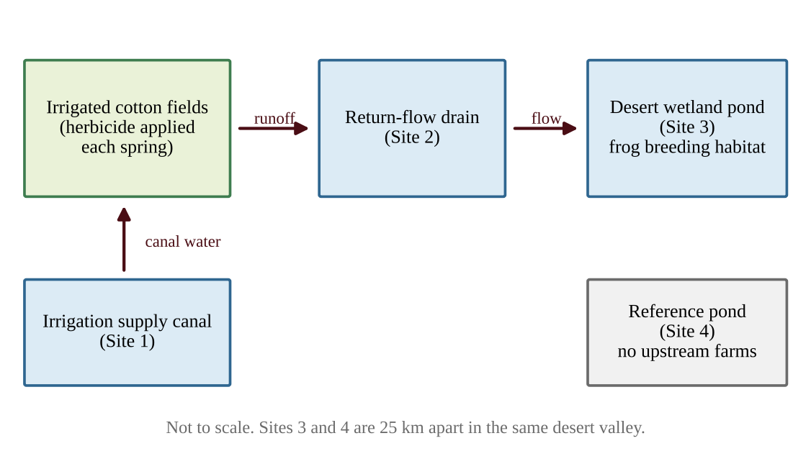{w=0.85}

(a) Identify the environmental problem that the researcher is investigating. [1]

(b) Write a testable hypothesis, in an "if … then …" statement, that links herbicide concentration to the frog abnormalities. [1]

(c) Identify the independent variable and the dependent variable in the researcher's field study. [2]

(d) Identify two variables that should be controlled so that the results can be attributed to herbicide exposure. [1]

(e) Describe a procedure for collecting the data. Your description must explain (i) how Site 4 will be used and (ii) how replication will increase the reliability of the data. [2]

(f) Describe the data that should be collected, and explain what results would support the hypothesis. [1]

(g) Propose one solution to reduce the amount of herbicide reaching the pond, and justify it by describing one advantage or one disadvantage of the solution. [2]
:::

:::q PE4-FRQ002 | unit=9 | topic=9.5 | diff=3 | frqtype=2 | pts=10
**Question 2 — Analyze and interpret quantitative data**

Scientists monitoring a tundra research station recorded atmospheric CO₂ concentration, the thickness of the active layer (the surface soil layer above permafrost that thaws each summer), and the minimum extent of Arctic sea ice each September.

| Year | Atmospheric CO₂ (ppm) | Active-layer thickness (cm) | Sea-ice minimum extent (million km²) |
|---|---|---|---|
| 2000 | 369 | 42 | 6.3 |
| 2005 | 380 | 44 | 5.6 |
| 2010 | 390 | 47 | 4.9 |
| 2015 | 401 | 51 | 4.6 |
| 2020 | 413 | 56 | 3.9 |
| 2025 | 425 | 61 | 3.6 |

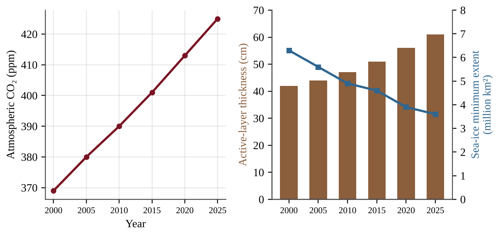{w=0.9}

(a) Describe the trend in atmospheric CO₂ concentration from 2000 to 2025. [1]

(b) Calculate the average annual rate of increase in atmospheric CO₂, in ppm per year, from 2000 to 2020. [1]

(c) Calculate the percent increase in active-layer thickness from 2000 to 2025. [1]

(d) Explain how a deeper active layer can lead to additional atmospheric warming. In your answer, identify one greenhouse gas released and the process that releases it, and explain why this is a positive feedback. [2]

(e) Explain how the decline in sea-ice extent can cause additional warming of the Arctic. [2]

(f) Assuming the 2020–2025 rate of increase continues, predict the atmospheric CO₂ concentration in 2040. Show your work. [1]

(g) Propose one policy or action to slow the increase in atmospheric CO₂, and justify it using evidence from the data. [2]
:::

:::q PE4-FRQ003 | unit=6 | topic=6.7 | diff=3 | frqtype=3 | pts=10
**Question 3 — Analyze an environmental problem doing calculations**

A county operates 50 diesel buses to reduce traffic in a desert city. The county is considering switching to B20, a blend that is 20% biodiesel and 80% petroleum diesel by volume. The biodiesel would be made from oilseed crops grown on irrigated land in the county.

| Data | Value |
|---|---|
| Number of buses | 50 |
| Distance driven per bus | 48,000 km per year |
| Fuel consumption of each bus | 50 L per 100 km |
| Life-cycle emissions, petroleum diesel | 3.2 kg CO₂e per L |
| Life-cycle emissions, biodiesel | 1.1 kg CO₂e per L |
| Oilseed biodiesel yield | 1,200 L per hectare per year |
| Irrigation water for oilseed crop | 5,500 m³ per hectare per year |

(a) Calculate the total volume of diesel fuel the fleet uses in one year, in liters. [1]

(b) Calculate the fleet's annual life-cycle emissions, in metric tons of CO₂e, if all of the fuel is petroleum diesel. (1 metric ton = 1,000 kg) [1]

(c) Calculate the fleet's annual life-cycle emissions using B20, and then calculate the percent reduction compared with your answer to (b). [2]

(d) Calculate the area of cropland, in hectares, needed each year to produce the biodiesel for B20. [1]

(e) Calculate the volume of irrigation water, in cubic meters, needed each year to grow that crop. [1]

(f) Describe one environmental disadvantage of growing oilseed crops for biodiesel in a desert region. [1]

(g) Make a claim about whether the county should adopt B20 or pursue another option (such as using waste cooking oil as the feedstock or buying electric buses). Justify your claim with at least two pieces of evidence from your calculations or from the data. [3]
:::
