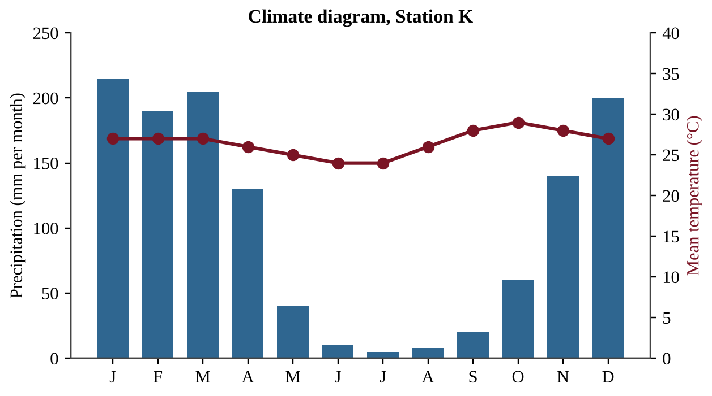
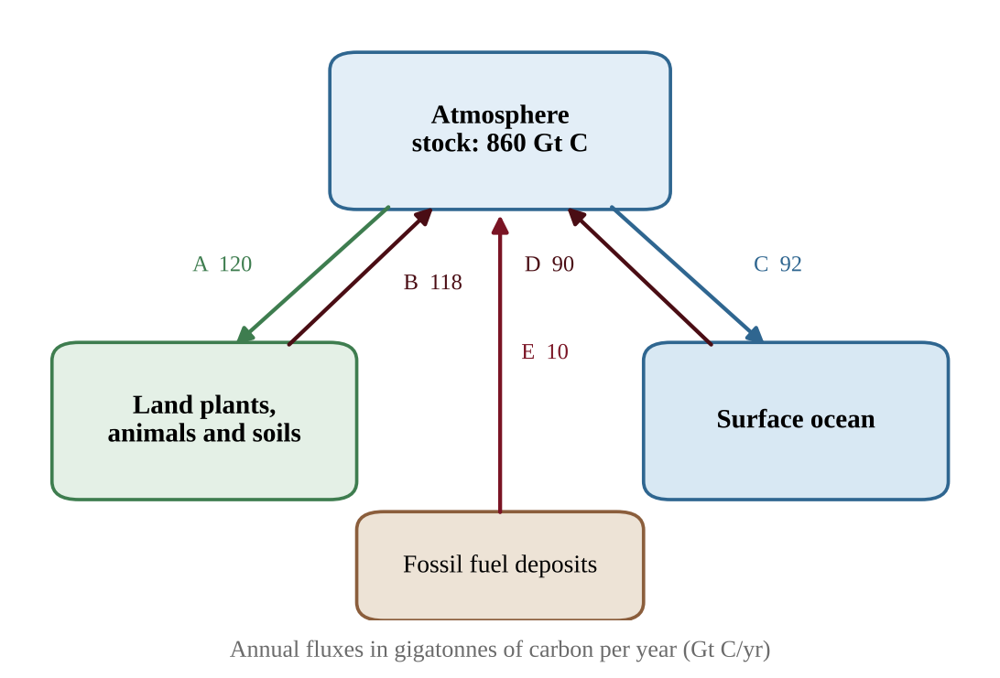
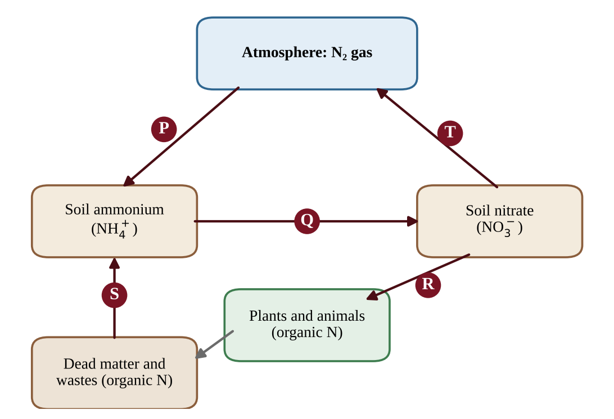
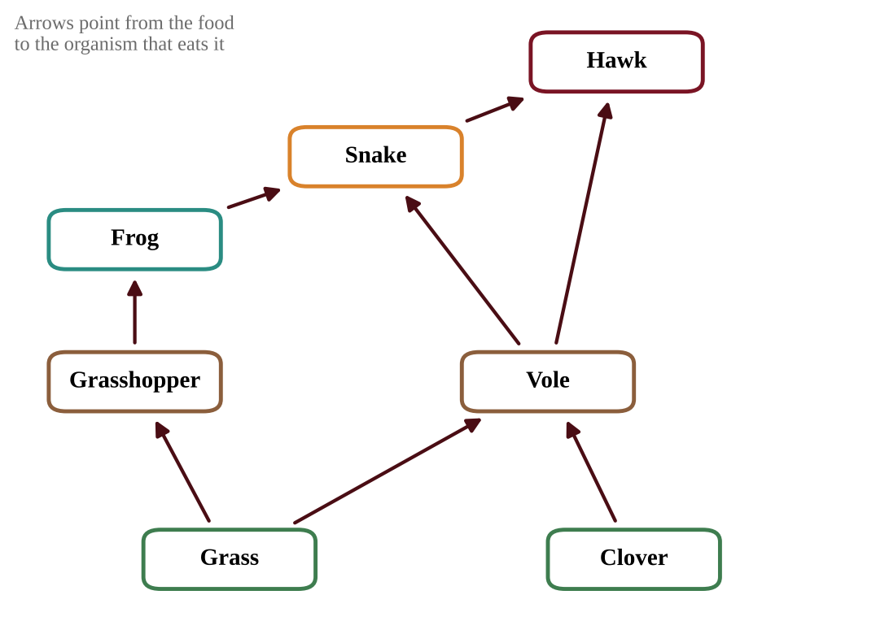
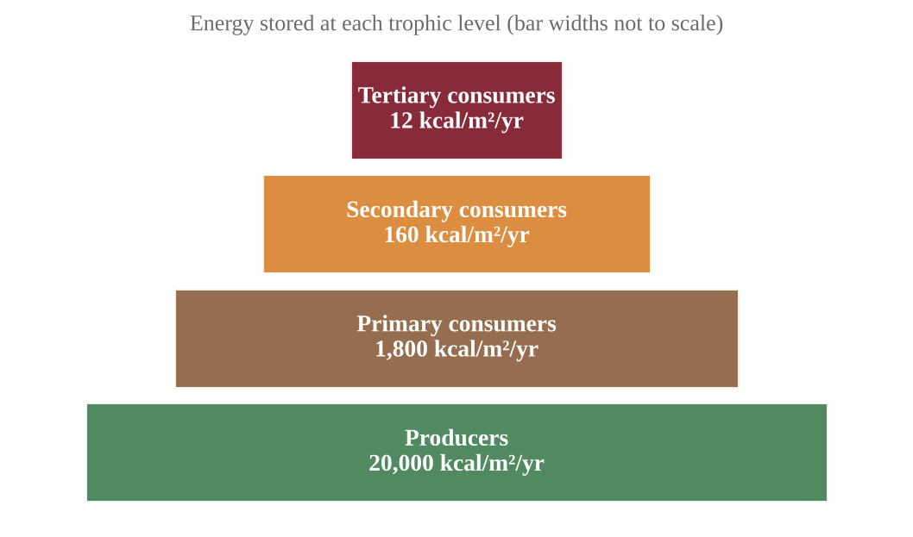
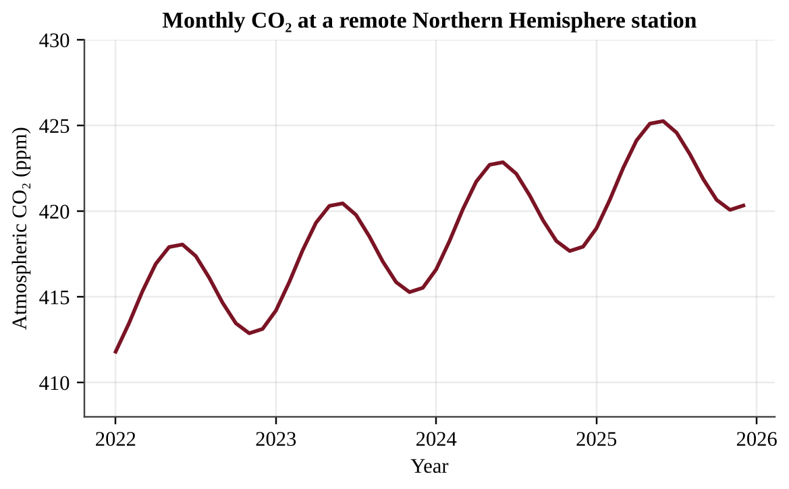
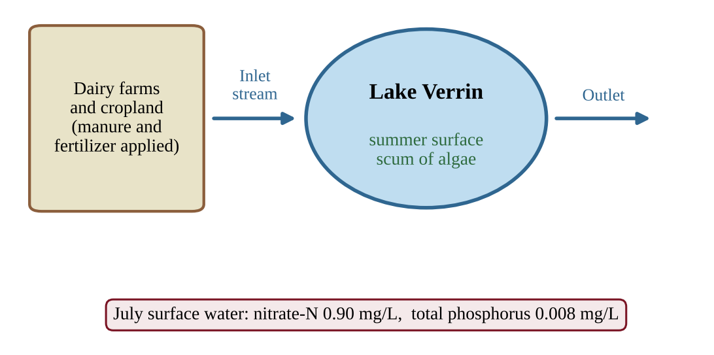
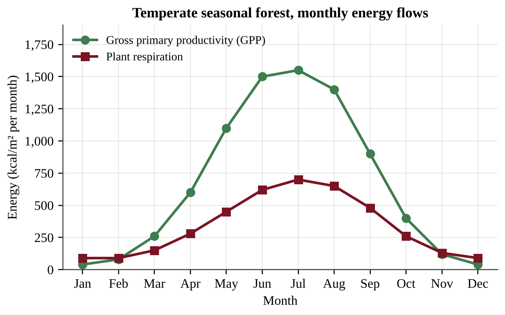
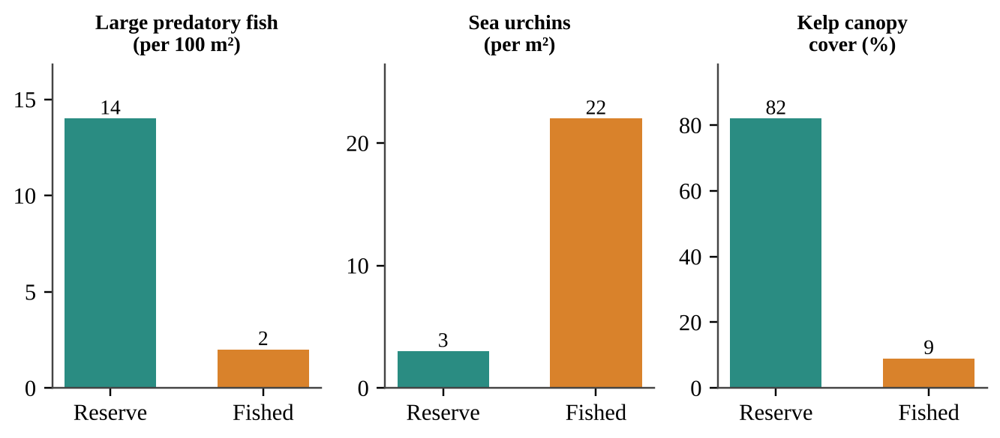

# Unit 1 — The Living World: Ecosystems

:::box note
Exam weight: Unit 1 accounts for about 6–8% of the AP Environmental Science exam score.
This section assesses species interactions, terrestrial and aquatic biomes, the carbon, nitrogen, phosphorus and hydrologic cycles, productivity, trophic levels, the 10% rule and food webs (Topics 1.1–1.11).
Expect cycle diagrams, climate graphs, energy-flow calculations and food-web predictions.
:::

## Section A — Multiple-Choice Questions

:::q QB-U1-MCQ001 | unit=1 | topic=1.1 | diff=1
Mycorrhizal fungi form a sheath around the roots of a spruce tree. The fungal threads absorb phosphorus and water from a large volume of soil and pass them to the tree, while the tree supplies the fungus with sugars made by photosynthesis. Both organisms grow better together than apart. Which term best describes this relationship?
A) Commensalism
B) Mutualism
C) Parasitism
D) Interspecific competition
:::

:::q QB-U1-MCQ002 | unit=1 | topic=1.2 | diff=1
A biome has a layer of permanently frozen soil beneath its surface, a very short growing season, and vegetation made up mostly of mosses, lichens and low shrubs. Which biome is this?
A) Taiga
B) Temperate grassland
C) Desert
D) Tundra
:::

:::q QB-U1-MCQ003 | unit=1 | topic=1.7 | diff=1
Which of the following is the largest reservoir of water at Earth's surface?
A) The oceans
B) Polar ice caps
C) Groundwater
D) The atmosphere
:::

:::q QB-U1-MCQ004 | unit=1 | topic=1.4 | diff=1
Which process removes carbon dioxide from the atmosphere and stores the carbon in the sugars of living plants?
A) Cellular respiration
B) Decomposition
C) Photosynthesis
D) Combustion
:::

:::q QB-U1-MCQ005 | unit=1 | topic=1.5 | diff=1
Which statement correctly describes nitrogen fixation?
A) Certain bacteria convert N₂ from the air into ammonia.
B) Certain bacteria convert nitrate in waterlogged soil into N₂ gas.
C) Plant roots absorb nitrate from the soil water.
D) Decomposers convert nitrogen in dead tissue into ammonium.
:::

:::q QB-U1-MCQ006 | unit=1 | topic=1.6 | diff=1
Which statement correctly compares the phosphorus cycle with the nitrogen cycle?
A) Both cycles have their largest reservoir in the atmosphere.
B) Phosphorus is returned to the atmosphere by bacteria in the same way that nitrogen is.
C) Phosphorus has no significant atmospheric component, and its major reservoirs are rocks and sediments.
D) Phosphorus is abundant in most ecosystems because rocks weather quickly.
:::

:::q QB-U1-MCQ007 | unit=1 | topic=1.9 | diff=1
In a prairie, grass is eaten by grasshoppers, grasshoppers are eaten by frogs, frogs are eaten by snakes, and snakes are eaten by hawks. At which trophic level, and as which type of consumer, does the snake feed?
A) Second trophic level, primary consumer
B) Third trophic level, secondary consumer
C) First trophic level, producer
D) Fourth trophic level, tertiary consumer
:::

:::q QB-U1-MCQ008 | unit=1 | topic=1.3 | diff=1
Salinity in one aquatic biome rises and falls with the tides and with the amount of river flow, because freshwater from a river mixes with seawater there. Which biome is described?
A) Coral reef
B) Estuary
C) Open ocean
D) Lake
:::

:::q QB-U1-MCQ009 | unit=1 | topic=1.10 | diff=1
Producers in a meadow capture 50,000 kcal/m²/yr of energy. Using the 10% rule, about how much energy is available to secondary consumers?
A) 5 kcal/m²/yr
B) 50 kcal/m²/yr
C) 500 kcal/m²/yr
D) 5,000 kcal/m²/yr
:::

:::q QB-U1-MCQ010 | unit=1 | topic=1.8 | diff=1
A shrubland has a gross primary productivity (GPP) of 6,000 kcal/m²/yr. The plants use 4,500 kcal/m²/yr in respiration. What is the net primary productivity (NPP) of the shrubland?
A) 1,500 kcal/m²/yr
B) 4,500 kcal/m²/yr
C) 6,000 kcal/m²/yr
D) 10,500 kcal/m²/yr
:::

:::q QB-U1-MCQ011 | unit=1 | topic=1.1 | diff=2
Four species of warbler live in the same spruce forest and all eat insects. One species feeds mainly near the treetop, another on the middle branches, a third near the trunk, and a fourth at the outer tips of the lower branches. Which concept best explains how the four species can coexist?
A) Commensalism, because each species benefits without harming the others
B) Intraspecific competition, because individuals of one species compete only with each other
C) Parasitism, because the species depend on insects living on the tree
D) Resource partitioning, which reduces the negative effects of competition
:::

:::q QB-U1-MCQ012 | unit=1 | topic=1.2 | diff=2
The climate diagram below shows monthly precipitation (bars) and mean monthly temperature (line) at a lowland station.

{w=0.8}

Which biome is most likely found at this station?
A) Tropical rainforest
B) Savanna
C) Temperate grassland
D) Desert
:::

:::q QB-U1-MCQ013 | unit=1 | topic=1.3 | diff=2
A fisheries scientist compares four marine sites and wants to find where the base of the food web is most productive. The table shows the measurements.

| Site | Setting | Nitrate (µmol/L) | Turbidity | Water temperature (°C) |
|---|---|---|---|---|
| W | Mid-ocean region | 0.2 | Very low | 27 |
| X | Coastal zone where deep water rises | 18 | Moderate | 12 |
| Y | River mouth after a flood | 3 | Very high | 20 |

Which statement is best supported by the data?
A) Site W should be most productive, because its very low turbidity lets sunlight reach the greatest depth in the water column.
B) Site Y should be most productive, because high turbidity means abundant food particles for fish.
C) Site X should be most productive, because its high nutrient level can support abundant phytoplankton.
D) Site W should be most productive, because warm water always holds more dissolved nutrients.
:::

:::q QB-U1-MCQ014 | unit=1 | topic=1.4 | diff=2
The diagram shows annual carbon fluxes among three reservoirs. Arrows A and C move carbon out of the atmosphere; arrows B, D and E move carbon into it.

{w=0.8}

According to the diagram, what is the net change in the carbon stored in the atmosphere each year?
A) An increase of 6 Gt C
B) An increase of 8 Gt C
C) An increase of 10 Gt C
D) A decrease of 6 Gt C
:::

:::q QB-U1-MCQ015 | unit=1 | topic=1.5 | diff=2
The diagram shows steps in the nitrogen cycle, labeled P through T.

{w=0.8}

After heavy rain, a low field stays waterlogged and its soil contains almost no oxygen. Bacteria in the soil begin to speed up the step that removes nitrogen from the soil and returns it to the atmosphere. Which step is this?
A) P
B) Q
C) S
D) T
:::

:::q QB-U1-MCQ016 | unit=1 | topic=1.6 | diff=2
A researcher fills clear bottles with water from a freshwater lake, adds nutrients as shown, and measures algal chlorophyll *a* after three weeks under identical light and temperature.

| Treatment | Mean chlorophyll *a* (µg/L) |
|---|---|
| No nutrients added (control) | 4.1 |
| Nitrogen added | 4.5 |
| Phosphorus added | 17.8 |
| Nitrogen and phosphorus added | 41.3 |

Which conclusion is best supported by the data?
A) Nitrogen is the main limiting nutrient, because adding it increased chlorophyll *a* above the level in the control bottles.
B) Phosphorus is the main limiting nutrient, because algal growth rose sharply when it was added.
C) Neither nutrient is limiting, because algae grew in the control bottles.
D) Both nutrients must be added together for any increase in algal growth to occur.
:::

:::q QB-U1-MCQ017 | unit=1 | topic=1.7 | diff=2
A city replaces a meadow with parking lots, roofs and storm drains. Compared with the meadow, which change in the local hydrologic cycle is most likely?
A) More surface runoff and less infiltration into the soil
B) More infiltration and more groundwater recharge
C) More transpiration from plants
D) Less surface runoff and slower stream flow after storms
:::

:::q QB-U1-MCQ018 | unit=1 | topic=1.8 | diff=2
The table gives net primary productivity (NPP) per unit area and the area covered by three ecosystems.

| Ecosystem | NPP (kcal/m²/yr) | Area (10⁶ km²) |
|---|---|---|
| Open ocean | 600 | 360 |
| Tropical rainforest | 9,000 | 17 |
| Estuary | 8,000 | 1.4 |

(1 km² = 10⁶ m²)

Which statement is supported by the data?
A) The tropical rainforest has the largest total NPP because it has the highest NPP per square meter.
B) The open ocean has the lowest total NPP because it has the lowest NPP per square meter.
C) The open ocean has the lowest NPP per square meter but the largest total NPP because of its enormous area.
D) All three ecosystems have similar total NPP because NPP per area and area offset each other.
:::

:::q QB-U1-MCQ019 | unit=1 | topic=1.9 | diff=2
Which statement correctly contrasts the movement of energy and matter in an ecosystem?
A) Both energy and matter cycle repeatedly among producers, consumers and decomposers.
B) Matter cycles, while energy flows in one direction and leaves each trophic level partly as heat.
C) Energy cycles back to the producers through decomposers, while matter flows in one direction.
D) Both energy and matter flow in one direction and are lost from the ecosystem at every transfer.
:::

:::q QB-U1-MCQ020 | unit=1 | topic=1.10 | diff=2
In a lake food chain, algae are eaten by water fleas, water fleas by minnows, and minnows by pike. The pike population stores 2.5 × 10⁶ kcal of energy per year. Assuming 10% of energy is passed on at each transfer, how much energy must the algae capture per year to support the pike?
A) 2.5 × 10⁶ kcal
B) 2.5 × 10⁷ kcal
C) 2.5 × 10⁸ kcal
D) 2.5 × 10⁹ kcal
:::

:::q QB-U1-MCQ021 | unit=1 | topic=1.11 | diff=2
Use the grassland food web below. Arrows point from the food to the organism that eats it.

{w=0.8}

Which of the following organisms feeds at more than one trophic level?
A) Grasshopper
B) Frog
C) Snake
D) Clover
:::

:::q QB-U1-MCQ022 | unit=1 | topic=1.11 | diff=2
In the grassland food web shown below, frogs eat only grasshoppers. A disease eliminates the frogs.

{w=0.7}

Which is the most likely immediate effect within the food web?
A) Grasshopper numbers increase because they lose their only predator in this web.
B) Grasshopper numbers decrease because the frogs, their competitors, are gone.
C) Clover biomass decreases because grasshoppers switch to eating clover.
D) Hawk numbers increase because snakes now face less competition from frogs.
:::

:::q QB-U1-MCQ023 | unit=1 | topic=1.2 | diff=2
Over several decades, average temperatures at high northern latitudes rise steadily. Which change in the distribution of biomes is most likely?
A) Tundra expands equatorward and replaces the taiga.
B) Desert expands poleward into the taiga.
C) Temperate seasonal forest retreats toward the equator.
D) Taiga shifts poleward into areas that are currently tundra.
:::

:::q QB-U1-MCQ024 | unit=1 | topic=1.3 | diff=2
Which statement best supports the claim that algae in marine biomes influence the composition of Earth's atmosphere?
A) Marine algae release most of the nitrogen gas in the atmosphere during photosynthesis.
B) Marine algae supply a large portion of Earth's oxygen and take in carbon dioxide through photosynthesis.
C) Marine algae absorb oxygen and release carbon dioxide during photosynthesis.
D) Marine algae convert atmospheric carbon dioxide into phosphorus compounds in sediments.
:::

:::q QB-U1-MCQ025 | unit=1 | topic=1.7 | diff=2
A large aquifer holds 8.0 × 10³ km³ of water. Water enters (recharge) and leaves (discharge) the aquifer at the same rate of 16 km³ per year. What is the average residence time of water in the aquifer?
A) 0.002 years
B) 50 years
C) 500 years
D) 1.3 × 10⁵ years
:::

:::q QB-U1-MCQ026 | unit=1 | topic=1.8 | diff=2
In very clear tropical ocean water, most red light is absorbed in the upper 1 m, while blue light can penetrate below 100 m. A scientist finds photosynthetic organisms growing at a depth of 40 m. Which statement best explains how they can photosynthesize there?
A) They have pigments that capture blue-green light, which penetrates to that depth.
B) They rely mainly on red light, which is the most abundant wavelength at that depth.
C) Photosynthesis is faster at 40 m than at the surface because the water is warmer.
D) They do not need light because nutrients at depth replace the need for sunlight.
:::

:::q QB-U1-MCQ027 | unit=1 | topic=1.10 | diff=3
The figure shows the energy stored at each trophic level of a spring ecosystem.

{w=0.75}

Which statement is best supported by the data?
A) The data contradict the 10% rule, because no transfer passes on exactly 10% of the energy.
B) Each transfer passes on roughly 7.5% to 9% of the energy, close to the 10% rule, and the rest is mostly lost as heat.
C) The energy not passed on at each transfer is destroyed, which shows that energy is not conserved in ecosystems.
D) Each transfer passes on roughly 90% of the energy, so very little energy is lost between trophic levels.
:::

:::q QB-U1-MCQ028 | unit=1 | topic=1.10 | diff=3
A fish farm manager wants to harvest 60 kg of largemouth bass per year from a pond. The food chain is algae → water fleas → minnows → bass. Bass tissue contains 2,000 kcal per kg. The pond's algae have an NPP of 2,400 kcal/m²/yr. Assume 10% of energy is transferred at each step and that all the NPP is available to the chain. What is the minimum area of pond needed? (1 ha = 10⁴ m²)
A) 0.0050 ha
B) 0.050 ha
C) 0.50 ha
D) 5.0 ha
:::

:::q QB-U1-MCQ029 | unit=1 | topic=1.4 | diff=3
The graph shows monthly atmospheric CO₂ concentration at a remote station in the Northern Hemisphere over four years.

{w=0.8}

Which explanation accounts for both the yearly decline from late spring to autumn and the long-term upward trend?
A) The decline is caused by less fossil fuel burning in summer, and the rise is caused by CO₂ released by the oceans.
B) The decline is caused by cooling of the ocean, and the rise is caused by volcanic eruptions each year.
C) The decline is caused by net photosynthesis by land plants in the growing season, and the rise is caused by fossil fuel burning.
D) The decline is caused by peak decomposition in summer, and the rise is caused by increased respiration of plants each year.
:::

:::q QB-U1-MCQ030 | unit=1 | topic=1.5 | diff=3
A grassland ecologist suspects that nitrogen limits plant growth on a prairie. Which investigation is best designed to test this idea?
A) Mark out several equal plots; add nitrogen fertilizer to half of them and none to the rest, keep all other conditions the same, and compare plant biomass at the end of the growing season.
B) Add nitrogen fertilizer to one plot in the prairie and compare its biomass with an unfertilized plot in a different field.
C) Add nitrogen, phosphorus and extra water together to treated plots and compare their biomass with untreated plots.
D) Add nitrogen fertilizer to every plot and measure plant biomass before and after the growing season.
:::

:::q QB-U1-MCQ031 | unit=1 | topic=1.11 | diff=3
Anglers remove most of the bass from a lake, and the lake is monitored for two years.

| Year | Bass (per ha) | Minnows (per ha) | Zooplankton (mg/L) | Chlorophyll *a* (µg/L) |
|---|---|---|---|---|
| 0 | 12 | 4,000 | 90 | 5 |
| 1 | 2 | 9,500 | 40 | 12 |
| 2 | 1 | 15,000 | 15 | 31 |

Which statement best explains the pattern?
A) Algae increased first, which caused minnows to increase and zooplankton to decrease.
B) With fewer bass, minnows increased and ate more zooplankton, so less grazing let chlorophyll *a* rise.
C) Removing bass directly increased the nutrients in the lake, which caused zooplankton to decrease.
D) Zooplankton decreased because bass eat zooplankton, so fewer bass means fewer zooplankton.
:::

:::q QB-U1-MCQ032 | unit=1 | topic=1.7 | diff=3
Two similar watersheds receive 1,200 mm of precipitation per year. In one, the forest is left intact; in the other, the forest is cleared. Annual measurements are shown.

| Watershed | Evapotranspiration (mm/yr) | Stream runoff (mm/yr) |
|---|---|---|
| Forested | 700 | 380 |
| Cleared | 450 | 600 |

Which statement correctly interprets the data?
A) Runoff increased by 220 mm because the cleared watershed received more precipitation.
B) Runoff increased by 220 mm mainly because infiltration of precipitation increased after clearing.
C) Runoff decreased by 220 mm because evapotranspiration fell after clearing.
D) Runoff increased by 220 mm because lower evapotranspiration left more precipitation to leave as streamflow.
:::

## Section B — Free-Response Questions

:::q QB-U1-FRQ001 | unit=1 | topic=1.6 | diff=2 | frqtype=1 | pts=10
Lake Verrin is a freshwater lake surrounded by dairy farms and cropland. Every July a thick scum of algae covers its surface, and local residents complain that the water smells bad. Farmers apply manure and fertilizer containing both nitrogen and phosphorus to their fields, and rain washes some of it into the inlet stream. Measurements of surface water in July are shown in the figure.

{w=0.85}

A student proposes an experiment to find out which nutrient, nitrogen or phosphorus, limits algal growth in the lake.

(a) Identify the environmental problem that the investigation is designed to address. [1]

(b) Write a testable hypothesis about which nutrient limits algal growth in Lake Verrin, and state the reasoning behind it. [1]

(c) For the experiment, identify
  (i) the independent variable [1]
  (ii) the dependent variable [1]

(d) Describe a procedure that uses clear bottles of lake water. Your description must include the treatments, a control, and how the design ensures reliable results. [2]

(e) Identify one variable that must be kept constant among the bottles and explain why. [1]

(f) Describe the result that would support your hypothesis. [1]

(g) Propose one action that the farmers or local government could take to reduce the problem, and justify your proposal with reference to a nutrient cycle. [2]
:::

:::q QB-U1-FRQ002 | unit=1 | topic=1.8 | diff=2 | frqtype=2 | pts=10
Ecologists measured the monthly gross primary productivity (GPP) and the respiration of the plants in a temperate seasonal forest for one year. The data are shown in the table and graph.

| Month | GPP (kcal/m²/month) | Plant respiration (kcal/m²/month) |
|---|---|---|
| January | 40 | 90 |
| February | 80 | 90 |
| March | 260 | 150 |
| April | 600 | 280 |
| May | 1,100 | 450 |
| June | 1,500 | 620 |
| July | 1,550 | 700 |
| August | 1,400 | 650 |
| September | 900 | 480 |
| October | 400 | 260 |
| November | 120 | 130 |
| December | 40 | 90 |

{w=0.85}

(a) Describe the seasonal pattern of GPP shown in the data. [1]

(b) Explain two environmental factors that account for the difference between GPP in July and GPP in January. [2]

(c) Identify the months in which the net primary productivity (NPP) is negative, and explain how NPP can be negative. [2]

(d) Calculate the percentage of the forest's annual GPP that is used in plant respiration. Show your work. [2]

(e) Make a claim about whether the forest's plants gain or lose energy over the full year, and justify your claim with data. [1]

(f) An outbreak of leaf-eating caterpillars removes about half of the leaf area from June through August. Predict the effect on GPP and on annual NPP, and justify your prediction. [1]

(g) Propose one management action that would help keep forest productivity high over the long term, and justify it. [1]
:::

:::q QB-U1-FRQ003 | unit=1 | topic=1.10 | diff=3 | frqtype=3 | pts=10
A rural region has 400 hectares (ha) of grassland with an NPP of 4,500 kcal/m²/yr. Cattle graze the grass, and local people eat beef. Assume that 10% of the energy is transferred at each step in the food chain and that a person needs 2,500 kcal per day. (1 ha = 10⁴ m²; use 365 days per year.)

(a) Calculate the total NPP of the grassland in kcal/yr. [1]

(b) Calculate the energy available to people who eat beef from the cattle (grass → cattle → people), in kcal/yr. [2]

(c) Calculate the number of people whose energy needs could be met by the beef in part (b). [2]

(d) Suppose the same 400 ha were planted with a crop with the same NPP, and, for simplicity, assume that people could eat all of that NPP directly. Calculate the number of people whose energy needs could then be met. [1]

(e) Explain, using the second law of thermodynamics, why fewer people can be fed per hectare when they eat beef rather than plants. [1]

(f) Explain why the assumption in part (d) is not realistic. [1]

(g) Propose one change in food production or diet that would feed more people from the same land, and justify your proposal. [2]
:::

:::q QB-U1-FRQ004 | unit=1 | topic=1.11 | diff=3 | frqtype=2 | pts=10
Marine biologists surveyed two rocky reefs off a temperate coast in 2025. One reef lies inside a marine reserve where fishing is banned; the other is open to fishing. Large predatory fish eat sea urchins, and sea urchins graze on kelp. The data are shown below.

| Measure | Reserve | Fished area |
|---|---|---|
| Large predatory fish (per 100 m²) | 14 | 2 |
| Sea urchins (per m²) | 3 | 22 |
| Kelp canopy cover (%) | 82 | 9 |

{w=0.9}

(a) Describe the difference in sea urchin density and in kelp canopy cover between the reserve and the fished area. [1]

(b) Identify the trophic level of the sea urchins and of the large predatory fish. [1]

(c) Explain how fishing could lead to the lower kelp cover in the fished area. Your answer should describe the chain of effects through the food web. [2]

(d) Calculate the percentage decrease in kelp canopy cover in the fished area compared with the reserve. [1]

(e) A student claims, "The data prove that fishing caused the loss of kelp." Justify why the data alone cannot prove this claim, and describe one additional piece of evidence or study design that would strengthen it. [2]

(f) A disease kills most of the sea urchins in the fished area. Predict what will happen to kelp cover over the next two years and explain your prediction. [1]

(g) Propose one management action to restore kelp in the fished area and justify it. [2]
:::
