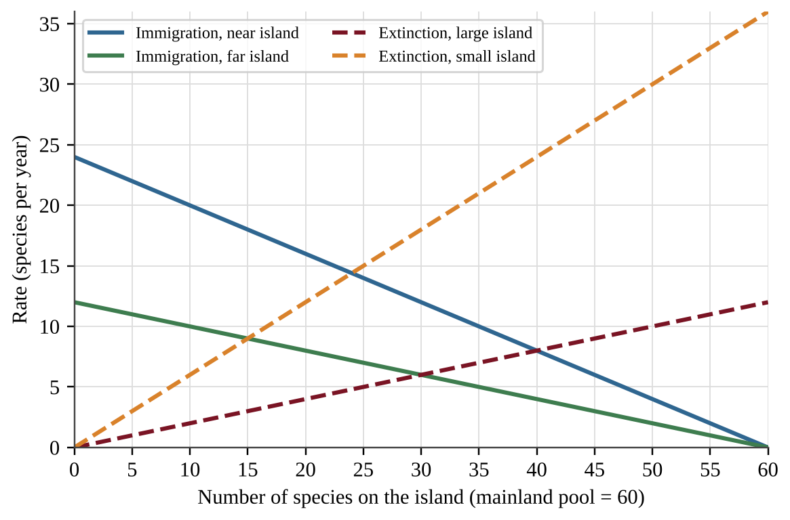
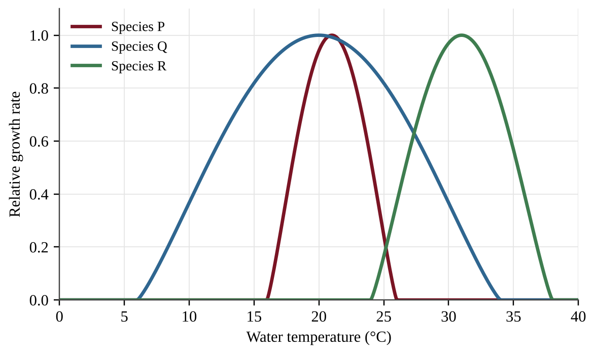
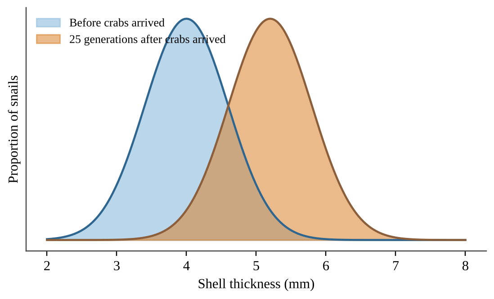
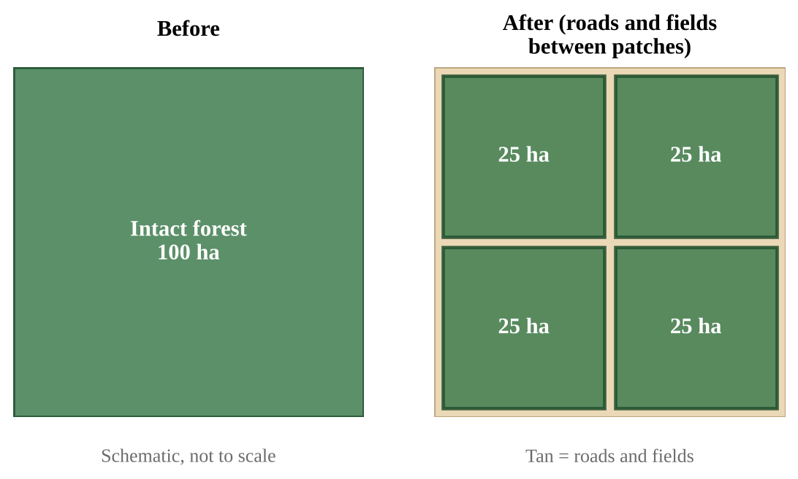
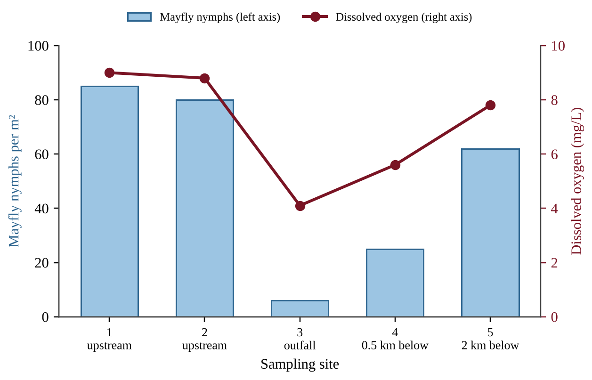
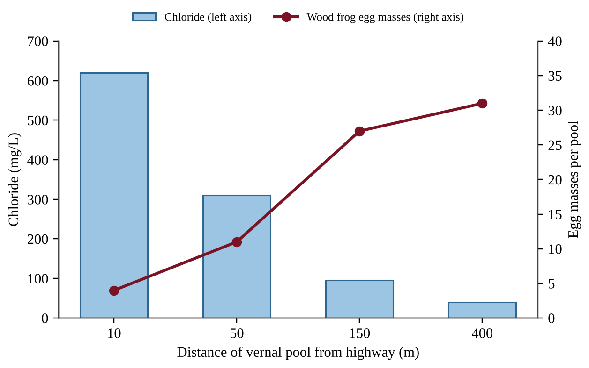
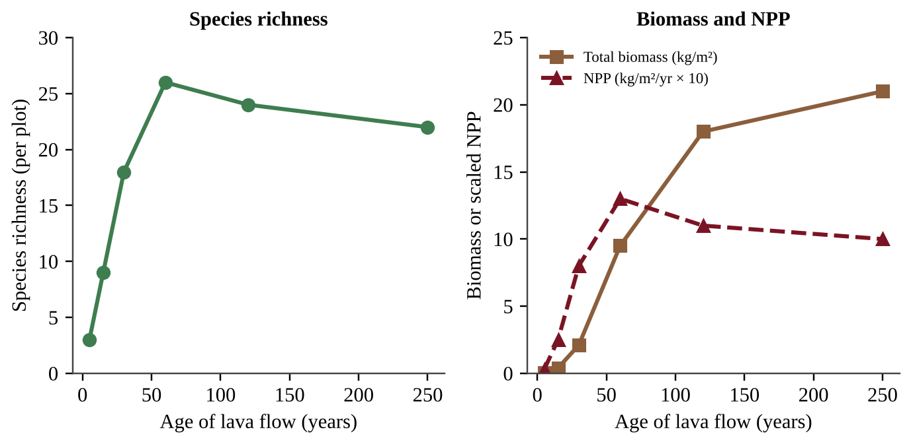
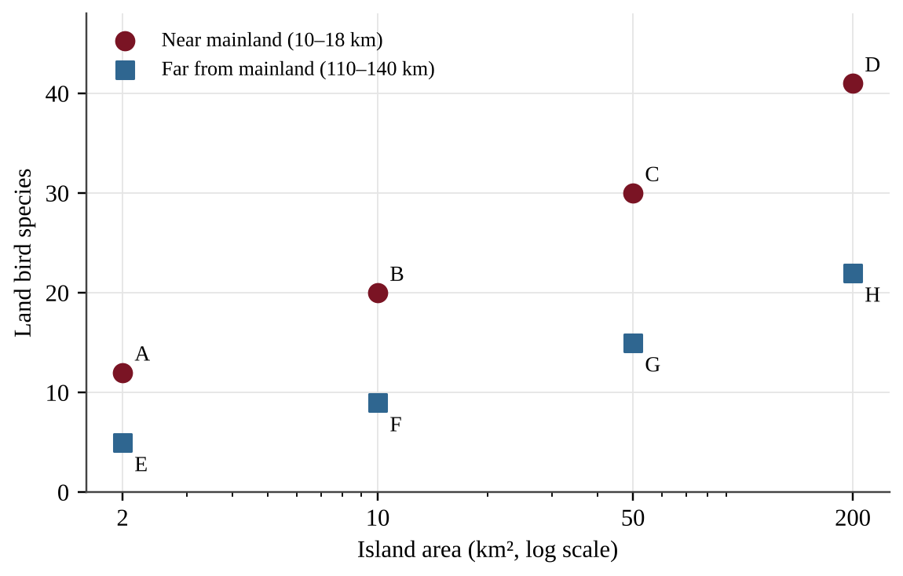

# Unit 2 — The Living World: Biodiversity

:::box note
Exam weight: Unit 2 accounts for 6–8% of the AP Environmental Science exam score (CED Topics 2.1–2.7).
This section assesses levels of biodiversity, ecosystem services, island biogeography, ecological tolerance, natural disruptions, adaptation, and ecological succession.
Expect data in tables and graphs, short calculations (percent change, totals, differences), and scenarios that ask you to explain, justify, or propose a solution.
:::

## Section A — Multiple-Choice Questions

:::q QB-U2-MCQ001 | unit=2 | topic=2.1 | diff=1
Which of the following best describes genetic diversity?
A) The number of different species living in a wetland
B) The number of distinct habitat types within a river basin
C) The total number of individuals counted in a population
D) The variety of alleles carried by the individuals of a population
:::

:::q QB-U2-MCQ002 | unit=2 | topic=2.2 | diff=1
A coastal salt marsh absorbs storm-surge water that would otherwise flood nearby homes. Which category of ecosystem service does this represent?
A) Regulating
B) Provisioning
C) Cultural
D) Supporting
:::

:::q QB-U2-MCQ003 | unit=2 | topic=2.7 | diff=1
Which of the following situations would most likely lead to primary succession?
A) A hay field that has been abandoned for several years
B) A forest after a wildfire that left the soil intact
C) Bare rock exposed as a glacier retreats
D) A logged hillside where the topsoil remains
:::

:::q QB-U2-MCQ004 | unit=2 | topic=2.4 | diff=1
Brook trout survive in stream water between 2°C and 20°C and die when the temperature moves outside that range. This temperature range is an example of the trout's
A) carrying capacity
B) ecological tolerance
C) biotic potential
D) species richness
:::

:::q QB-U2-MCQ005 | unit=2 | topic=2.3 | diff=1
According to the theory of island biogeography, which island is expected to support the greatest number of species at equilibrium?
A) A large island close to the mainland
B) A large island far from the mainland
C) A small island close to the mainland
D) A small island far from the mainland
:::

:::q QB-U2-MCQ006 | unit=2 | topic=2.5 | diff=1
Which of the following natural disruptions is best described as periodic?
A) A meteorite impact that triggers a mass extinction
B) A lightning strike that ignites a single wildfire
C) An earthquake that collapses a hillside
D) Flooding of a river floodplain every spring
:::

:::q QB-U2-MCQ007 | unit=2 | topic=2.6 | diff=1
Which statement best describes how natural selection leads to adaptation in a population?
A) Individuals develop useful traits during their lives and pass those traits directly to their offspring.
B) Individuals with heritable traits that raise survival and reproduction leave more offspring, so those traits become more common.
C) A population changes its genes in response to a need, so every member adapts within a single generation.
D) A change in the environment causes mutations that are beneficial to the population.
:::

:::q QB-U2-MCQ008 | unit=2 | topic=2.7 | diff=1
A lava flow cools and hardens into bare rock. Which organisms are most likely to colonize it first?
A) Hardwood tree saplings
B) Grazing mammals
C) Lichens and mosses
D) Perennial shrubs
:::

:::q QB-U2-MCQ009 | unit=2 | topic=2.1 | diff=2
A disease reduced a kestrel population on a small island, and the population later recovered. Genetic surveys of the population are shown below.

| Year | Population size | Alleles found at one gene |
|---|---|---|
| 1990 | 400 | 14 |
| 1995 | 12 | 5 |
| 2020 | 380 | 5 |

Which statement best explains why the 2020 population is more vulnerable to new environmental stressors than the 1990 population?
A) Population growth after a crash further reduces the number of alleles.
B) The bottleneck eliminated alleles that population growth cannot restore, limiting the variation available to respond to stress.
C) The number of species on the island fell during the disease outbreak.
D) The 2020 population is smaller than the 1990 population, so it has less habitat diversity.
:::

:::q QB-U2-MCQ010 | unit=2 | topic=2.2 | diff=2
A city drains a floodplain wetland to build housing. In the following years, downstream flooding becomes more frequent and nitrate levels in the drinking-water reservoir rise. Which ecosystem services were most directly reduced?
A) Provisioning services, such as fish and timber harvests
B) Cultural services, such as recreation and spiritual value
C) Supporting services, such as soil formation and primary production
D) Regulating services, such as flood control and water purification
:::

:::q QB-U2-MCQ011 | unit=2 | topic=2.3 | diff=2
The graph shows a model of island biogeography for a mainland species pool of 60 species. Immigration curves are shown for a near island and a far island, and extinction curves are shown for a large island and a small island.

{w=0.8}

According to the model, how many more species would be expected at equilibrium on a large, near island than on a small, far island?
A) 25
B) 10
C) 16
D) 15
:::

:::q QB-U2-MCQ012 | unit=2 | topic=2.4 | diff=2
The graph shows how the growth rate of three aquatic species changes with water temperature.

{w=0.8}

A lake warms from 20°C to 30°C. Which statement is best supported by the graph?
A) Species R has the widest range of tolerance of the three species.
B) Species Q is the most vulnerable to warming because it has the narrowest range of tolerance.
C) Species P would be eliminated, while Species Q and Species R would remain within their tolerance ranges.
D) All three species were within their tolerance ranges at 20°C.
:::

:::q QB-U2-MCQ013 | unit=2 | topic=2.5 | diff=2
Several islands on a shallow continental shelf contain the same small-mammal species found on the nearby mainland, even though these mammals cannot cross open water. Which of the following is the most likely explanation?
A) The mammals evolved identical traits independently on each island.
B) Ocean currents regularly carried mammals from the mainland to every island.
C) Mutations on the islands repeatedly produced the same species.
D) Lower sea levels during past glacial periods exposed land connections that were flooded again as the ice melted.
:::

:::q QB-U2-MCQ014 | unit=2 | topic=2.6 | diff=2
Shell thickness was measured in a population of marine snails before and 25 generations after predatory crabs were introduced to their shoreline.

{w=0.8}

Which of the following best explains the change shown?
A) Snails with thicker shells survived crab predation more often and passed the heritable trait to their offspring.
B) Each snail thickened its shell after sensing the crabs, and the thicker shells were inherited by its offspring.
C) The crabs caused mutations that produced thicker shells in the snails.
D) The snail population needed thicker shells, so its genes changed to meet that need.
:::

:::q QB-U2-MCQ015 | unit=2 | topic=2.7 | diff=2
Researchers surveyed a forest plot at several times after a wildfire.

| Years since fire | Species richness |
|---|---|
| 1 | 8 |
| 10 | 22 |
| 30 | 35 |
| 80 | 31 |

By what percent did species richness increase between year 10 and year 30?
A) 13%
B) 37%
C) 59%
D) 160%
:::

:::q QB-U2-MCQ016 | unit=2 | topic=2.1 | diff=2
A 100-ha block of forest is divided by roads and farm fields into four isolated 25-ha patches, as shown.

{w=0.8}

Which species is most likely to disappear from the landscape first, given that each pair needs a single 40-ha territory of mature forest?
A) A generalist rodent that eats seeds, insects, and fruit in many habitats
B) A specialist forest-interior bird that needs one 40-ha territory of mature forest
C) A generalist deer that browses in both forests and fields
D) A weedy plant that colonizes disturbed forest edges
:::

:::q QB-U2-MCQ017 | unit=2 | topic=2.2 | diff=2
A 60-ha oyster reef removes excess nitrogen from a bay. A water utility would spend $1,500 per hectare per year to remove the same nitrogen by other means. The reef also supports a harvest of 800 kg of oysters per hectare per year, sold for $6 per kilogram. What is the total annual value of these two services?
A) $378,000
B) $90,000
C) $288,000
D) $6,300
:::

:::q QB-U2-MCQ018 | unit=2 | topic=2.3 | diff=2
Rats are accidentally introduced to an island where several bird species eat only one kind of seed and nest only in one kind of shrub. Which statement best explains why these island birds are especially vulnerable?
A) Island birds have more genetic diversity than the introduced rats.
B) Island birds are usually larger than the introduced rats and need more food.
C) Island birds reproduce more slowly than all mainland species.
D) Limited island resources favored specialization, and generalist invaders can outcompete or prey on specialists.
:::

:::q QB-U2-MCQ019 | unit=2 | topic=2.4 | diff=2
A researcher wants to determine the range of salinity that tadpoles of a frog species can tolerate. Which design would best accomplish this?
A) Place 20 tadpoles in a single tank at 15 ppt salinity and record survival after one week.
B) Place 20 tadpoles in each of six tanks with salinities from 0 to 20 ppt, keep temperature and food the same, and record survival after seven days.
C) Collect tadpoles from creeks with different salinities and compare their body sizes.
D) Place tadpoles in one tank and slowly add salt while observing their behavior.
:::

:::q QB-U2-MCQ020 | unit=2 | topic=2.5 | diff=2
After a hurricane destroys the mangrove roosting sites on a barrier island, thousands of herons fly 40 km inland and use freshwater marshes for the rest of the season. This behavior is best described as
A) the formation of a new species
B) the start of primary succession
C) a short-term migration in response to a natural disruption
D) a loss of genetic diversity through a bottleneck
:::

:::q QB-U2-MCQ021 | unit=2 | topic=2.6 | diff=2
Which population is most likely to adapt through natural selection to the environmental change described?
A) A long-lived tree species with little genetic variation, facing a sudden, severe drought
B) A small population of large predators with low genetic variation, facing a sudden loss of prey
C) An isolated amphibian population with few breeding adults, facing a sudden new disease
D) A short-lived insect with high genetic variation, facing a gradual warming trend
:::

:::q QB-U2-MCQ022 | unit=2 | topic=2.7 | diff=2
Mayfly nymphs are sensitive to low dissolved oxygen. A stream was sampled at five sites, with a wastewater outfall at Site 3.

{w=0.8}

Which conclusion is best supported by the data?
A) Low mayfly density near the outfall suggests degraded water quality, which is consistent with mayflies acting as an indicator species.
B) Mayflies are a keystone species because their decline at Site 3 caused oxygen to fall.
C) The outfall increases mayfly reproduction, so densities recover downstream.
D) Mayfly density does not depend on oxygen because some mayflies survive at Site 3.
:::

:::q QB-U2-MCQ023 | unit=2 | topic=2.7 | diff=3
In an intertidal zone, a predatory sea star made up about 2% of the total biomass. Researchers removed the sea star from 8 pools and left it in 8 other pools. Mussels covered 20% of the rock surface in all pools at the start.

| Treatment | Species per pool at start | Species per pool after 2 years | Mussel cover after 2 years |
|---|---|---|---|
| Sea star removed | 15 | 6 | 85% |
| Sea star left in place | 15 | 14 | 20% |

Which conclusion is best supported by the data?
A) The sea star is an indicator species because species richness fell when it was removed.
B) The decline in species richness resulted from natural variation, since the control pools also changed.
C) The sea star is a keystone species because removing a species with small biomass strongly altered community structure.
D) Mussels are the keystone species because they covered most of the rock in the removal pools.
:::

:::q QB-U2-MCQ024 | unit=2 | topic=2.2 | diff=3
A city can protect its drinking water in one of two ways. A treatment plant would cost $24 million to build and $1.2 million per year to operate. Alternatively, the city could restore 800 ha of wetland that provides equivalent purification, at $9,000 per hectare once plus $150 per hectare per year for maintenance. Over 20 years, how much less would the wetland option cost than the treatment plant?
A) $16.8 million
B) $38.4 million
C) $40.8 million
D) $14.4 million
:::

:::q QB-U2-MCQ025 | unit=2 | topic=2.3 | diff=3
Ecologists surveyed the birds of a small island 30 km from the mainland in two years.

| Survey year | Species recorded | Species recorded in both surveys |
|---|---|---|
| 2010 | 31 | 24 |
| 2020 | 31 | 24 |

Which interpretation is best supported by the data?
A) Seven species were lost and seven new species arrived, which is consistent with a dynamic equilibrium between immigration and extinction.
B) No species arrived or went extinct, because species richness stayed the same.
C) Twenty-four species went extinct and 24 species arrived between the surveys.
D) Species richness was constant, so the extinction rate on the island must be zero.
:::

:::q QB-U2-MCQ026 | unit=2 | topic=2.4 | diff=3
Coral colonies of one species were held at several temperatures for 1 week or for 4 weeks.

| Temperature (°C) | Survival after 1 week | Survival after 4 weeks |
|---|---|---|
| 28 | 98% | 98% |
| 30 | 96% | 85% |
| 31 | 90% | 55% |
| 32 | 70% | 5% |
| 33 | 20% | 0% |

Which conclusion is best supported by the data?
A) The species tolerates temperatures up to 33°C because some colonies survived for a week.
B) Temperature has no measurable effect on survival below 32°C.
C) The tolerance range of the species is fixed at 28°C to 33°C regardless of exposure time.
D) The harm caused by a temperature depends on how long the colonies are exposed to it.
:::

:::q QB-U2-MCQ027 | unit=2 | topic=2.6 | diff=3
A grower sprays the same insecticide on a field each season. The fraction of the pest population that is resistant is shown below.

| Season | 1 | 2 | 3 | 4 | 5 |
|---|---|---|---|---|---|
| Resistant fraction | 0.02 | 0.08 | 0.28 | 0.62 | 0.90 |

Which management change would most effectively slow the evolution of resistance?
A) Apply a higher dose of the same insecticide each season.
B) Spray the same insecticide more often so that susceptible insects cannot recover.
C) Leave untreated refuge plots so susceptible insects survive and mate with resistant survivors.
D) Wait until more than half of the pests are resistant before changing the insecticide.
:::

:::q QB-U2-MCQ028 | unit=2 | topic=2.7 | diff=3
Data were collected from forest stands of different ages after a disturbance.

| Stand age (years) | Total biomass (kg/m²) | Net primary productivity (kg/m²/yr) |
|---|---|---|
| 5 | 0.8 | 0.60 |
| 20 | 4.0 | 1.2 |
| 80 | 18 | 1.0 |
| 200 | 22 | 0.9 |

Which statement is best supported by the data?
A) Net primary productivity rises throughout succession as biomass accumulates.
B) Net productivity per unit of biomass declines during succession, even though total biomass increases.
C) Total biomass is highest in the 20-year-old stand.
D) Both total biomass and net primary productivity are highest in the 200-year-old stand.
:::

## Section B — Free-Response Questions

:::q QB-U2-FRQ001 | unit=2 | topic=2.4 | diff=2 | frqtype=1 | pts=10
Wood frogs breed in small seasonal ponds called vernal pools. In a northeastern watershed, a highway runs along one edge of the forest and is treated with road salt (sodium chloride) every winter. Spring meltwater carries chloride into nearby pools. A biologist counted wood frog egg masses and measured chloride in four pools at different distances from the highway.

{w=0.8}

(a) Describe the relationship shown in the figure between a pool's distance from the highway and (i) its chloride concentration and (ii) the number of egg masses. [1]
(b) Explain why the survey data alone do not show that chloride caused the low number of egg masses near the highway. [1]
(c) State a testable hypothesis about the effect of chloride on wood frog eggs, and justify it using the concept of ecological tolerance. [2]
(d) The biologist will test the hypothesis in a laboratory experiment. Identify the independent variable and the dependent variable. [2]
(e) Describe an experimental procedure that includes the chloride treatments, a control, and replication, and identify two variables that should be held constant. [2]
(f) Describe how the biologist should use the results to identify the range of chloride that the eggs can tolerate. [1]
(g) Propose one solution that would reduce chloride entering vernal pools, and describe one tradeoff of your solution. [1]
:::

:::q QB-U2-FRQ002 | unit=2 | topic=2.7 | diff=2 | frqtype=2 | pts=10
Ecologists studied vegetation on lava flows of different ages on a volcanic island. Each lava flow cooled to bare rock with no soil. Data from one plot on each flow are shown below.

| Age of lava flow (years) | Dominant vegetation | Species richness | Total biomass (kg/m²) | NPP (kg/m²/yr) |
|---|---|---|---|---|
| 5 | Lichens and mosses | 3 | 0.05 | 0.03 |
| 15 | Ferns and grasses | 9 | 0.4 | 0.25 |
| 30 | Shrubs | 18 | 2.1 | 0.80 |
| 60 | Young trees | 26 | 9.5 | 1.30 |
| 120 | Mixed mature forest | 24 | 18.0 | 1.10 |
| 250 | Old-growth forest | 22 | 21.0 | 1.00 |

{w=0.9}

(a) Identify the type of ecological succession shown, and justify your answer with evidence from the stem. [2]
(b) Describe the trend in species richness from year 5 to year 250. [1]
(c) Calculate the percent increase in total biomass between the 30-year-old and the 60-year-old flows. [1]
(d) Calculate the ratio of NPP to total biomass (in yr⁻¹) for the 15-year-old flow and for the 250-year-old flow. [2]
(e) Explain one reason that species richness declines slightly after year 60. [2]
(f) A hurricane topples most of the trees on the 250-year-old flow but leaves the soil in place. Predict whether recovery will be faster or slower than the original colonization of the bare lava, and justify your prediction. [2]
:::

:::q QB-U2-FRQ003 | unit=2 | topic=2.2 | diff=3 | frqtype=3 | pts=10
A coastal region contains 1,500 ha of mangrove forest. A developer proposes converting 20% of the mangrove area to shrimp ponds. Estimated values of three ecosystem services provided by the mangroves are shown below.

| Ecosystem service | Value or rate (per hectare per year) |
|---|---|
| Storm protection (avoided property damage) | $7,200 |
| Harvested fish and crabs | 380 kg, selling for $4.50 per kg |
| Carbon storage | 6.0 metric tons of CO₂, valued at $50 per metric ton |

The shrimp ponds would produce a net profit of $3,800 per hectare per year for the developer.

(a) Calculate the total annual value of the three ecosystem services that would be lost if the proposal goes ahead. Show the area converted, the value per hectare of the fish and crab harvest, the value per hectare of all three services, and the total. [4]
(b) Calculate the developer's total annual profit from the shrimp ponds, and calculate the net difference between the services lost and the profit gained. [2]
(c) Calculate the mass of CO₂, in metric tons per year, that the converted area would no longer sequester. [1]
(d) Identify the category of ecosystem service represented by (i) the fish and crab harvest and (ii) storm protection. [1]
(e) Make a claim about whether the conversion benefits society, and justify it using your calculations. [1]
(f) Propose one solution that would allow shrimp production while reducing the loss of ecosystem services. [1]
:::

:::q QB-U2-FRQ004 | unit=2 | topic=2.3 | diff=3 | frqtype=2 | pts=10
Biologists surveyed land bird species on eight islands in an archipelago. Four islands lie close to the mainland and four lie far from it.

| Island | Area (km²) | Distance from mainland (km) | Land bird species |
|---|---|---|---|
| A | 2 | 15 | 12 |
| B | 10 | 12 | 20 |
| C | 50 | 18 | 30 |
| D | 200 | 10 | 41 |
| E | 2 | 120 | 5 |
| F | 10 | 140 | 9 |
| G | 50 | 110 | 15 |
| H | 200 | 130 | 22 |

{w=0.85}

Twenty years after black rats were accidentally introduced to Island C, a second survey found that the number of island specialist bird species had fallen from 18 to 9, while the number of generalist species had changed from 12 to 11.

(a) Describe the relationship between island area and species richness for the islands near the mainland. [1]
(b) Calculate the percent difference in species richness between Island C and Island G, which have the same area but different distances from the mainland, relative to Island C. [1]
(c) Using the theory of island biogeography, explain (i) why larger islands tend to support more species and (ii) why islands far from the mainland support fewer species than near islands of the same size. [2]
(d) Calculate the percent change in the number of specialist species on Island C after the rats were introduced. [1]
(e) Explain why the specialist birds on Island C were affected more than the generalists. [2]
(f) Propose one solution that would protect the remaining specialist birds on island C. [1]
(g) A new island of 100 km² lies 20 km from the mainland. Predict whether it would support more or fewer than 30 land bird species, and justify your prediction using the data. [2]
:::
