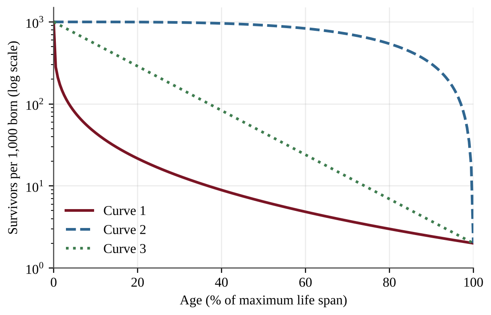
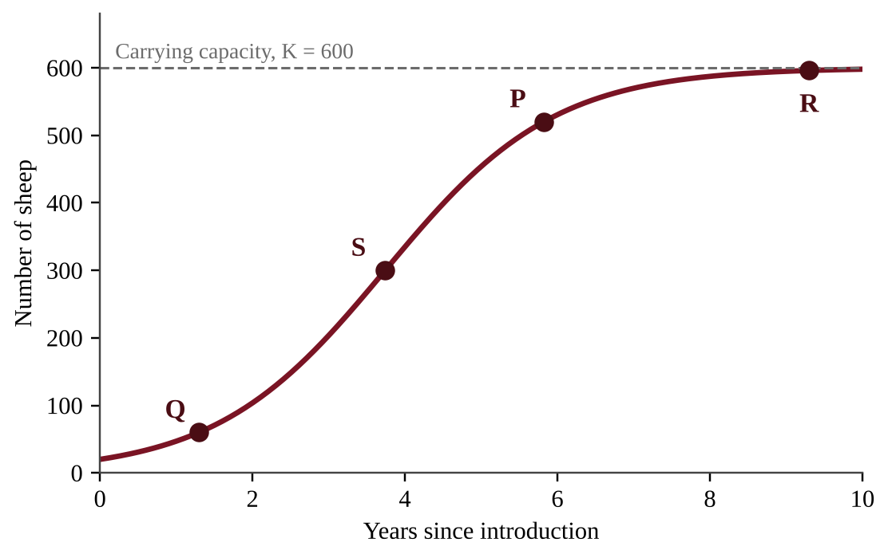
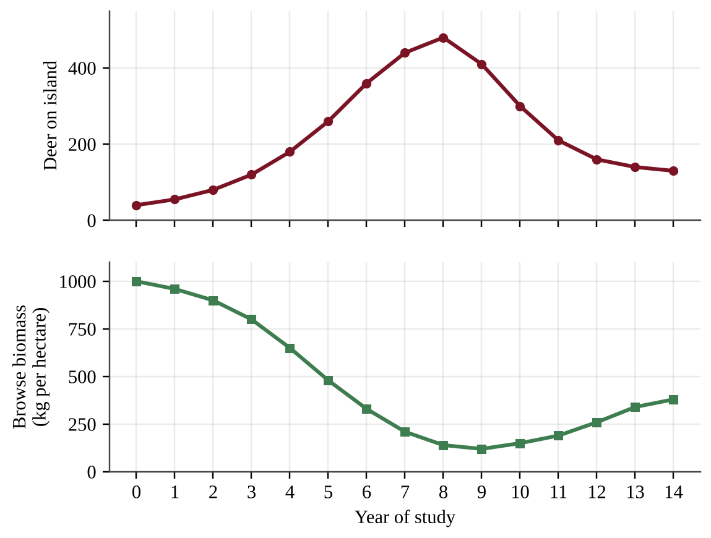
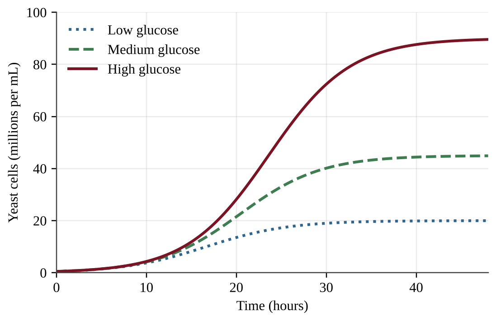
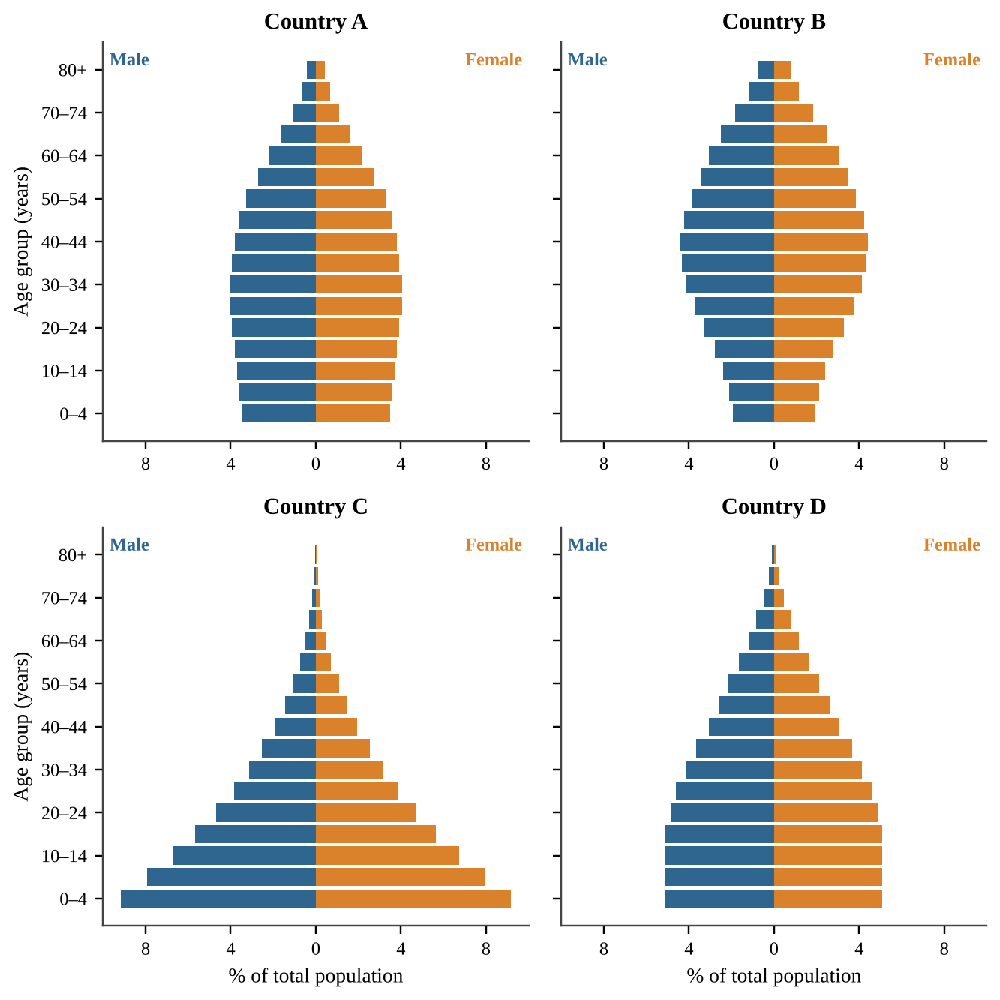
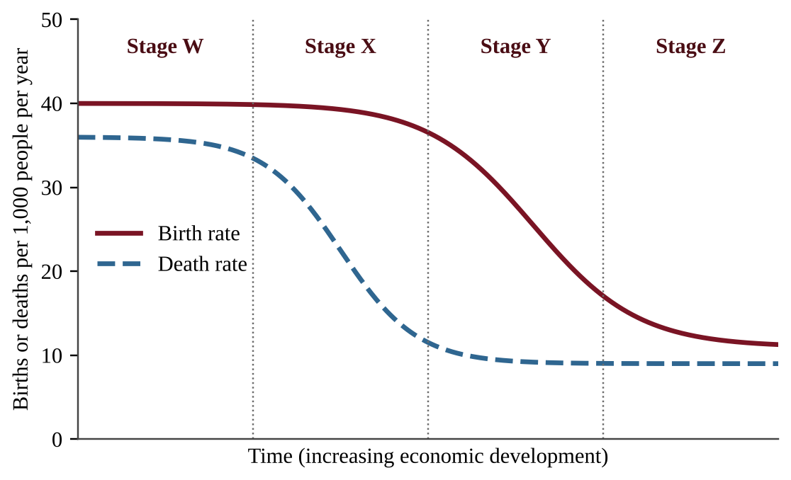
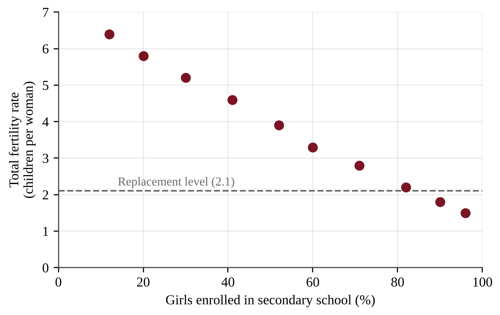
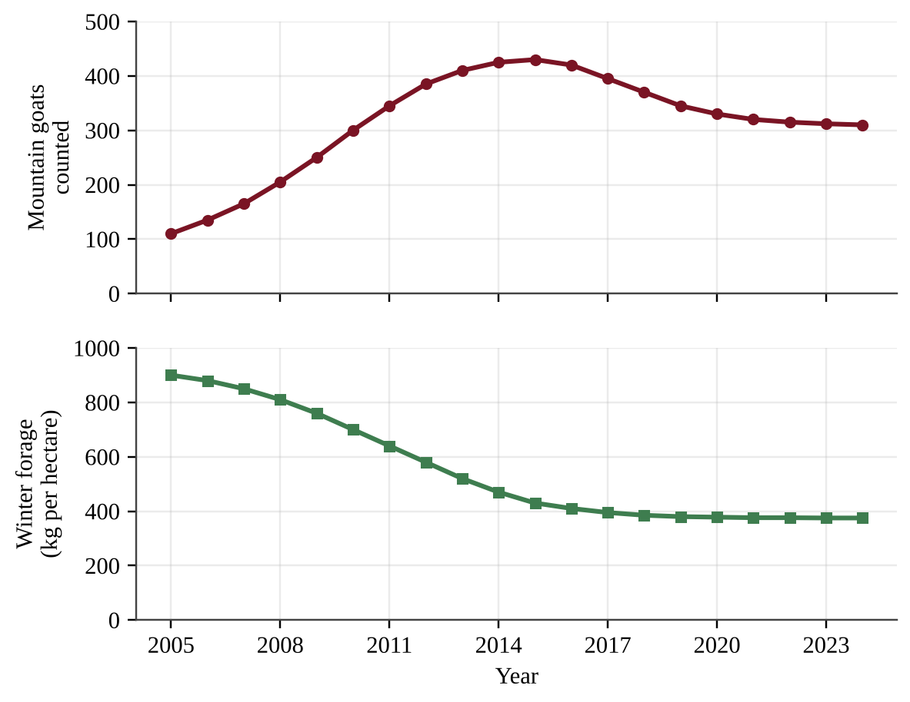
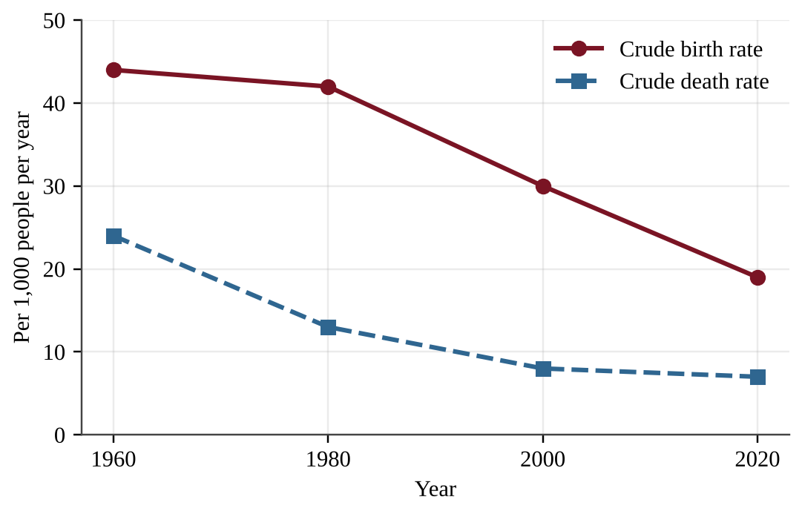
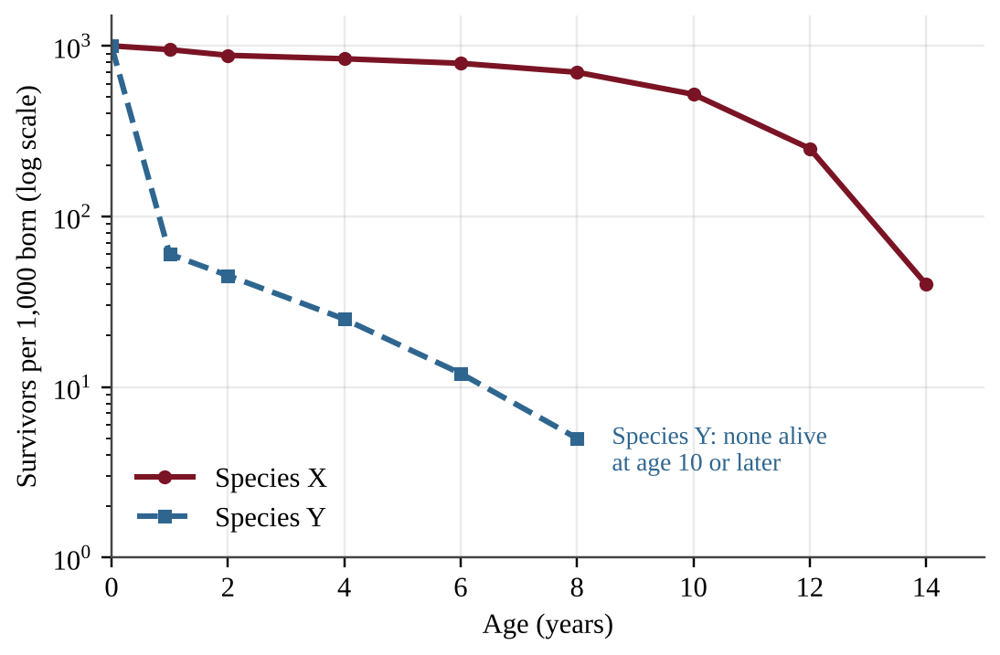

# Unit 3 — Populations

:::box note
Exam weight: 10–15% of the AP Environmental Science exam (about 12–13 class periods).
This unit assesses population ecology (generalists, r- and K-selection, survivorship, carrying capacity, resource limits) and human demography (age structure, fertility, growth calculations, the demographic transition).
Expect data interpretation, rule-of-70 and rate-of-natural-increase calculations, and explanations of population trends from graphs and tables.
:::

## Section A — Multiple-Choice Questions

:::q QB-U3-MCQ001 | unit=3 | topic=3.1 | diff=1
Which statement best describes a specialist species?
A) It tolerates a wide range of conditions and is generally advantaged where its habitat is changing.
B) It reproduces rapidly and is generally advantaged where its habitat is repeatedly disturbed.
C) It has narrow habitat or resource requirements and is generally advantaged where its habitat stays constant.
D) It feeds on many different foods and is therefore rarely harmed by habitat loss.
:::

:::q QB-U3-MCQ002 | unit=3 | topic=3.2 | diff=1
Which set of characteristics is typical of a K-selected species?
A) Few offspring, no parental care, early maturity, and a short life span
B) Many offspring, extensive parental care, late maturity, and a long life span
C) Many offspring, little parental care, short life span, and reproduction often only once
D) Few offspring, extensive parental care, long life span, and repeated reproduction
:::

:::q QB-U3-MCQ003 | unit=3 | topic=3.3 | diff=1
A female oyster releases millions of eggs each season. Nearly all of the resulting larvae are eaten or die within days, but the few that settle on a reef may live for years. Which survivorship curve and reproductive strategy best fit this species?
A) Type II curve; K-selected strategy
B) Type III curve; r-selected strategy
C) Type I curve; K-selected strategy
D) Type III curve; K-selected strategy
:::

:::q QB-U3-MCQ004 | unit=3 | topic=3.4 | diff=1
Which statement best defines the carrying capacity of an environment for a species?
A) The population size at which the number of individuals added per year is greatest
B) The maximum population size that the environment can sustain indefinitely given its available resources
C) The maximum number of offspring a population could produce in one year under ideal conditions
D) The number of individuals originally introduced to or present in a new habitat
:::

:::q QB-U3-MCQ005 | unit=3 | topic=3.5 | diff=1
A few rabbits are released on an island that has abundant grass, water, and shelter, and no predators. During the first several years, which pattern of population growth is most likely?
A) Growth stays constant at the same number of rabbits added each year.
B) Growth slows from the start because the population has reached carrying capacity.
C) Growth stops almost immediately because the island's resources are finite.
D) Growth accelerates because each new generation includes more reproducing individuals.
:::

:::q QB-U3-MCQ006 | unit=3 | topic=3.6 | diff=1
An age structure diagram has a very wide base for the youngest age groups and becomes much narrower at each successive older age group. What does this shape indicate?
A) Many young people, so the population is likely to grow rapidly
B) A high proportion of retirees relative to working-age adults
C) A declining population because the oldest age groups are small in number
D) A nearly stable population in which births and deaths are about equal
:::

:::q QB-U3-MCQ007 | unit=3 | topic=3.7 | diff=1
A country has a total fertility rate (TFR) of 2.1 and negligible immigration and emigration. Which prediction is most reasonable?
A) Its population will be relatively stable over the long term.
B) Its population will decline sharply because 2.1 is a low fertility rate.
C) Its population will double in about 35 years.
D) Its population will grow rapidly because every woman has at least two children.
:::

:::q QB-U3-MCQ008 | unit=3 | topic=3.8 | diff=1
Which pair of processes adds individuals to a human population?
A) Deaths and immigration
B) Deaths and emigration
C) Births and immigration
D) Births and emigration
:::

:::q QB-U3-MCQ009 | unit=3 | topic=3.9 | diff=1
In the four-stage demographic transition model, which stage has both high birth rates and high death rates, resulting in very slow population growth?
A) Stage 1
B) Stage 2
C) Stage 3
D) Stage 4
:::

:::q QB-U3-MCQ010 | unit=3 | topic=3.4 | diff=1
When a population grows well above the carrying capacity of its environment, which outcome is most likely?
A) Birth rates increase because competition for each resource declines.
B) The population stabilizes immediately at its new, larger size.
C) The carrying capacity rises permanently because a larger population uses resources more efficiently.
D) Resources become depleted, and the population experiences a dieback.
:::

:::q QB-U3-MCQ011 | unit=3 | topic=3.3 | diff=1
Which pattern is characteristic of a Type I survivorship curve?
A) Survivorship drops steeply in mid-life and then levels off for the oldest individuals.
B) Mortality is highest among the youngest individuals, and survivors live much longer.
C) Most individuals survive to old age, and mortality is concentrated late in life.
D) The probability of dying is about the same at every age.
:::

:::q QB-U3-MCQ012 | unit=3 | topic=3.8 | diff=1
Which of the following is a density-independent factor that can limit a population?
A) Competition among crowded birds for scarce nesting sites
B) A wildfire that kills organisms in its path
C) Faster spread of an infectious disease through a crowded herd of animals
D) Depletion of the local food supply by a large, dense population
:::

:::q QB-U3-MCQ013 | unit=3 | topic=3.2 | diff=1
Which statement best defines the biotic potential of a species?
A) The number of individuals that enter a population each year through immigration
B) The maximum reproductive rate of a population under ideal conditions
C) The average number of offspring that survive to adulthood in a natural habitat
D) The maximum number of individuals an environment can support indefinitely
:::

:::q QB-U3-MCQ014 | unit=3 | topic=3.1 | diff=2
A coastal lagoon is dredged, and its seagrass beds are replaced by bare mud. Before dredging, two fish species lived in the lagoon. Species 1 eats almost only seagrass shoots and lays eggs only in seagrass. Species 2 eats seagrass, worms, small crustaceans, and dead organic matter, and spawns in many habitats. Which prediction is best supported?
A) Both species will decline by the same amount because both fed on seagrass before dredging.
B) Species 1 is more likely to persist because specialization makes it efficient in new habitats.
C) Species 2 is more likely to persist because it can use a wider range of foods and habitats.
D) Species 1 will switch to worms and crustaceans as easily as Species 2 can.
:::

:::q QB-U3-MCQ015 | unit=3 | topic=3.2 | diff=2
The table lists four species. Assume ideal conditions for all of them.

| Species | Adult mass | Offspring per reproductive event | Age at first reproduction | Typical life span |
|---|---|---|---|---|
| P | 0.03 kg | 400 eggs | 0.4 years | 1 year |
| Q | 4,000 kg | 1 calf | 11 years | 65 years |
| R | 6 kg | 3 young | 4 years | 18 years |
| S | 0.5 kg | 8 young | 1 year | 4 years |

Which species most likely has the highest biotic potential?
A) Species P, because it produces many offspring and matures very early
B) Species Q, because its large body size gives it the greatest resource reserves
C) Species S, because it has the best balance of litter size and age at maturity
D) Species R, because it has several young and lives long enough to reproduce repeatedly
:::

:::q QB-U3-MCQ016 | unit=3 | topic=3.2 | diff=2
A predatory fish is introduced to a lake that contains two native species. One native is K-selected (large, few young, long-lived), and the other is r-selected (small, many young, short-lived). Which statement best explains why the K-selected native is typically more adversely affected by the invasive species over the long term?
A) It reproduces so quickly that its numbers soon exceed the lake's carrying capacity.
B) It has a short life span, so each individual is exposed to the invader only briefly.
C) It reproduces slowly, so it cannot quickly replace the individuals lost to predation or competition.
D) It faces less competition for resources than the r-selected species, so it declines first.
:::

:::q QB-U3-MCQ017 | unit=3 | topic=3.3 | diff=2
The graph shows three possible survivorship curves, plotted on a logarithmic vertical axis.

Which curve is most likely to describe a large mammal that bears one calf at a time and provides years of parental care?
A) Curve 1, because a species with few offspring must lose most of them early in life
B) Curve 3, because the chance of dying is about the same at every age
C) Curve 1, because mortality is highest among the youngest individuals
D) Curve 2, because most individuals survive until old age
:::

:::q QB-U3-MCQ018 | unit=3 | topic=3.3 | diff=2
Refer to the same graph of survivorship curves.

A researcher finds that in a certain lizard species, an individual has about the same probability of dying at any age. Which curve best represents this species?
A) Curve 3, because a constant percentage of survivors dies in each time interval
B) Curve 2, because lizards are small and therefore have few predators
C) Curve 2, because the same number of individuals dies in every time interval
D) Curve 1, because the probability of dying declines steadily with age
:::

:::q QB-U3-MCQ019 | unit=3 | topic=3.4 | diff=2
A population of bighorn sheep was introduced to a mountain basin. The graph shows population size over time; the dashed line is the carrying capacity.

At which point is the population increasing by the greatest number of individuals per year?
A) Point P
B) Point Q
C) Point R
D) Point S
:::

:::q QB-U3-MCQ020 | unit=3 | topic=3.4 | diff=2
A deer herd was introduced to an island with no predators, and its size and the biomass of the available browse (leaves and twigs) were measured for 14 years. Weather records show no unusual storms, droughts, or cold snaps during the study.

Which statement best explains the decline in the deer population after year 8?
A) A density-independent event, such as a severe winter or storm, killed deer regardless of herd size.
B) The herd exceeded the carrying capacity set by browse, depleted that resource, and then experienced dieback.
C) The biotic potential of the deer decreased because food was too plentiful in the early years of the study.
D) The carrying capacity of the island increased as the browse became less abundant.
:::

:::q QB-U3-MCQ021 | unit=3 | topic=3.5 | diff=2
A student wants to test the hypothesis that the surface area of a pond limits the growth of a floating duckweed population. Which experimental design is best?
A) Grow one tub with a large surface area in bright light and one with a small surface area in dim light, and count plants weekly.
B) Start equal numbers of plants in replicate tubs of identical solution and light, vary only the surface area, and count plants every three days.
C) Start different numbers of plants in same-sized tubs of identical solution and compare final counts after three weeks.
D) Use one tub for each surface area and add extra fertilizer to the largest tub to be sure that growth is not limited by nutrients.
:::

:::q QB-U3-MCQ022 | unit=3 | topic=3.5 | diff=2
Three yeast cultures were started with the same small number of cells in flasks that differed only in glucose concentration. All flasks were kept at the same temperature and shaken the same way.

Which conclusion is best supported by the data?
A) The leveling off was caused by a density-independent factor, because the temperature and shaking were the same in all flasks.
B) All three cultures leveled off at the same carrying capacity, because the flasks were the same size and temperature.
C) The amount of available glucose set the carrying capacity: more glucose supported a larger plateau population.
D) Glucose concentration had no effect on population growth because all cultures grew rapidly at first.
:::

:::q QB-U3-MCQ023 | unit=3 | topic=3.6 | diff=2
The figure shows age structure diagrams for four countries.

Assuming negligible migration, which country is likely to have the highest population growth rate over the next decade?
A) Country A
B) Country B
C) Country C
D) Country D
:::

:::q QB-U3-MCQ024 | unit=3 | topic=3.6 | diff=2
Refer to the age structure diagrams for Countries A–D.

Which country will most likely experience the largest increase in the number of retirees per working-age adult over the next 30 years?
A) Country A
B) Country B
C) Country C
D) Country D
:::

:::q QB-U3-MCQ025 | unit=3 | topic=3.7 | diff=2
A country passes a law requiring girls to stay in school through age 18 and opens family planning clinics in rural districts. Which change in TFR over the next 20 years is most likely?
A) TFR will increase because healthier, better-educated women will have more children.
B) TFR will decrease only if the infant mortality rate rises at the same time.
C) TFR will stay the same because fertility is determined only by biology.
D) TFR will decrease as the average age at first birth rises and more women can plan family size.
:::

:::q QB-U3-MCQ026 | unit=3 | topic=3.7 | diff=2
Region 1 has an infant mortality rate of 9 deaths per 1,000 live births, and Region 2 has a rate of 71 deaths per 1,000 live births. Which difference between the regions most likely explains the gap?
A) Region 1 has a larger total population.
B) Mothers in Region 1 have better access to healthcare and nutrition.
C) Region 1 has a higher total fertility rate.
D) Region 1 has a larger proportion of children in the workforce.
:::

:::q QB-U3-MCQ027 | unit=3 | topic=3.8 | diff=2
A country's population is growing at 0.7% per year. Using the rule of 70, about how many years will it take the population to double?
A) 10 years
B) 49 years
C) 70 years
D) 100 years
:::

:::q QB-U3-MCQ028 | unit=3 | topic=3.8 | diff=2
A country has a crude birth rate of 17 and a crude death rate of 11, both per 1,000 people per year. Migration is negligible. What is the rate of natural increase (RNI)?
A) 0.6%
B) 6%
C) 28%
D) 60%
:::

:::q QB-U3-MCQ029 | unit=3 | topic=3.8 | diff=2
During an outbreak of an infectious disease, health workers recorded the following in four villages.

| Village | Population density (people per km²) | People infected (%) |
|---|---|---|
| 1 | 20 | 2 |
| 2 | 60 | 5 |
| 3 | 150 | 14 |
| 4 | 300 | 31 |

Which conclusion is best supported by the data?
A) Disease affected the villages equally because the number of infected people rose in each one.
B) Disease acted as a density-independent factor because every village had infected people.
C) Disease can only limit a population that is already below its carrying capacity.
D) Disease acted as a density-dependent factor because the share infected rose with density.
:::

:::q QB-U3-MCQ030 | unit=3 | topic=3.9 | diff=2
The graph shows birth and death rates through the four stages of the demographic transition model.

Which stage best fits a country in which vaccination and clean drinking water have caused the death rate to fall sharply while the birth rate remains high?
A) Stage X
B) Stage W
C) Stage Y
D) Stage Z
:::

:::q QB-U3-MCQ031 | unit=3 | topic=3.9 | diff=2
Compared with developed countries, developing countries typically have which pair of characteristics?
A) Higher infant mortality rates and more children in the workforce
B) Lower infant mortality rates and more children in the workforce
C) Higher infant mortality rates and fewer children in the workforce
D) Lower infant mortality rates and lower birth rates
:::

:::q QB-U3-MCQ032 | unit=3 | topic=3.8 | diff=2
In the late 1700s Thomas Malthus argued that human populations are ultimately limited by food supply. Which statement best summarizes the Malthusian view?
A) Population growth always slows as nations industrialize because families choose to have fewer children, so food supply is never the limit.
B) Technology will always increase carrying capacity as quickly as population grows, preventing shortages.
C) Population tends to grow exponentially while food supply grows only linearly, so famine, disease, and conflict eventually check growth.
D) Food supply grows faster than population, so shortages can occur only through unequal distribution of food among regions.
:::

:::q QB-U3-MCQ033 | unit=3 | topic=3.2 | diff=2
Which statement about r-selected and K-selected reproductive strategies is most accurate?
A) r-selected species are always larger than K-selected species of the same group.
B) K-selected species have a higher biotic potential than r-selected species do.
C) Many species show a mix of traits or shift strategy, so the categories form a continuum.
D) Every species can be placed into exactly one of the two categories without overlap.
:::

:::q QB-U3-MCQ034 | unit=3 | topic=3.4 | diff=2
Which change would most likely increase the carrying capacity of a grassland for bison?
A) Several years of above-average rainfall
B) A long-term drought that reduces grass growth
C) The addition of more bison from another herd
D) The introduction of cattle that graze the same grassland
:::

:::q QB-U3-MCQ035 | unit=3 | topic=3.7 | diff=2
The graph shows total fertility rate and the percentage of girls enrolled in secondary school for ten countries.

Which statement is best supported by the data?
A) Raising enrollment by 10 percentage points will lower the TFR of any country by about 0.6 children per woman.
B) Countries with a TFR above 4 have more than half of their girls enrolled in secondary school.
C) Total fertility rate does not vary with girls' secondary school enrollment.
D) Every country in which at least 90% of girls are enrolled has a TFR below the replacement level of about 2.1.
:::

:::q QB-U3-MCQ036 | unit=3 | topic=3.6 | diff=3
Country Z lowered its total fertility rate from 5.8 to 2.1 over the past 15 years, but its population is still growing by about 1.8% per year with negligible migration. Which is the best explanation?
A) A TFR of 2.1 is well above replacement level, so rapid growth is still expected.
B) A large share of its population is entering the reproductive years, so births still exceed deaths.
C) Replacement-level fertility cannot reduce growth in any country that has had a high birth rate.
D) TFR does not count children who die, so true fertility must still be near 5.8 per woman.
:::

:::q QB-U3-MCQ037 | unit=3 | topic=3.5 | diff=3
A wildlife reserve produces 150,000 kg of usable winter forage each year, and each elk needs 1,500 kg of forage per winter. The reserve currently has 130 elk. Assuming that forage is the only limiting resource, by approximately what percent does the current herd exceed the carrying capacity?
A) 23%
B) 30%
C) 77%
D) 130%
:::

:::q QB-U3-MCQ038 | unit=3 | topic=3.8 | diff=3
A country has 18 million people and a population growth rate of 2.5% per year. If this rate stays constant, about how large will the population be in 56 years?
A) 36 million
B) 54 million
C) 72 million
D) 144 million
:::

:::q QB-U3-MCQ039 | unit=3 | topic=3.8 | diff=3
A country has a crude birth rate of 14 and a crude death rate of 9 per 1,000 people per year. Net migration adds 4 people per 1,000 per year. Using the rule of 70 with the total annual growth rate, about how long will the population take to double?
A) 8 years
B) 39 years
C) 78 years
D) 140 years
:::

:::q QB-U3-MCQ040 | unit=3 | topic=3.5 | diff=3
Researchers counted a population of ground squirrels introduced to an island with limited food.

| Year | 0 | 1 | 2 | 3 | 4 | 5 | 6 | 7 | 8 | 9 |
|---|---|---|---|---|---|---|---|---|---|---|
| Squirrels | 50 | 120 | 270 | 480 | 650 | 740 | 780 | 790 | 792 | 790 |

Which option correctly identifies the interval with the greatest increase in number of squirrels and the best estimate of the carrying capacity?
A) Years 2 to 3; carrying capacity of about 790 squirrels
B) Years 2 to 3; carrying capacity of about 480 squirrels
C) Years 5 to 6; carrying capacity of about 740 squirrels
D) Years 0 to 1; carrying capacity of about 120 squirrels
:::

:::q QB-U3-MCQ041 | unit=3 | topic=3.9 | diff=3
A country has a crude birth rate of 41 and a crude death rate of 11 per 1,000 people per year, with negligible migration. Which option correctly identifies its stage in the demographic transition model and its approximate doubling time?
A) Stage 2; about 230 years
B) Stage 1; about 2.3 years
C) Stage 4; about 23 years
D) Stage 2; about 23 years
:::

:::q QB-U3-MCQ042 | unit=3 | topic=3.3 | diff=3
Researchers followed a cohort of 5,000 newly hatched fish for five years.

| Age (years) | 0 | 1 | 2 | 3 | 4 | 5 |
|---|---|---|---|---|---|---|
| Survivors | 5,000 | 400 | 300 | 225 | 150 | 80 |

Which option correctly gives the survivorship curve type and the percentage of the cohort that died before age 1?
A) Type III; 92%
B) Type III; 8%
C) Type I; 92%
D) Type II; 8%
:::

:::q QB-U3-MCQ043 | unit=3 | topic=3.1 | diff=3
An ecologist wants to test whether partial clearcutting of a forest favors generalist small mammals over specialist small mammals. Which study design is best?
A) Count all small mammals in cut plots and compare the total with a published average from a different forest and decade.
B) Count only the generalist species in one cut plot before and after the cutting takes place, with no uncut comparison plot.
C) Compare one cut plot at low elevation with one uncut plot at high elevation, trapping each for one night.
D) Trap and count a generalist and a specialist in several pairs of similar cut and uncut plots, using equal trapping effort in every plot.
:::

:::q QB-U3-MCQ044 | unit=3 | topic=3.8 | diff=3
Researchers place 10, 40, 160, or 640 flour beetles in identical containers that each hold the same amount of flour, with five containers per density. After two weeks they count the eggs laid per female. Which result would indicate that fecundity is limited by a density-dependent factor?
A) Eggs per female are nearly identical at all four densities.
B) Eggs per female decrease steadily as the starting density increases.
C) Eggs per female increase steadily as the starting density increases.
D) Eggs per female vary randomly among containers with no link to starting density.
:::

## Section B — Free-Response Questions

:::q QB-U3-FRQ001 | unit=3 | topic=3.5 | diff=2 | frqtype=1 | pts=10
A population of mountain goats lives on an alpine plateau in a national park with no hunting and few predators. Park biologists counted the goats each summer and measured the biomass of winter forage (grasses and sedges) each spring. The goat population rose for ten years and then declined and leveled off.

A biologist hypothesizes that the amount of winter forage, rather than disease or predation, limits the size of the goat population. To test this, the park proposes a supplemental-feeding experiment in six separate winter ranges on the plateau. Three ranges would receive supplemental forage pellets and three would not.

(a) Describe the pattern shown in the data for the goat population and for winter forage between 2005 and 2024. [1]

(b) Write a testable hypothesis, in an if–then format, that predicts how supplemental feeding will affect the goat population. [1]

(c) For the proposed experiment, identify the following. [3]
  (i) The independent variable
  (ii) One dependent variable
  (iii) One variable that should be controlled

(d) Describe two features of the experimental procedure that would increase the reliability or validity of the results. [2]

(e) Describe the results that would support the biologist's hypothesis. [1]

(f) If the hypothesis is supported, propose a management solution to keep the goat population within the plateau's carrying capacity and justify your proposal. [2]
:::

:::q QB-U3-FRQ002 | unit=3 | topic=3.9 | diff=2 | frqtype=2 | pts=10
The table and graph show demographic data for the country of Oren, which has had negligible migration. Infant mortality rate (IMR) is in deaths per 1,000 live births, and TFR is in children per woman.

| Year | Crude birth rate (per 1,000) | Crude death rate (per 1,000) | TFR | IMR | Girls enrolled in secondary school (%) |
|---|---|---|---|---|---|
| 1960 | 44 | 24 | 6.4 | 140 | 9 |
| 1980 | 42 | 13 | 5.9 | 95 | 18 |
| 2000 | 30 | 8 | 3.7 | 48 | 46 |
| 2020 | 19 | 7 | 2.2 | 17 | 84 |

(a) Describe the trends in the crude birth rate and the crude death rate between 1960 and 2020. [2]

(b) Calculate the rate of natural increase (RNI) for 1980 as a percentage. Show your work. [1]

(c) Using your answer to part (b) and the rule of 70, calculate the doubling time of Oren's population in 1980. Show your work. [1]

(d) Explain how two of the factors shown in the table contributed to the decline in TFR. [2]

(e) Identify the stage of the demographic transition model that Oren was in during 1980 and justify your answer with data. [2]

(f) Predict how the age structure diagram of Oren in 2040 will differ from the one in 1980, assuming TFR remains near replacement level. [1]

(g) Propose one government action to prepare for the change in age structure you described in part (f), and justify it. [1]
:::

:::q QB-U3-FRQ003 | unit=3 | topic=3.8 | diff=3 | frqtype=3 | pts=10
The island nation of Teluva has a population of 5.0 million people. In the most recent year there were 125,000 births, 45,000 deaths, 20,000 immigrants, and 5,000 emigrants. The average person in Teluva eats 0.55 kg of grain per day. Teluva's farms produce 850,000 metric tons of grain per year. (1 metric ton = 1,000 kg.) Assume a 365-day year.

(a) Calculate the annual population growth rate of Teluva as a percentage, including migration. Show your work. [2]

(b) Calculate the rate of natural increase (RNI) of Teluva as a percentage. Show your work. [1]

(c) Using your answer to part (a) and the rule of 70, calculate the doubling time of Teluva's population and the population size at the end of one doubling time. Show your work. [2]

(d) Calculate the current annual grain demand of Teluva in metric tons. Show your work. [1]

(e) Calculate the current annual grain shortfall in metric tons. [1]

(f) Explain one reason that Teluva's population growth rate might decline over the next several decades as the country develops. [1]

(g) Propose a solution to the grain shortfall that Teluva is likely to face as its population grows, and justify your proposal using your results above. [2]
:::

:::q QB-U3-FRQ004 | unit=3 | topic=3.3 | diff=3 | frqtype=2 | pts=10
Researchers followed two cohorts of 1,000 newborns each. Species X is a large, hunted mountain mammal that gives birth to one young at a time and cares for it for a year. Species Y is a small marine fish that releases about 40,000 eggs per female each year and provides no parental care. The table and graph show the number of survivors at each age.

| Age (years) | Species X survivors | Species Y survivors |
|---|---|---|
| 0 | 1,000 | 1,000 |
| 1 | 950 | 60 |
| 2 | 880 | 45 |
| 4 | 840 | 25 |
| 6 | 790 | 12 |
| 8 | 700 | 5 |
| 10 | 520 | none alive |
| 12 | 250 | none alive |
| 14 | 40 | none alive |

(a) Describe two differences between the survivorship patterns of Species X and Species Y. [2]

(b) Calculate the percentage of the Species Y cohort that died before age 1, and the percentage of the Species X cohort that survived to age 10. Show your work. [2]

(c) Identify the survivorship curve type for each species, and identify the reproductive strategy (r-selected or K-selected) of each. [2]

(d) Explain how the survivorship pattern of Species Y accounts for the very large number of eggs it releases. [1]

(e) Suppose that hunting removes 30% of the adults from each species in a single year. Make a claim about which species will recover faster, and justify it with a characteristic of each species. [2]

(f) Propose a management measure that would help prevent a decline in Species X, and justify it. [1]
:::
