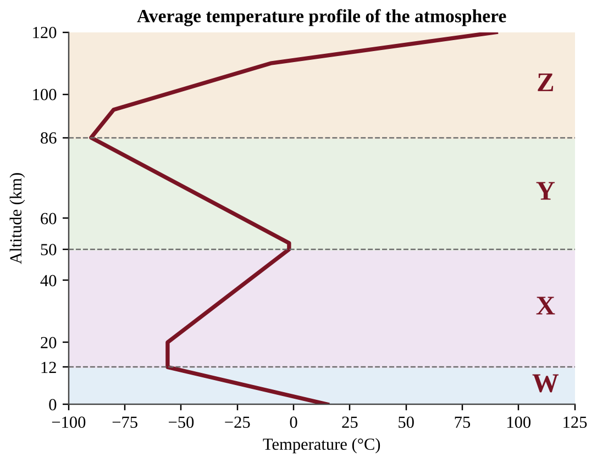
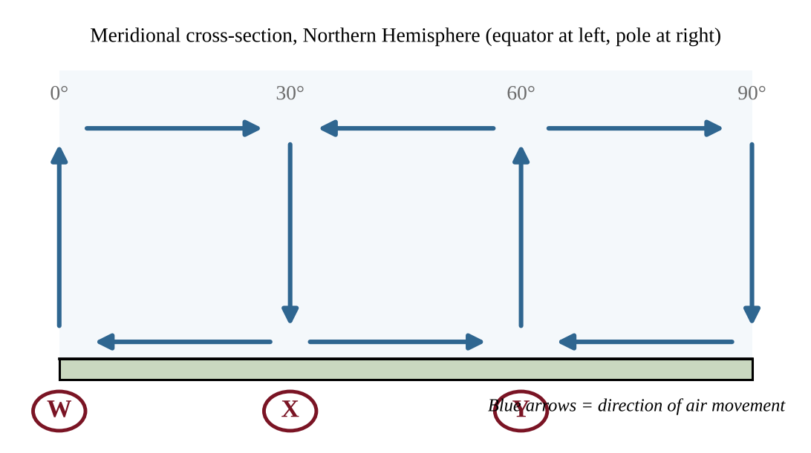
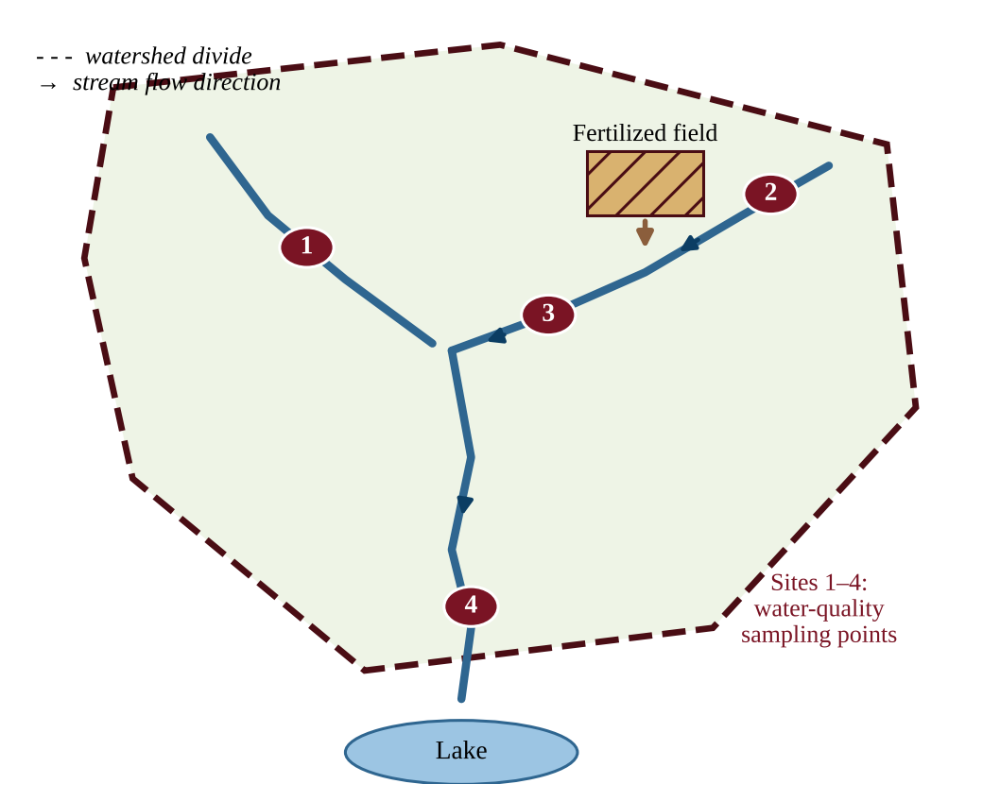
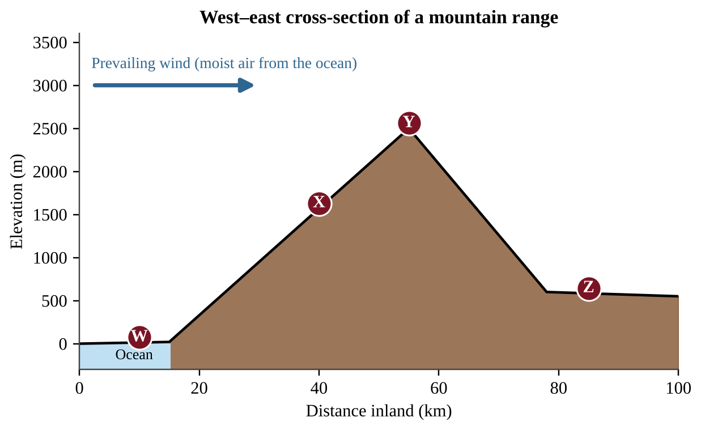
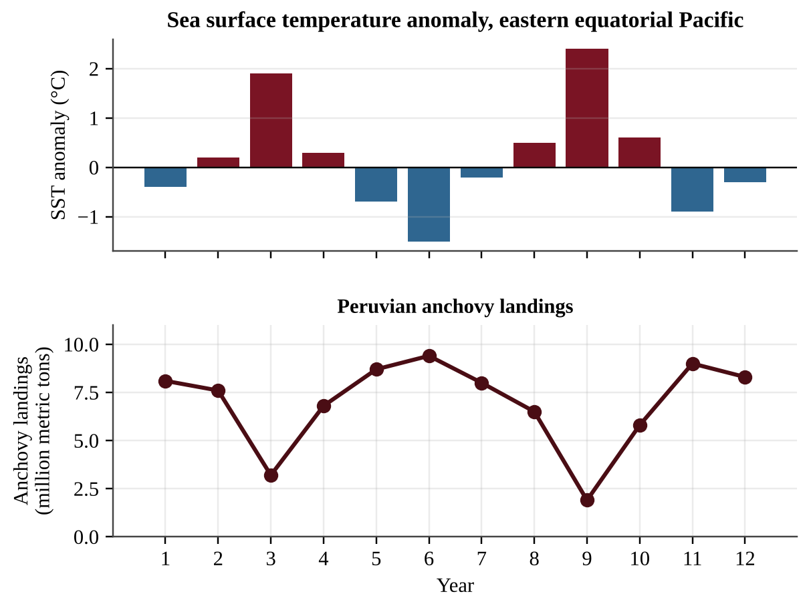
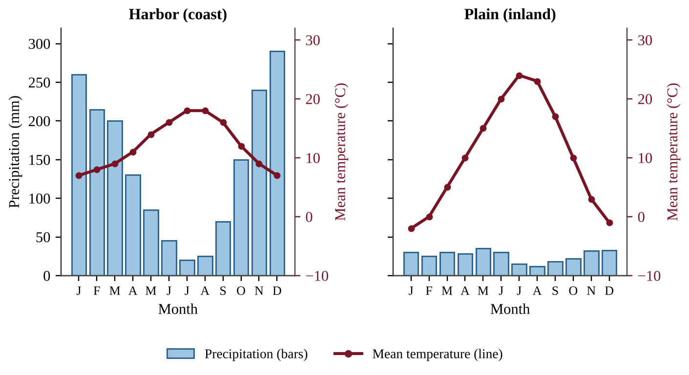

# Unit 4 — Earth Systems and Resources

:::box note
Exam weight: Unit 4 accounts for 10–15% of the AP Environmental Science exam score.
This set assesses plate tectonics, soil formation and properties, the atmosphere, global wind patterns, watersheds, solar radiation and seasons, geography and climate, and El Niño and La Niña (Topics 4.1–4.9).
It also tests how you read maps, soil profiles, graphs, and climatograms, and how you apply calculations; a calculator is allowed.
:::

## Section A — Multiple-Choice Questions

:::q QB-U4-MCQ001 | unit=4 | topic=4.1 | diff=1
Two oceanic plates converge, and the older, denser plate sinks beneath the other. Which landform is most likely to develop on the overriding plate?
A) A rift valley with new crust forming along its axis
B) A mid-ocean ridge running parallel to the boundary
C) A long transform fault that offsets the seafloor
D) A curved chain of volcanic islands (an island arc)
:::

:::q QB-U4-MCQ002 | unit=4 | topic=4.1 | diff=1
Which statement best describes how an earthquake occurs along a locked fault?
A) Rising magma fractures the crust, and the escaping gases make the ground shake along the fault.
B) The plates stop moving completely, and the stored thermal energy escapes as seismic waves.
C) The fault slips smoothly and continuously, so the stored energy is released at a steady rate.
D) Stress builds until it exceeds the strength of the fault, and the stored energy is released as the rocks slip.
:::

:::q QB-U4-MCQ003 | unit=4 | topic=4.2 | diff=1
Soils develop from parent material. Which of the following best describes parent material?
A) The rock or sediment that is weathered to form the mineral part of a soil
B) The dark surface layer of humus and partly decomposed leaves in the soil
C) The dissolved nutrients that plant roots take up from the soil water
D) The solid, unweathered bedrock that lies below every soil profile
:::

:::q QB-U4-MCQ004 | unit=4 | topic=4.2 | diff=1
Assume parent material, slope, and time are the same at four sites. At which site would soil form most rapidly?
A) A cold, dry site where water and biological activity are limited
B) A hot, arid site where rainfall is very low
C) A warm, humid site where chemical weathering and decomposition are fastest
D) A cold, wet site where water is present but frozen much of the year
:::

:::q QB-U4-MCQ005 | unit=4 | topic=4.2 | diff=1
How do soils help protect the quality of water that moves through them?
A) Soil changes every dissolved pollutant into harmless minerals, no matter how much is applied.
B) Soil particles and organisms filter, adsorb, and break down some contaminants as water percolates.
C) Soil prevents water from reaching groundwater, so pollutants cannot spread below the surface.
D) Soil increases surface runoff, which dilutes pollutants before they can enter streams.
:::

:::q QB-U4-MCQ006 | unit=4 | topic=4.3 | diff=1
Which soil particle class, when it dominates a soil, generally gives the highest permeability?
A) Sand, because its large particles leave large, well-connected pores
B) Silt, because its medium particles pack together loosely
C) Clay, because its many tiny pores add up to the largest passageways
D) Loam, because a mixture of particle sizes opens the widest channels
:::

:::q QB-U4-MCQ007 | unit=4 | topic=4.4 | diff=1
The table gives the approximate composition of dry air near Earth's surface, with the gases hidden as W, X, Y, and Z.

| Gas | Percent by volume |
|---|---|
| W | 78 |
| X | 21 |
| Y | 0.93 |
| Z | 0.04 |

Which identification of the four gases is correct?
A) W = oxygen, X = nitrogen, Y = argon, Z = carbon dioxide
B) W = nitrogen, X = oxygen, Y = argon, Z = carbon dioxide
C) W = nitrogen, X = oxygen, Y = carbon dioxide, Z = argon
D) W = nitrogen, X = argon, Y = oxygen, Z = carbon dioxide
:::

:::q QB-U4-MCQ008 | unit=4 | topic=4.4 | diff=1
Scientists divide the atmosphere into the troposphere, stratosphere, mesosphere, thermosphere, and exosphere. These layers are distinguished mainly by
A) large differences in the proportions of nitrogen and oxygen from layer to layer.
B) the altitude at which air pressure drops to zero.
C) the presence or absence of water vapor in the air.
D) reversals in the direction of temperature change with increasing altitude.
:::

:::q QB-U4-MCQ009 | unit=4 | topic=4.5 | diff=1
Winds do not blow in straight lines between the equator and the poles. Which factor causes moving air to be deflected to the right in the Northern Hemisphere?
A) Earth's rotation (the Coriolis effect)
B) Greater heating of land than of ocean
C) The Moon's gravitational pull on the atmosphere
D) The tilt of Earth's axis of rotation
:::

:::q QB-U4-MCQ010 | unit=4 | topic=4.6 | diff=1
A ridge of high ground that separates one watershed from the neighboring watershed is called a
A) floodplain.
B) divide.
C) delta.
D) recharge zone.
:::

:::q QB-U4-MCQ011 | unit=4 | topic=4.7 | diff=1
Which statement best explains why the Northern Hemisphere has warmer summers than winters?
A) In summer Earth is closer to the Sun than it is in winter, so it receives more energy.
B) The Sun gives off more energy in June than in December.
C) In summer the Northern Hemisphere is tilted toward the Sun, so it receives more direct sunlight and longer days.
D) Earth rotates faster in summer, so the Sun heats the surface more strongly.
:::

:::q QB-U4-MCQ012 | unit=4 | topic=4.8 | diff=1
A city on the leeward side of a mountain range that lies across the prevailing wind is much drier than a city on the windward side. Which explanation is best?
A) Air loses moisture as precipitation while rising and cooling on the windward side, then descends and warms on the leeward side.
B) Mountains absorb water vapor from the passing air, leaving little moisture for the leeward side.
C) Mountains block sunlight from the leeward side, which reduces evaporation and rainfall there.
D) Winds reverse direction at the crest, so no moist air from the ocean reaches the leeward side.
:::

:::q QB-U4-MCQ013 | unit=4 | topic=4.9 | diff=1
During an El Niño event, sea surface temperatures in the central and eastern tropical Pacific Ocean are
A) unusually cold.
B) close to average, while the Atlantic Ocean warms sharply.
C) unusually warm.
D) unusually warm only in the far western Pacific.
:::

:::q QB-U4-MCQ014 | unit=4 | topic=4.1 | diff=2

Plate Q is oceanic crust and Plate R is continental crust. Which statement best describes events along Boundary II?
A) Plates Q and R pull apart, forming a rift valley with new crust.
B) Plate Q sinks beneath Plate R, producing a trench, volcanoes, and earthquakes on Plate R.
C) Plates Q and R slide horizontally past each other, causing shallow earthquakes but no volcanoes.
D) Plate R sinks beneath Plate Q, producing volcanoes on the ocean floor.
:::

:::q QB-U4-MCQ015 | unit=4 | topic=4.1 | diff=2

Earthquakes in a coastal region occur at increasing depth with increasing distance inland from the trench. Which process best explains this pattern?
A) A mantle plume rises vertically beneath the trench and fractures the overlying rock.
B) Two plates slide horizontally past each other along a near-vertical fault.
C) A cool, dense oceanic plate descends into the mantle at an angle beneath the neighboring plate.
D) New crust forms along a ridge and pushes older crust inland.
:::

:::q QB-U4-MCQ016 | unit=4 | topic=4.2 | diff=2

The figure shows a soil profile with four horizons (W–Z) and the organic matter and clay content of each. Z contains fragments of partly weathered rock. Which horizon is most likely the subsoil (B horizon), where fine particles and dissolved minerals carried down from above accumulate?
A) Horizon Y, because it has the most clay and little organic matter
B) Horizon W, because it has the highest organic matter and lies closest to the surface
C) Horizon X, because it is the first layer below the surface and holds the most humus
D) Horizon Z, because it contains rock fragments and the lowest organic matter
:::

:::q QB-U4-MCQ017 | unit=4 | topic=4.3 | diff=2
A soil scientist tests four soil samples. The composition of each is given below and plotted on the soil texture triangle.

| Sample | Sand (%) | Silt (%) | Clay (%) |
|---|---|---|---|
| 1 | 80 | 10 | 10 |
| 2 | 40 | 40 | 20 |
| 3 | 15 | 25 | 60 |
| 4 | 20 | 65 | 15 |

Which sample would most likely have the greatest water-holding capacity and the lowest permeability?
A) Sample 1, because the large pores of sand hold the greatest amount of water
B) Sample 2, because loam balances all particle sizes and so holds the most water
C) Sample 4, because silt always has the smallest pores of any soil particle
D) Sample 3, because its high clay content gives tiny pores that hold water but pass it slowly
:::

:::q QB-U4-MCQ018 | unit=4 | topic=4.3 | diff=2
A clay soil can have more total pore space (porosity) than a sandy soil, yet water moves through the clay much more slowly. Which statement best explains this?
A) Clay particles are larger than sand particles and block the pores that sand leaves open.
B) Clay soils contain less water-holding capacity than sandy soils, so they fill with air.
C) The pores in sand are smaller than those in clay, so water is drawn out of sand more quickly.
D) The pores in clay are extremely small, so water is held tightly by adhesion and moves through slowly.
:::

:::q QB-U4-MCQ019 | unit=4 | topic=4.3 | diff=2
A student places 300 g of oven-dried soil in a funnel lined with filter paper above a graduated cylinder. She pours 200 mL of water onto each soil and measures the water that has drained into the cylinder after 15 minutes. Soil X drains 150 mL, and Soil Y drains 60 mL. Which conclusion is best supported?
A) Soil Y has the greater water-holding capacity: it retained about 140 mL, compared with about 50 mL for Soil X.
B) Soil X has the greater water-holding capacity, because 150 mL of water passed through it.
C) The soils have equal water-holding capacity, because the same 200 mL was added to each.
D) Soil X has the greater water-holding capacity, because it retained 150 mL and Soil Y retained 60 mL.
:::

:::q QB-U4-MCQ020 | unit=4 | topic=4.3 | diff=2
A ring pushed into the ground is filled with 40 mm of water. The water completely soaks into Field P in 16 minutes and into Field Q in 200 minutes. A storm delivers rain at 30 mm per hour. Assuming the infiltration rates stay constant, which prediction is correct?
A) Field P produces about 120 mm of runoff per hour, and Field Q absorbs all of the rain.
B) Both fields absorb all of the rain, because every soil infiltrates some water.
C) Field P absorbs all of the rain, and Field Q produces about 18 mm of runoff for each hour of rain.
D) Field Q produces about 30 mm of runoff per hour, because its infiltration is negligible.
:::

:::q QB-U4-MCQ021 | unit=4 | topic=4.3 | diff=2
A vegetable farm on a soil that is 80% sand irrigates once a week with a large application. Plants show water stress by day 5, and soil tests show water has moved below the root zone. Which change is most consistent with the properties of this soil?
A) Apply smaller amounts of water more often, because the soil has high permeability and low water-holding capacity.
B) Apply even larger amounts less often, so that sand pores fill and hold the water for the whole week.
C) Stop irrigating, because sandy soils have the greatest water-holding capacity of all soils.
D) Add more sand to the field, which will increase the volume of water the soil can hold.
:::

:::q QB-U4-MCQ022 | unit=4 | topic=4.4 | diff=2

In the figure, the layers are labeled W through Z from lowest to highest. In which layer does temperature increase with altitude mainly because ozone absorbs ultraviolet radiation?
A) Layer W
B) Layer X
C) Layer Y
D) Layer Z
:::

:::q QB-U4-MCQ023 | unit=4 | topic=4.5 | diff=2

Many of the world's major deserts lie near the latitude marked X. Which statement best explains this using the figure?
A) Air rises at this latitude, cooling and condensing, which produces heavy rainfall nearby.
B) Cold polar air spreads along the surface here and prevents evaporation from the land.
C) Air descends at this latitude, warming and becoming drier, which suppresses cloud formation and rainfall.
D) Strong westerly winds at the surface carry dry air from the ocean onto the land.
:::

:::q QB-U4-MCQ024 | unit=4 | topic=4.5 | diff=2
A sailor traveling at 15° N latitude finds that the surface wind blows steadily and gently from the same direction day after day. From which direction does it blow, and why?
A) From the southeast, because air flowing toward the equator is deflected to the left by Earth's rotation
B) From the northeast, because air flowing toward the equator is deflected to the right by Earth's rotation
C) From the northwest, because air flowing away from the equator is deflected to the right by Earth's rotation
D) From the southwest, because air flowing away from the equator is deflected to the left by Earth's rotation
:::

:::q QB-U4-MCQ025 | unit=4 | topic=4.5 | diff=2
The heaviest and most consistent rainfall on Earth occurs near the equator. Which explanation is best?
A) Cold, dense air sinks at the equator and releases its water vapor as it is compressed.
B) The Coriolis effect is strongest at the equator and spins the air into storm systems.
C) Trade winds are forced upward by coastal mountains that surround the equator.
D) Intense solar heating makes the air less dense, so it rises, cools, and condenses its water vapor.
:::

:::q QB-U4-MCQ026 | unit=4 | topic=4.6 | diff=2

Rain washes nitrate fertilizer from the field shown into the stream it borders. Assuming nitrate stays dissolved in the flowing water, which sites would most likely show elevated nitrate?
A) Sites 3 and 4 only
B) Sites 1, 3, and 4
C) Sites 2 and 3 only
D) Sites 1 and 2 only
:::

:::q QB-U4-MCQ027 | unit=4 | topic=4.6 | diff=2
Loggers clear-cut the forest on the steep, thin-soiled slopes of the upper part of a watershed, leaving bare soil. Which downstream change is most likely over the next several years?
A) Lower peak stream flows, because water spreads evenly across bare soil
B) Higher peak stream flows after storms and increased sediment (turbidity) in the stream
C) Cleaner, clearer stream water, because the soil is no longer disturbed by roots
D) Greater groundwater recharge, because bare soil absorbs more rain than forest soil
:::

:::q QB-U4-MCQ028 | unit=4 | topic=4.6 | diff=2
A watershed has an area of 250 km². It receives an average of 1,000 mm of precipitation per year, and 35% of the precipitation leaves the watershed as runoff in the river. What is the average annual runoff volume?
A) 8.8 × 10⁴ m³
B) 8.8 × 10⁷ m³
C) 2.5 × 10⁸ m³
D) 7.1 × 10⁸ m³
:::

:::q QB-U4-MCQ029 | unit=4 | topic=4.6 | diff=2
Two watersheds of equal area receive the same storm. Watershed R is mostly forest; Watershed U is mostly roofs and parking lots. The table shows the discharge of each stream at the outlet.

| Hours after storm began | 0 | 2 | 4 | 6 | 8 | 10 | 12 |
|---|---|---|---|---|---|---|---|
| Watershed R (m³/s) | 2 | 3 | 6 | 9 | 8 | 6 | 4 |
| Watershed U (m³/s) | 2 | 14 | 30 | 22 | 12 | 6 | 3 |

Which statement is best supported by the data?
A) Watershed U's peak was about 3 times higher than R's and came 2 hours earlier, consistent with less infiltration.
B) Watershed R had the higher peak discharge, because its forest soil released water more quickly than U's.
C) Both watersheds reached the same peak discharge, but Watershed U reached it later than R did.
D) Watershed U drained more slowly, because its discharge stayed above R's after 10 hours of the storm.
:::

:::q QB-U4-MCQ030 | unit=4 | topic=4.7 | diff=2

In the figure, the axis of Earth keeps the same direction in space throughout the orbit. Which position corresponds to the Northern Hemisphere summer solstice?
A) Position W
B) Position X
C) Position Y
D) Position Z
:::

:::q QB-U4-MCQ031 | unit=4 | topic=4.7 | diff=2
At the March equinox, why is the solar radiation received per square meter of surface lower at 60° N than at the equator, even at local noon?
A) Earth is much farther from the Sun at 60° N than it is at the equator.
B) At the equinox, daylight at 60° N lasts far fewer hours than daylight at the equator.
C) The Sun's rays strike at a more oblique angle, spreading the energy over a larger area and through more atmosphere.
D) Cooler air at 60° N reflects more of the incoming rays back into space.
:::

:::q QB-U4-MCQ032 | unit=4 | topic=4.7 | diff=2

Which interpretation of the graph is best supported?
A) City Q is closest to the equator because its day length changes the most, and City R is in the Northern Hemisphere.
B) City P is closest to the equator because its day length changes least, and City R is in the Southern Hemisphere because its longest days occur in December.
C) City P is closest to the equator because its day length is longest in June, and City Q is in the Southern Hemisphere.
D) City R is closest to the equator because its day length is greatest, and City P is near the pole.
:::

:::q QB-U4-MCQ033 | unit=4 | topic=4.8 | diff=2

Annual precipitation at the four stations is given below.

| Station | Elevation (m) | Annual precipitation (mm) |
|---|---|---|
| W | 20 | 900 |
| X | 1,570 | 2,300 |
| Y | 2,500 | 1,700 |
| Z | 590 | 350 |

Which interpretation of the data is best supported?
A) Precipitation decreases steadily with distance from the ocean, so the mountains have little effect on the pattern.
B) Station Z is dry because it is at lower elevation than Station Y, and low elevations always receive less rain.
C) Station X is wet because moist air sinks and warms on the windward slope.
D) Rising air on the windward side loses moisture, and the descending air at Z is warmer and drier, producing a rain shadow.
:::

:::q QB-U4-MCQ034 | unit=4 | topic=4.8 | diff=2
Two cities are at the same latitude and elevation in the middle latitudes. City A is on the coast and has an annual temperature range of 8°C. City B is 500 km inland and has an annual temperature range of 28°C. Which statement best explains the difference?
A) Ocean air is always warmer than air over land, so City A is warmer all year.
B) City B receives more intense solar radiation because it is farther from the ocean.
C) Sea breezes blow at City A only in winter, which keeps winter temperatures high.
D) Water heats and cools more slowly than land, so air over the ocean moderates City A's temperatures.
:::

:::q QB-U4-MCQ035 | unit=4 | topic=4.9 | diff=2
Peru's anchovy fishery is monitored along with Pacific sea surface temperature (SST).

| Year | SST anomaly in the eastern Pacific (°C) | Anchovy landings (million metric tons) |
|---|---|---|
| 1 | −0.3 | 8.4 |
| 2 | +0.1 | 8.1 |
| 3 | +2.3 | 2.6 |
| 4 | +0.4 | 6.9 |
| 5 | −1.2 | 9.3 |

Which statement best explains the landings in Year 3?
A) Warm water deepened the warm surface layer and weakened upwelling, so fewer nutrients reached the phytoplankton.
B) Warm water holds more dissolved oxygen, which caused the anchovies to leave the coastal waters.
C) Stronger trade winds increased upwelling, which scattered the anchovy schools across the open Pacific.
D) Colder water in Year 3 killed the anchovies directly, so landings fell sharply.
:::

:::q QB-U4-MCQ036 | unit=4 | topic=4.1 | diff=3
A volcanic island chain forms as a plate moves over a stationary hot spot. The table shows the distance of three extinct volcanic islands from the active volcano above the hot spot and the age of each.

| Island | Distance from active hot spot (km) | Age (millions of years) |
|---|---|---|
| B | 300 | 6.0 |
| C | 750 | 15 |
| D | 1,250 | 25 |

An island lies 1,600 km from the hot spot along the same chain. Which choice gives the plate's speed and the predicted age of this island?
A) 0.5 cm/yr; 320 million years
B) 5 cm/yr; 32 million years
C) 5 cm/yr; 320 million years
D) 50 cm/yr; 3.2 million years
:::

:::q QB-U4-MCQ037 | unit=4 | topic=4.1 | diff=3
A mountain range of tall, folded peaks lies where two continental plates are colliding. The region has frequent earthquakes but no active volcanoes. Which explanation is best?
A) One plate subducts deeply, but its magma cools before it can reach the surface.
B) The plates slide past each other, so crust is neither compressed nor destroyed.
C) Neither continental plate is dense enough to subduct, so the crust thickens instead of melting.
D) The plates are moving apart, so pressure on the underlying mantle is released.
:::

:::q QB-U4-MCQ038 | unit=4 | topic=4.2 | diff=3
A student wants to test whether grass cover reduces soil erosion. She prepares two trays of the same soil. Tray 1 has bare soil on a 10° slope. Tray 2 has grass sod on a 25° slope. She applies simulated rain from the same sprinkler for 5 minutes and measures the dry mass of sediment collected from each tray. Tray 2 loses much less sediment. Which change would most improve the validity of her conclusion about grass cover?
A) Apply rain to the grass tray for twice as long so the test is more rigorous
B) Measure only the volume of runoff from each tray and ignore the sediment
C) Replace the bare soil in Tray 1 with sand so that the soils are different
D) Set both trays at the same slope so that ground cover is the only difference between them
:::

:::q QB-U4-MCQ039 | unit=4 | topic=4.4 | diff=3
Large volcanic eruptions and high-flying aircraft can place particles in the lower stratosphere. These particles generally remain in the air far longer than particles released into the troposphere. Which statement best explains this?
A) Temperature rises with altitude in the stratosphere, so the layer is stable with little mixing, and little precipitation removes particles.
B) The stratosphere has more water vapor than the troposphere, and the water vapor holds the particles aloft for years.
C) Strong convection currents in the stratosphere keep the particles suspended for years at a time.
D) Gravity is much weaker in the stratosphere, so particles fall far more slowly than in the troposphere.
:::

:::q QB-U4-MCQ040 | unit=4 | topic=4.5 | diff=3
Imagine Earth stopped rotating but kept the same uneven heating by the Sun (greatest at the equator). Which statement best describes the expected surface winds in the Northern Hemisphere?
A) The same three-cell pattern as today, including the northeast trade winds and westerlies
B) Surface winds blowing from the equator straight toward the pole in each hemisphere
C) No steady winds at all, because the Sun would heat every place equally
D) One cell in the hemisphere, with surface winds blowing from the pole straight toward the equator
:::

:::q QB-U4-MCQ041 | unit=4 | topic=4.7 | diff=3
The intensity of sunlight on a horizontal surface at noon is proportional to cos z, where z is the angle between the Sun's rays and the vertical. At noon on the June solstice the Sun is directly overhead at 23.5° N, and at noon on the December solstice it is directly overhead at 23.5° S. Approximately how many times greater is the noon intensity of sunlight on a horizontal surface at 40° N on the June solstice than on the December solstice?
A) 0.47
B) 1.3
C) 2.1
D) 3.8
:::

:::q QB-U4-MCQ042 | unit=4 | topic=4.8 | diff=3
City P is on the west coast and City Q is on the east coast of the same mid-latitude continent. Both are at 45° N and at sea level.

| City | Mean January temperature (°C) | Mean July temperature (°C) |
|---|---|---|
| P | 4 | 17 |
| Q | −8 | 22 |

Which explanation best accounts for the difference in temperature range?
A) City P is closer to the equator and therefore receives more solar radiation throughout the year.
B) Trade winds bring warm tropical air to City P in winter but never reach City Q at all.
C) Prevailing westerlies bring ocean-moderated air to City P, while City Q receives air that crossed the continent.
D) City Q lies in a rain shadow, which makes its winters colder and its summers warmer.
:::

:::q QB-U4-MCQ043 | unit=4 | topic=4.9 | diff=3
The table shows conditions during four years. Rainfall is given as a percentage of the long-term average.

| Year | Eastern Pacific SST anomaly (°C) | Northern Peru coast rainfall (%) | Indonesia rainfall (%) |
|---|---|---|---|
| W | +2.1 | 380 | 62 |
| X | −1.6 | 35 | 135 |
| Y | +0.1 | 105 | 98 |
| Z | +0.9 | 190 | 80 |

Which year is most consistent with a strong La Niña?
A) Year W
B) Year X
C) Year Y
D) Year Z
:::

:::q QB-U4-MCQ044 | unit=4 | topic=4.9 | diff=3
Which sequence best describes the development of an El Niño event?
A) Trade winds strengthen → warm water piles up in the western Pacific → upwelling off South America increases → eastern Pacific cools
B) Upwelling off South America increases → surface water cools → trade winds weaken → warm water spreads eastward
C) Trade winds weaken → warm surface water spreads eastward → upwelling off South America declines → rainfall shifts toward the central and eastern Pacific
D) Warm water spreads eastward → trade winds strengthen → upwelling off South America increases → rainfall shifts west
:::

## Section B — Free-Response Questions

:::q QB-U4-FRQ001 | unit=4 | topic=4.2 | diff=2 | frqtype=1 | pts=10
Growers manage an apple orchard on a hillside above a stream. After heavy rains the stream runs muddy, and the growers suspect that soil is washing off the orchard rows, where the soil between the trees is kept bare by tilling. A grower proposes planting a perennial grass cover between the tree rows to reduce erosion. The orchard has four blocks, all planted in the same year with the same tree variety. The slope and soil texture of each block are shown below. The growers can install identical sediment traps at the downhill edge of any block and can measure rainfall with a rain gauge.

{w=0.8}

(a) Identify the environmental problem that the growers are trying to address. [1]
(b) Write a testable hypothesis, in if–then form, that predicts how a grass cover will affect soil loss from the orchard. [1]
(c) Identify the independent variable and the dependent variable in the investigation. [2]
(d) Identify the two blocks that should be used to test the hypothesis, and explain why you chose them. [2]
(e) Describe a procedure for the investigation. Include how the treatments will be applied, how soil loss will be measured, and how the reliability of the results will be improved. [2]
(f) Describe the pattern of results that would support the hypothesis. [1]
(g) Propose one additional practice, other than grass cover between rows, that the growers could use to reduce soil loss from the orchard, and justify your proposal. [1]
:::

:::q QB-U4-FRQ002 | unit=4 | topic=4.9 | diff=2 | frqtype=2 | pts=10
Along the coast of Peru, cold, nutrient-rich water normally rises (upwelling) near the shore and supports a large fishery for anchovies. A research team monitored the sea surface temperature (SST) anomaly in the eastern equatorial Pacific (the difference from the long-term average), annual anchovy landings, and January–March rainfall in northern Peru for 12 years. The figure shows the SST anomaly and landings, and the table gives all of the data.

{w=0.8}

| Year | SST anomaly (°C) | Anchovy landings (million metric tons) | Northern Peru rainfall (mm) |
|---|---|---|---|
| 1 | −0.4 | 8.1 | 110 |
| 2 | +0.2 | 7.6 | 140 |
| 3 | +1.9 | 3.2 | 640 |
| 4 | +0.3 | 6.8 | 160 |
| 5 | −0.7 | 8.7 | 70 |
| 6 | −1.5 | 9.4 | 40 |
| 7 | −0.2 | 8.0 | 105 |
| 8 | +0.5 | 6.5 | 220 |
| 9 | +2.4 | 1.9 | 910 |
| 10 | +0.6 | 5.8 | 260 |
| 11 | −0.9 | 9.0 | 60 |
| 12 | −0.3 | 8.3 | 95 |

For this question, a year is classified as an El Niño year if the SST anomaly is +1.0°C or greater and as a La Niña year if the anomaly is −0.5°C or less.

(a) Identify the years that are El Niño years and the years that are La Niña years. [1]
(b) Calculate the mean anchovy landings for the El Niño years and for the La Niña years. Show your work. [2]
(c) Calculate the percent decrease from the mean landings in La Niña years to the mean landings in El Niño years. [1]
(d) Explain, in terms of ocean processes, why anchovy landings are lower in El Niño years. [2]
(e) Describe the effect of El Niño on rainfall in northern Peru shown by the data, and explain one atmospheric or ocean cause of that effect. [2]
(f) Propose one solution that a fishing community could use to reduce its economic risk during El Niño years. [1]
(g) Make a claim about which El Niño event, Year 3 or Year 9, was stronger, and justify your claim with two types of data from the table. [1]
:::

:::q QB-U4-FRQ003 | unit=4 | topic=4.6 | diff=3 | frqtype=3 | pts=10
Kestrel Creek drains a watershed with an area of 180 km². The watershed receives an average of 1,100 mm of precipitation per year, and 40% of the precipitation leaves the watershed as runoff in Kestrel Creek. Monitoring shows that the creek carries an average suspended sediment concentration of 150 mg/L. Cropland covers 30% of the watershed, and you may assume that all of the sediment in the creek comes from erosion of the cropland. The soil on the cropland has a bulk density of 1.3 metric tons per cubic meter (1.3 t/m³), and soil forms on the cropland at an average rate of 0.05 mm per year.

Use these conversions as needed: 1 km² = 10⁶ m²; 1 m³ = 1,000 L; 1 metric ton = 10⁹ mg; 1 year = 3.15 × 10⁷ s.

(a) Calculate the volume of runoff, in cubic meters, that flows out of the watershed in one year. Show your work. [2]
(b) Calculate the average discharge of Kestrel Creek in cubic meters per second. Show your work. [2]
(c) Calculate the mass of sediment, in metric tons, carried by the creek in one year. Show your work. [2]
(d) Calculate the average depth, in millimeters, of soil lost from the cropland in one year. Show your work. [2]
(e) Justify whether the rate of soil loss on the cropland is sustainable, using your answer to part (d). [1]
(f) Propose one action that farmers in the watershed could take to reduce the amount of sediment entering the creek. [1]
:::

:::q QB-U4-FRQ004 | unit=4 | topic=4.8 | diff=3 | frqtype=2 | pts=10
Harbor is a coastal city and Plain is a city 150 km inland, on the opposite side of a mountain range. Both cities are at about 45° N latitude. The prevailing wind carries air from the ocean toward the land. The figure shows a climatogram for each city, and the table gives the data.

| Month | J | F | M | A | M | J | J | A | S | O | N | D |
|---|---|---|---|---|---|---|---|---|---|---|---|---|
| Harbor precipitation (mm) | 260 | 215 | 200 | 130 | 85 | 45 | 20 | 25 | 70 | 150 | 240 | 290 |
| Plain precipitation (mm) | 30 | 25 | 30 | 28 | 35 | 30 | 15 | 12 | 18 | 22 | 32 | 33 |
| Harbor temperature (°C) | 7 | 8 | 9 | 11 | 14 | 16 | 18 | 18 | 16 | 12 | 9 | 7 |
| Plain temperature (°C) | −2 | 0 | 5 | 10 | 15 | 20 | 24 | 23 | 17 | 10 | 3 | −1 |

(a) Describe two differences between the climate of Harbor and the climate of Plain shown by the climatograms. [2]
(b) Calculate the percent by which the annual precipitation at Plain is less than the annual precipitation at Harbor. Show your work. [2]
(c) Explain, in terms of the movement of air over the mountain range, why Plain receives much less precipitation than Harbor. [2]
(d) Explain why the annual temperature range at Plain is greater than that at Harbor. [2]
(e) Identify the global wind pattern that carries air from the ocean toward the land at 45° N latitude. [1]
(f) Propose one solution that farmers at Plain could use to cope with the low precipitation. [1]
:::
