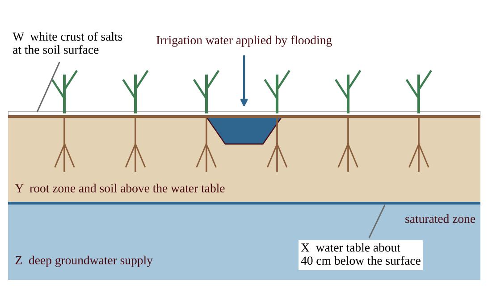
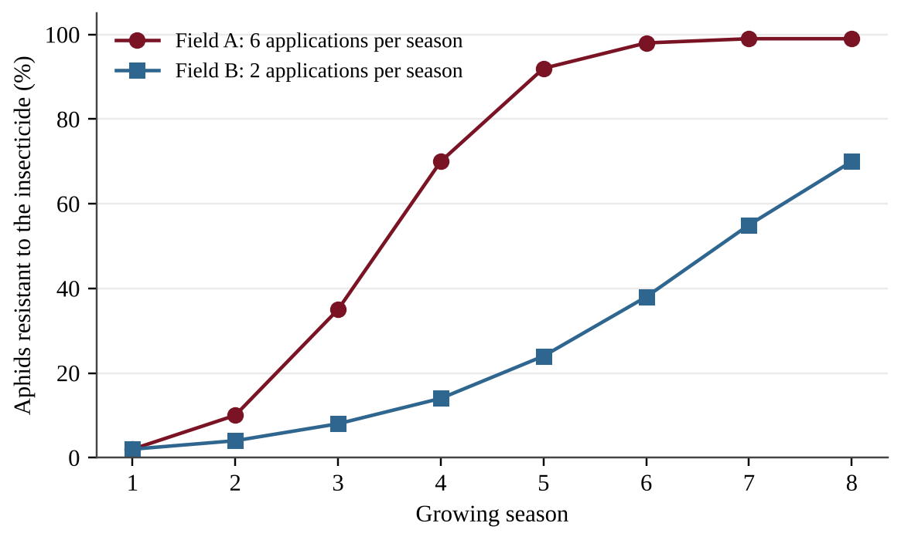
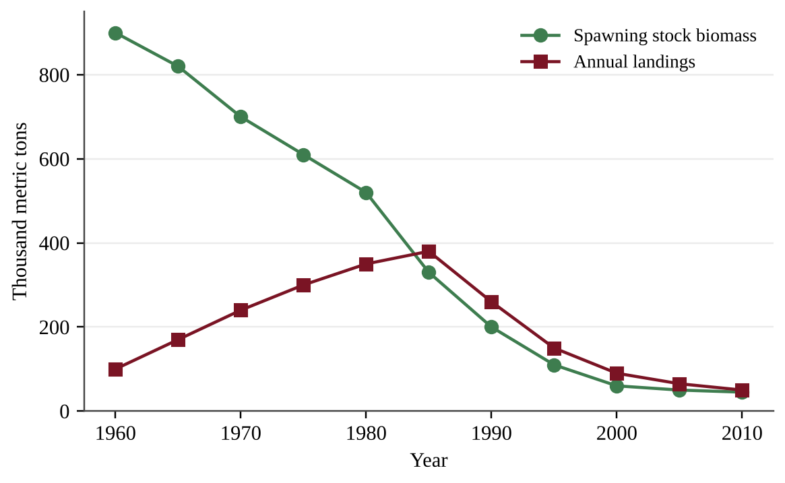
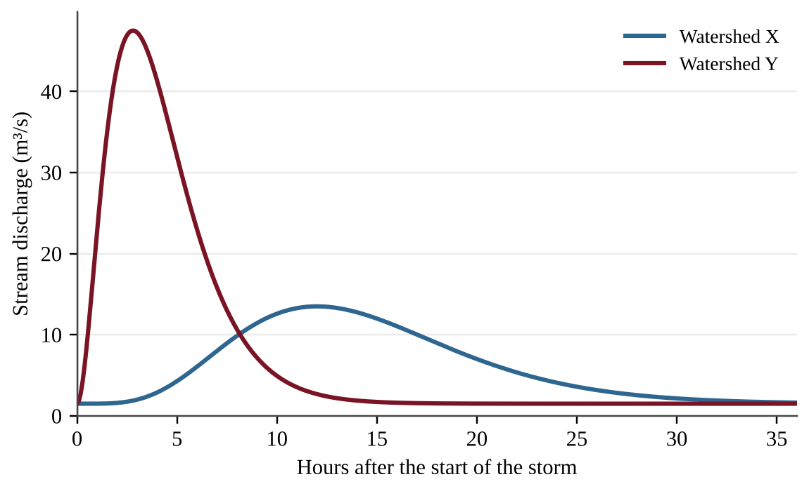
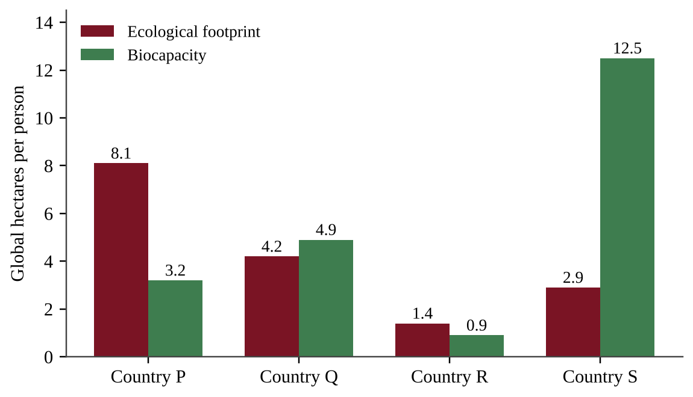
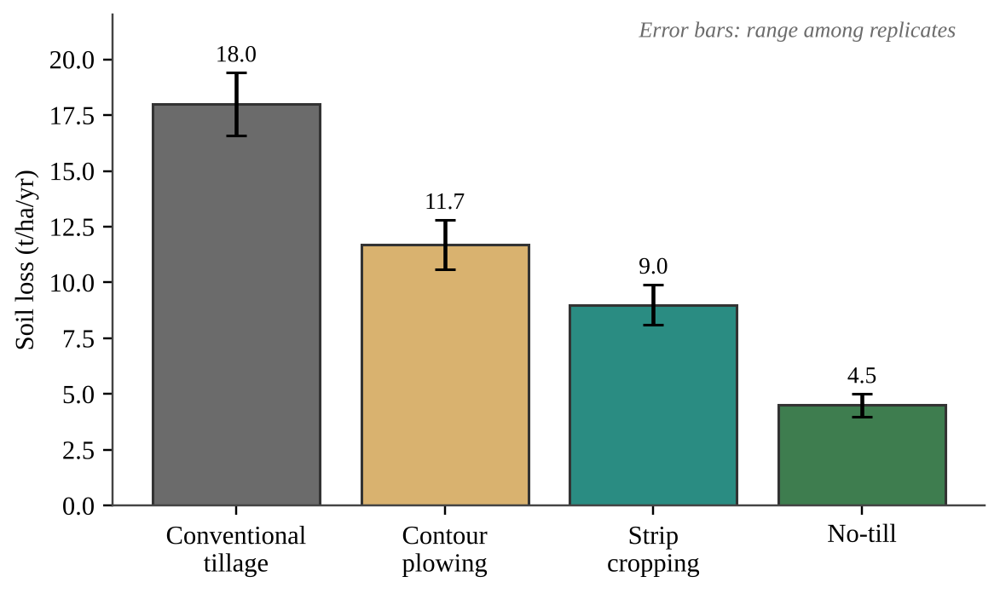
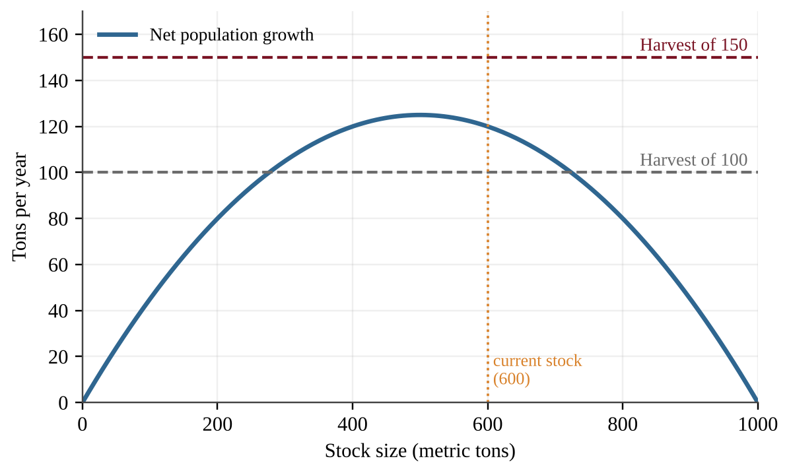
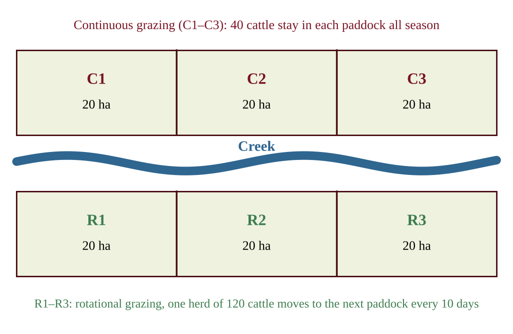
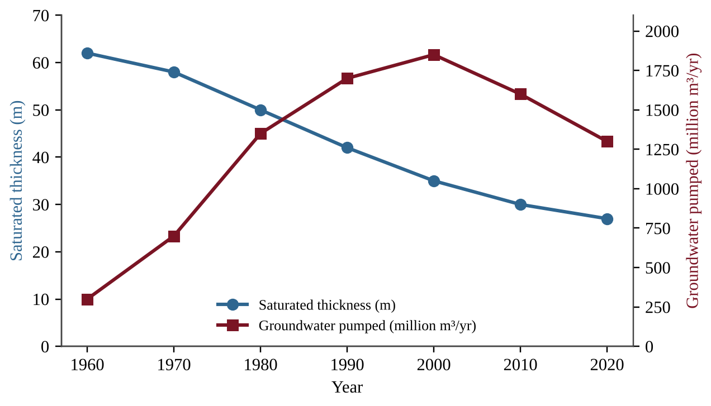

# Unit 5 — Land and Water Use

:::box note
Exam weight: Unit 5 accounts for 10–15% of the AP Environmental Science exam score (about 8–12 of the 80 multiple-choice questions and parts of the free-response questions).
This section assesses how humans use land and water (agriculture, irrigation, pest control, meat production, fishing, mining, urbanization, and forestry), ecological footprints, and the sustainable practices that reduce those impacts.
Skills practiced: explaining processes, analyzing data and graphs, doing calculations, evaluating experimental designs, and proposing and justifying solutions.
:::

## Section A — Multiple-Choice Questions

Choose the single best answer for each question.

:::q QB-U5-MCQ001 | unit=5 | topic=5.1 | diff=1
A coastal village's families all graze goats on one shared, unfenced pasture with no rules. Each family gains the full benefit of adding a goat but shares the cost of a more damaged pasture with everyone else. Which outcome does the tragedy of the commons predict?
A) Each family acts in its own self-interest, herds keep growing, and the shared pasture is depleted.
B) Families notice the damage and spontaneously agree to reduce their herds, so the shared pasture stays productive.
C) Manure from the added goats raises pasture growth enough to support unlimited herd expansion.
D) Depletion occurs only if a single family owns the entire pasture.
:::

:::q QB-U5-MCQ002 | unit=5 | topic=5.2 | diff=1
A steep forested hillside above a trout stream is clearcut. Which set of changes is most likely?
A) Bare soil absorbs more rain than the forest floor did, so infiltration rises sharply and the risk of downstream flooding falls.
B) Loss of canopy and roots increases soil erosion and runoff, and the stream becomes warmer and more prone to flooding.
C) More sunlight reaches the stream and cools it, while sediment input to the stream decreases.
D) Erosion declines because exposed soil quickly forms a protective crust that holds it in place.
:::

:::q QB-U5-MCQ003 | unit=5 | topic=5.4 | diff=1
Which agricultural practice most directly increases the risk of soil erosion by wind and water?
A) Repeated tilling that leaves loosened, bare soil between crops
B) Planting a perennial grass strip along the contour of a slope above the field
C) Leaving crop residue on the field surface after harvest
D) Planting rows of trees along the edges of a field
:::

:::q QB-U5-MCQ004 | unit=5 | topic=5.5 | diff=1
Approximately what share of human freshwater consumption worldwide is used for agriculture?
A) About 7%
B) About 30%
C) About 50%
D) About 70%
:::

:::q QB-U5-MCQ005 | unit=5 | topic=5.6 | diff=1
A cotton grower sprays the same insecticide on every field each week. After several years the spray kills far fewer aphids. Which is the best explanation?
A) Aphids with genetic resistance survived each spraying and reproduced, so resistant aphids became a larger share of the population.
B) Individual aphids gradually developed tolerance during their lives, and they passed that tolerance on to their offspring as they reproduced.
C) The insecticide caused the aphids to mutate in ways that made them resistant.
D) Aphids learned to avoid sprayed leaves, so fewer of them were exposed.
:::

:::q QB-U5-MCQ006 | unit=5 | topic=5.7 | diff=1
Beef cattle are kept in crowded pens, fed grain and soy, and produce large amounts of manure in a small area. Compared with rotational grazing, this system is more likely to
A) use more land per animal, which raises the cost of meat to consumers.
B) eliminate the need for antibiotics because disease cannot easily spread among animals that are kept in confinement.
C) lower the cost of meat to consumers but risk contaminating nearby waterways with manure and antibiotics.
D) reduce nutrient pollution because manure is spread evenly over large pastures.
:::

:::q QB-U5-MCQ007 | unit=5 | topic=5.8 | diff=1
Which is a likely consequence of overfishing a commercially important fish species?
A) Higher genetic diversity within the fish population as the number of fish falls
B) Increased catch per unit of fishing effort over time as the fish become easier to find
C) Reduced biodiversity in the aquatic system and economic hardship for fishing communities
D) Faster recovery of the stock because fewer fish compete for food
:::

:::q QB-U5-MCQ008 | unit=5 | topic=5.9 | diff=1
In surface mining, what is overburden?
A) Waste material left after the minerals are separated from the ore
B) Glassy waste produced when metal is smelted from ore
C) The valuable mineral deposit that the mine is trying to extract
D) Soil and rock removed to reach the ore beneath
:::

:::q QB-U5-MCQ009 | unit=5 | topic=5.10 | diff=1
A meadow is replaced by a large shopping-center parking lot. Which change in the local water cycle is most likely?
A) More infiltration and groundwater recharge because the pavement stores water and releases it slowly
B) More evapotranspiration, which lowers the risk of downstream flooding
C) No change in runoff because the same amount of rain falls on the site
D) Less infiltration and more surface runoff, which raises the risk of flooding downstream
:::

:::q QB-U5-MCQ010 | unit=5 | topic=5.11 | diff=1
Which statement describes what an ecological footprint compares?
A) The resources a person or society uses and the waste it produces, compared with what the environment can supply and absorb
B) The number of people living in a country, compared with the land area of that country
C) The amount of renewable energy generated per person, compared with the fossil fuel energy used
D) The number of species lost per year in a region, compared with the number present before
:::

:::q QB-U5-MCQ011 | unit=5 | topic=5.13 | diff=1
Which change to a city's parking lots would most directly increase water infiltration?
A) Replacing asphalt with permeable pavement and planting trees in the lot
B) Installing larger storm drains to carry the runoff to the nearest stream faster
C) Lining drainage ditches with concrete
D) Paving over grass medians to reduce maintenance
:::

:::q QB-U5-MCQ012 | unit=5 | topic=5.14 | diff=1
Which statement best describes integrated pest management (IPM)?
A) Spraying a broad-spectrum pesticide on a fixed schedule regardless of how many pests are present or how large their natural enemy populations are
B) A combination of biological, physical, and limited chemical methods that controls pests with minimal harm to the environment
C) Eliminating every pest organism in a field using chemical methods alone
D) Planting a single crop over a large area to simplify pest control
:::

:::q QB-U5-MCQ013 | unit=5 | topic=5.15 | diff=1
A farmer wants to reduce water erosion on a steep, sloping field. Which practice is best?
A) Plowing in straight rows up and down the slope
B) Leaving the soil bare between growing seasons so that it dries
C) Removing perennial plants from the field edges to expand the planted area
D) Terracing the slope and plowing along the contour lines
:::

:::q QB-U5-MCQ014 | unit=5 | topic=5.1 | diff=2
Which situation is the best example of the tragedy of the commons?
A) A landowner clear-cuts her own woodlot for quick income, then regrets the lost timber and the topsoil that washed off the slope afterward.
B) A water district assigns household quotas during a drought, and the reservoir recovers.
C) A fishing cooperative sets a harvest quota for its own lake, and every member follows it.
D) Fishing fleets from several countries each catch as much as they can from a stock in open international waters until it collapses.
:::

:::q QB-U5-MCQ015 | unit=5 | topic=5.2 | diff=2
A forest stores 150 metric tons of carbon per hectare in its trees. A 50-ha stand is clearcut and burned, and 60% of the stored carbon is released to the atmosphere as CO₂. About how many metric tons of CO₂ are released? (Molar masses: C = 12 g/mol; CO₂ = 44 g/mol.)
A) 1.2 × 10³
B) 4.5 × 10³
C) 1.65 × 10⁴
D) 2.75 × 10⁴
:::

:::q QB-U5-MCQ016 | unit=5 | topic=5.3 | diff=2
The Green Revolution began a major shift in agriculture in the mid-1900s. Which statement best describes it?
A) It raised yields mainly by cutting back fertilizer and irrigation, which lowered the energy needed to farm and kept food prices low for consumers throughout the developing world.
B) It replaced machinery with draft animals, which reduced dependence on fossil fuels.
C) It increased food production through high-yield crops, fertilizer, irrigation, pesticides, and mechanization, but raised reliance on fossil fuels.
D) It promoted traditional polyculture on small plots, which lowered yields but also lowered costs.
:::

:::q QB-U5-MCQ017 | unit=5 | topic=5.3 | diff=2
The table shows changes on farms in one region after they adopted Green Revolution methods.

| Measure | 1965 | 1995 |
|---|---|---|
| Wheat yield (t/ha) | 1.2 | 3.1 |
| Nitrogen fertilizer applied (kg/ha) | 5 | 60 |
| Irrigated share of cropland (%) | 20 | 85 |
| Tractors per 1,000 ha | 2 | 14 |

Which conclusion is best supported by the table?
A) Higher yields came with much greater use of fertilizer, irrigation, and machinery, so the farms became more dependent on inputs.
B) Yield rose faster than fertilizer use, so fertilizer was not important to the yield gain.
C) Production increased without any increase in the use of irrigation water.
D) Mechanization reduced the number of tractors needed per 1,000 ha of cropland, which cut fossil fuel use on the farms and across the region.
:::

:::q QB-U5-MCQ018 | unit=5 | topic=5.4 | diff=2
Farmers in a tropical forest region cut and burn patches of forest, grow crops on each patch for two or three years, and then move to a new patch. Which statement best describes the environmental effects of this practice?
A) Burning permanently raises soil fertility because the nutrients in the ash stay bound in the soil for decades after the fire.
B) Burning adds no CO₂ to the atmosphere because the carbon in the trees returns to the soil.
C) Removing the forest reduces erosion because crops intercept rain better than a forest canopy does.
D) Burning releases CO₂ and gives a short-term pulse of nutrients from ash, but the nutrients are soon lost or used up.
:::

:::q QB-U5-MCQ019 | unit=5 | topic=5.5 | diff=2
The figure shows a cross-section of a flood-irrigated field in an arid valley after 25 years of irrigation with pumped groundwater. Farmers report declining yields, and some plants have wilted in the wet soil.

Which pair of processes does the figure illustrate?
A) Salinization from salty rainfall, and waterlogging from a water table that has dropped far below the roots
B) Eutrophication from fertilizer runoff, and desertification from overgrazing
C) Saltwater intrusion from coastal pumping, and soil compaction from heavy machinery
D) Salinization from salts left behind as irrigation water evaporates, and waterlogging from a water table that has risen into the root zone
:::

:::q QB-U5-MCQ020 | unit=5 | topic=5.5 | diff=2
A grower irrigates 25 ha of crops by furrow irrigation, in which about one-third of the applied water is lost to evaporation and runoff. The crop needs 6,000 m³ of water per hectare delivered to its roots. If the grower switches to drip irrigation, in which about 5% of the applied water is lost, how much less water in total must be applied?
A) 7.5 × 10⁴ m³
B) 6.7 × 10⁴ m³
C) 4.3 × 10⁴ m³
D) 7.5 × 10³ m³
:::

:::q QB-U5-MCQ021 | unit=5 | topic=5.5 | diff=2
Which statement about irrigation methods is accurate?
A) Spray irrigation loses about one-third of the water and needs no energy to operate.
B) Furrow irrigation is the most efficient method, losing only about 5% of the water.
C) Drip irrigation is inexpensive to install, which is why it is the most widely used method worldwide.
D) Flood irrigation loses about 20% of the water to evaporation and runoff and can cause waterlogging.
:::

:::q QB-U5-MCQ022 | unit=5 | topic=5.6 | diff=2
Two cotton fields infested with aphids were treated with the same insecticide for eight growing seasons. The graph shows the percentage of aphids resistant to the insecticide in each field.

Which conclusion is best supported by the graph?
A) The insecticide caused new resistance mutations to appear in Field A, but it did not do so in Field B.
B) Resistance develops only in fields that are sprayed more than four times per season.
C) The aphids in Field B are not evolving at all, because their resistant share stays below 100% in every season.
D) More frequent applications imposed stronger selection, so resistant aphids dominated sooner in Field A.
:::

:::q QB-U5-MCQ023 | unit=5 | topic=5.6 | diff=2
A region plants one genetically engineered, pest-resistant variety of corn on nearly all of its cropland. Which statement about this practice is most accurate?
A) Planting a single variety reduces the crop's genetic diversity, which could leave the whole region vulnerable to a new disease or pest.
B) The engineered trait guarantees that the targeted pest species will never evolve resistance, even after many years of exposure to the crop.
C) Genetically engineered crops can be grown only with more synthetic fertilizer, so yields soon collapse.
D) Planting one variety increases the crop's genetic diversity because the trait is spread to every field.
:::

:::q QB-U5-MCQ024 | unit=5 | topic=5.7 | diff=2
A semi-arid rangeland carries about twice as many cattle as its vegetation can regrow to support. Bare patches, gullies, and compacted soil are spreading. Which action would best slow desertification there?
A) Reduce the herd to the land's carrying capacity and rotate the cattle among rested pastures.
B) Add more cattle so that hooves break the soil crust and plant seeds.
C) Irrigate the pastures heavily with pumped groundwater to keep plants growing through every dry season.
D) Remove the fences so that animals graze wherever the forage is greenest.
:::

:::q QB-U5-MCQ025 | unit=5 | topic=5.8 | diff=2
The graph shows annual landings and spawning stock biomass for a fishery. The number of fishing vessels doubled between 1960 and 1985, and vessels added sonar to locate schools of fish.

Which interpretation of the graph is best supported?
A) Greater fishing effort and technology kept landings high for years while the stock shrank; then landings collapsed.
B) Rising landings through 1985 show that the stock was increasing in size, so no management action was needed at that time.
C) Landings fell after 1985 because fishing effort decreased, which let the stock rebuild.
D) Landings and stock biomass changed independently, so fishing had little effect on the stock.
:::

:::q QB-U5-MCQ026 | unit=5 | topic=5.9 | diff=2
As the most accessible coal seams are exhausted, a mining company shifts from surface mining to deeper subsurface mining. Which result is most likely?
A) A lower cost per ton, because no overburden has to be removed to reach seams that lie deep underground
B) A complete end to methane release from the coal
C) A higher cost of extracting each ton of coal because the remaining reserves are harder to reach
D) A larger supply of low-cost coal available to consumers
:::

:::q QB-U5-MCQ027 | unit=5 | topic=5.10 | diff=2
Two watersheds of similar size and soil received the same storm. One is 8% covered by impervious surfaces; the other is 62% impervious. The graph shows stream discharge in each.

Which statement is best supported?
A) Watershed X is the more urbanized; its slower rise shows that water moves across the pavement more slowly than through soil.
B) Watershed Y is the more urbanized; reduced infiltration sends runoff to the stream faster, giving a higher, earlier peak.
C) Watershed Y is the more urbanized; its higher peak shows that more rain fell on it.
D) Watershed X is the more urbanized; its lower peak shows that storm drains stored most of the water.
:::

:::q QB-U5-MCQ028 | unit=5 | topic=5.11 | diff=2
The graph shows the average ecological footprint and biocapacity per person in four countries.

Which conclusion is best supported by the graph?
A) Country S has the largest biocapacity, so it must also have the largest footprint.
B) Country R has a small footprint but still demands more than its land supplies, because its biocapacity is even smaller.
C) Country P uses resources at a rate below its biocapacity, because it has the largest footprint of the four countries shown in the graph.
D) Country Q has an ecological deficit because its footprint is greater than that of Country R.
:::

:::q QB-U5-MCQ029 | unit=5 | topic=5.11 | diff=2
Earth's biocapacity is about 1.6 global hectares per person. If everyone lived like the average resident of a country whose ecological footprint is 5.6 global hectares per person, how many Earths would be needed to sustain humanity?
A) 9.0
B) 4.0
C) 3.5
D) 0.29
:::

:::q QB-U5-MCQ030 | unit=5 | topic=5.13 | diff=2
A city engineer wants to know whether permeable pavement reduces runoff compared with asphalt. Which investigation provides the best evidence?
A) Measure runoff from an existing asphalt lot in one storm and from a permeable lot across town during a different storm several months later.
B) Build test plots of equal area and slope with each surface, apply the same simulated rainfall, and measure the runoff volume from each.
C) Build one permeable plot and measure its runoff during several storms without any comparison surface.
D) Compare runoff from plots that differ in surface type and in slope so that more conditions are tested.
:::

:::q QB-U5-MCQ031 | unit=5 | topic=5.15 | diff=2
Researchers measured soil loss on four plots with the same slope and soil, each managed differently for several years. The bars show the mean annual soil loss, with error bars showing the range among replicates.

Which practice produced the greatest reduction in soil loss compared with conventional tillage, and about how large was the reduction?
A) No-till, about 25%
B) Strip cropping, about 50%
C) Contour plowing, about 35%
D) No-till, about 75%
:::

:::q QB-U5-MCQ032 | unit=5 | topic=5.16 | diff=2
Which statement gives a reason aquaculture has expanded?
A) It lowers the risk of disease because the fish are kept together at high density in pens.
B) It needs no added feed because fish eat natural prey.
C) It can raise fish efficiently in small areas of water while using little fuel.
D) It has no effect on the quality of surrounding water.
:::

:::q QB-U5-MCQ033 | unit=5 | topic=5.16 | diff=2
A coastal farm raises salmon in open net pens at high density. Which pair of problems is most likely?
A) Crowding lowers disease risk, but escaped fish easily outcompete wild fish.
B) Fuel use is very high, but the quality of the surrounding water improves.
C) Nutrient-rich waste enters the surrounding water, and parasites or disease can spread to wild fish.
D) Fish density reduces nutrient pollution, and escaped fish cannot breed with wild fish.
:::

:::q QB-U5-MCQ034 | unit=5 | topic=5.17 | diff=2
Forest managers set a low-intensity fire under controlled conditions in a pine forest. What is the main purpose of a prescribed burn?
A) To convert the forest to cropland for the local community
B) To reduce built-up fuel so that natural fires are less frequent or less severe
C) To permanently eliminate the possibility of any wildfire in the forest, including natural ones
D) To increase carbon stored in the forest by killing all of the trees
:::

:::q QB-U5-MCQ035 | unit=5 | topic=5.17 | diff=2
A county forestry office wants to reduce deforestation and also protect a forest from a bark beetle outbreak. Which plan is most consistent with sustainable forestry and both goals?
A) Clear-cut the whole forest at once to remove beetle habitat, then plant a single fast-growing species.
B) Spray a broad-spectrum insecticide over the entire forest every year and harvest all of the oldest trees.
C) Replant after harvest, favor wood from sustainable sources, remove infested trees, and use integrated pest management.
D) Stop all harvesting, replant nothing, and leave infested trees standing so that the outbreak runs its course.
:::

:::q QB-U5-MCQ036 | unit=5 | topic=5.4 | diff=3
A student wants to test whether the amount of nitrogen fertilizer applied to lawn plots affects the nitrate concentration in runoff. She has six identical plots on the same slope with the same soil and grass. Which design is best?
A) Apply the same fertilizer amount to all six plots and measure nitrate in runoff after storms of different sizes.
B) Use a different fertilizer type and a different amount of simulated rainfall on each plot so that many variables are tested at the same time in a single experiment.
C) Fertilize one plot heavily and compare its runoff with that of an unfertilized plot on a steeper slope with different soil.
D) Apply 0, 25, and 50 g/m² of fertilizer to two plots each, give every plot the same simulated rainfall, and measure nitrate in the runoff.
:::

:::q QB-U5-MCQ037 | unit=5 | topic=5.5 | diff=3
Farmers pump an aquifer that currently has 24 m of saturated thickness. Pumping lowers the water table by 0.9 m per year, and natural recharge raises it by 0.1 m per year. If these rates stay constant, about how many years until the aquifer is depleted?
A) 24 years
B) 27 years
C) 30 years
D) 240 years
:::

:::q QB-U5-MCQ038 | unit=5 | topic=5.7 | diff=3
The table shows greenhouse gas emissions for producing 100 g of protein from four foods.

| Food | Emissions (kg CO₂-equivalent per 100 g protein) |
|---|---|
| Beef | 50 |
| Pork | 8 |
| Chicken | 6 |
| Lentils | 1 |

A school cafeteria serves 800 servings per day, each containing 20 g of protein from beef. If the cafeteria replaces the beef with chicken that supplies the same 20 g of protein per serving, by how much will its daily emissions decrease?
A) 0.70 metric tons CO₂-eq
B) 7.0 metric tons CO₂-eq
C) 8.0 metric tons CO₂-eq
D) 35 metric tons CO₂-eq
:::

:::q QB-U5-MCQ039 | unit=5 | topic=5.7 | diff=3
Consumers often assume that beef from free-range or pasture-based systems is always better for the environment than beef from feedlots. Which statement best evaluates this assumption?
A) Pasture-based systems can be more sustainable, especially with rotational grazing, but they need more land, can still cause runoff and erosion at high animal density, and are not always antibiotic-free.
B) The assumption is correct because cattle that graze on pasture do not produce methane, unlike feedlot cattle.
C) The assumption is incorrect because pasture-based systems always cause more pollution than CAFOs do.
D) The assumption is correct because manure deposited on pasture is spread out and can never reach nearby water.
:::

:::q QB-U5-MCQ040 | unit=5 | topic=5.9 | diff=3
A copper mine processes ore averaging 0.50% copper by mass and produces 500 metric tons of copper per year. As richer ore is mined out, the average grade falls to 0.25% copper. To keep producing 500 metric tons of copper per year, how many metric tons of ore per year must it process?
A) 5.0 × 10⁴
B) 1.0 × 10⁵
C) 2.0 × 10⁵
D) 4.0 × 10⁵
:::

:::q QB-U5-MCQ041 | unit=5 | topic=5.10 | diff=3
A coastal city draws drinking water from a freshwater aquifer that lies above saltwater. Over 15 years the city's population doubled and groundwater pumping increased. Chloride concentration in the wells rose from 40 to 380 mg/L. Which process best explains the change?
A) Heavy pumping lowered the freshwater level in the aquifer, letting saltwater move inland into the wells.
B) Increased paving raised recharge of the aquifer, which flushed salts from the soil and into the city's wells.
C) Sea level fell, which drew salt from the ocean floor into the aquifer.
D) Fossil fuel burning acidified the groundwater, which released chloride from the rock.
:::

:::q QB-U5-MCQ042 | unit=5 | topic=5.12 | diff=3
A fish stock's net growth depends on its size, as shown in the graph. The current stock is 600 metric tons, and managers set a fixed harvest of 150 metric tons per year.

Which outcome is most likely over time?
A) The stock levels off near 500 tons, where net growth is greatest.
B) The stock declines every year because the harvest exceeds net growth at every stock size, and it eventually collapses.
C) The stock rises toward 1,000 tons because net growth is positive at 600 tons.
D) The stock stabilizes near 725 tons, the right-hand point where the growth curve meets one of the harvest lines on the graph.
:::

:::q QB-U5-MCQ043 | unit=5 | topic=5.14 | diff=3
A grower wants to test whether releasing ladybugs, which prey on aphids, reduces aphid damage in a greenhouse bean crop. Which design is best?
A) Release ladybugs on the benches with the most aphids, where they are needed most, and compare them with the benches that have the fewest aphids.
B) Randomly choose half of the similar benches for ladybug release, keep growing conditions the same on all benches, and count aphids per plant at regular intervals on every bench.
C) Release ladybugs on all benches this season and compare the aphid counts with those of last year's crop grown in the same greenhouse.
D) Release ladybugs on half the benches and also spray insecticide on those benches, then compare with unsprayed benches.
:::

:::q QB-U5-MCQ044 | unit=5 | topic=5.15 | diff=3
The soil in a field is acidic (pH 4.9) and low in nitrogen. Which pair of practices would most directly raise both the soil pH and the nitrogen available to crops?
A) Adding elemental sulfur and plowing in a legume cover crop
B) Adding limestone and plowing in a legume cover crop as green manure
C) Adding limestone and planting corn in the same field every single year
D) Terracing the field and plowing along the contour lines
:::

## Section B — Free-Response Questions

Each question is worth 10 points. Show all calculations, include units, and write in complete sentences where an explanation is requested.

:::q QB-U5-FRQ001 | unit=5 | topic=5.7 | diff=2 | frqtype=1 | pts=10
A rancher manages 120 ha of semi-arid grassland along a creek. Cattle have grazed the land continuously for many years, and the rancher has noticed bare patches, gullies, and cloudy water in the creek after storms. She wants to test whether rotational grazing can restore the vegetation. She divides the land into six 20-ha paddocks with similar soil, slope, and starting vegetation, as shown in the figure. Each continuous-grazing paddock (C1–C3) holds 40 cattle all season. One herd of 120 cattle is rotated among the three rotational-grazing paddocks (R1–R3), spending 10 days in each before moving on.

(a) Identify the environmental problem that the rancher's continuous grazing most likely has caused. [1]
(b) Write a testable hypothesis for the rancher's investigation. Your hypothesis must state the expected direction of the result. [1]
(c) Identify each of the following for the investigation. [3]
  (i) The independent variable
  (ii) One dependent variable
  (iii) Two variables that should be kept constant (controlled)
(d) Describe a method the rancher could use to collect data on plant cover in each paddock, and state how often she should collect it. [2]
(e) Describe the results that would support the hypothesis in part (b). [1]
(f) Describe one measurement the rancher could make in the creek to gather additional evidence about the effect of the grazing methods, and state the result expected if rotational grazing reduces erosion. [1]
(g) Propose a solution, other than changing the grazing system, that the rancher could use to restore the bare patches and justify it by describing one advantage. [1]
:::

:::q QB-U5-FRQ002 | unit=5 | topic=5.5 | diff=2 | frqtype=2 | pts=10
Farmers in an arid plains region irrigate with groundwater from a shallow aquifer that is recharged slowly by rainfall. The table and graph show irrigated cropland, groundwater pumped for irrigation, and the average saturated thickness of the aquifer (the thickness of water-bearing rock) between 1960 and 2020.

| Year | Irrigated cropland (thousand ha) | Groundwater pumped (million m³/yr) | Saturated thickness (m) |
|---|---|---|---|
| 1960 | 40 | 300 | 62 |
| 1970 | 90 | 700 | 58 |
| 1980 | 160 | 1,350 | 50 |
| 1990 | 210 | 1,700 | 42 |
| 2000 | 230 | 1,850 | 35 |
| 2010 | 225 | 1,600 | 30 |
| 2020 | 215 | 1,300 | 27 |

Most of the cropland is irrigated by flood irrigation.

(a) Describe the trend in the aquifer's saturated thickness from 1960 to 2020. [1]
(b) Calculate the average annual rate of decline in saturated thickness, in meters per year, from 1970 to 2000. Show your work. [1]
(c) Explain why the saturated thickness continued to decrease between 2000 and 2020 even though the amount of groundwater pumped decreased. [2]
(d) Make a claim about whether groundwater use in this region in 2020 was sustainable, and justify your claim with data from the table. [2]
(e) Describe one environmental problem that flood irrigation can cause on this cropland, and explain how it occurs. [2]
(f) Propose one solution that would extend the life of the aquifer, and describe one advantage and one drawback of your solution. [2]
:::

:::q QB-U5-FRQ003 | unit=5 | topic=5.10 | diff=3 | frqtype=3 | pts=10
A developer plans to replace a 40-ha forest with a shopping center and parking lots. Rainfall in the area can reach 5.0 cm in a single storm. The proportion of rainfall that leaves a surface as runoff is given below.

| Surface | Fraction of rainfall that becomes runoff |
|---|---|
| Forest | 0.10 |
| Conventional roofs and asphalt | 0.90 |
| Permeable pavement | 0.30 |

Use 1 ha = 10,000 m². The forest stores 120 metric tons of carbon per hectare. Molar masses: C = 12 g/mol; CO₂ = 44 g/mol.

(a) Calculate the volume of rain, in m³, that falls on the 40-ha site during a 5.0 cm storm. Show your work. [1]
(b) Calculate the volume of runoff, in m³, produced by the forested site during the storm. [1]
(c) Assume the entire 40 ha is covered by conventional roofs and asphalt after development. Calculate (i) the runoff volume, in m³, produced by the developed site during the storm and (ii) the percent increase in runoff compared with the forested site. [2]
(d) Explain why developing the forest increases runoff, and describe one environmental effect of this increased runoff on a nearby stream. [2]
(e) The developer proposes using permeable pavement on half of the 40-ha site, with the other half remaining conventional roofs and asphalt. Calculate the runoff volume, in m³, from the site during the storm and the percent reduction compared with your answer to part (c)(i). [2]
(f) If clearing the forest releases 75% of its stored carbon to the atmosphere as CO₂, calculate the mass of CO₂, in metric tons, released. [1]
(g) Propose one action, other than permeable pavement, that the developer could take to reduce the effects of the project on both runoff and carbon dioxide, and justify it by describing one advantage. [1]
:::

:::q QB-U5-FRQ004 | unit=5 | topic=5.8 | diff=3 | frqtype=2 | pts=10
Global fisheries supply a large share of the protein in many diets. The table shows the mass of fish and shellfish produced by wild capture and by aquaculture, together with the percentage of assessed wild fish stocks that were overfished, for four years.

| Year | Wild capture (million t) | Aquaculture (million t) | Assessed stocks overfished (%) |
|---|---|---|---|
| 1990 | 80 | 15 | 10 |
| 2000 | 90 | 35 | 25 |
| 2010 | 90 | 60 | 30 |
| 2020 | 90 | 90 | 35 |

(a) Describe the trends in wild capture and aquaculture production between 1990 and 2020. [2]
(b) Calculate the percentage of total production that came from aquaculture in 2020. Show your work. [1]
(c) Explain why wild capture production stayed at about 90 million t from 2000 to 2020 even though fishing effort and technology continued to grow and the percentage of overfished stocks increased. [2]
(d) Identify one reason that aquaculture has expanded. [1]
(e) Describe two environmental drawbacks of aquaculture. [2]
(f) Propose a solution to reduce overfishing of wild stocks, and justify it by using data from the table or by describing one advantage. [2]
:::
