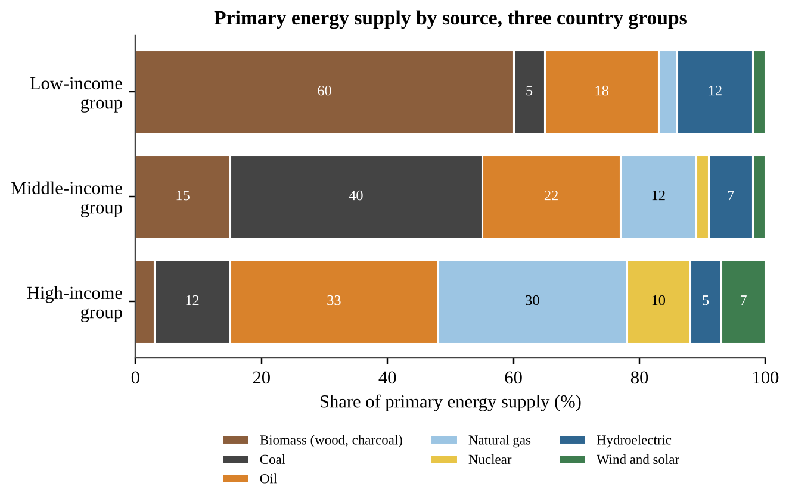
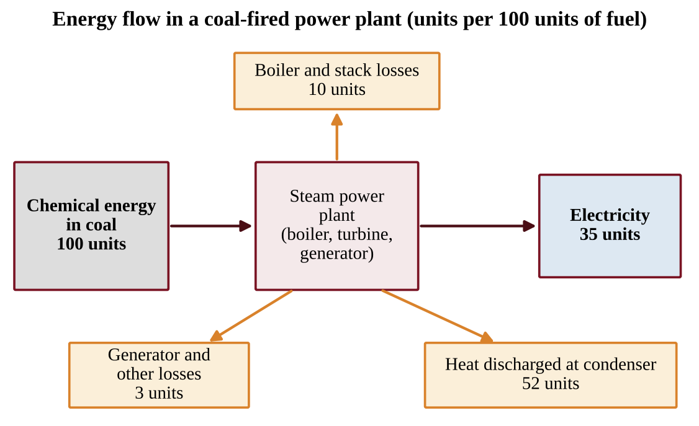
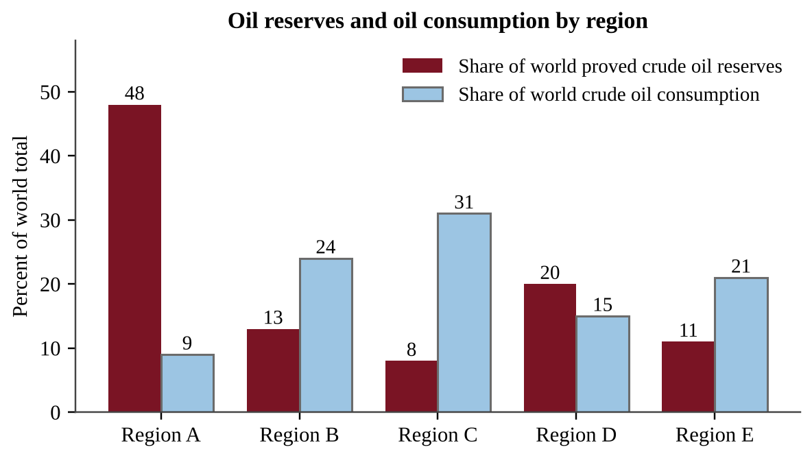
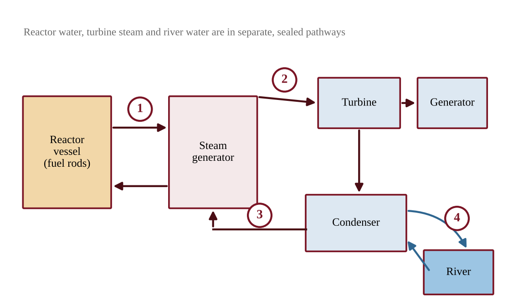
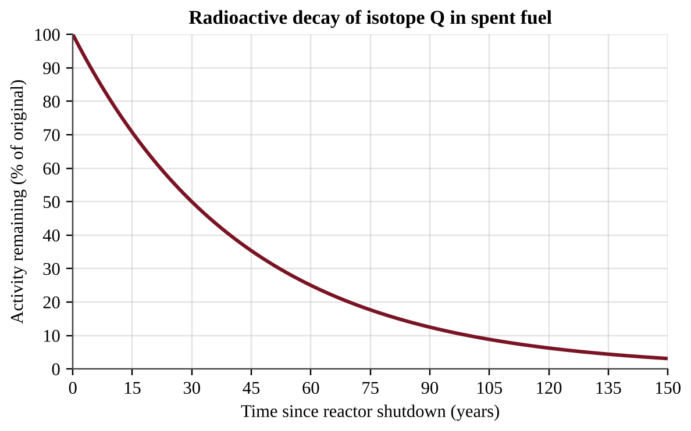
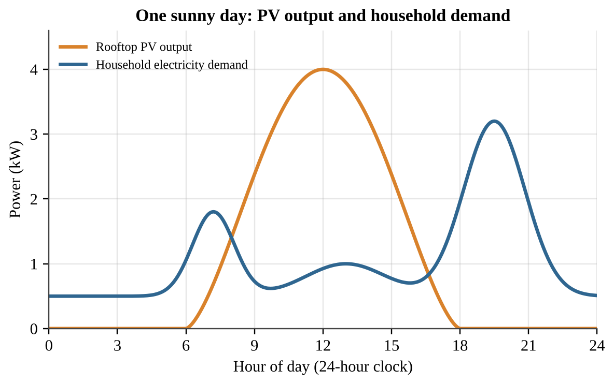
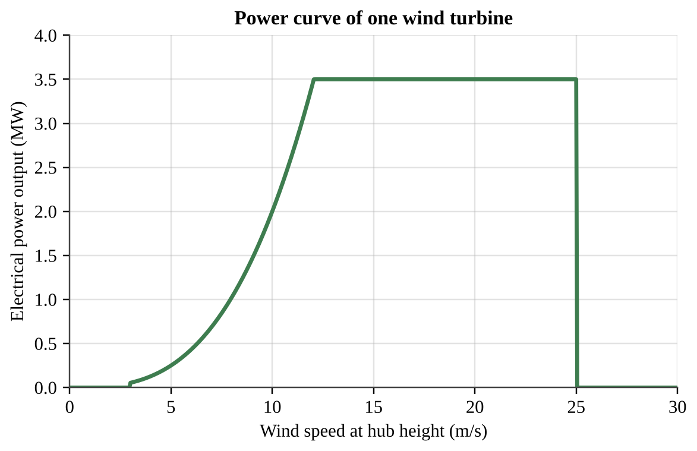
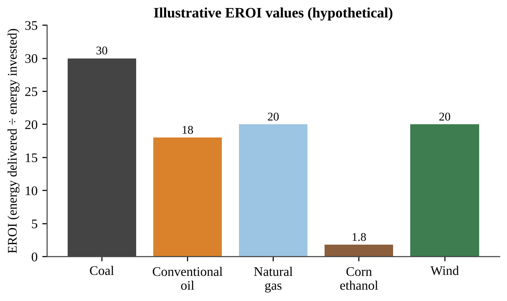
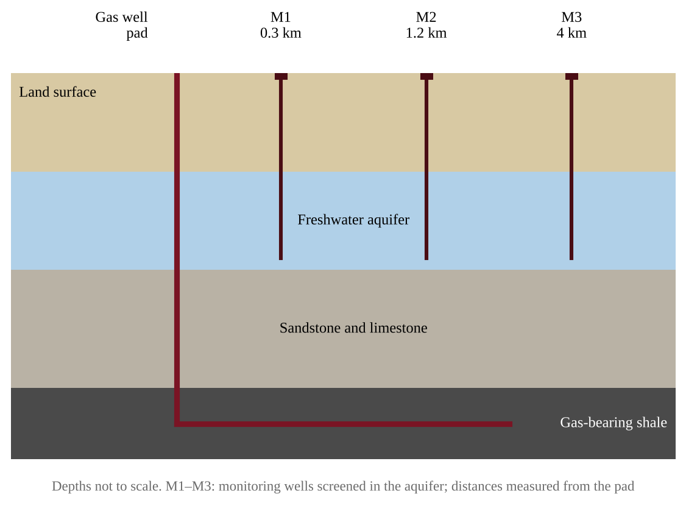

# Unit 6 — Energy Resources and Consumption

:::box note
Exam weight: Unit 6 accounts for 10–15% of the AP Environmental Science exam score.
This set assesses your knowledge of renewable and nonrenewable energy sources, global energy use, and their environmental effects (Topics 6.1–6.13).
It also tests data analysis and energy, efficiency, cost, and emissions calculations; a calculator is allowed.
:::

## Section A — Multiple-Choice Questions

:::q QB-U6-MCQ001 | unit=6 | topic=6.1 | diff=1
A student sorts energy sources into renewable and nonrenewable categories and gives a reason for each. Which classification and reason are both correct?
A) Wind is renewable because moving air is replenished naturally at or near the rate people use it.
B) Uranium is renewable because a very small mass of fuel releases a very large amount of energy.
C) Natural gas is renewable because new deposits are continually being discovered by drilling.
D) Biomass is nonrenewable because burning it always releases carbon dioxide into the air.
:::

:::q QB-U6-MCQ002 | unit=6 | topic=6.2 | diff=1
Which statement best describes how the world currently meets most of its energy demand?
A) Fossil fuels supply the largest share of energy used worldwide.
B) Hydroelectric dams supply the largest share of energy used worldwide.
C) Nuclear power supplies the largest share of energy used worldwide.
D) Wind and solar together supply the largest share of energy used worldwide.
:::

:::q QB-U6-MCQ003 | unit=6 | topic=6.3 | diff=1
In many rural areas of developing countries, households use firewood and charcoal as their main fuel. Which is the most likely reason?
A) Wood releases more energy per kilogram than any fossil fuel.
B) Wood is easily accessible and can often be gathered at little or no cost.
C) Burning wood produces no particulates or carbon monoxide indoors.
D) Wood is a fuel that is never harvested faster than it regrows.
:::

:::q QB-U6-MCQ004 | unit=6 | topic=6.3 | diff=1
Natural gas is considered the cleanest-burning fossil fuel. Which compound makes up most of natural gas?
A) Bitumen
B) Methane
C) Ethanol
D) Carbon dioxide
:::

:::q QB-U6-MCQ005 | unit=6 | topic=6.3 | diff=1
Which list places three types of coal in order from lowest to highest carbon content and energy released per kilogram?
A) Bituminous, lignite, anthracite
B) Anthracite, bituminous, lignite
C) Lignite, anthracite, bituminous
D) Lignite, bituminous, anthracite
:::

:::q QB-U6-MCQ006 | unit=6 | topic=6.5 | diff=1
Which sequence correctly describes how a coal-fired power plant produces electricity?
A) Coal is burned to release heat, the heat turns a generator directly, and the generator makes steam for a turbine.
B) Coal is split into smaller nuclei, the nuclei release heat, and the heat spins a turbine connected to a generator.
C) Coal is burned to release heat, the heat turns water to steam, the steam spins a turbine, and the turbine spins a generator.
D) Coal is converted to hydrogen, the hydrogen reacts with oxygen, and the reaction directly produces electricity.
:::

:::q QB-U6-MCQ007 | unit=6 | topic=6.6 | diff=1
Which process releases the heat that is used to make steam in a commercial nuclear power plant?
A) Uranium-235 is burned in oxygen to form carbon dioxide and water.
B) Hydrogen nuclei combine to form helium in the reactor core.
C) Uranium-235 is chemically oxidized to produce a hot gas.
D) Neutrons strike uranium-235 nuclei, splitting them into smaller nuclei.
:::

:::q QB-U6-MCQ008 | unit=6 | topic=6.8 | diff=1
A homeowner in the Northern Hemisphere builds a house with large south-facing windows and a dark stone floor that absorbs heat on winter days and releases it at night. No pumps or fans are used. This is an example of
A) an active solar energy system.
B) a photovoltaic solar energy system.
C) a geothermal energy system.
D) a passive solar energy system.
:::

:::q QB-U6-MCQ009 | unit=6 | topic=6.9 | diff=1
A river is dammed to create a large reservoir for a hydroelectric plant. Which is a likely environmental effect of the project?
A) The plant releases large amounts of sulfur dioxide into the air.
B) Habitats upstream and downstream of the dam are lost or changed.
C) The plant produces radioactive solid waste that must be stored.
D) The plant releases hydrogen sulfide gas from underground steam.
:::

:::q QB-U6-MCQ010 | unit=6 | topic=6.12 | diff=1
Which sequence correctly describes the energy transformations in a wind turbine?
A) Thermal energy of the air, then chemical energy in the blades, then electrical energy
B) Chemical energy in the tower, then thermal energy in the generator, then electrical energy
C) Electrical energy from the grid, then rotational energy of the blades, then kinetic energy of the air
D) Kinetic energy of moving air, then rotational energy of the blades and generator, then electrical energy
:::

:::q QB-U6-MCQ011 | unit=6 | topic=6.13 | diff=1
Which action is an example of conserving energy in a home?
A) Raising the temperature setting on the water heater
B) Leaving lights on in empty rooms for security
C) Running the dishwasher when it is only half full
D) Lowering the thermostat setting on cold winter days
:::

:::q QB-U6-MCQ012 | unit=6 | topic=6.11 | diff=1
A city bus powered by a hydrogen fuel cell is operating on a street. What is the only substance the fuel cell itself emits from the bus?
A) Water
B) Carbon dioxide
C) Nitrogen oxides
D) Carbon monoxide
:::

:::q QB-U6-MCQ013 | unit=6 | topic=6.10 | diff=1
Residents living near a geothermal power plant report a “rotten egg” odor near the plant’s steam vents. Which gas is the most likely cause?
A) Carbon monoxide
B) Ground-level ozone
C) Hydrogen sulfide
D) Radon
:::

:::q QB-U6-MCQ014 | unit=6 | topic=6.1 | diff=2
In a rural region, villagers harvest forest trees for fuelwood at about twice the rate at which the forest regrows. Which statement best describes the resource?
A) Wood is acting like a nonrenewable resource because it is being used faster than it is replenished.
B) Wood remains renewable because trees are living organisms and always grow back.
C) Wood is nonrenewable because it is made of carbon that was stored for millions of years.
D) Wood is renewable because burning it adds no carbon dioxide to the atmosphere.
:::

:::q QB-U6-MCQ015 | unit=6 | topic=6.2 | diff=2
The graph below shows the share of primary energy supplied by each source for three groups of countries.

{w=0.9}

Which conclusion is best supported by the data?
A) Moving from the low-income group to the middle-income group, the combined share from fossil fuels rises sharply while the share from biomass falls.
B) Moving from the middle-income group to the high-income group, the combined share from fossil fuels continues to rise sharply.
C) Wind and solar supply a larger share of primary energy than hydroelectric power in every country group.
D) The high-income group relies on biomass for a larger share of its energy than the low-income group.
:::

:::q QB-U6-MCQ016 | unit=6 | topic=6.2 | diff=2
A rapidly industrializing country has annual energy demand that is growing by 3.5% per year. Using the rule of 70, about how many years will it take for its annual energy demand to double if this growth rate continues?
A) 10 years
B) 20 years
C) 35 years
D) 245 years
:::

:::q QB-U6-MCQ017 | unit=6 | topic=6.3 | diff=2
Some coal-fired plants capture part of the waste heat that would otherwise be released and pipe it to nearby buildings for heating. The diagram below shows the energy flow in one plant per 100 units of fuel energy.

{w=0.85}

The plant is converted to cogeneration, and 30 of the 52 units discharged at the condenser are now delivered as useful heat. What is the new overall efficiency of fuel use, counting both electricity and useful heat?
A) 30%
B) 35%
C) 65%
D) 87%
:::

:::q QB-U6-MCQ018 | unit=6 | topic=6.3 | diff=2
Which description best matches tar sands?
A) Partially decomposed plant material that can be dried and burned for fuel
B) A mixture of clay, sand, water, and bitumen from which crude oil can be recovered
C) A dense carbon-rich rock formed from buried swamp vegetation under heat and pressure
D) A fine-grained rock with natural gas trapped in tiny pores between its particles
:::

:::q QB-U6-MCQ019 | unit=6 | topic=6.4 | diff=2
The graph below compares each region’s share of world proved crude oil reserves with its share of world crude oil consumption.

{w=0.85}

Which statement is best supported by the graph?
A) Region C has the largest share of world reserves because it has the largest share of consumption.
B) In every region, the share of reserves is close to the share of consumption.
C) Region A holds about five times as large a share of reserves as its share of consumption, showing that where oil is located does not match where it is used.
D) Region E’s share of reserves is larger than its share of consumption.
:::

:::q QB-U6-MCQ020 | unit=6 | topic=6.4 | diff=2
Large coal deposits occur in some regions of the world but not in others. Which is the best explanation?
A) Coal forms where plant material from ancient swamps was buried and then exposed to heat and pressure, so deposits depend on a region’s geologic history.
B) Coal forms wherever large human populations live because people produce organic waste that becomes coal.
C) Coal forms only in regions that now receive the most rainfall, because water converts soil into coal.
D) Coal is distributed evenly in Earth’s crust but only some governments have chosen to mine it.
:::

:::q QB-U6-MCQ021 | unit=6 | topic=6.5 | diff=2
A community near a proposed hydraulic fracturing (fracking) site asks about the environmental risks of the process. Which pair of concerns is most directly associated with fracking?
A) Release of hydrogen sulfide and loss of habitat from flooding a valley
B) Contamination of groundwater and release of volatile organic compounds
C) Release of radioactive waste and thermal pollution of rivers
D) Death of birds and bats and disturbance of desert ecosystems
:::

:::q QB-U6-MCQ022 | unit=6 | topic=6.5 | diff=2
Which pairing of a fossil fuel with an appropriate method of extraction is correct?
A) Shallow coal seam — strip (surface) mining
B) Crude oil in a reservoir — mountaintop removal mining
C) Natural gas in shale — open-pit mining of the gas
D) Tar sand deposits — hydraulic fracturing with salt water
:::

:::q QB-U6-MCQ023 | unit=6 | topic=6.6 | diff=2
The diagram shows a nuclear power plant. Reactor water, turbine steam, and river water move in separate sealed pathways. Locations 1–4 are marked on pipes or channels.

{w=0.9}

Water leaving which numbered location is most directly responsible for thermal pollution of the river?
A) Location 1
B) Location 2
C) Location 3
D) Location 4
:::

:::q QB-U6-MCQ024 | unit=6 | topic=6.6 | diff=2
The graph shows how the radioactivity of isotope Q in spent fuel decreases with time.

{w=0.85}

About how many years after shutdown will the activity be 12.5% of its original value?
A) 53 years
B) 60 years
C) 90 years
D) 120 years
:::

:::q QB-U6-MCQ025 | unit=6 | topic=6.6 | diff=2
Which statement correctly describes a nuclear power plant during normal operation?
A) It emits no air pollutants from fission, but it releases waste heat and produces hazardous solid waste.
B) It emits large amounts of sulfur dioxide and nitrogen oxides from burning uranium.
C) It releases no waste heat and produces no solid waste that must be stored.
D) It is a renewable source because uranium-235 is replaced by natural decay.
:::

:::q QB-U6-MCQ026 | unit=6 | topic=6.7 | diff=2
A farmer-owned cooperative argues that corn ethanol blended into gasoline is better for the climate than gasoline. Which statement best weighs the evidence about ethanol?
A) Burning ethanol adds no carbon to the atmosphere, and its energy return on investment is higher than that of oil.
B) Burning ethanol releases carbon that was stored underground for millions of years, so it adds more carbon than gasoline.
C) Ethanol can substitute for gasoline, but it can be produced only from fossil fuels.
D) The carbon dioxide released when ethanol burns was recently taken up by the crop, but the energy return on energy investment is low because energy is used to grow, harvest, and process the corn.
:::

:::q QB-U6-MCQ027 | unit=6 | topic=6.8 | diff=2
A homeowner plans to install 20 m² of photovoltaic panels with an efficiency of 18%. The site receives an average of 5 kWh of sunlight energy per square meter per day. About how much electricity will the panels produce per day?
A) 0.9 kWh
B) 3.6 kWh
C) 18 kWh
D) 100 kWh
:::

:::q QB-U6-MCQ028 | unit=6 | topic=6.8 | diff=2
The graph shows the output of a rooftop photovoltaic system and a household’s electricity demand during one sunny day.

{w=0.85}

Which conclusion is best supported by the graph?
A) PV output and household demand reach their highest values at about the same time of day.
B) The household’s highest demand occurs after PV output has nearly stopped, so evening needs would depend on stored energy or the grid.
C) The PV system supplies more than the household’s demand at every hour of the day.
D) PV output is greatest at night because the cells store sunlight during the day.
:::

:::q QB-U6-MCQ029 | unit=6 | topic=6.9 | diff=2
A small turbine is placed directly in a flowing stream without building a dam or reservoir. Compared with a large dam, what is the most likely result?
A) More land is flooded and more habitat is lost, but more electricity is produced steadily.
B) No electricity is produced because turbines work only when water falls from a reservoir.
C) Less land is flooded and habitat change is smaller, but less electricity is produced and it depends on stream flow.
D) Tidal flows are required to spin the turbine, so it works only near the ocean.
:::

:::q QB-U6-MCQ030 | unit=6 | topic=6.10 | diff=2
Geothermal power plants supply a large share of electricity in a few places, such as areas near tectonic plate boundaries, but little in most of the world. Which statement best explains this pattern?
A) Geothermal energy is used up quickly in every location, so only a few plants can be built.
B) Heat can be reached at a reasonable depth only in some places, and drilling to reach it elsewhere can be prohibitively expensive.
C) Geothermal plants require large amounts of sunlight and so work only in desert regions.
D) Geothermal plants release more carbon dioxide than coal plants, so most countries ban them.
:::

:::q QB-U6-MCQ031 | unit=6 | topic=6.11 | diff=2
How does a hydrogen fuel cell produce electricity?
A) Hydrogen combines with oxygen from the air to form water, releasing electrical energy.
B) Hydrogen is burned in a boiler to make steam that spins a turbine.
C) Hydrogen is split apart by sunlight into protons and neutrons, which are collected as current.
D) Hydrogen reacts with nitrogen in the air to form ammonia, releasing electrical energy.
:::

:::q QB-U6-MCQ032 | unit=6 | topic=6.12 | diff=2
The graph shows the power curve of a wind turbine.

{w=0.85}

The wind speed at the site increases from 5 m/s to 10 m/s. About how many times greater is the turbine’s power output at 10 m/s than at 5 m/s?
A) 2 times
B) 4 times
C) 8 times
D) 16 times
:::

:::q QB-U6-MCQ033 | unit=6 | topic=6.13 | diff=2
A household replaces a 60 W incandescent bulb with a 10 W LED bulb that gives the same light. The bulb is used 3 hours per day. About how much electricity is saved in one year (365 days)?
A) 11 kWh
B) 55 kWh
C) 66 kWh
D) 548 kWh
:::

:::q QB-U6-MCQ034 | unit=6 | topic=6.13 | diff=2
A driver travels 12,000 miles per year. Replacing a car that gets 25 miles per gallon with a more efficient car that gets 40 miles per gallon will save about how many gallons of fuel per year?
A) 480 gallons
B) 300 gallons
C) 180 gallons
D) 15 gallons
:::

:::q QB-U6-MCQ035 | unit=6 | topic=6.7 | diff=2
The bar graph compares illustrative values of energy return on energy investment (EROI) for several energy sources.

{w=0.85}

Based on the graph, how much net energy gain results from every 100 MJ of energy invested in producing corn ethanol?
A) 180 MJ
B) 80 MJ
C) 56 MJ
D) 44 MJ
:::

:::q QB-U6-MCQ036 | unit=6 | topic=6.5 | diff=3
A coal-fired plant produces 500 MW of electrical power at an overall efficiency of 38%. The coal contains 24 MJ of energy per kilogram, and 1 MW = 1 MJ/s. About how many metric tons of coal does the plant burn each hour? (1 metric ton = 1,000 kg)
A) 197 metric tons
B) 75 metric tons
C) 54.8 metric tons
D) 28.5 metric tons
:::

:::q QB-U6-MCQ037 | unit=6 | topic=6.6 | diff=3
A 900 MW nuclear plant generated 6.30 × 10⁶ MWh of electricity during a year of 8,760 hours. What was its capacity factor (actual output divided by output if run at full power all year)?
A) 125%
B) 80%
C) 70%
D) 7%
:::

:::q QB-U6-MCQ038 | unit=6 | topic=6.5 | diff=3
Residents worry that hydraulic fracturing is contaminating their drinking-water aquifer with methane and other chemicals. Which investigation is best designed to test whether fracturing at a new site changes groundwater quality?
A) Sample monitoring wells at several distances up and down the flow direction from the site before and after fracturing, measuring methane, volatile organic compounds, and chloride.
B) Sample one well beside the drilling pad only after fracturing and compare the result with a drinking-water standard.
C) Sample wells once at several different gas fields with different geology and compare the average concentrations.
D) Survey residents about the taste and smell of their tap water before and after drilling begins.
:::

:::q QB-U6-MCQ039 | unit=6 | topic=6.11 | diff=3
A city replaces its diesel buses with hydrogen fuel cell buses. The hydrogen is made by using electricity from a coal-fired power plant to split water. Which statement is best supported?
A) The change eliminates carbon dioxide emissions because fuel cells combine hydrogen and oxygen to form water.
B) The change increases carbon dioxide emissions because fuel cells burn the hydrogen and release carbon dioxide.
C) The change has no energy cost because the hydrogen is obtained from water, which is renewable.
D) The buses emit only water, but the overall carbon dioxide emissions depend on the source of the electricity used to make the hydrogen, so emissions are shifted to the power plant.
:::

:::q QB-U6-MCQ040 | unit=6 | topic=6.12 | diff=3
At a wind farm, researchers counted bat fatalities and recorded wind speed at hub height. The turbine in the study begins generating power at 3 m/s and produces little power below 6 m/s.

| Wind speed band (m/s) | Bat fatalities per turbine per night |
|---|---|
| 3–4 | 0.80 |
| 4–6 | 0.60 |
| 6–8 | 0.20 |
| Above 8 | 0.05 |

Which operating change would most reduce bat deaths while giving up the least electricity?
A) Shut down all turbines on every night of the year regardless of wind speed.
B) Keep blades turning at low wind speeds but stop them whenever winds exceed 8 m/s.
C) Replace the turbines with taller turbines without changing when they operate.
D) Keep blades from turning at wind speeds below 6 m/s during the nights of the bat migration season.
:::

:::q QB-U6-MCQ041 | unit=6 | topic=6.9 | diff=3
Data were collected for five years before and five years after a dam was completed on a river.

| Measurement | Before dam | After dam |
|---|---|---|
| Reservoir surface area (km²) | 0 | 38 |
| Downstream suspended sediment (mg/L) | 120 | 18 |
| Downstream summer water temperature (°C) | 15 | 10 |
| Migratory salmon counted moving upstream (fish/year) | 24,000 | 3,100 |

Which conclusion is best supported by the data?
A) The dam had no effect on downstream conditions because the river still flows after the dam.
B) Downstream water became warmer and muddier after the dam, which explains the changes in salmon numbers.
C) The dam is associated with changes in habitat both upstream and downstream, including a large decrease in sediment and cooler summer water below the dam.
D) The dam eliminated all aquatic habitat in the river, as shown by the reservoir’s surface area.
:::

:::q QB-U6-MCQ042 | unit=6 | topic=6.2 | diff=3
A state’s electric utilities reported the following changes between two years.

| Measurement | 2018 | 2024 |
|---|---|---|
| Coal share of generation (%) | 46 | 22 |
| Natural gas share of generation (%) | 30 | 41 |
| Wind and solar share of generation (%) | 7 | 25 |
| Delivered natural gas price ($ per million BTU) | 5.00 | 3.00 |
| State limit on power-plant CO₂ emissions | None | In effect since 2020 |

Which explanation for the decline in coal use is best supported by the table?
A) Coal reserves in the state were depleted, so coal could no longer be mined.
B) Total electricity demand in the state fell sharply, so fewer plants were needed.
C) Hydroelectric capacity expanded, replacing coal with the most affordable source.
D) A drop in natural gas prices and a new emissions limit made coal less competitive than other sources.
:::

:::q QB-U6-MCQ043 | unit=6 | topic=6.13 | diff=3
A homeowner is considering new windows that cost $2,400. A utility rebate of $400 is available, and the windows are expected to reduce the household’s heating and cooling costs by $250 per year. What is the simple payback period for the homeowner?
A) 11.2 years
B) 9.6 years
C) 8.0 years
D) 1.6 years
:::

:::q QB-U6-MCQ044 | unit=6 | topic=6.7 | diff=3
A school district compares burning wood pellets with burning natural gas to deliver the same amount of heat. Emissions per megawatt-hour of heat delivered are shown.

| Emission | Wood pellets | Natural gas |
|---|---|---|
| Particulate matter (kg/MWh) | 0.30 | 0.01 |
| Nitrogen oxides (kg/MWh) | 0.40 | 0.18 |
| CO₂ from fossil fuel use, including processing and trucking (kg/MWh) | 25 | 200 |

Which statement is best supported by the table?
A) Switching to pellets would lower every pollutant listed in the table.
B) Switching to pellets would produce no pollutants because wood is renewable.
C) Switching to pellets would lower particulate emissions but increase fossil-fuel CO₂ emissions.
D) Switching to pellets would lower fossil-fuel CO₂ emissions but increase particulate and nitrogen oxide emissions.
:::

## Section B — Free-Response Questions

:::q QB-U6-FRQ001 | unit=6 | topic=6.5 | diff=2 | frqtype=1 | pts=10
A rural county overlies a freshwater aquifer that supplies household drinking-water wells. A company plans to use hydraulic fracturing (fracking) to extract natural gas from a shale layer about 2,000 m below the surface. Residents are concerned that the process could change the quality of their well water. A hydrogeologist proposes monitoring the aquifer with three monitoring wells (M1, M2, and M3) installed at different distances from the planned well pad, as shown below.

{w=0.9}

(a) Identify the environmental problem that the residents are concerned could result from fracking and affect their drinking water. [1]
(b) Write a testable hypothesis, in if–then form, that predicts how the dissolved methane concentration in the aquifer will differ with distance from the pad after fracking begins. [1]
(c) Describe a procedure the hydrogeologist could follow to test the hypothesis. Include when and where samples will be collected and how the reliability of the data will be improved. [2]
(d) Identify the independent variable and the dependent variable in the investigation. [2]
(e) Identify one variable that should be kept constant during sampling, and explain why. [1]
(f) Describe the pattern of results that would support the hypothesis, and explain how the hydrogeologist should decide that a change in methane is greater than natural variation. [2]
(g) Propose one action the gas company could take to reduce the risk of groundwater contamination, and justify it. [1]
:::

:::q QB-U6-FRQ002 | unit=6 | topic=6.12 | diff=2 | frqtype=2 | pts=10
A region tracks how it generates electricity. Hydroelectric power supplied 10 TWh in each of the three years shown. All other generation came from the sources in Table 1. Table 2 gives total generation, power-sector carbon dioxide emissions, and the estimated number of birds and bats killed at the region’s wind farms.

**Table 1. Generation by source (TWh)**

| Year | Coal | Natural gas | Wind | Solar |
|---|---|---|---|---|
| 2015 | 60 | 30 | 6 | 1 |
| 2020 | 36 | 40 | 14 | 6 |
| 2025 | 12 | 38 | 30 | 18 |

**Table 2. Totals and impacts**

| Year | Total generation (TWh) | Power-sector CO₂ (million metric tons) | Birds and bats killed at wind farms (per year) |
|---|---|---|---|
| 2015 | 107 | 73.5 | 1,200 |
| 2020 | 106 | 54.0 | 5,600 |
| 2025 | 108 | 29.1 | 12,000 |

(a) Describe the trend in electricity generated from coal and the trend in electricity generated from wind between 2015 and 2025, citing data for each. [2]
(b) Calculate the percentage of the region’s total generation that came from wind and solar combined in 2025. Show your work. [2]
(c) Using the data, explain why power-sector CO₂ emissions fell between 2015 and 2025 even though total generation stayed nearly constant. [1]
(d) Calculate the percent decrease in power-sector CO₂ emissions from 2015 to 2025. Show your work. [2]
(e) Describe one environmental disadvantage of wind power shown by the data, and use the data to support your answer. [2]
(f) Propose one action that could reduce the wildlife deaths at wind farms and justify it. [1]
:::

:::q QB-U6-FRQ003 | unit=6 | topic=6.8 | diff=3 | frqtype=3 | pts=10
A school district plans to install a rooftop photovoltaic (PV) array on a high school. Use the information below to analyze the project.

- School’s electricity use: 450,000 kWh per year
- PV array area: 1,200 m²
- Average sunlight reaching the array: 5.0 kWh per m² per day (annual average)
- PV panel efficiency: 20%
- Net installed cost after incentives: $630,000
- Price of electricity purchased from the grid: $0.12 per kWh
- Emissions from the local grid: 0.40 kg CO₂ per kWh

(a) Calculate the electrical energy, in kWh per year, that the array will produce. Show your work, including units. [2]
(b) Calculate the percentage of the school’s annual electricity use that the array will supply. [1]
(c) Calculate the annual electricity cost savings, and then calculate the simple payback period in years. [2]
(d) Calculate the mass of CO₂, in metric tons per year, that is not emitted because of the PV array. (1 metric ton = 1,000 kg) [2]
(e) Describe one environmental advantage and one limitation of using photovoltaic solar energy. [2]
(f) Propose one way the district could address the limitation you described in part (e), and justify your answer. [1]
:::

:::q QB-U6-FRQ004 | unit=6 | topic=6.6 | diff=3 | frqtype=3 | pts=10
A nuclear power plant has an electrical output (capacity) of 1,000 MW and an efficiency of 33%. During one year (8,760 hours) it operates at 90% of its full capacity. The plant uses water from a river that flows at 150 m³/s. Assume that all of the plant’s waste heat is absorbed by the river water, that 1 m³ of water has a mass of 1,000 kg, and that the specific heat of water is 4.18 kJ/(kg·°C).

(a) Calculate the electrical energy, in MWh, that the plant generates in one year. Show your work. [2]
(b) Calculate the plant’s waste heat output, in MW. (Thermal power = electrical power ÷ efficiency.) [2]
(c) Calculate the increase in river temperature, in °C, caused by the waste heat. (Heat absorbed = mass flow × specific heat × temperature change.) [2]
(d) Describe one effect of this increase in water temperature on the river ecosystem. [1]
(e) Propose one way to reduce the amount of heat the plant discharges to the river. [1]
(f) If the electricity generated in part (a) replaced electricity from coal-fired plants that emit 0.95 metric tons of CO₂ per MWh, calculate the metric tons of CO₂ emissions avoided in one year. [1]
(g) Strontium-90, a component of nuclear waste, has a half-life of 29 years. Calculate how many years are required for the radioactivity of a sample to fall to 6.25% of its original value. [1]
:::
