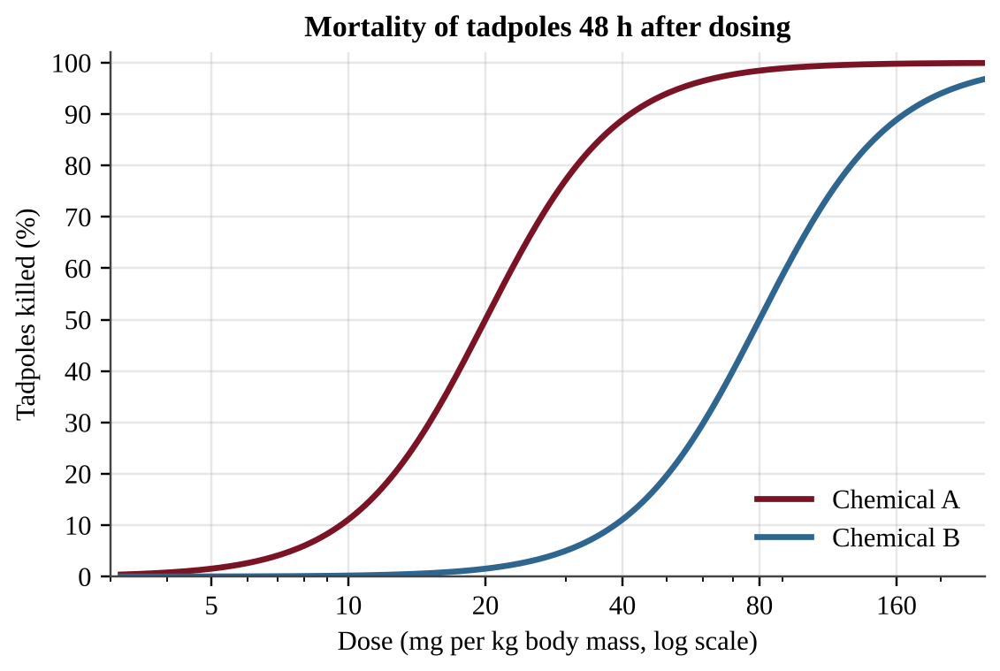
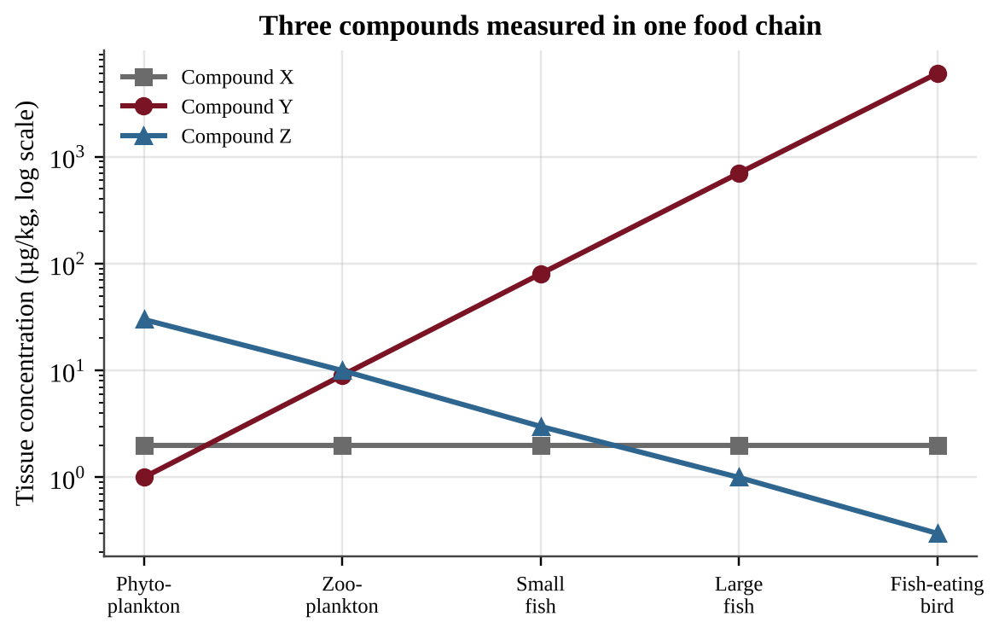
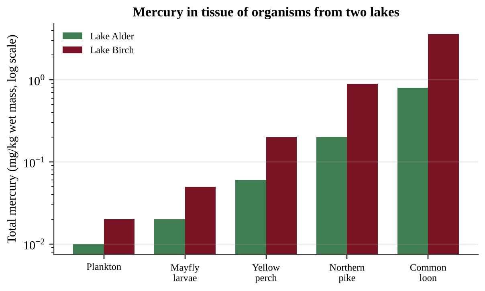
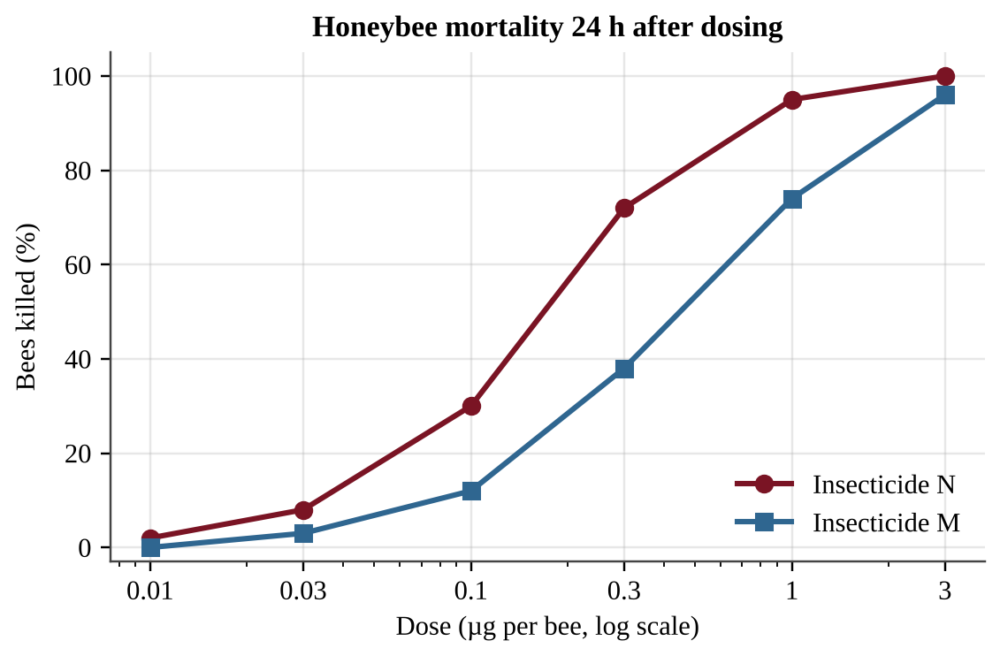

# Unit 8 — Aquatic and Terrestrial Pollution

:::box note
Exam weight: Unit 8 accounts for about 7–10% of the AP Environmental Science exam score.
This section assesses point and nonpoint sources, water pollutants, eutrophication, thermal pollution, POPs and biomagnification, solid waste and sewage, and toxicity (LD50 and dose-response).
Expect conceptual items, graph and diagram interpretation, dimensional-analysis calculations, and investigation design.
:::

## Section A — Multiple-Choice Questions

:::q QB-U8-MCQ001 | unit=8 | topic=8.1 | diff=1
Which of the following is an example of a nonpoint source of water pollution?
A) Wastewater flowing from a pipe at a textile factory
B) An overflow pipe at a sewage treatment plant
C) Fertilizer and pesticides washed by rain from many farm fields into a river
D) Fuel leaking from a single underground tank at a gas station
:::

:::q QB-U8-MCQ002 | unit=8 | topic=8.3 | diff=1
Endocrine disruptors are best described as
A) bacteria and viruses that infect the reproductive organs of animals.
B) chemicals that interfere with the hormone systems of animals.
C) gases that lower the dissolved oxygen available to aquatic animals.
D) metals that kill organisms by coating their fur or feathers.
:::

:::q QB-U8-MCQ003 | unit=8 | topic=8.4 | diff=1
Mangrove forests along a tropical coast are cleared to build shrimp ponds. Which ecological service is most directly reduced for the nearby villages?
A) Buffering against storm surge and coastal flooding
B) Conversion of saltwater into drinking water
C) Production of oil that fuels fishing boats
D) Removal of ultraviolet light from sunlight
:::

:::q QB-U8-MCQ004 | unit=8 | topic=8.6 | diff=1
A power plant takes in river water to cool its equipment and returns the warmed water to the river. Which change is most likely in the river just downstream of the discharge?
A) Dissolved oxygen increases because warm water holds more gas.
B) Dissolved oxygen is unchanged because temperature does not affect gases.
C) Sediment increases because warm water carries more soil.
D) Dissolved oxygen decreases because warm water holds less oxygen.
:::

:::q QB-U8-MCQ005 | unit=8 | topic=8.7 | diff=1
Why do persistent organic pollutants (POPs) such as PCBs remain in ecosystems for decades?
A) They are naturally occurring elements that cannot be destroyed.
B) They are synthetic, carbon-based molecules that break down only very slowly.
C) They dissolve completely in water and are diluted to zero.
D) They are quickly absorbed by plants and removed from the food web.
:::

:::q QB-U8-MCQ006 | unit=8 | topic=8.9 | diff=1
A sanitary municipal landfill is built with a bottom liner of compacted clay or plastic. The main purpose of the liner is to
A) keep leachate from seeping into the groundwater.
B) speed up decomposition by trapping oxygen in the waste.
C) collect methane so it can be burned for electricity.
D) keep rainwater from entering the top of the landfill.
:::

:::q QB-U8-MCQ007 | unit=8 | topic=8.12 | diff=1
Which of the following best defines the LD50 of a chemical?
A) The dose that produces any visible symptom in half of a population
B) The concentration of the chemical in tissue after half of it has broken down
C) The time needed for half of a dose to be excreted by an organism
D) The dose that is lethal to 50% of a population of a particular species
:::

:::q QB-U8-MCQ008 | unit=8 | topic=8.11 | diff=1
Which process takes place during the primary treatment of sewage?
A) Bacteria in an aerated tank break down organic matter.
B) Ultraviolet light kills disease-causing bacteria.
C) Screens remove large objects and solids settle to the bottom of a tank.
D) A constructed wetland removes remaining nutrients.
:::

:::q QB-U8-MCQ009 | unit=8 | topic=8.2 | diff=1
A pollutant in a stream rises above the optimum range for a fish species but stays below the level that kills fish quickly. Which outcome is most likely for the fish population?
A) All fish die within hours.
B) Physiological stress, slower growth and reduced reproduction
C) No effect, because every organism tolerates every level of a pollutant equally
D) Faster growth, because organisms always adapt immediately
:::

:::q QB-U8-MCQ010 | unit=8 | topic=8.10 | diff=1
A town generates 480 metric tons of solid waste in one month and recycles 120 metric tons of it. What is the town's recycling rate for the month?
A) 25%
B) 33%
C) 75%
D) 400%
:::

:::q QB-U8-MCQ011 | unit=8 | topic=8.5 | diff=2
A lake receives large inputs of phosphorus, and an algal bloom develops and then dies. Which process is the main cause of the fish kill that follows the collapse of the bloom?
A) Dead algae release heat that warms the water above the fish's tolerance.
B) Algal cells clog the gills of the fish.
C) Phosphorus poisons the gills of the fish at the concentrations found in lakes.
D) Microbes digesting the dead algae use up the dissolved oxygen.
:::

:::q QB-U8-MCQ012 | unit=8 | topic=8.5 | diff=2
Heavy rain washed lawn fertilizer into Lake Tamarack in late May. The lake was sampled monthly.

{w=0.85}

Which conclusion is best supported by the data?
A) Bottom-water DO declined after July because there were fewer algae left to produce oxygen by photosynthesis.
B) Higher chlorophyll concentrations cause higher DO in every month because of photosynthesis.
C) Bottom-water DO was lowest after the chlorophyll peak, consistent with decomposers using oxygen on dead algae.
D) Because chlorophyll returned to its April level by October, the nutrient input had no ecological effect.
:::

:::q QB-U8-MCQ013 | unit=8 | topic=8.1 | diff=2
A county measured the annual nitrogen load reaching a river from four sources.

| Source | Nitrogen load (kg/yr) |
|---|---|
| Wastewater treatment plant outfall pipe | 9,000 |
| Food-processing plant discharge pipe | 6,000 |
| Runoff from cropland | 36,000 |
| Runoff from residential lawns and streets | 9,000 |

What percentage of the total nitrogen load comes from nonpoint sources?
A) 75%
B) 25%
C) 60%
D) 15%
:::

:::q QB-U8-MCQ014 | unit=8 | topic=8.2 | diff=2
Deforestation on hillsides above a tropical coast greatly increases the amount of sediment carried to the sea. Which is the most direct way this sediment harms nearby coral reefs?
A) It raises the salinity of the water above the tolerance of the coral.
B) It reduces the light reaching the coral's photosynthetic algae and smothers coral as it settles.
C) It adds oxygen to the water, which burns the coral's tissues.
D) It attracts fishing boats that damage the reef.
:::

:::q QB-U8-MCQ015 | unit=8 | topic=8.2 | diff=2
Weeks after a tanker spill, dead clams and crabs are found on the seafloor 15 km from shore, although no oil is visible on the surface there. Which statement best explains this observation?
A) Surface oil blocked sunlight from reaching the sediments.
B) Seabirds carried oil down to the bottom.
C) Oil dissolved completely and became harmless to bottom dwellers.
D) Some components of oil sink to the ocean floor and kill bottom-dwelling organisms.
:::

:::q QB-U8-MCQ016 | unit=8 | topic=8.3 | diff=2
Researchers find many male fish with developing eggs in their testes in a river downstream of a wastewater outfall. Fish upstream are normal, and temperature and dissolved oxygen are similar at both sites. Which hypothesis is best supported by these observations?
A) A bacterial infection spread by the effluent changed the fishes' chromosomes.
B) Low dissolved oxygen in the effluent is feminizing the male fish.
C) The effluent contains chemicals that interfere with the fishes' hormone systems.
D) Thermal pollution from the outfall is changing the fishes' sex.
:::

:::q QB-U8-MCQ017 | unit=8 | topic=8.4 | diff=2
A developer fills in a floodplain marsh upstream of a town. After the next heavy rain, the town floods more severely than in the past. Which statement best explains the change?
A) The marsh used to absorb storm water and release it slowly, and its loss let runoff reach the river faster.
B) The marsh plants used to release extra water to the river by transpiration.
C) Filling the marsh increased the soil's ability to store storm water.
D) The loss of the marsh increased groundwater recharge, which raised the river.
:::

:::q QB-U8-MCQ018 | unit=8 | topic=8.6 | diff=2
A river upstream of a power plant is 15 °C. The plant's discharge raises the river to 25 °C downstream. Assume the water is saturated with oxygen at both temperatures.

{w=0.8}

By about what percentage does the saturation DO decrease from the upstream to the downstream temperature?
A) 8%
B) 18%
C) 22%
D) 82%
:::

:::q QB-U8-MCQ019 | unit=8 | topic=8.7 | diff=2
Fat tissue of polar bears contains DDT even though DDT has never been used in the Arctic. Which statement best explains this finding?
A) Polar bears eat crops that were treated with DDT.
B) DDT is produced naturally in sea ice.
C) DDT dissolves in water, so it is quickly carried into the Arctic and then excreted by the polar bears.
D) POPs travel long distances by air and water and accumulate in fatty tissues.
:::

:::q QB-U8-MCQ020 | unit=8 | topic=8.8 | diff=2
A pesticide residue was measured in organisms from one lake food chain.

| Organism | Concentration (µg/kg wet mass) |
|---|---|
| Phytoplankton | 0.05 |
| Zooplankton | 0.4 |
| Minnows | 2.0 |
| Lake trout | 10 |
| Osprey | 60 |

The concentration in the osprey is how many times the concentration in the phytoplankton?
A) 6
B) 60
C) 1,200
D) 120
:::

:::q QB-U8-MCQ021 | unit=8 | topic=8.9 | diff=2
{w=0.8}

Which numbered component collects the water that has trickled through the waste so that it can be pumped out and treated?
A) 3
B) 1
C) 2
D) 4
:::

:::q QB-U8-MCQ022 | unit=8 | topic=8.10 | diff=2
A household has a drawer of old phones and laptops. Which option is most effective at keeping the lead and mercury in them out of groundwater?
A) Mixing them with household trash in a municipal landfill, where leachate can eventually escape
B) Burning them in a backyard fire pit
C) Burying them in a pit on the property
D) Taking them to a certified e-waste recycler that recovers the materials
:::

:::q QB-U8-MCQ023 | unit=8 | topic=8.10 | diff=2
A town generates 150,000 tons of municipal solid waste per year. Currently 30% is recycled, 10% is composted, and the rest is landfilled. A new plan raises composting to 25% and leaves recycling unchanged. How many fewer tons will be landfilled each year?
A) 15,000
B) 22,500
C) 37,500
D) 67,500
:::

:::q QB-U8-MCQ024 | unit=8 | topic=8.11 | diff=2
{w=0.9}

Which statement best describes the treatment that occurs in tank Q?
A) Screens and grates remove large objects from the incoming sewage.
B) Solids settle by gravity alone, with no biological activity involved.
C) Microbes break down organic matter, and added air speeds up the process.
D) Chemical or ecological processes remove nutrients left after earlier stages.
:::

:::q QB-U8-MCQ025 | unit=8 | topic=8.12 | diff=2
The LD50 of an insecticide for laboratory mice is 25 mg per kg of body mass. What dose would be expected to kill half of a group of mice that each have a mass of 0.040 kg?
A) 0.0016 mg per mouse
B) 1.0 mg per mouse
C) 25 mg per mouse
D) 625 mg per mouse
:::

:::q QB-U8-MCQ026 | unit=8 | topic=8.13 | diff=2
Tadpoles were given single doses of two chemicals, and mortality was recorded after 48 hours.

{w=0.8}

Which statement is best supported by the graph?
A) Chemical A is more toxic than chemical B because a lower dose of A kills half of the tadpoles.
B) Chemical B is more toxic than chemical A because its curve lies farther to the right.
C) The two chemicals are equally toxic because both eventually kill nearly all tadpoles.
D) Chemical A causes no mortality below 10 mg/kg because its curve is flat there.
:::

:::q QB-U8-MCQ027 | unit=8 | topic=8.15 | diff=2
As average temperatures rise, mosquitoes that carry dengue virus are detected for the first time in a temperate city. Which statement best explains this observation?
A) Rising carbon dioxide makes the dengue virus airborne so that it spreads directly between people.
B) Disease vectors can spread only through ocean currents.
C) A city with clean drinking water cannot have vectors, so the report must be an error.
D) Warming lets vectors and their pathogens spread poleward into areas that previously had no cases of the disease.
:::

:::q QB-U8-MCQ028 | unit=8 | topic=8.5 | diff=3
Researchers want to determine whether nitrogen or phosphorus limits algal growth in Lake Corbin. Which design best answers the question?
A) Add both nitrogen and phosphorus to every container and vary the light level.
B) Add nitrogen to containers filled at one end of the lake and phosphorus to containers filled at the other end.
C) Use identical containers of lake water with four replicated treatments (none, N, P, N + P), the same light and temperature, and measure chlorophyll after 10 days.
D) Add increasing amounts of nitrogen to a single container of lake water and measure chlorophyll each day for two weeks.
:::

:::q QB-U8-MCQ029 | unit=8 | topic=8.8 | diff=3
A biologist finds PCBs in the tissues of sea otters and wants to investigate whether PCBs biomagnify in the otters' coastal food web. Which is the most testable hypothesis?
A) If PCBs biomagnify in this food web, then PCB concentrations in tissue samples will be higher in sea otters than in the clams and sea urchins they eat.
B) If PCBs are harmful to wildlife, then the law should protect sea otters and other marine mammals from them.
C) If PCB levels are measured only in sea otters, then PCBs must be present in the food web.
D) If PCBs are fat soluble, then they will be found everywhere in the ocean, even in the deepest water.
:::

:::q QB-U8-MCQ030 | unit=8 | topic=8.2 | diff=3
{w=0.85}

The outfall discharges untreated organic waste. Which statement best explains why DO keeps falling for about 13 km below the outfall and then rises?
A) The concentration of organic waste is highest 13 km downstream.
B) The water becomes colder as it moves downstream, so it holds less oxygen than before.
C) Photosynthesis by decomposing bacteria adds oxygen to the water after 13 km.
D) Decomposers use oxygen faster than it is replaced until much of the waste is gone; then reoxygenation exceeds use.
:::

:::q QB-U8-MCQ031 | unit=8 | topic=8.8 | diff=3
Three compounds were measured in tissues at five trophic levels of one food chain.

{w=0.85}

Which compound shows biomagnification, and which property best explains this pattern?
A) Compound Z, because its concentration is highest at the base and it is therefore very persistent
B) Compound Y, because it is persistent and fat soluble, so it is retained in tissues and passed up the food chain
C) Compound X, because its constant concentration shows it is fat soluble and stable
D) Compound Y, because it is water soluble and rapidly excreted at each level
:::

:::q QB-U8-MCQ032 | unit=8 | topic=8.14 | diff=3
Researchers want to test whether higher tropospheric ozone is linked to reduced lung function in children. It would be unethical to assign children to breathe different ozone levels. Which approach would give the strongest evidence?
A) Measure lung function in 20 children from the city with the highest ozone only.
B) Compare lung function in one high-ozone city and one low-ozone city without recording any other differences between the children.
C) Measure lung function in many children from high- and low-ozone neighborhoods, recording age, asthma, household smoking and time outdoors, then analyze the association.
D) Ask parents whether their child ever coughs and compare the answers between the two cities.
:::

:::q QB-U8-MCQ033 | unit=8 | topic=8.10 | diff=3
A landfill captures 2.0 × 10⁶ m³ of methane per year. Each m³ of methane releases 36 MJ of energy when burned. A generator converts 30% of that energy to electricity. One household uses 10,000 kWh per year (1 kWh = 3.6 MJ). About how many households could be supplied?
A) 600
B) 2,000
C) 2,160
D) 7,200
:::

:::q QB-U8-MCQ034 | unit=8 | topic=8.13 | diff=3
A pest manager claims that chemical B is "safe" at 40 mg/kg for tadpoles because its LD50 is 80 mg/kg.

{w=0.8}

Which statement best evaluates the claim?
A) The claim is valid because doses below the LD50 cause no deaths.
B) The claim is not supported, because the curve shows that about one in ten tadpoles would still die at 40 mg/kg.
C) The claim is valid because the curve shows less than 5% mortality at 40 mg/kg.
D) The claim is not supported, because chemical A kills more tadpoles than chemical B at that dose.
:::

## Section B — Free-Response Questions

:::q QB-U8-FRQ001 | unit=8 | topic=8.5 | diff=2 | frqtype=1 | pts=10
Cedar Pond is a small recreational pond that receives water from two inlet streams. Inlet 1 drains a housing development with fertilized lawns and storm drains. Inlet 2 drains a forested hillside. For the past two summers, residents have seen dense green scum on the pond in July, and several dead fish washed up in August. Residents suspect that lawn fertilizer in the runoff is responsible. A student team plans to test this idea using four sampling sites, S1 through S4.

{w=0.85}

(a) Identify the environmental problem the residents have observed in Cedar Pond. [1]
(b) State a testable hypothesis, in if-then form, that links the runoff from the housing development to the problem identified in part (a). [1]
(c) Identify the independent variable and the dependent variable for the team's investigation. [2]
(d) Describe a procedure the team could follow to test the hypothesis. In your description, identify at least one nutrient or water-quality measurement, state when and how often samples are collected at the four sites, and identify one variable that must be kept constant or recorded for every sample. [3]
(e) Describe the pattern of data across the four sites that would support the hypothesis. [1]
(f) Explain how a bloom of algae in the pond can lead to the August fish kill. [1]
(g) Propose one action the housing development could take to reduce nutrient runoff into Inlet 1 and justify why it would work. [1]
:::

:::q QB-U8-FRQ002 | unit=8 | topic=8.8 | diff=2 | frqtype=2 | pts=10
Lake Alder is in a protected forest. Lake Birch is similar in size and depth, but it lies downwind of a coal-fired power plant. Biologists measured total mercury in tissue of five organisms from each lake. The values are in the table and the graph (log scale).

| Organism | Lake Alder (mg/kg wet mass) | Lake Birch (mg/kg wet mass) |
|---|---|---|
| Plankton | 0.01 | 0.02 |
| Mayfly larvae | 0.02 | 0.05 |
| Yellow perch | 0.06 | 0.20 |
| Northern pike | 0.20 | 0.90 |
| Common loon | 0.80 | 3.6 |

{w=0.85}

(a) Describe the trend in mercury concentration from plankton to loon in Lake Birch. [1]
(b) Calculate how many times greater the mercury concentration is in Lake Birch pike than in Lake Birch plankton. Show your work. [1]
(c) Explain why the mercury concentration increases at higher trophic levels. [2]
(d) Identify one human activity that could account for the higher mercury values in Lake Birch, and explain how elemental mercury that reaches the lake becomes the form that accumulates in organisms. [2]
(e) A health agency advises people not to eat fish with more than 0.5 mg/kg of mercury. Make a claim about whether people can safely eat pike from each lake, and justify your claim with data from the table. [2]
(f) Propose one solution that would reduce mercury levels in fish from Lake Birch over the long term, and identify one drawback of the solution. [2]
:::

:::q QB-U8-FRQ003 | unit=8 | topic=8.10 | diff=3 | frqtype=3 | pts=10
The city of Riverton has a population of 250,000. Residents generate an average of 1.8 kg of municipal solid waste (MSW) per person per day. Currently 22% of the MSW is recycled and 12% is composted. The rest is landfilled. Landfilled waste is compacted to a density of 600 kg/m³. The city's landfill has 4.0 × 10⁶ m³ of unused capacity. (1 metric ton = 1,000 kg; use 365 days per year.)

(a) Calculate the mass of MSW generated by Riverton in one year, in metric tons. Show your work. [2]
(b) Calculate the mass of MSW landfilled in one year, in metric tons. [1]
(c) Calculate the volume of landfill space used in one year, in m³. [2]
(d) Calculate the number of years until the landfill is full at the current rate. [1]
(e) The city proposes to raise the combined recycling and composting rate from 34% to 50% of MSW. Calculate how many years the landfill's remaining capacity would last under the proposal. [2]
(f) Describe one drawback of a larger composting program, and propose one change besides increased recycling or composting that would further extend the life of the landfill. Justify your proposal. [2]
:::

:::q QB-U8-FRQ004 | unit=8 | topic=8.13 | diff=3 | frqtype=2 | pts=10
Beekeepers noticed hive losses near fields sprayed with two insecticides. Researchers dosed groups of honeybees with each insecticide and recorded the percentage of bees killed after 24 hours.

| Dose (µg per bee) | Insecticide N, bees killed (%) | Insecticide M, bees killed (%) |
|---|---|---|
| 0.01 | 2 | 0 |
| 0.03 | 8 | 3 |
| 0.1 | 30 | 12 |
| 0.3 | 72 | 38 |
| 1 | 95 | 74 |
| 3 | 100 | 96 |

{w=0.85}

(a) Describe the relationship between dose and mortality for the two insecticides, and identify one difference between the curves. [2]
(b) Estimate the LD50 of each insecticide from the data, in µg per bee. [2]
(c) Identify which insecticide is more toxic to honeybees and justify your answer with data. [1]
(d) A hive has 40,000 foraging bees, and each bee receives a dose of 0.3 µg of insecticide N. Calculate the number of bees expected to die. [1]
(e) Explain two reasons why the LD50 alone is not enough to judge the risk an insecticide poses to a honeybee colony. [2]
(f) Propose one practice that would reduce harm to bees from insecticide use, and justify it. [2]
:::
