# Unit 9 — Global Change

:::box note
Exam weight: Unit 9 accounts for about 15–20% of the AP Environmental Science exam score, the largest share of any unit.
This section assesses stratospheric ozone depletion and its solutions, the greenhouse effect and greenhouse gases, global climate change and its effects, ocean warming and acidification, invasive and endangered species, and human impacts on biodiversity.
Expect conceptual items, graph and table interpretation, GWP, rate and percent calculations, and investigation design.
:::

## Section A — Multiple-Choice Questions

:::q QB-U9-MCQ001 | unit=9 | topic=9.1 | diff=1
Which statement best describes the importance of the stratospheric ozone layer to life on Earth?
A) It supplies most of the oxygen that organisms use for cellular respiration.
B) It filters visible light so that plants receive only the wavelengths used in photosynthesis.
C) It absorbs most of the Sun's harmful ultraviolet radiation before it reaches the surface.
D) It traps outgoing infrared radiation and keeps the surface warm enough for liquid water.
:::

:::q QB-U9-MCQ002 | unit=9 | topic=9.1 | diff=1
A thinner stratospheric ozone layer lets more ultraviolet radiation reach the surface. Which pair of human health problems is most directly linked to increased UV exposure?
A) Skin cancer and cataracts
B) Cholera and typhoid fever
C) Asthma and chronic bronchitis
D) Hearing loss and high blood pressure
:::

:::q QB-U9-MCQ003 | unit=9 | topic=9.2 | diff=1
Hydrofluorocarbons (HFCs) were adopted as substitutes for chlorofluorocarbons (CFCs) mainly because HFCs
A) absorb more ultraviolet radiation than CFCs do and so shield the ozone layer.
B) contain no chlorine and therefore do not destroy stratospheric ozone.
C) have a global warming potential of zero and therefore cannot affect climate.
D) break down completely in the troposphere within hours of being released.
:::

:::q QB-U9-MCQ004 | unit=9 | topic=9.2 | diff=1
Which international agreement, signed in 1987, required countries to phase out the production of CFCs and other ozone-depleting substances?
A) The Montreal Protocol
B) The Basel Convention
C) The Kyoto Protocol
D) The Ramsar Convention
:::

:::q QB-U9-MCQ005 | unit=9 | topic=9.3 | diff=1
Which list contains only principal greenhouse gases?
A) Nitrous oxide, argon, and oxygen gas
B) Methane, oxygen, and sulfur dioxide
C) Carbon dioxide, nitrogen, and argon gas
D) Carbon dioxide, methane, and nitrous oxide
:::

:::q QB-U9-MCQ006 | unit=9 | topic=9.3 | diff=1
Which statement about the greenhouse effect is correct?
A) It occurs because holes in the ozone layer let extra heat reach the surface.
B) It is caused entirely by human activities that began in the industrial era.
C) It is the absorption of incoming ultraviolet radiation by carbon dioxide.
D) It is a natural process that keeps Earth's surface warm enough for life to exist.
:::

:::q QB-U9-MCQ007 | unit=9 | topic=9.4 | diff=1
Which pair of processes both contribute to a rise in global sea level as the climate warms?
A) Melting of floating sea ice and increased evaporation from the ocean
B) Melting of land-based ice sheets and thermal expansion of ocean water
C) Thermal contraction of ocean water and growth of glaciers
D) Increased snowfall in polar regions and formation of sea ice
:::

:::q QB-U9-MCQ008 | unit=9 | topic=9.4 | diff=1
Which health-related change is predicted as global temperatures rise?
A) Mosquito-borne diseases spreading from the tropics toward higher latitudes
B) A decrease in heat-related illness among people living in large cities
C) A shift of tropical diseases toward the equator and away from the poles
D) Fewer insect-borne diseases at mid-latitudes as winters become milder
:::

:::q QB-U9-MCQ009 | unit=9 | topic=9.5 | diff=1
Which of the following provides direct evidence of atmospheric CO₂ concentrations hundreds of thousands of years ago?
A) The pH of lake sediment at the surface today
B) Records of fossil fuel sales from the 1800s
C) Air bubbles trapped in layers of glacial ice cores
D) Satellite images of present-day cloud cover
:::

:::q QB-U9-MCQ010 | unit=9 | topic=9.6 | diff=1
Coral bleaching caused by unusually warm ocean water occurs when corals
A) absorb too much calcium carbonate from the water.
B) lose the symbiotic algae that live in their tissues.
C) produce extra pigment to block ultraviolet light.
D) are covered by a layer of floating plastic.
:::

:::q QB-U9-MCQ011 | unit=9 | topic=9.7 | diff=1
The primary cause of ocean acidification is that the oceans
A) absorb atmospheric carbon dioxide, which forms carbonic acid in seawater.
B) absorb oil from spills and tanker accidents that coats the surface water.
C) receive more rainfall as the global temperature increases over time.
D) receive nitrate and phosphate runoff from farms that causes algal blooms.
:::

:::q QB-U9-MCQ012 | unit=9 | topic=9.8 | diff=1
Which description best defines an invasive species?
A) Any species that is found in a garden or farm field rather than a wild area.
B) A non-native species planted in a yard that never spreads beyond it.
C) A native species whose population has declined sharply because of habitat loss.
D) A non-native species that spreads in a new area and threatens native species.
:::

:::q QB-U9-MCQ013 | unit=9 | topic=9.8 | diff=1
Which of the following is a common way that aquatic invasive species are introduced to new regions?
A) Natural recolonization of a forest after a fire
B) Discharge of ballast water from cargo ships
C) Seed dispersal by wind within a native plant's existing range
D) Seasonal migration of native songbirds along their usual routes
:::

:::q QB-U9-MCQ014 | unit=9 | topic=9.9 | diff=1
Which species would be most vulnerable to extinction if its habitat were altered?
A) A fast-reproducing rodent that eats seeds from many kinds of plants
B) A migratory bird that is able to use many different wetland types
C) An omnivore that lives in forests, farmland, and suburbs of many regions
D) A bird that nests in one type of old-growth tree and eats a single insect
:::

:::q QB-U9-MCQ015 | unit=9 | topic=9.9 | diff=1
Which action most directly addresses the overexploitation of elephants for their ivory?
A) Converting part of the protected land to farmland
B) Building new roads through reserves to allow more tourism
C) Criminalizing poaching and penalizing the ivory trade
D) Introducing a non-native predator into the elephants' habitat
:::

:::q QB-U9-MCQ016 | unit=9 | topic=9.10 | diff=1
In the acronym HIPPCO, which two factors are represented by the letter P?
A) Population growth and pollution
B) Predation and parasitism
C) Pesticides and precipitation
D) Poaching and preservation
:::

:::q QB-U9-MCQ017 | unit=9 | topic=9.10 | diff=1
Which of the following is an example of habitat fragmentation?
A) Wolves reintroduced to a protected valley
B) A forest that regrows over abandoned farmland
C) A highway built through a large continuous forest
D) A national park expanded by purchasing adjacent land
:::

:::q QB-U9-MCQ018 | unit=9 | topic=9.1 | diff=2
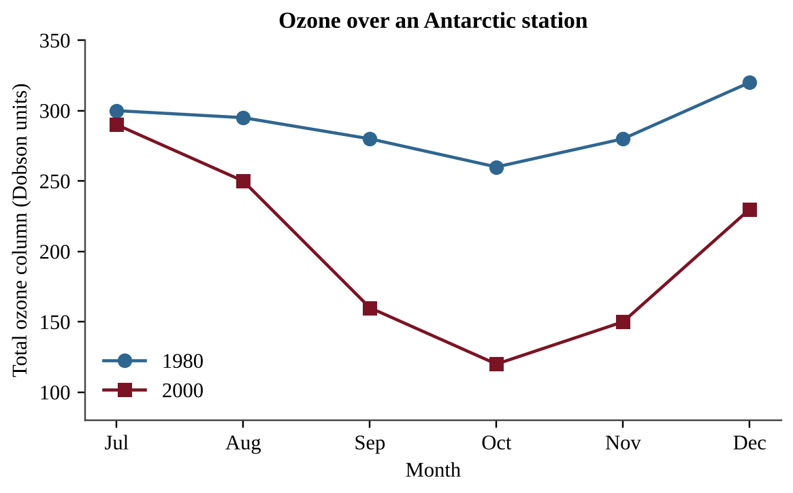

Which explanation best accounts for the sharp drop in ozone between August and October in 2000?
A) Ultraviolet radiation breaks ozone into oxygen on its own, without help from any chemicals in the air.
B) Returning spring sunlight frees chlorine from ice crystals, and the chlorine destroys ozone.
C) Most CFCs are produced in Antarctica and are released into the air in October each year.
D) Winter darkness lets stratospheric ozone leak down into the troposphere over the pole.
:::

:::q QB-U9-MCQ019 | unit=9 | topic=9.1 | diff=2
Which sequence correctly describes how a chlorofluorocarbon (CFC) molecule damages the ozone layer?
A) UV light frees a chlorine atom from the CFC, and it destroys many ozone molecules.
B) The CFC reacts directly with ozone in the troposphere, and rain then removes the products.
C) The CFC absorbs UV radiation and then converts the ozone it meets into carbon dioxide.
D) A chlorine atom is used up as it reacts with a single ozone molecule in the stratosphere.
:::

:::q QB-U9-MCQ020 | unit=9 | topic=9.2 | diff=2
A company replaces the CFC refrigerant in its freezers with a hydrofluorocarbon (HFC). Which statement best evaluates this change?
A) It protects ozone, but many HFCs are potent greenhouse gases that add to climate change.
B) It does not help the ozone layer because HFCs still release large amounts of chlorine.
C) It increases ozone depletion but reduces greenhouse warming.
D) It protects the ozone layer and has no effect on climate because HFCs do not absorb infrared radiation.
:::

:::q QB-U9-MCQ021 | unit=9 | topic=9.3 | diff=2
Over 100 years, the global warming potential (GWP) of methane (CH₄) is 28 and that of nitrous oxide (N₂O) is 265, relative to CO₂ = 1. A wastewater plant emits 200 metric tons of CH₄ and 10 metric tons of N₂O in a year. What is the total emission in metric tons of CO₂ equivalent?
A) 210
B) 2,650
C) 5,600
D) 8,250
:::

:::q QB-U9-MCQ022 | unit=9 | topic=9.3 | diff=2
Water vapor is a greenhouse gas, yet it is not considered a principal driver of human-caused climate change. Which statement best explains why?
A) Its short residence time means its amount follows temperature, not emissions.
B) Its global warming potential is higher than that of CFCs and nitrous oxide.
C) It does not absorb any infrared radiation emitted from the surface.
D) It is present in the atmosphere only in the polar regions where air is cold.
:::

:::q QB-U9-MCQ023 | unit=9 | topic=9.4 | diff=2
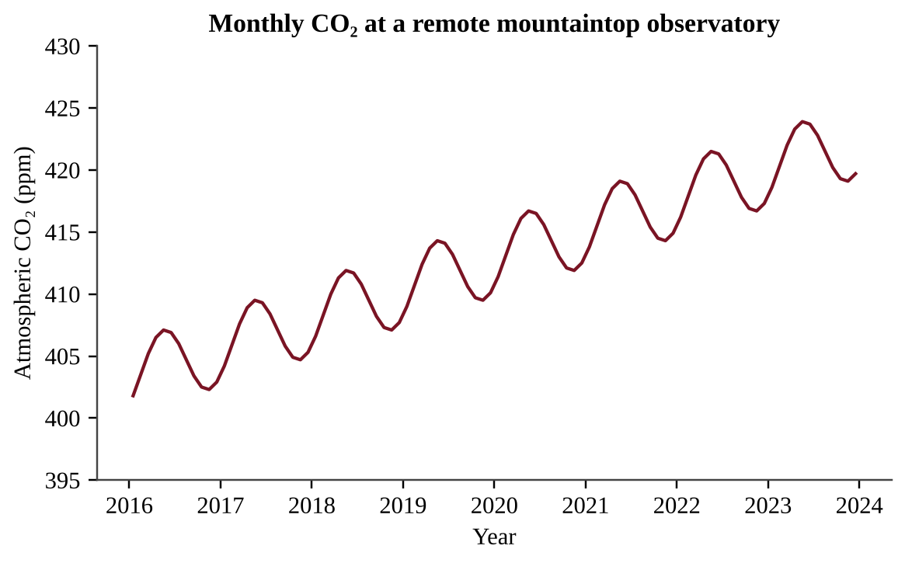

Which process best explains the regular yearly rise and fall superimposed on the long-term upward trend?
A) Northern Hemisphere plants take up CO₂ in summer, and decay returns it in winter.
B) Oceans release all of their CO₂ every spring and absorb it all again every winter.
C) A volcano erupts every autumn and releases a large amount of CO₂ to the air.
D) Fossil fuel burning stops completely at the observatory during the summer months.
:::

:::q QB-U9-MCQ024 | unit=9 | topic=9.4 | diff=2
A low-lying island nation expects sea level to rise by 0.6 m during this century. Which population-level response is most likely?
A) Immigration to the island because rising seas create new shallow fishing areas
B) Higher birth rates because saltwater makes groundwater richer in nutrients
C) Displacement of coastal residents who relocate inland or abroad
D) No change in where people live because the sea rises evenly everywhere
:::

:::q QB-U9-MCQ025 | unit=9 | topic=9.5 | diff=2
Annual mean atmospheric CO₂ was 396 ppm in 2013 and 420 ppm in 2023. If CO₂ continues to rise at the average yearly rate observed between 2013 and 2023, in which year will it reach 444 ppm?
A) 2029
B) 2033
C) 2038
D) 2043
:::

:::q QB-U9-MCQ026 | unit=9 | topic=9.5 | diff=2
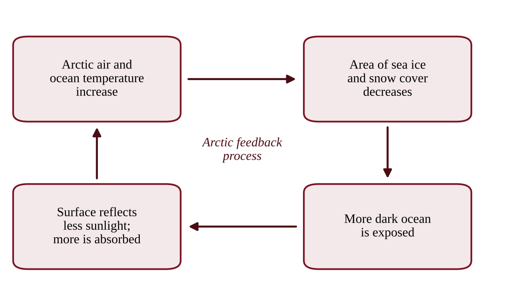

Which statement correctly identifies the type of feedback shown and its effect?
A) It is a negative feedback that reduces the initial warming.
B) It is a negative feedback because loss of ice cools the surface.
C) It is a positive feedback because open ocean reflects more sunlight than ice does.
D) It is a positive feedback that amplifies the initial warming.
:::

:::q QB-U9-MCQ027 | unit=9 | topic=9.5 | diff=2
How does the thawing of Arctic permafrost amplify climate change?
A) Microbes decompose the thawed organic matter and release methane and CO₂.
B) Thawing releases CFCs that were trapped in the frozen soil for thousands of years.
C) Thawed soil reflects more sunlight than frozen soil does, which increases cooling.
D) Thawed ground absorbs large amounts of atmospheric methane and carbon dioxide.
:::

:::q QB-U9-MCQ028 | unit=9 | topic=9.5 | diff=2
Climate models project that a farming region will receive heavier rainstorms separated by longer droughts. Which effect on the region's soil is most likely?
A) Less erosion because dry soil binds together more tightly
B) Increased fertility because extra rain flushes out salts
C) Higher soil organic matter from more frequent flooding
D) Greater erosion and reduced soil viability
:::

:::q QB-U9-MCQ029 | unit=9 | topic=9.5 | diff=2
Rising sea level will affect marine ecosystems in different ways. Which is the most likely positive effect?
A) A coastal freshwater aquifer receives more fresh water as the sea level rises.
B) A coastal salt marsh with a seawall built behind it can migrate farther inland.
C) A seagrass bed near its lower limit of light penetration receives more light from above.
D) Newly flooded low-lying coastal land provides shallow habitat that species can colonize.
:::

:::q QB-U9-MCQ030 | unit=9 | topic=9.6 | diff=2
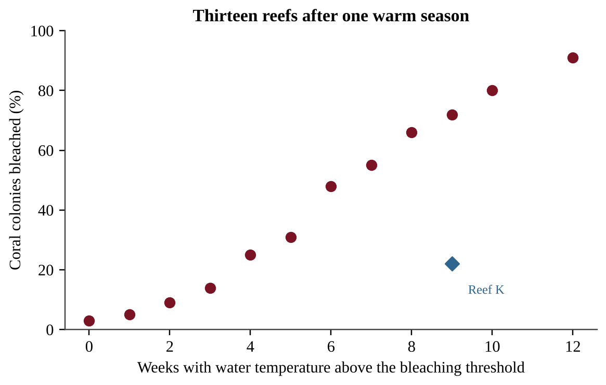

Which statement is best supported by the data?
A) No bleaching occurred at reefs that were above the threshold for fewer than three weeks.
B) Heat stress is the only factor that causes coral bleaching.
C) Reefs with more weeks above the threshold generally had a larger percentage of bleached colonies.
D) Every reef above the threshold for more than four weeks had over 50% of its colonies bleached.
:::

:::q QB-U9-MCQ031 | unit=9 | topic=9.6 | diff=2
Which is a likely effect of ocean warming on a population of cold-water fish?
A) An increase in the dissolved oxygen available to the fish in the water
B) A shift in its range toward the poles or into deeper water
C) A shift in its range toward the equator into warmer water
D) A decrease in metabolic rate, so the fish need less food to survive
:::

:::q QB-U9-MCQ032 | unit=9 | topic=9.7 | diff=2
Which set of reactions represents what happens when atmospheric CO₂ dissolves in seawater?
A) SO₂ + H₂O → H₂SO₃ → H⁺ + HSO₃⁻
B) CO₂ + H₂O → H₂CO₃ → H⁺ + HCO₃⁻
C) CO₂ + H₂O → C₆H₁₂O₆ + O₂
D) CaCO₃ → Ca²⁺ + CO₃²⁻ + H⁺
:::

:::q QB-U9-MCQ033 | unit=9 | topic=9.7 | diff=2
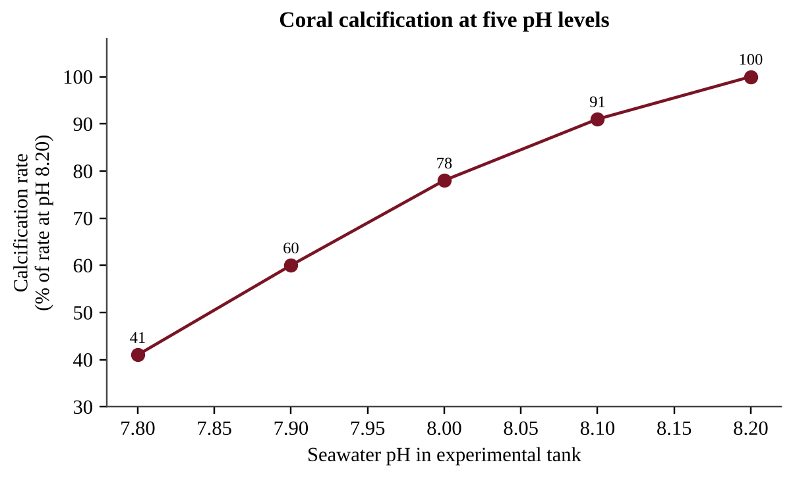

By approximately what percent does the calcification rate decrease, relative to its value at pH 8.10, when the pH drops from 8.10 to 7.90?
A) 2.5%
B) 31%
C) 34%
D) 66%
:::

:::q QB-U9-MCQ034 | unit=9 | topic=9.7 | diff=2
Because pH is a logarithmic scale, a drop in surface ocean pH from 8.2 to 8.0 corresponds to which change in H⁺ concentration?
A) An increase of about 20%
B) An increase of about 60%
C) An increase of about 100%
D) An increase of about 900%
:::

:::q QB-U9-MCQ035 | unit=9 | topic=9.7 | diff=2
Which action would most directly slow the increase in ocean acidification over the long term?
A) Cutting CO₂ emissions from fossil fuel use and deforestation
B) Reducing sulfur dioxide emissions from coal-fired power plants
C) Adding nitrogen fertilizer to coastal waters to boost algal growth
D) Building seawalls along the coast to block storm waves
:::

:::q QB-U9-MCQ036 | unit=9 | topic=9.8 | diff=2
Which combination of traits would most likely help a non-native plant become invasive?
A) Long life span, few offspring, and large parental investment
B) Specialist habitat needs, slow reproduction, and low seed dispersal
C) Generalist habitat needs, rapid reproduction, and high seed dispersal
D) Narrow tolerance of soil conditions and a need for one specific pollinator
:::

:::q QB-U9-MCQ037 | unit=9 | topic=9.8 | diff=2
An invasive vine now covers 40 hectares of a watershed. Its infested area doubles every 3 years. If no control measures are taken, what area will it cover after 12 years?
A) 160 hectares
B) 480 hectares
C) 640 hectares
D) 1,280 hectares
:::

:::q QB-U9-MCQ038 | unit=9 | topic=9.8 | diff=2
Which control strategy for an invasive species has the greatest risk of unintended consequences for native ecosystems?
A) Inspecting and cleaning boat hulls at busy lake launch sites
B) Pulling invasive plants by hand from small patches near a trail or road
C) Replanting native vegetation after an invader has been removed from a site
D) Releasing an untested non-native predator from the invader's home range
:::

:::q QB-U9-MCQ039 | unit=9 | topic=9.8 | diff=2
A county compares three ways to manage an invasive aquatic weed over 10 years. Costs are shown below.

| Option | Cost |
|---|---|
| Eradicate now | $2.0 million one time, plus $0.1 million per year monitoring |
| Contain only | $0.35 million per year |
| No action | $0.6 million per year in damage |

Which option has the lowest total 10-year cost, and what is that cost?
A) Contain only; $3.5 million
B) No action; $6.0 million
C) Eradicate now; $3.0 million
D) Eradicate now; $2.1 million
:::

:::q QB-U9-MCQ040 | unit=9 | topic=9.9 | diff=2
A frog lives only in cloud forest above 2,000 m on one mountain range and eats a single insect species. Which statement best explains why it is at high risk of extinction as the climate warms?
A) Species at high elevation are never affected by competition for resources.
B) Frogs produce so many eggs that they cannot survive in cooler habitats.
C) Warming always increases the number of insects available for frogs to eat.
D) Its narrow habitat and limited diet leave it little ability to adapt or move.
:::

:::q QB-U9-MCQ041 | unit=9 | topic=9.9 | diff=2
Anti-poaching patrols were introduced at a reserve. Records of rhinoceroses poached are shown.

| Year | Patrol days per month | Rhinos poached |
|---|---|---|
| 2019 | 0 | 60 |
| 2021 | 30 | 38 |
| 2023 | 60 | 15 |

What was the percent decrease in rhinos poached between 2019 and 2023?
A) 25%
B) 75%
C) 300%
D) 400%
:::

:::q QB-U9-MCQ042 | unit=9 | topic=9.10 | diff=2
A conservation agency plants a strip of forest connecting two isolated forest reserves. What is the main benefit of this habitat corridor?
A) It increases the total forest area by a large amount, giving each species more room.
B) It allows animals to move between reserves, supporting gene flow and recolonization.
C) It prevents invasive species from entering either of the two reserves.
D) It eliminates edge effects in both of the reserves it connects.
:::

:::q QB-U9-MCQ043 | unit=9 | topic=9.10 | diff=2
Honeybee colonies and dairy cattle are managed for economic returns. How can domestication of an organism affect the biodiversity of that organism?
A) It has no effect on diversity, because managed animals still breed randomly.
B) Large managed populations always increase the species' genetic diversity.
C) Selective breeding for a few high-yield traits can reduce its genetic diversity.
D) It increases the size of the wild populations of the same species.
:::

:::q QB-U9-MCQ044 | unit=9 | topic=9.10 | diff=2
A fishing fleet catches bluefin tuna faster than the population can reproduce. Which HIPPCO category does this represent?
A) Over exploitation
B) Habitat destruction
C) Climate change
D) Pollution
:::

:::q QB-U9-MCQ045 | unit=9 | topic=9.10 | diff=2
An alpine butterfly lives only above 2,800 m on a mountain whose peak is 3,000 m. As average temperatures rise, which outcome is most likely?
A) Its suitable habitat will expand because more of the mountain becomes warm enough for it.
B) Its population will move downslope to settle in the cooler valleys at the base.
C) Its habitat will be unaffected because the mountain itself does not move or change.
D) Its suitable habitat will shift upslope and shrink, raising the risk of local extinction.
:::

:::q QB-U9-MCQ046 | unit=9 | topic=9.1 | diff=3
Researchers hypothesize that thinner stratospheric ozone increases the UV-B reaching the surface. Which dataset would best test this hypothesis?
A) Multi-year measurements of ozone and surface UV-B at the same sites
B) Average summer temperatures recorded at several different latitudes
C) Yearly skin cancer rates recorded in the same region over many years
D) Atmospheric CFC concentrations measured at one monitoring location
:::

:::q QB-U9-MCQ047 | unit=9 | topic=9.2 | diff=3
The table lists three refrigerants.

| Substance | Ozone depletion potential | 100-year GWP |
|---|---|---|
| CFC-12 | 1.0 | 10,200 |
| HCFC-22 | 0.05 | 1,760 |
| HFC-134a | 0 | 1,430 |

A technician releases 4.0 kg of HFC-134a. Which statement is correct?
A) It has no climate effect because its ozone depletion potential is zero.
B) Its warming effect over 100 years equals about 4 kg of CO₂.
C) Its warming effect equals about 41,000 kg of CO₂, because all CFC substitutes share the GWP of CFC-12.
D) Its warming effect over 100 years equals about 5,700 kg of CO₂, and it does not deplete ozone.
:::

:::q QB-U9-MCQ048 | unit=9 | topic=9.3 | diff=3
A landfill flares (burns) 500 metric tons of methane per year that had been venting. Each ton of CH₄ burned produces 2.75 tons of CO₂, and the GWP of CH₄ is 28. What is the net change in CO₂ equivalent emissions, treating the CO₂ as new emissions?
A) A decrease of 14,000 t CO₂e
B) A decrease of 12,625 t CO₂e
C) A decrease of 1,375 t CO₂e
D) An increase of 15,375 t CO₂e
:::

:::q QB-U9-MCQ049 | unit=9 | topic=9.3 | diff=3
Methane has a global warming potential of 28 per metric ton, yet CO₂ is the largest contributor to human-caused warming. Which statement best explains this?
A) Human CO₂ emissions are far larger, and CO₂ persists for centuries.
B) CO₂ has a higher global warming potential per ton than methane does.
C) Methane is produced only by natural processes such as wetlands.
D) Methane does not absorb infrared radiation emitted by the surface.
:::

:::q QB-U9-MCQ050 | unit=9 | topic=9.5 | diff=3
Large amounts of freshwater from melting Greenland ice flow into the North Atlantic. Freshwater is less dense than seawater. Which consequence is most plausible?
A) Freshwater would mix in completely, so ocean circulation would be unchanged.
B) Weaker sinking of dense water would slow the conveyor belt and cool northwestern Europe.
C) Hadley cells would stop moving air, causing the tropics to cool.
D) The conveyor belt would strengthen and make northwestern Europe warmer.
:::

:::q QB-U9-MCQ051 | unit=9 | topic=9.5 | diff=3
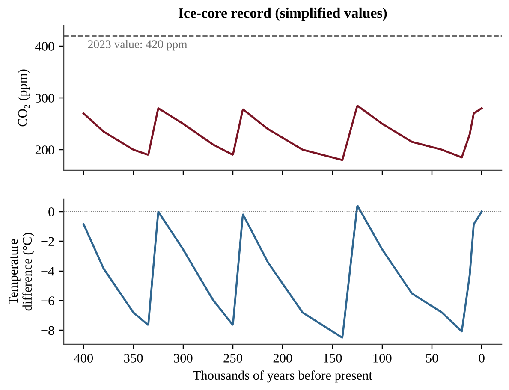

Which conclusion is best supported by the figure?
A) CO₂ and temperature changed independently of each other over time.
B) Higher CO₂ coincided with warmer temperatures, and 2023 CO₂ exceeds all past values.
C) The figure proves that CO₂ was the only cause of every temperature change.
D) CO₂ concentrations were always above 300 ppm during the warm periods.
:::

:::q QB-U9-MCQ052 | unit=9 | topic=9.5 | diff=3
A scientist wants to test whether warming increases CO₂ released from tundra soil. Which design is best?
A) Heat one plot for a single afternoon and compare it with its flux before heating.
B) Measure CO₂ flux once in a warm tropical soil and once in a cold tundra soil.
C) Heat replicate plots, keep unheated control plots, and measure CO₂ flux regularly.
D) Measure CO₂ flux only in unheated plots during several different seasons.
:::

:::q QB-U9-MCQ053 | unit=9 | topic=9.7 | diff=3
Researchers place coral fragments in tanks of seawater at pH 8.1, 7.9, and 7.7 to test the effect of acidification on calcification. Which set of conditions should be kept the same in all tanks?
A) Light intensity and salinity, with temperature allowed to vary with pH level
B) Seawater pH, temperature, and salinity in every tank
C) Temperature, salinity, light intensity, and the source colony of the fragments
D) Calcification rate, light intensity, and water temperature
:::

:::q QB-U9-MCQ054 | unit=9 | topic=9.8 | diff=3
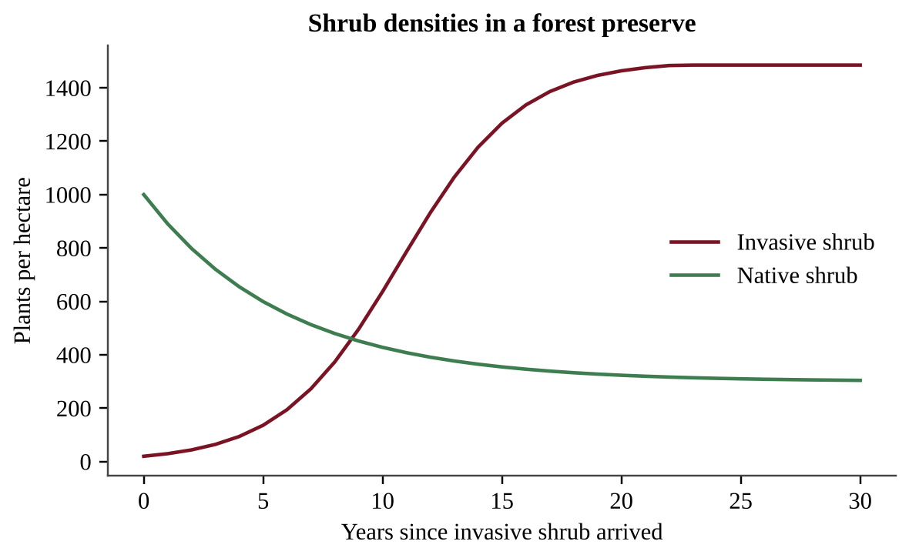

Which conclusion is best supported by the data?
A) The native shrub was completely eliminated from the preserve by the end of the 30 years.
B) The invasive shrub's growth rate stayed the same no matter how dense its own population became.
C) The invasive population kept growing exponentially throughout the entire 30-year period.
D) The invasive shrub leveled off near carrying capacity, and the native shrub stayed below its original density.
:::

:::q QB-U9-MCQ055 | unit=9 | topic=9.9 | diff=3
A herd's births add 9% per year, but poaching removes 15% per year, so the herd shrinks by a net 6% per year. Using the rule of 70, about how many years until the herd is half its size?
A) 3 years
B) 5 years
C) 8 years
D) 12 years
:::

:::q QB-U9-MCQ056 | unit=9 | topic=9.10 | diff=3
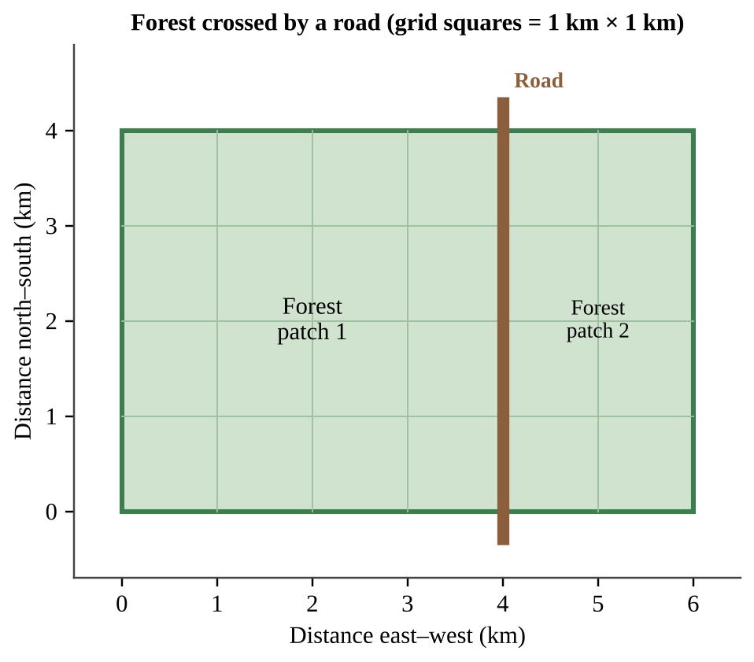

A forest-interior bird needs habitat at least 1 km from any forest edge or road. Ignoring the width of the road, what percentage of the forest's original interior habitat remains after the road is built?
A) 25%
B) 33%
C) 50%
D) 67%
:::

## Section B — Free-Response Questions

:::q QB-U9-FRQ001 | unit=9 | topic=9.7 | diff=2 | frqtype=1 | pts=10
A shellfish hatchery on a coastal bay raises oyster larvae in seawater pumped from the bay. Staff recorded the pH of the intake water and the percentage of larvae surviving to day 14 in batches started each month (figure). Larval survival is lowest in summer, when winds draw cold, CO₂-rich deep water to the surface near the intake pipe.

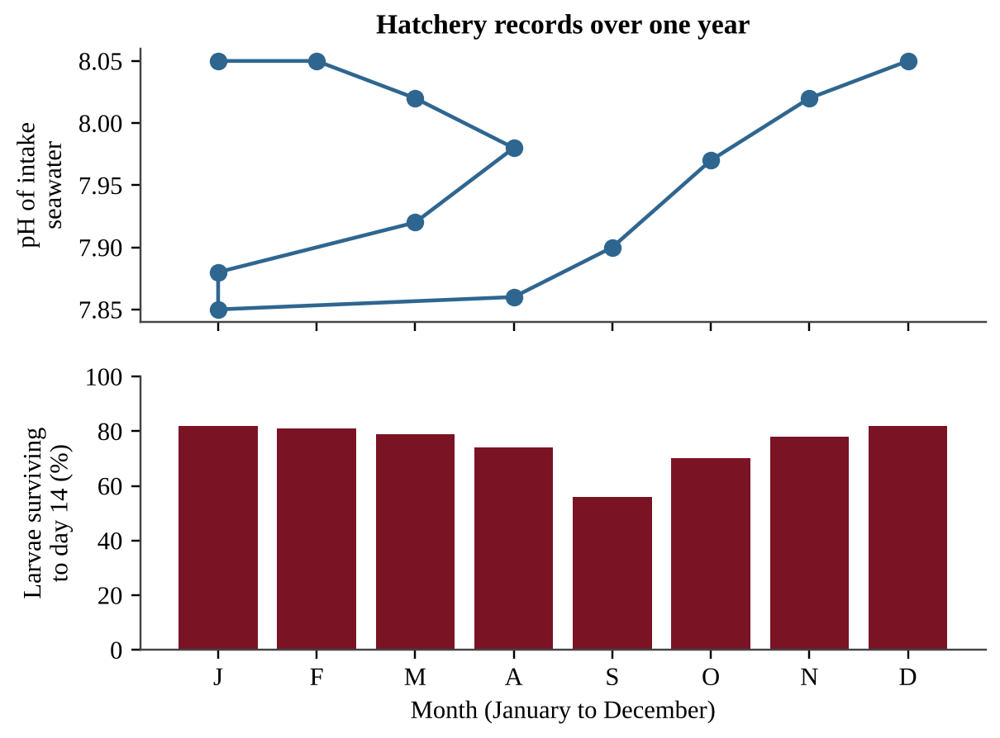{w=0.85}

(a) Describe the seasonal relationship between intake-water pH and larval survival shown in the figure. [1]
(b) Identify the global environmental process most likely responsible for a long-term decrease in the bay's baseline pH, and identify one human activity that contributes to it. [1]
(c) State a testable hypothesis, in if-then form, about the effect of seawater pH on oyster larval survival. [1]
(d) Design an experiment to test your hypothesis using larvae from one group of parent oysters. In your design, identify
  (i) the independent variable and the dependent variable [1]
  (ii) two variables that must be held constant [1]
(e) Describe the procedure, including the levels of the independent variable, how the experiment is replicated, and the control. [2]
(f) Describe the pattern of results that would support your hypothesis. [1]
(g) Propose one action the hatchery could take to protect larvae during low-pH months, and describe one disadvantage or unintended consequence of that action. [2]
:::

:::q QB-U9-FRQ002 | unit=9 | topic=9.8 | diff=2 | frqtype=1 | pts=10
A nature preserve contains a mature deciduous forest crossed by a hiking trail. Rangers have noticed a dense, non-native shrub, introduced decades ago as a garden ornamental, growing mostly near the trail. They suspect that the shrub is reducing the number of native wildflower species on the forest floor. The diagram shows a sketch of the shrub's pattern at three possible sampling plots.

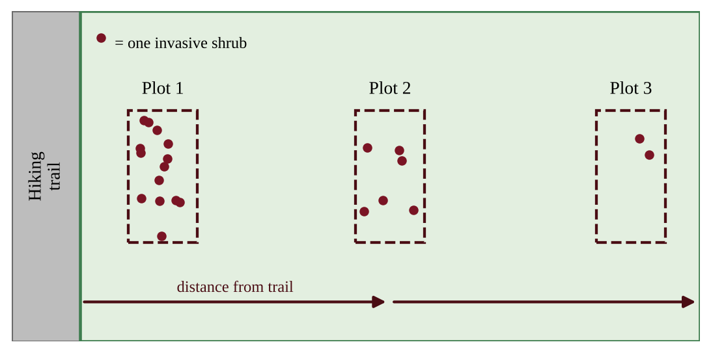{w=0.85}

(a) Identify one characteristic of invasive species that helps them outcompete native species. [1]
(b) State a testable hypothesis, in if-then form, relating distance from the trail, invasive shrub density, and native wildflower richness. [1]
(c) Identify the independent variable and the dependent variable for an investigation of your hypothesis. [1]
(d) Describe how data could be collected, including the number and size of plots and how replication and randomness are achieved. [2]
(e) Identify two variables that should be kept the same or similar when selecting plots. [1]
(f) Describe the pattern of data that would support your hypothesis. [1]
(g) Propose one method for controlling the shrub and describe one disadvantage or unintended consequence of that method. [2]
(h) Explain why the trail is a likely pathway for the introduction and spread of the shrub. [1]
:::

:::q QB-U9-FRQ003 | unit=9 | topic=9.1 | diff=2 | frqtype=2 | pts=10
Scientists monitor stratospheric chlorine, which comes mainly from chlorofluorocarbons (CFCs), and ozone over Antarctica. The table gives data for selected years.

| Year | Stratospheric chlorine (ppb) | Minimum ozone column (Dobson units) | Largest ozone-hole area (million km²) |
|---|---|---|---|
| 1980 | 1.7 | 225 | 3 |
| 1990 | 2.9 | 130 | 22 |
| 2000 | 3.4 | 100 | 29 |
| 2010 | 3.0 | 115 | 24 |
| 2020 | 2.5 | 125 | 21 |

(a) Describe the trend in stratospheric chlorine between 1980 and 2020. [1]
(b) Calculate the percent decrease in stratospheric chlorine from 2000 to 2020. [1]
(c) Calculate the average rate of change in the minimum ozone column from 1980 to 2000. Include units. [2]
(d) Explain how CFCs destroy ozone, and explain why the largest losses of ozone occur over Antarctica in the spring. [2]
(e) Identify one international policy responsible for the decline in chlorine after 2000, and explain why ozone recovery has lagged behind the decline in chlorine. [2]
(f) Make a claim about whether the data support the statement "By 2020 the ozone layer over Antarctica had fully recovered." Justify your claim with data from the table. [1]
(g) Describe one human health effect of an increase in ultraviolet radiation at the surface. [1]
:::

:::q QB-U9-FRQ004 | unit=9 | topic=9.5 | diff=3 | frqtype=2 | pts=10
Polar bears hunt seals from the surface of sea ice. Researchers recorded the minimum Arctic sea ice extent in September, the average summer air temperature anomaly (difference from the 1951–1980 average), and the percentage of polar bear cubs surviving their first year in one study region.

| Year | September sea ice extent (million km²) | Summer air temperature anomaly (°C) | Cubs surviving first year (%) |
|---|---|---|---|
| 2000 | 6.3 | +0.4 | 66 |
| 2005 | 5.6 | +0.8 | 61 |
| 2010 | 4.9 | +1.3 | 52 |
| 2015 | 4.5 | +1.8 | 44 |
| 2020 | 3.9 | +2.2 | 35 |

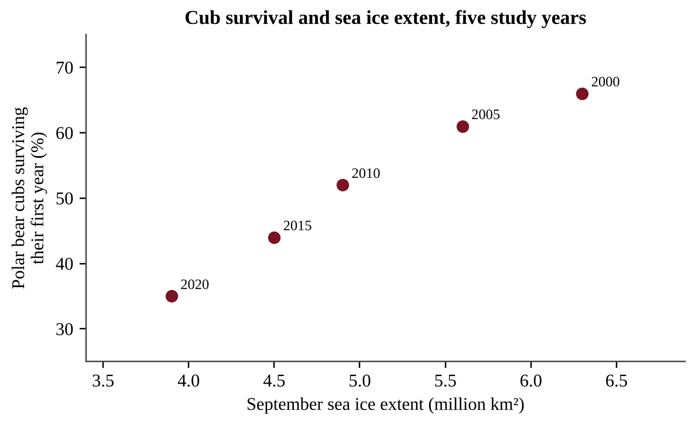{w=0.85}

(a) Describe the trend in September sea ice extent from 2000 to 2020. [1]
(b) Calculate the percent change in sea ice extent from 2000 to 2020. [1]
(c) Calculate the average rate of change in sea ice extent per decade between 2000 and 2020. Include units. [1]
(d) Assuming the rate you calculated in part (c) continues, calculate the year in which September ice extent would reach zero. [1]
(e) Explain one reason why the prediction in part (d) might be inaccurate. [1]
(f) Explain how the ice-albedo feedback helps explain why the Arctic is warming faster than the global average. [2]
(g) Describe the relationship between sea ice extent and cub survival shown in the figure, and explain one ecological reason for it. [2]
(h) Propose one solution that would slow the long-term loss of Arctic sea ice. [1]
:::

:::q QB-U9-FRQ005 | unit=9 | topic=9.3 | diff=3 | frqtype=3 | pts=10
A dairy farm keeps 800 cows. Each cow emits 110 kg of methane (CH₄) per year, and the farm's manure lagoons emit a total of 4,000 kg of nitrous oxide (N₂O) per year. Use 100-year global warming potentials (GWP) of 28 for CH₄ and 265 for N₂O, relative to CO₂ = 1. Of the farm's total methane, 25% comes from manure and 75% from digestion in the cows. 1 metric ton = 1,000 kg.

(a) Calculate the total mass of CH₄ the farm emits per year, in kg. [1]
(b) Calculate the farm's total annual emissions of CH₄ and N₂O combined, in metric tons of CO₂ equivalent (t CO₂e). [2]
(c) Calculate the percentage of the farm's total CO₂e emissions that is due to CH₄. [1]
(d) The farm installs a digester that captures 80% of the methane from manure and burns it. Calculate the annual reduction in emissions, in t CO₂e. Treat the CO₂ released when the methane is burned as having no net climate effect, because it comes from recently grown plants. [2]
(e) Calculate the percent reduction in the farm's total CO₂e emissions achieved by the digester. [1]
(f) A carbon price of $50 per t CO₂e is paid for each ton of reduction. The digester costs $350,000. Calculate the annual payment for the reduction and the number of years to pay back the cost from this payment alone. [2]
(g) Propose one additional change in animal feed or manure management that would reduce the farm's greenhouse gas emissions, and explain how it works. [1]
:::

:::q QB-U9-FRQ006 | unit=9 | topic=9.4 | diff=3 | frqtype=3 | pts=10
A coastal district of 62 km² is protected by a natural shoreline. Planners are comparing two sea-level scenarios from 2025 to 2100 (75 years): a low-emission scenario with a rise of 4.0 mm per year, and a high-emission scenario with a rise of 10.0 mm per year. The table gives the land area that would be flooded at each total rise, and the district's population density is 2,400 people per km², distributed uniformly. 1 m = 1,000 mm.

| Total sea-level rise (m) | Land area below that elevation (km²) |
|---|---|
| 0.30 | 7 |
| 0.75 | 22 |
| 1.50 | 41 |

(a) Calculate the total sea-level rise, in meters, between 2025 and 2100 under each scenario. [2]
(b) Using the table, calculate the number of people living on land that would be flooded under each scenario. [2]
(c) Calculate how many more people would be displaced under the high-emission scenario than under the low-emission scenario. [1]
(d) Explain two processes that cause global sea level to rise as the climate warms. [2]
(e) A seawall to protect the district's shoreline would cost $18 million per km of coastline and 14 km would be needed. Calculate the total cost. [1]
(f) Calculate the cost of the seawall per person in the high-emission scenario. [1]
(g) Propose one solution to the flooding problem other than building the seawall, and justify why it could be effective. [1]
:::
